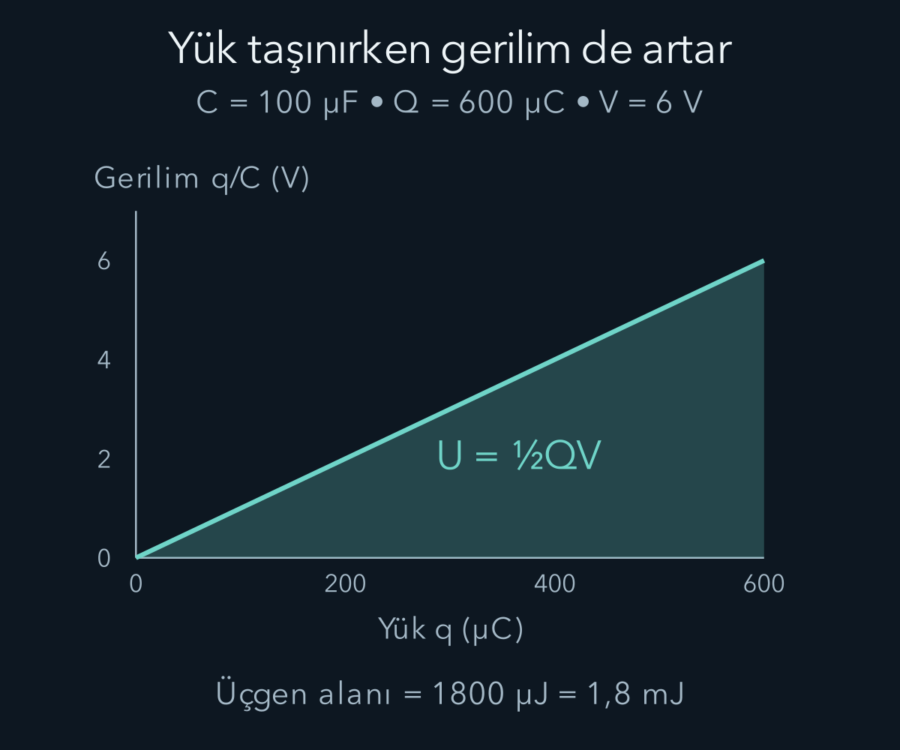
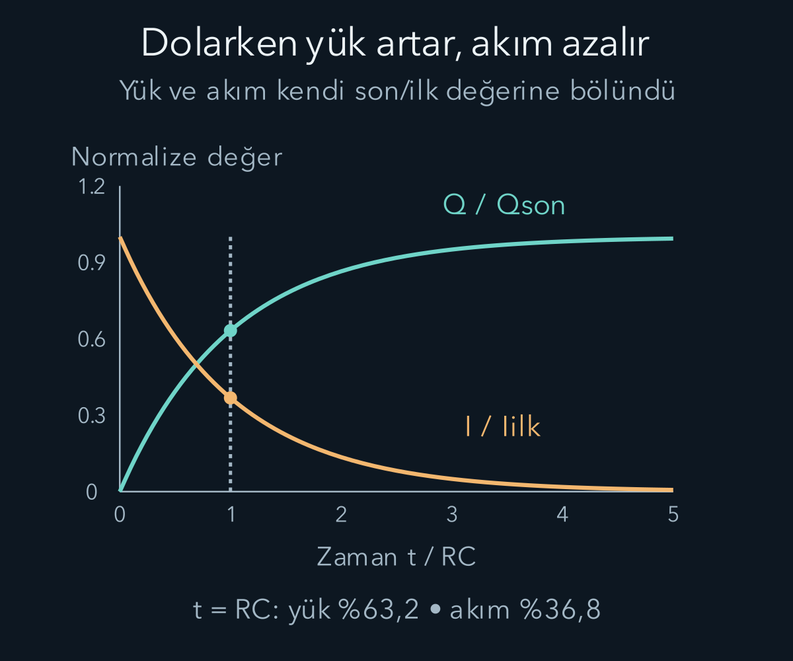

import ArticleVideo from '@/components/ArticleVideo.astro'
import kavram from './media/01-kavram.mp4?url'
import kavramPoster from './media/01-kavram.jpg?url'

İki iletken arasında yük ayırdığımızda bir elektrik alanı ve potansiyel farkı oluşur. İletkenleri başka elemanlarla bağladığımızda yükler hareket eder, alan değişir ve enerji aktarılır. Devre dili bu olayları akım, gerilim, direnç ve kapasite gibi birkaç nicelikle temsil eder. Bu dilin arkasında önceki yazıda kurduğumuz yük korunumu ve elektriksel enerji hesabı vardır.

[Elektrik alanı ve potansiyeli](/blog/elektrik-yuku-alan-ve-potansiyel/) temel alacağız. Basit integrallerle depolanan enerjiyi, [birinci mertebe diferansiyel denklemle](/blog/birinci-derece-diferansiyel-denklemler/) dolma ve boşalma sürecini çıkaracağız. İdeal elemanlar ve kısa bağlantılarla çalışacağız; devre boyutunun, sinyallerin yayılma mesafelerine göre küçük kaldığı yavaş değişen yaklaşımı kullanıyoruz.

## 1. Kondansatör yük ayrımını tutar

Birbirine değmeyen iki iletkenin üzerinde eşit büyüklükte zıt yükler bulunsun: $+Q$ ve $-Q$. Aralarındaki potansiyel farkının büyüklüğünü $V$ ile gösterelim. Sabit geometri ve doğrusal malzeme koşullarında:

$$
Q=CV
$$

ilişkisi vardır. $C$ **kapasitans**, yani kapasite niceliğidir. Birimi farad, $\mathrm F$, coulomb bölü volttur. Değişken olan $C$ harfiyle coulomb birim simgesi $\mathrm C$ farklıdır. Kapasite, her volt başına ne kadar yük ayrımı oluştuğunu anlatır; cihazın her koşulda saklayabileceği en büyük yük değildir.

Bir mikrofarad $10^{-6}$ faraddır. Yüz mikrofaradlık ideal kondansatörde altı voltluk fark varsa yük büyüklüğü $600\,\mathrm{\mu C}$ olur. Bir plakada bu büyüklükte pozitif, diğerinde negatif net yük bulunur. İki plakanın toplamı yine sıfır olabilir. “Kondansatörün yükü” ifadesi genellikle tek plakadaki büyüklüğü kısaltır; iki işaretli yükü toplayıp sıfır diye kullanmayız.

Gerçekte kapasite gerilime, sıcaklığa veya malzemenin davranışına bağlı olabilir. Ayrıca plakalar arasındaki yalıtım sınırsız alan taşıyamaz. Burada sabit kapasiteli ideal elemanı kullanmak, bu ayrıntıları ilgili aralıkta ihmal ettiğimizi söyler. Bir model parametresi ile bir gerçek ürünün çalışma sınırını ayırmak gerekir.

## 2. Kapasiteyi geometriden bulmak

Alanları $A$, aralıkları $d$ olan paralel plakalar arasında vakum olsun. Aralık levha boyutlarına göre küçükken kenar etkilerini ihmal edebiliriz. Önceki alan hesabından $E=Q/(\varepsilon_0A)$ ve potansiyel farkı büyüklüğünden $V=Ed$ bulunur. Bölerek:

$$
C=\frac QV=\frac{\varepsilon_0A}{d}
$$

elde edilir. Alan büyürse kapasite artar; plakalar uzaklaşırsa azalır. Burada $Q$ sadeleşti, çünkü doğrusal modelde yük artışı potansiyel farkını aynı oranda büyütür.

Plakalar arasına doğrusal bir yalıtkan konursa malzemenin kutuplanması alanı değiştirir. Tüm aralığı düzgün dolduran ideal durumda $\varepsilon_0$ yerine $\varepsilon=\kappa\varepsilon_0$ kullanılabilir. $\kappa$ boyutsuz bağıl geçirgenliktir. Kapasite büyüyebilir, fakat yükün veya gerilimin sabit kalması kondansatörün kaynağa bağlı olup olmadığına göre değişir.

Kaynak bağlıysa gerilim sabit tutulabilir ve daha çok yük taşınır. Kaynak ayrılmış, kaçak ihmal edilmişse plakaların yükü sabittir; kapasite değişince gerilim değişir. Aynı geometri işlemi farklı bağlantı koşullarında farklı enerji aktarımı doğurur. Sistem sınırına kaynak ve mekanik olarak hareket eden parçalar da gerektiğinde eklenmelidir.

## 3. Depolanan enerjiyi parça parça hesaplamak

Başlangıçta yüksüz kondansatöre küçük miktarlarda yük taşıyalım. Bir anda plaka yükü $q$ iken potansiyel farkı $q/C$ olur. Küçük $dq$ yükünü taşımak için gereken iş $dW=(q/C)dq$ biçimindedir. Toplam enerji:

$$
U_C=\int_0^Q\frac qC\,dq
=\frac{Q^2}{2C}
=\frac12CV^2
=\frac12QV.
$$

Yarım çarpanı, yük taşınırken gerilimin sıfırdan son değerine büyümesinden gelir. Son gerilimi bütün yük için kullanıp $QV$ yazmak iki kat fazla enerji verir. Bu integral, yay kuvvetinin uzamayla artmasında karşılaştığımız birikim hesabına benzer.

Paralel plakalarda $C=\varepsilon_0A/d$ ve $V=Ed$ koyarsak $U_C=\tfrac12\varepsilon_0E^2Ad$ bulunur. $Ad$ plakalar arasındaki hacimdir. Böylece vakumdaki elektrik alan enerji yoğunluğu $u_E=\tfrac12\varepsilon_0E^2$ olarak yorumlanır. Enerji yoğunluğu joule bölü metre küp birimindedir; ileride elektromanyetik dalgalarda bu ifadeyi yeniden kullanacağız.

## 4. Kondansatörleri bağlamak

Paralel bağlı kondansatörlerin iki uçları aynı iki düğüme bağlanır. Bu nedenle gerilimleri aynıdır. Toplam yük $Q_1+Q_2=(C_1+C_2)V$ olduğundan eşdeğer kapasite $C_{\mathrm{eş}}=C_1+C_2$ olur. Daha fazla plaka alanı eklemeye benzer biçimde aynı gerilimde daha fazla yük ayrımı depolanabilir.

Seri bağlantıda, başlangıçta yüksüz ve aradaki ortak iletkeni dışarıdan yalıtılmış iki ideal kondansatörün yük büyüklükleri eşit olur. Gerilimler toplanır: $V=Q/C_1+Q/C_2$. Böylece $1/C_{\mathrm{eş}}=1/C_1+1/C_2$ bulunur. Ara düğümde başlangıçtan kalma net yük varsa yük eşitliğini düşünmeden kullanamayız; düğümün yük bilançosu gerekir.

İki ve üç mikrofaradlık elemanların paralel eşdeğeri beş mikrofarad, seri eşdeğeri $6/5=1{,}2$ mikrofaraddır. Seri durumda eşdeğerin en küçük elemandan da küçük olması, verilen toplam gerilimin parçalar arasında paylaşılmasıyla uyumludur. Dirençlerde birazdan bunun ters toplama desenini göreceğiz; nedenini ezber değil ortak akım veya ortak gerilim belirler.

## 5. Akım yükün geçiş hızıdır

Bir tel kesitinden seçilen pozitif yönde geçen net yük miktarını $q(t)$ ile gösterelim. **Elektrik akımı** $I=dq/dt$ olur. Birimi amper, $\mathrm A$, coulomb bölü saniyedir. Akım, telin içindeki bütün yükün aynı anda bir uçtan ötekine gitmesi demek değildir; belirli kesitten net geçişi ölçer.

Geleneksel akım yönü pozitif yüklerin hareket yönü olarak tanımlanır. Metalde hareketli taşıyıcılar çoğunlukla negatif elektronlar olduğundan onların ortalama sürüklenme yönü akıma terstir. Bu işaret seçimi devre hesabını tutarlı tutar. Hangi taşıyıcının hareket ettiğini ayrıca bilsek de pozitif akım yönünü keyfî biçimde her elemanda değiştirmeyiz.

Bir telde taşıyıcıların gelişigüzel mikroskobik hareketi büyük olabilirken ortalama sürüklenme hızı küçük kalabilir. Devredeki elektriksel etkinin yayılma süresi, tek bir elektronun bütün tel boyunca gitme süresiyle aynı değildir. Yavaş değişen devre modeli bağlantılardaki alan düzeninin çok hızlı kurulmasını yaklaşık olarak hesaba katar; gerçek sinyal yayılımı sonlu hızdadır.

## 6. Direnç ve Ohm modeli

Belirli koşullarda bir elemanın gerilim farkı ile akımı $V=IR$ ilişkisini sağlar. $R$ dirençtir ve birimi ohm, $\Omega$, volt bölü amperdir. Bu ilişkiye **Ohm yasası** denir; bütün elektrik elemanlarının her koşulda uyması gereken evrensel davranış değildir. Diyot gibi elemanlar veya sıcaklığı belirgin değişen iletkenler doğrusal olmayan ilişki gösterebilir.

Düzgün kesitli tel için uygun malzeme modelinde $R=\rho\ell/A$ yazılır. $\rho$ özdirenç, $\ell$ tel uzunluğu, $A$ kesit alanıdır. Buradaki rho elektriksel özdirenci gösterir; başka bağlamdaki kütle veya yük yoğunluğu değildir. Birimi ohm metredir. Uzun tel daha büyük, geniş kesit daha küçük direnç verir.

Direncin yüksek potansiyelli ucundan giren pozitif akım için elektriksel güç $P=VI=I^2R=V^2/R$ pozitiftir. Enerji dirençte iç enerjiye aktarılır. Yük, dirençten geçerken yok olmaz veya tüketilmez; değişen enerji hesabıdır. Altı volt altında üç kiloohm dirençten iki miliamper akım geçer ve on iki miliwatt güç aktarılır.

Seri dirençlerde akım ortak, gerilimler toplamdır; eşdeğer dirençler toplanır. Paralelde gerilim ortak, akımlar toplanır; eşdeğer direncin tersi ters dirençlerin toplamıdır. Seri iki ve üç kiloohm beş kiloohm; paralel bağlandıklarında bir virgül iki kiloohm olur. Aynı cebir deseninin kondansatörlerde farklı bağlantıya ait olmasının nedeni eleman bağıntılarıdır.

## 7. Kaynak ve Kirchhoff kuralları

Bir pil, kimyasal süreçlerle yük başına enerji sağlayabilir. Bu kaynak etkisine elektromotor kuvvet, kısaca **emk**, deriz ve $\mathcal E$ ile gösteririz. Adında kuvvet olsa da birimi volt, yani enerji bölü yüktür; newton değildir. İdeal kaynakta uç gerilimi bu değere eşittir. İç direnci $r$ olan, akım veren basit pil modelinde uç gerilimi $V=\mathcal E-Ir$ olur.

Bir düğümde yük birikimini ihmal ettiğimiz devre yaklaşımında gelen akımların toplamı gidenlerin toplamına eşittir. Bu Kirchhoff'un düğüm kuralıdır ve yük korunumundan gelir. Düğümde kapasitif yük birikimi önemliyse uygun eleman veya zaman türevi bu hesaba eklenmelidir. Kuralı hiçbir yerde yük tutulamaz diye yorumlamıyoruz.

Kapalı devre yolu boyunca ideal kaynak yükselmeleri ve eleman gerilim düşmeleri tutarlı işaretlerle toplandığında sıfır verir. Bu **çevre kuralı**, devreye bağlanan değişken manyetik akı etkilerinin ihmal edildiği veya indüklenen kaynakların uygun biçimde modele eklendiği yaklaşımda kullanılır. Daha sonra değişken manyetik alanın elektrik alan çizgi integralini nasıl değiştirdiğini göreceğiz.

Akım yönünü başlangıçta tahmin edebiliriz. Çözüm negatif çıkarsa gerçek yön seçimin tersidir; bu tek başına hata değildir. Önemli olan denklemlerde aynı seçimi korumaktır. Bir direnç boyunca akım yönünde ilerlerken gerilim düşüşü, ideal kaynakta eksi uçtan artıya giderken yükseliş yazılır.

### İki kola ayrılan akımı hesaplamak

Altı voltluk ideal kaynağa paralel iki direnç bağlayalım. Birinin direnci iki kiloohm, ötekinin üç kiloohm olsun. Her ikisinin uçları aynı düğümlere bağlı olduğundan üzerlerindeki gerilim altı volttur. İlk koldaki akım üç miliamper, ikinci koldaki akım iki miliamper çıkar. Düğüm kuralı kaynaktan gelen toplam akımın beş miliamper olduğunu söyler.

Eşdeğer dirençle kontrol edersek altı voltun bir virgül iki kiloohma bölümü yine beş miliamperdir. İlk dirençte on sekiz miliwatt, ikinci dirençte on iki miliwatt güç harcanır. Toplam otuz miliwatt, kaynağın altı volt ile beş miliamperin çarpımı olan gücüne eşittir. Böylece akım korunumu ve enerji hesabı aynı devrede birlikte doğrulandı.

Kolların akımlarının farklı olması, yükün bir kolda daha hızlı “tüketildiğini” göstermez. Küçük dirençli yol aynı gerilim altında daha büyük yük geçiş hızına izin verir. Ayrılan akımlar birleşme düğümünde tekrar toplanır. Kaynak da sistem boyunca yük üretip yok etmez; yüklerin enerji durumlarını değiştiren kimyasal süreçlerle dolaşımı sürdürür.

## 8. Direnç üzerinden kondansatörü doldurmak

Başlangıçta yüksüz kondansatörü, sabit $\mathcal E$ kaynağına $R$ direnci üzerinden bağlayalım. Akımın pozitif yönünü pozitif plakaya yük getirecek biçimde seçelim; $I=dQ/dt$ olur. Çevre denklemi:

$$
\mathcal E-IR-\frac QC=0
$$

ve dolayısıyla:

$$
R\frac{dQ}{dt}+\frac QC=\mathcal E
$$

verir. Çözümün nasıl ortaya çıktığını görmek için son yükle aradaki farkı $Z(t)=C\mathcal E-Q(t)$ tanımlayalım. Kaynak ve kapasite sabit olduğundan $\dot Z=-\dot Q$ olur. Devre denklemi $\dot Q=(C\mathcal E-Q)/(RC)=Z/(RC)$ verdiği için $\dot Z=-Z/(RC)$ elde ederiz. Bu, daha önce çözdüğümüz üstel azalma denklemidir. $Q(0)=0$ koşulu $Z(0)=C\mathcal E$ demektir; dolayısıyla $Z=C\mathcal E e^{-t/(RC)}$. Yeniden $Q=C\mathcal E-Z$ yazıp türev alırsak:

$$
Q(t)=C\mathcal E\left(1-e^{-t/(RC)}\right),
\qquad I(t)=\frac{\mathcal E}{R}e^{-t/(RC)}.
$$

Kondansatör doldukça kendi gerilimi artar. Direnç üzerindeki gerilim farkı küçülür ve akım azalır. Son sınırda kondansatör gerilimi kaynakla eşitlenir, ideal doğru akım kesilir. Plakalar arasındaki yalıtkandan iletim akımı geçtiğini varsaymadık; dış devrede yükler bir plakadan alınarak diğerinde biriktirilir.

Çözümü denkleme koyarak kontrol edebiliriz. Direnç düşüşü $\mathcal E e^{-t/(RC)}$, kondansatör düşüşü $\mathcal E(1-e^{-t/(RC)})$ olur; toplamları her an kaynak gerilimidir. Başlangıçta akım en büyük, uzun zamanda sıfıra yaklaşır. Kondansatör gerilimi sonlu akımla ani sıçrama yapmaz, çünkü bunun için sonlu yükü sıfır sürede taşımak gerekirdi.

## 9. Zaman sabitiyle sayısal okumak

$\tau=RC$ çarpımına zaman sabiti denir. Birimi ohm çarpı farad, yani saniyedir. Bir zaman sabiti sonunda yük son değerinin yaklaşık yüzde altmış üçünü, akım başlangıç değerinin yaklaşık yüzde otuz yedisini alır. Beş zaman sabiti sonunda yük yaklaşık yüzde doksan dokuz virgül üçe ulaşır; matematiksel üstel tam son değere sonlu sürede erişmez.

On kiloohm direnç, yüz mikrofarad kondansatör ve altı volt kaynak seçelim. Zaman sabiti bir saniye, son yük altı yüz mikrocoulomb olur. Başlangıç akımı $6/10000=0{,}0006\,\mathrm A$, yani sıfır virgül altı miliamperdir. Bir saniye sonra yük yaklaşık üç yüz yetmiş dokuz mikrocoulomb, akım yaklaşık sıfır virgül iki yüz yirmi bir miliamper olur.

Direnç büyütülürse son yük değişmez, fakat dolma daha uzun sürer ve başlangıç akımı küçülür. Kapasite büyütülürse aynı kaynak geriliminde daha fazla yük depolanır ve zaman sabiti artar. Böylece modelde hız ile son durumun farklı parametre birleşimlerine bağlı olduğunu görürüz.

<ArticleVideo src={kavram} poster={kavramPoster} title="RC devresinde dolma" caption="Başlangıçta boş kondansatörün normalize yükü 1−exp(−t/RC) eğrisini izler. Bir zaman sabitinde son yükün yaklaşık yüzde 63’üne ulaşılır." />

Devrenin durumunu yalnız uzun zaman davranışıyla anlatmak eksik kalabilir. Kondansatör, dolmanın ilk anında çok küçük gerilim taşıdığı için direnç neredeyse bütün kaynak gerilimini görür. Uzun zamanda ise gerilimin neredeyse tamamı kondansatör üzerindedir. Aynı bağlantı, farklı zamanlarda çok farklı akım verir. Bu yüzden “kondansatör doğru akımı geçirmez” ifadesi ideal sabit son durum için bir kısaltmadır; anahtarın kapanmasından sonraki geçici akımı ortadan kaldırmaz.

Gerçek kondansatörde kaçak iletim veya devrede başka paralel yollar varsa uzun zaman akımı tam sıfır olmayabilir. Ölçümde beklenenden farklı bir kuyruk görmek, üstel matematiğin yanlış olduğunu değil modelde ihmal edilen bir yolun önemli olabileceğini gösterebilir. Parametreleri ölçerek belirlemekle ideal formülü kullanmak birbirini tamamlayan iki iştir.

## 10. Boşalma ve enerji bilançosu

Kaynağı çıkarıp yüklü kondansatörü yalnız dirençle kapalı çevreye bağlayalım. Önceki pozitif yük yönünü korursak $R\dot Q+Q/C=0$ olur. Başlangıç yükü $Q_0$ için $Q=Q_0e^{-t/(RC)}$ bulunur. $dQ/dt$ negatiftir; akım yükü azaltacak yöndedir. Gerilim aynı zaman sabitiyle, depolanan enerji ise gerilimin karesi nedeniyle $e^{-2t/(RC)}$ ile azalır.

Dolma örneğinde son depolanan enerji $\tfrac12C\mathcal E^2=1{,}8\,\mathrm{mJ}$ olur. Sabit ideal kaynağın sağladığı toplam enerji $\int\mathcal E I\,dt=\mathcal E Q_{\mathrm{son}}=C\mathcal E^2=3{,}6\,\mathrm{mJ}$ çıkar. Aradaki bir virgül sekiz milijoule dirençte iç enerjiye dönüşür. Kaynağın verdiği enerjinin tamamı kondansatörde kalmaz.

Direnç ısısını doğrudan hesaplamak da aynı sonucu verir: $\int_0^\infty I^2R\,dt=\tfrac12C\mathcal E^2$. Bu ideal modelde toplam kayıp direncin büyüklüğünden bağımsızdır; direnç enerji aktarımının zaman dağılımını değiştirir. Ancak direnci tam sıfır yapmak aynı çözümün sıradan bir sınırı değildir. Bağlantıların endüktansı, yayılma ve diğer etkiler artık ihmal edilemeyebilir.

Dirençteki toplam dönüşümün neden yarım katsayısı verdiğini akımı yerine koyarak açalım. Dirençte iç enerjiye dönüşen miktarı $E_R$ ile gösterirsek:

$$
\begin{aligned}
E_R&=\int_0^\infty I(t)^2R\,dt\\
&=\frac{\mathcal E^2}{R}
\int_0^\infty e^{-2t/(RC)}\,dt\\
&=\frac{\mathcal E^2}{R}\frac{RC}{2}
=\frac12C\mathcal E^2.
\end{aligned}
$$

Üstelin karesini alırken üs iki katına çıktı; integraldeki zaman ölçeği bu yüzden $RC/2$ oldu. Başlangıçtaki $1/R$ ile bu süredeki $R$ sadeleşti. Büyük direnç her anda daha küçük güç oluştururken aktarım daha uzun sürer; toplam enerjinin aynı kalması bu iki etkinin birlikte sonucudur. Bu hesap yalnız başlangıçta boş kondansatörün sabit kaynak ve pozitif direnç üzerinden doldurulmasına aittir; her şarj yönteminin mutlaka enerjinin yarısını kaybettiği sonucu çıkarılamaz.

Yük depolama ile enerji depolama aynı şey değildir; kapasite ve gerilim ilişkiyi belirler. Devrede akım, gerilim ve enerji hesabını tutarlı kurduğumuzda zamanla değişen alanlara hazır hale geliriz. Sonraki yazıda hareketli yüklerin manyetik etkileşimini ve değişen manyetik akının devrede nasıl gerilim oluşturduğunu inceleyeceğiz.

## Kaynaklar

- [OpenStax — Kondansatörler ve kapasite](https://openstax.org/books/university-physics-volume-2/pages/8-1-capacitors-and-capacitance).
- [OpenStax — Kondansatörde depolanan enerji](https://openstax.org/books/university-physics-volume-2/pages/8-3-energy-stored-in-a-capacitor).
- [OpenStax — Ohm yasası](https://openstax.org/books/university-physics-volume-2/pages/9-4-ohms-law).
- [OpenStax — Kirchhoff kuralları](https://openstax.org/books/university-physics-volume-2/pages/10-3-kirchhoffs-rules) ve [RC devreleri](https://openstax.org/books/university-physics-volume-2/pages/10-5-rc-circuits).
