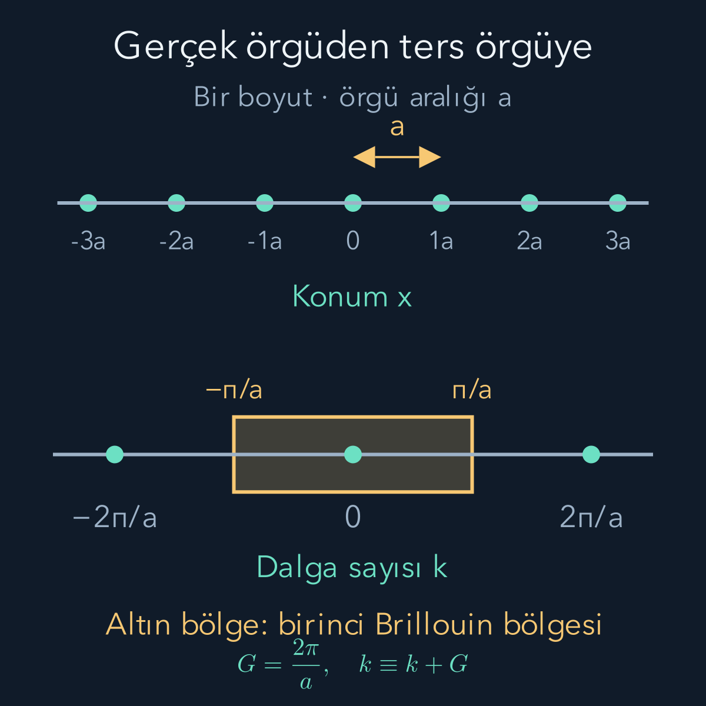
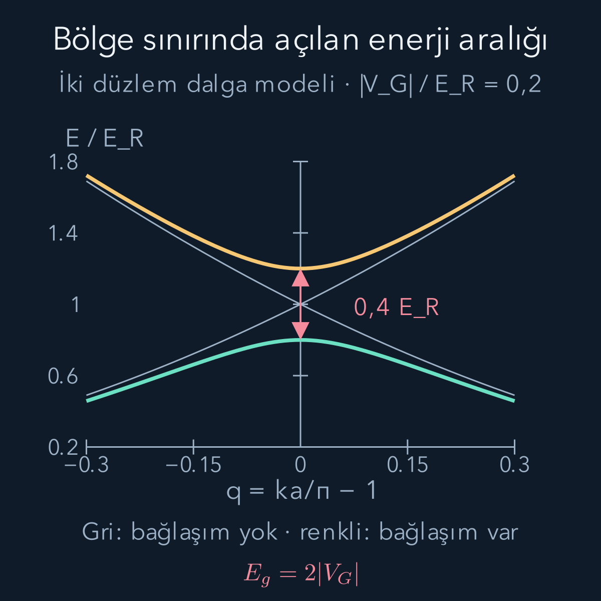

import ArticleVideo from '@/components/ArticleVideo.astro'
import kavram from './media/01-kavram.mp4?url'
import kavramPoster from './media/01-kavram.jpg?url'

Tek bir atomun ayrık enerji düzeyleri vardır. İki atom bir molekül oluşturduğunda atomik orbitaller birleşir ve farklı ortak enerjiler ortaya çıkar. Çok sayıda atom düzenli bir kristal oluşturduğunda ise düzeyler sıklaşarak enerji bantları halinde örgütlenir. Bir katının elektriksel davranışını anlamak için hem bu bantları hem de elektronların onları nasıl doldurduğunu bilmemiz gerekir.

Ön bilgilerimiz [dalgalar](/blog/dalgalar-ve-dalga-denklemi/), [Fourier serileri](/blog/fourier-serileri-ve-dalga-paketleri/), [kuantum simetrisi](/blog/kuantumda-simetri-ve-parite/), [moleküler bağlar](/blog/molekuller-ve-kuantum-baglari/) ve [Fermi–Dirac dağılımı](/blog/bose-einstein-ve-fermi-dirac-dagilimlari/). Burada bir boyutlu, kusursuz periyodik bir ortamda etkin tek elektron Hamiltonyeni kullanacağız. Kristalin bütün elektronlarını ve hareketli çekirdeklerini birlikte tam çözmüş olmayacağız; bu yaklaşımın sınırlarını son bölümde açıkça ayıracağız.

## 1. Kristalin tekrar eden mesafesi

Bir doğru üzerindeki eşdeğer atom konumları $x_j=ja$ olsun. $j$ bir tam sayı, $a>0$ komşu eşdeğer konumlar arasındaki **örgü aralığıdır**. Bir boyutlu bu modelde $a$ uzunluk birimi taşır. Gerçek kristaller üç boyutludur; burada tek doğrultudaki tekrarın matematiğini görmeye çalışıyoruz.

Elektronun gördüğü etkin potansiyel enerjisi $V(x)$ olsun. Kusursuz periyodiklik:

$$
V(x+a)=V(x)
$$

demektir. Potansiyel elektronun yüküyle birlikte tanımlanan enerjidir; yalnız elektriksel potansiyel, yani volt cinsinden bir büyüklük değildir. Hamiltonyen:

$$
H=-\frac{\hbar^2}{2m}\frac{d^2}{dx^2}+V(x)
$$

olur. $m$ elektron kütlesi, $\hbar$ indirgenmiş Planck sabitidir. Sabit duran iyonların ve diğer elektronların ortalama etkisini $V$ içinde temsil edebiliriz. Bu temsil, elektronlar arasındaki bütün korelasyonların çözüldüğü anlamına gelmez.

## 2. Öteleme simetrisi dalgaya ne söyler?

Bir fonksiyonu bir örgü aralığı kaydıran işlemi $(T_a\psi)(x)=\psi(x+a)$ diye tanımlayalım. Potansiyel ve kinetik terim bu kaydırmayla değişmediği için $H$ ile $T_a$ yer değiştirir. Uygun sınır koşullarında enerji özdurumlarını aynı zamanda bu ötelemenin özdurumları olacak şekilde seçebiliriz.

Öteleme normu koruduğundan özdeğeri birim büyüklükte bir fazdır. Bu fazı $e^{ika}$ yazalım:

$$
\psi_k(x+a)=e^{ika}\psi_k(x).
$$

$k$ **dalga sayısıdır**; birimi ters uzunluktur. $ka$ boyutsuz bir faz açısıdır. Bir hücre öteye gidince dalga fonksiyonunun değişmemesi gerekmez; yalnız aynı faz çarpanıyla değişmesi yeterlidir. Mutlak karesinde faz silindiği için bu enerji özdurumunun olasılık yoğunluğu hücreden hücreye aynıdır.

$u_k(x)=e^{-ikx}\psi_k(x)$ tanımlayalım. Bir hücre ötede:

$$
\begin{aligned}
u_k(x+a)
&=e^{-ik(x+a)}\psi_k(x+a)\\
&=e^{-ikx}\psi_k(x)=u_k(x).
\end{aligned}
$$

Dolayısıyla:

$$
\psi_k(x)=e^{ikx}u_k(x),
\qquad u_k(x+a)=u_k(x).
$$

Bu **Bloch biçimidir**: düzlem dalga fazı ile örgü periyoduna sahip bir fonksiyonun çarpımı. Aynı $k$ için farklı enerji çözümleri bulunabileceğinden gerektiğinde bir bant etiketi $b$ de ekler, $E_b(k)$ ve $u_{b,k}$ yazarız. Öteleme temelli bu yapı [MIT'nin Bloch fonksiyonları notlarında](https://ocw.mit.edu/courses/6-730-physics-for-solid-state-applications-spring-2003/2651d17943a473d271bfac9c275671a1_lecture_18d.pdf) incelenir.

Bloch dalgası genellikle momentum özdurumu değildir. Periyodik $u_k$ fonksiyonu birden fazla Fourier bileşeni taşır. Bu nedenle $\hbar k$ **kristal momentumu** diye adlandırılır; serbest parçacıktaki gibi her durumda fiziksel momentumun kesin değeri sayılamaz.

## 3. Ters örgü ve Brillouin bölgesi

$k$'ye $G=2\pi/a$ eklersek bir hücredeki faz değişmez:

$$
e^{i(k+G)a}=e^{ika}e^{i2\pi}=e^{ika}.
$$

$G$ bir ters örgü vektörünün bir boyutlu karşılığıdır; bütün tam sayı katları da ters örgüyü oluşturur. Gerçek örgünün adımları $a$ uzunluğunda, ters örgünün adımları $2\pi/a$ ters uzunluğundadır. İkisi aynı uzayda çizilen iki farklı atom dizisi değildir; biri konumları, diğeri dalganın tekrar fazlarını düzenler.

Aynı fiziksel Bloch fonksiyonunu $k+G$ etiketiyle de yazabiliriz; bu durumda periyodik parçasını $u_{k+G}(x)=e^{-iGx}u_k(x)$ olarak değiştiririz. Yalnız düzlem dalga çarpanına bakıp $e^{ikx}$ ile $e^{i(k+G)x}$'in her noktada aynı olduğunu söylemek yanlış olur. Eşdeğerlik, bütün Bloch gösteriminin yeniden etiketlenmesidir.

Benzersiz etiketler için bir temel aralık seçmek yeterlidir. Bir boyutta alışılmış seçim $-\pi/a\le k<\pi/a$ aralığıdır; buna **birinci Brillouin bölgesi** denir. Sağ ve sol uç aynı öteleme fazına sahip olduğundan uçları iki kez saymayız. Bantların tümünü bu bölge içinde çizmek, diğer bölgelerdeki bilgiyi atmak değildir; gerekli farklı çözümler bant etiketiyle korunur.

Örneğin $a=0{,}50\,\mathrm{nm}=5{,}0\times10^{-10}\,\mathrm m$ ise $G\simeq1{,}257\times10^{10}\,\mathrm{m^{-1}}$ olur. İlk bölgenin sınır büyüklüğü bunun yarısı, $\pi/a\simeq6{,}283\times10^9\,\mathrm{m^{-1}}$'dir. Konumdaki küçük tekrar aralığının dalga sayısı uzayında büyük bir aralığa karşılık geldiğini birimlerden de görebiliriz.

## 4. Çok sayıda orbital tek bir banda nasıl dönüşür?

[Molekül yazısında](/blog/molekuller-ve-kuantum-baglari/) iki atomik orbitalden iki ortak çözüm kurduk. Şimdi $N_c$ hücreden oluşan bir halkada her hücreye bir yerelleşmiş orbital $|j\rangle$ koyalım. $N_c$ hücre sayısıdır. Orbitalleri bu etkin modelde ortonormal kabul ediyor, yalnız en yakın komşular arasındaki geçişi tutuyoruz.

Tek hücre enerji parametresi $\varepsilon_a$, komşu bağlaşımının büyüklüğü $t>0$ olsun. $t$ zaman değildir; enerji birimi taşıyan bir parametredir. Durum $|\psi\rangle=\sum_j c_j|j\rangle$ biçiminde yazıldığında özdeğer denkleminin hücre $j$ bileşeni:

$$
E c_j=\varepsilon_a c_j-t(c_{j-1}+c_{j+1})
$$

olur. Komşu katsayılar elektronun dalgasının komşu orbitallere uzanmasını ifade eder. Bloch fazına uygun $c_j=Ae^{ikja}$ seçelim; $A$ normalizasyon katsayısıdır. Ortonormal $N_c$ orbitalde $|A|=1/\sqrt{N_c}$ olur. Bu seçimle $c_{j\pm1}=c_je^{\pm ika}$ bulunur. Sıfır olmayan $c_j$ ile bölünce:

$$
\begin{aligned}
E(k)&=\varepsilon_a-t(e^{-ika}+e^{ika})\\
&=\varepsilon_a-2t\cos(ka).
\end{aligned}
$$

Enerjiler $\varepsilon_a-2t$ ile $\varepsilon_a+2t$ arasında yer alır; **bant genişliği** $4t$'dir. $t=0{,}50\,\mathrm{eV}$ örneğinde genişlik $2{,}0\,\mathrm{eV}$ olur. Komşu bağlaşımı kapatılırsa bütün orbitaller aynı $\varepsilon_a$ enerjisine döner. Açıldığında farklı hücreler arası faz düzenleri farklı enerji verir.

Bu **sıkı bağ modeli**, atom çevresinde yerelleşmiş orbitallerden başlayan yaklaşık bir modeldir. Tek orbital ve tek bant kurduk; bu hesap tek başına bir sonraki bantla arasında yasak aralık bulunduğunu kanıtlamaz. Bunun için başka orbital/bantları veya daha geniş Hamiltonyeni de incelemeliyiz. Modelin hücre ve durum sayımı [MIT'nin bir boyutlu bant notlarında](https://ocw.mit.edu/courses/6-730-physics-for-solid-state-applications-spring-2003/9c02b9656da9914bf6a4bb9f1b663a05_lecture_12c.pdf) de ele alınır.

## 5. Bir bant kaç elektron alır?

Halka çevresinde $N_ca$ kadar ilerleyince dalga kendine dönsün. Bloch fazı $e^{ikN_ca}=1$ olmalıdır. Böylece $k=2\pi\ell/(N_ca)$, $\ell$ tam sayı olur. Birinci bölgenin genişliği $2\pi/a$, ardışık $k$ değerlerinin aralığı $2\pi/(N_ca)$ olduğundan bir bantta tam $N_c$ farklı uzaysal durum vardır.

Spin etkilerini ayırmayan bu modelde her uzaysal durum için iki elektron spin durumu bulunur. Bant kapasitesi bu yüzden $2N_c$ elektrondur. Hücre başına bir elektron, bu tek bandı yarı doldurur; iki elektron bandı doldurur. Bu sayımda gerçek malzemenin başka atomik orbitallerini, manyetik düzenini veya daha büyük ilkel hücresini görmezden geldiğimizi hatırlamalıyız. Gerçek katılarda hücredeki atom sayısı ve ilgili orbital sayısı önce belirlenir.

Sonlu kristalde hâlâ ayrık $k$ değerleri ve ayrık enerjiler vardır. Makroskopik $N_c$ için aralıklar çok küçük olduğu için eğriyi sürekli çiziyoruz. “Bant” sözcüğü kuantum enerji hesabının ortadan kalkması anlamına gelmez; çok sayıda izinli düzeyin dar aralıklarla sıralanmasını anlatır.

## 6. Serbest dalgalar bölge sınırında karşılaşır

Bant aralığının nasıl açıldığını görmek için farklı, tamamlayıcı bir yaklaşıma geçelim: Elektron önce yaklaşık serbest olsun, periyodik potansiyel zayıf olsun. Sabit potansiyel parçasını enerji sıfırına dahil edip tek Fourier bileşeni seçelim:

$$
V(x)=2V_G\cos(Gx),\qquad G=\frac{2\pi}a.
$$

$V_G$ gerçek bir enerji katsayısıdır. Kosinüsü üstellerle açınca $V_G(e^{iGx}+e^{-iGx})$ elde edilir. Bu terimler bir $e^{ikx}$ dalgasını $e^{i(k+G)x}$ ve $e^{i(k-G)x}$ dalgalarına bağlar. Periyodik potansiyelin dalgaları karıştırma nedeni böyle doğrudan görünür.

Serbest enerji $E^{(0)}(k)=\hbar^2k^2/(2m)$'dir. $k=G/2=\pi/a$ noktasında $k-G=-\pi/a$ olur; iki dalganın serbest enerjisi aynıdır. Buna $E_R=\hbar^2(\pi/a)^2/(2m)$ diyelim. Aynı enerjiye gelen bu iki dalga arasındaki küçük bir bağlaşımı bile ihmal etmek artık uygun değildir.

## 7. İki dalgayı karıştırıp aralığı hesaplamak

Bölge sınırı yakınında yalnız $k$ ve $k-G$ dalgalarını tutalım. Bu iki boyutlu yaklaşımda Hamiltonyen:

$$
H_k=\begin{pmatrix}
E^{(0)}(k)&V_G\\
V_G&E^{(0)}(k-G)
\end{pmatrix}
$$

olur. Diğer dalgalar enerji bakımından yeterince uzak, bağlaşım da onların ayrımına göre küçük olmalıdır. Birinci köşegen elemana $A$, ikinciye $D$ dersek karakteristik denklem $(A-E)(D-E)-V_G^2=0$'dır. Açıp ikinci derece denklemi çözünce:

$$
E_\pm=\frac{A+D}{2}
\pm\sqrt{\left(\frac{A-D}{2}\right)^2+V_G^2}
$$

buluruz. Tam sınırda $A=D=E_R$ olur. İki enerji $E_R-|V_G|$ ve $E_R+|V_G|$'ye ayrılır. Dolayısıyla sınırdaki **bant aralığı**:

$$
E_g=2|V_G|
$$

olur. Serbest eğrilerin kesişmesi bağlaşım açıldığında kaçınılan kesişmeye dönüşür. Bu, yalnız izinli $k$ aralığını yeniden etiketlemekten farklıdır: Potansiyel gerçekten enerji özdeğerlerini değiştirmiştir. Düzlem dalga yaklaşımının daha geniş çerçevesi [MIT'nin yaklaşık serbest elektron notlarında](https://ocw.mit.edu/courses/6-730-physics-for-solid-state-applications-spring-2003/c22b71caa3f94853e45fefcc13e4c0eb_lecture_16c.pdf) verilir.

Şekilde $q=ka/\pi-1$ ve $v=|V_G|/E_R$ kullanıyoruz. Serbest enerjiler $E_R(1+q)^2$ ve $E_R(-1+q)^2$ olduğundan:

$$
\frac{E_\pm}{E_R}
=1+q^2\pm\sqrt{4q^2+v^2}.
$$

$v=0{,}2$ için sınır enerjileri $0{,}8E_R$ ve $1{,}2E_R$, aralık $0{,}4E_R$'dir. Önceki $a=0{,}50\,\mathrm{nm}$ ve elektron kütlesiyle $E_R\simeq1{,}504\,\mathrm{eV}$, $|V_G|\simeq0{,}301\,\mathrm{eV}$, $E_g\simeq0{,}602\,\mathrm{eV}$ bulunur. Bunlar seçtiğimiz iki dalga modelinin sayılarıdır; belirli bir kristalin ölçülmüş bant aralığı değildir.

<ArticleVideo src={kavram} poster={kavramPoster} title="Periyodik potansiyel bant aralığı açıyor" caption="Bölge sınırının yakınında iki düzlem dalga modeli kullanılıyor. |VG|/ER sıfırdan 0,2'ye çıkarken gri serbest dallar iki renkli dala ayrılıyor. Kırmızı çizgi q = 0 noktasında açılan aralığı gösterir; son aralık 0,4 ER'dir. Bu tarama potansiyel gücünü değiştirir, elektronun izlediği yolu göstermez." />

## 8. Aynı enerji ayrımını uzayda görmek

Tam bölge sınırında iki düzlem dalganın toplamı kosinüs, farkı sinüs biçiminde duran dalgalar verir. $V_G>0$ seçtiğimiz kosinüs potansiyelinde bu iki dalganın yoğunluk tepeleri aynı yerde değildir. Kosinüs türü durumun yoğunluğu potansiyelin yüksek bölgelerinde daha fazladır; sinüs türünün yoğunluğu düşük bölgelerde daha fazladır. Böylece potansiyel enerji beklentileri farklı olur.

İki dalganın eşit toplam ve fark vektörleri, yukarıdaki matrisin özvektörleridir. Toplam için enerji $E_R+V_G$, fark için $E_R-V_G$ çıkar. Dalga fonksiyonunun genel fazı enerji değiştirmez; burada önemli olan iki dalganın göreli işaretinin yoğunluk desenini kaydırmasıdır. İki durumun düğüm ve tepe yerleri, periyodik ortamdan farklı enerji katkıları alır. Bant aralığını yalnız cebirdeki karekök olarak değil, bu farklı uzaysal dağılımlar olarak da okuyabiliriz.

## 9. Enerji aralığı ile doluluk birlikte gerekir

Elektronların bir banttaki doluluğu önceki yazıdaki:

$$
f_b(k)=\frac1{e^{[E_b(k)-\mu]/(k_BT)}+1}
$$

bağıntısıyla verilir. Burada $\mu$ toplam elektron sayısını sağlayan kimyasal potansiyeldir. Bir enerji aralığının başka bir yerde var olması, malzemenin mutlaka yalıtkan olduğunu söylemez. Dolu durumların üst sınırında yakın boş durumların bulunup bulunmadığına bakmalıyız.

Bağımsız elektron yaklaşımında kısmen dolu bir bant, elektronların küçük enerji değişimleriyle geçebileceği yakın boş durumlar sağlar; tipik metal durumudur. Farklı bantlar enerji bakımından örtüşürse de dolu ve boş durumlar yakın enerjilerde bulunabilir. Buna karşılık sıfır sıcaklıkta bütün dolu bantlar tamamen doluysa ve sonraki boş durumlarla sonlu bir **toplam enerji aralığı** varsa bant yalıtkanı elde ederiz. Üç boyutta farklı $k$ noktalarındaki bantlar örtüşebileceğinden yalnız tek bir noktada aralık görmek yeterli değildir. Doluluk ve bant örtüşmesinin bu ayrımı [MIT katıhal ders notlarında](https://web.mit.edu/course/6/6.732/www/6.732-pt1.pdf) karşılaştırmalı olarak ele alınır.

Dolu bandın akım vermemesini dalga paketi hızıyla da görebiliriz. Dar bir dalga paketinin grup hızı $d\omega/dk$ idi. $E=\hbar\omega$ ilişkisi bir bant içinde $v_b(k)=\hbar^{-1}dE_b/dk$ verir. Tüm $k$ durumları doluyken büyük kristalde hızların toplamı, bölge boyunca bu türevin integraline karşılık gelir. İntegral bant enerjisinin iki uç değeri arasındaki farktır; periyodiklik nedeniyle sıfır olur. Bu, zayıf alan altında bantlar arası uyarılmayı ihmal eden boyuna taşınım açıklamasıdır. Kısmen dolu bantta doluluklar dengeden kaydırılabilir; tam dolu bantta aynı bant içindeki bütün yerler zaten doludur.

## 10. Yarı iletkenin taşıyıcıları ve modelin sınırı

Yarı iletken ile bant yalıtkanı aynı temel dolu-bant/boş-bant düzenini paylaşabilir. Yarı iletkende sıcaklık, ışık veya kontrollü katkılama ile kullanılabilir miktarda taşıyıcı üretmek mümkün olur. İki ad arasında bütün malzemeler ve sıcaklıklar için geçerli tek bir keskin enerji sınırı yoktur. İletkenliği bant aralığıyla birlikte taşıyıcı yoğunluğu ve hareketliliği belirler.

Dolu alt bandın tepesine değerlik bandı kenarı $E_v$, boş üst bandın tabanına iletim bandı kenarı $E_c$ diyelim; $E_g=E_c-E_v$ olur. Elektron üst banda uyarılınca altta bir boş yer bırakır. Bu eksik elektronun dolu bandın tepkisine katkısını pozitif yüklü bir **delik** olarak betimleyebiliriz. Delik bir pozitron değildir; birçok elektronlu bandın eksik doluluğunun etkili tarifidir.

Basit, simetrik bir örnekte $E_g=1{,}0\,\mathrm{eV}$ ve $\mu$ aralığın ortasında olsun. $300\,\mathrm K$ için $k_BT\simeq0{,}02585\,\mathrm{eV}$ olduğundan iletim bandı kenarında:

$$
\begin{aligned}
f(E_c)&=\frac1{e^{0{,}5/0{,}02585}+1}\\
&\simeq4{,}0\times10^{-9}
\end{aligned}
$$

buluruz. Bu bir tam kuantum durumunun doluluk olasılığıdır; birim hacimdeki taşıyıcı sayısı değildir. Taşıyıcı yoğunluğu için bütün durumları uygun durum yoğunluğuyla toplamak gerekir. Gerçek içsel yarı iletkende kimyasal potansiyel tam ortada olmak zorunda da değildir; elektron ve delik durum yoğunlukları bu konumu etkiler.

Son olarak, periyodik bir tek elektron potansiyeli bütün katı fiziğini tek başına açıklamaz. Güçlü elektron etkileşimleri, tek bandın kısmen dolu olmasına rağmen yalıtkan davranış üretebilir; [Mott yalıtkanı](https://www.damtp.cam.ac.uk/user/tong/aqm/solidstate.pdf) bu sınıra örnektir. Düzensizlik, örgü titreşimleri, spin etkileri ve manyetik düzen de ayrı katkılar getirir. Sıkı bağ ve yaklaşık serbest elektron modelleri iki farklı başlangıç yaklaşımıdır; her malzemede aynı doğrulukla kullanılamazlar. Burada öğrendiğimiz ayrım kalıcıdır: Önce izin verilen enerji durumlarını, sonra elektron sayısını ve doluluğu, ardından dış etkiye verilen yanıtı incelemeliyiz.
