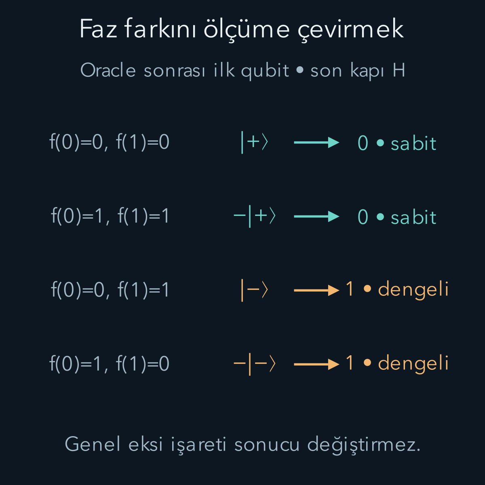
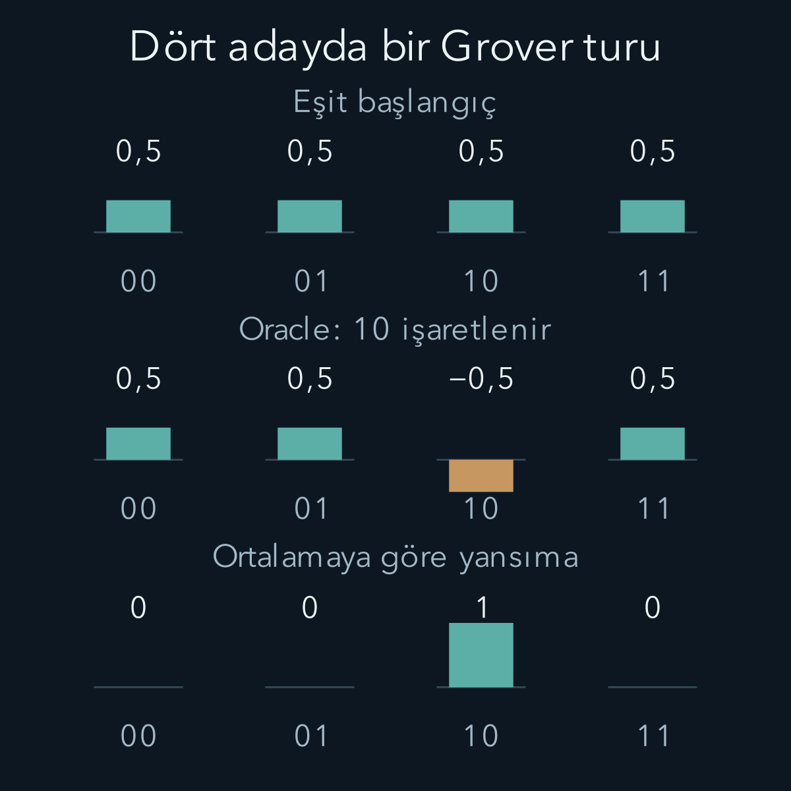

import ArticleVideo from '@/components/ArticleVideo.astro'
import kavram from './media/01-kavram.mp4?url'
import kavramPoster from './media/01-kavram.jpg?url'

Dört adayın eşit süperpozisyonunu hazırlayıp hemen ölçersek dört adaydan birini rastgele görürüz. Aradığımız adayı bulma olasılığı dörtte birdir. Aynı anda dört genlik yazabilmek, dört cevabı aynı anda okuyabilmek anlamına gelmez. Hesabın işe yaraması için kapıları, istenen sonuca giden genlikler birbirini güçlendirecek biçimde düzenlemek gerekir.

Bu yazıda **girişimin hesaplama içindeki rolünü** iki küçük örnekle inceleyeceğiz. Deutsch algoritması bir fonksiyonun iki çıktısının aynı olup olmadığını bulacak. Grover örneği dört adaydan işaretlenmiş olanın olasılığını artıracak. Her ikisinde de kritik adım, önce fazlara yazılan bilginin daha sonra ölçüm olasılıklarına çevrilmesidir.

[Kapılar ve devreler](/blog/kuantum-kapilari-ve-devreler/) yazısından H ve X'i, [ışınlama ve yoğun kodlamadan](/blog/kuantum-isinlama-ve-super-yogun-kodlama/) genel faz ile göreli faz ayrımını kullanacağız. İlk qubiti ketin sol basamağı kabul ediyoruz. Genliklerin toplanmasıyla olasılıkların toplanmasını ayıracağız: Alternatifler birbirinden ölçümle ayrılmamışsa önce genlikler toplanır, olasılık en son mutlak kare alınarak bulunur.

## 1. Oracle sözcüğü hangi varsayımı saklar?

Elimizde bir bit alan, bir bit veren f fonksiyonu olsun. Girdi x, çıktı f(x) ile gösterilsin; her ikisi de 0 veya 1'dir. Fonksiyonun iç yapısını incelemek yerine istediğimiz girdiler için onu çağırabildiğimizi varsayıyoruz. Böyle erişilen işlem kutusuna **oracle**, yani sorgu aygıtı denir. Bu sözcük fizik yasalarının dışında bir bilgi kaynağını anlatmaz; maliyet hesabında neyi bir sorgu saydığımızı belirler.

Kuantum devrede yalnız x'i silip f(x) yazamayız: Sabit fonksiyon iki farklı girdiyi aynı çıktıya gönderir, bu da tersinir değildir. İkinci bir qubit ekleyerek şu dönüşümü kullanırız:

$$
U_f|x\rangle|y\rangle=|x\rangle|y\oplus f(x)\rangle.
$$

$U_f$ fonksiyon sorgusunu uygulayan üniter işleçtir. y yardımcı bit, $\oplus$ ikiye göre toplam veya XOR işaretidir: Aynı iki bitin toplamı 0, farklı iki bitin toplamı 1 olur. x korunur. Aynı oracle ikinci kez uygulanınca $f(x)\oplus f(x)=0$ olduğundan y eski değerine döner. Böylece dönüşümün tersinirliği açıkça görülür.

Süperpozisyonlara etki, temel durumlara tanımlanan bu işlemin doğrusallıkla genişletilmesidir. Fiziksel aygıtın bunu **koherent**, yani göreli fazları koruyarak gerçekleştirebildiğini varsayıyoruz. Klasik bir internet servisine iki istek atmak kendiliğinden böyle bir kuantum oracle üretmez. Gerçek uygulamada fonksiyonu tersinir kapılara dönüştürmek, yardımcı qubitleri hazırlamak ve geçici hesap artıklarını temizlemek de iş gerektirir.

## 2. Hedefteki eksi, girdinin fazına nasıl geçer?

Hadamard ile hazırlanabilen iki durum tanımlayalım:

$$
|+\rangle=\frac{|0\rangle+|1\rangle}{\sqrt2},
\qquad
|-\rangle=\frac{|0\rangle-|1\rangle}{\sqrt2}.
$$

X, sıfır ile biri değiştirdiğinden artı durumunu değiştirmez. Eksi durumu üzerinde ise:

$$
X|-\rangle=\frac{|1\rangle-|0\rangle}{\sqrt2}
=-|-\rangle.
$$

Eksi durumunun X özdeğeri eksi birdir: Kapı aynı durum vektörünü bir işaretle geri verir. Yardımcı qubiti bu durumda hazırlarsak, f(x)=0 iken hiçbir şey yapılmaz; f(x)=1 iken X uygulanıp eksi işaret doğar. İki durumu birleştiren ifade:

$$
U_f|x\rangle|-\rangle=(-1)^{f(x)}|x\rangle|-\rangle.
$$

Yardımcı qubit yine aynı eksi durumundadır. İşaret, tensör çarpımının herhangi bir tarafına yazılabileceği için girdinin genliği üzerinde gösterilebilir. Buna **faz geri tepmesi** denir. Gerçekte bir işaretin uzayda geri yolculuk yaptığını düşünmeyelim; kontrollü işlemin ortak durum üzerindeki cebirsel etkisini adlandırıyoruz.

x sabit bir baz girdisiyse bu eksi yalnız genel fazdır ve tek başına ölçülemez. Ama girişte 0 ve 1 birlikte bulunuyorsa f(0) ile f(1)'in farklı olması iki bileşen arasındaki göreli işareti değiştirir. Hesap için değerli olan bu farktır. Yardımcı qubiti yanlışlıkla artı durumda hazırlasaydık $X|+\rangle=|+\rangle$ olduğundan işaret çıkmaz, bu düzenekte f hakkında gereken bilgi girdiye yazılmazdı.

## 3. Deutsch problemi: hangi soruyu cevaplıyoruz?

İki olasılık sınıfımız var. **Sabit** fonksiyonda f(0)=f(1); ikisi de sıfır veya ikisi de birdir. **Dengeli** fonksiyonda iki çıktı farklıdır; bir tanesi sıfır, öteki birdir. Tek bitlik girdide her deterministik Boolean fonksiyon zaten bu iki sınıftan birindedir. Daha büyük girdilerle kurulan Deutsch–Jozsa probleminde sabit veya dengeli olma ayrıca gerçek bir vaat, yani problem koşuludur. Burada yalnız iki girdili en küçük sürümü ele alıyoruz.

Amaç f(0) ve f(1)'i ayrı ayrı öğrenmek değil, aynı olup olmadıklarına karar vermektir. Klasik, kesin doğru bir çözüm genel durumda iki sorgu gerektirir. Yalnız f(0)=0 bilgisi hem sürekli sıfır fonksiyonuyla hem de f(1)=1 olan dengeli fonksiyonla uyumludur. İkinci değer görülmeden sınıflar ayırt edilemez.

Kuantum devreye $|0\rangle|1\rangle$ ile başlayalım. İki qubite H uygulamak şu çarpım durumunu verir:

$$
(H\otimes H)|01\rangle=|+\rangle|-\rangle.
$$

Tek oracle çağrısından sonra ilk qubit:

$$
|\eta\rangle=
\frac{(-1)^{f(0)}|0\rangle+(-1)^{f(1)}|1\rangle}{\sqrt2}
$$

durumundadır; yardımcı qubit ayrı bir eksi çarpanı olarak kalır. Eta, bu ara durumun adıdır. Henüz ilk qubiti 0/1 bazında ölçsek yine yarı yarıya sonuç alırız; işaretler mutlak karede kaybolur. Bir H daha uygulamamızın nedeni budur.

## 4. Son Hadamard cevabı görünür yapar

Kısalık için $u=(-1)^{f(0)}$ ve $v=(-1)^{f(1)}$ diyelim. Her biri artı veya eksi birdir. H'nin etkisini iki terime ayrı ayrı uygulayınca:

$$
\begin{aligned}
H|\eta\rangle
&=\frac u2(|0\rangle+|1\rangle)\\
&\quad+\frac v2(|0\rangle-|1\rangle)\\
&=\frac{u+v}{2}|0\rangle+\frac{u-v}{2}|1\rangle.
\end{aligned}
$$

Sabit fonksiyonda u=v olur. Bir genliği $(u-v)/2=0$'a iner; sıfır genliği u olur ve mutlak karesi birdir. Dengeli fonksiyonda u=-v olur; sıfır genliği yok olur, bir genliğinin mutlak karesi bire çıkar. İlk qubit ölçümünde 0 sabit, 1 dengeli cevabıdır.

Somut olarak f(0)=1, f(1)=0 seçelim. Oracle sonrası ilk durum $(-|0\rangle+|1\rangle)/\sqrt2=-|-\rangle$ olur. Son H bunu $-|1\rangle$ yapar. Ölçüm kesinlikle 1 verir; baştaki eksi genel fazdır. Ters dengeli fonksiyon +1 genliğiyle aynı ölçümü verir. Algoritma bu iki fonksiyonu birbirinden ayırmaz; sorduğumuz soruya yetecek bilgiyi çıkarır.

Bu tek sorguluk avantaj, ideal kuantum oracle ile kesin sonuç veren klasik sorgu modelinin karşılaştırmasıdır. Devrenin bütün kapılarını veya aygıtın çalışma süresini saymadık. Rastgele tahmin eklemek, klasik yöntemi tek sorguyla bütün izinli fonksiyonlarda kesin doğru yapmaz. Ayrıca bu iki girdili örnek, büyük pratik işlerde başlı başına hız kazancı iddiası değildir; girişimin küresel bir özelliği nasıl ayıklayabildiğini gösterir.

## 5. Grover için dört aday hazırlayalım

Şimdi adaylarımız 00, 01, 10 ve 11 olsun. İki qubit, bu dört etiketi taşımaya yeter. Tam bir adaya işaret koyan f fonksiyonu varsayıyoruz. Hesabı izleyebilmek için işaretli etiketi 10 seçiyoruz:

$$
f(10)=1,\qquad f(00)=f(01)=f(11)=0.
$$

Bir arama uygulamasında bu seçim çözümü baştan biliyoruz anlamına gelmemelidir. Oracle genellikle verilen adayın bir koşulu sağlayıp sağlamadığını denetler; uygun adayı bulmak başka iştir. Burada 10'u açıkça yazmamız, ara genlikleri kâğıt üzerinde hesaplayabilmek içindir.

İki sıfıra Hadamard uygulanınca eşit durum hazırlanır:

$$
\begin{aligned}
|s\rangle&=H^{\otimes2}|00\rangle\\
&=\frac12\bigl(|00\rangle+|01\rangle\\
&\qquad+|10\rangle+|11\rangle\bigr).
\end{aligned}
$$

s eşit başlangıç durumunun adıdır; $H^{\otimes2}=H\otimes H$, her qubite H uygulamak demektir. Her genlik 1/2, her olasılık 1/4'tür. Vektörleri bundan sonra 00, 01, 10, 11 sırasında yazacağız. Başlangıç sütunu $(1/2,1/2,1/2,1/2)^T$ olur; T satır listesini sütun olarak okumamızı belirtir.

Faz oracle'ına $O_f$ diyelim:

$$
O_f|x\rangle=(-1)^{f(x)}|x\rangle.
$$

Faz geri tepmesiyle, eksi durumunda bir yardımcı qubit ve tek $U_f$ çağrısı bu işlemi gerçekleştirebilir. İşaretlemeden sonra genlikler:

$$
O_f|s\rangle=\frac12\begin{pmatrix}1\\1\\-1\\1\end{pmatrix}.
$$

Hedefin **olasılığı hâlâ dörtte birdir**. Eksi genlik, negatif olasılık değildir. Şimdi ölçmek bütün işaretleme emeğini boşa çıkarır; faz bilgisini olasılığa dönüştüren ikinci adıma ihtiyacımız var.

## 6. Ortalamaya göre yansıma nereden gelir?

Grover'ın ikinci işleci:

$$
D=2|s\rangle\langle s|-I
$$

olarak tanımlanır. Burada I dört boyutlu birim matristir; $|s\rangle\langle s|$ ise bir vektörün s yönündeki bileşenini seçen projektördür. D, s yönündeki bileşeni korur, ona dik bileşenlerin işaretini değiştirir. Böylece bir yansıma olur; normu koruması keyfî bir olasılık büyütme işlemi yapmadığımızı gösterir.

Genel bir dört bileşenli durumun genliklerine $a_0,a_1,a_2,a_3$ diyelim. Ortalama genlik $\bar a=(a_0+a_1+a_2+a_3)/4$ olsun. Eşit durumla iç çarpım:

$$
\langle s|a\rangle=\frac{a_0+a_1+a_2+a_3}{2}=2\bar a.
$$

Bunu D ifadesine koyunca $2|s\rangle\langle s|a\rangle$ vektörünün her bileşeni $2\bar a$ olur. I ile eski vektörü çıkardığımızdan her yeni genlik:

$$
\boxed{a'_j=2\bar a-a_j}
$$

şeklindedir. j, 0'dan 3'e bileşen etiketidir. Burada ortalamaya alınan şey olasılıklar değil, işaretli genliklerdir. Bu örnekte hepsi gerçek sayıdır; aynı cebir karmaşık genliklere de uygulanır, fakat sıradan sayı doğrusu üzerindeki yansıma resmi o zaman tek başına yeterli olmaz.

İşaretleme sonrası ortalama:

$$
\bar a=\frac{1/2+1/2-1/2+1/2}{4}=\frac14.
$$

İşaretsiz üç genlik için $2(1/4)-1/2=0$ çıkar. Hedef için $2(1/4)-(-1/2)=1$ çıkar. Böylece:

$$
DO_f|s\rangle=\begin{pmatrix}0\\0\\1\\0\end{pmatrix}=|10\rangle.
$$

Norm denetimi de basittir: Başlangıçta dört çarpı 1/4 birdir; sonda tek çarpı 1 birdir. Olasılık yaratılmadı. Üniter dönüşüm, genlikleri girişimle yeniden dağıttı. İdeal ölçüm artık 10'u kesin olarak verir.

## 7. Yansıma da bir devredir

D'nin içinde aranan etiket bulunmaz; yalnız bilinen eşit başlangıç durumu vardır. Bu yüzden D, aramayı gizlice çözmüş bir alt yordam değildir. $R_0=2|00\rangle\langle00|-I$ tanımlarsak:

$$
D=(H\otimes H)R_0(H\otimes H).
$$

$R_0$, 00'ın işaretini koruyup diğer üç etiketin işaretini çevirir. Böyle kontrollü faz işlemleri temel kapılara ayrılabilir. Bazı devre gösterimleri bunun bütününe eksi ekleyen bir sürüm kullanır; yalnız genel faz değiştiği için ölçüm sonucu aynı kalır. Ancak bir bileşenin göreli eksi işaretini yanlış seçmek gerçek devreyi değiştirir.

Bilinen kapılara somut bir köprü kuralım. Kontrollü Z kapısı, yalnız 11 bileşeninin işaretini çevirir. Kısa adı CZ ve matris gösterimi şöyledir:

$$
\mathrm{CZ}=\operatorname{diag}(1,1,1,-1).
$$

“diag”, yazılan sayıların köşegene yerleştirildiğini, diğer elemanların sıfır olduğunu söyler. H ile X'in bazını değiştirmek Z verdiğinden, hedef qubitin iki yanına H koyarak:

$$
\mathrm{CZ}=(I\otimes H)\mathrm{CNOT}(I\otimes H)
$$

elde ederiz. İki qubite X uygulamak 00 ile 11 etiketlerini değiştirir. Dolayısıyla yalnız 00'ın işaretini çeviren işlemin genel eksisi:

$$
R_0=-(X\otimes X)\mathrm{CZ}(X\otimes X)
$$

olur. Devrede bu genel eksi uygulanmasa da ölçüm istatistikleri değişmez. Böylece D için gereken yansımayı önceki yazıdaki X, H ve CNOT kapılarıyla kurmuş olduk.

Küçük boyutta matrisi açık yazmak da denetim sağlar:

$$
D=\frac12\begin{pmatrix}
-1&1&1&1\\1&-1&1&1\\1&1&-1&1\\1&1&1&-1
\end{pmatrix}.
$$

Her satırın karesi toplamı birdir, iki farklı satırın iç çarpımı sıfırdır. Böylece D'nin üniter olduğu doğrudan kontrol edilebilir. Yukarıdaki işaretli vektörü bu matrisle çarpmak aynı sonuca ulaşır. Ortalama hesabı, bu matris çarpımının daha kolay okunabilen biçimidir.

<ArticleVideo src={kavram} poster={kavramPoster} title="Grover aramasında işaretten olasılığa" caption="Dört adayın gerçek genlikleri gösteriliyor. Oracle yalnız 10 genliğini eksiye çevirir; ortalama 1/4 olur. D yansıması her genliği 2×ortalama−eski kuralıyla değiştirerek ideal devrede hedefin olasılığını bire taşır. Ara kareler ayrık hesap adımlarının görsel geçişidir; fiziksel üniter zaman evrimi olarak okunmamalıdır." />

## 8. Daha fazla tur her zaman daha iyi değildir

İlk turun sonunda 10 durumuna tam ulaştık. Bir tur daha uygulayalım: Oracle hedefin tek genliğini eksi bir yapar. Ortalama artık eksi 1/4'tür. D sonrası hedef genliği $-1/2-(-1)=1/2$, diğer üç genlik eksi 1/2 olur. Hedef olasılığı yeniden dörtte bire düşer. Grover adımı monoton bir başarı artırıcı değildir; doğru yerde durmamız gerekir.

N aday ve tek hedef için iki boyutlu bir geometrik açıklama kullanılabilir. Hedef doğrultusu ile bütün hedef dışı adayların eşit birleşimi bir düzlem oluşturur. $\sin\theta=1/\sqrt N$ olacak biçimde theta açısını tanımlarsak r tam tur sonrasında hedef olasılığı:

$$
P_r=\sin^2((2r+1)\theta)
$$

olur. r sıfır veya pozitif tam sayıdır. Dört adayda theta π/6'dır; r=1 için açı π/2, olasılık birdir. r=2 için açı 5π/6, olasılık dörtte birdir. Buradaki açı uzaydaki qubitin fiziksel dönme açısı değil, durum uzayındaki iki bileşenin geometrisidir.

Büyük N'de ilk tepeye yaklaşık $\pi\sqrt N/4$ turda ulaşılır. Yakın tam sayı seçilir; genel N için sonuç tam bir olmak zorunda değildir. Birden fazla hedef varsa başlangıçtaki hedef ağırlığı ve uygun tur sayısı değişir. Hedef sayısı bilinmiyorsa bu bilgiyi ele alan ek yöntemler gerekir; tek hedef formülünü körlemesine kullanamayız.

## 9. Sorgu kazancı ile toplam çalışma süresini ayırmak

Yapısız, tek hedefli aramada klasik sorgu sayısı N ile, kuantum sorgu sayısı yaklaşık karekök N ile büyür. Bu **karesel** bir avantajdır; üstel hızlanma değildir. Dört aday için “klasik kesinlikle dört kez bakar” demek bile fazla kabadır: Tam bir hedef olduğu biliniyorsa üç olumsuz sorgudan sonra son aday çıkarımla belirlenir. Büyük ölçekte bu ayrıntı doğrusal büyümeyi değiştirmez.

Bir oracle çağrısı pahalı bir tersinir hesap içeriyorsa bütün Grover turları bu bedeli öder. Veri yükleme, kapı sayısı, yardımcı qubitler, hata düzeltme ve sonucun kontrolü toplam süreye eklenir. Küçük bir klasik listede kuantum aygıtını hazırlama masrafı kazancı aşabilir. Sorgu modelinin teoremi, her veritabanında pratik hızlanma garanti etmez.

İki örneğin ortak yapısı artık görülebilir: Cevabın bir özelliğini göreli faza yazdık, sonra bu fazları girişimle ölçülebilir bir farka çevirdik. Ara ölçüm veya çevreyle istenmeyen etkileşim bu düzeni bozabilir. Bir sonraki yazıda kuantum bilgisini hata düzeltmeyle koruma fikrine bu ihtiyaçtan hareketle geçeceğiz.

## Kaynaklar

Oracle ve faz geri tepmesi tanımları [IBM Quantum Learning — Deutsch's algorithm](https://quantum.cloud.ibm.com/learning/en/courses/fundamentals-of-quantum-algorithms/quantum-query-algorithms/deutsch-algorithm) ile; Grover adımının devre yapısı [IBM Quantum Learning — Description of Grover's algorithm](https://quantum.cloud.ibm.com/learning/en/courses/fundamentals-of-quantum-algorithms/grover-algorithm/grover-algorithm-description) ile doğrulandı. Sorgu modeli, arama geometrisi ve sınırlar için [John Preskill — Quantum Algorithms, §§6.1, 6.6–6.7](https://www.preskill.caltech.edu/ph219/chap6_20_6A_2022.pdf) kontrol edildi. Dört aday hesabı, ara genlikler, ikinci tur örneği ve görseller bağımsız hazırlanmıştır.

Kaynak erişimi ve formül kontrolü: **13 Ekim 2026**.
