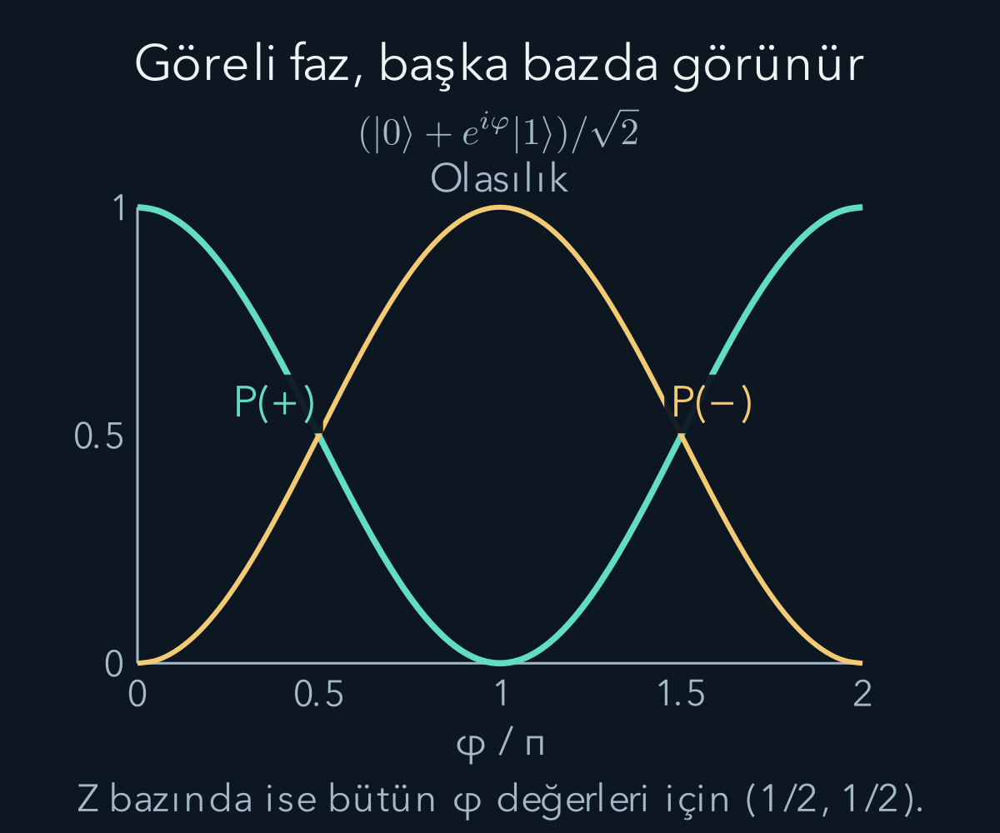
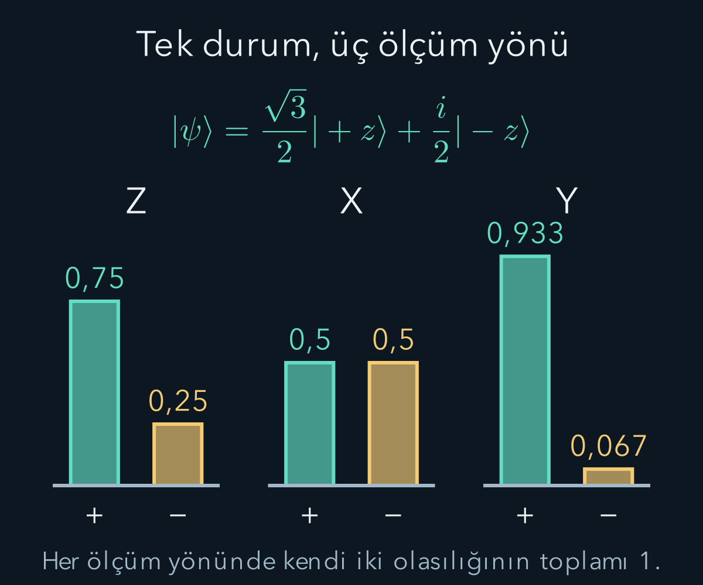

import ArticleVideo from '@/components/ArticleVideo.astro'
import kavram from './media/01-kavram.mp4?url'
import kavramPoster from './media/01-kavram.jpg?url'

[Stern–Gerlach deneyinde](/blog/stern-gerlach-deneyi-ve-spin/) aynı hazırlığın farklı yönlerde farklı sonuç dağılımları verdiğini gördük. Şimdi bu bilgileri tek bir matematiksel nesnede toplayacağız. İki sonuçlu bir kuantum sisteminin saf durumunu, iki karmaşık sayıdan oluşan bir vektörle temsil edebiliriz. Bu vektörün görevi parçacığın uzaydaki yerini gösteren bir ok çizmek değil, seçilen ölçümün sonuç olasılıklarını hesaplamaktır.

[Karmaşık iç çarpım](/blog/karmasik-vektorler-hermit-ve-uniter-matrisler/) ve [olasılık](/blog/olasilik-sayma-ve-kosullu-bilgi/) ön bilgilerimizdir. $i^2=-1$, karmaşık eşlenik ve norm kavramlarını kullanacağız. Bu yazı sonlu boyutlu saf durumlarla sınırlıdır. Hazırlamadaki klasik karışımları ve sürekli konum değişkenini daha sonra ayrıca kuracağız; iki sayı içeren sütunu bütün kuantum sistemlerine koşulsuz uygulamayacağız.

## 1. İki sonuçtan iki baz vektörüne

Seçtiğimiz $z$ ölçümünün kesin artı sonucunu veren hazırlığı $|+z\rangle$, kesin eksi sonucunu veren hazırlığı $|-z\rangle$ ile gösterelim. Bu yazım **ket** diye okunur. Açılı ayraçların içindeki işaret, vektörün adıdır. Başlangıç bazımızı sütunlarla:

$$
|+z\rangle=\begin{pmatrix}1\\0\end{pmatrix},\qquad
|-z\rangle=\begin{pmatrix}0\\1\end{pmatrix}
$$

olarak seçelim. Şekil ve videolarda kullanılan kısa adlar $|0\rangle=|+z\rangle$ ve $|1\rangle=|-z\rangle$ demektir; bunlar yeni durumlar değildir. Genel saf durum temsilcisi:

$$
|\psi\rangle=\alpha|+z\rangle+\beta|-z\rangle
=\begin{pmatrix}\alpha\\\beta\end{pmatrix}
$$

olur. $\psi$ durumun adı; $\alpha$ ve $\beta$ karmaşık **olasılık genlikleridir**. Genlik, doğrudan olasılık değildir. Negatif veya sanal bileşen içerebilir; olasılık ise gerçek ve negatif olmayan bir sayıdır.

İki baz vektörünün birbirine dik olması, zıt iki fiziksel uzay oku olmaları anlamına gelmez. Buradaki diklik karmaşık durum uzayındaki iç çarpıma aittir. Fiziksel $+z$ ve $-z$ eksen yönleri birbirinin tersidir; bunlarla adlandırılan durum vektörleri ise iç çarpım bakımından diktir. Aynı sözcüğü iki ayrı uzayda aynı geometri sanmamalıyız.

## 2. Ketin eşleniği ve bra

Bir sütun vektörünün karmaşık eşlenik devriğini alarak **bra** elde ederiz. $|\psi\rangle=(\alpha,\beta)^T$ için $\langle\psi|=(\alpha^*,\beta^*)$ olur. Yıldız karmaşık eşleniği, $T$ sıradan devriği gösterir. Bir bra ile bir ketin çarpımı skaler iç çarpımdır:

$$
\langle\phi|\psi\rangle
=\phi_1^*\alpha+\phi_2^*\beta.
$$

İlk vektörün bileşenleri eşlenir; ikincininki eşlenmez. Bu sıra, özellikle $i$ içeren örneklerde sonucu değiştirir. Örneğin $|\psi\rangle=(1,i)^T/\sqrt2$ için bra $(1,-i)/\sqrt2$ olur. Norm karesi $[1+(-i)i]/2=(1+1)/2=1$'dir. Eşleniği unutursak yanlışlıkla $(1+i^2)/2=0$ buluruz.

Baz vektörlerimiz için $\langle+z|+z\rangle=\langle-z|-z\rangle=1$ ve $\langle+z|-z\rangle=0$ olur. Hem birim normlu hem dik olan bu tür bir baza **ortonormal baz** denir. Sonlu boyutta bu iç çarpım yapısı olan karmaşık uzay, burada kullandığımız Hilbert uzayı örneğidir. Sonsuz boyuttaki tamamlık inceliklerine henüz ihtiyacımız yoktur.

## 3. Normalleştirme neyi sağlar?

Fiziksel durum temsilcisini $\langle\psi|\psi\rangle=1$ olacak biçimde seçeriz. İki bileşenli gösterimde bu koşul $|\alpha|^2+|\beta|^2=1$ olur. Karmaşık $z=a+ib$ sayısında $|z|^2=z^*z=a^2+b^2$'dir. Bu yüzden norm karesi her zaman gerçek ve negatif olmayan bir sayıdır.

Örneğin başlangıçta yalnız yönü belli olan $(2,i)^T$ sütunu verilsin. Norm karesi $4+1=5$, norm $\sqrt5$ olur. Her bileşeni aynı $\sqrt5$ sayısına bölerek normalleştiririz:

$$
|\psi\rangle=\frac1{\sqrt5}\begin{pmatrix}2\\i\end{pmatrix}.
$$

Bileşenleri ayrı ayrı birim yapmak durumu değiştirir; normalleştirme bütün vektöre tek ortak çarpan uygulamaktır. Sıfır vektörünün normu sıfırdır ve normalleştirilemez. Bu yüzden sıfır vektörü fiziksel saf durum temsilcisi değildir. Bir genliğin sıfır olması mümkünken bütün genliklerin sıfır olması mümkün değildir.

## 4. Born kuralı: genlikten olasılığa

İdeal ortonormal baz ölçümünde $|u\rangle$ sonucunun olasılığı:

$$
\boxed{P(u)=|\langle u|\psi\rangle|^2}
$$

olarak verilir. Bu **Born kuralıdır**. İç çarpım, hazırlanan durumun ölçüm sonucuna geçiş genliğini; mutlak değer karesi ise olasılığını verir. Bu kuralı sıradan olasılık hesabından ispatlamış değiliz. Kuantum kuramının deneylerle sınanan bağlantı ilkelerinden biri olarak kabul ediyoruz.

Başlangıç bazında $\langle+z|\psi\rangle=\alpha$ ve $\langle-z|\psi\rangle=\beta$ olduğu için olasılıklar $|\alpha|^2$ ve $|\beta|^2$ olur. Yukarıdaki normalleştirilmiş $(2,i)$ örneği için $P(+z)=4/5$ ve $P(-z)=1/5$ çıkar. Toplamın bir olması, olası iki sonucun bütün seçenekleri kapsamasına karşılık gelir.

Bu dağılım, her beş ardışık ölçümde kesin olarak dört artı ve bir eksi çıkacağı anlamına gelmez. Aynı durumun bağımsız hazırlıklarında uzun vadeli oranlar bu olasılıklara yaklaşır. Tek bir ölçüm belirli bir sonuç verir; durumun bütün iki bileşenini tek seferde ekran üzerinde okuyamayız.

## 5. Başka bir bazda aynı durumu ölçmek

$x$ doğrultusundaki kesin spin sonuçlarını başlangıç bazında şu vektörlerle temsil edelim:

$$
|+x\rangle=\frac1{\sqrt2}\begin{pmatrix}1\\1\end{pmatrix},
\qquad|-x\rangle=\frac1{\sqrt2}\begin{pmatrix}1\\-1\end{pmatrix}.
$$

Normları birdir; iç çarpımları $(1-1)/2=0$ olur. İki bağımsız vektör oldukları için aynı iki boyutlu uzayın başka ortonormal bazını oluştururlar. Baz değiştirmek tek başına sistemi fiziksel olarak değiştirmek değildir; aynı durumu başka koordinatlarla yazabiliriz. Ölçüm aygıtını $x$ yönüne ayarlamak ise hangi baz olasılıklarını deneyde sınadığımızı belirler.

$|\psi\rangle=|+z\rangle$ için $\langle+x|+z\rangle=1/\sqrt2$, $\langle-x|+z\rangle=1/\sqrt2$ bulunur. Born kuralı iki sonucu da $1/2$ verir. Art arda ölçüm deneyinde kullandığımız dik eksen dağılımı, bu iç çarpım hesabıyla ortaya çıkar. Katsayıların yalnız karelerini toplayarak değil, önce uygun ölçüm vektörüyle iç çarpım alarak çalıştık.

## 6. Süperpozisyon, adı değişen bir belirsizlik değildir

$|+x\rangle=(|+z\rangle+|-z\rangle)/\sqrt2$ ifadesi, $+x$ durumunun $z$ bazında bir **süperpozisyon** olduğunu söyler. Bu doğrusal birleşim, aynı sistemin kuantum durum temsilidir. Parçacığın yarısının bir durumda, öteki yarısının diğer durumda olduğunu anlatmaz. Bir ölçüm sonucu yine artı veya eksidir.

Ayrıca bu saf durum, hazırlamaların yarısında $|+z\rangle$, yarısında $|-z\rangle$ seçilen klasik bir karışımla aynı değildir. İki hazırlık da $z$ ölçümünde eşit oranlar verebilir. Fakat $|+x\rangle$ durumunu $x$ bazında ölçersek artı olasılığı birdir. Klasik yarı yarıya karışımın her alt topluluğu $x$ ölçümünde yarı yarıya sonuç verdiği için birleşik toplulukta da artı olasılığı $1/2$ olur.

Demek ki tek bir ölçümde aynı dağılımı vermek, iki hazırlığın bütün ölçümlerde aynı olduğu anlamına gelmez. Süperpozisyonun katsayıları arasında korunmuş bir faz ilişkisi vardır. Karışımda yalnız hangi hazırlığın ne sıklıkta seçildiğini söylemek, bu ilişkiyi yerine getirmez. Karışımları temsil etmek için ayrıca yoğunluk matrisi dilini kuracağız.

## 7. Ortak faz neden görünmez?

Normalleştirilmiş vektörün bütün bileşenlerini $e^{i\chi}$ ile çarpalım. $\chi$ gerçek bir açıdır ve $|e^{i\chi}|=1$ olur. Yeni vektör $|\psi'\rangle=e^{i\chi}|\psi\rangle$ için herhangi bir sabit ölçüm sonucunun olasılığı:

$$
|\langle u|\psi'\rangle|^2
=|e^{i\chi}\langle u|\psi\rangle|^2
=|\langle u|\psi\rangle|^2
$$

olarak aynı kalır. Bütün ölçüm olasılıklarını değiştirmeyen bu ortak çarpana **global faz** denir. Saf fiziksel durum, bu nedenle tek bir normalleştirilmiş vektörden çok, yalnız ortak fazla farklılaşan vektörlerin eşdeğerlik sınıfıyla temsil edilir.

Örneğin $(1,i)^T/\sqrt2$ ile $(i,-1)^T/\sqrt2$ arasında ortak $i$ çarpanı vardır; aynı saf durumu temsil ederler. Fakat yalnız ikinci bileşeni $i$ ile çarpmak genel olarak global faz değişimi değildir. Hangi bileşenlerin birlikte değiştiğini belirtmeden ‘faz gözlenmez’ demek yanlıştır. Ortak fazın görünmezliği, bütün faz farklarının görünmezliği değildir.

## 8. Göreli fazın ölçülebilir etkisi

Şu aileyi ele alalım:

$$
|\psi_\varphi\rangle=
\frac{|+z\rangle+e^{i\varphi}|-z\rangle}{\sqrt2}.
$$

$z$ ölçümünde her $\varphi$ için olasılıklar eşittir. Buna karşılık $+x$ genliği $(1+e^{i\varphi})/2$ olur. Mutlak değer karesini açıkça hesaplayalım:

$$
P(+x)=\frac{(1+e^{-i\varphi})(1+e^{i\varphi})}{4}
=\frac{2+2\cos\varphi}{4}
=\frac{1+\cos\varphi}{2}.
$$

Eksi sonucun olasılığı $(1-\cos\varphi)/2$'dir; toplam birdir. $\varphi=0$ için yalnız $+x$, $\varphi=\pi$ için yalnız $-x$, $\varphi=\pi/2$ için iki sonuç eşit çıkar. Başlangıç bazında aynı iki olasılığa sahip üç farklı saf durum, başka bir ölçümle ayrılabilir.

<ArticleVideo src={kavram} poster={kavramPoster} title="Gerçek genliklerden Born olasılıkları" caption="cosθ ve sinθ katsayılı durumun 0 ve 1 olasılıkları kareleriyle hesaplanır. θ=π/4 konumunda iki sonuç da 1/2 olur." />

## 9. Karmaşık katsayılı tam bir hesap

Şimdi $|\psi\rangle=(\sqrt3/2)|+z\rangle+(i/2)|-z\rangle$ seçelim. Normalleşme $3/4+1/4=1$ sağlar. $z$ olasılıkları sırasıyla $3/4$ ve $1/4$'tür. $x$ bazında genlikler $(\sqrt3+i)/(2\sqrt2)$ ve $(\sqrt3-i)/(2\sqrt2)$ olur. Her ikisinin mutlak değer karesi $(3+1)/8=1/2$ çıkar.

$y$ ölçümü için $|+y\rangle=(1,i)^T/\sqrt2$, $|-y\rangle=(1,-i)^T/\sqrt2$ bazını kullanalım. Artı bra $(1,-i)/\sqrt2$ olduğundan:

$$
\langle+y|\psi\rangle
=\frac1{\sqrt2}\left(\frac{\sqrt3}{2}+(-i)\frac i2\right)
=\frac{\sqrt3+1}{2\sqrt2}.
$$

Artı olasılığı $(\sqrt3+1)^2/8=(2+\sqrt3)/4\approx0{,}933$ olur. Eksi olasılığı $(2-\sqrt3)/4\approx0{,}067$'dir. Toplamın bir olduğunu ve her sonucun sıfırla bir arasında kaldığını kontrol ederiz. Aynı durum, üç ölçüm yönünde üç farklı dağılım verdi.

Katsayıdaki $i$ yerine 1 yazsaydık normalleşme ve $z$ dağılımı aynı kalırdı. Fakat bu kez yüksek artı olasılığı $x$ bazında ortaya çıkardı. Göreli fazın yalnız soyut bir cebir ayrıntısı olmadığını bu sayısal fark gösterir. Eşleniği doğru almak, hangi eksende girişimin yapıcı olduğunu belirler.

## 10. Ölçümden sonra hangi durum kullanılır?

İdeal keskin ve tahrip etmeyen bir baz ölçümünde $|u\rangle$ sonucu elde edildiğinde, sonraki hesap için durum $|u\rangle$ olarak güncellenir; varsa ortak faz fiziksel tahminleri etkilemez. Bu **ideal seçici ölçüm güncellemesi**, Born olasılığına ek bir kuraldır. Gerçek aygıtın parçacığı soğurması gibi durumlarda aynı parçacık üzerinde sonraki ölçüm yapılamaz; düşünce deneyimizde aktarılabilir çıkışları varsayıyoruz.

Başlangıç $|+z\rangle$ olsun. $x$ ölçümünde $+x$ seçilirse sonraki durum $|+x\rangle$ olur. Bunun ardından $z$ ölçümünde artı ve eksi olasılıkları $1/2$'dir. İlk durumun katsayılarını son ölçüme doğrudan taşımak, aradaki fiziksel ölçümün etkisini atlar. Önce yeni koşullu durumu yazmalı, sonra Born kuralını uygulamalıyız.

Sonucu seçmediğimizde ise tek bir çıkış ketini kullanmak doğru değildir. Farklı sonuçlarla ilişkili alt toplulukları olasılıklarıyla birleştirmek gerekir. Bu yazıda saf seçilmiş durumların hesabını öğreniyoruz; sonucu kaydı okunmadan bırakılmış ölçümü otomatik olarak ‘durum hiç değişmedi’ diye yorumlamıyoruz.

## 11. Ölçüm yönü ile baz değişiminin bağı

Genel spin ölçüm ekseni, $z$ ile $\theta$ açısı ve yatay düzlemde $\varphi$ yön açısı yapıyorsa, artı durum için yaygın faz seçimi $|+n\rangle=\cos(\theta/2)|+z\rangle+e^{i\varphi}\sin(\theta/2)|-z\rangle$ biçimindedir. Burada $n$ eksenin adıdır; vektörün bileşenlerinin toplamı değil norm karelerinin toplamı birdir. Bu yön-durum eşlemesi spin yarım dönüşüm yapısının fiziksel girdisidir; Born kuralı tek başına uzaysal dönmelerin temsilini üretmez.

$+z$ hazırlığını bu eksende ölçerken iç çarpımın mutlak değer karesi $\cos^2(\theta/2)$ olur. Önceki yazının açı bağıntısını artık hesaplayabiliyoruz. Yarım açı, sıradan iki boyutlu uzay oklarının izdüşümündeki açıyla aynı değildir. Durum uzayıyla fiziksel uzayın ayrımı burada bir kez daha görünür.

İki sonuçlu ölçümün eksi durumunu da belirtmek gerekir. Artı durumla uyumlu bir faz seçimi:

$$
|-n\rangle=
-e^{-i\varphi}\sin\frac\theta2\,|+z\rangle
+\cos\frac\theta2\,|-z\rangle
$$

olur. Normu sinüs ve kosinüs karelerinin toplamıyla birdir. Diklik için artı durumun brasını kullanınca:

$$
\begin{aligned}
\langle+n|-n\rangle
&=-e^{-i\varphi}\cos\frac\theta2\sin\frac\theta2\\
&\quad+e^{-i\varphi}\sin\frac\theta2\cos\frac\theta2=0.
\end{aligned}
$$

Böylece yalnız tek sonucu tarif etmedik; iki elemanlı tam bir ortonormal ölçüm bazı kurduk. $+z$ hazırlığının eksi genliği $\langle-n|+z\rangle=-e^{i\varphi}\sin(\theta/2)$, olasılığı $\sin^2(\theta/2)$ olur. Artı ve eksi olasılıklarının toplamı yeniden birdir. Eksendeki iki fiziksel sonuç, bu iki dik durum vektörüyle birlikte temsil edilir.

Bir saf durumun iki karmaşık bileşeni başlangıçta dört gerçek sayı taşır. Normalleşme bir koşul getirir; global fazın fiziksel etkisizliği de bir serbestliği kaldırır. Geriye iki gerçek parametre kalır. Yukarıdaki iki açı bu parametreleri kullanışlı biçimde ifade eder. Ancak kutuplarda faz açısının etkisinin kaybolması gibi koordinat ayrıntıları vardır; açı çizimi kendi başına yeni bir ölçüm kuralı değildir.

## 12. Bir durumu bilmek neyi sağlar?

Durumu bilmek, her yeni ölçümün tek sonucunu önceden kesin söylemek değildir. Bazı ölçümlerde kesin sonuç, bazılarında olasılık dağılımı verir. Bu iki durumda da model somut bir tahmin üretir. $+z$ durumunda $z$ için kesinlik ile $x$ için eşit olasılık, bilginin tutarsızlığı değil aynı durumun farklı sorulara verdiği cevaplardır.

Ters yönde, tek bir ölçüm dağılımı durumu her zaman belirlemez. Aynı $z$ dağılımına sahip farklı göreli fazları açıkça gördük. Durumun özelliklerini belirlemek için aynı hazırlığı çok sayıda tekrarlayıp yeterince farklı ölçümler yapmak gerekir. Buna durum kestirimi veya tomografi denir; tek parçacığın bütün bilinmeyen genliklerini tek seferde kopyalayıp okuma işlemi değildir.

Şimdi durum vektörü, genlik, normalleşme, baz ve Born olasılığı bir araya geldi. Bir sonraki adımda ölçüm sonuçlarını yalnız artı-eksi isimleriyle değil, birimleri olan sayısal değerlerle bağlayacağız. Bu değerleri ve ilgili bazları tek nesnede toplayan Hermit işleçler, ortalama ve yayılım hesabını sistemli hâle getirecek.

## 13. Aynı hesabı iki koordinatla kontrol etmek

$|\psi\rangle=\alpha|+z\rangle+\beta|-z\rangle$ durumunun $x$ bazındaki katsayıları $c_+=(\alpha+\beta)/\sqrt2$ ve $c_-=(\alpha-\beta)/\sqrt2$ idi. Bunları geri yerine koyarak aynı durumu elde ettiğimizi görelim. $c_+|+x\rangle+c_-|-x\rangle$ ifadesinin üst bileşeni $(c_++c_-)/\sqrt2=\alpha$, alt bileşeni $(c_+-c_-)/\sqrt2=\beta$ olur. Baz değiştirme, vektörün fiziksel hazırlığını değiştirmeden koordinatları yeniden düzenler.

Norm da korunur. Yeni katsayıların kareleri toplamı $[|\alpha+\beta|^2+|\alpha-\beta|^2]/2$'dir. Birinci karedeki artı girişim terimiyle ikinci karedeki eksi girişim terimi birbirini götürür. Geriye $|\alpha|^2+|\beta|^2=1$ kalır. Olasılıkların toplamının farklı bir bazda değişmemesi böylece yalnız ezber bir koşul değil, doğrudan cebirsel kontroldür.

Ölçüm ise bu koordinat dönüşümünden farklıdır. Yeni katsayıları hesaplamak için parçacığa dokunmak zorunda değiliz; bu bir kâğıt üzerindeki temsil değişikliğidir. Gerçek aygıtta belirli bir sonuç seçtiğimizde sonraki hazırlık değişebilir. ‘x bazına geçtim’ cümlesi yalnız hesap yöntemi değişimini mi, yoksa fiziksel bir x ölçümünü mü anlatıyor, bunu açık yazmak gerekir.

Aynı şekilde bir baz vektörünü ortak bir fazla yeniden tanımladığımızda o bazdaki koordinat katsayısı ters fazla değişmelidir; temsil edilen toplam vektör aynı kalır. Faz tercihleriyle fiziksel faz işlemlerini karıştırmamak için hesap boyunca baz tanımlarımızı sabit tuttuk. Ölçülebilir göreli faz değişimi, bu sabit tanımlara göre hazırlanan durumun gerçekten değiştirilmesidir.

Böyle bir kontrolde en güvenilir sıra şudur: önce vektörlerin tanımlarını yazmak, sonra eşlenikleri almak, ardından iç çarpımı hesaplamak ve en son mutlak değer karesine geçmek. Genlikle olasılığı aynı satırda düşünmeden karıştırmak işaret hatalarını artırır.

## Kaynakça

Aşağıdaki açık kaynaklar 11 Ekim 2026 tarihinde yeniden doğrudan kontrol edildi. Metin, hesap örnekleri ve şekiller bu yazı için özgün olarak hazırlandı.

- [Caltech, Feynman Lectures — Spin One-Half](https://www.feynmanlectures.caltech.edu/III_06.html): Bazlar, karmaşık genlikler ve faz serbestliği.
- [MIT OpenCourseWare — Quantum Physics II Lecture Notes](https://ocw.mit.edu/courses/8-05-quantum-physics-ii-fall-2013/pages/lecture-notes/): Durumlar, bra-ket ve ölçüm yapısı için açık ders notları.
