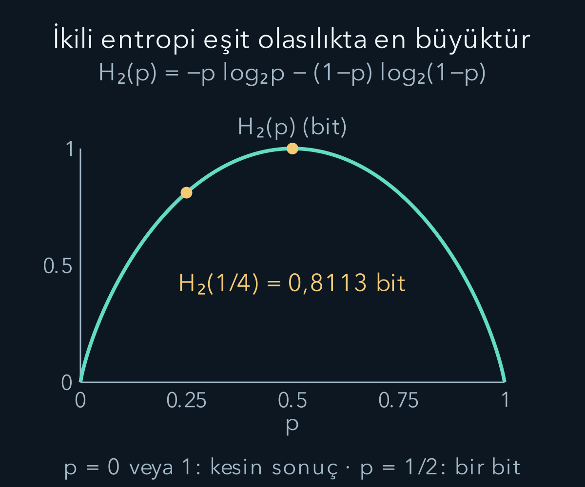
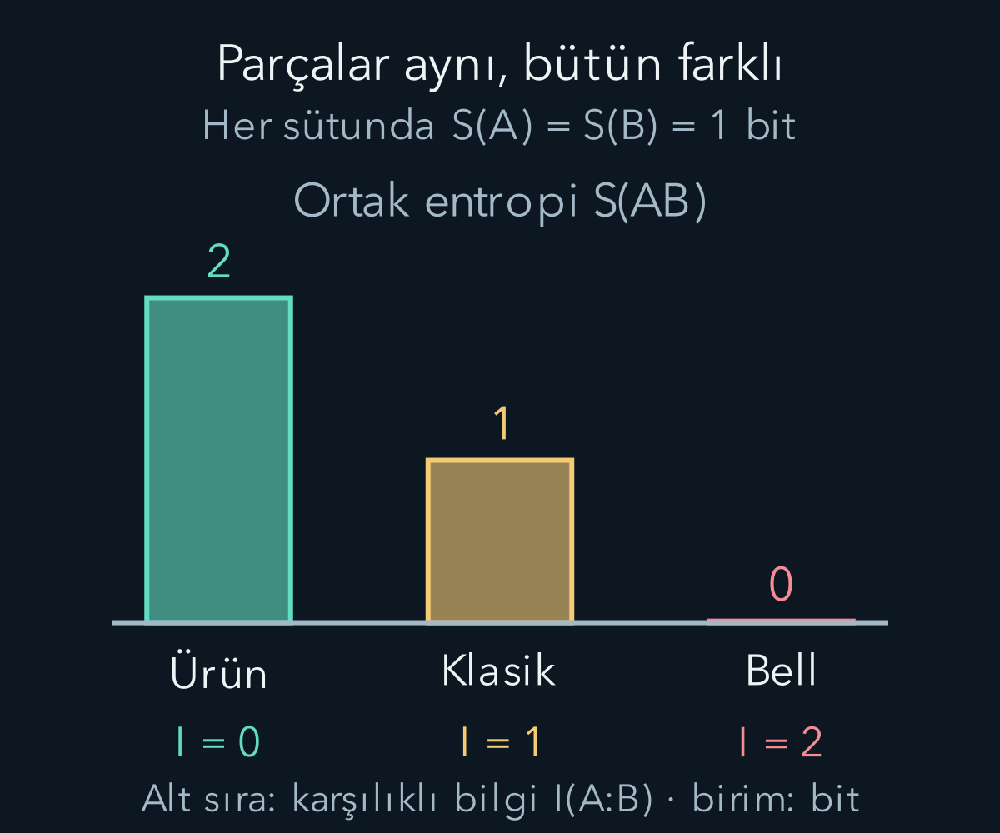

import ArticleVideo from '@/components/ArticleVideo.astro'
import kavram from './media/01-kavram.mp4?url'
import kavramPoster from './media/01-kavram.jpg?url'

Bir kuantum deneyinin sonuçları rastgele olabilir. Fakat buradan sistemin durumunun mutlaka karışık olduğu sonucu çıkmaz. Örneğin tam bildiğimiz $|+\rangle$ durumunda Z ölçümü iki eşit olasılık verir; yine de durum saftır. Entropiyi öğrenirken önce “hangi belirsizliği ölçüyoruz?” sorusunu sormamız gerekir. Bir kayıt listesinin belirsizliğiyle bir yoğunluk matrisinin karışıklığı aynı nesne değildir.

[Yoğunluk matrisleri](/blog/yogunluk-matrisleri-ve-karisik-durumlar/), [genel ölçüm](/blog/genellestirilmis-kuantum-olcumleri/) ve [kuantum kanalları](/blog/kuantum-kanallari-ve-dekoherens/) bu yazının ön koşullarıdır. Özdeğer, iz ve kısmi iz kullanacağız. Logaritmayı da olasılığın bilgi ölçüsüne nasıl dönüştüğünü göstererek hatırlayacağız. Bütün entropilerde taban iki olacak; böylece sayısal birim **bit** olacak.

## 1. Bir olasılık dağılımının ortalama bilgisi

Klasik bir kayıt değişkeni $X$, $x$ değerlerini $p_x$ olasılıklarıyla alsın. $p_x\ge0$ ve $\sum_xp_x=1$'dir. Bir sonucun bilgi miktarını $I_x=-\log_2p_x$ ile ölçebiliriz. Kesin sonucun $p=1$ olması sıfır, $p=1/2$ olması bir, $p=1/4$ olması iki bit verir. Bu sayı, tek bir olayda fiziksel bir kutunun içinde saklı bit sayısını saymak değildir; olasılığa bağlı bilgi ölçüsüdür.

Buradaki $\log_2p$, “ikiyi hangi kuvvete yükseltirsek $p$ elde ederiz?” sorusunun yanıtıdır. $2^{-2}=1/4$ olduğundan $\log_2(1/4)=-2$ çıkar; baştaki eksi işareti bilgi miktarını pozitif yapar. Olasılıklar boyutsuzdur, bu yüzden logaritmanın içine bir fiziksel birim sokmuyoruz.

Logaritmanın yararı bağımsız sonuçlarda görülür. İki olayın ortak olasılığı $pq$ ise $-\log_2(pq)=-\log_2p-\log_2q$ olur: bağımsız bilgi katkıları toplanır. Sonuçlar değiştikçe bilgi miktarı da değiştiğinden olasılıkla ağırlıklı ortalamayı alırız:

$$
H(X)=-\sum_xp_x\log_2p_x.
$$

Bu **Shannon entropisi**dir. Sıfır olasılıklı terimi $0\log_2 0=0$ süreklilik kuralıyla alırız; çünkü $p\to0^+$ iken $p\log p\to0$. Olasılık sıfır olduğu için hiçbir kaydı olmayan sonucu sonsuz katkı diye toplamıyoruz.

İki sonuç için $p$ ve $1-p$ kullanırsak:

$$
\begin{aligned}
H_2(p)&=-p\log_2p\\
&\quad-(1-p)\log_2(1-p).
\end{aligned}
$$

$p=0$ veya $1$'de entropi sıfır, $p=1/2$'de bir bittir. $p=1/4$ için ilk katkı $1/2$, ikincisi yaklaşık $0{,}3113$; toplam $0{,}8113$ bittir. Dağılımın iki sonucu olması, ortalama belirsizliğin her zaman bir bit olduğu anlamına gelmez.

## 2. Yoğunluk matrisinde hangi olasılıkları kullanacağız?

Bir $d$ boyutlu sistemin yoğunluk matrisi $\rho$ pozitif ve iz birdir. Hermit olduğu için ortonormal özbazda:

$$
\begin{gathered}
\rho=\sum_{j=1}^d\lambda_j|j\rangle\langle j|,\\
\lambda_j\ge0,\qquad\sum_j\lambda_j=1.
\end{gathered}
$$

yazılır. $\lambda_j$ özdeğerlerdir. Bu liste bir olasılık dağılımı gibi davranır. **Von Neumann entropisi** bu listenin Shannon entropisidir:

$$
\boxed{\begin{aligned}
S(\rho)&=-\sum_j\lambda_j\log_2\lambda_j\\
&=-\operatorname{Tr}(\rho\log_2\rho).
\end{aligned}}
$$

Matris logaritması her kutunun içindeki sayının logaritmasını ayrı ayrı almak değildir. Önce özbazda pozitif özdeğerlere logaritma uygulanır. Sıfır özdeğerde $\lambda\log\lambda$ çarpımı yukarıdaki limitle tanımlanır. Entropiyi hesaplamak için bütün matris logaritmasını oluşturmaya gerek yoktur; özdeğerleri bulmak yeterlidir.

Bir saf durumun özdeğerleri $1,0,\ldots,0$ olduğu için $S=0$ olur. Tam karışık $\rho=I/d$ durumunun bütün özdeğerleri $1/d$'dir ve $S=\log_2d$ çıkar. Genel sınır $0\le S\le\log_2d$'dir. Bir kübit için üst sınır bir bit, iki kübitin dört boyutlu bütünü için iki bittir.

Üst sınırın neden eşit dağılımda olduğunu klasik listeden görebiliriz. Tek bir $\lambda$'nın katkısı $h(\lambda)=-\lambda\log_2\lambda$ içbükeydir: $h''(\lambda)=-1/(\lambda\ln2)<0$. Sabit toplamı daha eşit dağıtmak katkıların toplamını artırır. Bütün ağırlıklar eşitlendiğinde daha fazla eşitleme yapılamaz; maksimum $d h(1/d)=\log_2d$ olur.

## 3. Saf süperpozisyonda ölçüm entropisi

$|+\rangle=(|0\rangle+|1\rangle)/\sqrt2$ için:

$$
\rho_+=\frac12\begin{pmatrix}1&1\\1&1\end{pmatrix}.
$$

Özdeğerleri bulmak için $\det(\rho_+-\lambda I)=(1/2-\lambda)^2-1/4=\lambda(\lambda-1)=0$ çözeriz. Sonuçlar sıfır ve birdir, dolayısıyla $S(\rho_+)=0$.

Z bazında ölçüm olasılıkları köşegenlerden $1/2,1/2$ çıkar; bu kayıtların Shannon entropisi bir bittir. X bazında ölçersek artı sonuç kesin olduğundan kayıt entropisi sıfırdır. Aynı durumun farklı ölçümleri farklı klasik dağılımlar üretir. Durum entropisi ise baz seçiminden bağımsızdır.

Şimdi $\rho_{\rm kar}=I/2$ karışımını düşünelim. Z köşegenleri yine aynıdır, fakat özdeğerleri $1/2,1/2$ ve $S=1$'dir. X bazında da iki sonuç eşit çıkar. Köşegen dışı elemanları atıp yalnız bir ölçümün olasılıklarına bakmak, saf süperpozisyon ile tam karışımı ayırt etmeye yetmez. “Entropi sıfırsa her ölçüm kesin olmalıdır” çıkarımı bu yüzden yanlıştır.

## 4. Üniter hareket entropiyi neden değiştirmez?

Üniter evrimde $\rho'=U\rho U^\dagger$ olsun. $\rho|j\rangle=\lambda_j|j\rangle$ eşitliğini kullanırsak:

$$
\begin{aligned}
\rho'(U|j\rangle)&=U\rho|j\rangle\\
&=\lambda_j(U|j\rangle).
\end{aligned}
$$

Yani özvektörler döner, özdeğer listesi aynı kalır. Bu nedenle $S(U\rho U^\dagger)=S(\rho)$. Bir kübiti saf olarak başka bir yöne çevirmek onu karışık yapmaz. Başlangıç safsa kapalı sistemde üniter hareket boyunca entropi sıfır kalır.

Buna karşılık bir alt sistemin entropisi ortak üniter hareketle değişebilir; çünkü hesapta yalnız bir parçayı tutuyoruz. Ayrıca ölçüm sonucu unutulması veya bir gürültü kanalı özdeğerleri değiştirebilir. Her kanalın entropiyi artıracağını söylemek de doğru değildir: önceki yazıdaki tam enerji gevşemesi her girişi saf alt duruma götürebiliyordu.

## 5. Faz sönümünü özdeğerlerle ölçmek

$|+\rangle$ girişinin faz sönümü sonrasında $0\le\lambda\le1$ kalan uyum çarpanıyla:

$$
\rho_\lambda=\frac12\begin{pmatrix}1&\lambda\\\lambda&1\end{pmatrix}
$$

olduğunu biliyoruz. Burada $\lambda$ kanal parametresidir; özdeğerleri karıştırmamak için $q_+,q_-$ diye yazalım. Karakteristik denklem $(1/2-q)^2-\lambda^2/4=0$ olduğundan:

$$
\begin{aligned}
q_\pm&=\frac{1\pm\lambda}{2},\\
S(\rho_\lambda)&=H_2\!\left(\frac{1+\lambda}{2}\right).
\end{aligned}
$$

$\lambda=1$ başlangıcında $S=0$, $\lambda=0$ tam sönümünde $S=1$ olur. $\lambda=0{,}6$ için özdeğerler $0{,}8$ ve $0{,}2$, entropi yaklaşık $0{,}7219$ bittir. Z ölçümü tüm bu süreçte eşit olasılıklı kaldığı halde durum entropisi değişti. Sayıların farkı, ölçüm kaydı ile durumun özdeğerlerinin farklı soruları yanıtladığını bir kez daha gösterir.

Saflık $\operatorname{Tr}\rho^2=q_+^2+q_-^2$ de bir karışıklık göstergesidir; ancak entropiyle aynı tanım değildir. Örnekte saflık $0{,}68$, entropi $0{,}7219$ bittir. Farklı fonksiyonları aynı sayı çıkmalıymış gibi karşılaştırmamalıyız.

## 6. Bütün safken parçalar nasıl belirsiz olur?

İki kübitin ortak saf durumunu:

$$
\begin{aligned}
|\Psi(p)\rangle&=\sqrt{1-p}|00\rangle\\
&\quad+\sqrt p|11\rangle,\\
&\qquad 0\le p\le1.
\end{aligned}
$$

olarak alalım. $A$ ve $B$ iki alt sistemi, $AB$ birlikte ele alınan sistemi belirtir. $S(A)$ yazımı $S(\rho_A)$, $S(AB)$ yazımı ise $S(\rho_{AB})$ için kısaltmadır. Bütünün yoğunluk matrisi bir saf durum projektörü olduğu için $S(AB)=0$'dır. B'yi izden çıkardığımızda çapraz terimler $\langle0|1\rangle=0$ nedeniyle silinir:

$$
\begin{aligned}
\rho_A&=(1-p)|0\rangle\langle0|\\
&\quad+p|1\rangle\langle1|.
\end{aligned}
$$

Aynı hesap B için de geçerli; iki parçanın özdeğerleri $1-p,p$ olur. Böylece $S(A)=S(B)=H_2(p)$. $p=1/2$ Bell durumunda her parçanın entropisi bir bitken bütünün entropisi sıfırdır. Ortak durum hakkındaki tam bilgi, her alt sisteme ayrı ayrı saf durum atayabilmek anlamına gelmez.

Bir bipartit saf durum için alt sistem entropisi dolanıklığı nicelleştirir. Bu özel şartı koruyalım: genel karışık ortak durumda $S(A)>0$ olması tek başına dolanıklık kanıtı değildir. Örneğin $I_A/2\otimes I_B/2$ ürün karışımında parçalar karışık ama aralarında korelasyon bile yoktur.

<ArticleVideo src={kavram} poster={kavramPoster} title="Bütün saf, alt sistem karışık" caption="Ortak durum √(1−p)|00⟩+√p|11⟩ için p, 0'dan 1/2'ye artıyor. Üst çubuklar alt sistemin özdeğerleri 1−p ve p; alttaki hareketli nokta S(A)=H₂(p) değeridir. Bütünün S(AB)=0 entropisi değişmez. Aynı p'yi iki olasılığa ekleyip toplamı bozmak yerine birini artırırken diğerini azaltıyoruz." />

## 7. Klasik korelasyonla dolanıklığı karşılaştırmak

Klasikçe ortak bir bit hazırlayan karışımı:

$$
\begin{aligned}
\rho_{\rm klasik}&=\tfrac12|00\rangle\langle00|\\
&\quad+\tfrac12|11\rangle\langle11|.
\end{aligned}
$$

alalım. Ortak özdeğerler $1/2,1/2,0,0$; dolayısıyla $S(AB)=1$'dir. Her parçanın matrisi $I/2$ ve entropisi bir bittir. Bell durumuyla aynı Z kayıtlarını verir, fakat Bell yoğunluk matrisindeki $|00\rangle\langle11|$ ve eşleniği burada yoktur.

Sistemler arasındaki toplam korelasyonu **kuantum karşılıklı bilgi** ile tanımlarız:

$$
I(A:B)=S(A)+S(B)-S(AB).
$$

Genel durumda negatif değildir; sıfır olması ürün durumuyla eşdeğerdir. Bu genel özellik entropinin alt toplamsallık eşitsizliğine dayanır. Burada bütün ispatını kullanmadan üç açık matris üzerinde sonucu hesaplayabiliriz:

| Nicelik | Ürün | Klasik | Bell |
| --- | ---: | ---: | ---: |
| $S(A)$ | 1 | 1 | 1 |
| $S(B)$ | 1 | 1 | 1 |
| $S(AB)$ | 2 | 1 | 0 |
| $I(A:B)$ | 0 | 1 | 2 |

Tabloda “Ürün”, $I_A/2\otimes I_B/2$ durumunu; “Klasik”, eşit 00/11 karışımını; “Bell”, saf Bell durumunu gösterir. Tüm değerler bit cinsindendir. Bell durumundaki iki bit karşılıklı bilgi, tek kübiti ölçerek iki bağımsız klasik bit okuyabildiğimiz anlamına gelmez. Bu tanım bütün kuantum korelasyonlarını hesaplar; belirli bir yerel ölçümle erişilecek klasik bilgi ayrı bir sorudur.

## 8. Negatif koşullu entropi ne demektir?

Kuantum koşullu entropisini $S(A|B)=S(AB)-S(B)$ ile tanımlarız. Ürün karışımında bir, klasik 00/11 karışımında sıfır, saf Bell durumunda eksi bir bittir. Negatiflik yanlış hesap veya negatif olasılık değildir. Bütün yoğunluk matrislerinin özdeğerleri negatif değildir; negatif olan iki pozitif entropinin farkıdır.

Klasik kayıtlar için $H(X|Y)$, Y'nin belirli kaydı bilindiğinde X'in kalan Shannon entropilerinin ortalamasıdır ve negatif olamaz. Kuantum ifadesinde ise B henüz belirli klasik sonuca ölçülmüş olmak zorunda değildir; kuantum yan bilgi taşır. Aynı cebirsel fark bu daha geniş bağlamda negatif olabilir. Bu özellik dolanıklıkla bilgi işleme kaynaklarını anlatırken önem kazanır, fakat eksi bir belirsizlikli sıradan zar gibi yorumlanmaz.

B üzerindeki bir ölçümü seçmek A'ya ışık hızından hızlı mesaj göndermez. Sonuç etiketi iletilmezse A'nın yerel yoğunluk matrisi aynı kalır. Dolanıklığın entropi hesabındaki rolü, kullanılabilir iletişim yolunun yerini tutmaz.

## 9. Hazırlık etiketi ile durum entropisi

Bir kaynak yarı olasılıkla $|0\rangle$, yarı olasılıkla $|+\rangle$ hazırlasın. Hazırlık etiketi klasik bir bit belirsizliğindedir. Etiketi bilmeyen alıcının durumu:

$$
\begin{aligned}
\rho&=\tfrac12|0\rangle\langle0|\\
&\quad+\tfrac12|+\rangle\langle+|\\
&=\begin{pmatrix}3/4&1/4\\1/4&1/4\end{pmatrix}.
\end{aligned}
$$

İz bir, determinant $1/8$'dir. Özdeğer denklemi $q^2-q+1/8=0$ olup kökleri $(1\pm1/\sqrt2)/2$'dir. Entropi yaklaşık $0{,}6009$ bittir. Hazırlık etiketindeki bir bit ile bu sayı aynı değildir; iki hazırlık durumu ortogonal olmadığı için kusursuz ayırt edilemez.

Bu ayrımın genel bilgi sınırı Holevo niceliğiyle ifade edilir. $x$ etiketi $p_x$ ağırlıkla $\rho_x$ hazırlıyorsa $\rho=\sum_xp_x\rho_x$ ve $\chi=S(\rho)-\sum_xp_xS(\rho_x)$ tanımlanır. Ölçüm kaydına Y dersek klasik karşılıklı bilgi $I(X:Y)=H(X)+H(Y)-H(X,Y)$ ile hesaplanır; $H(X,Y)$ ortak kayıt olasılıklarının Shannon entropisidir. Bu sayı, Y kaydının X hazırlık etiketi hakkında taşıdığı bilgiyi ölçer ve $\chi$'yi aşamaz. Bu sınırı burada bir bilgi kuramı sonucu olarak kullanıyoruz; her ölçümün sınırı mutlaka doyuracağını söylemiyoruz. Saf iki hazırlık örneğinde $S(\rho_x)=0$ olduğundan sınır $0{,}6009$ bittir.

Sınır ile gerçek ölçüm bilgisini aynı örnekte karşılaştıralım. Hazırlık etiketi $X=0$ ise $|0\rangle$, $X=1$ ise $|+\rangle$ gönderilsin; iki etiketin ön olasılığı $1/2$'dir. Alıcı Z ölçsün ve çıktıya $Y=0$ veya $Y=1$ desin. $|0\rangle$ gönderildiğinde yalnız sıfır çıkar; $|+\rangle$ gönderildiğinde iki çıktı eşit olasılıklıdır. Ön olasılıkla koşullu olasılığı çarparak ortak tabloyu kurarız:

| Hazırlık ve ölçüm | $Y=0$ | $Y=1$ |
| --- | ---: | ---: |
| $X=0$ | $1/2$ | $0$ |
| $X=1$ | $1/4$ | $1/4$ |

Tablodaki dört sayı bir eder. Sütun toplamları $p(Y=0)=3/4$, $p(Y=1)=1/4$ verir; dolayısıyla $H(Y)=H_2(1/4)\approx0{,}8113$ bittir. Hazırlık bilinseydi ilk satırda ölçüm kesin, ikinci satırda bir bit belirsiz olacaktı. Bu yüzden $H(Y|X)=(1/2)\times0+(1/2)\times1=1/2$ bittir. Karşılıklı bilgiyi eşdeğer biçimde çıkarabiliriz:

$$
\begin{aligned}
I(X:Y)&=H(Y)-H(Y|X)\\
&\approx0{,}3113\ \text{bit}.
\end{aligned}
$$

Bu değer $0{,}6009$ bitlik Holevo üst sınırının altındadır. Yani ölçüm sonucu kendi başına yaklaşık $0{,}8113$ bit rastgelelik taşıdığı halde, bunun tamamı gönderilen etikete dair bilgi değildir. Bir bölümü $|+\rangle$ ölçümünün kendi rastgeleliğinden gelir. “Çok rastgele çıktı” ile “gönderici hakkında çok bilgi” böylece açıkça ayrılır.

Tabloyu ters yönden de okuyabiliriz. Alıcı bir sonucunu görürse sıfır hazırlığı imkânsızdır; kaynak kesin $|+\rangle$ göndermiştir. Sıfır sonucunu görürse iki hazırlık da mümkündür: koşullu ağırlıklar $(1/2)/(3/4)=2/3$ ve $(1/4)/(3/4)=1/3$ olur. Bazı kayıtların kesin tanıma, bazılarının belirsizliğe yol açması, ortalama karşılıklı bilginin kesirli çıkmasıyla uyumludur. Bu Z ölçümünün en iyi ölçüm olduğunu iddia etmedik; yalnız erişilen bilgiyi bütün adımlarıyla hesapladık.

## 10. Entropi hesabında önce nesneyi seçmek

Entropi kullanırken önce klasik kayıt dağılımını mı, tek sistemin yoğunluk matrisini mi, yoksa ortak bir sistemin parçalarını mı hesapladığımızı söylemeliyiz. Özdeğerler kuantum durum entropisini belirler; seçilmiş ölçümün köşegen olasılıkları her zaman aynı liste değildir. Ortak durumdaki korelasyonlar da parçaların ayrı entropilerinden tek başına okunamaz.

Bu yazının örneklerinde aynı yerel dağılımdan üç farklı ortak yapı, saf durumdan rastgele ölçüm ve pozitif matrislerden negatif koşullu entropi elde ettik. Her sonuç tanımından adım adım çıktı. Böylece entropiyi yalnız “düzensizlik” sözcüğüne sıkıştırmadan, hangi bilgiye erişildiğini belirleyen hesaplanabilir bir nicelik olarak kullanabiliriz.

## Kaynaklar

Shannon ve von Neumann entropisi, karşılıklı bilgi, koşullu entropi ve Holevo sınırı [John Preskill, Caltech — Quantum Shannon Theory, §§10.1–10.2 ve 10.6](https://www.preskill.caltech.edu/ph219/chap10_6A_2025.pdf) ile karşılaştırıldı. Kübit matrislerinin özdeğerleri, üç ortak durum tablosu ve sayısal entropiler bu yazı için yeniden hesaplandı. Kaynak 13 Ekim 2026 tarihinde yeniden doğrudan açılarak ilgili bölümler kontrol edildi.
