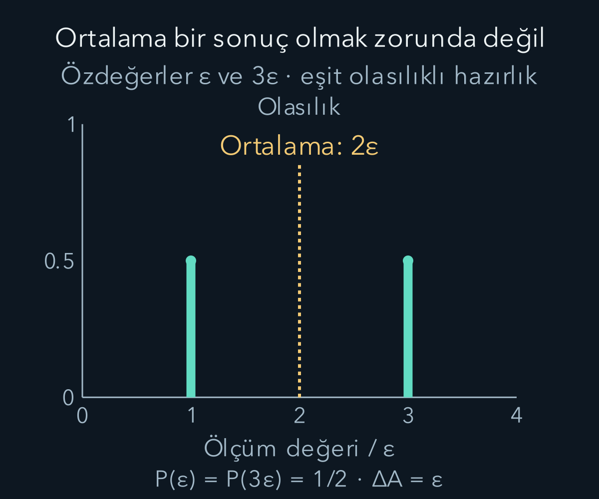
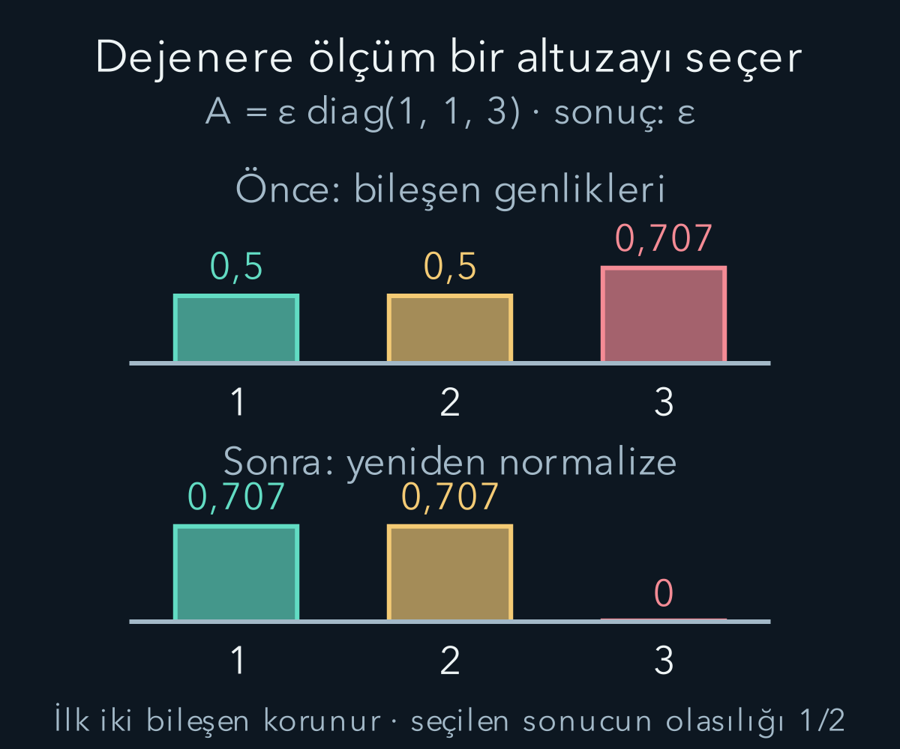

import ArticleVideo from '@/components/ArticleVideo.astro'
import kavram from './media/01-kavram.mp4?url'
import kavramPoster from './media/01-kavram.jpg?url'

Bir ölçümün artı veya eksi sonucu vermesini artık genliklerden hesaplayabiliyoruz. Fakat ölçüm aygıtı çoğu zaman yalnız etiket göstermez: enerji, açısal momentum veya başka bir fiziksel büyüklük bildirir. Sonuçların birimleri ve büyüklükleri vardır. **Gözlenebilir**, kuantum kuramında bu olası sayısal değerlerle bunlara karşılık gelen durumları aynı matematiksel yapıda birleştirir.

[Durum ve Born kuralı](/blog/kuantum-durumu-superpozisyon-ve-born-kurali/) ile [Hermit matrisler](/blog/karmasik-vektorler-hermit-ve-uniter-matrisler/) bu yazının temelidir. Ayrıca [dağılım, ortalama ve varyans](/blog/rastgele-degiskenler-ve-dagilimlar/) bilgisini kullanacağız. Önce sonlu boyutlu sistemlerde çalışacağız; türev içeren konum ve momentum işleçlerinin tanım kümelerini bu matris hesabına gelişigüzel eklemeyeceğiz.

## 1. Gözlenebilir neden Hermit matrisle temsil edilir?

Seçilen bazda gözlenebiliri $A$ matrisiyle gösterelim. Matrisin vektörler üzerindeki doğrusal etkisini vurguladığımızda **işleç** diyeceğiz. Sonlu boyutlu ideal ölçüm modelinde $A^\dagger=A$ koşulunu isteriz. Hançer, karmaşık eşlenik devriği gösterir. Bu özelliğe Hermitlik denir.

Hermit bir matrisin özdeğerleri gerçektir ve ortonormal özvektörlerden oluşan bir baz seçilebilir. Gerçek özdeğerler, ölçüm aygıtının bildireceği gerçek sayılarla uyumludur. Ortonormal özvektörler ise Born olasılıklarının toplamını bire tamamlayan ölçüm bazını sağlar. Bu, her Hermit matrisi laboratuvarda sınırsız hassasiyetle kolayca ölçebiliriz demek değildir; fiziksel aygıt gerçekleştirmesi ayrıca bir sorundur.

$A|a\rangle=a|a\rangle$ denkleminde soldaki $A$ işleç, sağdaki $a$ sayısal özdeğerdir. $|a\rangle$ sıfır olmayan özvektördür. Bu durumda hazırlanan sistemin ideal $A$ ölçümü, kesin olarak $a$ sonucu verir. Özvektörün normunu bir seçmek olasılık hesabını kolaylaştırır; özdeğer denklemindeki sıfır olmayan ortak çarpan sonucu değiştirmez.

Hermitliğin gerçek özdeğer vermesini kısaca görelim. Normalleştirilmiş özvektörde $\langle a|A|a\rangle=a$ olur. Bunun karmaşık eşleniği $\langle a|A^\dagger|a\rangle=a^*$'dır. Hermitlik iki ifadeyi eşitlediği için $a=a^*$ çıkar; yani sanal kısım sıfırdır. Burada kullandığımız eşlenik sırası önceki yazıdaki iç çarpım konvansiyonuyla aynıdır.

Farklı sonuçlara ait özvektörlerin neden dik olduğunu da aynı Hermitlikten çıkarabiliriz. $A|a\rangle=a|a\rangle$ ve $A|b\rangle=b|b\rangle$ olsun. Gerçek $a$ için ilk eşitliğin eşlenik devriği $\langle a|A=a\langle a|$ olur. Aynı iç çarpımı iki taraftan hesaplayınca:

$$
\langle a|A|b\rangle
=a\langle a|b\rangle
=b\langle a|b\rangle.
$$

Dolayısıyla $(a-b)\langle a|b\rangle=0$ bulunur. $a\ne b$ ise sıfır olmayan $a-b$ sayısına bölebiliriz ve $\langle a|b\rangle=0$ çıkar. Sonuçlar farklıyken diklik zorunludur. Aynı özdeğer durumunda bu çıkarma yalnız $0=0$ verir; o özuzay içinde ortonormal bir baz seçebiliriz ama her gelişigüzel özvektör çifti zaten dik olmak zorunda değildir. Dejenerelik bölümünde neden tek bir özvektör yerine bütün özuzayı kullanacağımızın ilk işareti budur.

## 2. Özdeğerler ve ölçüm olasılıkları

$A$'nın farklı özdeğerleri $a_j$, bunların normalleştirilmiş özvektörleri $|a_j\rangle$ olsun; önce her özdeğerin tek özvektör yönüyle ilişkili olduğu durumu düşünelim. Hazırlığı bu bazda $|\psi\rangle=\sum_j c_j|a_j\rangle$ diye açarsak $c_j=\langle a_j|\psi\rangle$ olur. İdeal ölçümde $a_j$ sonucunun olasılığı $|c_j|^2$'dir.

Özdeğerlerin toplamı bir olmak zorunda değildir. Bir olmak zorunda olan, sonuç **olasılıklarının** toplamıdır. Enerji değerleri örneğin 1 ve 3 joule olabilir; bunların toplamının 4 joule olması hiçbir normalleştirme sorunu yaratmaz. Vektör genliklerinin normuyla fiziksel sonuç değerlerinin birimleri ayrı kavramlardır.

Bir enerji ölçeği $\varepsilon>0$ tanımlayalım ve şu matrisi seçelim:

$$
A=\varepsilon\begin{pmatrix}2&1\\1&2\end{pmatrix}.
$$

$\varepsilon$ enerji birimine sahiptir; matristeki 1 ve 2 sayıları boyutsuzdur. $(1,1)^T/\sqrt2$ vektörüne uygulayınca her bileşen üç katına çıkar; özdeğer $3\varepsilon$ olur. $(1,-1)^T/\sqrt2$ için sonuç aynı vektörün $\varepsilon$ katıdır. Dolayısıyla olası iki ölçüm değeri $\varepsilon$ ve $3\varepsilon$'dur; matrisin köşegeninde görünen $2\varepsilon$, otomatik olarak ölçüm sonucu değildir.

## 3. İzdüşüm işleci neyi seçer?

Normalleştirilmiş bir özvektör için $P_j=|a_j\rangle\langle a_j|$ **izdüşüm işleci** olsun. Ket ile bra bu sırada çarpıldığında bir matris elde ederiz; ters sıradaki bra-ket iç çarpımı ise skalerdi. $P_j$ genel durumun yalnız ilgili özvektör yönündeki bileşenini bırakır:

$$
P_j|\psi\rangle=|a_j\rangle\langle a_j|\psi\rangle
=c_j|a_j\rangle.
$$

$P_j^2=P_j$ olur; bir kez seçilen bileşeni tekrar seçmek yeni bir değişiklik üretmez. Farklı dik yönler için $P_jP_k=0$ ve bütün sonuçlar için $\sum_jP_j=I$ bulunur. $I$, vektörü değiştirmeyen birim işleçtir. Bu özellikler ölçüm seçeneklerinin birbirini dışlaması ve bütün uzayı kapsamasıyla ilişkilidir.

Gözlenebiliri $A=\sum_j a_jP_j$ şeklinde yazabiliriz. Buna **spektral ayrışım** denir. Her bileşen önce kendi yönüne seçilir, sonra o yönün ölçüm değeriyle çarpılır. Olasılık da $p_j=\langle\psi|P_j|\psi\rangle$ olur. Bu ifade ile $|\langle a_j|\psi\rangle|^2$ aynı sonuçtur; yalnız farklı biçimlerde yazılmıştır.

## 4. Ortalama tek ölçümün sonucu değildir

Aynı $|\psi\rangle$ durumunda hazırlanmış çok sayıda bağımsız sistemde $A$ ölçelim. Uzun vadeli ortalamanın kuramsal değeri:

$$
\langle A\rangle=\sum_jp_ja_j
=\langle\psi|A|\psi\rangle
$$

olur. Açılı ayraç burada **beklenen değer** gösterimidir; hangi durumda hesaplandığı metinde belirtilir. Eşitliği görmek için $A$'nın spektral ayrışımını yerine koyarız: her $a_j$ sayısı dışarı çıkar, kalan $\langle\psi|P_j|\psi\rangle$ kendi olasılığıdır.

Örneğimizde $|\psi\rangle=(1,0)^T$ hazırlansın. İki özvektörle iç çarpımların büyüklüğü $1/\sqrt2$ olduğundan iki sonuç eşit olasılıktadır. Ortalama $(\varepsilon+3\varepsilon)/2=2\varepsilon$ bulunur. Tek bir ideal ölçümde $2\varepsilon$ görülmez. Ortalama, çok sayıdaki $\varepsilon$ ve $3\varepsilon$ sonucunun dağılımını özetler.

Matrisle doğrudan kontrol de yapalım: $A|\psi\rangle=\varepsilon(2,1)^T$ olur; bra $(1,0)$ ile çarpınca $2\varepsilon$ çıkar. İki hesap aynı sonucu verdi. Ortalama hesabının pratik olması, özdeğerlerin ne olduğunu bilme ihtiyacını ortadan kaldırmaz; ortalamadan tek başına tam ölçüm dağılımı okunamaz.

## 5. Varyansı adım adım hesaplamak

Dağılımın yayılımını **varyans** ile ölçeriz:

$$
(\Delta A)^2=\sum_jp_j(a_j-\langle A\rangle)^2
=\langle A^2\rangle-\langle A\rangle^2.
$$

$\Delta A$ standart sapmadır; $A$ ile aynı birime sahiptir. Varyansın birimi ölçülen büyüklüğün biriminin karesidir. Buradaki $\Delta$, iki ardışık ölçümün farkı değil, aynı hazırlığın sonuç dağılımındaki standart sapma sembolüdür.

Örneğimizde $\langle A^2\rangle=(\varepsilon^2+9\varepsilon^2)/2=5\varepsilon^2$ olur. Ortalama karesi $4\varepsilon^2$ olduğundan varyans $\varepsilon^2$, standart sapma $\varepsilon$ çıkar. Aynı sonucu farklardan da görebiliriz: sonuçlar ortalamadan $-\varepsilon$ ve $+\varepsilon$ uzaklıktadır; karelerinin ortalaması $\varepsilon^2$'dir.

Matrisin karesi $A^2=\varepsilon^2\begin{pmatrix}5&4\\4&5\end{pmatrix}$ olur. İlk baz vektöründe beklenen değeri yine $5\varepsilon^2$ verir. Bu kontrol, $\langle A^2\rangle$ ile $\langle A\rangle^2$'nin genel olarak eşit olmadığını gösterir. İlkinde her ölçüm sonucunu kareleyip ortalıyoruz; ikincisinde önce ortalama alıp sonra kareliyoruz.

## 6. Spin için birimler ve Pauli matrisleri

İki boyutlu spin sisteminde şu boyutsuz matrisleri tanımlayalım:

$$
\sigma_x=\begin{pmatrix}0&1\\1&0\end{pmatrix},\quad
\sigma_y=\begin{pmatrix}0&-i\\i&0\end{pmatrix},\quad
\sigma_z=\begin{pmatrix}1&0\\0&-1\end{pmatrix}.
$$

Bunlara **Pauli matrisleri** denir. Üçü de Hermittir ve kareleri $I$'dır. Fiziksel spin bileşenleri $S_x=(\hbar/2)\sigma_x$, $S_y=(\hbar/2)\sigma_y$, $S_z=(\hbar/2)\sigma_z$ olur. Pauli özdeğerleri $\pm1$ iken spin sonuçları $\pm\hbar/2$'dir. Boyutsuz işaretlerle fiziksel açısal momentum sonuçlarını ayırıyoruz.

$\sigma_x$ bileşenleri yer değiştirir. Bu yüzden $(1,1)^T/\sqrt2$ vektörü değişmez, $(1,-1)^T/\sqrt2$ eksi işaret alır. Bunlar önceki yazıdaki $+x$ ve $-x$ durumlarıdır. $\sigma_y$'deki karmaşık işaretler de $(1,i)^T/\sqrt2$ ve $(1,-i)^T/\sqrt2$ durumlarını sırasıyla artı ve eksi özvektör yapar.

Bu matrisler, fiziksel uzaydaki üç bileşeni iki bileşenli durumlara etki eden işleçlerle ifade eder. Matrisin ikiye iki olması, fiziksel uzayın iki boyutlu olduğu anlamına gelmez. Önceki yazının durum uzayı ile gerçek uzay ayrımı burada da sürer.

## 7. Spin ortalaması ve yayılımı

$|\psi\rangle=(\sqrt3,i)^T/2$ durumunu yeniden kullanalım. $S_z$ sonuçları $+\hbar/2$ için $3/4$, $-\hbar/2$ için $1/4$ olasılıklıdır. Beklenen değer:

$$
\langle S_z\rangle=\frac34\frac\hbar2+\frac14\left(-\frac\hbar2\right)
=\frac\hbar4.
$$

$S_z^2=(\hbar^2/4)I$ olduğundan her normalleştirilmiş durumda $\langle S_z^2\rangle=\hbar^2/4$ olur. Burada varyans $\hbar^2/4-\hbar^2/16=3\hbar^2/16$; standart sapma $\sqrt3\hbar/4$ çıkar. Ortalama $\hbar/4$ yine izin verilen tek ölçüm değerlerinden biri değildir.

Aynı durumun $S_x$ sonuçları eşit olasılıklıydı. Dolayısıyla $\langle S_x\rangle=0$ ve $\Delta S_x=\hbar/2$ olur. Sıfır ortalama, her ölçümde sıfır spin bulunduğunu söylemez. Spin yarım sisteminin bu eksendeki ölçüm seçenekleri arasında sıfır yoktur. Pozitif ve negatif sonuçlar ortalamada birbirini dengeler.

<ArticleVideo src={kavram} poster={kavramPoster} title="Tek sonuç ile beklenen değeri ayırmak" caption="Artı sonucun olasılığı p, 1/2’den 1/4’e değişen hazırlıklar karşılaştırılır. Olasılık sütunlarıyla ortalama birlikte değişir. Son dağılımda ortalama −ħ/4’tür; tek ölçüm sonuçları yine yalnız ±ħ/2 olabilir." />

## 8. Aynı özdeğer birden çok duruma aitse

Bir ölçüm değeri birden fazla bağımsız özvektöre ait olabilir. Buna **dejenerelik**, ilgili uzaya da özuzay denir. O zaman yalnız bir vektöre izdüşüm almak yerine, aynı değere ait bütün dik yönlerin izdüşümlerini toplarız. $P_a$ bu toplam izdüşüm olsun; $a$ sonucunun olasılığı $\langle\psi|P_a|\psi\rangle$ olur.

Üç boyutlu örnekte $A=\varepsilon\,\operatorname{diag}(1,1,3)$ seçelim. $\operatorname{diag}$ belirtilen sayıları köşegene koyar. $\varepsilon$ özdeğerinin özuzayı ilk iki bileşenden oluşur. Normalleştirilmiş $|\psi\rangle=(1,1,\sqrt2)^T/2$ için bu sonucun olasılığı $1/4+1/4=1/2$ olur. $3\varepsilon$ sonucu da $1/2$ olasılıklıdır.

İdeal Lüders tipi seçici ölçümde $\varepsilon$ sonucu elde edilirse sonraki durum $P_\varepsilon|\psi\rangle/\sqrt{p_\varepsilon}=(1,1,0)^T/\sqrt2$ olur. İlk iki bileşen arasındaki ilişki korunur. Aygıt aynı zamanda bu iki yönü ayrı ayrı ayırt edip kaydederse daha ayrıntılı bir ölçüm yapmış olur; yalnız enerji değerini seçen ideal güncellemeyle aynı işlem değildir. Dejenerelikte ölçüm aygıtının hangi ek bilgiyi kaydettiği önem taşır.

## 9. Ölçüm güncellemesinin normalleşmesi

Genel ideal seçici izdüşüm ölçümünde, olasılığı sıfır olmayan $a$ sonucu için:

$$
|\psi_a\rangle=\frac{P_a|\psi\rangle}{\sqrt{p_a}},
\qquad p_a=\langle\psi|P_a|\psi\rangle.
$$

Payın norm karesi $\langle\psi|P_a^\dagger P_a|\psi\rangle$'dir. $P_a$ Hermit ve karesi kendisine eşit olduğundan bu $p_a$ olur. Kareköküne bölmek yeni vektörün normunu bire getirir. $p_a=0$ ise o sonuç bu durumda oluşmaz; sıfıra bölerek koşullu durum tanımlamayız.

Sonraki aynı ölçümde $P_a|\psi_a\rangle=|\psi_a\rangle$ olduğu için aynı sonuç kesin çıkar. İdeal tekrar edilebilirlik böylece izdüşüm cebirinden görülür. Bunun koşulu, iki ölçüm arasında durumu değiştiren bir evrim veya farklı etkileşim olmamasıdır. Güncelleme denklemini zaman içinde gerçekleşen bütün fiziksel süreçlerin yerine kullanamayız.

## 10. Ölçümlerin sırası önem taşıyabilir

Başlangıç $|+z\rangle$ olsun. Önce $z$ ölçülürse sonuç kesin artıdır; ardından $x$ ölçümü eşit dağılım verir. Ters sırada önce $x$ ölçüp artı sonucunu seçersek hazırlık $|+x\rangle$ olur; son $z$ ölçümü artık eşit dağılımlıdır. Aynı iki aygıtın sıra ve seçici kayıt koşulları, hangi ortak sonuçların hangi olasılıkla oluştuğunu değiştirir.

Matrislerin çarpımında da $S_xS_z$ ile $S_zS_x$ eşit değildir. Ancak matris çarpımını tek başına iki ölçümün bütün olasılıklarının kısa adı saymamalıyız. Ardışık ölçüm olasılıkları, uygun izdüşümler ve normalleşmelerle hesaplanır. İşleçlerin değişmeli olup olmaması önemli bir yapısal bilgidir; deney düzeninin hangi sonucu seçtiğini ayrıca yazmak gerekir.

Sonlu boyutta birbirleriyle değişmeli Hermit işleçler ortak bir ortonormal özbazda yazılabilir. Bu, uygun bir ortak keskin ölçüm tanımına izin verir. Değişmeli olmayan çiftler için aynı kolaylık genel olarak yoktur. Bu yapı daha sonra komütatör ve belirsizlik ilişkisini kurarken kesin bir cebirsel biçim alacak.

## 11. Topluluk yayılımı ile ölçüm hatasını ayırmak

$\Delta A$, aynı kuantum durumunda hazırlanan sistemlerde ideal $A$ ölçümünün sonuç yayılımıdır. Aygıtın ölçeğinin yanlış ayarlanması veya detektör gürültüsü başka etkilerdir. İdeal aygıt varsayımı altında bile $\Delta A$ sıfırdan farklı olabilir. Bu yüzden kuantum standart sapmasını doğrudan ‘ölçüm aleti yeterince iyi değil’ diye yorumlamayız.

Aynı bağımsız hazırlık $N$ kez ölçülürse örnek ortalamasının standart hatası, sonlu varyanslı ideal bağımsız modelde $\Delta A/\sqrt N$ olur. Bu sayı ölçüm sonuçlarının tek tek yayılımı değildir; ortalamayı kestirmemizin belirsizliğidir. Daha çok tekrar ortalama kestirimini iyileştirebilir, fakat aynı durumun tek ölçüm dağılımını daraltmaz.

Spin örneğinde $N=400$ için ortalamanın standart hatası $\sqrt3\hbar/(4\times20)\approx0{,}0217\hbar$ olur. Tek ölçümlerin standart sapması ise hâlâ yaklaşık $0{,}433\hbar$'dır. İki sayının farklı sorulara ait olması, daha sonra belirsizlik ilkesini yorumlarken temel önemdedir.

## 12. Sıfır yayılımın kesin anlamı

Varyansın sıfır olması ne gerektirir? Tanımda her terim $p_j(a_j-\langle A\rangle)^2$ biçimindedir. Olasılıklar ve kareler negatif olmadığı için terimler birbirini götüremez. Toplam sıfırsa, olasılığı sıfırdan büyük her sonuç ortalamaya eşit olmalıdır. Dolayısıyla dağılım tek bir ölçüm değerinde yoğunlaşır. Dejenerelik varsa durum o değere ait özuzayın herhangi bir normalleştirilmiş birleşimi olabilir; mutlaka bizim seçtiğimiz tek bir baz vektörü olmak zorunda değildir.

Bu sonucu farklı bir gözlenebilir için otomatik olarak kullanamayız. $|+z\rangle$ durumunda $S_z$ yayılımı sıfırdır, fakat $S_x$ yayılımı $\hbar/2$'dir. ‘Durum kesin’ sözünü hangi ölçüm bakımından kesin olduğunu belirtmeden kullanmak bu ayrımı siler. Saf bir kuantum durumu bilmekle bütün gözlenebilirlerin tekil sonuçlarını bilmek aynı ifade değildir.

Ölçüm ölçeğini değiştirdiğimizde ortalama ve yayılımın davranışı da denetlenebilir. Yeni gözlenebilir $B=rA+sI$ olsun; $r$ ve $s$ gerçek sabitlerdir ve birimler tutarlı seçilmiştir. Ölçüm sonuçları $b_j=ra_j+s$ olur. Ortalama $\langle B\rangle=r\langle A\rangle+s$, standart sapma ise $\Delta B=|r|\Delta A$'dır. Ortak bir sabit eklemek bütün değerleri aynı miktar taşır, birbirlerine göre yayılımlarını değiştirmez.

Örneğimizde $A$ sonuçları $\varepsilon$ ve $3\varepsilon$ iken $B=A-2\varepsilon I$ sonuçları $-\varepsilon$ ve $+\varepsilon$ olur. Yeni ortalama sıfırdır, standart sapma yine $\varepsilon$'dur. Enerji sıfırını değiştirmek ile dağılımı daraltmak arasındaki farkı bu basit kaydırma görünür kılar. Fiziksel farklar ve dağılımlarla çalışırken sıfır noktası seçimini ayrıca takip edeceğiz.

## 13. Ölçüm hesabının bütün parçaları

Bir kuantum ölçümünü tam tanımlamak için önce hazırlanmış durum, sonra gözlenebilir ve ölçüm modeli, ardından varsa seçilen sonuç belirtilir. Gözlenebilirin özdeğerleri izin verilen sayıları, özuzayları Born olasılıklarını, seçici izdüşüm güncellemesi ise sonraki ölçümün başlangıcını belirler. Ortalama ve varyans bu tam dağılımdan türetilen özetlerdir.

Durumun kendisi olmadan yalnız matrisi bilmek, deneyin sonuç oranlarını vermez. Durumu bilip hangi ölçüm yapıldığını söylememek de yeterli değildir. İki bilgiyi birlikte kullanmak, kuantum hesabının tekrar eden yapısıdır. Bir sonraki yazıda sistem ölçülmeden bekletildiğinde durumun nasıl değiştiğini ele alacağız; enerjiyi temsil eden Hamiltonyen bu değişimin temel belirleyicisi olacak.

## Kaynakça

Aşağıdaki açık kaynaklar 11 Ekim 2026 tarihinde yeniden doğrudan kontrol edildi. Metin, hesap örnekleri ve şekiller bu yazı için özgün olarak hazırlandı.

- [Caltech, Feynman Lectures — Operators](https://www.feynmanlectures.caltech.edu/III_20.html): İşleçler, ortalamalar ve fiziksel gözlenebilirler.
- [MIT OpenCourseWare — Quantum Physics II Lecture Notes](https://ocw.mit.edu/courses/8-05-quantum-physics-ii-fall-2013/pages/lecture-notes/): Hermit işleçler ve ölçümün spektral yapısı.
