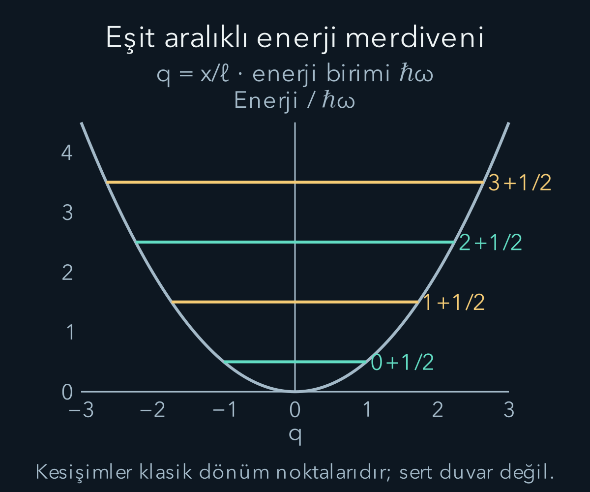
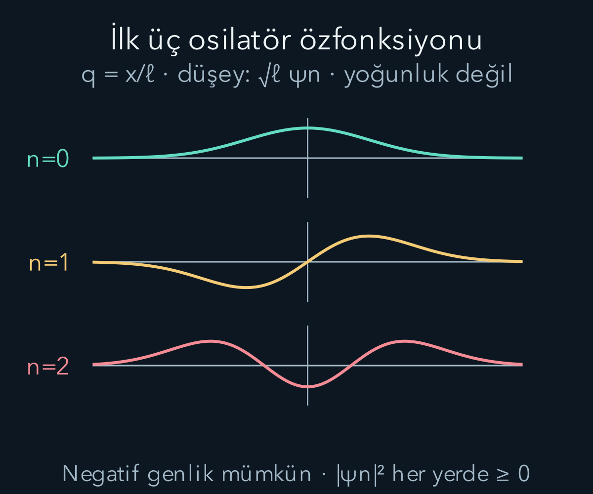

import ArticleVideo from '@/components/ArticleVideo.astro'
import kavram from './media/01-kavram.mp4?url'
import kavramPoster from './media/01-kavram.jpg?url'

Denge konumundan biraz uzaklaştırılan bir sistem, çoğu zaman geri çağırıcı bir kuvvet hisseder. Kuvvet yer değiştirmeyle yaklaşık orantılıysa klasik harmonik salınım modeli ortaya çıkar. Kuantumda aynı potansiyel, sürekli değişebilen klasik enerji yerine eşit aralıklı enerji düzeyleri üretir. Üstelik en düşük durumda enerji sıfır değildir.

[Klasik salınım](/blog/salinim-sonum-ve-rezonans/), [Schrödinger denklemi](/blog/schrodinger-denklemi-ve-olasilik-akimi/) ve [komütatörler](/blog/komutatorler-ve-belirsizlik-iliskisi/) ön bilgilerimizdir. Bir boyutta, bütün doğru üzerinde hareket eden göreli olmayan parçacığı ele alıyoruz. Kütle $m>0$, açısal frekans $\omega>0$ olsun. Potansiyel $V(x)=m\omega^2x^2/2$ ve denge noktası $x=0$'dır.

## 1. Neden bu potansiyel birçok yerde görünür?

Düzgün bir potansiyelin, ikinci türevi pozitif olan kararlı bir denge noktasını ele alalım. Buna dejenere olmayan minimum denir; birinci türev sıfırdır. Her kararlı minimum bu koşulu sağlamaz: örneğin $V(x)=x^4$ için sıfır noktasında ikinci türev de sıfırdır ve başat yaklaşım karesel değildir. Denge noktasını sıfır seçip Taylor açılımını yazarsak $V(x)=V(0)+V''(0)x^2/2+\cdots$ olur. Yeterince küçük yer değiştirmelerde yüksek kuvvetler ihmal edilebiliyorsa karesel model elde edilir. $V''(0)=m\omega^2$ tanımı, yerel eğrilikle salınım frekansını bağlar.

Bu nedenle molekül titreşimlerinden alan modlarına kadar çeşitli problemlerde harmonik osilatör matematiği kullanılır. Ancak tek bir kuantum parçacığının koordinatıyla bir alan modunun genliği aynı fiziksel nicelik değildir. Ortak olan, karesel Hamiltonyenin yapısıdır. Modeli yeni bir sisteme taşırken koordinatın, kütle benzeri katsayının ve enerji ölçeğinin anlamı yeniden belirtilmelidir.

Bu yazıda yüksek dereceli potansiyel terimlerini tamamen dışarıda bırakıyoruz; ideal harmonik model tam kabul ediliyor. Gerçek bir sistemde yüksek enerjiye çıkıldıkça parçacık denge çevresinden uzaklaşabilir ve karesel yaklaşım bozulabilir. Eşit aralıklı enerji düzeylerini bütün gerçek potansiyeller için evrensel bir özellik saymayacağız.

## 2. Hamiltonyen ve doğal uzunluk

Konum ve momentum işleçleriyle enerji:

$$
H=\frac{p^2}{2m}+\frac12m\omega^2x^2
$$

olur. Şapkaları kalabalığı azaltmak için yazmıyoruz; bu bölümde $x$ ve $p$ işleçtir. Bütün doğru üzerinde uygun tanım kümelerinde $[x,p]=i\hbar I$ bağıntısını kullanacağız. Hamiltonyen hem kinetik hem potansiyel katkısının karesel toplamıdır.

Doğal uzunluk ölçeğini $\ell=\sqrt{\hbar/(m\omega)}$ tanımlayalım. Birim kontrolünde $\hbar/(m\omega)$ uzunluğun karesidir. Boyutsuz işleçler $Q=x/\ell$ ve $P=\ell p/\hbar$ olsun. $[Q,P]=iI$ ve:

$$
H=\frac{\hbar\omega}{2}(Q^2+P^2)
$$

elde edilir. Böylece fiziksel ölçek $\hbar\omega$ ortak çarpan olarak ayrıldı. $\omega$ açısal frekanstır; sıradan frekans $f=\omega/(2\pi)$ olduğundan $\hbar\omega=hf$ olur. Bu ayrımı korumak enerji aralığında yanlış $2\pi$ çarpanı oluşmasını önler.

## 3. Yükseltme ve alçaltma işleçleri

Şu iki boyutsuz işleci tanımlayalım:

$$
a=\frac{Q+iP}{\sqrt2},\qquad
 a^\dagger=\frac{Q-iP}{\sqrt2}.
$$

$Q$ ve $P$ Hermit olduğundan ikinci ifade birincinin eşlenik devriğidir. $a$ ve $a^\dagger$ tek başlarına Hermit değildir; doğrudan konum gibi gerçek sonuçlu gözlenebilirler diye yorumlamayız. Bunlar enerji özdurumlarını birbirine bağlamak için kullanacağımız matematiksel araçlardır.

Çarpımda sıra önemlidir. Açarsak $a^\dagger a=[Q^2+P^2+i(QP-PQ)]/2$ olur. $[Q,P]=iI$ olduğundan son katkı $i(iI)=-I$'dir. Böylece:

$$
N=a^\dagger a=\frac{Q^2+P^2-I}{2},
\qquad H=\hbar\omega\left(N+\frac12I\right).
$$

$N$'ye sayı işleci denir; özdeğerlerinin neden tam sayı olduğunu henüz göstermedik. Aynı çarpımla $aa^\dagger=(Q^2+P^2+I)/2$ bulunur. Çıkarma $[a,a^\dagger]=I$ verir. Enerjideki yarım katkısı, $Q$ ile $P$'yi değişmeli sayamadığımız için ortaya çıkar.

## 4. Basamak değiştirme özelliği

Komütatör cebrinden $[N,a]=-a$ ve $[N,a^\dagger]=a^\dagger$ bulunur. Örneğin $[a^\dagger a,a]=a^\dagger aa-aa^\dagger a=(a^\dagger a-aa^\dagger)a=-a$ olur. Şimdi $N|n\rangle=n|n\rangle$ özdurumuna uygulayalım:

$$
N(a|n\rangle)=(aN-a)|n\rangle=(n-1)a|n\rangle.
$$

Sıfır değilse $a|n\rangle$ bir alt özdeğere aittir. Benzer biçimde $a^\dagger|n\rangle$ üst özdeğere aittir. Bu nedenle $a$ alçaltma, $a^\dagger$ yükseltme işleci adını alır. Enerji farkı her adımda $\hbar\omega$ olur.

Bu işleci bir ket üzerinde uygulamak, laboratuvarda kendiliğinden parçacığın enerji kaybettiğini söylemez. Gerçek geçişi sağlayan dış etkileşim ve olasılık ayrıca tanımlanmalıdır. Burada ilk olarak durum uzayındaki matematiksel yapıyı kuruyoruz. İşleç adını fiziksel zaman evriminin kendisiyle karıştırmayacağız.

## 5. Özdeğerler neden negatif olamaz?

Normalleştirilmiş herhangi bir uygun durum için $\langle N\rangle=\langle\psi|a^\dagger a|\psi\rangle=\|a|\psi\rangle\|^2\ge0$ olur. Dolayısıyla $N$'nin normalleştirilebilir özdurumlarının özdeğerleri negatif olamaz. Bir özdurumun alçaltılmış hâlinin norm karesi tam olarak $n$'dir.

Eğer pozitif ama tam sayı olmayan bir özdeğerle başlasaydık, alçaltma işlemini tekrarlayarak önce sıfırla bir arasındaki bir değere ulaşırdık. Bu son durumun alçaltılmış norm karesi hâlâ pozitif olurdu; yani sonuç sıfır vektörü olmazdı. Fakat yeni özdeğer negatif olurdu. Bu, pozitiflik sonucuyla çelişir.

Bu nedenle normalleştirilebilir enerji özdurumlarının merdiveni sıfırda durmalıdır. En altta $a|0\rangle=0$ olur ve izin verilen değerler $n=0,1,2,\ldots$ şeklindedir. Bu argüman, özdurumlar üzerinde gerekli işleç uygulamalarının tanımlı olduğu harmonik osilatör problemine aittir. Sonsuz boyutlu her keyfî işleç çiftinde yalnız sembolik cebir yazarak aynı spektrumu ilan edemeyiz.

Enerjiler böylece:

$$
\boxed{E_n=\hbar\omega\left(n+\frac12\right),\qquad n=0,1,2,\ldots}
$$

olur. Sonsuz kutudan farklı olarak komşu düzeylerin enerji farkı sabittir. Kutu enerjileri $n^2$ ile büyüyordu; burada karesel potansiyelin özel yapısı eşit aralıklar üretir.

## 6. Basamakların normalleştirme katsayıları

$\|a|n\rangle\|^2=n$ olduğundan normalleştirilmiş alt durumla ilişki $a|n\rangle=\sqrt n|n-1\rangle$ biçiminde seçilebilir. Benzer şekilde $\|a^\dagger|n\rangle\|^2=\langle n|aa^\dagger|n\rangle=n+1$ verir. Dolayısıyla $a^\dagger|n\rangle=\sqrt{n+1}|n+1\rangle$ olur.

Fazları bu katsayılar pozitif olacak biçimde seçtik. İşlem bir durumun normunu korumaz; yükseltme ve alçaltma tek başına üniter evrim değildir. Yeni bir normalleştirilmiş durum elde etmek için ilgili karekök katsayısına bölmek gerekir. Aynı işlemi birkaç kez uyguladığımızda $|n\rangle=(a^\dagger)^n|0\rangle/\sqrt{n!}$ bulunur.

Örneğin birinci durum $a^\dagger|0\rangle$'dır; normu birdir. İkinci durum için iki yükseltmenin norm çarpanı $\sqrt1\sqrt2=\sqrt2$ olur ve $\sqrt{2!}$ ile bölünür. Faktöriyel burada yalnız bir ezber normalleştirme sabiti değildir; art arda basamakların normlarının çarpımından gelir.

## 7. Temel durumun fonksiyonunu bulmak

Konum gösteriminde $P=-i\ell\,d/dx$ olduğundan $a=(x/\ell+\ell\,d/dx)/\sqrt2$ olur. Temel durum $a\psi_0=0$ koşulunu sağlar:

$$
\frac{d\psi_0}{dx}=-\frac{x}{\ell^2}\psi_0.
$$

Ayırıp integre edince $\psi_0=C\exp[-x^2/(2\ell^2)]$ bulunur. Yoğunluğun integrali $|C|^2\int e^{-x^2/\ell^2}dx=|C|^2\sqrt\pi\ell$'dir. Normalleşme için:

$$
\boxed{\psi_0(x)=\frac1{\pi^{1/4}\sqrt\ell}
 e^{-x^2/(2\ell^2)}.}
$$

Bu fonksiyon bütün doğru üzerinde normalleşir, sonsuzda azalır ve enerji denkleminde yerine konduğunda $E_0=\hbar\omega/2$ verir. Temel durumun Gauss biçimi, önceki belirsizlik eşitliği koşuluyla da uyumludur. Normalleşebilir en alt durumun gerçekten varlığını böylece yalnız cebirle varsaymak yerine fonksiyon olarak gösterdik.

## 8. İlk uyarılmış durumları açık yazmak

Yükseltme işleci konumda $(x/\ell-\ell\,d/dx)/\sqrt2$'dir. Temel durumun türevi $-x\psi_0/\ell^2$ olduğundan iki katkı toplanır ve:

$$
\psi_1(x)=\sqrt2\frac{x}{\ell}\psi_0(x)
$$

elde edilir. Bu fonksiyon tek simetrilidir; merkezde sıfırdan geçer. Bir kez daha yükseltip normalleştirdiğimizde:

$$
\psi_2(x)=\frac1{\sqrt2}\left(2\frac{x^2}{\ell^2}-1\right)\psi_0(x)
$$

bulunur. Hazır Hermite polinomlarını ön bilgi saymadık; ilk iki çarpanı doğrudan türevle ürettik. Genel durumda Gauss zarfını çarpan polinomlara Hermite polinomları adı verilir. Bu isim, burada oluşturduğumuz tekrar eden yapının adıdır.

İkinci durumdaki sabit eksi terim çarpımın türevinden gelir; onu atlamayalım. $q=x/\ell$ yazınca $a^\dagger=(q-d/dq)/\sqrt2$, $d\psi_0/dq=-q\psi_0$ ve $\psi_1=\sqrt2q\psi_0$ olur. Bu nedenle:

$$
\begin{aligned}
\psi_2&=\frac1{\sqrt2}a^\dagger\psi_1\\
&=\frac1{\sqrt2}\left[q^2\psi_0-\frac{d}{dq}(q\psi_0)\right]\\
&=\frac1{\sqrt2}\left[q^2\psi_0-\psi_0+q^2\psi_0\right].
\end{aligned}
$$

$d(q\psi_0)/dq=\psi_0+q\psi_0'$ olduğu için $-1$ ortaya çıktı. Baştaki $1/\sqrt2$ ise türevden değil, ikinci basamağın normunu bire getirmekten gelir. Bu ikisi farklı görevler yapar. Sonuçta düğümler $2q^2-1=0$, yani $x=\pm\ell/\sqrt2$ noktalarındadır; Gauss çarpanı sonlu konumda sıfır olmadığı için başka düğüm yoktur.

Enerji arttıkça özfonksiyonların düğüm sayısı artar. Yoğunluk fonksiyonun mutlak değer karesidir; negatif loblar negatif olasılık oluşturmaz. Fonksiyonun işaret ve faz yapısı, farklı durumların süperpozisyonlarında girişim için önem taşır. Bu yüzden yalnız yoğunluk grafiğini çizmek bütün durum bilgisini göstermeye yetmez.

<ArticleVideo src={kavram} poster={kavramPoster} title="Kuantum osilatörünün enerji düzeyleri" caption="Parabolik potansiyel üzerinde n=0, 1, 2 ve 3 enerjileri gösterilir. Aralıklar ħω, en düşük enerji ħω/2’dir." />

## 9. Temel durumda konum ve momentum yayılımı

Temel durum yoğunluğu $e^{-x^2/\ell^2}/(\sqrt\pi\ell)$'dir. Standart Gauss biçimiyle karşılaştırınca konum varyansı $\ell^2/2$ olur. Simetriden ortalama konum sıfırdır. Böylece $\Delta x=\ell/\sqrt2=\sqrt{\hbar/(2m\omega)}$ çıkar.

Fourier dönüşümü veya türev normu, momentum varyansını $\hbar^2/(2\ell^2)=m\hbar\omega/2$ verir. Dolayısıyla $\Delta p=\sqrt{m\hbar\omega/2}$ ve $\Delta x\Delta p=\hbar/2$ olur. Her iki ortalama sıfır olsa da yayılımlar sıfır değildir.

Ortalama kinetik enerji $\langle p^2\rangle/(2m)=\hbar\omega/4$; ortalama potansiyel enerji $m\omega^2\langle x^2\rangle/2=\hbar\omega/4$ olur. Toplam $\hbar\omega/2$'dir. Bu iki pozitif katkı, temel enerjinin neden sıfır olamadığını somutlaştırır. Konumu aşırı daraltmak kinetik katkıyı, yaymak ise potansiyel katkıyı büyütür.

## 10. Enerjiyi belirsizlikten sınamak

Ortalamaların sıfır olduğu durumlarda $\langle H\rangle=(\Delta p)^2/(2m)+m\omega^2(\Delta x)^2/2$ olur. Belirsizlik sınırından $\Delta p\ge\hbar/(2\Delta x)$ kullanırsak, $s=\Delta x>0$ için:

$$
\langle H\rangle\ge\frac{\hbar^2}{8ms^2}+\frac12m\omega^2s^2.
$$

Sağ tarafın türevini sıfıra eşitlemek $-\hbar^2/(4ms^3)+m\omega^2s=0$ verir. Buradan $s^2=\hbar/(2m\omega)$ çıkar. Bu değerde iki katkı da $\hbar\omega/4$ olur; alt sınır $\hbar\omega/2$'dir. Temel Gauss durumu eşitliği sağladığı için sınır ulaşılabilirdir.

Ortalama konum veya momentum sıfır değilse enerjiye ayrıca pozitif $\langle p\rangle^2/(2m)$ ve $m\omega^2\langle x\rangle^2/2$ katkıları gelir. Bu yüzden temel durumun merkezi denge noktasında ve ortalama momentumu sıfırdır. Enerji minimizasyonu yalnız keyfî merkezlenmiş bir aileye bakmaktan daha genel bir kontrol sağlar.

## 11. Seçilmiş bir frekansta sayısal ölçek

Titreşimin sıradan frekansı $f=10^{13}\ \mathrm{Hz}$ olsun. Enerji aralığı $hf\approx6{,}626\times10^{-21}\ \mathrm J\approx0{,}0414\ \mathrm{eV}$ olur. Temel enerji bunun yarısı, yaklaşık $0{,}0207\ \mathrm{eV}$'dur. Birinci uyarılmış enerji $3hf/2\approx0{,}0621\ \mathrm{eV}$ olur; temel durumdan farkı yine $0{,}0414\ \mathrm{eV}$'dur.

Kütleyi örnek olarak $1{,}67\times10^{-27}\ \mathrm{kg}$ alırsak $\omega=2\pi f$ ile $\ell\approx3{,}17\times10^{-11}\ \mathrm m$ bulunur. Temel konum standart sapması yaklaşık $2{,}24\times10^{-11}\ \mathrm m$'dir. Bu değerler belirli bir molekülün ölçülmüş parametreleri olarak verilmedi; seçilen kütle ve frekansın modelde ürettiği ölçeklerdir.

Aynı frekansta daha büyük kütle konum yayılımını küçültür; enerji aralığı ise kütle formülde ayrıca görünmediği için aynı kalır. Fakat gerçek bir yayı aynı sertlikle tutup kütleyi değiştirirsek frekans da değişir. Hangi parametrenin sabit tutulduğu söylenmeden bu iki karşılaştırma birbiriyle çelişiyormuş gibi görünebilir.

## 12. Geçişler ve simetri

Konum işleci $x=\ell(a+a^\dagger)/\sqrt2$ olarak yazılır. Bu nedenle konumla orantılı zayıf bir dış etkileşimin matris elemanları yalnız komşu basamakları bağlar: $\langle n+1|x|n\rangle=\ell\sqrt{n+1}/\sqrt2$ olur. Diğer uzak basamaklar arasında bu tek $x$ işlemi için matris elemanı sıfırdır.

Bu, her türlü etkileşimde yalnız komşu geçişler mümkündür diye bir genel yasa değildir. $x^2$ gibi başka bir etkileşim farklı basamakları bağlayabilir. Seçim kuralını söylemek için dış etkileşimin hangi işleçle temsil edildiğini belirtmek gerekir. Tek ve çift simetri de aynı sonucu kontrol eder: $x$ tek bir fonksiyondur ve aynı pariteli iki durum arasındaki integral tek olup sıfırlanır.

Enerji özdurumu zamanla yalnız global faz kazanır; yoğunluğu durağandır. Süperpozisyonlar ise farklı fazlarla evrilebilir. Harmonik osilatör bu bakımdan önceki modellerden kopuk yeni bir kuram değildir; aynı durum, gözlenebilir ve üniter evrim dilinin özel olarak çözülebilen bir uygulamasıdır.

## 13. Uyarılmış durumda yayılımları kontrol etmek

$x=\ell(a+a^\dagger)/\sqrt2$ ifadesini karelerken dört terim oluşur. Bir enerji özdurumunda $a^2$ ve $(a^\dagger)^2$ iki farklı basamağa götürdüğü için aynı başlangıç durumuyla iç çarpımları sıfırdır. Kalan $aa^\dagger$ ve $a^\dagger a$ terimleri sırasıyla $n+1$ ve $n$ verir. Böylece $\langle x^2\rangle=\ell^2(n+1/2)$ elde edilir. Simetriden $\langle x\rangle=0$'dır.

Benzer biçimde $p=\hbar(a-a^\dagger)/(i\sqrt2\ell)$ kullanılır. Karedeki eksi işareti çapraz terimlerle birleşir ve $\langle p^2\rangle=(\hbar^2/\ell^2)(n+1/2)$ bulunur. İki standart sapmanın çarpımı $(n+1/2)\hbar$ olur. Yalnız temel durum en küçük $\hbar/2$ değerini alır; enerji arttıkça yayılımların çarpımı büyür. Enerji ölçümünün kesin olması bu artışı engellemez, çünkü enerji ile konum-momentum dağılımları farklı gözlenebilirlerdir.

Kinetik ve potansiyel ortalamaları her enerji özdurumunda ayrı ayrı $E_n/2$ çıkar. Bu denklik harmonik modelin yapısına bağlıdır; her potansiyelde aynı katsayılarla geçerli değildir. Klasik harmonik salınımda bir çevrim boyunca ortalanan enerji paylaşımını hatırlatır, fakat kuantum özdurumunda zamana göre salınan kesin bir konum eğrisi varsaymamız gerekmez.

İlk uyarılmış fonksiyonun normalleşmesini de bağımsız kontrol edebiliriz. $q=x/\ell$ dersek $|\psi_1|^2=2q^2|\psi_0|^2$ olur. Temel durum yoğunluğunda $\langle q^2\rangle=1/2$ olduğundan integral $2\times1/2=1$ çıkar. İkinci uyarılmış durumda Gauss dördüncü momenti $\langle q^4\rangle=3/4$ kullanılır; norm karesi $(4\times3/4-4\times1/2+1)/2=1$ olur.

Bu küçük kontroller, yükseltme işlemindeki karekök katsayılarının neden gerekli olduğunu gösterir. Katsayı atlandığında düğüm yerleri doğru görünebilir, fakat toplam olasılık yanlış olur. Bir şeklin benzer görünmesi normalleşmenin doğru olduğunu garanti etmez; fonksiyonun integralini veya işleç normunu ayrıca doğrulamak gerekir. Kutu örneğinde olduğu gibi, hem cebir hem integral hesabının aynı sonucu vermesi çözümü sağlamlaştırır.

Yüksek enerji düzeylerinde klasik dönüm noktaları $V(x)=E_n$ koşulundan bulunur. Bu noktalar yaklaşık hareket aralığını tanımak için yararlıdır, fakat kuantum özfonksiyonu bu sınırların hemen dışında keskin biçimde sıfırlanmaz. Gauss zarfı sonsuza doğru azalan kuyruklar taşır. Parabol üzerinde çizilen enerji kesişimlerini sert kutu duvarları gibi okumamak gerekir; iki potansiyel modelinin sınır yapıları farklıdır.

## 14. Sıfır nokta enerjisini doğru okumak

Temel durumun sıfırdan farklı enerjisi ve momentum yayılımı, küçük bir topun klasik olarak gizli bir yörüngede salınmasını varsaymaz. Kuantum modelinin söylediği, konum ve momentum ölçümlerinin sıfırdan farklı dağılımları olduğu ve toplam enerji ölçümünün kesin olarak $\hbar\omega/2$ verdiğidir. Enerji kesinliğiyle konum-momentum yayılımı birlikte mümkündür.

Temel enerji, sistemden sınırsız iş çekebileceğimiz bir kaynak değildir. Sistem zaten en düşük durumdadır; daha alt bir enerji özdurumuna indiren normalleştirilebilir bir durum yoktur. $a|0\rangle=0$ bağıntısı tam bunu ifade eder. Enerji sıfırını sayısal olarak değiştirmek de fiziksel bir alt basamak yaratmaz.

Bir sonraki adımda tek bir sistemin durumunu aşarak iki kuantum sistemi birlikte yazacağız. Enerji merdivenindeki tek vektörler yerine bileşik durum uzayı gerekecek. İki sistemin ayrı ayrı durumlarını söylemenin her zaman bütünü tanımlamaya yetmediğini, tensör çarpımı ve dolanıklık üzerinden göreceğiz.

## Kaynakça

Aşağıdaki açık kaynaklar 11 Ekim 2026 tarihinde yeniden doğrudan kontrol edildi. Metin, hesap örnekleri ve şekiller bu yazı için özgün olarak hazırlandı.

- [OpenStax — The Quantum Harmonic Oscillator](https://openstax.org/books/university-physics-volume-3/pages/7-5-the-quantum-harmonic-oscillator): Harmonik potansiyel, düzeyler ve temel durum.
- [MIT OpenCourseWare — Quantum Physics II Lecture Notes](https://ocw.mit.edu/courses/8-05-quantum-physics-ii-fall-2013/pages/lecture-notes/): Yükseltme-alçaltma işleçleri ve osilatör cebri.
