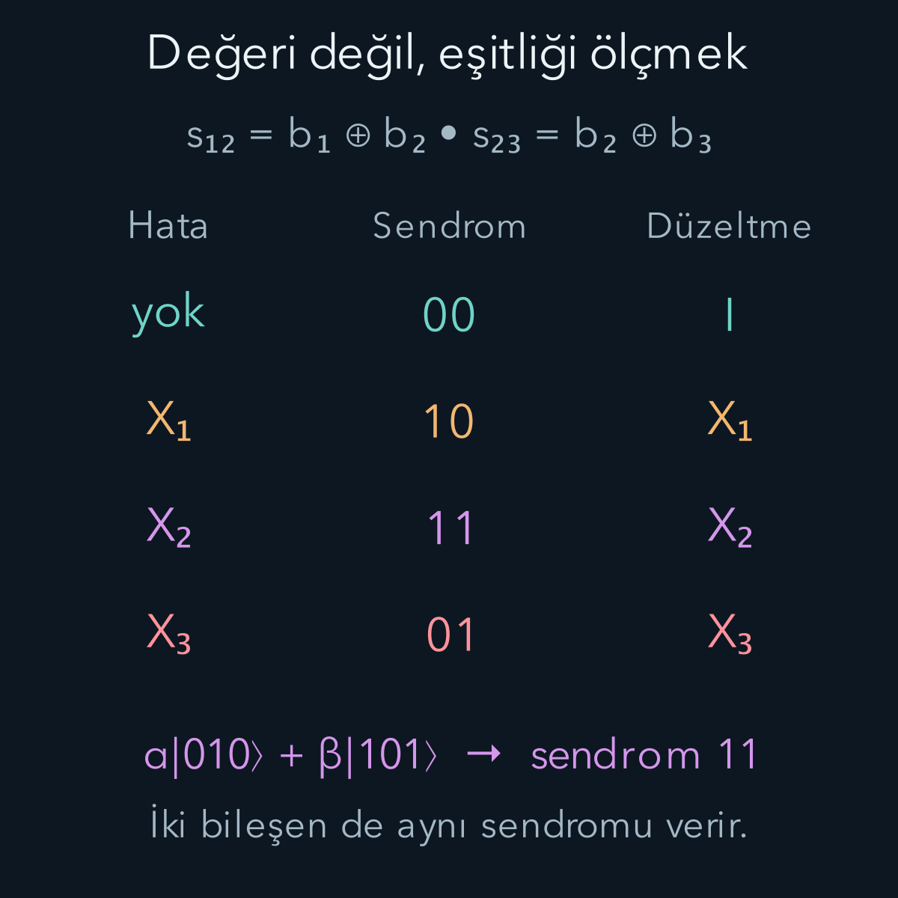
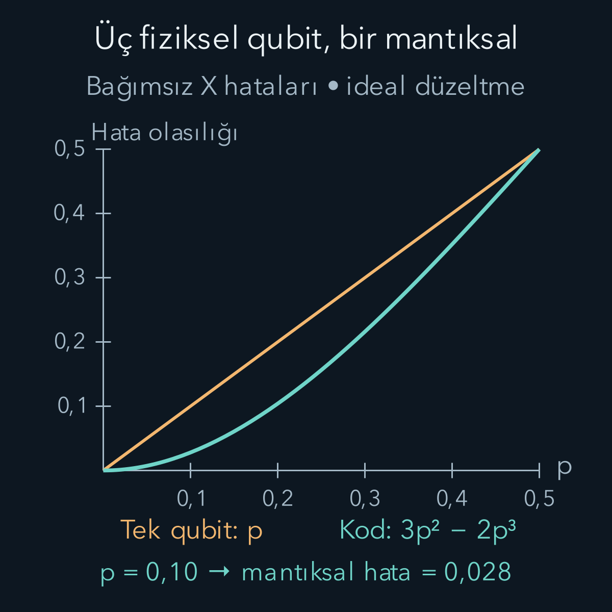

import ArticleVideo from '@/components/ArticleVideo.astro'
import kavram from './media/01-kavram.mp4?url'
import kavramPoster from './media/01-kavram.jpg?url'

Üç klasik bite 000 yazdığımızı, iletim sırasında ortadaki bitin değişerek 010 olduğunu düşünelim. En fazla bir bitin bozulduğunu biliyorsak çoğunluğa bakıp başlangıcın 000 olduğunu çıkarabiliriz. Bu basit fikir kuantum bilgisini korumak için de bir başlangıç sunar. Fakat qubitlerin değerlerini tek tek okuyup çoğunluğunu seçmek, bilinmeyen süperpozisyonu yok edebilir.

Kuantum hata düzeltmede amaç **korunan bilgiyi öğrenmeden, hatayı ayırt edecek bilgiyi çıkarmaktır**. Bunun için bir mantıksal qubiti birkaç fiziksel qubitin ortak durumuna kodlayacağız. Ölçümlerimiz “ilk bit sıfır mı?” sorusunu değil, “bu iki bit birbirine eşit mi?” sorusunu cevaplayacak. Ayrım küçük görünür; süperpozisyonun korunmasını sağlayan nokta tam olarak budur.

[Kapılar ve devrelerdeki](/blog/kuantum-kapilari-ve-devreler/) CNOT, X, Z ve H işlemlerini, [kanallar yazısındaki](/blog/kuantum-kanallari-ve-dekoherens/) gürültü fikrini kullanacağız. [Algoritmalarda](/blog/kuantum-algoritmalarinda-girisim/) göreli fazın cevabı nasıl belirlediğini gördük. Bu nedenle yalnız sıfır/bir ölçüm olasılıklarını değil, göreli fazı da korumamız gerekiyor. İlk kodumuz yalnız bit çevirme hatasına karşı çalışacak; bu sınırı hesabın sonunda açıkça göreceğiz.

## 1. Fiziksel qubit ile mantıksal qubit

Saklamak istediğimiz durum:

$$
|\psi\rangle=\alpha|0\rangle+\beta|1\rangle,
\qquad |\alpha|^2+|\beta|^2=1
$$

olsun. Alfa ve beta karmaşık genliklerdir. Fiziksel qubit, kapı uyguladığımız ve gürültüye maruz kalan gerçek iki düzeyli sistemdir. Mantıksal qubit ise bilgiyi yorumladığımız iki boyutlu kod uzayıdır. Birden çok fiziksel sistem birlikte tek bir mantıksal qubit taşıyabilir.

Üç qubitlik tekrar kodunda iki mantıksal baz durumu tanımlarız:

$$
|0_L\rangle=|000\rangle,
\qquad |1_L\rangle=|111\rangle.
$$

L alt indisi “mantıksal” anlamındadır. Kodlanmış genel durum:

$$
|\psi_L\rangle=\alpha|000\rangle+\beta|111\rangle
$$

olur. Üç fiziksel qubitin durum uzayı sekiz boyutludur; kod bunların yalnız 000 ve 111 doğrultularınca gerilen iki boyutlu bölümünü kullanır. Diğer doğrultuların bir kısmı hatanın bilgiyi götürebileceği yerlerdir. Kullanmadığımız bu ek alan, doğru hataları birbirinden ayırt etmek için alan sağlar.

Hatasız durumda üçlü ölçüm yaparsak yalnız 000 veya 111 görürüz. Ama kod yalnız bu iki klasik sözcüğün saklanması değildir. Alfa ve beta arasındaki göreli faz da ortak durumda durur. Bu fazı kaybedip aynı iki sözcüğün klasik karışımını elde etmek, bir kuantum belleği doğru korumak sayılmaz.

## 2. Kodlama neden klonlama değildir?

İlk qubit bilinmeyen durumda, öteki ikisi sıfırda başlasın. Qubitleri soldan sağa 1, 2, 3 diye numaralandırıyoruz. Önce 1 kontrol, 2 hedef CNOT; sonra 1 kontrol, 3 hedef CNOT uygularız:

$$
\begin{aligned}
|\psi\rangle|00\rangle
&=\alpha|000\rangle+\beta|100\rangle\\
&\longrightarrow\alpha|000\rangle+\beta|110\rangle\\
&\longrightarrow\alpha|000\rangle+\beta|111\rangle.
\end{aligned}
$$

Genlikler bu işlemi tanımlarken bilinmek zorunda değildir. Kapıların doğrusallığı aynı devrenin her alfa ve betada çalışmasını sağlar. Ancak ortaya çıkan durum $|\psi\rangle\otimes|\psi\rangle\otimes|\psi\rangle$ değildir. Bilinmeyen üç ayrı kopya üretmedik; bilgiyi ortak bir duruma yerleştirdik.

Örneğin başlangıç artı durumu, yani $\alpha=\beta=1/\sqrt2$ olsun. Kodlama $(|000\rangle+|111\rangle)/\sqrt2$ verir. Üç bağımsız artı kopyasının açılımında ise sekiz baz sözcüğünün her biri $1/\sqrt8$ genliğiyle bulunurdu. Biri iki terimli, diğeri sekiz terimli bu durumlar aynı değildir. Dolayısıyla klonlama yasağıyla bir çelişki yoktur.

Kodlanmış durumun yalnız ilk fiziksel qubitini incelersek yerel yoğunluk matrisi köşegendir: $|\alpha|^2|0\rangle\langle0|+|\beta|^2|1\rangle\langle1|$. Bu tek alt sistem, genellikle ilk saf durumu taşımaz. Göreli faz üç sistem arasındaki ortak ilişkilerde saklanır. Bir fiziksel qubiti alıp kodun bağımsız bir kopyası gibi kullanamayız.

## 3. Düzeltmeyi vaat ettiğimiz hata sınıfı

X kapısı, hesaplama bazında sıfır ile biri değiştirir. $X_1=X\otimes I\otimes I$ ilk qubitin değişimini ifade etsin; I birim işlemdir. $X_2$ ve $X_3$ benzer biçimde ikinci ve üçüncü qubite etki eder. Şimdilik bir düzeltme çevriminde ya hiç hata olmadığını ya da **en fazla bir X hatası** olduğunu varsayalım.

İkinci qubit değişirse:

$$
X_2|\psi_L\rangle=\alpha|010\rangle+\beta|101\rangle.
$$

Alfa ve beta kaybolmadı; fakat iki kod sözcüğü izin verilen kod uzayının dışına çıktı. Hangi qubitin değiştiğini öğrenebilirsek aynı X'i tekrar uygulayabiliriz. Çünkü X'in karesi I olduğundan iki kez bit çevirme başlangıcı geri getirir.

Sorun, bunu genlikleri bozmadan anlamaktır. İlk qubiti doğrudan ölçersek 010 ile 101'i ayırırız. Ölçüm sonucu 0 geldiğinde beta bileşeni, 1 geldiğinde alfa bileşeni silinir. Ardından bitleri düzeltmek kaybolan göreli fazı geri getirmez. Hata yerini öğrenmek için bu kadar fazla bilgi ölçmememiz gerekir.

## 4. Parite: değerleri açıklamayan karşılaştırma

Bir baz sözcüğünün basamakları $b_1,b_2,b_3$ olsun. Komşu çiftler için iki parite biti tanımlayalım:

$$
\begin{aligned}
s_{12}&=b_1\oplus b_2,\\
s_{23}&=b_2\oplus b_3.
\end{aligned}
$$

$\oplus$ ikiye göre toplamdır: Eşit bitler 0, farklı bitler 1 verir. Pariteyi “eşitlik denetimi” olarak okuyabiliriz. 000 ve 111'in ikisi de 00 sonucunu verir. Bu ölçüm onları birbirinden ayırmaz. Ortadaki hata sonrası 010 için 11, onun tamamlayıcısı 101 için de 11 çıkar. Yine alfa ve beta bileşenleri ayırt edilmez.

Bu iki klasik bitin birlikte oluşturduğu kayda **hata sendromu** denir. Sendrom sıramız daima $s_{12}s_{23}$ olacaktır. Ölçümü işleçlerle ifade etmek istersek iki gözlenebilir $Z_1Z_2$ ve $Z_2Z_3$'tür. Z, 0 üzerinde artı bir, 1 üzerinde eksi bir özdeğerine sahiptir. İki Z özdeğerinin çarpımı eşit bitlerde artı bir, farklı bitlerde eksi birdir.

Böylece özdeğer artı biri sendrom biti 0, eksi biri sendrom biti 1 olarak kaydederiz. İki gözlenebilirin aynı anda kullanılabilmesinin nedeni birbirleriyle komütatif olmalarıdır: İkisi de hesaplama bazında köşegendir. Özdeğerlerle sendrom bitleri arasındaki bu kodlamayı belirtmezsek aynı fiziksel sonuç farklı tablolarda ters işaretlerle görünebilir.

## 5. Yardımcı qubitlerle pariteyi çıkarmak

İki yardımcı qubiti 00'da hazırlayalım. Bunlar bilgi taşıyan üç veri qubitinden ayrıdır. Birinci yardımcıya önce veri 1, sonra veri 2 kontrol olacak biçimde CNOT uygulayalım. Yardımcı başlangıçta sıfır olduğundan ilk CNOT sonrasında $b_1$, ikinci sonrasında $b_1\oplus b_2$ taşır. Veri qubitleri bu temel durum hesabında değişmez.

İkinci yardımcıya da veri 2 ve veri 3'ten CNOT uygulanır. Ortak dönüşüm kısa biçimde:

$$
\begin{aligned}
&|b_1b_2b_3\rangle|00\rangle\\
&\quad\longrightarrow |b_1b_2b_3\rangle|s_{12}s_{23}\rangle.
\end{aligned}
$$

İkinci qubitte hata örneğinde iki veri bileşeninin de sendromu 11 olduğundan sonuç:

$$
\bigl(\alpha|010\rangle+\beta|101\rangle\bigr)|11\rangle
$$

olur. Yardımcıların 11 durumunu ölçmek, veri parantezinin içindeki iki genlik arasında seçim yapmaz. Çarpan olarak ayrılabildiği için yardımcı ölçümü bu veri süperpozisyonunu değiştirmez. Hatasız kodda aynı gerekçe yardımcıların 00 sonucuyla çalışır.

Bu, ölçümün her zaman zararsız olduğu anlamına gelmez. Seçtiğimiz ölçüm, düzeltilebilir bir hata dalı içindeki bütün mantıksal durumlara aynı sonucu verdiği için bilgiyi korur. Yanlış gözlenebilir ölçersek veya veri qubitlerini gereksiz yere çevreye açarsak durum bozulabilir. Hata düzeltmenin tasarımı hangi bilginin dışarı çıkarıldığını dikkatle seçer.

## 6. Sendrom tablosunu gerekçesiyle okumak

İlk qubit değişirse ilk çift farklı, ikinci çift aynı olur: 10. İkinci qubit değişirse her iki çift farklıdır: 11. Üçüncü değişirse yalnız ikinci çift farklıdır: 01. Böylece tablo:

| Hata | Sendrom | Düzeltme |
| --- | --- | --- |
| Yok | 00 | $I$ |
| $X_1$ | 10 | $X_1$ |
| $X_2$ | 11 | $X_2$ |
| $X_3$ | 01 | $X_3$ |

Tablo en fazla bir X hatası koşuluyla okunur. 00 kaydı genel olarak “evrende hiçbir hata olmadı” demek değildir; seçilmiş ölçümlerin hata göstermediğini söyler. Örneğin üç bitin birden değişmesi de 000 ile 111'i yer değiştirdiği için sendromu 00 bırakır.

Sayısal bir örnek seçelim: $\alpha=\sqrt3/2$, $\beta=i/2$. İkinci qubitte hata sonrası durum:

$$
|\chi\rangle=\frac{\sqrt3}2|010\rangle+\frac i2|101\rangle.
$$

Sendrom 11'dir; ölçümün bu sonucu verme olasılığı birdir, çünkü bütün normalize durum aynı sendrom altuzayındadır. Tablo X₂ uygulanmasını söyler. Sonuç:

$$
X_2|\chi\rangle=\frac{\sqrt3}2|000\rangle+\frac i2|111\rangle.
$$

Başlangıçtaki mantıksal durum, karmaşık göreli fazıyla birlikte geri geldi. Veri qubitlerinin hiçbirinin 0 mı 1 mi olduğu okunmadı. Şimdi kodlamayı tersine çevirirsek iki CNOT, bu ortak durumu ilk qubitte $|\psi\rangle$ ve diğer ikisinde 00 durumuna ayırır. Bellekte korumaya devam edeceksek kodu çözmek yerine yeni yardımcılarla sendrom çevrimini yineleyebiliriz.

<ArticleVideo src={kavram} poster={kavramPoster} title="Mantıksal bilgiyi okumadan bit hatasını düzeltmek" caption="İkinci veri qubitindeki X hatası, 000/111 bileşenlerini 010/101 yapar. Her iki bileşen sendrom 11 verir; X₂ uygulanınca kod durumu geri gelir. Ekrandaki sendrom geçmiş ölçüm kaydıdır. Hareket ayrık adımları gösterir; yeni bir fiziksel zaman evrimi modeli değildir." />

## 7. İki hata neden yanlış düzeltmeye yol açar?

Birinci ve ikinci qubitin birlikte değiştiğini düşünelim. Durum $\alpha|110\rangle+\beta|001\rangle$ olur. Her iki bileşenin sendromu 01'dir. Tablo bunu üçüncü qubit hatası sanır ve X₃ uygular. Sonuç:

$$
\alpha|111\rangle+\beta|000\rangle
$$

olur. Kod uzayına geri döndük, ama mantıksal sıfır ile biri değiştirdik. Bu işleme mantıksal X hatası denir; $X_L|0_L\rangle=|1_L\rangle$ ve $X_L|1_L\rangle=|0_L\rangle$ ile tanımlanır. Üç fiziksel X'in çarpımı bu mantıksal işlemi gerçekleştirir.

Burada sendrom aygıtı yanlış ölçüm yapmadı. İki farklı hata deseni aynı sendromu verdi; bizim düzelticimiz daha az hata olduğu varsayımıyla karar verdi. Kodun güvencesinin hata sınıfıyla birlikte belirtilmesinin nedeni budur. Kod uzayına geri dönmek de tek başına doğru bilginin geri geldiğini kanıtlamaz.

## 8. Bağımsız bit hatalarında kazanç hesabı

Her fiziksel qubitin bir çevrimde bağımsız olarak p olasılıkla X hatasına uğradığını, 1−p olasılıkla değişmediğini varsayalım. p, sıfır ile bir arasında bir sayıdır. Kodlama, sendrom ölçümü ve düzeltme kapıları bu hesapta kusursuz kabul ediliyor. Başarısız mantıksal X olayı, iki veya üç fiziksel bitin değişmesidir.

Tam iki hata için üç konum çifti vardır: 12, 13, 23. Her birinin olasılığı bağımsızlıktan $p^2(1-p)$ olur. Üç hatanın olasılığı $p^3$'tür. Dolayısıyla mantıksal hata katsayısı:

$$
\begin{aligned}
p_L&=3p^2(1-p)+p^3\\
&=3p^2-2p^3.
\end{aligned}
$$

L alt indisi yine mantıksal düzeyi gösterir. Küçük p'de başlıca terim $3p^2$ olduğundan hata birinci dereceden ikinci dereceye bastırılır. Örneğin p=0,10 için $p_L=0,03-0,002=0,028$ olur; yüzde 10 fiziksel hata bu ideal modelde yüzde 2,8 mantıksal X olayına iner. p=0,01 için sonuç 0,000298, yani yüzde 0,0298'dir.

Kazanç koşulunu da bulabiliriz:

$$
p_L-p=p(1-p)(2p-1).
$$

$0<p<1/2$ olduğunda ilk iki çarpan pozitif, sonuncu negatiftir; bu yüzden kodun hata katsayısı küçülür. p=1/2'de iyileşme yoktur. Bu sınır gerçek aygıtlar için evrensel bir hata düzeltme eşiği değildir; yalnız bağımsız X hataları ve kusursuz yardımcı işlemler modelinin sonucudur.

$p_L$'yi her giriş durumunun mutlaka bu oranda ayırt edilebilir biçimde bozulmasıyla karıştırmayalım. Etkin kanal, $1-p_L$ ağırlıkla hiçbir mantıksal işlem yapmaz, $p_L$ ağırlıkla X_L uygular. Mantıksal artı durumu X_L'nin özdurumu olduğundan bu özel giriş değişmeyebilir. Katsayı, bütün olası mantıksal bilgiyi korumak isteyen bellekte kalan hata sürecini tarif eder.

Bağımsızlık da belirleyicidir. Ortak bir çevresel etki iki qubiti birlikte birinci dereceden olasılıkla çeviriyorsa başarısızlık artık p² ile başlamayabilir. Üç ayrı bileşenin bireysel hata oranlarını bilmek, ortak hata olasılıklarını bilmek değildir. Grafik, bu nedenle üzerinde yazan gürültü modelinin dışına doğrudan taşınamaz.

## 9. Faz hatası bu koddan nasıl kaçar?

İlk qubite Z uygulayalım. 000 terimi değişmez, 111 terimi eksi alır:

$$
Z_1|\psi_L\rangle=\alpha|000\rangle-\beta|111\rangle.
$$

İki terimde de komşular hâlâ eşittir; sendrom 00 çıkar. Fakat göreli faz değişti. Başlangıç mantıksal artı durumuyken bu işlem mantıksal eksi durumunu üretir; iki durum birbirine diktir ve uygun ölçümle kesin ayırt edilir. Dolayısıyla “sendrom temiz” ile “kuantum bilgi sağlam” aynı önerme değildir.

Üç fiziksel qubitin herhangi birindeki tek Z, kod uzayında aynı mantıksal Z etkisini yapar. Kod bu hata sınıfını düzeltmez. Hesaplama bazı sözcüklerinin üç yerde farklı olması, kodun her tür tek qubit hatasını düzelttiği anlamına gelmez.

Bazı değiştirmek bir yönde çözüm sağlar: Her qubite H uygulayarak $\alpha|+++\rangle+\beta|---\rangle$ kodunu elde ederiz. Z, artı ile eksi durumlarını değiştirdiği için bu kod tek faz hatasına karşı bir tekrar kodu gibi çalışır. Uygun parite gözlenebilirleri artık $X_1X_2$ ve $X_2X_3$ olur. Ancak bu kez genel bit hatası korunmaz. Sadece aynı üç qubit üzerinde baz seçimini değiştirmek, iki korumayı birden ücretsiz sağlamaz.

## 10. Sürekli gürültüden genel kodlara

Gerçek hata mutlaka tam X veya Z kapısı biçiminde gerçekleşmez. Örneğin küçük bir dönme, I ve X'in doğrusal birleşimi olabilir. Düzeltilebilir bir konumdaki böyle bir hata, kodu “hatasız dal” ile “X hatalı dal” süperpozisyonuna götürür. Parite ölçümü bu dalları ayırır; her dalda aynı bilinmeyen mantıksal bilgi kaldığı için uygun düzeltme onu geri getirir. Sürekli genliklerin varlığı tek başına hata düzeltmeyi imkânsız kılmaz.

Genel tek qubit işlemleri I, X, Y, Z matrislerinin doğrusal birleşimiyle yazılabilir; Y, bit değişimini faz değişimiyle birleştiren üçüncü Pauli matrisidir: $Y=iXZ$, dolayısıyla $Y|0\rangle=i|1\rangle$ ve $Y|1\rangle=-i|0\rangle$ olur; i sanal birimdir. Genel tek qubit hatalarına dayanıklı bir kod, izin verilen konumlarda bu farklı etkileri ve onların birleşimlerini doğru ele almalıdır. Üç qubitlik bit tekrar kodu bunu yapmaz. Daha geniş kodlar, örneğin dokuz qubitlik Shor kodu, bit ve faz korumasını uygun biçimde bir araya getirir.

Gerçek aygıtta yardımcı qubitler, CNOT'lar ve ölçümler de hata yapar. Hatalı bir sendrom, sağlam bir qubite yanlış düzeltme uygulanmasına yol açabilir; bir kapı hatası birden fazla veri qubitine yayılabilir. Bu nedenle hata düzeltme devresinin kendisini de hataların yayılmasını sınırlayacak biçimde tasarlamak gerekir. Bu çalışma alanına hataya dayanıklı kuantum hesaplama denir. Yalnız daha fazla qubit eklemek, uygun devre ve gürültü koşulları olmadan daha iyi bellek garanti etmez.

Burada tamamladığımız hesap, bütün mühendislik sorunlarını çözmez; korumanın nasıl mümkün olduğunu gösterir. Bilgiyi ortak bir kod uzayına yerleştirdik, mantıksal değeri açıklamayan iki karşılaştırma ölçtük ve belirli bir hata sınıfını düzelttik. Başarıyı da sınırını da aynı matematikten çıkardık: Bir X düzeltilebilir, iki X yanıltabilir, tek Z görünmeden mantıksal bilgiyi değiştirebilir.

## Kaynaklar

Tekrar kodunun kodlama devresi, sendrom ölçümleri ve faz hatası sınırı [IBM Quantum Learning — Repetition codes](https://quantum.cloud.ibm.com/learning/en/courses/foundations-of-quantum-error-correction/correcting-quantum-errors/repetition-codes) ile doğrulandı. Ölçümün mantıksal bilgiyi açıklamaması, düzeltilebilir hata uzayları ve genel kodlara geçiş için [John Preskill — Quantum Error Correction](https://www.preskill.caltech.edu/ph219/chap7_26_6A.pdf) kontrol edildi. Bu yazıdaki 1–2–3 qubit sırası, sayısal karmaşık durum, olasılık açılımı ve görseller bağımsız hesaplanarak hazırlandı.

Kaynak erişimi ve formül kontrolü: **13 Ekim 2026**.
