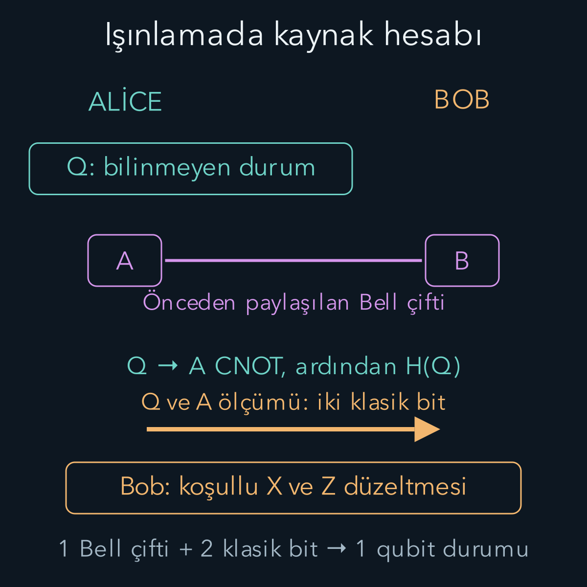
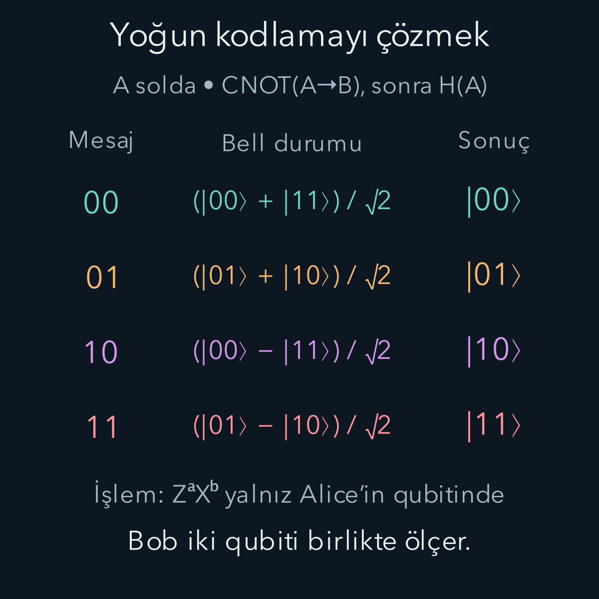

import ArticleVideo from '@/components/ArticleVideo.astro'
import kavram from './media/01-kavram.mp4?url'
import kavramPoster from './media/01-kavram.jpg?url'

Alice'in laboratuvarında bir qubit, Bob'un laboratuvarında başka bir qubit bulunsun. Alice kendi qubitinin nasıl hazırlandığını bilmiyor. Amaç, bu bilinmeyen kuantum durumunu Bob'un elindeki sisteme aktarmak. Durumu ölçüp sonucu telefonla söylemek genellikle yeterli değildir: Tek ölçüm, durumun bütün karmaşık genliklerini ortaya çıkarmaz. Üstelik ölçüm, korunmasını istediğimiz süperpozisyonu değiştirebilir.

**Kuantum ışınlama**, önceden paylaşılmış dolanıklığı ve iki klasik biti birlikte kullanarak bu aktarımı yapar. Taşınan şey maddenin kendisi değil, bir fiziksel sistemde bulunan kuantum bilgisidir. Bob'un laboratuvarında son durumu taşıyacak fiziksel qubit zaten vardır. İşlem sonunda Alice'in ilk qubitinde ikinci bir kusursuz kopya kalmaz.

[Kapılar ve devreler yazısındaki](/blog/kuantum-kapilari-ve-devreler/) X, Z, H ve CNOT işlemlerini kullanacağız. Gereken diğer iki fikir, birleşik sistemlerin durumlarını yan yana yazarak ifade etmek ve olasılığı genliğin mutlak karesiyle bulmaktır. Bu yazıda qubit sırasını her hesapta açıkça belirteceğiz. Kaynakların veya yazılım araçlarının farklı sıra kullanması fiziksel sonucu değiştirmez; fakat hangi klasik bitin hangi düzeltmeyi yönettiğini değiştirir.

## 1. Önce aktarılacak durum ile hazır kaynağı ayıralım

Alice'in bilinmeyen qubitine Q diyelim. Durumu:

$$
|\psi\rangle_Q=\alpha|0\rangle_Q+\beta|1\rangle_Q,
\qquad |\alpha|^2+|\beta|^2=1
$$

olsun. Alfa ve beta, karmaşık olabilen olasılık genlikleridir. Alt indis Q, durumun hangi sisteme ait olduğunu gösterir; çarpma işlemi değildir. Alice'in ayrıca A, Bob'un B adlı birer qubiti vardır. Bu ikisi önceden şu Bell durumunda hazırlanmıştır:

$$
|\Phi^+\rangle_{AB}=\frac{|00\rangle_{AB}+|11\rangle_{AB}}{\sqrt2}.
$$

İlk basamak A'ya, ikinci B'ye aittir. Hesaplama bazında her biri tek başına rastgele sonuç verirken ortak ölçümleri aynı çıkar. Ancak Bell durumunu yalnız bu klasik ilişki tanımlamaz: İki terim arasındaki göreli faz da belirli olduğu için uygun başka bazlarda girişim görülebilir. Eşit olasılıkla 00 veya 11 hazırlanan klasik karışım, bu saf dolanık durumla aynı kaynak değildir.

Bell çiftini hazırlamak için başlangıçtaki 00 durumunda A'ya H, ardından A kontrol ve B hedef olacak biçimde CNOT uygulayabiliriz. Çifti iki laboratuvara dağıtmak fiziksel iletişim gerektirir. Işınlama hesabı, bu dağıtımın önceden başarıyla tamamlandığını varsayar. Dolanıklığı başlangıçta verilmiş kabul etmemiz onun bedelsiz üretildiği anlamına gelmez.

## 2. Üç qubitin açılımını birlikte izlemek

Bundan sonra üçlü ket sıramız daima **Q, A, B** olacak. Örneğin 101, Q'nun 1, A'nın 0, B'nin 1 olduğunu söyler. Başlangıç durumu çarpımını dağıtalım:

$$
\begin{aligned}
|\Psi_0\rangle
&=|\psi\rangle_Q|\Phi^+\rangle_{AB}\\
&=\frac1{\sqrt2}\bigl(
\alpha|000\rangle+\alpha|011\rangle\\
&\qquad+\beta|100\rangle+\beta|111\rangle\bigr).
\end{aligned}
$$

Alice önce Q kontrol, A hedef olacak biçimde CNOT uygular. Q sıfırken A değişmez; Q birken A ters çevrilir. B'ye henüz hiçbir kapı uygulanmaz. Bu nedenle 100 terimi 110'a, 111 terimi 101'e gider:

$$
\begin{aligned}
|\Psi_1\rangle=\frac1{\sqrt2}\bigl(&\alpha|000\rangle+\alpha|011\rangle\\
&+\beta|110\rangle+\beta|101\rangle\bigr).
\end{aligned}
$$

Ardından yalnız Q'ya Hadamard uygulanır. H'nin iki temel etkisi:

$$
\begin{aligned}
H|0\rangle&=\frac{|0\rangle+|1\rangle}{\sqrt2},\\
H|1\rangle&=\frac{|0\rangle-|1\rangle}{\sqrt2}.
\end{aligned}
$$

Örneğin beta ile gelen 110 terimi, beta çarpı 010 eksi 110 birleşimine dönüşür. Önceki normalizasyon katsayısıyla yeni katsayı çarpıldığı için her terimin önünde 1/2 bulunur. Tam açılım:

$$
\begin{aligned}
|\Psi_2\rangle=\frac12\bigl(&\alpha|000\rangle+\alpha|100\rangle\\
&+\alpha|011\rangle+\alpha|111\rangle\\
&+\beta|010\rangle-\beta|110\rangle\\
&+\beta|001\rangle-\beta|101\rangle\bigr).
\end{aligned}
$$

Buradaki sekiz terim sekiz ayrı deney değildir. Tek birleşik durumun, seçtiğimiz ortonormal bazdaki bileşenleridir. Alice'in hangi sonucu görebileceğini anlamak için terimleri ilk iki basamağa göre yeniden gruplayacağız. Dağılma özelliğini ters yönde kullanarak ortak 00, 01, 10 ve 11 çarpanlarını dışarı almak yeterlidir.

## 3. Dört ölçüm dalı, dört düzeltme

Alice'in Q ölçüm sonucuna q, A ölçüm sonucuna a diyelim. Klasik mesajı **qa sırasıyla** yazıyoruz. Bob'un dört normalize dalına $|\chi_{qa}\rangle$ adını verelim. Her biri son qubitin durumudur:

$$
\begin{aligned}
|\chi_{00}\rangle&=\alpha|0\rangle+\beta|1\rangle,\\
|\chi_{01}\rangle&=\beta|0\rangle+\alpha|1\rangle,\\
|\chi_{10}\rangle&=\alpha|0\rangle-\beta|1\rangle,\\
|\chi_{11}\rangle&=-\beta|0\rangle+\alpha|1\rangle.
\end{aligned}
$$

Bu tanımlarla gruplanmış üçlü durum:

$$
\begin{aligned}
|\Psi_2\rangle=\frac12\bigl(&|00\rangle|\chi_{00}\rangle
+|01\rangle|\chi_{01}\rangle\\
&+|10\rangle|\chi_{10}\rangle
+|11\rangle|\chi_{11}\rangle\bigr).
\end{aligned}
$$

Her çarpımdaki son ket B'ye aittir. Bu ifadeyi okurken ölçümden önce Bob'un aynı anda dört ayrı qubiti olduğunu düşünmeyelim. Birleşik durumda dört olası klasik sonuç ile dört koşullu Bob durumu ilişkilendirilmiştir.

00 dalının olasılığı, o dalın norm karesidir:

$$
\begin{aligned}
P(00)&=\left\|\frac12|\chi_{00}\rangle\right\|^2\\
&=\frac{|\alpha|^2+|\beta|^2}{4}=\frac14.
\end{aligned}
$$

Diğer dallar yalnız işaret veya bileşen sırası bakımından farklı olduğundan onların normları da aynıdır. Böylece her sonuç yüzde 25 olasılıkla çıkar. Bu olasılıklar alfa ve betaya bağlı değildir: İki klasik bit, bilinmeyen durumun genliklerini tarif eden bir dosya taşımaz.

| qa | Bob'un durumu | Düzeltme |
| --- | --- | --- |
| 00 | $\vert \psi\rangle$ | $I$ |
| 01 | $X\vert \psi\rangle$ | $X$ |
| 10 | $Z\vert \psi\rangle$ | $Z$ |
| 11 | $XZ\vert \psi\rangle$ | $ZX$ |

I hiçbir şey değiştirmeyen birim işlemdir. X sıfır ile birin genliklerini yer değiştirir; Z yalnız bir bileşeninin işaretini ters çevirir. Matris çarpımı sağdan sola uygulandığı için **ZX, önce X sonra Z** demektir. Özellikle 11 dalında:

$$
\begin{aligned}
-\beta|0\rangle+\alpha|1\rangle
&\xrightarrow{X}\alpha|0\rangle-\beta|1\rangle\\
&\xrightarrow{Z}\alpha|0\rangle+\beta|1\rangle.
\end{aligned}
$$

Düzeltme genel olarak $Z^qX^a$ yazılabilir. Sıfırıncı kuvvet I, birinci kuvvet kapının kendisidir. Bob yanlışlıkla 11 dalında XZ sırasını uygularsa sonucun tamamı eksi işaret alır. Çünkü $XZ=-ZX$ olur. Bütün durumdaki tek eksi, gözlenemeyen genel fazdır; bu dal için fiziksel durum yine doğrudur. Fakat yalnız beta önündeki eksiyi genel faz sanmak yanlıştır. O, girişim deneyini değiştiren göreli fazdır.

## 4. Karmaşık genlikli bir örneği bitirelim

$\alpha=\sqrt3/2$ ve $\beta=i/2$ seçelim; i, karesi eksi bir olan sanal birimdir. Normalizasyon $3/4+1/4=1$ olur. Alice 11 bulduğunda Bob'un durumu:

$$
|\chi\rangle_B=-\frac i2|0\rangle+\frac{\sqrt3}2|1\rangle
$$

olur. X uygulaması iki genliği değiştirir, ardından Z son bileşenin işaretini çevirir:

$$
\begin{aligned}
X|\chi\rangle_B&=\frac{\sqrt3}2|0\rangle-\frac i2|1\rangle,\\
ZX|\chi\rangle_B&=\frac{\sqrt3}2|0\rangle+\frac i2|1\rangle.
\end{aligned}
$$

Yalnız sıfır ve bir olasılıkları değil, karmaşık göreli faz da aktarılmıştır. Bob'un doğru olasılıkları elde etmesi tek başına yeterli bir başarı ölçütü olmazdı. Örneğin betayı eksi i/2 yapmak aynı hesaplama bazı olasılıklarını verir; fakat başka bir bazda ayırt edilebilir. Işınlama devresi bu daha güçlü koşulu, bütün durumun korunmasını sağlar.

Animasyonda işaretleri daha kolay görmek için beta gerçek 1/2 seçildi. Dört dalın her biri aynı başlangıç durumuna dönüyor. Bu dallar gerçek deneyde sırayla yaşanmaz; tek çalıştırmada yalnız biri gerçekleşir. Gösterim, dört olası sonucu karşılaştıran bir anlatımdır.

<ArticleVideo src={kavram} poster={kavramPoster} title="Işınlamanın dört ölçüm dalı" caption="Q ve A ölçümlerinin qa sırasındaki 00, 01, 10, 11 sonuçları sırasıyla I, X, Z ve ZX düzeltmelerini seçer. Her dalın olasılığı dörtte birdir. ZX sağdan sola uygulanır: önce X, sonra Z." />

## 5. Klasik mesaj gelmeden Bob ne bilir?

Bob Alice'in sonucunu bilmiyorsa dört koşullu durumu olasılıklarıyla birlikte hesaba katmalıdır. [Kuantum kanalları yazısındaki](/blog/kuantum-kanallari-ve-dekoherens/) yoğunluk matrisi dili bunu kısa ifade eder. Başlangıcın yoğunluk matrisi $\rho=|\psi\rangle\langle\psi|$ olsun. Bob'un düzeltmeden önceki yerel matrisi:

$$
\begin{aligned}
\rho_B=\frac14\bigl(&\rho+X\rho X\\
&+Z\rho Z+XZ\rho ZX\bigr)
=\frac I2.
\end{aligned}
$$

Son eşitliği görmek için $\rho$'nun köşegenini $|\alpha|^2,|\beta|^2$, köşegen dışını $\alpha\beta^*,\alpha^*\beta$ yazabiliriz; yıldız karmaşık eşleniktir. Z ile gelen terimler köşegen dışı katkıların işaretini değiştirir, böylece toplamda onlar silinir. X ile gelen terimler iki köşegen elemanını yer değiştirir. Her köşegen toplamı $2(|\alpha|^2+|\beta|^2)=2$ olur; dörtte birle çarpınca 1/2 çıkar.

Sonuç başlangıç durumundan bağımsızdır. Bob yalnız kendi qubitinde hangi ölçümü yaparsa yapsın Alice'in bilinmeyen durumunu veya ölçüm sonucunu buradan okuyamaz. Mesaj gelince hangi düzeltmenin gerektiğini öğrenir. Bu mesaj normal bir fiziksel iletişim kanalıyla taşınacağından ışınlama ışıktan hızlı haberleşme sağlamaz. Uzaklık, cebirsel protokolün doğruluğunu değiştirmez; mesajın ulaşma süresini ve gerçek kanalların kayıp sorunlarını değiştirir.

Koşullu durumun değişmesiyle kullanılabilir mesajın ulaşması aynı olay değildir. Alice'in kaydını sonradan Bob'un kayıtlarıyla birleştirirsek alt gruplarda beklenen ilişkileri görürüz. Fakat bu grupları belirlemek için de kayıt paylaşımı gerekir. Bu ayrım, dolanıklıkla ilgili görünen iletişim çelişkisini ortadan kaldırır.

## 6. Neden bir kopya üretmedik?

Ölçümden sonra Alice'in Q ve A sistemleri qa sonucuna karşılık gelen baz durumundadır. Başlangıçtaki bilinmeyen süperpozisyon Q'da korunmaz. Bell çiftinin dolanıklığı da tüketilir; aynı çiftle yeni bir qubiti yeniden ışınlayamayız. Bir sonraki aktarım için yeni bir ortak kaynak gerekir.

Burada Alice'in genlikleri bilmemesi sorun değildir. Uyguladığı kapılar alfa ve beta değerlerine göre seçilmez; yalnız ölçüm sonuçlarına göre Bob'un son düzeltmesi seçilir. Doğrusallık, aynı devrenin izin verilen bütün genliklerde çalışmasını sağlar. Q başka bir referans sistemle dolanık olsa da kapılar o referansa dokunmadan Q'nun korelasyonlarını B'ye aktarır. Bu durumda tek başına Q'ya saf bir durum vektörü atamayız; yine de protokol bütün birleşik durum üzerinde geçerlidir.

Işınlamayı klasik bir resim dosyasının gönderilmesine benzetmek bu noktada sınırlıdır. Dosyanın içeriğini okuyup çoğaltabiliriz; bilinmeyen tek kuantum durumunun eksiksiz klasik tarifini tek örnekten elde edemeyiz. Işınlama böyle bir tarif çıkarmaz. Durumu taşıyan fiziksel sistem değişirken sonraki deneylerin istatistikleri korunur.

Işınlamanın başarısını sınayan bir deneyde hazırlayıcı, seçtiği durumları test ekibinden saklayabilir. Bob protokolü tamamladıktan sonra bu durumlar farklı ölçüm bazlarında çok sayıda tekrar üzerinden karşılaştırılır. Tek bir qubitin tek ölçüm sonucu, aktarımın bütün durumlar için doğru olduğunu kanıtlamaz. Örneğin sürekli sıfır gönderen kusurlu bir aygıt, başlangıç zaten sıfır seçildiğinde başarılı görünür. Artı ve karmaşık fazlı durumların da denenmesi, yalnız baz değerlerini koruyan bir aygıtla kuantum durumu koruyan aygıtı ayırt eder.

Kuramsal hesapta böyle bir deney örneklemesi yerine alfa ve betayı serbest bırakmamızın nedeni de budur. Her iki katsayı için aynı dönüşümü ispatlayınca yalnız seçilmiş bir girişe değil bütün saf qubit durumlarına ilişkin sonuç elde ederiz. Bu ispat fiziksel aygıtın kapıları tam uyguladığını göstermeye yetmez; devre modelinin ne yapması gerektiğini belirler. Deneysel doğrulama, gerçek kapıların ve ortak kaynağın bu modele ne kadar yaklaştığını ölçer.

## 7. Yoğun kodlamada amaç ters yönde değişir

Şimdi aktarılacak bilgi bilinmeyen bir qubit değil, Alice'in seçtiği iki **klasik bit** olsun: a ve b. Alice ile Bob yine $|\Phi^+\rangle_{AB}$ paylaşsın. Alice kendi A qubitine $Z^aX^b$ uygular; ardından A'yı fiziksel bir kuantum kanalıyla Bob'a gönderir. Bu bölümde a ve b mesaj bitleridir; önceki bölümün ölçüm sonuçlarıyla aynı rollerde değildir.

Dört işlem dört ortogonal Bell durumunu üretir:

$$
\begin{aligned}
|\Phi^+\rangle&=(|00\rangle+|11\rangle)/\sqrt2,\\
|\Psi^+\rangle&=(|01\rangle+|10\rangle)/\sqrt2,\\
|\Phi^-\rangle&=(|00\rangle-|11\rangle)/\sqrt2,\\
|\Psi^-\rangle&=(|01\rangle-|10\rangle)/\sqrt2.
\end{aligned}
$$

Phi ve psi harfleri burada Bell durumlarının adlarıdır; üstteki artı ve eksi göreli işareti belirtir. 11 için önce X, sonra Z uygulanması yazılan işareti tam verir. Bütün durumun eksi işaretle yazıldığı başka bir konvansiyon aynı fiziksel kodlamadır.

Bob artık iki qubite de sahiptir. Önce A kontrol, B hedef CNOT, ardından A'ya H uygular. Bell hazırlama devresinin tersidir bu. Örneğin 11 mesajını açalım:

$$
\begin{aligned}
\frac{|01\rangle-|10\rangle}{\sqrt2}
&\xrightarrow{\mathrm{CNOT}}
\frac{|01\rangle-|11\rangle}{\sqrt2}\\
&=\frac{|0\rangle-|1\rangle}{\sqrt2}\,|1\rangle\\
&\xrightarrow{H\otimes I}|11\rangle.
\end{aligned}
$$

İlk qubitteki eksi süperpozisyon H ile 1'e dönüşür; ikinci qubit zaten 1'dir. Aynı hesap öteki Bell durumlarını sırasıyla 00, 01, 10 yapar. Son hesaplama bazı ölçümü ideal devrede mesajı kesin olarak verir.

## 8. Bir qubit göndererek iki bit: kaynak nerede?

Yoğun kodlamada iletişim aşamasında yalnız A gönderilir, fakat Bob'un ayırt ettiği durumlar **iki qubitlik** uzaydadır. Önceden paylaşılmış B ve onun A ile dolanıklığı kaynak hesabına dahildir. Tek, ilişkisiz qubit üzerinde dört kusursuz ayırt edilebilir durum yaratmış olmayız. Dört Bell durumu iki qubitlik uzayda birbirine diktir; tek qubitlik uzayın boyutu yalnız ikidir.

Kaynak hesabını iki ayrı satır halinde okuyabiliriz:

**Işınlama:** Önceden bir Bell çifti gerekir. Aktarım sırasında iki klasik bit gönderilir ve bir bilinmeyen qubit durumu aktarılır.

**Yoğun kodlama:** Önceden bir Bell çifti gerekir. Aktarım sırasında bir fiziksel qubit gönderilir ve iki klasik bit aktarılır.

Bell çiftini sıfırdan dağıtmanın bedelini de sayarsak yoğun kodlamanın toplam kaynak karşılaştırması değişir. Avantaj, elde bulunan dolanıklığın sonraki iletişimde kullanılmasındadır. Bob, Alice'in qubiti ulaşmadan mesajı öğrenemez: Alice'in hangi yerel kapıyı seçtiğinden bağımsız olarak B'nin yerel durumu yine I/2'dir. Dolayısıyla yoğun kodlama da fiziksel iletim sınırını aşmaz.

Bu hesaplar kusursuz Bell çifti, doğru kapılar, hatasız ölçümler ve başarılı iletişim varsayar. Gerçek bir uygulamada kayıp, dekoherens ve yanlış klasik bit, elde edilen durumu değiştirebilir. Protokolün cebirsel doğruluğu bu fiziksel hataları kendiliğinden düzeltmez. Sonraki yazıda aynı kapıları bir iletişim düzeni yerine bir hesap düzeni içinde kullanıp girişimin cevabı nasıl görünür kıldığını inceleyeceğiz.

## Kaynaklar

Protokollerin kaynakları ve düzeltme mantığı [IBM Quantum Learning — Quantum teleportation](https://quantum.cloud.ibm.com/learning/en/courses/basics-of-quantum-information/entanglement-in-action/quantum-teleportation) ve [Superdense coding](https://quantum.cloud.ibm.com/learning/en/courses/basics-of-quantum-information/entanglement-in-action/superdense-coding) derslerinden kontrol edildi. Bell bazının iki iletişim protokolündeki rolü için [MIT OCW — Peter Shor, Lecture 12: Superdense Coding & Quantum Teleportation](https://ocw.mit.edu/courses/18-435j-quantum-computation-fall-2003/4f97e39d2509d075121823e6b999455c_qc_lec12.pdf) kullanıldı. Buradaki Q, A, B sırası, ara açılımlar, karmaşık genlik örneği ve görseller bağımsız hesaplanarak hazırlandı.

Kaynak erişimi ve formül kontrolü: **13 Ekim 2026**.
