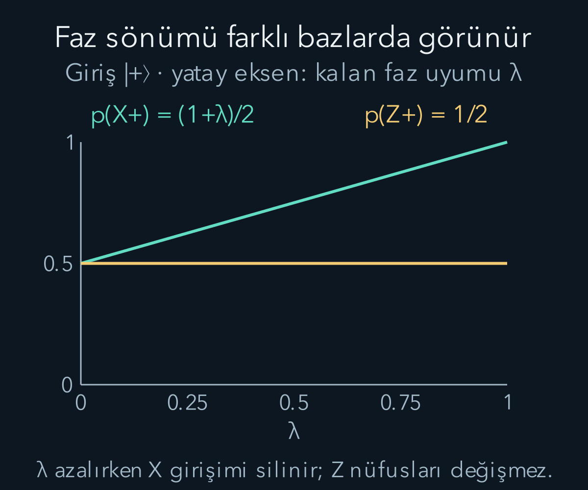
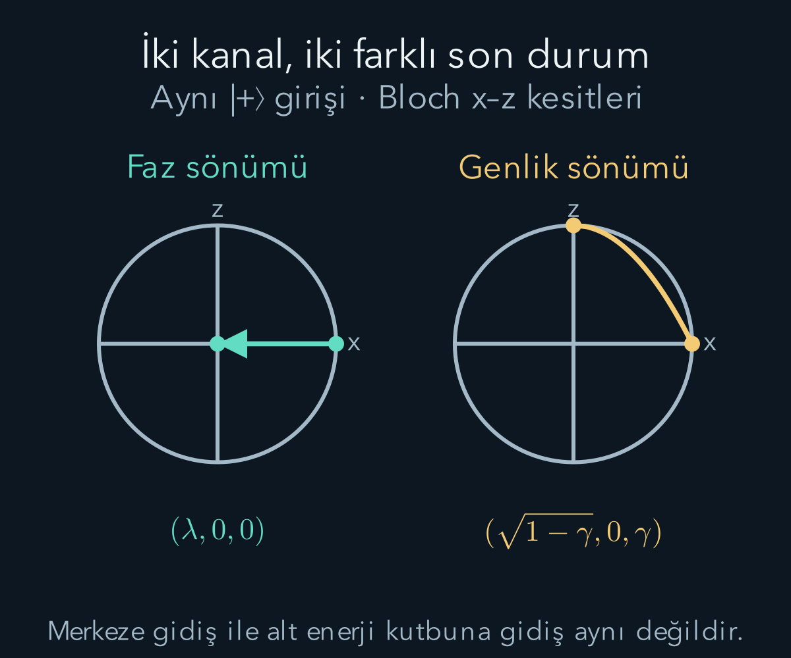

import ArticleVideo from '@/components/ArticleVideo.astro'
import kavram from './media/01-kavram.mp4?url'
import kavramPoster from './media/01-kavram.jpg?url'

Bir kübit dış dünyadan bütünüyle yalıtılmadığında, yalnız kübit için yazdığımız evrim genellikle üniter olmaz. Bu, tüm sistemin Schrödinger denklemini bıraktığı anlamına gelmez. Kübit çevreyle birlikte üniter evrilebilir; biz çevrenin ayrıntılarına erişmeyip yalnız kübitin durumunu hesapladığımızda farklı bir dönüşüm görürüz. **Kuantum kanalı**, bu yerel dönüşümün matematiksel ifadesidir.

[Yoğunluk matrisi ve kısmi iz](/blog/yogunluk-matrisleri-ve-karisik-durumlar/) ile [genelleştirilmiş ölçümler](/blog/genellestirilmis-kuantum-olcumleri/) bu yazının araçlarıdır. Özellikle ölçüm sonucunu kaydettiğimiz koşullu durumla, bütün sonuçları topladığımız ortalama durum arasındaki ayrım kullanılacak. İki örneği ayrıntılı karşılaştıracağız: enerji nüfuslarını değiştirmeyen faz sönümü ve üst düzey nüfusunu alt düzeye taşıyan genlik sönümü.

Matris dilindeki üç işaretin rolünü ayıralım. $\dagger$ eşlenik transpozdur; $\otimes$ iki sistemin durum uzayını birlikte kuran tensör çarpımıdır; $\operatorname{Tr}$ köşegen toplamıdır. Kısmi iz ise ortak matriste yalnız çevre indislerini toplar. Çevreyi fiziksel olarak yok etmek veya mutlaka ölçmek anlamına gelmez. Sistem üzerinde yapılabilecek bütün ölçümlerin olasılıklarını üretmek için çevre ayrıntıları olmadan yeterli bir matris oluştururuz.

Kanal sözcüğü de yalnız haberleşme kablosunu anlatmaz. Kontrollü bir dönme, beklerken enerji kaybetme veya ölçüm kaydını unutma aynı matematiksel sınıfın farklı örnekleri olabilir. Bu yazıda giriş ve çıkış yine aynı iki düzeyli sistemdir. Çevre ölçülüp sonuç seçildiğinde ise bu toplam dönüşümün içinden bir alt topluluk ayırırız; iki hesabı karıştırmamak için olasılık normalleştirmesini görünür tutacağız.

## 1. Çevreyi hesaptan çıkarmak

İlgilendiğimiz sisteme $S$, çevreye $E$ diyelim. Başlangıçta ortak durumun $\rho\otimes|e_0\rangle\langle e_0|$ olduğunu varsayalım. $\rho$ sistemin yoğunluk matrisi; $|e_0\rangle$ sabit hazırlanmış çevre durumudur. Bu başlangıçta sistemle çevre arasında korelasyon bulunmadığını özellikle belirtiyoruz.

Ortak üniter $U$ uygulandıktan sonra yalnız sistemin durumu:

$$
\begin{aligned}
\rho'&=\operatorname{Tr}_E\Bigl[\\
&\quad U(\rho\otimes|e_0\rangle\langle e_0|)U^\dagger\Bigr].
\end{aligned}
$$

olur. $\operatorname{Tr}_E$ çevre üzerinden kısmi izdir. Bir çevre bazı $\{|\alpha\rangle\}$ seçip kısmi izi baz elemanları üzerinden açarsak:

$$
\begin{aligned}
\rho'&=\sum_\alpha\Bigl[\langle\alpha|U|e_0\rangle\,\rho\\
&\qquad\times\langle e_0|U^\dagger|\alpha\rangle\Bigr]\\
&=\sum_\alpha K_\alpha\rho K_\alpha^\dagger.
\end{aligned}
$$

$K_\alpha=\langle\alpha|U|e_0\rangle$ sistem uzayında etkili bir **Kraus operatörü**dür. Çevreye ait bra ve ketler alınırken sistem indisleri açık kalır; sonuç bir sayı değil, sistem üzerinde matristir. Dönüşümü $\mathcal E(\rho)$ ile göstereceğiz.

Çevre başlangıçta karışıksa da benzer bir toplam elde edilir; başlangıç karışımının ağırlıkları ve çevre çıkış etiketi birlikte Kraus indisine alınır. Başlangıçta sistem-çevre korelasyonları varsa her olası sistem girişine aynı sabit kanalı atamak otomatik değildir. Burada kullandığımız koşul bu güçlüğü dışarıda bırakır.

## 2. Olasılık neden kaybolmaz?

Kraus toplamının izini alıp çarpanları çevirelim:

$$
\operatorname{Tr}\rho'
=\operatorname{Tr}\!\left[\rho\sum_\alpha K_\alpha^\dagger K_\alpha\right].
$$

Üniter $U$ ve çevre bazının tamlığı, $\sum_\alpha K_\alpha^\dagger K_\alpha=I$ sonucunu verir. Dolayısıyla $\operatorname{Tr}\rho'=\operatorname{Tr}\rho=1$. Bütün olası çevre kayıtları toplandığında sistemin toplam olasılığı korunur.

Tamlık adımını çevre indislerini açık tutarak yazabiliriz. Kısmi bra-ket gösteriminde:

$$
\begin{aligned}
\sum_\alpha K_\alpha^\dagger K_\alpha
&=\langle e_0|U^\dagger
\left(I_S\otimes\sum_\alpha|\alpha\rangle\langle\alpha|\right)
U|e_0\rangle\\
&=\langle e_0|U^\dagger U|e_0\rangle\\
&=I_S.
\end{aligned}
$$

İlk satırdaki çevre projektörlerinin toplamı $I_E$'dir. İkinci satırda üniterlik, son satırda $\langle e_0|e_0\rangle=1$ kullanılır. Sistem uzayındaki birim $I_S$ kalır; onu bir sayıyla karıştırmamalıyız. Bu hesap, olasılığın tek tek her dalda korunmasını değil, çevrenin bütün alternatifleri birlikte toplandığında korunmasını sağlar.

Tek bir Kraus dalı $K_\alpha\rho K_\alpha^\dagger$ ise genellikle birden küçük iz taşır. Bu iz ilgili kayıt olasılığıdır. Kayıt gerçekten okunup yalnız o sonuç seçilirse normalize etmek için bu olasılığa bölünür. Kanal ise seçilmiş kayıt değil, bütün dalların toplamıdır. Doğrusal kanal ile normalleştirilmiş koşullu güncellemeyi aynı işlem saymamalıyız.

Kraus gösterimi tek değildir. Aynı kanalı farklı operatör listeleri temsil edebilir. Bu nedenle bir listedeki her terimi, çevrede gerçekte kesin olarak meydana gelen benzersiz olayın kanıtı diye okumayız. Belirli bir çevre ölçümü ve fiziksel gerçekleştirim verilirse dallara operasyonel anlam atanabilir.

## 3. Pozitifliğin de ötesi: tam pozitiflik

Bir kanal, pozitif yoğunluk matrisini pozitif matrise götürmelidir. Fakat bu tek başına yeterli değildir. Sistem başka bir referans $R$ ile dolanık olabilir. Sisteme uygulanan aynı fiziksel işlem, ortak durumda $\mathcal E\otimes I_R$ olarak da negatif olasılık üretmemelidir. Kanal ifadesindeki $I_R$, referansa hiçbir işlem yapmayan özdeşlik dönüşümünü belirtir. Her yardımcı boyut için bu koşula **tam pozitiflik** denir.

Kraus biçimi bunu sağlar. Ortak pozitif durum $\rho_{SR}$ için:

$$
\begin{aligned}
&(\mathcal E\otimes I_R)(\rho_{SR})\\
&\quad=\sum_\alpha\Bigl[(K_\alpha\otimes I_R)\rho_{SR}\\
&\qquad\times(K_\alpha^\dagger\otimes I_R)\Bigr].
\end{aligned}
$$

pozitif terimlerin toplamıdır. İz korumayla birlikte kısaltması CPTP'dir: tamamen pozitif ve iz koruyan dönüşüm. Sonlu boyutta kuantum kanallarını bu sınıfla tanımlarız.

Neden daha zayıf koşul yetmiyor? Transpoz işlemi $\rho\mapsto\rho^T$, tek başına bir yoğunluk matrisinin özdeğerlerini korur. Fakat $|\Phi^+\rangle=(|00\rangle+|11\rangle)/\sqrt2$ Bell durumunun yalnız bir yarısını transpoze edersek, $00,01,10,11$ sırasında:

$$
\rho^{T_S}_{SR}=\frac12\begin{pmatrix}
1&0&0&0\\0&0&1&0\\0&1&0&0\\0&0&0&1
\end{pmatrix}
$$

elde edilir. Ortadaki $\begin{pmatrix}0&1/2\\1/2&0\end{pmatrix}$ bloğun özdeğerleri $\pm1/2$'dir; tüm liste $1/2,1/2,1/2,-1/2$ olur. Negatif özdeğer fiziksel duruma izin vermez. Dolayısıyla transpoz, her bilinmeyen duruma deterministik uygulanabilen yerel bir kuantum kanalı değildir.

## 4. Faz sönümü: köşegenleri korumak

$|0\rangle,|1\rangle$ bazında genel bir kübit durumu:

$$
\begin{gathered}
\rho=\begin{pmatrix}a&c\\c^*&1-a\end{pmatrix},\\
0\le a\le1,\qquad |c|^2\le a(1-a).
\end{gathered}
$$

olsun. $a$ sıfır sonucunun olasılığı, $c$ karmaşık köşegen dışı elemandır. Son eşitsizlik pozitiflik koşuludur. Şimdi $0\le\lambda\le1$ olmak üzere:

$$
\mathcal D_\lambda(\rho)=\begin{pmatrix}a&\lambda c\\\lambda c^*&1-a\end{pmatrix}
$$

tanımlayalım. $\lambda$ kalan faz uyumunun çarpanıdır; önceki yazıdaki ölçüm gücü $\eta$ ile aynı parametre değildir. $\lambda=1$ değişim yok, $\lambda=0$ bu bazda tam faz sönümü demektir.

Bu dönüşümün Kraus operatörleri:

$$
\begin{aligned}
K_0&=\sqrt{\frac{1+\lambda}{2}}I,\\
K_1&=\sqrt{\frac{1-\lambda}{2}}Z,\\
Z&=\begin{pmatrix}1&0\\0&-1\end{pmatrix}.
\end{aligned}
$$

seçilebilir. $Z\rho Z$ köşegenleri koruyup $c$'nin işaretini çevirir. İki ağırlıklı terimi topladığımızda köşegende $(1+\lambda+1-\lambda)/2=1$, köşegen dışında $(1+\lambda-1+\lambda)/2=\lambda$ kalır. Ayrıca $K_0^\dagger K_0+K_1^\dagger K_1=I$ açıkça sağlanır.

Bu gösterimde rastgele Z çevirme ağırlığı $(1-\lambda)/2$'dir; tam faz sönümü ağırlığın bir olduğu durum değildir. Bir olasılıkla kesin Z uygulamak yalnız üniter bir faz dönüşümüdür. Değişik kaynakların “faz hata olasılığı” tanımlarını karşılaştırırken bu katsayı farkını kontrol etmeliyiz.

## 5. Çevrede hangi bilgi kalır?

Çevre etkileşimi $|0\rangle|e_0\rangle\to|0\rangle|e^{(0)}\rangle$ ve $|1\rangle|e_0\rangle\to|1\rangle|e^{(1)}\rangle$ biçiminde olsun. İki çevre çıkışı normalize, örtüşmeleri $\langle e^{(1)}|e^{(0)}\rangle=\lambda$ gerçek ve pozitif seçilsin. Sistem süperpozisyonla girdiyse ortak çıkış:

$$
\begin{aligned}
&\alpha|0\rangle|e^{(0)}\rangle\\
&\quad+\beta|1\rangle|e^{(1)}\rangle.
\end{aligned}
$$

olur. Ortak yoğunluk matrisinin $|0\rangle\langle1|$ çapraz terimi $\alpha\beta^*|e^{(0)}\rangle\langle e^{(1)}|$ ile çarpılır. Çevre izi alınca bu çevre operatörünün izi $\lambda$ olur. Böylece sistemin çapraz terimi tam $\lambda\alpha\beta^*$'a iner.

Çevre kayıtları aynıysa $\lambda=1$ ve durumlar ayırt edilemez; çapraz terim korunur. Ortogonalse $\lambda=0$ ve çevre ilke olarak iki baz durumunu ayırt edebilir; sistemin yerel girişim terimi kaybolur. **Dekoherens**, bu tür süreçlerde belirli bazdaki faz ilişkilerinin yerel gözlemler için zayıflamasıdır. Toplam durum saf kalabilir; bilgi yalnız sistemden ortak korelasyonlara taşınmış olabilir.

$|+\rangle$ girişinde X artı sonucu olasılığı $(1+\lambda)/2$ olur. Başta bir olan bu olasılık tam faz sönümünde $1/2$'ye iner. Z olasılıkları ise hep $1/2$'dir. Bu nedenle yalnız Z ölçerek faz sönümünü tespit edemeyiz; farklı bazdaki girişim duyarlılığı gereklidir.

## 6. Genlik sönümü: üst düzeyden alt düzeye

Şimdi $|1\rangle$ üst, $|0\rangle$ alt enerji düzeyi olsun. $0\le\gamma\le1$ üst düzeyin gevşeme olasılığıdır. Sıfır sıcaklığa uygun basit genlik sönümü modelinin operatörleri:

$$
\begin{aligned}
A_0&=\begin{pmatrix}1&0\\0&\sqrt{1-\gamma}\end{pmatrix},\\
A_1&=\begin{pmatrix}0&\sqrt\gamma\\0&0\end{pmatrix}.
\end{aligned}
$$

olsun. İlk çarpım $A_0^\dagger A_0=\operatorname{diag}(1,1-\gamma)$, ikincisi $A_1^\dagger A_1=\operatorname{diag}(0,\gamma)$; toplam birimdir. İki çıkış katkısını ayrı yazalım:

$$
\begin{aligned}
&A_0\rho A_0^\dagger\\
&\quad=\begin{pmatrix}a&\sqrt{1-\gamma}c\\\sqrt{1-\gamma}c^*&(1-\gamma)(1-a)\end{pmatrix}.
\end{aligned}
$$

$$
A_1\rho A_1^\dagger=\begin{pmatrix}\gamma(1-a)&0\\0&0\end{pmatrix}.
$$

Toplamda üst nüfusun $\gamma$ payı alta eklenir. Köşegen dışı genlik ise $\sqrt{1-\gamma}$ ile azalır. Enerji kaybı ve faz uyumundaki azalma bu modelde bağlantılıdır; önceki saf faz sönümünde nüfus aktarımı yoktu.

Örneğin üst düzeyde başlayan atom için $\rho'=\gamma|0\rangle\langle0|+(1-\gamma)|1\rangle\langle1|$ olur. Çevre kaydı okunmadığında iki olasılıklı karışım elde ederiz. Fakat $\gamma=1$ sonunda her giriş alt saf duruma gider. Demek ki açık sistem evrimi her koşulda karışıklığı artırmak zorunda değildir; soğuma sistemi daha saf da yapabilir.

Somut bir hesap için $|+\rangle=(|0\rangle+|1\rangle)/\sqrt2$ ve $\gamma=1/2$ alalım. Başlangıç matrisinin her elemanı $1/2$'dir. İlk dalın izi $1/2+1/4=3/4$, ikinci dalın izi $1/4$ olur. Çevrede yayılan fotonu ideal olarak izleyebildiğimiz gerçekleştirimde ikinci dal foton kaydına karşılık gelir. O kayıt geldiğinde sistem kesin olarak $|0\rangle$'dadır. Foton görülmediği seçilmiş denemelerde ise normalize ket:

$$
\begin{aligned}
|\psi_{\rm yok}\rangle
&=\frac{(1/\sqrt2)|0\rangle+(1/2)|1\rangle}{\sqrt{3/4}}\\
&=\sqrt{\frac23}|0\rangle+\sqrt{\frac13}|1\rangle.
\end{aligned}
$$

olur. Hiç foton görülmemesi, sistemin hiç değişmemesi demek değildir. Başlangıçtaki alt ve üst bileşenlerin “foton yok” kaydına katkıları farklı olduğundan seçilmiş toplulukta ağırlıkları değişmiştir. Burada foton izlemenin kusursuz olduğu varsayılıyor; kaçırılmış kayıtlar varsa aygıt verimini de modele eklemek gerekir.

Kayıtların ikisini birlikte tuttuğumuzda bu saf dalları $3/4$ ve $1/4$ ağırlıklarıyla toplarız:

$$
\rho'=\begin{pmatrix}3/4&1/(2\sqrt2)\\1/(2\sqrt2)&1/4\end{pmatrix}.
$$

İz $3/4+1/4=1$, determinant $3/16-1/8=1/16$'dır. Pozitif köşegen ve pozitif determinant, bu iki boyutlu Hermit matrisin geçerli olduğunu doğrular. Aynı girişe $\lambda=1/2$ faz sönümü uygulasaydık köşegenler $1/2$ kalacak, çapraz elemanlar $1/4$ olacaktı. Böylece aynı “gürültü gücü” sayısını yazmak, aynı fiziksel çıktıyı elde ettiğimiz anlamına gelmez.

Enerji farkına $\Delta E>0$ diyelim ve alt enerjiyi sıfır seçelim. Ortalama enerji başlangıçta $\Delta E/2$, genlik sönümü sonunda $\Delta E/4$ olur; çünkü üst düzey nüfusu yarı yarıya azaldı. Saf faz sönümünde aynı baz enerji bazıysa ortalama enerji değişmez. Bu ek koşul gereklidir: rastgele seçtiğimiz bir bazda çapraz terimlerin azalması, her Hamiltonyen için enerji korunacağı anlamına gelmez.

## 7. Bloch geometrisinde iki farklı değişim

$X=\begin{pmatrix}0&1\\1&0\end{pmatrix}$ ve $Y=\begin{pmatrix}0&-i\\i&0\end{pmatrix}$, $Z$ ile birlikte Pauli matrisleridir; $i^2=-1$'dir. $x,y,z$ bu üç matrisin beklenti değerleridir. $\rho=(I+xX+yY+zZ)/2$ yazımında $a=(1+z)/2$, $c=(x-iy)/2$'dir. Bu bağıntıları iki kanalın sonuçlarına koyarsak:

$$
\begin{aligned}
\mathcal D_\lambda:\quad x&\longmapsto\lambda x,\\
y&\longmapsto\lambda y,\\
z&\longmapsto z.
\end{aligned}
$$

$$
\begin{aligned}
\mathcal A_\gamma:\quad x&\longmapsto\sqrt{1-\gamma}x,\\
y&\longmapsto\sqrt{1-\gamma}y,\\
z&\longmapsto\gamma+(1-\gamma)z.
\end{aligned}
$$

Faz sönümü Z eksenine doğru sıkıştırır; kürenin merkezi merkezde kalır. Genlik sönümü aynı zamanda merkezin yerini değiştirir ve uçta bütün küreyi $z=1$ alt durumuna taşır. Bu yüzden ikinci kanal birim matrisi sabit tutmaz; fiziksel olarak bir enerji yönü seçmiştir.

$|+\rangle$ başlangıcı $(1,0,0)$ olsun. Faz sönümünde $(\lambda,0,0)$ elde edilir. Genlik sönümünde $(\sqrt{1-\gamma},0,\gamma)$ olur. $\gamma=1/2$ için $(1/\sqrt2,0,1/2)$ ve saflık $\operatorname{Tr}\rho^2=(1+|\mathbf r|^2)/2=7/8$'dir. Sonuç karışıktır, fakat tam sönümde tekrar saf alt duruma yaklaşır.

<ArticleVideo src={kavram} poster={kavramPoster} title="Faz sönümü ile enerji gevşemesi" caption="İki Bloch x–z kesitinde aynı |+⟩ başlangıcı gösteriliyor. Üstte λ=1−s ile faz sönümü; altta γ=s ile genlik sönümü uygulanıyor. s, 0 ile 1 arasında kanal gücünü karşılaştıran parametredir; ortak fiziksel saat olduğu varsayılmıyor. Vektörler durum uzayında çizilir, parçacık konumu değildir." />

İki ardışık genlik sönümü de parametrelerin anlamını sınar. İlk kanalın gücü $\gamma_1$, ikincininki $\gamma_2$ olsun; aynı enerji bazında ve arada başka işlem olmadan uygulansınlar. Başlangıç üst nüfusu b ise önce $(1-\gamma_1)b$, sonra $(1-\gamma_2)(1-\gamma_1)b$ kalır. Bileşik güç bu nedenle:

$$
\gamma_{\text{toplam}}
=1-(1-\gamma_1)(1-\gamma_2).
$$

İki kez $\gamma=1/2$ uygulanınca toplam gevşeme $3/4$ olur; bir olmaz. İkinci aşamada başlangıç nüfusunun değil, geride kalan nüfusun yarısı aktarılır. Çapraz elemanın iki karekök çarpanı da $\sqrt{1-\gamma_{\text{toplam}}}$ verir. Böylece hem nüfus hem eşevrelilik aynı bileşik kanalla tutarlı kalır.

## 8. Zaman modeli ayrıca belirtilmelidir

$\lambda$ veya $\gamma$'nın bir anda hangi değerde olduğunu bilmek, zaman yasasını tek başına vermez. Basit belleksiz gevşemede $\gamma(t)=1-e^{-t/T_1}$ seçilir; $T_1$ nüfus gevşeme süresidir. Yalnız bu mekanizma varsa köşegen dışı eleman $\sqrt{1-\gamma}=e^{-t/(2T_1)}$ ile azalır. Saf faz sönümü ayrıca $e^{-t/T_\phi}$ çarpanı getirirse toplam üstel azalma $e^{-t/T_2}$ ve $1/T_2=1/(2T_1)+1/T_\phi$ olur.

Bu bağıntı, saydığımız bağımsız üstel sönüm modelinin sonucudur. Çevrenin belleği, zamanla değişen gürültü veya farklı bağlaşım varsa aynı biçim zorunlu değildir. Kanalın geçerli olması ile sürekli zaman evriminin belirli bir hız yasasına uyması ayrı iddialardır.

Örneğin $T_1=20$ mikrosaniye ve $T_\phi=40$ mikrosaniye olsun. Ters süreleri toplarsak $1/T_2=1/40+1/40=1/20$ ve $T_2=20$ mikrosaniye buluruz. Yirmi mikrosaniye sonunda üst nüfus başlangıç değerinin $e^{-1}\approx0{,}368$ katıdır. Köşegen dışı eleman da bu örnekte aynı çarpanla azalır; fakat bunun nedeni iki ayrı etkinin çarpımıdır: $e^{-1/2}e^{-1/2}=e^{-1}$. Saf faz sönümü olmasaydı aynı anda çapraz eleman $e^{-1/2}\approx0{,}607$ katına inerdi. Sayıları karşılaştırmak, enerji gevşemesi ile faz kaybının aynı süre olmak zorunda olmadığını gösterir.

## 9. Yerel karışımın anlamı

Dekoherens, neden bazı girişim deneylerinde çapraz terimleri göremediğimizi açıklar. Tek başına bir denemede hangi ölçüm sonucunun gerçekleştiğini seçen yeni bir kural değildir. Tam ortak durumdaki korelasyonları ve yerel yoğunluk matrisini ayırmak, ölçüm ile çevreyi tutarlı konuşmamızı sağlar.

Bir kanalı değerlendirirken iz koruması, dolanık yardımcıya uygulanabilirliği ve hangi bazdaki bilgiyi değiştirdiği sorulmalıdır. Faz sönümü, enerji gevşemesi ve kayıt seçimi farklı dönüşümlerdir. Bir sonraki adımda bu durumların belirsizliğini özdeğerlerinden hesaplanan entropiyle nicelleştirebiliriz.

## Kaynaklar

Kraus gösterimi, tam pozitiflik, faz sönümü ve genlik sönümü [John Preskill, Caltech — Foundations II: Measurement and Evolution, §§3.2–3.5](https://www.preskill.caltech.edu/ph219/chap3_15.pdf) ile karşılaştırıldı. Kullanılan parametre tanımları bu yazıda açıkça sabitlendi; matris çarpımları, Bell kısmi transpozu ve Bloch dönüşümleri yeniden hesaplandı. Kaynak 13 Ekim 2026 tarihinde yeniden doğrudan açılarak ilgili bölümler kontrol edildi.
