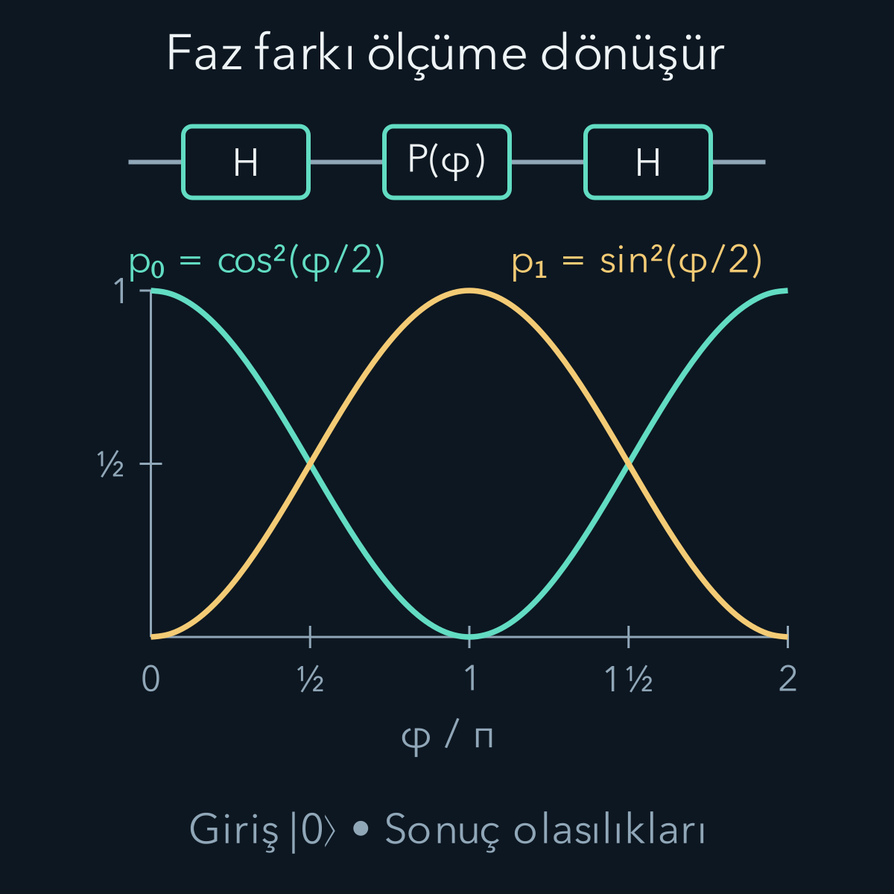
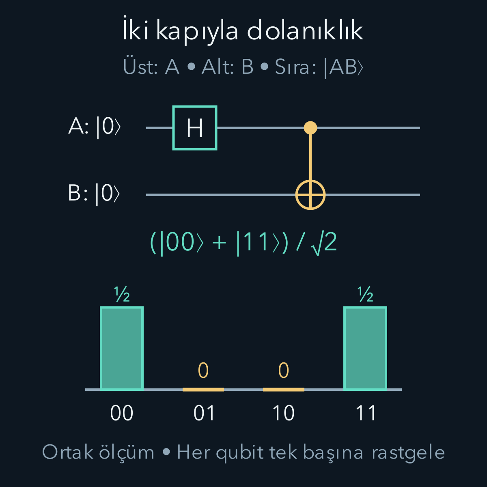

import ArticleVideo from '@/components/ArticleVideo.astro'
import kavram from './media/01-kavram.mp4?url'
import kavramPoster from './media/01-kavram.jpg?url'

Bir kuantum durumunu hazırladık, ölçüm olasılıklarını da hesaplayabiliyoruz. Şimdi araya kontrollü işlemler koymak istiyoruz: Genliklerin yerini değiştirmek, bir bileşene faz eklemek veya iki sistemi dolanık hâle getirmek. **Kuantum kapısı**, bu işlemi matematikte bir dönüşümle anlatır. Birkaç kapıyı belirli sırayla uyguladığımızda ortaya bir kuantum devresi çıkar.

[Entropi yazısında](/blog/kuantum-entropisi-ve-bilgi/) durumun ne kadar karışık olduğunu inceledik. Burada ağırlıklı olarak saf durumlar ve ideal, üniter kapılarla çalışacağız. [Matris çarpımı](/blog/matrisler-ve-dogrusal-donusumler/), [üniter matrisler](/blog/karmasik-vektorler-hermit-ve-uniter-matrisler/), [Born kuralı](/blog/kuantum-durumu-superpozisyon-ve-born-kurali/) ve [tensör çarpımı](/blog/tensor-carpimi-ve-dolaniklik/) ön bilgilerimiz. Ancak hesapta hangi bazın ve hangi sıranın kullanıldığını burada yeniden açıkça belirleyeceğiz.

## 1. Qubit için iki baz vektörü

İki boyutlu bir durum uzayına sahip kuantum sistemine **qubit**, Türkçe karşılığıyla kuantum biti diyoruz. Hesaplama bazını şu iki ortonormal vektör olarak seçelim:

$$
|0\rangle=\begin{pmatrix}1\\0\end{pmatrix},
\qquad |1\rangle=\begin{pmatrix}0\\1\end{pmatrix}.
$$

Sıfır ve bir, seçilen fiziksel durumların etiketidir. Bir spin sistemindeki iki yön veya bir atomun seçilmiş iki düzeyi bu rolü oynayabilir. Qubit, her zaman küçük bir mıknatıs ya da belirli bir cihaz demek değildir. Fiziksel sistemin bu iki durumun dışında düzeyleri varsa, işlemin oralara kaçmaması da deneysel bir gerekliliktir.

Genel saf durum $|\psi\rangle=\alpha|0\rangle+\beta|1\rangle$ olsun. $\alpha$ ve $\beta$ karmaşık genliklerdir; $|\alpha|^2+|\beta|^2=1$ normalizasyon koşuludur. Hesaplama bazında tek ölçüm 0 veya 1 verir. Aynı hazırlığı birçok kez tekrarladığımızda 0 sıklığı $|\alpha|^2$'ye, 1 sıklığı $|\beta|^2$'ye yaklaşır. Bir qubitten tek seferde iki genliği okuyamayız.

Örneğin $|\psi\rangle=(\sqrt3|0\rangle+i|1\rangle)/2$ seçelim. Burada $i^2=-1$ ve norm karesi $3/4+1/4=1$'dir. Sonuç olasılıkları $3/4$ ile $1/4$ olur. İkinci genlikteki $i$, bu bazda olasılığı değiştirmez; fakat ileride başka bir kapı uygulandığında etkili olabilir. Kapıları öğrenirken yalnız olasılıkları taşımak, böyle faz bilgisini kaybettirir.

## 2. İdeal kapı neden üniterdir?

Bir kapıyı $U$ matrisiyle gösterelim: $|\psi'\rangle=U|\psi\rangle$. Kesme işareti işlemden sonraki durumu adlandırır, türev değildir. Kapının tüm başlangıç durumlarında normu korumasını isteriz. Üniterlik koşulu $U^\dagger U=I$ bunu sağlar. $\dagger$, matrisin eşlenik devriğini; $I$ ise birim matrisi belirtir:

$$
\langle\psi'|\psi'\rangle
=\langle\psi|U^\dagger U|\psi\rangle
=\langle\psi|\psi\rangle=1.
$$

Üniterliğin bir başka sonucu geri döndürülebilirliktir: $U^{-1}=U^\dagger$. İdeal kapı, iki farklı ortogonal girdiyi aynı çıktıya sıkıştıramaz; iç çarpımları da korur. Örneğin hem $|0\rangle$ hem $|1\rangle$ girdisini $|0\rangle$ yapan sıfırlama işlemi, tek qubit üzerinde üniter bir kapı değildir. Sıfırlamayı yapmak için çevre veya ölçüm gibi ek bir kaynak gerekir.

Bu ayrım, devre çiziminde kutuyla gösterilen her şeyin üniter olduğu anlamına gelmediğini de hatırlatır. Ölçüm, hazırlama ve gürültü işlemleri devrelerde bulunabilir. [Kuantum kanalları](/blog/kuantum-kanallari-ve-dekoherens/) onların daha genel matematiğini verir. Burada “kapı” dediğimiz ideal dönüşümlerin hangi kısmının üniter olduğunu ayrıca belirteceğiz.

## 3. X ve Z: Genlikleri değiştirmek ve işaret eklemek

En basit iki kapıyı ayrı ayrı yazalım:

$$
X=\begin{pmatrix}0&1\\1&0\end{pmatrix},
\qquad
Z=\begin{pmatrix}1&0\\0&-1\end{pmatrix}.
$$

Matrisin ilk sütunu $|0\rangle$ girdisinin, ikinci sütunu $|1\rangle$ girdisinin çıktısıdır. Böylece $X|0\rangle=|1\rangle$ ve $X|1\rangle=|0\rangle$ olur. Genel vektöre uygulayınca:

$$
X\begin{pmatrix}\alpha\\\beta\end{pmatrix}
=\begin{pmatrix}\beta\\\alpha\end{pmatrix}.
$$

X kapısı klasik NOT işlemini baz durumlarında gerçekleştirir. Süperpozisyona etki ettiğinde önce bir ölçüm yapıp sonucu çevirmiyor; genlikleri doğrusal olarak yer değiştiriyor. Yukarıdaki örneğimizin çıktısı $(i|0\rangle+\sqrt3|1\rangle)/2$'dir. Olasılıklar da $1/4$ ve $3/4$ olur.

Z ise $|0\rangle$ bileşenini korur, $|1\rangle$ bileşenine eksi işareti verir:

$$
Z|\psi\rangle=\alpha|0\rangle-\beta|1\rangle.
$$

Eksi işaret mutlak kareyi değiştirmediğinden hesaplama bazındaki olasılıklar aynı kalır. Fakat durumun her bileşeni aynı sayıyla çarpılmamıştır; değişen şey göreli fazdır. $|1\rangle$ tek başına girerse çıkan $-|1\rangle$ yalnız genel fazla farklıdır. Süperpozisyonda ise işaret değişimi ölçülebilir bir fark yaratabilir. Hem $X^2=I$ hem $Z^2=I$ olduğundan aynı kapıyı iki kez uygulamak başlangıç durumuna döndürür.

## 4. Hadamard kapısı ve girişimin hesabı

Hadamard kapısını, Hamiltonyen için de kullanılan H harfiyle göstereceğiz. Bu yazıdaki $H$ bir kapı matrisidir; enerji işleci değildir:

$$
H=\frac1{\sqrt2}
\begin{pmatrix}1&1\\1&-1\end{pmatrix}.
$$

İki sütun bize $H|0\rangle=|+\rangle$ ve $H|1\rangle=|-\rangle$ sonuçlarını verir. Burada:

$$
|+\rangle=\frac{|0\rangle+|1\rangle}{\sqrt2},
\qquad
|-\rangle=\frac{|0\rangle-|1\rangle}{\sqrt2}.
$$

Genel giriş için satır-sütun çarpımı yapalım:

$$
H|\psi\rangle
=\frac{\alpha+\beta}{\sqrt2}|0\rangle
+\frac{\alpha-\beta}{\sqrt2}|1\rangle.
$$

Aynı sonuca ulaşan genlikler burada toplanır veya çıkarılır. Bu nedenle H kapısına “yazı tura atan kapı” demek yetersizdir. $|0\rangle$ girdisinden eşit olasılık üretirken, $|+\rangle$ girdisinden kesin 0 üretir. Çünkü bu girişte $\alpha=\beta=1/\sqrt2$'dir; 1 çıktısının genliği tam sıfırlanır.

İki H kapısının etkisini açıkça çarpalım:

$$
H^2=\frac12
\begin{pmatrix}2&0\\0&2\end{pmatrix}=I.
$$

Başlangıcı $|0\rangle$ seçelim. İlk H'nin ardından 0 ve 1 arasında ölçüm yapmazsak, ikinci H önceki girişimi tersine çevirebilir. Arada ölçüp sonucu kaydetmeden bırakırsak durum $I/2$ karışımına dönüşür. İkinci H bu karışımı yine $I/2$ bırakır; kesin 0 geri gelmez. “Olasılıkların ikisi de yarım” bilgisi, süperpozisyon ile karışımı ayırt etmeye yetmez.

## 5. Fazı sonucun olasılığına çevirmek

Sürekli ayarlanabilir faz kapısını tanımlayalım:

$$
P(\varphi)=
\begin{pmatrix}1&0\\0&e^{i\varphi}\end{pmatrix}.
$$

$\varphi$ radyan cinsinden boyutsuz açıdır. $S=P(\pi/2)$ ve $T=P(\pi/4)$ sık kullanılan özel kapılardır. Dolayısıyla $S=\operatorname{diag}(1,i)$, $T=\operatorname{diag}(1,e^{i\pi/4})$ olur; diag, yazılan elemanların köşegene konduğunu söyler. Bu tanımlardan $T^2=S$ ve $S^2=Z$ hemen bulunur.

Başlangıç $|0\rangle$ iken sırayla H, faz kapısı ve H uygulayalım. İlk iki adımdan sonra durum:

$$
|\chi\rangle
=\frac{|0\rangle+e^{i\varphi}|1\rangle}{\sqrt2}
$$

olur. Burada doğrudan hesaplama bazında ölçsek bütün fazlar için yarı yarıya sonuç alırız. Son H bu iki genliği yeniden birleştirir:

$$
\begin{aligned}
HP(\varphi)H|0\rangle
&=\frac{1+e^{i\varphi}}2|0\rangle\\
&\quad+\frac{1-e^{i\varphi}}2|1\rangle.
\end{aligned}
$$

0 olasılığını bulmak için ilk katsayıyı eşleniğiyle çarpalım:

$$
\begin{aligned}
p_0&=\frac{(1+e^{i\varphi})(1+e^{-i\varphi})}{4}\\
&=\frac{2+2\cos\varphi}{4}
=\cos^2(\varphi/2).
\end{aligned}
$$

Benzer şekilde $p_1=\sin^2(\varphi/2)$ elde edilir; toplam yine birdir. Faz sıfırken kesin 0, faz $\pi$ iken kesin 1 çıkar. $\varphi=\pi/3$ seçersek $p_0=3/4$ ve $p_1=1/4$ olur. Faz tek başına okunmadı; kapı dizisi onu ölçülebilen olasılık farkına dönüştürdü.

<ArticleVideo src={kavram} poster={kavramPoster} title="Faz farkından ölçüm olasılığına" caption="Her faz değeri ayrı bir devre ayarıdır: başlangıç |0⟩, ardından H, P(φ), H. Noktalar p₀=cos²(φ/2) ve p₁=sin²(φ/2) olasılıklarını izler. Bu tarama tek bir ölçüm kaydı veya qubitin uzaydaki hareketi değildir." />

## 6. Devreyi soldan sağa, matrisleri sağdan sola okumak

Devrede yatay bir çizgi bir qubiti, üzerindeki kutular sırayla uygulanan işlemleri gösterir. Çizgi, parçacığın laboratuvardaki gerçek yörüngesi olmak zorunda değildir. Giriş solda bulunur; önce $U_1$, sonra $U_2$ uygulanırsa çıkış $U_2U_1|\psi\rangle$ olur. Sağdaki matris vektöre daha yakındır ve önce etki eder.

Sıranın önemini H ve X ile görelim. Önce X sonra H uygulanırsa $HX|0\rangle=H|1\rangle=|-\rangle$. Önce H sonra X uygulanırsa $XH|0\rangle=X|+\rangle=|+\rangle$. Sonuçlar farklıdır. Yalnız hesaplama bazında ölçmek ikisine de yarı yarıya sonuç verdiği için farkı saklar. Her devrenin sonuna bir H daha koyarsak ilkinden kesin 1, ikincisinden kesin 0 okuruz.

İşlem sırası ile baz sırası farklı sorunlardır. Birincisi hangi kapının önce uygulandığını, ikincisi vektörün bileşenlerinin neyi adlandırdığını belirler. İkisi de baştan yazılırsa karmaşık bir devrenin hesabı, açık küçük adımların birleşimi hâline gelir.

## 7. İki qubite geçerken sırayı sabitlemek

Üst çizgideki qubite A, alttakine B diyelim. Bu yazıda $|ab\rangle$ gösterimindeki ilk rakam A'ya, ikinci B'ye aittir. Baz ve sütun sırası $|00\rangle,|01\rangle,|10\rangle,|11\rangle$ olacaktır. Bazı yazılım araçları farklı bit sırası kullanır; bir devreyi başka gösterime taşırken matris ve sonuç etiketleri birlikte dönüştürülmelidir.

A üzerinde H uygulamak, bütün uzayda $H\otimes I$ demektir. $\otimes$ tensör çarpımıdır; B üzerindeki birim işlem onun durumunu korur. Örneğin:

$$
(H\otimes I)|00\rangle
=\frac{|00\rangle+|10\rangle}{\sqrt2}.
$$

Bu hâlâ bir çarpım durumudur: $|+\rangle_A\otimes|0\rangle_B$. Bir bileşende süperpozisyon oluşturmak tek başına dolanıklık üretmedi. B üzerindeki H için ise $I\otimes H$ yazılır ve $|00\rangle$ girdisinden $(|00\rangle+|01\rangle)/\sqrt2$ elde edilir. Matrislerin yerini değiştirirken hangi sistemi değiştirdiğimizi de değiştirmiş olduk.

## 8. CNOT: Koşullu işlem, ölçüm değildir

A kontrol, B hedef olsun. Kontrollü X, kısaca CNOT kapısı baz durumlarında şu kuralı uygular:

$$
|a,b\rangle\longmapsto|a,b\oplus a\rangle.
$$

$\oplus$ ikiye göre toplamdır: $0\oplus0=0$, $0\oplus1=1$, $1\oplus0=1$, $1\oplus1=0$. Kontrol 0 ise hedef aynı kalır; kontrol 1 ise hedef çevrilir. Dört baz girdisi sırasıyla 00, 01, 11 ve 10 çıktılarına gider. Seçtiğimiz bazdaki matris:

$$
C=\begin{pmatrix}
1&0&0&0\\
0&1&0&0\\
0&0&0&1\\
0&0&1&0
\end{pmatrix}.
$$

CNOT'u C harfiyle kısalttık. Her sütunda ve her satırda bir tane 1 bulunduğundan baz vektörlerinin yerini değiştirir; normu korur. Ayrıca $C^2=I$'dır. Kontrolü önce ölçüp çıkan klasik sonuca göre X uygulamak aynı işlem değildir. Süperpozisyondaki kontrol, iki dalın faz ilişkisi korunarak hedefle birlikte dönüşür.

Devre sembolünde kontrol dolu nokta, hedef artı işaretli dairedir; aradaki dikey çizgi hangi iki sisteme ortak kapı uygulandığını gösterir. Nokta bir ölçüm sonucu kaydı değildir. Gerçek cihazda bu ideal ortak dönüşümü gerçekleştirecek bir etkileşim gerekir.

## 9. İki kapıyla Bell durumu hazırlamak

İki qubiti $|00\rangle$ hazırlayıp önce A'ya H, sonra A kontrollü CNOT uygulayalım:

$$
\begin{aligned}
|00\rangle&\xrightarrow{H\otimes I}
\frac{|00\rangle+|10\rangle}{\sqrt2}\\
&\xrightarrow{C}
\frac{|00\rangle+|11\rangle}{\sqrt2}
=|\Phi^+\rangle.
\end{aligned}
$$

Son adımda C'nin doğrusal etkisini kullandık: İlk terim aynı kaldı, ikinci terimde hedef değişti. Ortak hesaplama bazında yalnız 00 ve 11 gözlenir; ikisinin olasılığı $1/2$'dir. Her qubitin tek başına dağılımı ise yarı yarıyadır. Ortak saf durumun katsayılarını, satırı A ve sütunu B olacak şekilde ikiye iki bir tabloda toplayalım:

$$
F=\begin{pmatrix}1/\sqrt2&0\\0&1/\sqrt2\end{pmatrix},\qquad\det F=1/2.
$$

İki ayrı ketin çarpımında katsayılar $F_{ab}=u_a v_b$ biçiminde olur. $u_a$ A ketinin, $v_b$ B ketinin genliğidir; tablonun satırları aynı $(v_0,v_1)$ satırının katlarıdır. Bu nedenle çarpım durumunda determinant sıfır olurdu. Burada sıfır çıkmadığı için durum iki ayrı saf durumun çarpımı olarak yazılamaz. F, genlikleri düzenleyen tablodur; CNOT kapısının C matrisiyle aynı nesne değildir.

Bu devreyi tersine çevirebiliriz. Önce CNOT uygulanınca $(|00\rangle+|10\rangle)/\sqrt2$ geri gelir. Ardından A'ya H uygulamak $|00\rangle$ verir. Ters devre $ (H\otimes I)C$'dir; genel ters çarpım kuralındaki gibi kapı sırası ters döner. Arada ölçüm veya gürültü yoksa dolanıklığı bu şekilde geri alabiliriz.

CNOT her girdiyi dolanık yapmaz. Örneğin kontrol $|0\rangle$ ise hiçbir değişiklik olmaz. Hedef $|+\rangle$ iken X onu değiştirmediğinden, $(\alpha|0\rangle+\beta|1\rangle)\otimes|+\rangle$ girdisi de aynen kalır. Kapının dolanıklık üretme yeteneği, her durumda dolanıklık ürettiği iddiasından farklıdır.

## 10. Bir devreyi ölçmek ve fiziksel olarak uygulamak

Son ölçümden sonra genlik listesi yerine klasik sonuç elde ederiz. Bell devresini 200 kez bağımsız hazırlayıp çalıştırdığımızda, ideal modelde 00 sayısının beklenen değeri 100'dür; tam 100 çıkma zorunluluğu yoktur. İdeal örnekte 01 veya 10 olasılığı sıfırdır. Bunların deneyde görülmesi yanlış hazırlık, kapı hatası veya okuma hatası gibi etkilerin araştırılmasını gerektirir. Sonlu örneklem dalgalanması, modelde sıfır olan olasılığa kendi başına olay ekleyemez.

İdeal üniter kapı için karışık durumun değişimi $\rho'=U\rho U^\dagger$ olur. $\rho$ yoğunluk matrisidir. Bu dönüşüm özdeğerleri, dolayısıyla bütün sistemin von Neumann entropisini korur. Başlangıçta saf iki qubit Bell durumuna dönüşürken bütün hâlâ saftır; fakat her parçanın indirgenmiş durumu $I/2$ olur. Bütünün entropisinin korunmasıyla parçaların entropisinin artması birbiriyle çelişmez. Dolanıklık, ortak ve yerel bilgi arasındaki ayrımı görünür yapar.

Gerçek bir kapı belirli bir süre boyunca kontrollü Hamiltonyenle uygulanır. Sabit bir enerji işleci $\mathcal H$ için zaman evrimi $U(t)=e^{-i\mathcal Ht/\hbar}$ biçimindedir. Burada $t$ süre, $\hbar$ indirgenmiş Planck sabitidir; $\mathcal H$ ile Hadamard H'yi ayırdık. Darbenin süresi veya şiddeti yanlışsa ideal matristen sapma oluşur. Çevreyle etkileşim ve iki düzey dışına kaçış da bu soyut devrenin ötesinde modellenmelidir.

Bir devreyi anlamak için yalnız kapı adlarını ezberlemek yeterli olmaz. Başlangıç durumunu, baz sırasını, işlem sırasını ve ölçüm bazını birlikte belirtmek gerekir. Fazın nasıl genlik toplamına katıldığını gördüğümüzde, kapı kutuları hesaplanabilir fiziksel işlemlere dönüşür. Bu araçlarla sonraki adımda dolanıklık kullanarak bir kuantum durumunu başka bir sisteme aktarmanın hesabını kurabiliriz.

## Kaynaklar

Kapı tanımları için [IBM Quantum Learning — Quantum information](https://quantum.cloud.ibm.com/learning/en/courses/basics-of-quantum-information/single-systems/quantum-information), devre sembolleri ve sıralama karşılaştırması için [IBM Quantum Learning — Circuits](https://quantum.cloud.ibm.com/learning/en/courses/basics-of-quantum-information/quantum-circuits/circuits) doğrudan kontrol edildi. Kaynakların kendi bit sıralamasıyla bu yazıdaki A–B sırası birbirine karıştırılmadı. Matris çarpımları, faz taraması, sayısal örnekler ve görseller bu yazının seçtiği gösterimle yeniden hesaplandı. Bağlantılar 13 Ekim 2026 tarihinde açıldı.
