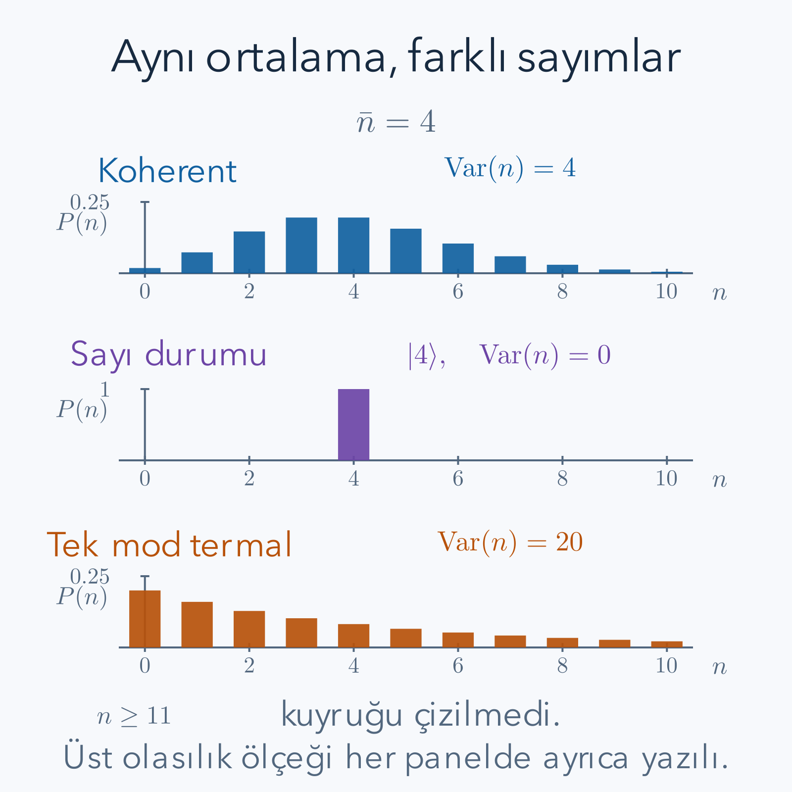

Ortalama dört foton içeren iki ışık hazırlığı, bir atomu veya bir algılayıcıyı her zaman aynı biçimde etkilemez. Birinde her ölçümde tam dört foton bulunabilir; diğerinde sıfır, bir, iki ve daha büyük sayılar değişik olasılıklarla gelebilir. Ortalama enerji bu farkı tek başına yakalamaz. Ayrıca elektrik alanın ortalaması, foton sayısı kesin olduğunda sıfır olabilir. Klasik bir sinüsle ilişkili kuantum durumunu bulmak için hem alanın fazını hem sayı dağılımını incelememiz gerekir.

Ön bilgiler [ikinci kuantizasyon](/blog/ikinci-kuantizasyon/), [elektromanyetik alanın kuantumlaştırılması](/blog/elektromanyetik-alanin-kuantumlastirilmasi/), [yoğunluk matrisleri](/blog/yogunluk-matrisleri-ve-karisik-durumlar/) ve [Rabi salınımları](/blog/zamana-bagli-perturbasyon-ve-rabi-salinimlari/) yazılarıdır. Burada tek bir frekans, uzaysal mod ve kutuplanma seçiyoruz. Sonsuz sayıdaki enerji basamağı bu tek modun içindedir; “tek mod” yalnız sıfır veya bir foton tutmak demek değildir. İlk bölümde alanın durumunu, son bölümde ise aynı alanla etkileşen iki düzeyli atomun ortak durumunu hesaplayacağız.

## 1. Sayı durumu ile alan genliği farklı bilgilerdir

Tek modun yok etme ve yaratma operatörleri $a,a^\dagger$ için $[a,a^\dagger]=1$ olsun. Foton sayısı operatörü $\hat n=a^\dagger a$, sayı durumları ise $\hat n|n\rangle=n|n\rangle$ koşulunu sağlar. $n$ sıfır veya pozitif tamsayıdır. Hamiltonyen $H_f=\hbar\omega(\hat n+1/2)$ olduğundan bir sayı durumu kesin enerjiye sahiptir. Fakat $a|n\rangle=\sqrt n|n-1\rangle$ başka bir dik duruma gider. Bu nedenle $\langle n|a|n\rangle=0$ olur.

Seçilen kutuplanma doğrultusundaki alanı $E=i\mathcal E(ae^{i\theta}-a^\dagger e^{-i\theta})$ yazacağız. Burada $\mathcal E=\sqrt{\hbar\omega/(2\epsilon_0V)}$, $\theta=\mathbf k\cdot\mathbf r-\omega t$ ve $V$ normalizasyon hacmidir. Sayı durumunda ortalama alan sıfır çıkar. Bu sonuç modun boş olduğu anlamına gelmez; enerjisi ve alan kare ortalaması pozitif olabilir. Alanın ortalamasının klasik dalga gibi salınmasını istiyorsak, farklı foton sayılarının faz ilişkisi bulunan bir süperpozisyonunu düşünmeliyiz.

## 2. Koherent durumun tanımı ve katsayı bağıntısı

**Koherent durum**, yok etme operatörünün özdurumudur:

$$
a|\alpha\rangle=\alpha|\alpha\rangle.
$$

$\alpha$ boyutsuz ve karmaşık bir sayıdır. $a$ Hermit olmadığı için özdeğerinin gerçek olması gerekmez. Bu tanım, foton sayısının $\alpha$ olduğu anlamına da gelmez. Sayı ölçümünün sonuçları hâlâ tamsayılardır. Tanımdaki vektörü sayı bazında $|\alpha\rangle=\sum_{n=0}^{\infty}c_n|n\rangle$ açalım. Solda merdiveni uygularsak:

$$
\begin{aligned}
a|\alpha\rangle
&=\sum_{n=1}^{\infty}c_n\sqrt n\,|n-1\rangle\\
&=\sum_{m=0}^{\infty}c_{m+1}\sqrt{m+1}\,|m\rangle.
\end{aligned}
$$

İlk toplamın sıfır terimi yoktur; vakum yok etme altında sıfır verir. İkinci satırda $m=n-1$ seçildi, bu yüzden alt sınır sıfıra indi. Sağdaki özdeğer ifadesi $\sum_m\alpha c_m|m\rangle$ olduğundan her baz vektörünün katsayısını eşitleriz:

$$
c_{m+1}=\frac{\alpha}{\sqrt{m+1}}c_m.
$$

İlk üç adım $c_1=\alpha c_0$, $c_2=\alpha^2c_0/\sqrt2$, $c_3=\alpha^3c_0/\sqrt6$ verir. Çarpanlar birikince genel sonuç $c_n=c_0\alpha^n/\sqrt{n!}$ olur. Katsayıların fazları bağımsız seçilmemiştir; hepsini tek karmaşık sayı $\alpha$ belirler.

## 3. Normalizasyonun üstel katsayısı

Sayı bazının ortonormalliği nedeniyle normda bütün çapraz terimler sıfırlanır. $\mu=|\alpha|^2$ tanımlayalım; bunun ortalama sayı olduğunu biraz sonra kanıtlayacağız. Birim norm koşulu:

$$
\begin{aligned}
1=\langle\alpha|\alpha\rangle
&=|c_0|^2\sum_{n=0}^{\infty}\frac{|\alpha|^{2n}}{n!}\\
&=|c_0|^2\sum_{n=0}^{\infty}\frac{\mu^n}{n!}
=|c_0|^2e^\mu
\end{aligned}
$$

olur. Son eşitlik üstel fonksiyonun kuvvet serisidir. Genel fazı sıfır seçerek $c_0=e^{-\mu/2}$ alırız. Normalize durum:

$$
|\alpha\rangle=e^{-|\alpha|^2/2}
\sum_{n=0}^{\infty}\frac{\alpha^n}{\sqrt{n!}}|n\rangle
$$

şeklindedir. Özellikle $\alpha=0$ için yalnız sıfırıncı terim kalır ve durum vakuma eşit olur. Normalizasyon katsayısının üs içindeki yarısı önemlidir: norm alınırken mutlak kareyle $e^{-\mu}$ gelir, seri toplamındaki $e^\mu$'yü götürür. $e^{-\mu}$ katsayısını doğrudan durum genliğine koymak birim normu bozardı.

Bu seri bir olasılık karışımı değildir. Her terimin karmaşık genliği bulunur ve terimler arasında belirli fazlar vardır. Aynı sayı olasılıklarını tutup fazları rastgeleleştirirsek, aşağıdaki ortalama alan değişebilir. Sayı dağılımını bilmek her kuantum gözlenebilirinin beklenti değerini belirlemeye yetmez.

## 4. Poisson dağılımının ortalamasını açık toplamla bulmak

$n$ foton ölçme olasılığı $P_n=|\langle n|\alpha\rangle|^2$ olduğundan:

$$
P_n=e^{-\mu}\frac{\mu^n}{n!}
$$

elde edilir. Bu Poisson dağılımıdır. Ortalama sayıyı tanımdan hesaplayalım:

$$
\begin{aligned}
\langle\hat n\rangle
&=e^{-\mu}\sum_{n=1}^{\infty}\frac{n\mu^n}{n!}\\
&=e^{-\mu}\mu\sum_{n=1}^{\infty}\frac{\mu^{n-1}}{(n-1)!}\\
&=e^{-\mu}\mu\sum_{m=0}^{\infty}\frac{\mu^m}{m!}\\
&=e^{-\mu}\mu e^\mu=\mu.
\end{aligned}
$$

İkinci satırda $n/n!=1/(n-1)!$ kullanıldı; $\mu$'nün bir kuvveti toplamın dışına çıkarıldı. Üçüncü satır yalnız indis kaydırmasıdır. Sonuç, özdeğer tanımından $\langle a^\dagger a\rangle=\alpha^*\alpha$ yazarak bulduğumuz değerle aynıdır. İki hesap farklı açıdan aynı ortalamayı kontrol eder.

Bu ortalama bir ölçümde kesirli foton görüleceği anlamına gelmez. Örneğin $\mu=0.2$ olan modda sonuç yine sıfır, bir, iki gibi değerlerdir; çok sayıda aynı hazırlama ve ölçümün ortalaması 0.2'ye yaklaşır. Deneyde kayıplar ve algılama verimi dağılımı etkileyebilir; buradaki $P_n$ ideal hazırlanmış modun içindeki sayıyı anlatır.

## 5. İkinci moment ve varyansın türetilmesi

Varyans $\operatorname{Var}(n)=\langle\hat n^2\rangle-\langle\hat n\rangle^2$ olarak tanımlanır. Doğrudan $n^2$ yerine $n(n-1)+n$ yazmak faktöriyelle sadeleşir:

$$
\begin{aligned}
\langle\hat n(\hat n-1)\rangle
&=e^{-\mu}\sum_{n=2}^{\infty}\frac{n(n-1)\mu^n}{n!}\\
&=e^{-\mu}\mu^2\sum_{n=2}^{\infty}
\frac{\mu^{n-2}}{(n-2)!}\\
&=e^{-\mu}\mu^2e^\mu=\mu^2.
\end{aligned}
$$

Burada yeni toplam indisi $m=n-2$ olup yine sıfırdan başlar. Ardından:

$$
\begin{aligned}
\langle\hat n^2\rangle&=\mu^2+\mu,\\
\operatorname{Var}(n)&=\mu^2+\mu-\mu^2=\mu,\\
\Delta n&=\sqrt\mu.
\end{aligned}
$$

Ortalama ve varyansın sayısal olarak eşit olması Poisson dağılımının ayırt edici özelliğidir; birim açısından ikisi de boyutsuz sayı istatistiğidir. Ortalama büyüdükçe mutlak dalgalanma büyür, fakat göreli dalgalanma $\Delta n/\langle\hat n\rangle=1/\sqrt\mu$ küçülür. Klasik parlak dalga sınırında küçük olan bu göreli belirsizliktir. Kuantum belirsizliği bütünüyle sıfıra gitmiş değildir.

## 6. Çözülmüş örnek: alfa iki olduğunda ne ölçülür?

Gerçek $\alpha=2$ seçelim. O zaman $\mu=4$, $\langle\hat n\rangle=4$, varyans dört ve standart sapma iki olur. İlk olasılıklar:

$$
\begin{aligned}
P_0&=e^{-4}\simeq0.018316,\\
P_1&=4e^{-4}\simeq0.073263,\\
P_2&=\frac{16}{2}e^{-4}\simeq0.146525,\\
P_3&=\frac{64}{6}e^{-4}\simeq0.195367,\\
P_4&=\frac{256}{24}e^{-4}\simeq0.195367.
\end{aligned}
$$

Üç ve dört fotonun eşit olasılığı rastlantı değildir. Ardışık oran $P_{n+1}/P_n=4/(n+1)$ olduğundan $n=3$ için oran bir olur. İlk beş olasılığın toplamı yaklaşık 0.62884'tür; kalan yaklaşık 0.37116 olasılık beş ve daha fazla fotondadır. Yalnız bu ilk terimleri yazıp toplamı bir sanmak, kuyruğu atmak olurdu.

Aynı ortalamalı $|4\rangle$ sayı durumunda ise $P_4=1$, diğer bütün olasılıklar sıfırdır ve varyans sıfır olur. İki hazırlığın ortalama enerjisi aynı, sayı dalgalanması farklıdır. Bu örnek ayrıca “koherent durumda foton sayısı dörttür” cümlesinin neden eksik olduğunu gösterir. Doğru ifade ortalama foton sayısının dört olduğudur; tek bir ölçümün sonucuna ilişkin kesinlik yoktur.

*Bütün dağılımlar aynı ortalamaya sahiptir. Çizimde yalnız ilk on bir sayı gösterilir; özellikle termal dağılımın görünmeyen kuyruğunda ek olasılık vardır. Çubuk yükseklikleri aşağıdaki formüllerden hesaplanmıştır.*

## 7. Karmaşık alfa neden faz taşır?

$\alpha=|\alpha|e^{i\varphi}$ yazalım. $\varphi$ alanın seçilmiş referansa göre fazıdır. Koherent özdeğer tanımından $\langle a\rangle=\alpha$ ve eşlenik alarak $\langle a^\dagger\rangle=\alpha^*$ bulunur. Alanın beklenti değeri:

$$
\begin{aligned}
\langle E\rangle
&=i\mathcal E(\alpha e^{i\theta}-\alpha^*e^{-i\theta})\\
&=-2\mathcal E|\alpha|\sin(\theta+\varphi)
\end{aligned}
$$

olur. Eksi işaret $i\cdot2i=-2$ çarpımından gelir. Alan açılımını farklı başlangıç fazıyla yazan bir kaynakta kosinüs görünmesi fiziksel uyuşmazlık değildir; kullanılan faz sözleşmesi karşılaştırılmalıdır. Burada klasik sinüs biçimini, değişen foton sayılarının fazlı süperpozisyonundan elde ettik.

Serbest evrimde her $|n\rangle$ katsayısı $e^{-i\omega(n+1/2)t}$ ile çarpılır. Ortak $e^{-i\omega t/2}$ fazını dışarı alırsak seride $\alpha^ne^{-in\omega t}=(\alpha e^{-i\omega t})^n$ kalır. Dolayısıyla koherent durum serbest evrimde koherent kalır ve Schrödinger gösteriminde $\alpha(t)=\alpha(0)e^{-i\omega t}$ olur. Alanın zamanını ya durumun bu hareketine ya da Heisenberg alanının $\theta$ fazına koyarız; ikisini aynı hesapta yeniden saymayız.

## 8. Kuadratürleri ve komütatörünü tanımlamak

Alan salınımının iki bağımsız faz bileşenine **kuadratür** denir. Boyutsuz operatörlerimizi:

$$
X=\frac{a+a^\dagger}{\sqrt2},
\qquad
P=\frac{a-a^\dagger}{i\sqrt2}
$$

olarak seçeceğiz. Buradaki $P$ boyutsuz alan kuadratürüdür; önceki alan yazısındaki birimli kanonik momentumla aynı sembolü taşısa da aynı büyüklük değildir. Sözleşmenin paydasındaki $\sqrt2$ yüzünden vakum varyansı yarım çıkacaktır. Başka bir kaynak paydayı iki seçerse varyans dörtte bir olur; sayıları karşılaştırmadan önce tanıma bakmalıyız.

Komütatörü açalım:

$$
\begin{aligned}
[X,P]
&=\frac1{2i}[a+a^\dagger,a-a^\dagger]\\
&=\frac1{2i}(-[a,a^\dagger]+[a^\dagger,a])\\
&=\frac{-2}{2i}=i.
\end{aligned}
$$

Bu yüzden belirsizlik bağıntısı $\Delta X\Delta P\ge1/2$ olur. Kuadratürlerin ortalaması koherent durumda $\langle X\rangle=\sqrt2\operatorname{Re}\alpha$ ve $\langle P\rangle=\sqrt2\operatorname{Im}\alpha$'dır. Karmaşık düzlemde $\alpha$'nın iki gerçek bileşeni, bu iki ortalama alan bileşenini belirler; foton sayısı ise merkezin orijine uzaklığının karesiyle ilişkilidir.

## 9. Koherent belirsizlikleri neden vakumunki kadardır?

Koherent durumda $\langle a^2\rangle=\alpha^2$, $\langle(a^\dagger)^2\rangle=(\alpha^*)^2$, $\langle a^\dagger a\rangle=\mu$ ve $\langle aa^\dagger\rangle=\mu+1$ olur. Son ifadedeki bir komütatörden gelir. Kareyi sırayı koruyarak açarsak:

$$
\begin{aligned}
\langle X^2\rangle
&=\frac12\big[\alpha^2+(\alpha^*)^2+2\mu+1\big],\\
\langle X\rangle^2
&=\frac12\big[\alpha^2+(\alpha^*)^2+2\mu\big],\\
(\Delta X)^2&=\frac12.
\end{aligned}
$$

$P^2=-(a-a^\dagger)^2/2$ açılımıyla:

$$
\begin{aligned}
\langle P^2\rangle
&=\frac12[-\alpha^2-(\alpha^*)^2+2\mu+1],\\
\langle P\rangle^2
&=\frac12[-\alpha^2-(\alpha^*)^2+2\mu],\\
(\Delta P)^2&=\frac12
\end{aligned}
$$

çıkar. Standart sapmaların çarpımı $1/2$ olduğundan bu durumlar seçilen iki kuadratür için belirsizlik alt sınırını doldurur. Sayı durumu için ortalamalar sıfır, her iki varyans $n+1/2$'dir. Dolayısıyla kesin foton sayısı, her iki alan kuadratürünün de kesin olmasıyla birlikte gelmez. Koherent durumda ise ortalama genlik büyürken mutlak kuadratür gürültüsü vakumdaki düzeyde kalır.

## 10. Çözülmüş örnek: alfa iki için alan ve faz

$\alpha=2$ durumunda $\langle X\rangle=2\sqrt2$, $\langle P\rangle=0$ ve her iki varyans $1/2$ olur. Alan açılımında $\theta=0$ noktasını seçersek $E=-\sqrt2\mathcal E P$ çıkar. Dolayısıyla bu anda ortalama alan sıfır, varyansı $2\mathcal E^2(1/2)=\mathcal E^2$ olur. Ortalama alanın sıfırdan geçmesi ışığın enerjisinin sıfıra düşmesi değildir; enerji alanın birinci momentine eşit değildir.

$\theta=-\pi/2$ noktasında aynı durumun ortalama alanı $4\mathcal E$ olur. Önceki yazının $\mathcal E\simeq9.3035\,\mathrm{V/m}$ örneğinde bu tepe değer yaklaşık $37.21\,\mathrm{V/m}$'dir. Kök ortalama kare belirsizlik ise faza bağlı olmadan yaklaşık $9.30\,\mathrm{V/m}$ kalır. Ortalama tepe alanı dört kat büyüklüğünde olsa da dalgalanma ortadan kalkmaz.

Şimdi $\alpha=2i$ seçersek foton olasılıkları aynı kalır çünkü $|2i|^2=4$'tür. Fakat $\langle X\rangle=0$, $\langle P\rangle=2\sqrt2$ olur ve alan sinüsü çeyrek dönem ötelenir. Sayı ölçümü iki hazırlığı ayıramaz, faz referansına duyarlı bir kuadratür ölçümü ayırabilir. Bu somut fark, olasılıkların yanında karmaşık genlikleri de saklamamız gerektiğini gösterir.

## 11. İkinci dereceden korelasyon neyi sayar?

İdeal tek modun aynı andaki ikinci dereceden korelasyonunu:

$$
g^{(2)}(0)=\frac{\langle(a^\dagger)^2a^2\rangle}
{\langle a^\dagger a\rangle^2}
=\frac{\langle\hat n(\hat n-1)\rangle}{\langle\hat n\rangle^2}
$$

tanımlayalım. İki yok etme uygulanınca $a^2|n\rangle=\sqrt{n(n-1)}|n-2\rangle$ olur; tekrar iki yaratma katsayıyı çarpar ve payın neden $n(n-1)$ içerdiğini açıklar. Bir fotonu iki kez saymak istemediğimiz için $n^2$ yerine bu çarpım çıkar. Payda aynı ortalamaya sahip bağımsız sayımların ölçeğini sağlar.

Bu bağıntı ideal ve seçilmiş tek mod içindir. Bir deneyde iki algılayıcıya giden ışıkla ölçülen çakışmaları yorumlarken zaman çözünürlüğü, arka plan ve kaç modun toplandığı belirtilmelidir. Buradaki sıfır argümanı zaman gecikmesinin sıfır olduğunu gösterir. Ortalama sayı sıfırsa payda sıfır olur; bu nedenle vakumun normalize $g^{(2)}(0)$ değeri **tanımsızdır**. Vakuma gelişigüzel sıfır veya bir atamayacağız. Buna karşılık sıfırdan farklı ortalamalı koherent durumların her biri için oran birdir; vakuma yaklaşan bu ailenin limitiyle vakumdaki ifadenin kendisi farklıdır.

## 12. Fock, koherent ve termal dağılımları karşılaştırmak

$n_0$ fotonlu sayı durumunda $n_0>0$ olmak üzere:

$$
g^{(2)}(0)=\frac{n_0(n_0-1)}{n_0^2}=1-\frac1{n_0}.
$$

Tek foton için sonuç sıfırdır: aynı anda soğurulabilecek ikinci foton yoktur. Koherent durumda önce türettiğimiz faktöriyel moment $\mu^2$ olduğundan $g^{(2)}(0)=1$ çıkar. İki durumun da ortalama sayısı dört seçilirse Fock değeri $3/4$, koherent değer bir olur. Ortalama aynıyken foton çiftlerinin olasılığı farklıdır.

Tek mod **termal** ışığın sayı dağılımı geometriktir. Burada bu dağılımı tanımlayıp momentlerini hesaplıyoruz; sıcaklığa bağlı ortalama sayının istatistiksel mekanikten türetilmesini ön bilgi olarak istemiyoruz. $0\le q<1$ için $P_n=(1-q)q^n$ seçilsin. Geometrik seri $\sum q^n=1/(1-q)$ normu bir yapar. Seri türevleri:

$$
\begin{aligned}
\sum_{n=1}^{\infty}nq^{n-1}&=\frac1{(1-q)^2},\\
\sum_{n=2}^{\infty}n(n-1)q^{n-2}&=\frac2{(1-q)^3}
\end{aligned}
$$

verir. İlkini $(1-q)q$ ile, ikincisini $(1-q)q^2$ ile çarparsak:

$$
\bar n=\frac q{1-q},\qquad
\langle n(n-1)\rangle=\frac{2q^2}{(1-q)^2}=2\bar n^2.
$$

Dolayısıyla sıfırdan farklı ortalamada termal değer iki olur. Varyans $\bar n^2+\bar n$'dir. Dört ortalama için $q=4/5$ seçilir, varyans yirmi çıkar; koherent varyansın beş katıdır. Bu sayısal karşılaştırma, şekildeki geniş termal kuyruğun nedenini açıklar.

## 13. Fazı silinmiş Poisson karışımı neden koherent değildir?

Aynı $P_n$ olasılıklarını taşıyan $\rho=\sum_nP_n|n\rangle\langle n|$ yoğunluk matrisini düşünelim. Bu karışımda $\langle a\rangle=\sum_nP_n\langle n|a|n\rangle=0$ olur. Oysa saf koherent durumda bu ortalama $\alpha$ idi. Sayı dağılımı, ortalama enerji, varyans ve $g^{(2)}(0)$ iki hazırlıkta aynıdır. Yine de bir faz referansıyla ölçülen ortalama alanları farklıdır.

Bunun kaynağı yoğunluk matrisinin köşegen dışı elemanlarıdır. Saf durumun $|\alpha\rangle\langle\alpha|$ açılımında farklı sayıları bağlayan $c_nc_m^*$ terimleri vardır. Fazı rastgeleleştirmek bu terimleri ortalamada silebilir. Bu nedenle $g^{(2)}(0)=1$ ölçmek tek başına durumun mutlaka saf koherent durum olduğunu kanıtlamaz. Korelasyon sayısı yararlı bir istatistiktir fakat tam durum tomografisi değildir. Işığın “klasik gibi” olduğunu tek bir sayıyla ilan etmek yerine hangi gözlenebilirin hangi hazırlıkları ayırabildiğini söylemek daha doğrudur.

## 14. İki düzeyli atomla ortak Hamiltonyen

Şimdi alanı atomla bağlayalım. $|e\rangle$ üst, $|g\rangle$ alt atom durumu; aralarındaki enerji farkı $\hbar\omega_a$ olsun. $\sigma_+=|e\rangle\langle g|$, $\sigma_-=|g\rangle\langle e|$ ve $\sigma_z=|e\rangle\langle e|-|g\rangle\langle g|$ tanımlarını kullanacağız. Atomun enerjisini iki düzeyin ortasına göre ölçelim. Modun sabit yarım kuantumunu da enerji referansından çıkarırsak Jaynes–Cummings Hamiltonyeni:

$$
H=\hbar\omega a^\dagger a+\frac{\hbar\omega_a}{2}\sigma_z
+\hbar g(a\sigma_++a^\dagger\sigma_-)
$$

olur. $g$ gerçek seçilmiş ve birimi $\mathrm{s^{-1}}$ olan bağlanma katsayısıdır. Dipol matris elemanı, alan katsayısı ve $1/\hbar$ çarpanı bu katsayıya girer; uygun baz fazlarıyla genel bağlantının fazı kaldırılabilir.

Bu model **dönen dalga yaklaşımı** kullanır. $a\sigma_+$ atomu uyarırken bir foton eksiltir; $a^\dagger\sigma_-$ atomu indirirken bir foton ekler. İkisini aynı anda artıran veya azaltan terimler serbest evrimde yaklaşık $\omega+\omega_a$ frekansıyla döner. Yakın rezonans ve $g\sqrt{n+1}\ll\omega,\omega_a$ koşullarında bunların hızlı katkıları ihmal edilir. Koşul güçlü bağlanmada bozulabilir; yaklaşımı her yoğunluğa sınırsız uzatamayız. İki düzey yaklaşımında diğer atom düzeylerinin de yeterince uzakta olması gerekir.

## 15. İkişer durumlu blok nasıl oluşur?

Toplam uyarılma operatörü $\hat C=\hat n+\sigma_+\sigma_-$ olsun. Atom üstteyse bir, alttaysa sıfır uyarılma sayar. $|e,n\rangle$ ile $|g,n+1\rangle$ aynı $n+1$ toplam uyarılmaya sahiptir. Etkileşim onları birbirine bağlar:

$$
\begin{aligned}
a^\dagger\sigma_-|e,n\rangle&=\sqrt{n+1}|g,n+1\rangle,\\
a\sigma_+|g,n+1\rangle&=\sqrt{n+1}|e,n\rangle.
\end{aligned}
$$

Diğer iki eylem atom merdiveninin sınırında sıfırdır. Bu nedenle her çift kapalı bir iki boyutlu blok oluşturur. Rezonansta $\omega_a=\omega$ iken iki durumun serbest enerjisi aynı $\hbar\omega(n+1/2)$ değeridir. Tek bir sabit $n$ bloğunda bu ortak değeri çıkarmak yalnız o bloğun genel fazını değiştirir. Kalan etkileşim matrisi:

$$
H_n=\hbar G_n\begin{pmatrix}0&1\\1&0\end{pmatrix},
\qquad G_n=g\sqrt{n+1}
$$

olur. Sıra $\{|e,n\rangle,|g,n+1\rangle\}$ biçimindedir. Foton sayı durumundaki başlangıç için yalnız bu blok gerekir. Koherent başlangıçta ise farklı $n$ değerlerinin her biri kendi $G_n$ katsayısıyla evrilir; ortalama sayıyı tek bir bloğa koymak tam çözüm değildir.

## 16. Salınım olasılığını ve iki katsayısını türetmek

Blok durumunu $c_e(t)|e,n\rangle+c_g(t)|g,n+1\rangle$ yazalım. Schrödinger denklemi:

$$
i\dot c_e=G_nc_g,\qquad i\dot c_g=G_nc_e
$$

verir. İlk denklemi türevleyip ikinciyi yerine koyarsak $\ddot c_e=-G_n^2c_e$ buluruz. Başlangıç $c_e(0)=1$, $c_g(0)=0$ için $\dot c_e(0)=0$ olduğundan:

$$
\begin{aligned}
c_e(t)&=\cos(G_nt),\\
c_g(t)&=-i\sin(G_nt),\\
P_{g,n+1}(t)&=\sin^2(G_nt).
\end{aligned}
$$

Norm kontrolü $\cos^2+\sin^2=1$ verir. Olasılığı $[1-\cos(2G_nt)]/2$ yazınca **Rabi açısal frekansını** $\Omega_n=2G_n=2g\sqrt{n+1}$ diye tanımlarız. Burada genliğin sinüs içindeki katsayısı $G_n$, olasılığın kosinüs içindeki katsayısı $2G_n$'dir. Kaynaklardaki iki farkı çoğu zaman bu iki adlandırmanın karışmasından doğar. Bizim sözleşmemizde tam aktarım, $G_nt=\pi/2$ veya eşdeğer olarak $\Omega_nt=\pi$ anında gerçekleşir.

## 17. Çözülmüş örnek: vakum Rabi salınımı ve pi darbesi

Bağlanma $g=2\pi\times50\,000\,\mathrm{s^{-1}}$ olsun. Uyarılmış atom ve boş modla, yani $|e,0\rangle$ ile başlarsak $G_0=g$ olur. İlk tam aktarım süresi:

$$
\begin{aligned}
t_\pi&=\frac\pi{2g}
=\frac\pi{2(2\pi)(50\,000)}\,\mathrm s\\
&=5.00\times10^{-6}\,\mathrm s=5.00\,\mu\mathrm s.
\end{aligned}
$$

Bu anda atom altta, mod bir fotonludur. $2.50\,\mu\mathrm s$ anında $gt=\pi/4$ olduğu için iki durumun olasılığı eşit yarımdır. Başlangıçtaki enerji atomdaydı; bu süreç vakumdan enerji soğurulması değildir. Hem atom hem alan tabanda olan $|g,0\rangle$ için etkileşimin iki terimi de sıfır verir ve bu modelde atom kendiliğinden uyarılmaz.

Üç fotonla uyarılmış atomdan, $|e,3\rangle$ durumundan başlarsak $G_3=g\sqrt4=2g$ ve $t_\pi=2.50\,\mu\mathrm s$ çıkar. Son durum $|g,4\rangle$ olur. İki kat genlik frekansı süreyi yarıya indirir. Fakat ortalama dört fotonlu koherent alanın bütün bileşenleri bu anda tam aktarım yapmaz; her sayı bileşeni farklı karekök katsayısı görür. Tek bir ortalama foton sayısına göre hesaplanan pi süresinin yaklaşık kullanım olması bu nedenle gerekir.

## 18. Rezonans kaçıklığı ve kayıplar ne değiştirir?

$\Delta=\omega_a-\omega$ rezonans kaçıklığı olsun. Ortak enerji çıkarıldıktan sonra aynı blok:

$$
\frac{H_n}{\hbar}=M_n=
\begin{pmatrix}\Delta/2&G_n\\G_n&-\Delta/2\end{pmatrix}
$$

olur. Matris karesinde köşegen dışı elemanlar $\Delta G_n/2-G_n\Delta/2=0$ verir; köşegenler $G_n^2+\Delta^2/4$'tür. $R_n=\sqrt{G_n^2+\Delta^2/4}$ tanımıyla $M_n^2=R_n^2I$ bulunur. Üstel serinin çift kuvvetleri kosinüse, tek kuvvetleri sinüse ayrılır:

$$
e^{-iM_nt}=I\cos(R_nt)-i\frac{M_n}{R_n}\sin(R_nt).
$$

Başlangıç üst durumsa alt duruma genlik $-i(G_n/R_n)\sin(R_nt)$ olur. Olasılık:

$$
P_{g,n+1}(t)=\frac{G_n^2}{G_n^2+\Delta^2/4}
\sin^2\!\left(\sqrt{G_n^2+\Delta^2/4}\,t\right)
$$

çıkar. Rezonansta önceki sonuç döner. $|\Delta|=2G_n$ için erişilebilen en büyük olasılık yarımdır; daha hızlı dönmesi tam aktarımı geri getirmez. Büyük kaçıklıkta bağlanma bastırılır. Bu kontrol, yalnız “salınım hızlandı” diyerek aktarımın arttığını düşünmenin neden yanlış olduğunu gösterir.

Kavite kaybı, atomun başka modlara ışıması ve faz bozunumu bu kapalı, birimsel Hamiltonyenin içinde değildir. Deneysel görünür salınımlar için uygun kayıp oranları $g$ ölçeğine göre değerlendirilir ve açık sistem modeli gerekir. Burada sönüm katsayısı uydurup kosinüse eklemiyoruz; sayısal örnekler kayıpsız, yakın rezonans ve iki düzey koşullarında geçerlidir.

## 19. Koherent alanla atomun olasılığını toplamak

Şimdi alan başlangıçta koherent, atom üst durumda olsun. Başlangıç $|e\rangle|\alpha\rangle$ çarpımıdır. Her sayı bileşeni kendi iki durumlu bloğunda evrilir. Rezonansta serbest Hamiltonyenin evrimini ayırdığımız **etkileşim gösteriminde** ortak durum:

$$
|\Psi(t)\rangle=\sum_{n=0}^{\infty}c_n\left[
\cos(G_nt)|e,n\rangle-i\sin(G_nt)|g,n+1\rangle\right]
$$

olur. Schrödinger gösteriminde köşeli parantezin önünde her blok için ayrıca $e^{-i\omega(n+1/2)t}$ bulunur. Bu faz $n$ değerine bağlıdır; bütün toplamdan tek bir genel faz gibi çıkarılamaz. Aşağıdaki atom nüfusunda ise her dik sayı bileşeninin mutlak karesi alındığı için bu fazlar sonucu değiştirmez. Atomun üstte bulunma olasılığını ölçerken alanın hangi sayıda kaldığını ayırt etmiyorsak, farklı son alan durumlarının olasılıklarını toplarız. Alan sayı durumları dik olduğundan bu ölçümde farklı sayılar arasında çapraz terim kalmaz:

$$
P_e(t)=\sum_{n=0}^{\infty}P_n\cos^2\!\big(g\sqrt{n+1}\,t\big).
$$

Bu, tek bir kosinüs değildir. Her sayı olasılığı farklı bir frekansı ağırlıklandırır. Bir süre sonra terimler aynı fazda kalmayabilir ve atomun salınımı görünür biçimde zayıflayabilir. Kapalı modelin toplam durumu yine birimsel evrilir; görünürlüğün azalması tek başına dışarıya enerji kaybı kanıtı değildir. Atomla alan arasında dolaşıklık oluşması, yalnız atomu ölçtüğümüzde daha az bilgi görmemize yol açabilir. Gerçek kayıpla bu etkiyi ayırmak için ortak model ve zaman ölçekleri değerlendirilmelidir.

Çok kısa zamanda $\cos^2x=1-x^2+O(x^4)$ açılımını kullanabiliriz. Poisson ortalamasını yerleştirince:

$$
P_e(t)=1-g^2t^2\sum_nP_n(n+1)+O(t^4)
=1-g^2(\mu+1)t^2+O(t^4)
$$

çıkar. Ortalama sayıyı karekökün içine koymak bu ilk kısa zaman terimini doğru verir; fakat sonraki terimler daha yüksek sayı momentlerini içerdiği için bütün zaman evrimini doğru vermez. Yaklaşımın başlangıçta işe yarayıp ileride sapabilmesinin somut nedeni budur. Sayı dağılımı dar olsa bile ne kadar süreye kadar aynı fazda kalındığı ayrıca kontrol edilmelidir.

Bu atom nüfusu hesabında yalnız sayı olasılıkları görünmesi, koherent durumun bütün faz bilgisinin önemsiz olduğu anlamına gelmez. Başlangıç atomu farklı bir süperpozisyonda hazırlanırsa veya atomun dipol fazı gibi başka bir gözlenebilir ölçülürse, farklı alan genlikleri arasında çapraz terimler bulunabilir. Hangi bilginin ölçümde kaldığı, ölçülen operatöre bağlıdır. Tek bir deneyde iki hazırlığın aynı sonucu vermesi, bütün deneylerde aynı kuantum durumu olduklarını göstermez.

## 20. Farklı koherent durumlar birbirine dik midir?

Normalize olmaları farklı koherent durumların ortogonal olduğu anlamına gelmez. İki karmaşık genliği $\alpha$ ve $\beta$ alıp sayı bazındaki açılımlarını iç çarpımda kullanırsak:

$$
\begin{aligned}
\langle\beta|\alpha\rangle
&=e^{-(|\alpha|^2+|\beta|^2)/2}
\sum_{n=0}^{\infty}\frac{(\beta^*\alpha)^n}{n!}\\
&=\exp\!\left[-\frac{|\alpha|^2+|\beta|^2}{2}+\beta^*\alpha\right],\\
|\langle\beta|\alpha\rangle|^2&=e^{-|\alpha-\beta|^2}
\end{aligned}
$$

elde edilir. Son satırda üstelin gerçek kısmının iki katı alındı; bu, iki karmaşık sayı arasındaki uzaklığın eksi karesidir. Örneğin genlikler iki ve eksi iki seçilirse örtüşmenin mutlak karesi $e^{-16}$ olur. Çok küçüktür fakat tam sıfır değildir. Bu iki durumun foton sayısı dağılımları ise aynıdır; farkları alan fazında yarım dönemdir. Sayı durumlarından farklı olarak koherent durumlar birbirine dik bir baz oluşturmaz. Bu nedenle farklı koherent durumları ortogonalmiş gibi toplayıp normlarını doğrudan katsayı karelerinin toplamı sayamayız; örtüşme terimleri kontrol edilmelidir.

## 21. Kaynaklar ve sonuç kontrolü

[MIT 22.51, Quantum Theory of Radiation Interactions](https://ocw.mit.edu/courses/22-51-quantum-theory-of-radiation-interactions-fall-2012/693972cea9cf9da5e4e9e86fbc72c9e7_MIT22_51F12_Notes.pdf) notlarının koherent durumlar ve atom–alan etkileşimi bölümleri bu konuları ortak çerçevede ele alır. [MIT 8.05, Lecture 14: Quantum Dynamics](https://ocw.mit.edu/courses/8-05-quantum-physics-ii-fall-2013/resources/lecture-14-quantum-dynamics-cont/) koherent durumların enerji bazını, zaman evrimini ve belirsizliklerini inceler. Buradaki dağılımlar, moment toplamları ve iki durumlu matris çözümleri belirtilen kuadratür ve Rabi sözleşmeleriyle doğrudan hesaplandı.

Bir sayı dağılımı incelerken toplam olasılığın bir olduğunu, kuadratürleri karşılaştırırken kullanılan ölçeği, atom–alan salınımında ise başlangıç durumuyla enerji kaynağını kontrol etmek gerekir. Ortalama dört foton, kesin dört foton ve fazı belirli genlik aynı hazırlığı tanımlamaz. Bu ayrımı korumak, ışığın hangi deneyde klasik dalga yaklaşımıyla yeterince anlatıldığını ve hangi deneyde kuantum istatistiğinin gerekli olduğunu somut biçimde değerlendirmeyi sağlar.
