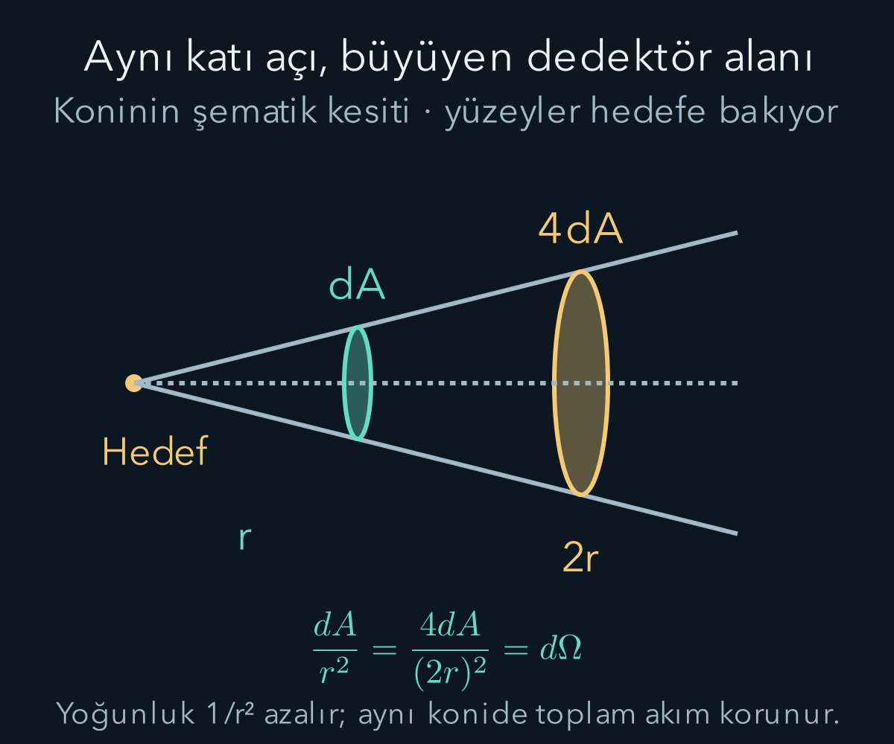
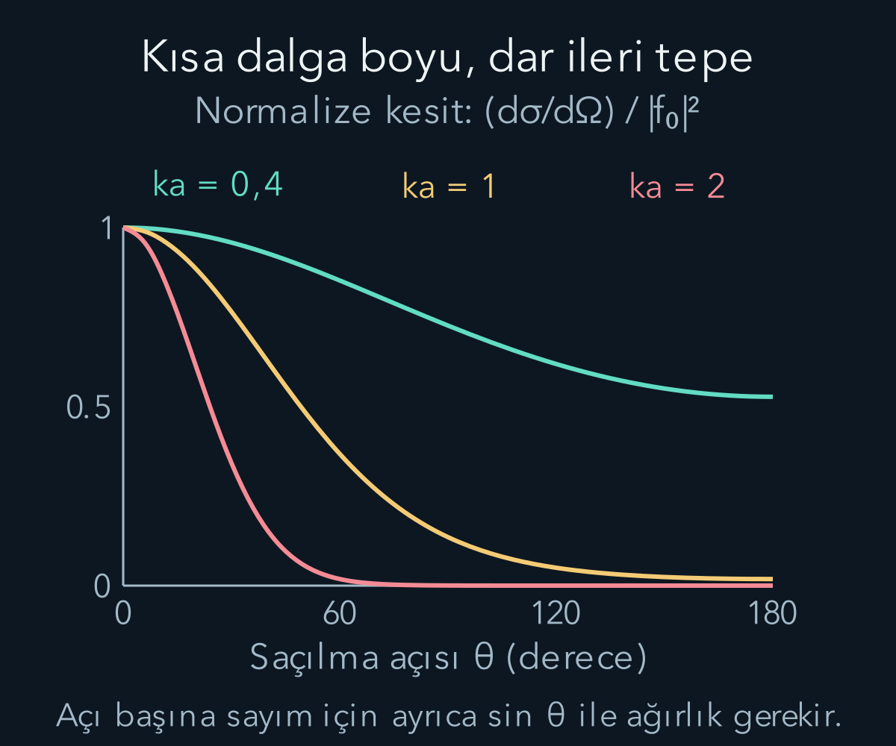

import ArticleVideo from '@/components/ArticleVideo.astro'
import kavram from './media/01-kavram.mp4?url'
import kavramPoster from './media/01-kavram.jpg?url'

Bir parçacık demetini küçük bir hedefe gönderip farklı yönlere dedektörler yerleştirelim. Bir dedektörün daha çok olay sayması, o yönde saçılmanın daha güçlü olduğunu düşündürür. Fakat dedektörün alanı, hedefe uzaklığı ve gelen demetin yoğunluğu da sayıyı değiştirir. Bu etkenleri ayırmadan hedef hakkında karşılaştırılabilir bir ölçü elde edemeyiz. **Tesir kesiti**, gelen akıyla saçılan olay sayısı arasındaki bu bağı kurar.

[Olasılık akımı](/blog/schrodinger-denklemi-ve-olasilik-akimi/) ve [bir boyutlu yansıma-geçiş](/blog/potansiyel-basamagi-ve-tunelleme/) konularında akım oranları kullanmıştık. Şimdi üç boyutta yönler de önemlidir. [Merkezi potansiyel](/blog/merkezi-potansiyel-ve-hidrojen-atomi/) yazısındaki küresel koordinatlar yararlı olacak. Bu yazıda sabit, gerçek değerli ve kısa menzilli bir potansiyelden **elastik saçılma** inceleyeceğiz: uzaklardaki giriş ve çıkış enerjileri aynı, yönleri farklı olabilir. [Önceki Rabi yazısında](/blog/zamana-bagli-perturbasyon-ve-rabi-salinimlari/) enerjiyi değiştiren zamana bağlı bir sürücü vardı; burada potansiyel sabittir. Hedefi yerinde tutulan ağır bir kaynak sayacağız. İki hareketli parçacığın göreli saçılmasında ise kütle merkezi sistemine geçmek ve kütle yerine hidrojen hesabında gördüğümüz indirgenmiş kütleyi kullanmak gerekir; laboratuvar açılarıyla o sistemdeki açıları karıştırmayız.

## 1. Gelen akı ve sayım hızı

Demet yoğunluğu $n$ birim hacimdeki parçacık sayısı, hız büyüklüğü $v$ olsun. Bir saniyede birim dik alandan geçen ortalama parçacık sayısı $J=nv$ olur. $J$'ye gelen akı diyelim; birimi $\mathrm{m^{-2}s^{-1}}$'dir. Bu, kaç parçacık hazırladığımızla ilgili deneysel bir büyüklüktür. Bu üç boyutlu problemde birimleri aynı olsa da biri parçacık sayısı akısı, diğeri olasılık akımıdır; normalleştirme ölçeğini tutarlı kullanmak gerekir.

Tek hedef için, seçilen yön aralığına saniyede saçılan ortalama olay sayısını $dR$ yazalım. O yön aralığına ait küçük tesir kesiti $d\sigma=dR/J$ olarak tanımlanır. Bölümün birimi alandır: $(\mathrm{s^{-1}})/(\mathrm{m^{-2}s^{-1}})=\mathrm{m^2}$. Bu alan, hedefin fotoğraftaki gölgesi olmak zorunda değildir. Dalga girişimi, enerji ve etkileşim gücüyle değişen bir etkin alan ölçüsüdür.

Toplam tesir kesiti $\sigma$ ise ilgilendiğimiz bütün çıkış yönlerini kapsar. Birden fazla süreç varsa “toplam” sözcüğünün elastik kanalı mı yoksa tüm kanalları mı topladığı belirtilmelidir. Burada yalnız modelimizdeki elastik saçılmayı sayıyoruz.

## 2. Küre üzerinde yön ölçmek: katı açı

Hedeften $r$ uzaklıkta, yüzeyi hedefe bakan küçük bir dedektörün alanı $dA$ olsun. Aynı yön konisi üzerinde uzaklığı iki katına çıkarınca alanı dört kat büyütmek gerekir. Uzaklıktan bağımsız yön ölçüsü:

$$
d\Omega=\frac{dA}{r^2}
$$

ile tanımlanır. $\Omega$ **katı açı**, birim adı steradyandır. Boyut hesabında alan oranı olduğu için boyutsuzdur. Tam kürenin katı açısı $4\pi$'dir. Buradaki $\Omega$, önceki yazıdaki Rabi frekansı değil, bu yazıya özgü katı açı sembolüdür.

$\theta$ gelen demet yönünden ölçülen kutupsal açı, $\phi$ o eksen çevresindeki azimut açısı olsun. Kürede küçük bir parçanın kenarları yaklaşık $r\,d\theta$ ve $r\sin\theta\,d\phi$ olur. Alanlarını çarpıp $r^2$'ye bölersek:

$$
d\Omega=\sin\theta\,d\theta\,d\phi.
$$

Dolayısıyla eşit genişlikli $\theta$ aralıkları eşit katı açı kaplamaz. Ekvator çevresindeki halka, kutup yakınındaki aynı açısal genişlikli halkadan daha büyüktür. Bu $\sin\theta$ çarpanını unutmak toplam olay sayısını yanlış hesaplatır.

Örneğin gelen eksen çevresinde $0\le\theta\le\alpha$ konisini kapsayan bir dedektör dizisi düşünelim. $\alpha$ koninin yarı açısıdır. Bütün azimutlar toplandığı için:

$$
\begin{aligned}
\Delta\Omega
&=\int_0^{2\pi}d\phi\int_0^\alpha\sin\theta\,d\theta\\
&=2\pi(1-\cos\alpha).
\end{aligned}
$$

$\alpha=30^\circ$ için yaklaşık $0{,}842$ steradyan elde ederiz. Tam küreye oranı $(1-\cos30^\circ)/2\approx0{,}067$ olur. Yani bu koni bütün yönlerin yaklaşık yüzde 6,7'sini kapsar. İzotropik saçılmada olayların da aynı oranı buraya gider. İleri yönde yoğunlaşmış saçılmada ise oran daha büyüktür; yalnız geometrik kesri kullanamayız.

**Diferansiyel tesir kesiti** $d\sigma/d\Omega$, birim katı açı başına etkin alandır. Küçük bir dedektör açıklığında yaklaşık sabitse $dR\approx J(d\sigma/d\Omega)\Delta\Omega$ olur. Geniş dedektörde ortadaki değeri çarpmak yerine açıklık boyunca integral almak gerekir. Dedektör verimi birden küçükse ayrıca bu olasılık da sayım denklemine girer.

## 3. Uzakta düzlem dalga ve dışarı giden küresel dalga

Gelen yönü $z$ ekseni seçelim. Potansiyelin etkili olduğu bölgeden çok uzakta, enerjiye ait uzaysal çözümü:

$$
\psi(\mathbf r)\sim A\left[e^{ikz}+f(\theta,\phi)\frac{e^{ikr}}{r}\right]
$$

biçiminde yazarız. $\mathbf r$ konum vektörü, $r=|\mathbf r|$ uzaklık, $k=\sqrt{2mE}/\hbar$ uzak bölgedeki dalga sayısıdır. Uzakta potansiyel sıfır seçilmiştir. $m$ kütle, $E>0$ enerji, $\hbar$ indirgenmiş Planck sabiti, $i^2=-1$ sanal birim, $A$ gelen dalganın genlik ölçeğidir. $f$ ise **saçılma genliği**dir. Köşeli parantezdeki iki terimin aynı boyutta olması için $f$ uzunluk birimli olmalıdır.

Düzlem dalga sonsuz hacimde tek parçacık için bire normalize edilemez. Burada onun amacı sabit gelen akıyı modellemektir; geniş bir dalga paketinin uygun sınırı gibi düşünülebilir. Sonuçta fiziksel olarak karşılaştırdığımız akım oranında ortak $|A|^2$ ölçeği silinecek. Bu nedenle normalleştirme sorusunu göz ardı etmiş olmuyoruz.

$e^{ikr}/r$ dışarı yayılan küresel dalgadır. $1/r$ genlik azalması, yoğunluğu $1/r^2$ ile azaltır. Kürenin alanı $r^2$ ile arttığı için aynı yön konisinden geçen toplam akım uzaklığa bağlı kalmaz. $f$ farklı yönlerin ağırlığını ve fazını belirler.

## 4. Genliğin karesi neden tesir kesiti olur?

Üç boyutta olasılık akımı $\mathbf j=(\hbar/m)\operatorname{Im}(\psi^*\nabla\psi)$'dir. $\nabla$ uzaysal türevleri bir vektörde toplayan gradyan, yıldız karmaşık eşlenik, $\operatorname{Im}$ sanal kısım anlamındadır. Gelen dalganın $z$ türevi $ikAe^{ikz}$ olduğundan gelen akım büyüklüğü:

$$
j_{\rm gelen}=\frac{\hbar k}{m}|A|^2.
$$

Saçılan parçayı $\psi_s=Af e^{ikr}/r$ alalım. Sabit yönde radyal türevi $(ik-1/r)\psi_s$'dir. Bu nedenle:

$$
\begin{aligned}
j_{s,r}&=\frac\hbar m\operatorname{Im}\left[(ik-1/r)|\psi_s|^2\right]\\
&=\frac{\hbar k}{m}|A|^2\frac{|f|^2}{r^2}.
\end{aligned}
$$

$-1/r$ gerçektir ve sanal kısma katkı vermez. Küçük küre alanından geçen akımı $r^2d\Omega$ ile çarpıp gelen akıya bölelim:

$$
\begin{aligned}
d\sigma&=\frac{j_{s,r}r^2d\Omega}{j_{\rm gelen}}\\
&=|f(\theta,\phi)|^2d\Omega.
\end{aligned}
$$

Böylece elde ettiğimiz ilişki:

$$
\boxed{\frac{d\sigma}{d\Omega}=|f|^2.}
$$

Bu eşitlikte giriş ve çıkış dalga sayıları aynıdır. Enerji değiştiren kanallarda uygun çıkış/giriş hız oranı ayrıca bulunur. Tam dalganın akımında gelen ve saçılan parçaların girişim terimleri de vardır; özellikle ileri yönde akım korunumu onlarla tutarlıdır. Dedektörün saçılan kanala ait akımını tanımlarken bu sınır ve ayrımı kullandık. İleri demetin içindeki ölçümü yalnız bağımsız iki şiddet toplamı saymak doğru olmaz.

## 5. Bir genlik biliniyorsa olay sayısı

Her yöne eşit, yani izotropik $f=f_0$ örneğinde $\sigma=4\pi|f_0|^2$ olur. Bu, kutupsal açıya göre olay yoğunluğunun sabit olduğu anlamına gelmez: tam azimut halkası için $dR/d\theta=2\pi J|f_0|^2\sin\theta$ bulunur. Yön başına eşitlik ile eşit açı aralığına düşen toplamı ayırmalıyız.

Örneğin $J=10^{12}\,\mathrm{m^{-2}s^{-1}}$, $d\sigma/d\Omega=10^{-20}\,\mathrm{m^2/sr}$, $\Delta\Omega=0{,}01\,\mathrm{sr}$ olsun. Tek hedefin sayım hızı $10^{-10}\,\mathrm{s^{-1}}$ olur. Birbirinden bağımsız $N=10^{12}$ hedef içeren, çoklu saçılmanın ihmal edildiği ince bir örnekte ideal hız $100\,\mathrm{s^{-1}}$ olur. Dedektörün kayıt verimi yüzde 60 ve sayım süresi 10 saniye olsaydı, ideal 100 olay/saniye yerine ortalama $100\times0{,}60\times10=600$ kayıt beklerdik. Bu bir ortalamadır; her tekrarın tam 600 olay vermesi gerekmez. Hedefler arası eşevreli girişim, gölgelenme, enerji kaybı veya tekrar saçılma önemliyse yalnız $N$ ile çarpmak yeterli değildir.

## 6. Born yaklaşımında hangi dalga değiştirilir?

Şimdi $f$'yi potansiyelden yaklaşık hesaplayalım. Kısa menzilli $V(\mathbf r)$ için dışarı giden sınır koşulunu taşıyan integral denkleminde, potansiyelin her noktası o noktadaki toplam dalgayla ağırlanmış bir kaynak gibi davranır. **Birinci Born yaklaşımı**, bu kaynak içindeki tam dalgayı gelen düzlem dalgayla değiştirmektir. Potansiyelin dalgayı içeride çok bozmadığı rejimde beklenen ilk düzeltmeyi verir.

Bu değiştirmenin nerede yapıldığını bir denklemde görelim. Gelen dalga vektörünü $\mathbf k_i$ ile gösterip, genliğini geçici olarak bir seçip $C=m/(2\pi\hbar^2)$ yazarsak, tam saçılma denkleminin integral biçimi:

$$
\begin{aligned}
\psi(\mathbf r)&=e^{i\mathbf k_i\cdot\mathbf r}\\
&\quad-C\int d^3r'\,
\frac{e^{ik|\mathbf r-\mathbf r'|}}{|\mathbf r-\mathbf r'|}
V(\mathbf r')\psi(\mathbf r').
\end{aligned}
$$

$\mathbf r'$ kaynak konumunu tarayan integral değişkeni, $d^3r'$ küçük hacim elemanıdır; bu asal işareti burada türev değildir. Çekirdekteki $e^{ikR}/R$, $R=|\mathbf r-\mathbf r'|$ uzaklığına yayılan dışarı giden küresel cevaptır. Bu integral biçimini Schrödinger denkleminin noktasal kaynağa cevabından gelen bir matematik sonucu olarak kullanıyoruz. Önemli fark şudur: sağdaki integralde bilinmeyen $\psi$ hâlâ vardır. Born adımı tam o içteki $\psi(\mathbf r')$ yerine gelen dalgayı koyar; çıkan dalgayı sıfır saymaz.

Uzakta $|\mathbf r-\mathbf r'|\approx r-\widehat{\mathbf r}\cdot\mathbf r'$ kullanılır; $\widehat{\mathbf r}$ gözlem yönünün birim vektörüdür. Paydadaki uzaklığı yaklaşık $r$ alırken üstelin fazında yön bağımlı ikinci terimi koruruz. Böylece ortak $e^{ikr}/r$ dışında kalan katsayıyı, yani $f$'yi okuyabiliriz.

Gelen ve çıkan dalga vektörleri $\mathbf k_i,\mathbf k_f$, aktarım dalga vektörü $\mathbf q=\mathbf k_f-\mathbf k_i$ olsun. Elastik durumda ikisinin büyüklüğü $k$'dır. Yaklaşık genlik:

$$
f_B(\theta,\phi)=-\frac{m}{2\pi\hbar^2}
\int d^3r\,V(\mathbf r)e^{-i\mathbf q\cdot\mathbf r}.
$$

Bu ifade potansiyelin üç boyutlu Fourier dönüşümüdür. Burada integral denkleminden gelen katsayıyı standart saçılma normalizasyonuyla kullanıyoruz; her Fourier tanımında aynı $2\pi$ katsayıları bulunmaz. Boyut denetimi yaparsak $mV/\hbar^2$ uzunluğun ters karesi, hacim integrali uzunluğun küpüdür; sonuç uzunluktur.

Vektör üçgeninden $q^2=k^2+k^2-2k^2\cos\theta$ bulunur. $1-\cos\theta=2\sin^2(\theta/2)$ ile $q=2k\sin(\theta/2)$ çıkar. İleri yönde küçük, geriye saçılmada büyük momentum aktarımı $\hbar q$ gerekir. Bu, açı dağılımının potansiyelin uzaysal yapısını nasıl örneklediğini gösterir.

## 7. Gauss potansiyelinde açık integral

$V(r)=V_0e^{-r^2/(2a^2)}$ seçelim. $a>0$ etkileşimin uzunluk ölçeği, $V_0$ enerji ölçeğidir. Koordinatlardan birini $\mathbf q$ boyunca seçince üç boyutlu integral üç Gauss integraline ayrılır. $q_x$ aktarım vektörünün x bileşeni olmak üzere tek boyutlu sonuç:

$$
\begin{aligned}
F(q_x)&=\int_{-\infty}^{\infty}e^{-x^2/(2a^2)}e^{-iq_xx}dx\\
&=\sqrt{2\pi}\,a\,e^{-a^2q_x^2/2}
\end{aligned}
$$

olur. Bu sonucu karmaşık düzlemde bir yol değiştirmeden de çıkarabiliriz. Yukarıda integrali $F(q_x)$ ile adlandırdık. $q_x$'e göre türev, integrandın önüne $-ix$ getirir. Gauss'un x türevi $-x/a^2$ çarpanı ürettiğinden kısmi integrasyonla:

$$
\begin{aligned}
F'(q_x)
&=ia^2\int\frac{d}{dx}e^{-x^2/(2a^2)}e^{-iq_xx}dx\\
&=-a^2q_xF(q_x).
\end{aligned}
$$

Sınır terimi Gauss sönümüyle sıfırdır. Bu birinci derece denklemin çözümü $F(q_x)=F(0)e^{-a^2q_x^2/2}$ olur. [Varyasyon yazısındaki](/blog/varyasyon-yontemi/) Gauss integralinden $F(0)=\sqrt{2\pi}a$ geldiği için gereken katsayı da belirlenir. Üç çarpanı birleştirince $q_x^2+q_y^2+q_z^2=q^2$ ile:

$$
\begin{aligned}
f_B&=-\sqrt{2\pi}\frac{mV_0a^3}{\hbar^2}e^{-a^2q^2/2}\\
&\equiv f_0e^{-2(ka)^2\sin^2(\theta/2)}.
\end{aligned}
$$

$f_0$ bu yaklaşık genliğin ileri yön değeridir. Kare alırsak:

$$
\frac{d\sigma_B}{d\Omega}=|f_0|^2
 e^{-4(ka)^2\sin^2(\theta/2)}.
$$

$ka\ll1$ iken açıya bağımlılık zayıftır. $ka$ büyüdükçe dağılım ileri yönde daralır. Bu sonucu, aynı potansiyelde dalga boyunu değiştirmenin açısal farkı olarak okuyoruz. Born yaklaşımının kendisi ayrıca geçerli kalmalıdır.

<ArticleVideo src={kavram} poster={kavramPoster} title="Dalga boyu değişince saçılma açısı dağılımı" caption="Gauss potansiyelinin birinci Born hesabında ka değeri 0,4'ten 2'ye artıyor. Çizgi, dσ/dΩ değerinin ileri yön değeri |f₀|²'ye oranıdır. Sağa doğru daha büyük saçılma açısı gösterilir. Bu eğri θ başına sayım değildir; toplam sayım için sinθ katı açı ağırlığı gerekir." />

## 8. Toplam kesiti katı açıyla toplamak

Merkezi potansiyelde $\phi$ bağımlılığı yoktur. $b=(ka)^2$ ve $u=\cos\theta$ koyarsak:

$$
\begin{aligned}
\sigma_B&=2\pi|f_0|^2\int_0^\pi
 e^{-2b(1-\cos\theta)}\sin\theta\,d\theta\\
&=2\pi|f_0|^2\int_{-1}^1e^{-2b(1-u)}du.
\end{aligned}
$$

Üstel integralin sonucu $(1-e^{-4b})/(2b)$ olduğundan:

$$
\sigma_B=\frac{\pi|f_0|^2}{(ka)^2}[1-e^{-4(ka)^2}].
$$

$ka\to0$ limitinde $1-e^{-4b}\approx4b$ kullanılır ve izotropik $4\pi|f_0|^2$ sonucu geri gelir. Formülde sıfıra bölme görünmesi fiziksel sonsuzluk değildir; pay da aynı hızla sıfıra gider.

Boyutsuz güç $g=mV_0a^2/\hbar^2$ olsun. $g=0{,}05$, $ka=1$ seçersek $|f_0|^2/a^2=2\pi g^2\approx0{,}01571$ ve $\sigma_B/a^2\approx0{,}04844$ çıkar. Bu küçük güçlü örnekte yaklaşım makuldür. $|g|$, potansiyel enerjisi ölçeğini $\hbar^2/(ma^2)$ kinetik enerji ölçeğine oranlar; yalnız enerji birimli bir sayıya “küçük” demekten daha anlamlı bir denetimdir. Sıfırdan farklı kesit elde etmek için yaklaşımın mutlaka güçlü bir bozunma üretmesi gerekmez; burada genlik güce, kesit gücün karesine bağlıdır. Güçlü çekici potansiyel, bağlanma eşiği veya rezonans yakınında ilk Born terimi güvenilir olmayabilir; yalnız $E>V_0$ karşılaştırması genel ve yeterli bir hata garantisi değildir.

Şimdi Gauss sonucunu belirli bir dedektör açıklığına uygulayalım. İleri yönde yarı açısı $\alpha$ olan koni için aynı integrali yalnız $0\le\theta\le\alpha$ boyunca alırız. $b=(ka)^2$ tanımıyla, saçılmış olayların bu koniye düşen koşullu payı:

$$
\begin{aligned}
F(\alpha)
&=\frac{\displaystyle\int_0^\alpha e^{-2b(1-\cos\theta)}\sin\theta\,d\theta}
{\displaystyle\int_0^\pi e^{-2b(1-\cos\theta)}\sin\theta\,d\theta}\\
&=\frac{1-e^{-2b(1-\cos\alpha)}}{1-e^{-4b}}.
\end{aligned}
$$

Ortak $2\pi|f_0|^2$ çarpanı sadeleşti. $ka=1$ ve $\alpha=30^\circ$ için pay yaklaşık $0{,}2351$, payda $0{,}9817$ ve $F\approx0{,}2394$ olur. Yani saçılmış olayların yaklaşık yüzde 23,9'u, bütün katı açının yalnız yüzde 6,7'sini kapsayan bu ileri koniye düşer. Bu fark ileri yığılmayı nicel olarak gösterir. $b\to0$ limitinde iki üsteli ilk derecede açmak $F\to(1-\cos\alpha)/2$ verir; izotropik geometrik kesir geri gelir. Bu koşullu oran, demetteki bütün parçacıkların yüzde 23,9'unun mutlaka saçıldığı anlamına gelmez; toplam saçılma hızını hâlâ J ve toplam kesit belirler.

## 9. Sayıdan etkileşime geri dönmek

Tesir kesiti, sayımları demet şiddeti ve dedektör geometrisinden ayırır. Kuantum hesabı önce karmaşık saçılma genliğini, sonra onun akımla ilişkisini verir. Tesir kesiti tek başına sıfır ile bir arasında sınırlı bir olasılık değildir; alan birimi taşır. Saçıldığı bilinen bir parçacığın hangi yöne gittiğinin koşullu olasılığını istersek, sonlu toplam kesit için $(d\sigma/d\Omega)/\sigma$ kullanırız. Bunun bütün kürede integrali birdir. Ölçülen açısal dağılım potansiyel hakkında bilgi taşır; fakat yalnız $|f|^2$ ölçmek karmaşık fazın tamamını otomatik belirlemez.

Bu yazıda tek kanal, kısa menzil ve uzak bölge varsayımları kullandık. Coulomb gibi uzun menzilli alanlarda uzak dalganın biçimi ve ileri yön davranışı ayrıca ele alınmalıdır. Bir yaklaşımın güzel bir eğri üretmesi yeterli değildir: hangi akıyı, hangi açıyı ve hangi koşullarda hesapladığını bilmek, eğrinin fiziksel anlamını kurar.

## Kaynaklar

Akımdan kesite geçiş ve Born integralinin normalizasyonu [MIT OCW, Barton Zwiebach — Scattering](https://ocw.mit.edu/courses/8-06-quantum-physics-iii-spring-2018/45dbd7038c3e969491eceeae86c44d42_MIT8_06S18ch7.pdf) ile karşılaştırıldı. Gauss potansiyelinin açısal ve toplam kesit hesapları ile sayım örneği bu yazı için yapıldı. Kaynak 13 Ekim 2026 tarihinde doğrudan açıldı.
