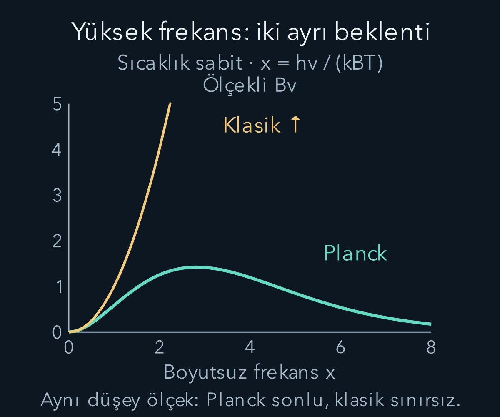
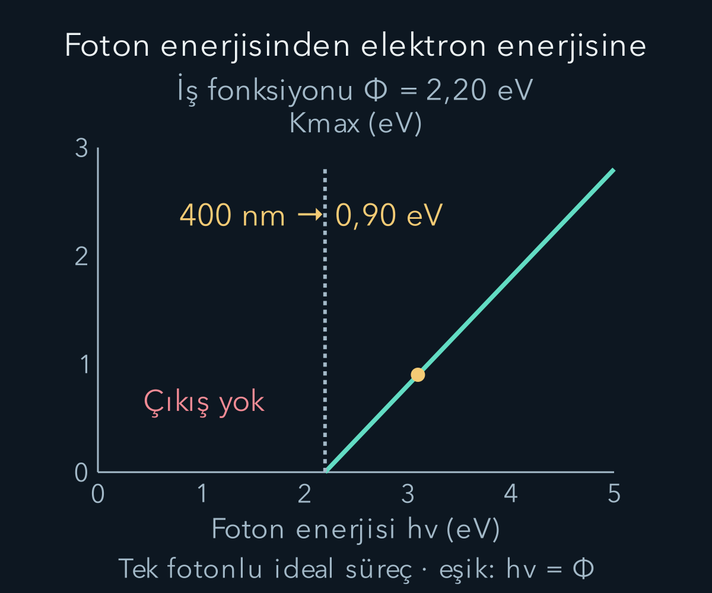

import ArticleVideo from '@/components/ArticleVideo.astro'
import kavram from './media/01-kavram.mp4?url'
import kavramPoster from './media/01-kavram.jpg?url'

Sıcak bir metalin kızarmasıyla ışığın bir metalden elektron koparması ilk bakışta farklı olaylardır. Birinde madde ışık yayıyor, diğerinde ışık maddeye enerji veriyor. Bu iki yönü birlikte incelemek, enerjinin ışıkla alışverişinde klasik dalga modelinin hangi soruları açık bıraktığını gösterir. Kuantum fikrine ‘çok küçük şeyler tuhaftır’ cümlesiyle değil, ölçülebilir enerji hesaplarıyla başlayacağız.

[Isıl enerji](/blog/sicaklik-isi-ve-termodinamigin-ilk-yasasi/), [elektromanyetik dalgalar](/blog/maxwell-denklemleri-ve-elektromanyetik-dalgalar/) ve [göreli enerji](/blog/ozel-gorelilik-uzay-zaman-ve-enerji/) bu yazının ön bilgileridir. Frekans $\nu$, saniyedeki salınım sayısıdır; birimi hertz, yani $\mathrm{s^{-1}}$ olur. Dalga boyu $\lambda$ ile boşlukta $c=\lambda\nu$ bağıntısıyla ilişkilidir. Frekans için önceki yazılarda kullanılan $f$ yerine burada yaygın $\nu$ harfini kullanacağız.

## 1. Kara cisim gerçekte ne demektir?

**Kara cisim**, üzerine gelen elektromanyetik ışınımın tamamını soğuran ideal modeldir. ‘Kara’ adı, cismin her sıcaklıkta karanlık görünmesi anlamına gelmez. Soğurmanın ideal olmasıyla ilgilidir. Isıl dengedeki böyle bir cismin yaydığı tayf, biçim ve malzeme ayrıntılarından bağımsız olarak sıcaklıkla belirlenir. Küçük delikli bir oyuk bu modele iyi yaklaşır: delikten giren ışık içeride çok kez yansıyıp soğurulur.

Tayf, yayılan enerjinin farklı dalga boylarına veya frekanslara nasıl dağıldığını gösterir. Tek bir sıcaklıkta yalnız tek bir renk çıkmaz; geniş bir dağılım oluşur. Sıcaklık arttıkça toplam yayım artar ve dağılımın baskın bölgesi değişir. İnsan gözü görünür bölgenin yalnız bir kısmını gördüğü için gözlenen renk, bütün enerji dağılımını anlatmaz.

Aşağıda **tayfsal ışıma şiddetini** $B_\nu(T)$ ile göstereceğiz. $T$ kelvin cinsinden mutlak sıcaklıktır. $B_\nu$, birim izdüşüm alanı, birim katı açı ve birim frekans aralığı başına yayılan gücü belirtir. Katı açı, uzayda bir yönler demetinin açısal büyüklüğüdür; birimi steradyandır. Bu yüzden $B_\nu$ birimi $\mathrm{W\,m^{-2}\,sr^{-1}\,Hz^{-1}}$ olur. Bir frekans aralığındaki enerji için eğri yüksekliğini tek başına değil, o aralık üzerindeki integrali kullanırız.

## 2. Klasik hesap nerede sorun çıkarır?

Bir oyuk içindeki elektromanyetik alan, farklı frekanslarda duran dalga modlarına ayrılabilir. Mod, sınır koşullarını sağlayan bağımsız salınım biçimidir. Klasik eşbölüşüm düşüncesi, ısıl dengede her böyle moda ortalama $k_BT$ enerji verir. Burada $k_B$ Boltzmann sabitidir; sıcaklığı enerji ölçeğine çevirir. Sorun dalga modlarının sayısının yüksek frekansta hızla artmasıdır.

Bu iki bilgi birleşince düşük frekansta başarılı olan Rayleigh–Jeans sonucu elde edilir:

$$
B_\nu^{\mathrm{RJ}}(T)=\frac{2\nu^2 k_BT}{c^2}.
$$

Ayrıntılı mod sayımını burada yeniden kurmuyoruz; önemli sınırı açıkça inceleyebiliriz. Sabit $T$ için sağ taraf $\nu^2$ ile büyür. Bütün frekanslardaki gücü toplamak istediğimizde $\int_0^\infty\nu^2\,d\nu$ ıraksar. Sonlu sıcaklıkta sonsuz enerji çıkması fiziksel değildir. **Morötesi felaket**, yalnızca bir rengin biraz yanlış hesaplanması değil, modelin toplam enerjiyi sonlu tutamamasıdır.

Bu hata ‘dalga denklemi yanlıştır’ diye okunmamalıdır. Modların dalga biçimleri doğru olabilir; onlara ısıl dengede enerji dağıtma kuralı yetersiz kalabilir. Bir modelin hangi parçasının deneyle çatıştığını ayırmak, yeni teoriyi kurarken korunacak başarıları görmemizi sağlar.

## 3. Planck bağıntısının söylediği

Planck'ın tarihsel adımı, maddeyle alanın enerji alışverişini yapan osilatörlerin enerjisini $E_n=nh\nu$ aralıklarıyla ele almaktı. $n=0,1,2,\ldots$ tam sayısı, $h$ ise Planck sabitidir. Günümüzde SI tanımıyla $h=6{,}62607015\times10^{-34}\ \mathrm{J\,s}$ tam değerindedir. Enerji aralığı $h\nu$ olduğundan yüksek frekanslı bir basamağı doldurmak daha fazla enerji gerektirir.

Modern kuantum açıklamada ısıl fotonların ortalama enerji katkısı $h\nu/[e^{h\nu/(k_BT)}-1]$ olur. Bu sonucu henüz Bose istatistiğinden türetmedik; tam türetimin ek ön bilgisi budur. Planck tayfını güvenilir bir fiziksel sonuç olarak kullanıp sınırlarını hesaplayabiliriz:

$$
\boxed{B_\nu(T)=\frac{2h\nu^3}{c^2}
\frac1{e^{h\nu/(k_BT)}-1}.}
$$

Üstelin içindeki $h\nu/(k_BT)$ boyutsuzdur: pay ve payda enerjidir. $h\nu\ll k_BT$ olduğunda $e^x-1\approx x$ kullanılır. Paydadaki $x=h\nu/(k_BT)$ yerine yazınca $h\nu$ sadeleşir ve $2\nu^2k_BT/c^2$ geri gelir. Böylece klasik sonuç, yeni ifadenin düşük frekans sınırıdır.

Yüksek frekansta ise üstel payda kuvvetten çok daha hızlı büyür. Tayf sıfıra yaklaşır; sonsuz yüksek frekanslara enerji yığılması önlenir. Burada ‘yüksek’ ve ‘düşük’ mutlak etiketler değildir: karşılaştırılan oran $h\nu/(k_BT)$'dir. Aynı frekans, sıcaklığı değiştirince farklı rejimde bulunabilir.

Şekilde yatay değişken $x=h\nu/(k_BT)$; düşey değer $B_\nu$'nün sabit sıcaklıkta $2(k_BT)^3/(h^2c^2)$ ölçeğine bölümüdür. Böylece Planck eğrisi $x^3/(e^x-1)$, klasik eğri $x^2$ olur. Klasik eğri şeklin üst sınırından sonra da büyümeye devam eder.

## 4. Frekans eksenini dalga boyuna çevirmek

$B_\nu$ eğrisine bakıp en yüksek noktayı bulduktan sonra yalnız $\lambda=c/\nu$ yazmak, dalga boyu tayfının tepe noktasını vermez. Çünkü eşit frekans aralıkları eşit dalga boyu aralıklarına karşılık gelmez. Aynı küçük fiziksel enerji dilimi iki koordinatta:

$$
B_\lambda\,|d\lambda|=B_\nu\,|d\nu|
$$

olmalıdır. $\nu=c/\lambda$ türevinden $|d\nu/d\lambda|=c/\lambda^2$ bulunur. Bu çarpanı da ekleyince:

$$
B_\lambda(T)=\frac{2hc^2}{\lambda^5}
\frac1{e^{hc/(\lambda k_BT)}-1}
$$

çıkar. Eksen dönüşümü yalnız noktanın yerini değil, birim aralık başına yoğunluğun yüksekliğini de değiştirir. Olasılık yoğunluklarında değişken dönüşümünde gördüğümüz fikir burada enerji yoğunluğuna uygulanıyor.

Dalga boyu tayfında Wien bağıntısı $\lambda_{\max}T\approx2{,}898\times10^{-3}\ \mathrm{m\,K}$ olur. $T=3000\ \mathrm K$ için $\lambda_{\max}\approx9{,}66\times10^{-7}\ \mathrm m=966\ \mathrm{nm}$ bulunur; bu yakın kızılötesindedir. Cismin görünür ışık yaymasıyla maksimumun görünür bölge dışında olması çelişmez. Tek bir tepe, dağılımın diğer bölgelerini yok etmez.

## 5. Fotoelektrik deneyinde ne ölçülür?

Uygun bir metal yüzeye ışık düştüğünde elektronlar yüzeyden çıkabilir. Elektronları toplayan ikinci elektrotla bir elektrik akımı ölçülür. Işığın frekansı, şiddeti ve elektrotlar arasındaki gerilim ayrı ayrı değiştirilebilir. Böylece tek bir belirsiz ‘ışık güçlendi’ ifadesi yerine birbirinden bağımsız etkileri karşılaştırırız.

Elektronun metalden çıkabilmesi için gereken en küçük enerjiye **iş fonksiyonu** deriz ve $\Phi$ ile gösteririz. Bu büyüklük malzemeye ve yüzey koşullarına bağlıdır; evrensel sabit değildir. Tek fotonlu ideal fotoelektrik modelde bir fotonun enerjisi $E_\gamma=h\nu$ olur. Yüzeyden kopan elektronun ulaşabileceği en büyük kinetik enerji:

$$
\boxed{K_{\max}=h\nu-\Phi}
$$

biçimindedir; bu ifade çıkış gerçekleşebilen $h\nu\ge\Phi$ bölgesine aittir. Eşik frekansı $\nu_0=\Phi/h$ olur. Eşiğin altında denklem negatif kinetik enerji üretmez; tek fotonla elektron koparmanın mümkün olmadığını söyler.

Einstein'ın ışık kuantumu fikri, Planck'ın ilk osilatör enerji basamakları fikrinden daha ileri bir fiziksel öneriydi. Tarihsel olarak bu ikisini tek bir anda ortaya çıkmış aynı iddia gibi anlatmak yanıltıcıdır. Foton modeli, elektromanyetik ışığın soğurma ve yayma olaylarında ayrık enerji alışverişlerini açıklar. Dalga girişiminin deneysel başarısını ortadan kaldırmaz; ikisini kapsayacak yeni bir durum tanımına ihtiyaç yaratır.

## 6. Şiddet ile frekansın ayrı görevleri

Tek renkli ışığın frekansı sabit tutulduğunda, şiddeti artırmak birim zamanda yüzeye gelen foton sayısını artırır. İdeal koşullarda daha çok elektron koparılabilir ve doyma akımı büyür. Fakat tek fotonun enerjisi hâlâ $h\nu$ olduğundan en büyük elektron enerjisi değişmez. Frekansı artırmak ise tek fotonun enerjisini artırır; $K_{\max}$ doğrusal büyür.

Şiddeti düşük tutmak deneyin kavramsal ayrımını temizleştirir. Çok güçlü ışıkta bir elektronun birden fazla fotonla etkileştiği çok fotonlu süreçler mümkün olabilir; bunlar tek fotonlu eşik kuralının kapsamı dışındadır. Dolayısıyla ‘eşik altında hiçbir koşulda elektron çıkmaz’ cümlesini bütün deney rejimlerine yaymıyoruz.

Fotonların hepsi aynı enerjide olsa bile çıkan elektronların enerjileri tek bir değerde toplanmak zorunda değildir. Elektronlar metal içinde farklı başlangıç durumlarında bulunabilir, yüzeye giderken enerji kaybedebilir. Einstein bağıntısında bu yüzden $K$ yerine $K_{\max}$ yazılır. Ölçümde enerji dağılımının üst sınırını takip ederiz.

## 7. Durdurma gerilimi ve işaret kontrolü

Elektronları toplayıcıya giderken yavaşlatacak ters gerilim uygulayalım. Elektronun yükü $-e$'dir; $e=1{,}602176634\times10^{-19}\ \mathrm C$ pozitif yük büyüklüğüdür. Yeterli ters gerilimde en enerjik elektron bile toplayıcıya ulaşamaz. Bu gerilimin **pozitif büyüklüğüne** $V_s$ dersek:

$$
eV_s=K_{\max}=h\nu-\Phi.
$$

$V_s$'yi büyüklük olarak tanımladığımız için solda eksi işareti yoktur. Elektrotlar arasındaki işaretli potansiyel farkını ayrıca tanımlasaydık polariteyi açıkça yazmamız gerekirdi. Enerji hesabında ‘elektron negatiftir, o hâlde bütün sonuç negatif olmalı’ demek doğru değildir; kinetik enerji negatif olmaz.

Polariteyi de açıkça kurabiliriz. Metal yüzeyin potansiyeli $V_m$, toplayıcının potansiyeli $V_c$ olsun. Elektronu yavaşlatmak için toplayıcıyı daha düşük potansiyele alırız: $V_c-V_m=-V_s$. Elektronun potansiyel enerji değişimi:

$$
\Delta U=(-e)(V_c-V_m)=(-e)(-V_s)=eV_s
$$

olur. Potansiyel enerji arttığı için, başka iş yokken kinetik enerji aynı miktarda azalır: $K_{\mathrm{son}}=K_{\mathrm{ilk}}-eV_s$. Durdurma sınırında en enerjik elektron için $K_{\mathrm{son}}=0$ koymak $K_{\max}=eV_s$ sonucunu verir. Böylece formüldeki pozitif enerji büyüklüğünün, elektronun negatif yüküyle nasıl bağdaştığı iki işareti birlikte izleyerek görülür.

Bir elektronvolt, yük büyüklüğü $e$ olan parçacığın 1 voltluk potansiyel farkında kazandığı enerji büyüklüğüdür: $1\ \mathrm{eV}=1{,}602176634\times10^{-19}\ \mathrm J$. Buradaki eV bir gerilim değil enerji birimidir. Bu dönüşümle $hc\approx1240\ \mathrm{eV\,nm}$ yazılabilir.

Özgün bir örnek seçelim: iş fonksiyonu $2{,}20\ \mathrm{eV}$ olan ideal yüzeye $\lambda=400\ \mathrm{nm}$ ışık gelsin. Foton enerjisi $1240/400=3{,}10\ \mathrm{eV}$ olur. İş fonksiyonunu çıkarınca $K_{\max}=0{,}90\ \mathrm{eV}$; dolayısıyla $V_s=0{,}90\ \mathrm V$ bulunur. Eşik dalga boyu $\lambda_0=hc/\Phi\approx564\ \mathrm{nm}$ olur. Daha uzun dalga boyu, daha küçük foton enerjisi demektir.

<ArticleVideo src={kavram} poster={kavramPoster} title="Fotoelektrik eşikten sonra enerji" caption="Yatay eksende foton enerjisinin iş fonksiyonuna oranı artar. Eşiğin üstünde elektronun en büyük kinetik enerjisi doğrusal büyür; ideal tek fotonlu modelin eşik koşulu ayrıca belirtilir." />

## 8. Aynı enerji bütçesini iki yönde okumak

Bu örnekte ışığın şiddetini iki katına çıkarmak, uygun verim ve doyma koşullarında daha çok elektron sağlayabilir; $0{,}90\ \mathrm{eV}$ sınırını iki katına çıkarmaz. Dalga boyunu 300 nanometreye indirirsek foton enerjisi $1240/300\approx4{,}13\ \mathrm{eV}$ olur ve üst sınır $1{,}93\ \mathrm{eV}$'a yükselir. İki değişiklik farklı ölçülebilir sonuçlar üretir.

Durdurma gerilimini frekansa karşı çizersek doğrunun eğimi $h/e$, yatay eksen kesişimi $\Phi/h$ olur. Böylece bir ölçüm serisi iki farklı fiziksel bilgiyi ayırabilir: eğim evrensel sabitle, kesişim yüzeyin iş fonksiyonuyla ilgilidir. Veri doğrusunun eşiğin altındaki uzantısı matematiksel olarak çizilebilir ama negatif kinetik enerjili elektronların varlığını anlatmaz.

Kara cisim tayfında yüksek frekanslı enerjinin ısıl olarak zor erişilebilir olması, fotoelektrik deneyinde yüksek frekanslı tek fotonun daha enerjik olmasıyla uyumludur. Aynı $h\nu$ ölçeği, hem madde ışık yayarken hem ışık maddeye enerji verirken karşımıza çıkar. Buradan bir sonraki soruya geçebiliriz: atomlar neden yalnız belirli enerji farklarına karşılık gelen çizgiler yayar ve madde parçacıkları neden bazı deneylerde dalga gibi girişim oluşturur?

## 9. Sayılan fotonlarla ölçülen gücü bağlamak

Işığın gücü, birim zamanda taşınan enerjidir. Bir lazerin tek renkli ışığının yüzeye ulaşan gücü $P$ olsun. Her fotonun enerjisi $h\nu$ ise saniyedeki ortalama foton sayısı $\dot N=P/(h\nu)$ olur. Üstteki nokta zaman başına değişimi belirtir; $\dot N$ birimi saniye başına foton sayısıdır. Bu bağıntı, enerji bütçesini sayma diliyle yazmaktan başka bir şey değildir. Fotonların hangi zamanlarda tek tek geleceğine dair bir kesinlik iddiası içermez.

Dalga boyu 400 nanometre, yüzeye ulaşan güç 1 mikrowatt olsun. Mikrowatt $10^{-6}\ \mathrm W$ demektir. Önce tek foton enerjisini joule'e çevirelim: $3{,}10\ \mathrm{eV}\times1{,}602\times10^{-19}\ \mathrm{J/eV}\approx4{,}97\times10^{-19}\ \mathrm J$. Böylece $\dot N\approx10^{-6}/(4{,}97\times10^{-19})\approx2{,}01\times10^{12}\ \mathrm{s^{-1}}$ bulunur. Çok küçük bir optik güç bile saniyede çok sayıda foton anlamına gelebilir; tek foton enerjisi çok küçüktür.

Her gelen fotonun tam bir elektron kopardığını ve bütün elektronların toplandığını varsayarsak akımın üst ideal değeri $I=e\dot N$ olur. Sayıları yerine koyunca yaklaşık $3{,}22\times10^{-7}\ \mathrm A$, yani $0{,}322\ \mathrm{\mu A}$ çıkar. Gerçek deneyde soğurma, elektron çıkarma ve toplama verimleri bu değeri azaltabilir. Varsayımı belirtmeden bu sayıyı her metalde beklenen kesin akım gibi sunamayız. Bununla birlikte hesap, şiddetin neden öncelikle olay sayısını etkilediğini açıkça gösterir.

Aynı gücü koruyup frekansı iki katına çıkarsak her fotonun enerjisi iki katına çıkar, saniyedeki foton sayısı yarıya iner. Dolayısıyla ‘daha yüksek frekans her durumda daha büyük akım demektir’ sonucu çıkmaz. Elektronun üst enerjisi artabilirken olay sayısı düşebilir. Deneyde değişmeyen büyüklüğün güç mü, foton akısı mı olduğunu söylemeden iki ışığı karşılaştırmak eksik kalır.

## 10. Grafiğin altında kalan toplamın anlamı

Bir kara cisim tayfında belirli bir frekansı seçtiğimizde, yalnız o matematiksel noktaya karşılık gelen sonlu bir enerji payı yoktur. Ölçüm aygıtı her zaman küçük de olsa bir bant toplar. Bant $\nu$ ile $\nu+\Delta\nu$ arasındaysa, yeterince dar olduğunda katkı yaklaşık $B_\nu(T)\Delta\nu$ ile orantılıdır. Daha geniş bantlarda eğri değiştiği için integral gerekir. Bu, tek bir noktada yoğunluk ile bir aralıkta biriken miktarın ayrımıdır.

Aynı veriyi dalga boyu ekseninde çizince bandın genişliği değişir. Örneğin kısa dalga boylarında bir nanometrelik aralık, uzun dalga boylarındaki aynı bir nanometrelik aralıktan daha büyük bir frekans aralığına karşılık gelir. Bu yüzden tepe noktalarının dönüşümünde gördüğümüz ek çarpan yalnız matematiksel bir incelik değildir; ölçüm aygıtının hangi bantları eşit genişlikte topladığıyla ilgilidir.

Bütün frekanslardaki yayımı ve dışarı giden yönleri topladığımızda ideal kara cismin birim alan başına toplam gücü sıcaklığın dördüncü kuvvetiyle değişir. Bu Stefan–Boltzmann sonucudur. Sıcaklık 3000 kelvinden 6000 kelvine çıkarsa oran $2^4=16$ olur. Alan ve diğer model koşulları aynı tutulduğunda toplam yayım on altı katına çıkar; ‘iki kat sıcak, iki kat ışık’ beklentisi doğru değildir. Bu toplam yasa, tayfın hangi renkte yoğunlaştığını tek başına vermez. Toplam büyüklükle dağılım biçimini birlikte incelemek gerekir.

Bu iki deney ailesi, tek bir sözcükle bütün ışık davranışını sınıflandırmaya çalışmak yerine hangi niceliği hesapladığımızı belirlemeyi öğretir. Enerji alışverişi, olay sayısı, tayfsal yoğunluk ve girişim görünürlüğü farklı sorulardır. Kuantum kuramını kurarken bunları aynı deneyin birbirini tamamlayan ölçülebilir parçaları olarak tutacağız.

## Kaynakça

Aşağıdaki açık kaynaklar 11 Ekim 2026 tarihinde yeniden doğrudan kontrol edildi. Metin, hesap örnekleri ve şekiller bu yazı için özgün olarak hazırlandı.

- [OpenStax — Blackbody Radiation](https://openstax.org/books/university-physics-volume-3/pages/6-1-blackbody-radiation): Klasik sınır ve Planck tayfı.
- [OpenStax — Photoelectric Effect](https://openstax.org/books/university-physics-volume-3/pages/6-2-photoelectric-effect): İş fonksiyonu, eşik ve durdurma gerilimi.
- [NIST — Fundamental Constants](https://physics.nist.gov/cuu/Constants/): Planck sabiti ve temel yük için SI değerleri.
