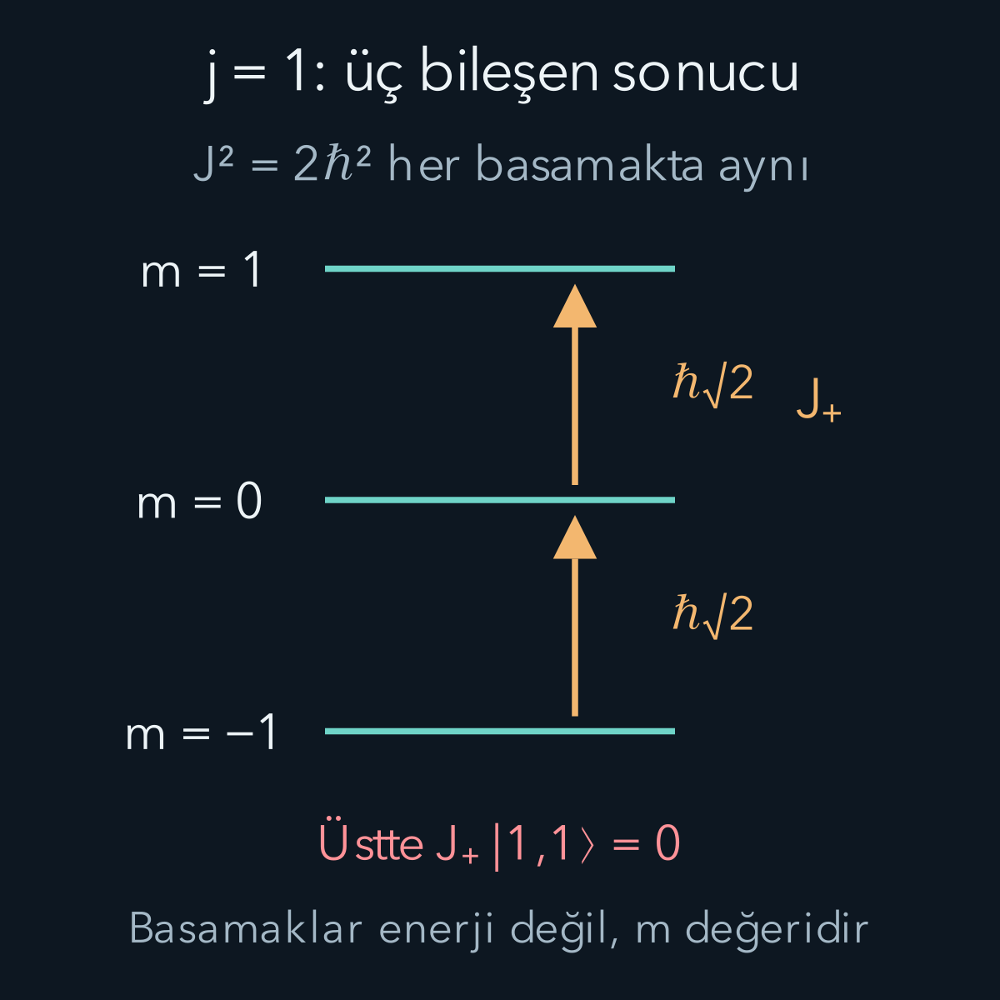
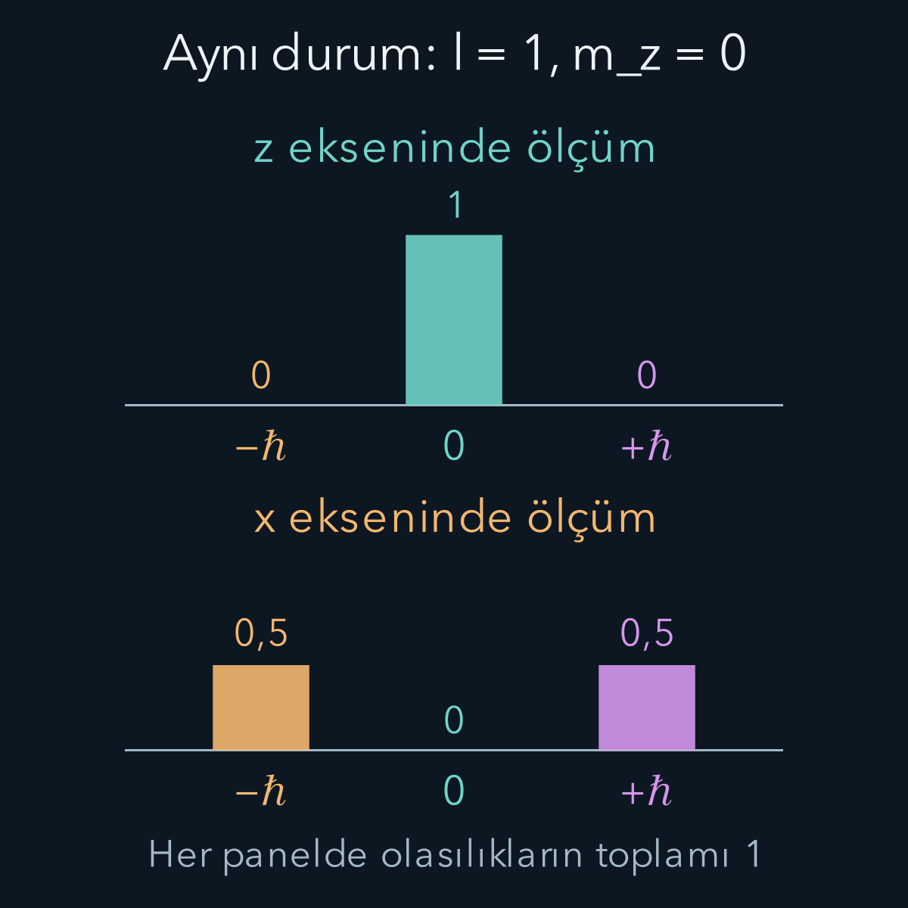

import ArticleVideo from '@/components/ArticleVideo.astro'
import kavram from './media/01-kavram.mp4?url'
import kavramPoster from './media/01-kavram.jpg?url'

Klasik mekanikte bir parçacığın açısal momentumunu konumuyla momentumunun vektörel çarpımından buluruz. Kuantum mekaniğinde aynı ifade işleçlerden oluşur. Bunun önemli sonucu, açısal momentumun üç bileşeninin sıradan üç sayı gibi aynı anda kesinleşmemesidir. Yine de belirli bir toplam büyüklük ve seçilen eksene göre belirli bir bileşen birlikte ölçülebilir.

[Önceki simetri ve parite yazısı](/blog/kuantumda-simetri-ve-parite/) dönüşümleri Hamiltonyenle ilişkilendirdi. Burada [klasik açısal momentum](/blog/donme-tork-ve-acisal-momentum/), [komütatörler](/blog/komutatorler-ve-belirsizlik-iliskisi/) ve [harmonik osilatördeki merdiven işleçleri](/blog/kuantum-harmonik-osilatoru/) ön bilgi olacak. Önce uzaydaki hareketten gelen yörüngesel açısal momentumu kuracağız. Sonra aynı cebrin spini nasıl kapsadığını, ikisinin hangi noktada ayrıldığını göstereceğiz.

Bir işleci bir duruma uygulamak ile o büyüklüğü ölçmek aynı işlem değildir. Örneğin $A|\psi\rangle=a|\psi\rangle$ yazıyorsak $|\psi\rangle$, $A$'nın özdurumu; $a$ o durumdaki kesin ölçüm sonucudur. Başka bir durumda farklı özdeğerler farklı olasılıklarla gelebilir. Köşeli parantezdeki $[A,B]=AB-BA$ ise iki uygulama sırasının farkını gösterir. Aşağıda $I$ birim işleç, $i$ karesi eksi bir olan karmaşık birimdir. Ketlerin normunu bir seçeriz; bu seçim ölçüm olasılıklarının toplamının bir olmasını sağlar.

## 1. Vektörel çarpımdan üç işlece

Konum işleçlerini $x,y,z$, momentum bileşenlerini $p_x,p_y,p_z$ ile gösterelim. Yörüngesel açısal momentumun bileşenleri:

$$
\begin{aligned}
L_x&=yp_z-zp_y,\\
L_y&=zp_x-xp_z,\\
L_z&=xp_y-yp_x
\end{aligned}
$$

olarak tanımlanır. Her bileşenin birimi kilogram metre kare bölü saniye, yani $\mathrm{J\,s}$'dir. İndirgenmiş Planck sabiti $\hbar$ da bu birimdedir. $L_z$ içindeki alt indis, ölçümün seçilen $z$ eksenine göre yapıldığını belirtir.

Aynı eksenin konum ve momentumu $[x,p_x]=i\hbar I$ bağıntısına uyar. Farklı eksenlerde ise örneğin $[x,p_y]=0$ olur. Bütün konum bileşenleri kendi aralarında, bütün momentum bileşenleri de kendi aralarında komüte eder. Bu yazıda elektromanyetik alan içinde kinetik momentumla kanonik momentum ayrımını gerektiren duruma girmiyoruz; kullanılan $p_j=-i\hbar\partial_j$ kanonik momentumdur. Bu ifadede $j$, $x,y,z$ koordinatlarından birini seçer; $\partial_j$ o koordinata göre kısmi türevdir.

Tanımdaki her çarpım farklı eksenlere ait olduğundan sıralama sorunu çıkmaz: $xp_y=p_yx$. Uygun fonksiyonlar ve sınır koşulları üzerinde bileşenler Hermitiktir. Ancak buradan farklı $L$ bileşenlerinin de birbirleriyle komüte ettiği sonucu gelmez. İçlerinde aynı koordinatla aynı momentumu karşılaştıran çapraz katkılar ortaya çıkar.

## 2. Bileşenlerin sırası neden önemlidir?

Bir çarpımla komütatör alırken $[A,BC]=[A,B]C+B[A,C]$ kuralını kullanırız. Bu kuralın gerekçesi, $ABC-BCA$ farkına $BAC$ ekleyip çıkarmaktır. Böylece uzun çarpımları bilinen basit komütatörlere indiririz.

$[L_x,L_y]$ örneğini dört parçaya ayıralım. $[yp_z,zp_x]=-i\hbar yp_x$ olur; çünkü $p_z z-zp_z=-i\hbar$'dır. $[yp_z,-xp_z]$ ile $[-zp_y,zp_x]$ sıfırdır; ilgili koordinatlar ve momentumlar birbirleriyle komüte eder. Son parça $[-zp_y,-xp_z]=i\hbar xp_y$ verir. Toplayınca:

$$
[L_x,L_y]=i\hbar(xp_y-yp_x)=i\hbar L_z.
$$

Eksen adlarını döngüsel değiştirerek diğer ikisini buluruz:

$$
\begin{aligned}
[L_x,L_y]&=i\hbar L_z,\\
[L_y,L_z]&=i\hbar L_x,\\
[L_z,L_x]&=i\hbar L_y.
\end{aligned}
$$

Sırayı ters çevirirsek komütatörün işareti değişir. Örneğin $[L_z,L_y]=-i\hbar L_x$ olur. Bu işaretler daha sonra merdiven işleçlerinin yükseltme mi alçaltma mı yaptığını belirleyecektir.

## 3. Toplamın karesi neden farklıdır?

$L^2=L_x^2+L_y^2+L_z^2$ tanımını yapalım. Burada $L^2$ tek bir bileşenin karesi değildir; üç karesinin toplamıdır. $L^2$ her bileşenle komüte eder. Örneğin:

$$
\begin{aligned}
[L_x^2,L_z]&=-i\hbar(L_xL_y+L_yL_x),\\
[L_y^2,L_z]&=+i\hbar(L_yL_x+L_xL_y).
\end{aligned}
$$

Bu iki ifade birbirini götürür; $[L_z^2,L_z]=0$ zaten sağlanır. Böylece $[L^2,L_z]=0$ bulunur. Aynı hesap diğer eksenlerde de çalışır. Dolayısıyla toplamın karesiyle seçilen tek bir bileşenin ortak özdurumlarını kullanabiliriz.

Bu, $L_x,L_y,L_z$ için aynı anda üç kesin değer verdiğimiz anlamına gelmez. Özel sıfır açısal momentum durumunda üçü de sıfır olabilir; bunun dışındaki genel durumda uyumsuzluk sürer. $z$ ekseni zorunlu veya evrensel bir özel yön değildir. Deneyde hangi ekseni seçersek o bileşeni toplamla birlikte kullanabiliriz.

### Dönüşümün üreteci olmak ne demektir?

Önceki yazıda momentumu küçük bir ötelemenin üreteci olarak gördük. Açısal momentumun ilgili bileşeni de küçük bir uzaysal dönmenin üretecidir. $z$ ekseni çevresinde $\alpha$ açısı kadar aktif dönmeyi $U_z(\alpha)=e^{-i\alpha L_z/\hbar}$ ile gösteririz. Açı radyan cinsinden boyutsuz olduğundan üstel içindeki $\alpha L_z/\hbar$ da boyutsuzdur. Küçük açı için $U_z(\alpha)\approx I-i\alpha L_z/\hbar$ olur.

Üreteç olmak, $L_z$ ölçümünün parçacığı fiziksel olarak döndürdüğü anlamına gelmez. Biri dönüşümün durum üzerindeki matematiksel etkisi, diğeri ölçümün sonuçları ve durum güncellemesidir. Aynı işleç iki tartışmada farklı roller üstlenir. Bir dönmeyi deneyde gerçekleştirmek için gereken etkileşim ayrıca tanımlanır.

Üç boyutlu sıradan dönmelerin de sırası önemlidir. Bir kitabı önce yatay eksende sonra düşey eksende döndürmek, ters sıranın verdiği yönelimi genellikle vermez. Açısal momentum komütatörleri bu dönme yapısının küçük açı düzeyindeki karşılığıdır. Buradaki $i\hbar$ çarpanı durum dönüşümlerinin üniter temsiline ait ölçek ve işaret bilgisini taşır; onu klasik vektör çarpımındaki sıradan gerçek sayı gibi atamayız.

## 4. Genel cebir ve merdiven tanımı

Aynı komütasyon kurallarına uyan herhangi bir açısal momentumu $J_x,J_y,J_z$ ile göstereceğiz. $J$, yörüngesel $L$ veya içsel spin $S$ olabilir. Cebri bir kez genel biçimde çözmek ikisine de uygulanabilir.

$J^2$ ve $J_z$ ortak özdurumunda $J^2$ özdeğerini $\hbar^2 c$, $J_z$ özdeğerini $\hbar m$ yazalım. $c$ ile $m$ şimdilik boyutsuz sayılardır. Buradaki $m$ kütle değildir; seçilen eksenin açısal momentum bileşenini etiketleyen sayıdır. Henüz alabileceği değerleri varsaymıyoruz.

Yükseltici ve alçaltıcı işleçleri:

$$
J_+=J_x+iJ_y,\qquad J_-=J_x-iJ_y
$$

diye tanımlayalım. $J_+^\dagger=J_-$'dir; tek başlarına Hermitik gözlenebilir değillerdir. Komütatörlerden $[J_z,J_\pm]=\pm\hbar J_\pm$ ve $[J^2,J_\pm]=0$ çıkar. Bu nedenle $J_\pm$ uygulaması sıfır değilse $c$ aynı kalırken $m$ bir artar veya bir azalır.

Örneğin $J_zJ_+|c,m\rangle=(J_+J_z+\hbar J_+)|c,m\rangle=\hbar(m+1)J_+|c,m\rangle$ olur. Bu ara işlem, merdiven sözcüğünün anlamını gösterir. Basamaklar enerji değil, belirli eksenin açısal momentum özdeğerleridir. Enerjiyle ilişkileri Hamiltonyene bağlıdır.

## 5. Merdivenin neden iki ucu vardır?

$J^2-J_z^2=J_x^2+J_y^2$ işleci negatif olmayan ortalamaya sahiptir; karelerin beklentileri norm kareleridir. Ortak özdurumda bu $c-m^2\ge0$ verir. Dolayısıyla sabit $c$ için $m$ sınırsız büyüyemez veya küçülemez. Yükseltme ve alçaltma zinciri bir yerde sıfır vektöründe sonlanmalıdır.

Çarpımları açalım:

$$
\begin{aligned}
J_-J_+&=J^2-J_z^2-\hbar J_z,\\
J_+J_-&=J^2-J_z^2+\hbar J_z.
\end{aligned}
$$

Norm hesabındaki sıra önemlidir. $J_+|c,m\rangle$ ketinin eşlenik devriği $\langle c,m|J_-$ olur; bu nedenle kare normda $J_-J_+$ çarpımı görünür. Çarpımın son terimi de işaretin nereden geldiğini gösterir:

$$
\begin{aligned}
J_-J_+
&=(J_x-iJ_y)(J_x+iJ_y)\\
&=J_x^2+J_y^2+i[J_x,J_y]\\
&=J^2-J_z^2-\hbar J_z.
\end{aligned}
$$

İkinci satırdaki $i[J_x,J_y]$ terimi, $i(i\hbar J_z)=-\hbar J_z$ olur. İşleçlerin sırasını sayılarda olduğu gibi değiştirseydik bu terimi kaybederdik. O zaman basamakların uçları ve $j(j+1)$ sonucu da yanlış çıkardı.

Normalize bir durumda $J_+|c,m\rangle$ normunun karesi $\hbar^2[c-m(m+1)]$ olur. En üst basamağa $m=j$ adını verelim. Yükseltme burada sıfır olduğundan $c=j(j+1)$ çıkar. En alt basamak $m=m_{\min}$ için alçaltma normu sıfırdır: $c=m_{\min}(m_{\min}-1)$.

İki ifadeyi eşitleyince $(m_{\min}+j)(m_{\min}-j-1)=0$ bulunur. En alt değer en üstten büyük olamayacağı için $m_{\min}=-j$ seçilir. Ayrıca $-j\le j$ olduğundan $j\ge0$ olur. En alttan en üste birer birer çıkıldığına göre $2j$ negatif olmayan tam sayıdır. Sonuç:

$$
\begin{aligned}
j&=0,\frac12,1,\frac32,\ldots,\\
m&=-j,-j+1,\ldots,j.
\end{aligned}
$$

Toplam $2j+1$ farklı bileşen özdeğeri vardır. Ortak durumları artık $|j,m\rangle$ yazarız:

$$
\begin{aligned}
J^2|j,m\rangle&=\hbar^2j(j+1)|j,m\rangle,\\
J_z|j,m\rangle&=\hbar m|j,m\rangle.
\end{aligned}
$$

Fazları uygun seçilmiş normalize bazda merdiven katsayısını $C_\pm(j,m)$ ile gösterelim:

$$
\begin{aligned}
C_\pm(j,m)&=\hbar\sqrt{j(j+1)-m(m\pm1)},\\
J_\pm|j,m\rangle&=C_\pm(j,m)|j,m\pm1\rangle.
\end{aligned}
$$

Katsayının karesi yukarıda hesaplanan norm karesidir. Negatif norm üretecek basamağa geçmiyoruz; uçta katsayı tam sıfıra iner.

Örneğin $j=1,m=0$ için yükseltme katsayısı $\hbar\sqrt{1(1+1)-0(0+1)}=\hbar\sqrt2$ olur. Yani $J_+|1,0\rangle$ normalize bir ket değildir; normu $\hbar\sqrt2$'dir. Normalize son durumu elde etmek istiyorsak bu katsayıya böleriz. Katsayının karesi $2\hbar^2$ olduğu için onu doğrudan geçiş olasılığı sanamayız: Hem birimlidir hem de boyutsuz bir olasılık aralığına ait değildir. Gerçek bir etkileşimde bu matris elemanı, uygun fiziksel katsayılarla ve zaman bağımlılığıyla birlikte kullanılır.

En üstte $J_+|1,1\rangle=0$ yazımı da sıfır açısal momentum durumuna geçildiği anlamına gelmez. Sağdaki sıfır, durum uzayının sıfır vektörüdür; normu yoktur ve fiziksel bir hazırlama olarak normalleştirilemez. $j=0$ durumu ise normu bir olan ayrı bir fiziksel durumdur. Sıfır vektörüyle sıfır özdeğerli durumu ayırmak, merdivenin uçlarını doğru okumamızı sağlar.

## 6. Yörüngesel açısal momentumda neden tam sayı çıkar?

Genel cebir yarım tam sayılara izin verdi. Sıradan uzaysal dalga fonksiyonunun yörüngesel açısal momentumunda ise ek bir koşul vardır. $z$ ekseni çevresindeki açıya $\varphi$ diyelim. Bu açı etrafındaki dönüşümü üreten işleç $L_z=-i\hbar\partial_\varphi$ biçimindedir.

Bu türev biçimi Kartezyen tanımdan zincir kuralıyla çıkar. $r$ ve kutupsal açı sabitken azimut açısı $\varphi$ değişsin. $x=r\sin\theta\cos\varphi$, $y=r\sin\theta\sin\varphi$ olduğundan $\partial x/\partial\varphi=-y$ ve $\partial y/\partial\varphi=x$ olur. Dolayısıyla:

$$
\begin{aligned}
\partial_\varphi\psi
&=-y\partial_x\psi+x\partial_y\psi,\\
L_z\psi
&=-i\hbar(x\partial_y-y\partial_x)\psi\\
&=-i\hbar\partial_\varphi\psi.
\end{aligned}
$$

Açısal türev, dalga fonksiyonunun sabit uzaklıkta yön boyunca değişimini ölçer. Formülde görünür bir uzaklık çarpanı kalmaması, açısal momentumun birimsiz olduğu anlamına gelmez: Radyan boyutsuz, $\hbar$ ise açısal momentum birimindedir. Buradaki $\theta$ yalnız noktanın kutupsal koordinatıdır; ileride cihaz yönünü belirtirken aynı harfi ayrıca tanımlayacağız.

$L_z\psi=\hbar m\psi$ denkleminin açısal kısmı $d\Phi/d\varphi=im\Phi$ verir. Çözüm $\Phi(\varphi)=C e^{im\varphi}$ olur. Uzayda aynı noktayı temsil eden $\varphi$ ile $\varphi+2\pi$ için sıradan skaler uzaysal fonksiyonun aynı değeri alması gerekir. Böylece $e^{2\pi im}=1$ ve $m$ tam sayı çıkar.

Bu durumda merdivenin üst etiketi de tam sayı olur. Yörüngesel büyüklük için geleneksel olarak $j$ yerine $l$ harfini kullanırız:

$$
l=0,1,2,\ldots,\qquad m=-l,\ldots,l.
$$

Bir fonksiyonun sadece bu açısal kısmını yazmak üç boyutlu Schrödinger problemini tamamlamaz; uzaklığa ve diğer açıya bağlı kısımlar da vardır. Buradaki amaç, tam sayı koşulunun cebre eklenen uzaysal tek değerlilikten geldiğini ayırmaktır. Yarım tam sayılı spini aynı skaler uzaysal fonksiyon gibi yorumlamayacağız.

## 7. Üç durumlu örneği matrisle kontrol etmek

$l=1$ seçelim ve baz sırasını $|1,1\rangle,|1,0\rangle,|1,-1\rangle$ olarak sabitleyelim. $L_z=\hbar\operatorname{diag}(1,0,-1)$ olur; diag yalnız köşegende verilen sayıları taşıyan matrisi belirtir. İki yükseltme katsayısı da $\hbar\sqrt2$ olduğundan:

$$
L_+=\hbar\sqrt2
\begin{pmatrix}0&1&0\\0&0&1\\0&0&0\end{pmatrix}.
$$

$L_x=(L_++L_-)/2$ ve $L_y=(L_+-L_-)/(2i)$ bağıntılarıyla:

$$
L_x=\frac{\hbar}{\sqrt2}
\begin{pmatrix}0&1&0\\1&0&1\\0&1&0\end{pmatrix},
$$

$$
L_y=\frac{\hbar}{\sqrt2}
\begin{pmatrix}0&-i&0\\i&0&-i\\0&i&0\end{pmatrix}.
$$

Bir matrisin sütunlarını bu bazla birlikte okumak gerekir. İkinci sütun, işlecin $|1,0\rangle$ üzerindeki sonucunun üç baz yönündeki katsayılarını taşır. Örneğin $L_x$'in ikinci sütunu $\hbar(1,0,1)^T/\sqrt2$'dir. Bu, aynı bazda $L_x|1,0\rangle$ yazımını verir; sütundaki sayılar doğrudan $L_x$ ölçüm olasılıkları değildir. Ölçüm hesabı için $L_x$'in kendi özvektörlerine geçeceğiz. Üstteki $T$ işareti satır hâlinde yazılan bileşenlerin sütun olarak okunacağını belirtir.

Matrislerin karelerini toplayınca $L^2=2\hbar^2I$ çıkar; $l(l+1)=2$ sonucu doğrulanır. Hazırlanan durum $|1,0\rangle=(0,1,0)^T$ olsun. $z$ ölçümü kesin olarak sıfır verir. Buna karşılık $L_x$'in $+\hbar$ ve $-\hbar$ özvektörlerini sırasıyla $(1,\sqrt2,1)^T/2$ ve $(1,-\sqrt2,1)^T/2$ seçebiliriz.

Bu iki vektörün başlangıç durumuyla iç çarpımları $+1/\sqrt2$ ve $-1/\sqrt2$'dir. Mutlak kareler yarım çıkar. Sıfır özdeğerinin özvektörü $(1,0,-1)^T/\sqrt2$ başlangıç durumuna diktir; onun olasılığı sıfırdır. Böylece aynı hazırlanmış durumda $x$ ölçümü yüzde elli $+\hbar$, yüzde elli $-\hbar$ verir.

## 8. Toplam büyüklük, ortalama ve belirsizlik

Bu durumda $L^2$ ölçümü kesin $2\hbar^2$ verir. Açısal momentum büyüklüğü gözlenebilirini $\sqrt{L^2}$ olarak tanımlarsak sonucu $\sqrt2\hbar$ olur. Buna rağmen üç bileşenin ortalamaları da sıfırdır. Dolayısıyla ortalama vektörün uzunluğu $|\langle\mathbf L\rangle|=0$ ile $\sqrt{\langle L^2\rangle}=\sqrt2\hbar$ aynı nicelik değildir.

$x$ ölçümündeki dağılımdan $\langle L_x^2\rangle=\hbar^2$ ve $\Delta L_x=\hbar$ buluruz. $y$ için de aynı sonuç geçerlidir; $\Delta L_z=0$'dır. Burada $\Delta$, eş hazırlanmış durumların ölçüm dağılımındaki standart sapmadır. $L_z$'nin kesin sıfır olması toplam açısal momentumun sıfır olduğunu söylemez.

Belirsizlik bağıntısı $\Delta L_x\Delta L_y\ge\hbar|\langle L_z\rangle|/2$ olur. Örneğimizde sağ taraf sıfırdır, fakat sol taraf $\hbar^2$'dir. Alt sınırın sıfır olması iki bileşenin birlikte kesin olduğunu göstermez. Ayrıca açısal momentumu kesin yönü olan klasik bir ok gibi çizmek bu ölçüm farklarını gizleyebilir. Yön çizimi kullanılacaksa onun ölçüm eksenini mi, ortalamayı mı gösterdiği açık olmalıdır.

Ölçüm ekseni $z$ yönüyle $\theta$ açısı yapıp $xz$ düzleminde kalsın. Ölçülen işleç $L_{\mathbf n}=L_z\cos\theta+L_x\sin\theta$ olur. Yukarıdaki matrislerle bulunan olasılıklar $P(0)=\cos^2\theta$ ve $P(\pm\hbar)=\sin^2\theta/2$'dir. Bu olasılıkları yalnız bir dönüşüm formülüne güvenmeden kontrol edebiliriz. $L_{\mathbf n}$ matrisinin sıfır özdeğerine ait normalize vektörü $(-\sin\theta/\sqrt2,\cos\theta,\sin\theta/\sqrt2)^T$ seçilebilir. Matrisi bu sütunla çarpınca her satır sıfır verir; norm karesi $\sin^2\theta/2+\cos^2\theta+\sin^2\theta/2=1$'dir. Başlangıç sütunu $(0,1,0)^T$ ile iç çarpım $\cos\theta$ olduğundan sıfır olasılığı $\cos^2\theta$ çıkar.

Diğer iki özdeğer $\pm\hbar$'dır. Bu durumda $\langle L_{\mathbf n}\rangle=\langle L_z\rangle\cos\theta+\langle L_x\rangle\sin\theta=0$ olduğundan iki olasılık eşit olmalıdır. Toplamları $1-\cos^2\theta=\sin^2\theta$ olduğuna göre her biri bunun yarısıdır. Örneğin $\theta=60^\circ$ için sıfır olasılığı $1/4$, diğer iki sonuç için ayrı ayrı $3/8$ çıkar. Toplam yine birdir.

<ArticleVideo src={kavram} poster={kavramPoster} title="Sabit durum, değişen ölçüm ekseni" caption="Hazırlanan durum l=1, m_z=0 olarak sabit tutulur. Ok parçacığın açısal momentum vektörü değil, ölçüm cihazının seçtiği eksendir. Eksen döndükçe −ℏ, 0 ve +ℏ sonuçlarının Born olasılıkları değişir. Her açı için ayrı, aynı biçimde hazırlanmış deneyler karşılaştırılır." />

Animasyonda eksen dönerken tek bir parçacığı art arda ölçtüğümüzü varsaymıyoruz. Her açı için aynı $|1,0\rangle$ durumu yeniden hazırlanır ve o açıdaki cihazla ölçülür. İlk ölçümden çıkan durumu yeniden hazırlamadan başka eksende ölçseydik başlangıç durumu değişmiş olurdu; aynı olasılık hesabını doğrudan kullanamazdık. Grafikteki değişimi belirleyen şey, sabit durumun farklı ölçüm bazlarına izdüşümüdür. Bu nedenle ok cihaza ait bir yönü gösterirken çubuklar çok sayıda eş hazırlanmış deneyden beklenen sonuç oranlarını gösterir.

Bir başka sayısal kontrol için $l=2,m=2$ durumuna bakalım. Toplamın karesi $6\hbar^2$, kesin $z$ bileşeni $2\hbar$ olur. Bu yüzden $\langle L_x^2+L_y^2\rangle=6\hbar^2-4\hbar^2=2\hbar^2$ kalır. En büyük $z$ bileşenini seçmek bile öteki iki bileşenin karelerini sıfırlamaz. $\sqrt{l(l+1)}\hbar$ büyüklüğü ile $l\hbar$ en büyük bileşeni arasındaki fark tam bu kuantum dağılımını yansıtır.

## 9. Spin aynı cebri kullanır, küçük bir yörünge değildir

Spin $S$ içsel açısal momentumdur. Elektron için $s=1/2$ olduğundan $S^2$ özdeğeri $3\hbar^2/4$, seçilen bileşenin sonuçları $\pm\hbar/2$ olur. [Stern–Gerlach yazısındaki](/blog/stern-gerlach-deneyi-ve-spin/) iki sonuç böylece genel $2j+1$ kuralının bir örneğidir. Spin, elektronun küçük bir katı küre gibi dönmesiyle açıklanmaz.

Yörüngesel $l$ uzaysal fonksiyonun dönüşümünden gelir; spin durumunun iç bileşenleri ayrıca dönüşür. Spin yarım durumda $2\pi$ dönmenin ket üzerinde eksi işaret oluşturması, tek başına ortak faz olarak ölçüm olasılıklarını değiştirmez. Bu özellikten elektronun uzaysal dalga fonksiyonunun aynı noktada iki farklı olasılık verdiği sonucu çıkmaz.

Son olarak bu cebir tek başına enerji formülü vermez. Dönme simetrisine sahip uygun bir Hamiltonyen açısal momentumla komüte edebilir ve korunuma yol açabilir. Sabit bir dış alan belirli yönü seçerse yalnız bazı bileşenler korunabilir. Bir merdiven işlemini yazmak da kendiliğinden fiziksel geçiş gerçekleştiği anlamına gelmez; hangi dış etkileşimin hangi durumları bağladığı ayrıca belirtilmelidir.

## Kaynaklar

İşleç cebri, merdiven normları ve yörüngesel tam sayı koşulu [MIT OCW, Quantum Physics II: Angular Momentum](https://ocw.mit.edu/courses/8-05-quantum-physics-ii-fall-2013/e765f050b2fd50a9d87d2ae801e9c52f_MIT8_05F13_Chap_09.pdf) ile karşılaştırıldı. Yörüngesel büyüklük ile seçilen bileşenin ayrımı için [OpenStax, Orbital Magnetic Dipole Moment of the Electron](https://openstax.org/books/university-physics-volume-3/pages/8-2-orbital-magnetic-dipole-moment-of-the-electron) kontrol edildi. Üç durumlu matris hesabı, ölçüm örneği ve Manim çizimleri bu yazı için hazırlanmıştır.

Kaynak bağlantıları ve ilgili denklemler 12 Ekim 2026 tarihinde yeniden kontrol edildi.
