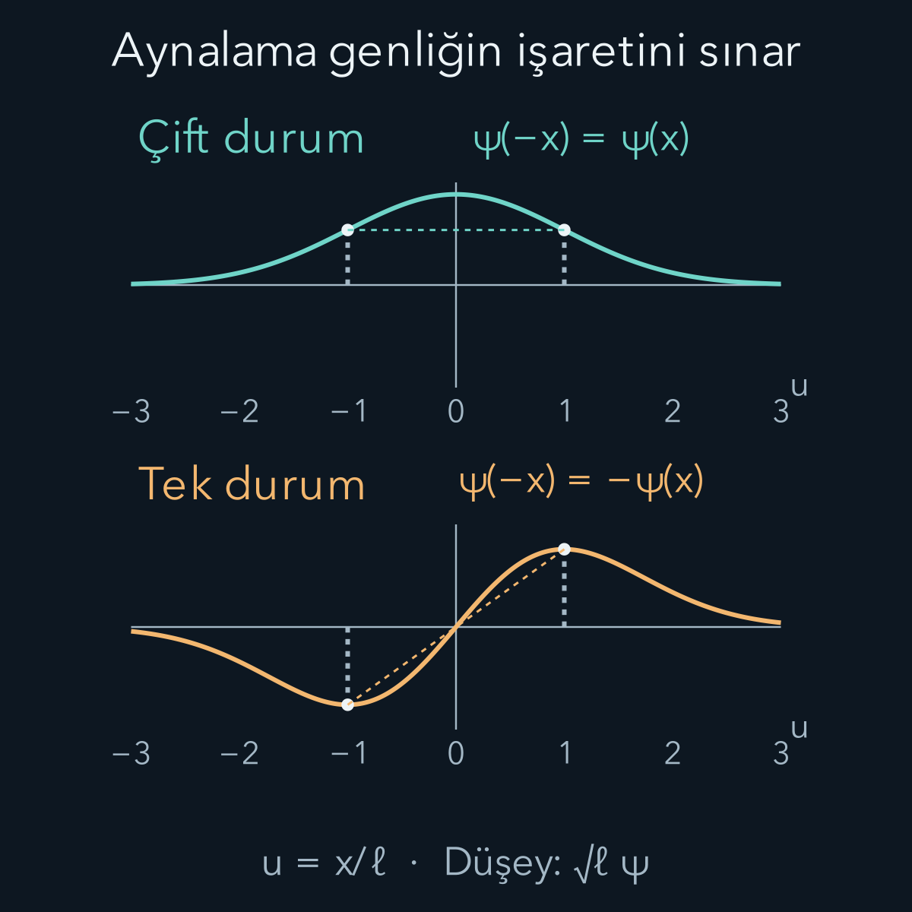
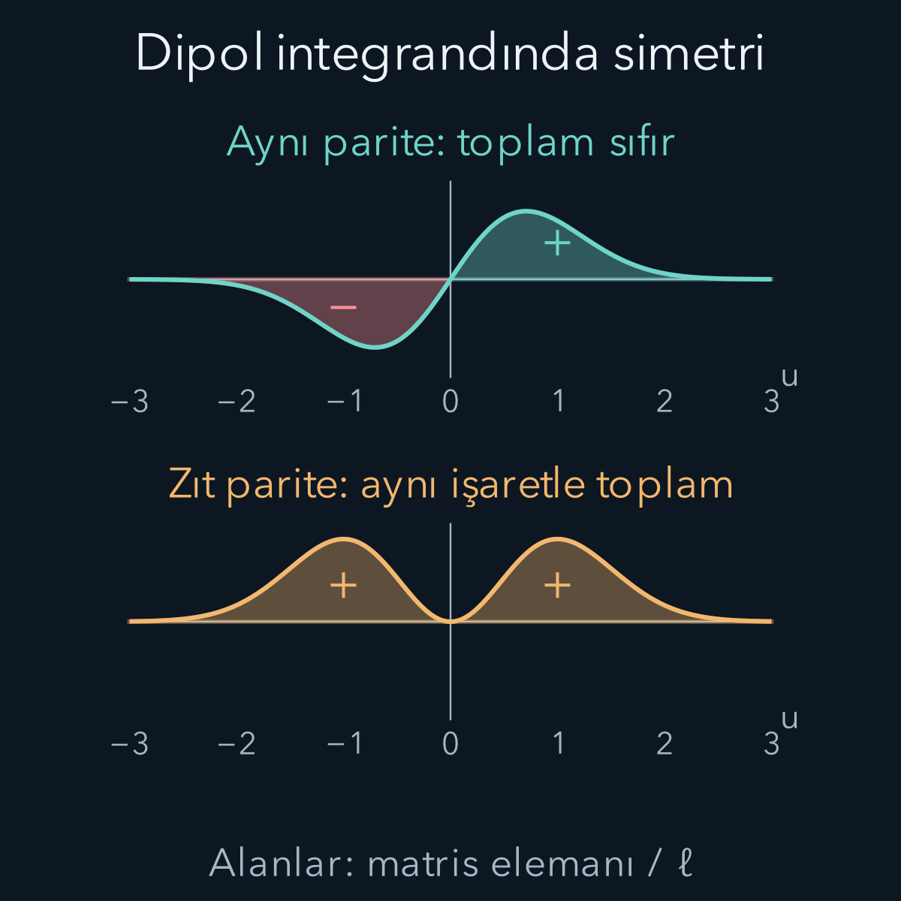

import ArticleVideo from '@/components/ArticleVideo.astro'
import kavram from './media/01-kavram.mp4?url'
import kavramPoster from './media/01-kavram.jpg?url'

[Önceki yazıda sonlu kuyuyu çözerken](/blog/sonlu-potansiyel-kuyusu/) bir kolaylık kullandık: Potansiyel sağda ve solda aynı olduğu için dalga fonksiyonlarını çift ve tek ailelere ayırdık. Bu yalnız güzel bir grafik özelliği değildir. Bir dönüşüm problemi değiştirmiyorsa, çözümü sınıflandırmak ve bazı sonuçları hesap yapmadan elemek mümkün olabilir. Simetri, kuantum mekaniğinde hem hesap aracı hem de hangi niceliklerin korunacağını anlamanın yoludur.

Bu yazıda [komütatör](/blog/komutatorler-ve-belirsizlik-iliskisi/), [üniter zaman evrimi](/blog/hamiltonyen-ve-kuantum-zaman-evrimi/) ve [gözlenebilirlerin matris elemanları](/blog/kuantum-gozlenebilirleri-ve-beklenen-deger/) kullanılacak. Komütatör iki işlemin sırasını karşılaştırır: $[A,B]=AB-BA$. Üniter işlem, durumların normunu ve iç çarpımlarını korur. Bir matris elemanı olan $\langle f|A|i\rangle$, $A$ işleminin başlangıç durumu $|i\rangle$ üzerine etkisinin son durum $|f\rangle$ yönündeki bileşenidir.

Gösterimleri birlikte okuyalım. $|\psi\rangle$ durum vektörünün ket, $\langle\psi|$ onun eşlenik devriğinin bra gösterimidir. $\langle\psi|\psi\rangle$ normun karesini verir; normalize durumda birdir. Bir işleç çarpımı sağdan sola uygulanır: $AB|\psi\rangle$ yazımında önce $B$, sonra $A$ etki eder. Bu yüzden $AB-BA$ karşılaştırması anlamlıdır. Aşağıda $i$ karmaşık birim, $\hbar$ indirgenmiş Planck sabiti, $t$ ise zamandır. Durum etiketi olarak ket içinde kullanılan $i$, başlangıç anlamındadır; üstel ifadelerdeki karmaşık birimle aynı görevde değildir.

## 1. Dönüşüm ile simetri aynı sözcük değildir

Bir dalga fonksiyonunu başlangıcın çevresinde aynalayabiliriz, bütün sistemi öteleriz veya uzayda döndürürüz. Bunların her biri bir **dönüşümdür**. Dönüşümden sonra Hamiltonyen, yani sistemin enerji ve hareket yasasını veren $H$ işleci aynı kalıyorsa bu dönüşüm sistemin bir **simetrisidir**.

Konumu $x$, kütleyi $m$, açısal frekansı $\omega$ ile gösterelim. Bir boyutlu harmonik potansiyel $V(x)=m\omega^2x^2/2$ için $x$ yerine $-x$ yazalım. Kare nedeniyle potansiyel değişmez. Buna karşılık $V(x)=m\omega^2x^2/2+Fx$ biçimindeki potansiyelde doğrusal terim işaret değiştirir. $F$ burada enerji bölü uzunluk biriminde sabit bir katsayıdır; bu işaret seçimiyle kuvvetin doğrusal terimden gelen katkısı $-F$ olur. Sabit $F\ne0$ için başlangıcın çevresindeki aynalama artık simetri değildir.

Burada hangi dönüşümü uyguladığımızı söylemek zorundayız. Hem sistemi hem dış alanı birlikte döndürmek başka, dış alan sabitken yalnız durumu döndürmek başka bir işlemdir. Ayrıca simetri seçilen başlangıç noktasına bağlı görünebilir: Eğilmiş harmonik potansiyelin minimumunu yeni başlangıç yaparsak o noktanın çevresinde yeniden aynalama simetrisi buluruz. “Simetri yok” derken hangi eksen veya dönüşümün kastedildiği belirtilmelidir.

## 2. Üniter simetrinin cebirsel koşulu

Dönüşümü $U$ ile gösterelim. Üniterlik $U^\dagger U=I$ demektir; $U^\dagger$ eşlenik devrik, $I$ birim işleçtir. Dönüştürülmüş durum $|\psi'\rangle=U|\psi\rangle$ olsun. Enerji ortalaması:

$$
\langle\psi'|H|\psi'\rangle
=\langle\psi|U^\dagger H U|\psi\rangle
$$

olur. Bütün uygun durumlar için enerji yasasının aynı kalmasını $U^\dagger H U=H$ ile ifade ederiz. Soldan $U$ ile çarpınca $HU=UH$ buluruz. Dolayısıyla:

$$
\boxed{[H,U]=0.}
$$

Bir tane özel durumun enerji ortalamasının değişmemesi yeterli değildir. Simetri, Hamiltonyenin uygun tanım kümesini ve sınır koşullarını da korumalıdır. Örneğin diferansiyel ifadesi serbest parçacığınki gibi görünse bile yalnız $0<x<L$ kutusunda tanımlı bir problem keyfî öteleme altında aynı kutuya dönmez. Duvarlar simetri tartışmasının parçasıdır.

Zamandan bağımsız $U$ için bir çözümü dönüştürmek aynı denklemin yeni çözümünü verir. Çünkü $i\hbar\partial_t(U|\psi\rangle)=UH|\psi\rangle=HU|\psi\rangle$ olur. Böylece simetri, yalnız tek bir andaki enerji hesabını değil tüm evrim yasasını birbirine bağlar. Zaman tersinimi gibi antiüniter dönüşümler ayrı dikkat ister; bu yazıda o sınıfa geçmiyoruz.

## 3. Korunum koşulunu doğrudan türetmek

$A$ bir gözlenebilir olsun. Beklenen değeri $\langle A\rangle=\langle\psi|A|\psi\rangle$ biçimindedir. Bu çarpımın zaman türevini alırken hem bra hem ket değişir; $A$ açıkça zamana bağlıysa onun türevi de eklenir:

$$
\begin{aligned}
\frac{d}{dt}\langle A\rangle
&=\langle\dot\psi|A|\psi\rangle\\
&\quad+\langle\psi|\partial_t A|\psi\rangle\\
&\quad+\langle\psi|A|\dot\psi\rangle.
\end{aligned}
$$

Schrödinger denklemi $|\dot\psi\rangle=-(i/\hbar)H|\psi\rangle$ verir. Hermitik $H$ için eşlenik denklem $\langle\dot\psi|=(i/\hbar)\langle\psi|H$ olur. Yerine yazıp iki terimi birleştirelim:

$$
\boxed{\frac{d}{dt}\langle A\rangle
=\frac{i}{\hbar}\langle[H,A]\rangle
+\langle\partial_t A\rangle.}
$$

$A$ açıkça zamana bağlı değilse ve evrim boyunca $[H,A]=0$ ise beklenen değeri sabittir. Sabit bir $A$ için komütasyon daha güçlü sonuç da verir: İdeal ölçümdeki özdeğer olasılıkları evrim sırasında değişmez. Yalnız ortalamanın tesadüfen sabit olduğu tek bir durumdan bu genel korunum sonucunu çıkaramayız.

$[H,A]=0$ olması, sistemin mutlaka bir $A$ özdurumunda olduğu anlamına gelmez. Başlangıçta birkaç farklı $A$ sonucunun olasılığı varsa bu olasılıklar korunabilir. Bir ölçümün her seferinde aynı sonucu vermesi ile aynı sonuç dağılımının zamanla korunması farklı iddialardır.

### Sürekli simetriye kısa bir örnek: öteleme

Parite iki kez uygulanınca başlangıca dönen kesikli bir dönüşümdür. Ötelemede ise kaydırma uzaklığını istediğimiz kadar küçük seçebiliriz. Bu tür dönüşümlere sürekli dönüşüm denir. $b$ kadar sağa ötelenmiş dalga fonksiyonunu $(T(b)\psi)(x)=\psi(x-b)$ yazalım. Başlangıçtaki tepe $x=0$ ise yeni tepe $x=b$ noktasındadır; eksi işareti sağa kaydırmayı sağlar.

Küçük $b$ için Taylor açılımının ilk iki terimi $\psi(x-b)\approx\psi(x)-b\psi'(x)$ olur. $p=-i\hbar\partial_x$ tanımını kullanırsak aynı ifade $T(b)\approx I-ibp/\hbar$ biçiminde yazılır. Buradaki momentum, küçük ötelemeyi üreten işleçtir. Daha tam yazım $T(b)=e^{-ibp/\hbar}$ olur; üstel işleç kuvvet serisiyle tanımlanır. Bu işaret, seçtiğimiz sağa öteleme tanımıyla birlikte kullanılmalıdır.

Hamiltonyen bütün ötelemelerle komüte ediyorsa küçük $b$ açılımında $[H,T(b)]\approx-ib[H,p]/\hbar=0$ olur. Böylece $[H,p]=0$ ve momentum korunumu ortaya çıkar. Serbest parçacığın $H=p^2/(2m)$ Hamiltonyeni bunun örneğidir. Konuma bağlı bir potansiyelde ise $[V,p]\psi=i\hbar V'(x)\psi$ bulunur. Bir önceki beklenen değer formülüne koyunca $d\langle p\rangle/dt=-\langle V'(x)\rangle$ elde edilir. Eksi potansiyel eğimi, klasik mekanikteki kuvvetle aynı yapıyı taşır.

Bu komütatördeki işareti çarpım kuralıyla kontrol etmek yararlıdır. Bir deneme fonksiyonuna $V p$ uygulamak $-i\hbar V\psi'$ verir. Sırayı değiştirince türev hem $V$'ye hem $\psi$'ye etki eder:

$$
\begin{aligned}
p(V\psi)&=-i\hbar(V'\psi+V\psi'),\\
(Vp-pV)\psi&=i\hbar V'\psi.
\end{aligned}
$$

İki ifadede ortak olan $V\psi'$ terimleri çıkarma sırasında yok olur. Korunum formülündeki ikinci $i$ ile çarpılınca $i^2=-1$ gelir; kuvvetin eksi işareti buradan çıkar. Böylece potansiyelin konuma bağlılığı ile momentum değişimi arasındaki bağı, formülü ezberlemeden görebiliriz. Gerçek bir ölçümdeki momentum dağılımı ile bu dağılımın ortalamasını yine ayırırız.

Yine de genel olarak $\langle V'(x)\rangle=V'(\langle x\rangle)$ diyemeyiz; doğrusal olmayan bir fonksiyonun ortalaması, ortalamanın o fonksiyona yerleştirilmesiyle aynı değildir. Ayrıca öteleme simetrisi yalnız diferansiyel ifadeyi değil, bütün uzaysal düzeni gerektirir. Kutunun duvarları veya sabit konumda duran bir dış potansiyel momentum korunmasını bozabilir. Bu örnek, simetri ile korunum arasındaki bağlantıyı gösterirken hangi fiziksel koşulların gerektiğini de görünür kılar.

## 4. Parite işleci ne yapar?

Bir boyutta **parite** veya uzaysal aynalama işlemini $\Pi$ ile gösterelim:

$$
(\Pi\psi)(x)=\psi(-x).
$$

Parantez, önce $\Pi$ işleminin dalga fonksiyonuna uygulandığını, sonra sonucun $x$ noktasında değerlendirildiğini anlatır. İki kez uygulayınca $\psi(-(-x))=\psi(x)$ elde ederiz; böylece $\Pi^2=I$ olur. Aynalama integrali değiştirmediği için norm korunur ve $\Pi$ üniterdir. Tersi kendisi olduğundan $\Pi^\dagger=\Pi$ de sağlanır; parite aynı zamanda Hermitik bir gözlenebilirdir.

Bir özdurumda $\Pi\psi=\eta\psi$ olsun. İkinci kez uygulamak $\psi=\eta^2\psi$ verir. Sıfır olmayan durum için $\eta^2=1$, dolayısıyla $\eta=+1$ veya $-1$ olmalıdır. Artı değer çift fonksiyon, eksi değer tek fonksiyon demektir. Bunlar boyutsuz özdeğerlerdir; konumun sağda veya solda ölçülme sonuçları değildir.

Örneğin $g(x)=e^{-x^2/(2\ell^2)}$ çifttir; $xg(x)$ tektir. $\ell>0$ uzunluk ölçeğidir. Tek bir fonksiyonun eksi işaretli yarısında negatif olasılık bulunmaz; yoğunluk mutlak karedir. Hem çift hem tek özdurumun olasılık yoğunluğu aynaya göre simetriktir.

## 5. Her durum belirli pariteli olmak zorunda mı?

Her uygun fonksiyondan çift ve tek parçalar oluşturabiliriz:

$$
\begin{aligned}
\psi_+(x)&=\frac{\psi(x)+\psi(-x)}2,\\
\psi_-(x)&=\frac{\psi(x)-\psi(-x)}2.
\end{aligned}
$$

Toplayınca başlangıç fonksiyonu geri gelir: $\psi=\psi_++\psi_-$. Aynalamayı doğrudan uygulamak $\Pi\psi_+=\psi_+$ ve $\Pi\psi_-=-\psi_-$ sonuçlarını verir. İşleç biçiminde bu ayırıcılar $P_+=(I+\Pi)/2$, $P_-=(I-\Pi)/2$'dir. $P_\pm^2=P_\pm$ oldukları için projektördürler.

Projektör sözcüğünü bu örnekte doğrudan sınayabiliriz. Çift parçayı bir kez ayırdıktan sonra aynı işlemi yeniden yapmak yeni bir şey eklemez; çift fonksiyon kendi aynasına zaten eşittir. Örneğin $P_+$ için:

$$
\begin{aligned}
P_+^2&=\frac{I+2\Pi+\Pi^2}{4}\\
&=\frac{2I+2\Pi}{4}=P_+.
\end{aligned}
$$

Çift parçaya tek projektörü uygulamak ise sıfır verir. Bu, durumun iki ayrı etiketle sınıflandırılabildiğini anlatır; uzayı sağ yarı ve sol yarı diye kesmiyoruz. Çift bir dalga fonksiyonu her iki yarıda da bulunabilir. Parite ölçümünü konum ölçümüyle karıştırmamamızın somut nedeni budur.

Bu parçalar birbirine diktir: $\int\psi_+^*\psi_-dx=0$. İntegrand tek fonksiyon olduğundan simetrik doğru üzerinde pozitif ve negatif taraflar birbirini götürür. Başlangıç durumu normalize ise $\|\psi_+\|^2+\|\psi_-\|^2=1$ olur. Bu iki norm karesi parite ölçümündeki artı ve eksi sonuç olasılıklarıdır. Parçaların her biri ayrı ayrı normalize olmak zorunda değildir.

Bir örnekte $|\psi\rangle=(\sqrt3/2)|+\rangle+(1/2)|-\rangle$ olsun; burada $|+\rangle$ ve $|-\rangle$ normalize, birbirine dik parite özdurumlarıdır. Artı olasılığı $3/4$, eksi olasılığı $1/4$ olur. Beklenen parite $(+1)(3/4)+(-1)(1/4)=1/2$ çıkar. Tek bir parite ölçümünde $1/2$ sonucu gelmez; bu sayı birçok eş hazırlanmış deneyin ortalamasıdır.

## 6. Hamiltonyenle parite ne zaman komüte eder?

Sabit kütleli bir parçacık için $H=p^2/(2m)+V(x)$ olsun. Momentum işleci $p=-i\hbar\partial_x$'tir. Parite, konum işleminin işaretini değiştirir: $\Pi x\Pi=-x$. Bunu bir deneme fonksiyonuna sırayla uygulayarak görebiliriz. Momentumda da türevin zincir kuralından $\Pi p\Pi=-p$ çıkar. Dolayısıyla karesi değişmez: $\Pi p^2\Pi=p^2$.

Potansiyel çarpma işleci ise $\Pi V(x)\Pi=V(-x)$ olur. Sonuç:

$$
\Pi H\Pi=\frac{p^2}{2m}+V(-x).
$$

Sınır koşulları da simetrikse $V(-x)=V(x)$, $[H,\Pi]=0$ koşulunu sağlar. Enerji özdurumu $H|E\rangle=E|E\rangle$ için $H\Pi|E\rangle=E\Pi|E\rangle$ olur. Yani aynalanmış durum aynı enerjiye aittir.

Enerji özuzayı tek boyutluysa aynalanmış durum asıl durumun sabit katı olmak zorundadır; böylece enerji özdurumu belirli paritelidir. Aynı enerjiye sahip birden fazla bağımsız durum varsa buna **dejenerasyon** denir. Bu durumda enerji özdurumlarını pariteyi de köşegenleştirecek biçimde seçebiliriz, fakat o enerjide yazılmış her gelişigüzel birleşim belirli pariteli değildir. “Seçilebilir” ile “her zaman öyledir” ayrımı gereklidir.

## 7. Bir integralin sıfır olduğunu hesaplamadan görmek

Başlangıç ve son durumların pariteleri $\eta_i$ ve $\eta_f$ olsun. $O$ işleci için $\Pi O\Pi=\eta_O O$ koşulunu sağlayan $\eta_O=\pm1$ sayısını tanımlayalım. İşleç artı işaretle dönüyorsa çift, eksi işaretle dönüyorsa tek paritelidir. Örneğin $x$ tek, $x^2$ çift paritelidir.

$M=\langle f|O|i\rangle$ matris elemanına dört parite çarpanı ekleyelim; $\Pi^2=I$ olduğundan değeri değişmez:

$$
\begin{aligned}
M&=\langle f|\Pi(\Pi O\Pi)\Pi|i\rangle\\
&=\eta_f\eta_O\eta_i\langle f|O|i\rangle\\
&=\eta_f\eta_O\eta_i M.
\end{aligned}
$$

İşaretlerin çarpımı $-1$ ise $M=-M$ gerekir. İki tarafa $M$ ekleyince $2M=0$, yani $M=0$ çıkar. Bu bir **seçim kuralıdır**. Tek pariteli işleç yalnız zıt pariteli durumlar arasında sıfır olmayan eleman verebilir; çift pariteli işleç için aynı parite gerekir.

Bu gerekli koşuldur, yeterli koşul değildir. İşaret çarpımının artı çıkması yalnız simetrinin elemanı sıfıra zorlamadığını söyler. Başka bir simetri, diklik veya integralin ayrıntılı yapısı nedeniyle sonuç yine sıfır olabilir. Seçim kuralında “izinli” dediğimizde geçişin kesinlikle gerçekleşeceğini söylemiş olmayız.

## 8. Harmonik osilatörde açık bir sayısal örnek

[Harmonik osilatörde](/blog/kuantum-harmonik-osilatoru/) $\ell=\sqrt{\hbar/(m\omega)}$ uzunluk ölçeğini kullanalım. İlk iki normalize özfonksiyon:

$$
\begin{aligned}
\phi_0(x)&=\frac{e^{-x^2/(2\ell^2)}}{\pi^{1/4}\sqrt\ell},\\
\phi_1(x)&=\sqrt2\frac{x}{\ell}\phi_0(x)
\end{aligned}
$$

biçimindedir. İlki çift, ikincisi tektir. $\langle0|x|0\rangle$ integralindeki $x\phi_0^2$ tek fonksiyondur; sonuç sıfırdır. Buna karşılık:

$$
\langle1|x|0\rangle
=\frac{\sqrt2}{\ell}\int_{-\infty}^{\infty}x^2\phi_0(x)^2\,dx.
$$

Gauss yoğunluğunun ikinci momenti $\ell^2/2$ olduğundan sonuç $\ell/\sqrt2$ olur. Bu momenti $u=x/\ell$ değişkeniyle de kontrol edebiliriz: $\int x^2\phi_0^2dx=(\ell^2/\sqrt\pi)\int u^2e^{-u^2}du=\ell^2/2$. Gauss integralinin ikinci momenti, $\int e^{-\alpha u^2}du=\sqrt{\pi/\alpha}$ eşitliğini $\alpha$'ya göre türevleyerek bulunur.

$\ell=2\,\mathrm{nm}$ seçilirse $\langle1|x|0\rangle=\sqrt2\,\mathrm{nm}\approx1{,}414\,\mathrm{nm}$ çıkar. Bu sayı bir konum ölçümü olasılığı değildir; uzunluk biriminde bir matris elemanıdır. Olasılık veya geçiş hızına dönüştürmek için etkileşimin ve zaman evriminin ayrıca verilmesi gerekir.

Şekilde yatay değişken $u=x/\ell$ olduğundan düşey eğrileri de boyutsuzlaştırdık. Üst eğri $u e^{-u^2}/\sqrt\pi$, alt eğri $\sqrt{2/\pi}\,u^2e^{-u^2}$ biçimindedir. Bu eğrilerin $u$ eksenine göre alanları sırasıyla $\langle0|x|0\rangle/\ell$ ve $\langle1|x|0\rangle/\ell$ verir. Gösterilen sonlu $-3<u<3$ aralığı bütün doğrunun çok iyi bir yaklaşımıdır; kuyruklar tam sıfır olmadığı için sonlu aralık sonucu ile sonsuz aralık sonucu matematiksel olarak özdeş değildir. Üstteki sıfırlanma ise her simetrik sonlu aralıkta da tam gerçekleşir.

Osilatörün üçüncü uyarılmış durumu da tek paritelidir; buna rağmen $\langle3|x|0\rangle=0$ olur. Çünkü $x=\ell(a+a^\dagger)/\sqrt2$ yazımındaki indirici $a$ temel durumu sıfırlar, yükseltici $a^\dagger$ yalnız $|1\rangle$ durumunu üretir. $|3\rangle$ bu duruma diktir. Böylece paritenin izin vermesiyle gerçek matris elemanının sıfır olmaması arasındaki fark somutlaşır.

<ArticleVideo src={kavram} poster={kavramPoster} title="Simetriyle birbirini götüren ve biriken alanlar" caption="Boyutsuz u = x/ℓ ekseninde integral aralığı simetrik biçimde genişler. Üstte φ₀ x φ₀ integrandının iki yanı birbirini götürür. Altta φ₁ x φ₀ integrandının iki yanı aynı işaretle birikir; bütün doğru limiti ℓ/√2 değeridir. Animasyon bir integralin kurulmasını gösterir." />

## 9. Simetrik yasa, asimetrik durum

$|\psi(t)\rangle=(e^{-iE_0t/\hbar}|0\rangle+e^{-iE_1t/\hbar}|1\rangle)/\sqrt2$ durumunu düşünelim. Osilatör Hamiltonyeni pariteyle komüte eder; artı ve eksi olasılıkları her zaman yarımdır. Buna rağmen yoğunlukta iki özfonksiyonun çapraz terimi bulunur:

$$
|\psi(x,t)|^2=\frac{\phi_0^2+\phi_1^2}{2}
+\phi_0\phi_1\cos(\omega t).
$$

$E_1-E_0=\hbar\omega$ kullanıldı. Son terim $x$ bakımından tektir ve çoğu anda yoğunluğu sağla solda farklı yapar. Konum ortalaması $\langle x\rangle=(\ell/\sqrt2)\cos(\omega t)$ olur. Parite dağılımı korunurken konum ortalaması salınabilir. Burada durumun sabit kalması veya dalga fonksiyonunun her an aynaya göre eşit olması gerekmiyor.

Bu durum için korunan niceliği doğrudan da görebiliriz. Artı pariteli bileşenin genliği yalnız $e^{-iE_0t/\hbar}$ fazıyla çarpılır; bu çarpanın mutlak karesi birdir. Eksi pariteli bileşende de aynı özellik geçerlidir. Dolayısıyla iki bileşenin ayrı olasılıkları değişmezken aralarındaki göreli faz değişebilir. Konum yoğunluğundaki çapraz terim bu göreli faza duyarlıdır. Simetriyle korunan bir ölçüm dağılımının varlığı, sistemin bütün gözlenebilirlerinin sabit kalmasını gerektirmez; hangi işlecin Hamiltonyenle komüte ettiğini ayrı ayrı sormalıyız.

Dış elektrik alanla etkileşen yüklü parçacıkta elektrik dipol yaklaşımı $H_{\rm etki}=-q\mathcal E(t)x$ verir. $q$ yük, $\mathcal E(t)$ elektrik alanıdır. Uzayda yaklaşık sabit alan için etkileşimin uzaysal paritesi tektir; bu yüzden belirli pariteli başlangıç ve son durumlar arasında dipol bağlaşımı yalnız zıt paritede mümkün olabilir. Bu çıkarım alanın dalga boyunun sistem boyuna göre büyük olduğu dipol yaklaşımına aittir.

Daha yüksek çokkutup katkıları, simetriyi bozan dış alanlar veya farklı etkileşimler farklı seçim kuralları getirir. Bir dipol elemanının sıfır olması, doğadaki bütün süreçlerle geçişin sonsuza kadar imkânsız olduğu anlamına gelmez. Simetriyi kullanırken hangi Hamiltonyenin, hangi durumların ve hangi etkileşim işlecinin tartışıldığını birlikte belirtiriz.

## Kaynaklar

Parite dönüşümü ve matris elemanı seçim koşulu [MIT OCW, Quantum Theory I, Lecture 22](https://ocw.mit.edu/courses/8-321-quantum-theory-i-fall-2017/3337bf0213bddf89f26edb73178da0f5_MIT8_321F17_lec22.pdf) ile; zaman evrimi ve korunum bağıntısı [MIT OCW, Quantum Physics II, Quantum Dynamics](https://ocw.mit.edu/courses/8-05-quantum-physics-ii-fall-2013/79a8091ef4f18d8e3ff76a097e8db33c_MIT8_05F13_Chap_06.pdf) ile karşılaştırıldı. Örnekler, integral açıklamaları ve görseller bu yazı için özgün olarak oluşturuldu.

Kaynak bağlantıları ve ilgili bağıntılar 12 Ekim 2026 tarihinde yeniden kontrol edildi.
