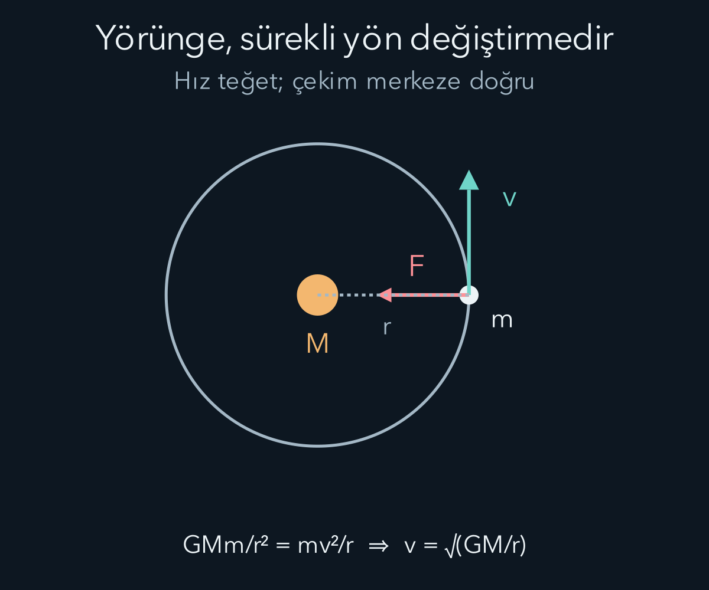
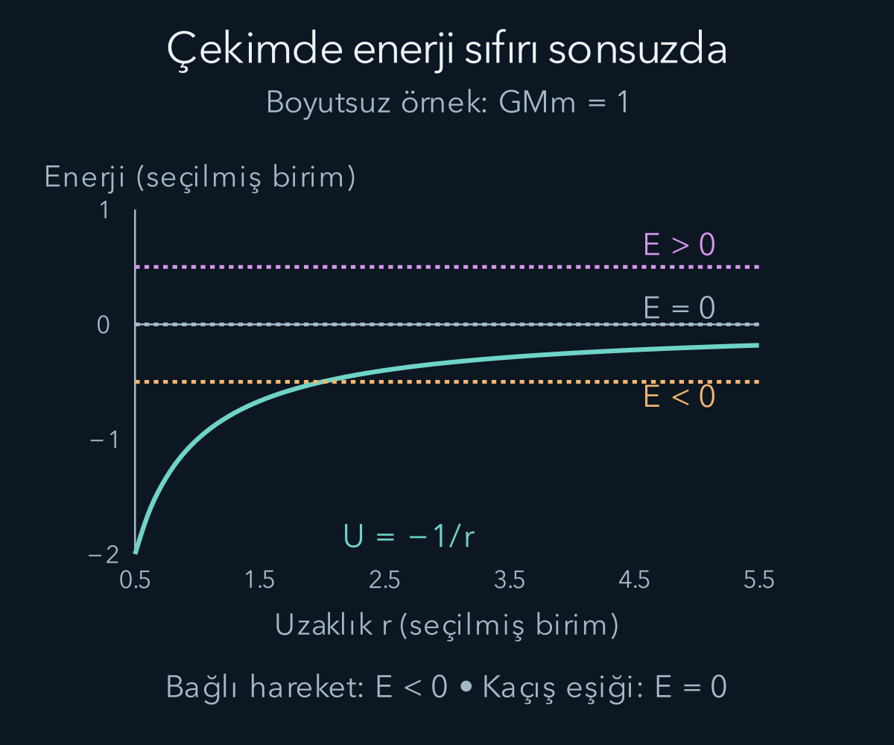

import ArticleVideo from '@/components/ArticleVideo.astro'
import kavram from './media/01-kavram.mp4?url'
import kavramPoster from './media/01-kavram.jpg?url'

Bir taşı bıraktığımızda yere düşer. Bir uydu ise Dünya'nın çevresinde dolanır. İlk bakışta farklı görünen bu hareketler aynı etkileşimle açıklanabilir: Uydu da kütleçekimin etkisi altında sürekli düşer; yeterli yatay hareketi olduğu için yolu Dünya'nın yüzeyine çarpmadan kıvrılır. Düşmek ile yörüngede kalmak arasındaki fark kuvvetin varlığı değil, başlangıç hareketidir.

[Önceki yazıda](/blog/donme-tork-ve-acisal-momentum/) tork ve açısal momentumu kurduk. Burada Newton yasasını, dairesel ivmeyi ve enerji korunumunu birlikte kullanacağız. Türev, integral ve kutupsal koordinatlar da hesabın araçlarıdır. Önce iki noktasal kütle modelini kurup sonra küresel gökcisimlerinde bu modelin hangi koşullarda kullanılabildiğini açıklayacağız.

## 1. Evrensel kütleçekim bağıntısı

Kütleleri $M$ ve $m$, aralarındaki uzaklık $r$ olan iki noktasal cismin birbirine uyguladığı çekim kuvvetinin büyüklüğü:

$$
F=G\frac{Mm}{r^2}
$$

olur. $G$ evrensel kütleçekim sabitidir; yaklaşık $6{,}67\times10^{-11}\,\mathrm{N\,m^2/kg^2}$ değeriyle kullanılabilir. Bu bir model yasasıdır; yalnız geometriden veya Newton'un ikinci yasasından türetilmez. Deney ve gözlemlerle sınanan ayrı bir fiziksel ilişkidir.

Büyük kütleyi başlangıca koyalım. Ondan küçük cisme doğru uzanan konum vektörü $\mathbf r$, dışarı yönlü birim vektör $\hat{\mathbf r}$ olsun. Küçük cisme etki eden kuvvet:

$$
\mathbf F=-\frac{GMm}{r^2}\hat{\mathbf r}
=-\frac{GMm}{r^3}\mathbf r
$$

biçimindedir. Eksi işareti çekimi, yani kuvvetin dışarı yönünün tersine dönük olmasını sağlar. İkinci yazımda paydada üçüncü kuvvet bulunması yeni bir uzaklık yasası değildir; $\mathbf r$ vektörünün kendi büyüklüğü de $r$ içerir.

Uzaklık iki katına çıkarsa kuvvet dörtte bire iner. Kütlelerden biri iki katına çıkarsa kuvvet iki katına çıkar. Küçük cismin ivmesini bulmak için kuvveti kendi kütlesine böleriz ve $\mathbf a=-GM\hat{\mathbf r}/r^2$ elde edilir. İvmenin küçük cismin kütlesinden bağımsızlığı, aynı dış alan içinde farklı kütleli ideal test cisimlerinin aynı şekilde düşmesini açıklar. Hava direnci gibi başka etkiler bu karşılaştırmayı değiştirebilir.

## 2. Küresel gökcismi ne zaman nokta gibi davranır?

Dünya'nın bütün kütlesi merkezindeki bir noktada değildir. Yine de küresel simetrili bir kütle dağılımının dışındaki çekim alanı, aynı toplam kütle merkezde toplanmış gibi hesaplanabilir. Küresel simetri, yoğunluğun merkeze uzaklığa bağlı olabileceği fakat aynı yarıçapta yöne göre değişmediği anlamına gelir. Bunun sonucu **kabuk teoremi** ile ifade edilir.

Düzgün küresel ince kabuğun içindeki net çekim alanı sıfırdır. Bu, kabuğun bütün parçalarının ayrı ayrı kuvvet uygulamadığı anlamına gelmez; vektörel toplamın sıfır olduğunu söyler. Küresel bir cismin içinde $r$ yarıçapında alanı yalnız daha küçük yarıçapların içerdiği $M(r)$ kütlesi belirler. Dıştaki kabukların net katkısı sıfır olur.

Düzgün yoğunluklu bir kürede içerilen kütle $r^3$ ile büyür. Kuvvetteki $r^2$ paydasıyla birleşince iç alanın büyüklüğü $r$ ile orantılı olur. Merkezde simetri nedeniyle sıfır, yüzeye yaklaşırken daha büyüktür. Dışarıda ise toplam kütle sabit kalır ve alan uzaklığın karesiyle azalır. Dış alan formülünü kürenin merkezine kadar aynı kütleyle kullanmak bu yüzden yanlış olur.

Gerçek Dünya tam küre değildir; döner ve kütlesi tamamen küresel simetrili dağılmaz. İlk yörünge hesaplarında küresel yaklaşım yeterli olabilir. Hassas uydu hareketinde bu sapmalar ve diğer gökcisimlerinin etkileri hesaba katılır. Uzaklık da yüzeyden yükseklik değil, merkeze uzaklıktır: Yarıçap $R$, yükseklik $h$ ise $r=R+h$ kullanılır.

## 3. Potansiyel enerjinin sıfırını sonsuzda seçmek

Kütleçekim merkezi ve korunumlu bir kuvvettir. Potansiyel enerjiyi cisimler birbirinden sonsuz uzaklaşırken sıfıra yaklaşacak biçimde seçelim. Radyal kuvvet $F_r=-GMm/r^2$ olduğundan $dU/dr=-F_r=GMm/r^2$ olur. İntegral alırsak:

$$
U(r)=-\frac{GMm}{r}+C.
$$

Sonsuzda sıfır seçimi $C=0$ verir. Sonlu uzaklıkta potansiyel enerji negatiftir. Negatif değer, cisimleri sonsuza ayırmak için enerji verilmesi gerektiğini anlatır; fiziksel olarak yasak bir enerji değildir. Önceki yazıda negatif olamayan niceliğin klasik kinetik enerji olduğunu ayırmıştık.

Yüzeyden küçük $h$ yüksekliğine çıkarılan cisim için tam enerji farkı:

$$
\Delta U=GMm\left(\frac1R-\frac1{R+h}\right)
=\frac{GMmh}{R(R+h)}
$$

olur. $h$ yarıçapa göre çok küçükse paydadaki $R+h$ yerine yaklaşık $R$ yazabiliriz. Böylece $\Delta U\approx(GM/R^2)mh=mgh$ elde edilir. Daha önce kullandığımız yakın Dünya formülü, genel potansiyelin küçük yükseklik değişimindeki yaklaşımıdır.

Bu sonuç birim denetiminden de geçer: $GM$ birimi metre küp bölü saniye kare, $GMm/r$ birimi kilogram metre kare bölü saniye karedir. Bu joule birimidir. Potansiyelin türevinden kuvvet elde etmek bir uzunluk çarpanını kaldırır ve newton birimini geri getirir.

## 4. Dairesel yörüngeyi kurmak

Büyük kütle $M$'nin hareketini ihmal edebileceğimiz kadar büyük, küçük cismin kütlesini $m$ alalım. Hava direnci veya başka itki bulunmasın. Yarıçapı $r$ olan dairesel yörüngede kütleçekim, gerekli merkez yönlü ivmeyi sağlar:

$$
\frac{GMm}{r^2}=m\frac{v^2}{r}.
$$

Kütle $m$ ve bir $r$ çarpanı sadeleşince:

$$
v_{\mathrm{daire}}=\sqrt{\frac{GM}{r}}
$$

çıkar. Uydu kütlesi sonuçta yoktur. Daha uzaktaki dairesel yörüngenin sürati daha küçüktür. Bu, daha uzakta hareket etmek için hiç kuvvet gerekmediği anlamına gelmez; daha küçük ama sıfır olmayan bir merkez yönlü ivme vardır.

Bir turda alınan yol $2\pi r$ olduğundan dönem, yani bir turun süresi:

$$
T=\frac{2\pi r}{v}=2\pi\sqrt{\frac{r^3}{GM}}.
$$

Dolayısıyla $T^2$ yarıçapın küpüyle orantılıdır. Bu dairesel durumda Kepler'in dönem yasasının biçimini doğrudan Newton yasasından elde ettik. Daha büyük yörünge hem daha uzun yol hem daha düşük sürat nedeniyle daha uzun sürer.

Örnek için $GM=4{,}0\times10^{14}\,\mathrm{m^3/s^2}$ ve $r=1{,}0\times10^7\,\mathrm m$ olan ideal bir merkez kullanalım. Bunlar hesap modelinin yuvarlatılmış sayılarıdır. Sürat $\sqrt{4{,}0\times10^7}\approx6{,}32\times10^3\,\mathrm{m/s}$ olur. Dönem yaklaşık $9{,}93\times10^3$ saniye, yani iki virgül yetmiş altı saattir. Metreyi kilometreyle karıştırmak kök içindeki ölçeği bin kat değiştirirdi.

## 5. Yörüngedeki cisim neden ağırlıksız hisseder?

Dairesel yörüngede kütleçekim sıfır değildir; zaten hareketi kıvıran kuvvet odur. Uzay aracındaki insan ve araç birlikte serbest düşer. İnsan zemine sürekli bastırılmak zorunda kalmadığı için destek kuvveti çok küçük olabilir. Tartının ölçtüğü desteğin azalması, kütleçekim kuvvetinin yok olmasıyla aynı şey değildir.

Bir asansör ideal serbest düşüşteyken de benzer durum oluşur. İnsan ve kabin yaklaşık aynı ivmeyi aldığı için aralarındaki destek kuvveti azalır. Gerçek yörüngede titreşimler, hava sürüklenmesi ve alanın aracın farklı noktalarında küçük farklılık göstermesi nedeniyle tam sıfır etkili bir ortam bulunmayabilir.

Yörüngeyi sürekli motorla ileri itilen bir hareket sanmak da doğru değildir. İdeal boşlukta gerekli başlangıç hızı verildikten sonra kütleçekim yönü değiştirerek yörüngeyi sürdürür. Motorlar yörüngeyi değiştirmek veya bozucu etkileri düzeltmek için kullanılabilir. Dairesel hareket boyunca kütleçekim hıza dik olduğu için anlık mekanik güç sıfırdır; sürat sabit kalır.

## 6. Dairesel yörüngenin toplam enerjisi

Dairesel hız bağıntısını kinetik enerjiye koyalım:

$$
K=\frac12mv^2=\frac{GMm}{2r}.
$$

Potansiyel enerji $U=-GMm/r$ olduğundan toplam:

$$
E=K+U=-\frac{GMm}{2r}
$$

olur. Toplam enerji negatiftir. Bağlı bir yörüngede cismin sonsuza ulaşması için enerji eklenmesi gerekir. Daha büyük yarıçaplı dairesel yörüngenin enerjisi daha az negatiftir, yani daha büyüktür.

Bu nedenle bir uyduyu daha yüksek dairesel yörüngeye geçirmek toplam mekanik enerji eklemeyi gerektirir; son dairesel süratin daha küçük olması buna aykırı değildir. Potansiyel enerji artışı, kinetik enerji azalmasından daha büyüktür. “Son sürat azaldıysa enerji çıkarılmıştır” düşüncesi potansiyel katkıyı unutmuş olur.

Yörünge değişimi sırasında hareket genellikle dairesel kalmaz. Bir anda teğetsel hız eklemek cismi doğrudan daha büyük çemberin üzerine yerleştirmez; yeni başlangıç koşullarına uygun bir yörünge oluşturur. Yeni dairesel duruma ulaşmak için başka bir düzeltme gerekebilir. İki son durumun enerjisini karşılaştırmak ile bütün geçiş yolunu çözmek farklı problemlerdir.

## 7. Kaçış hızı hangi koşula karşılık gelir?

Başlangıçta merkezden $r_0$ uzaklıkta olan cisim, ek itki olmadan sonsuza kadar uzaklaşabilsin. Sınır durumda sonsuzda sürati sıfıra yaklaşır, toplam enerji sıfırdır. Enerji korunumu:

$$
\frac12mv_{\mathrm{kaçış}}^2-\frac{GMm}{r_0}=0
$$

verir. Dolayısıyla:

$$
v_{\mathrm{kaçış}}=\sqrt{\frac{2GM}{r_0}}
=\sqrt2\,v_{\mathrm{daire}}.
$$

Bu değer aynı yarıçapta dairesel hızın karekök iki katıdır. Yukarıdaki örnekte yaklaşık $8{,}94\times10^3\,\mathrm{m/s}$ bulunur. Kaçış, kütleçekimin aniden bittiği bir sınıra ulaşmak değildir; kuvvet giderek küçülürken cismin geri dönmeden uzaklaşabilmesidir.

Formül atmosfer sürtünmesini, Dünya'nın dönmesini, başka gökcisimlerini ve devam eden motor itkisini içermez. Başlangıç yönü de çarpışmayan bir yol oluşturmalıdır; yüzeye doğru fırlatmak aynı enerjiyle yüzeye çarpmayı engellemez. Sürekli çalışan bir motorla daha küçük anlık hızlardan başlayarak uzaklaşmak mümkündür; kaçış hızı tek seferlik başlangıç enerjisi ölçütüdür.

## 8. Merkezi kuvvet açısal momentumu korur

Kütleçekim kuvveti konum vektörüne paralel olduğundan merkeze göre tork $\mathbf r\times\mathbf F=0$ olur. Böylece açısal momentum korunur. Sıfır olmayan açısal momentumda hareket, bu sabit vektöre dik bir düzlemde kalır. Merkezi kuvvetin geometrisi hareketi iki boyuta indirir.

Düzlemde kutupsal açıyı $\phi$ ile yazalım. Birim kütle başına açısal momentumun büyüklüğünü $\ell=L/m$ tanımlarsak:

$$
\ell=r^2\dot\phi
$$

sabit olur. Kısa bir zamanda merkezden cisme uzanan çizginin taradığı alan yaklaşık üçgen alanıdır: $dA=\tfrac12r^2d\phi$. Dolayısıyla $dA/dt=\ell/2$ sabittir. Eşit sürelerde eşit alanlar taranması Kepler'in ikinci yasasıdır.

Cisim merkeze yaklaşınca açısal ilerleyiş hızlanır, uzaklaşınca yavaşlar. Aynı alanı taramak için kısa yarıçapla daha büyük açı gerekir. Bu yasa çemberde sabit açısal hız verir; elipste ise açısal hız sabit değildir. Bir animasyonda noktayı elipsin açısında eşit adımlarla ilerletmek, doğru yörünge şekli gösterse bile gerçek zamanlamayı yanlış gösterebilir.

<ArticleVideo src={kavram} poster={kavramPoster} title="Dairesel yörüngede yön değişimi" caption="Dairesel yörüngedeki hız oku teğet, çekim kuvveti merkeze yönelmiştir. Sürat sabit kalsa da hızın yönü sürekli değişir." />

## 9. Elips yörünge denkleminin kaynağı

Dairesel yörünge, başlangıç koşullarının özel seçimidir. Genel şekli görmek için $u=1/r$ değişkenini kullanalım. Burada açısal momentum sıfır değildir; yalnız merkeze doğru düşme gibi radyal hareketleri bu değişken seçimiyle çözmüyoruz. Açının artış yönünü hareket yönüyle aynı seçelim; böylece $\ell>0$ olur. Üstteki nokta zamana, kesme işareti ise açıya göre türev anlamına gelsin: $u'=du/d\phi$.

Açısal momentum bağıntısından önce $\dot\phi=\ell/r^2=\ell u^2$ elde ederiz. Zincir kuralını adım adım uygulayalım:

$$
\dot r=\frac{d(1/u)}{du}\frac{du}{d\phi}\frac{d\phi}{dt}
=-\frac1{u^2}u'(\ell u^2)=-\ell u'.
$$

$\ell$ sabit olduğundan bir kez daha zamana göre türev:

$$
\ddot r=-\ell\frac{du'}{d\phi}\dot\phi
=-\ell^2u^2u''
$$

verir. Kutupsal koordinatlarda radyal ivme $a_r=\ddot r-r\dot\phi^2$ olur; ikinci terim, radyal yönün dönmesi nedeniyle ortaya çıkar. Örneğin yarıçap sabitken ilk terim sıfırdır ve kalan $-r\dot\phi^2$ tam merkeze yönelen çembersel ivmedir. Şimdi bu ikinci terimi de yeni değişkenle yazalım:

$$
r\dot\phi^2=\frac1u(\ell u^2)^2=\ell^2u^3.
$$

Newton'un radyal denklemi $a_r=-GM/r^2$ olduğuna göre:

$$
-\ell^2u^2u''-\ell^2u^3=-GMu^2.
$$

Sonlu pozitif $r$ için $u>0$ ve seçtiğimiz hareket için $\ell\ne0$ olduğundan iki tarafı $-\ell^2u^2$ ile bölebiliriz:

$$
u''+u=\frac{GM}{\ell^2}.
$$

Böylece zaman yerine açıyı bağımsız değişken seçmek, uzaklığın tersini basit bir ikinci derece diferansiyel denkleme dönüştürdü. [İkinci derece denklemler yazısındaki](/blog/ikinci-derece-diferansiyel-denklemler/) gibi çözüm, sabit bir özel çözüme sinüs ve kosinüs eklenerek kurulur.

Açının başlangıcını en yakın nokta doğrultusunda seçip sabitleri birleştirirsek:

$$
r(\phi)=\frac{p}{1+e\cos\phi},
\qquad p=\frac{\ell^2}{GM}.
$$

$p$ uzunluk boyutlu bir yörünge parametresi, $e$ boyutsuz dışmerkezliktir. $e=0$ çember; sıfır ile bir arasındaki değerler elips verir. Kuvvet merkezi elipsin geometrik merkezinde değil bir odağındadır. $e=1$ sınırı parabol, daha büyük değerler açık hiperbol yollarıdır. Bu sınıflandırma çarpışmasız noktasal merkez modelinin konik kesit çözümlerine aittir.

Bağlı elipsin büyük yarı ekseni $a$ ise toplam enerji $E=-GMm/(2a)$ olur ve dönem $T^2=4\pi^2a^3/(GM)$ bağıntısını sağlar. Bu genel sonuçlar yukarıdaki yörünge çözümüyle enerji ve alan hızının birleştirilmesinden elde edilir; çemberde $a=r$ koyunca önceki ifadelerimize döner. Şimdi elipsin geometrik bağıntılarını kullanarak enerji ve dönem hesabındaki ara adımları da görünür kılalım.

### Elipsin enerji ve dönem bağıntılarını tamamlamak

Elipste merkeze en yakın ve en uzak uzaklıklar, yörünge denkleminde kosinüsün artı bir ve eksi bir olmasıyla bulunur. Bunlara $r_{\min}=p/(1+e)$ ve $r_{\max}=p/(1-e)$ diyelim. Büyük yarı eksen bu iki uzaklığın ortalamasıdır; böylece $a=p/(1-e^2)$ elde edilir. Elipsin küçük yarı ekseni $b=a\sqrt{1-e^2}$ bağıntısını sağlar. Bu iki uzunluk, elipsin dik iki eksen boyunca yarı genişlikleridir.

En yakın noktada radyal hız sıfırdır ve hız teğettir. Açısal momentumdan sürat $v=\ell/r_{\min}$ olur. Birim kütle başına enerjiye $\varepsilon=E/m$ diyelim. O noktada:

$$
\varepsilon=\frac{\ell^2}{2r_{\min}^2}-\frac{GM}{r_{\min}}
=\frac{GM}{p}\left[\frac{(1+e)^2}{2}-(1+e)\right].
$$

Köşeli parantezi açarsak $(e^2-1)/2$ kalır. Dolayısıyla enerji eksi $GM(1-e^2)/(2p)$ olur. Az önce bulduğumuz büyük yarı eksen bağıntısını kullanınca $\varepsilon=-GM/(2a)$ sonucuna ulaşırız. Böylece çemberdeki enerji formülünde yarıçapın yerini neden büyük yarı eksenin aldığını yalnız benzerliğe bakarak söylememiş olduk.

Dönem için elips alanını sabit alan hızına böleriz. Alan $\pi ab$, alan hızı $\ell/2$ olduğundan $T=2\pi ab/\ell$ çıkar. Karesini alıp $b^2=a^2(1-e^2)$ ve $\ell^2=GMp=GMa(1-e^2)$ ifadelerini yerleştirirsek ortak dışmerkezlik çarpanı sadeleşir. Geriye $T^2=4\pi^2a^3/(GM)$ kalır. Aynı büyük yarı eksene sahip, farklı dışmerkezlikteki bağlı yörüngelerin aynı döneme sahip olması böylece görünür olur.

Bu sonuçlar çarpışmayan bir elips ve sabit merkez yaklaşımı içindir. Merkezdeki gökcisminin fiziksel yarıçapı en yakın uzaklıktan büyükse matematiksel yörünge onun içinden geçer; dış alan varsayımı artık yeterli değildir. Güzel bir konik çizmek, o yolun gerçek bir uydu tarafından izlenebileceğini tek başına garanti etmez.

## 10. İki gövde de hareket eder

Büyük gövdeyi hareketsiz almak bir yaklaşımdır. Gerçekte iki gövde ortak kütle merkezleri çevresinde hareket eder. Kütleler çok farklıysa büyük olanın hareketi küçük kalır. Kütleler yakınsa onu sabit tutmak doğru değildir. Göreli uzaklığın hareketi uygun biçimde kurulduğunda dönem hesabında toplam kütle $M+m$ görünür.

Toplam kütlenin nereden geldiğini iki ivmeyi çıkararak görelim. Büyük cismin konumu $\mathbf r_M$, küçüğünki $\mathbf r_m$ ve aralarındaki vektör $\mathbf r=\mathbf r_m-\mathbf r_M$ olsun. Yalnız birbirlerini çektiklerinde:

$$
\ddot{\mathbf r}_m=-\frac{GM}{r^3}\mathbf r,
\qquad
\ddot{\mathbf r}_M=+\frac{Gm}{r^3}\mathbf r.
$$

İkinci ivmenin işareti artıdır; büyük gövde de küçük gövdeye doğru hareket eder. Göreli ivme iki konumun farkının ikinci türevidir:

$$
\ddot{\mathbf r}
=\ddot{\mathbf r}_m-\ddot{\mathbf r}_M
=-\frac{G(M+m)}{r^3}\mathbf r.
$$

Bu denklem sabit merkez hesabıyla aynı biçimdedir, fakat $GM$ yerini $G(M+m)$ almıştır. Bu yüzden iki gövde arasındaki göreli elipsin büyük yarı ekseni $a_{\text{göreli}}$ için $T^2=4\pi^2a_{\text{göreli}}^3/[G(M+m)]$ olur. Buradaki yarı eksen gövdelerden birinin kütle merkezine göre yörüngesinin yarı ekseni değildir. $m/M$ çok küçükse toplam kütlede $m$'yi ihmal etmek önceki yaklaşıma geri döndürür.

Bütün bu çözümler Newton kütleçekiminin kapsamındadır. Güçlü alanlarda, yüksek hassasiyet gerektiren yörünge ayrıntılarında veya ışığın kütleçekimle ilişkisini açıklarken genel görelilik gerekir. Burada genel göreliliği ön bilgi olarak kullanmıyoruz. Newton modeli, zayıf alan ve uygun hız koşullarında birçok yörünge hesabına güçlü bir başlangıç sağlar.

Merkezi çekimde enerji yörüngenin bağlı olup olmadığını, açısal momentum ise hareketin düzlemini ve alan tarama hızını düzenledi. Bir sonraki yazıda bir denge noktasına tekrar tekrar dönen hareketlere geçeceğiz. Küçük sapmalarda geri çağırıcı kuvvetin neden sinüs ve kosinüsle sonuçlandığını yay ve sarkaç üzerinde kuracağız.

Yörünge denetiminde yalnız başlangıç süratine bakmak yeterli değildir. Başlangıç uzaklığı ve hızın yönü de açısal momentumu belirler. Aynı noktada aynı süratle farklı yönlere atılan cisimlerin enerjileri eşit olsa bile en yakın geçiş uzaklıkları ve yörünge biçimleri farklı olabilir.

## Kaynaklar

- [OpenStax — Evrensel kütleçekim yasası](https://openstax.org/books/university-physics-volume-1/pages/13-1-newtons-law-of-universal-gravitation).
- [OpenStax — Kütleçekim potansiyeli ve toplam enerji](https://openstax.org/books/university-physics-volume-1/pages/13-3-gravitational-potential-energy-and-total-energy).
- [OpenStax — Uydu yörüngeleri ve enerji](https://openstax.org/books/university-physics-volume-1/pages/13-4-satellite-orbits-and-energy).
- [OpenStax — Kepler yasaları](https://openstax.org/books/university-physics-volume-1/pages/13-5-keplers-laws-of-planetary-motion).
