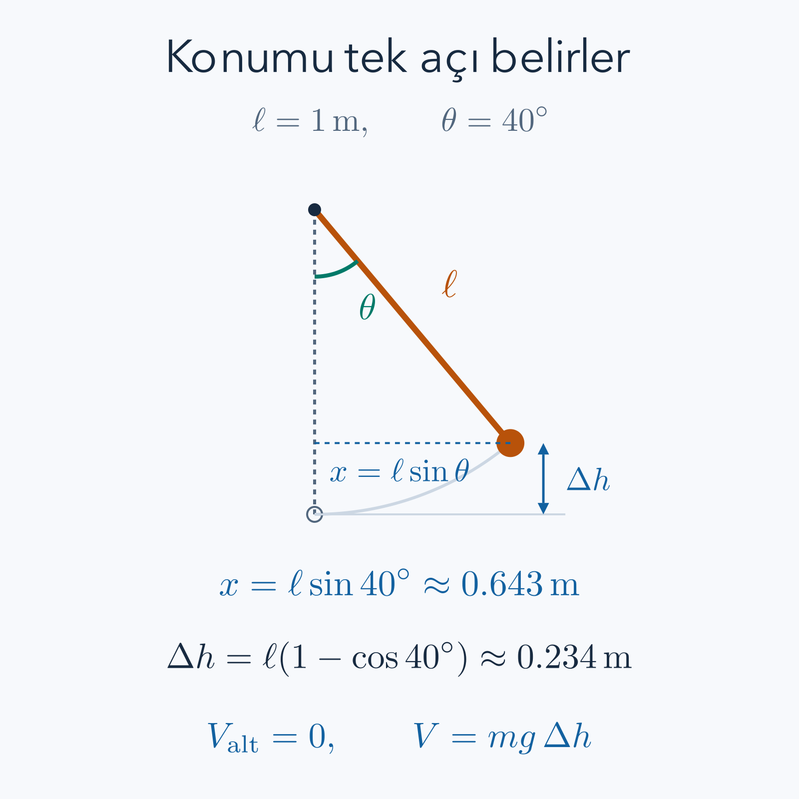

Bir sarkaç sallanırken yerçekimi aşağıya, ip gerilmesi ipin doğrultusuna etki eder. Newton yasasıyla her anda bu iki kuvveti bileşenlerine ayırabiliriz. Fakat asıl aradığımız yalnız sarkacın açısıysa, gerilme kuvvetini baştan bilinmeyenler listesine koymak gereksiz bir yük olabilir. Lagrange mekaniği, izin verilen hareketi uygun koordinatlarla tarif edip kinetik ve potansiyel enerjiden hareket denklemi üretir. Kazanç, kuvvet kavramının ortadan kalkması değil, kısıtla zaten belirlenmiş doğrultuların hesabın dışına alınmasıdır.

Önce [Newton yasaları](/blog/newton-yasalari-ve-kuvvetler/), [iş ve enerji](/blog/is-enerji-ve-korunum/), [salınımlar](/blog/salinim-sonum-ve-rezonans/), [çok değişkenli türev](/blog/cok-degiskenli-fonksiyonlar-ve-turev/) ve [varyasyon hesabı](/blog/varyasyon-hesabi-ve-euler-lagrange/) okunabilir. Son bağlantıdaki matematiksel yöntemi fizik diline çevirirken kritik adımları yeniden yapacağız. Bu ders Newtoncu hızlarda, ideal kısıtlar altında ve belirtilen enerji modeliyle çalışır; özel göreliliğin enerji bağıntısını buradaki kinetik enerjiye eklemiş olmayacağız.

## 1. Bir Sistemin Durumunu Kaç Sayı Anlatır?

**Genelleştirilmiş koordinat**, sistemin izin verilen konumunu belirleyen bağımsız sayılardan biridir. Bunları $q_1,\ldots,q_n$ ile göstereceğiz; $n$ serbestlik derecesidir. Doğru üzerinde hareket eden boncuk için bir uzaklık, çember üzerindeki boncuk için bir açı yeterlidir. Koordinatın mutlaka metre birimli olması gerekmez. Açı, iki parçanın birbirine göre uzanımı veya uygun bir başka ölçü kullanılabilir.

Konumu bilmek hareketin tamamını belirlemez. Sarkaç aynı açıdan sağa giderken de sola giderken de geçebilir. Bu nedenle başlangıçta koordinatlarla birlikte hızlarını da vermek gerekir. Üstte nokta zaman türevini gösterecek: $\dot q_i=dq_i/dt$, $\ddot q_i=d^2q_i/dt^2$. Bir koordinat açıysa bu türev açısal hızdır; uzaklıksa doğrusal hızdır. Aynı sembolik denklem içinde bu fiziksel ayrımı izlemek birim hatalarını yakalar.

Koordinat seçimi gerçek bir bağımsızlık iddiasıdır. Sabit uzunluklu bir ipteki kütle için hem yatay hem düşey konumu bağımsız seçersek bazı seçimler ip uzunluğunu değiştirir. İzin verilen konumlar düzlemin tamamını doldurmaz. Daha az koordinat kullanmak, eksik fizik anlatmak değil, aynı izinli konumu gereksiz tekrar olmadan tarif etmektir. Bununla birlikte seçilen koordinat haritası bazı noktalarda geçersiz olabilir; küresel tek bir harita varmış gibi davranmamalıyız.

## 2. Holonom Kısıt ve İdeal Kuvvet

Konumlar ve zaman arasında $f(q_1,\ldots,q_n,t)=0$ biçiminde yazılabilen kısıta **holonom kısıt** denir. Sabit uzunluğu $\ell$ olan sarkaçta, destek noktasını başlangıç alırsak Kartezyen konumlar $x,y$ şu koşulu sağlar:

$$
x^2+y^2=\ell^2.
$$

Bu bir çemberdir. Açıyı aşağı düşeyden ölçüp $\theta$ dersek aynı kısıtı otomatik sağlayan tanım

$$
x=\ell\sin\theta,\qquad y=-\ell\cos\theta
$$

olur. Yerine koyunca $x^2+y^2=\ell^2(\sin^2\theta+\cos^2\theta)=\ell^2$ çıkar. İki Kartezyen sayı yerine tek bağımsız açı kalmıştır. İpin düz, gergin ve uzamaz olduğu modelde bu seçim uygundur. İp gevşerse kütlenin çemberde kalma varsayımı bozulur; aynı denklem o hareket bölümünü tarif etmez.

Her hız kısıtı holonom değildir. Kaymadan yuvarlanma gibi koşulların bazıları yalnız konum eşitliği olarak bütünleştirilemez. Burada bu genel durumları çözmüyoruz. Ayrıca **ideal kısıt**, kısıta uygun sonsuz küçük yer değiştirmelerde kısıt kuvvetlerinin toplam sanal işinin sıfır olmasıdır. Durgun ve sürtünmesiz bir yüzeyin normal kuvveti yüzey boyunca yer değiştirmeye diktir. Sarkacın gerilmesi de çembere teğet yer değiştirmeye diktir. Bu nedenle bu kuvvetler seçilen koordinatın denkleminde doğrudan görünmez.

Zamanla hareket eden bir yüzey ideal olsa da cisme enerji aktarabilir. Sanal işte zaman sabit tutulur; gerçek zaman boyunca yüzeyin yaptığı iş başka bir sorudur. Bu ayrımı korumak, “kısıt kuvveti her zaman sıfır iş yapar” gibi fazla geniş bir sonuçtan kaçınmamızı sağlar. Aşağıdaki örneklerde destek ve düzlem durgundur.

## 3. Kinetik Enerjiyi Koordinata Çevirmek

Kütlesi $m_a$ olan $a$ numaralı parçacığın konumu $\mathbf r_a$ olsun. Toplam kinetik enerji, Newtoncu modelde

$$
T=\sum_a\frac12m_a\dot{\mathbf r}_a\cdot\dot{\mathbf r}_a
$$

ile tanımlanır. Nokta çarpım hızın büyüklüğünün karesini üretir. Konumları koordinatlar cinsinden yazdıktan sonra zaman türevini almalıyız; yalnız harfleri değiştirmek yeterli değildir. Genel zincir kuralı

$$
\dot{\mathbf r}_a=
\sum_i\frac{\partial\mathbf r_a}{\partial q_i}\dot q_i
+\frac{\partial\mathbf r_a}{\partial t}
$$

şeklindedir. Son terim koordinat tanımının veya kısıtın açıkça zamanla değişmesini hesaba katar. Durgun sarkaç ve eğik düzlemde bu terim sıfırdır.

Örneğin düzlemde kutupsal koordinatları $x=r\cos\theta$, $y=r\sin\theta$ seçersek iki türevde hem uzaklık hem açı değişir. Kareler toplamını açınca çapraz terimler birbirini götürür ve $\dot x^2+\dot y^2=\dot r^2+r^2\dot\theta^2$ bulunur. Buradaki $r^2$ katsayısı bir süs değildir: aynı açısal hızla daha büyük çember çizmek daha büyük doğrusal hız gerektirir. Kinetik enerjinin koordinatlara bağlı görünmesi, uzayda yeni bir kuvvetin var olduğu anlamına gelmez.

## 4. Lagrange Fonksiyonu ve Etki

Hızdan bağımsız bir potansiyel enerji $V(q,t)$ bulunan korunumlu kuvvetler için **Lagrange fonksiyonu**

$$
L(q,\dot q,t)=T(q,\dot q,t)-V(q,t)
$$

olarak alınır. Eksi işareti önemlidir. Bu fonksiyon toplam mekanik enerji değildir; mekanik enerji uygun koşullarda $T+V$ olacaktır. $L$'nin görevi hareket denklemini üretmektir. Elektromanyetik alanda hıza bağlı ek bir terim gerekebilir; o durumda yalnız bu biçimi kullanmak yeterli olmaz.

Başlangıç zamanı $t_a$, bitiş zamanı $t_b$ olsun. Bir bütün yola atanan **etki**

$$
S[q]=\int_{t_a}^{t_b}L(q(t),\dot q(t),t)\,dt
$$

sayısıdır. $L$ enerji birimindedir: joule. Zamanla çarptığımız için $S$'nin birimi joule saniyedir. Bir yol boyunca $L$ bazen pozitif bazen negatif olabilir; etki kinetik enerjinin zaman toplamı olarak yorumlanamaz. Yolun farklı parçalarındaki katkıları işaretleriyle toplarız.

Gerçek yol, sabit uçları koruyan küçük yol değişiklikleri altında etkinin birinci dereceden değişiminin sıfır olduğu yoldur. Buna **durağan etki ilkesi** diyeceğiz. Cisim gelecekteki ucu bilerek seçenekleri karşılaştırmaz. Bu, yerel hareket denklemiyle eşdeğer matematiksel bir koşuldur. Başlangıç değerleriyle hareketi hesapladıktan sonra herhangi bir zaman aralığını kesip bu yolun sabit uçlu durağanlığını sınayabiliriz.

## 5. Yol Değişikliğinden Euler–Lagrange Denklemine

Önce tek koordinat alalım. $\eta(t)$ düzgün bir değişim şekli ve $\varepsilon$ küçük gerçek parametre olsun. Karşılaştırma yolları $q_\varepsilon=q+\varepsilon\eta$ biçiminde tanımlansın. Sabit uçlar için $\eta(t_a)=\eta(t_b)=0$ gerekir. Hız da değişir: $\dot q_\varepsilon=\dot q+\varepsilon\dot\eta$.

$L$'nin gerekli türevlerinin sürekli olduğunu, yolların düzgün ve zaman aralığının sonlu olduğunu varsayalım. Böylece bu küçük ailede integral altında türev alabiliriz. $\delta S$, $\varepsilon=0$'daki türevin adı olsun:

$$
\begin{aligned}
\delta S
&=\left.\frac{dS[q+\varepsilon\eta]}{d\varepsilon}\right|_0\\
&=\int_{t_a}^{t_b}\left(
\frac{\partial L}{\partial q}\eta
+\frac{\partial L}{\partial\dot q}\dot\eta\right)dt.
\end{aligned}
$$

Kısmi türevde $q$ ve $\dot q$ ayrı girişler olarak ele alınır. İkinci terimdeki $\eta$ türevini kaldırmak için çarpım kuralını tersine kullanalım:

$$
\frac{d}{dt}\left(\frac{\partial L}{\partial\dot q}\eta\right)
=\frac{d}{dt}\left(\frac{\partial L}{\partial\dot q}\right)\eta
+\frac{\partial L}{\partial\dot q}\dot\eta.
$$

Son terimi yalnız bırakıp integrale koyarsak

$$
\delta S=
\left[\frac{\partial L}{\partial\dot q}\eta\right]_{t_a}^{t_b}
+\int_{t_a}^{t_b}
\left[\frac{\partial L}{\partial q}
-\frac{d}{dt}\left(\frac{\partial L}{\partial\dot q}\right)\right]\eta\,dt.
$$

Uçlardaki $\eta$ sıfır olduğu için köşeli sınır terimi gider. İntegral her izinli $\eta$ için sıfır olmalıdır. Köşeli parantezin sürekli olup bir noktada pozitif olduğunu düşünelim. O noktanın küçük çevresinde de pozitif kalır; yalnız orada pozitif bir tümsek seçerek integralin pozitif olmasını sağlarız. Negatif durum aynı mantıkla çelişir. Dolayısıyla köşeli parantez her noktada sıfırdır:

$$
\boxed{\frac{d}{dt}\left(\frac{\partial L}{\partial\dot q}\right)
-\frac{\partial L}{\partial q}=0.}
$$

Birden fazla bağımsız koordinatta her birinin değişimini ayrı seçebiliriz. Aynı denklem her $q_i$ için yazılır. Bağımsızlık şartının türetimdeki rolü budur; kısıtla birbirine bağlı Kartezyen değişimleri keyfî sayamayız.

## 6. Newton Yasasıyla İşaret Kontrolü

Doğru üzerindeki kütle için $L=\frac12m\dot x^2-V(x)$ alalım. Hıza göre türev $m\dot x$, bunun zaman türevi $m\ddot x$ olur. Konuma göre türevde kinetik terim sıfır, potansiyel terim $-V'(x)$ verir. Euler–Lagrange denklemi

$$
m\ddot x-[-V'(x)]=0
\quad\Longrightarrow\quad
m\ddot x=-V'(x)
$$

olur. Sağ taraf potansiyelden türeyen kuvvettir. Demek ki seçtiğimiz eksi işareti Newton yasasını doğru yönde yeniden üretmiştir. Bu kontrol yeni yöntemin eski deneysel yasayla bağını kurar; enerji ifadeleri keyfî seçilmiyor.

Birimin de tutması gerekir. $\partial L/\partial\dot x$ birimi enerji bölü hız, yani kilogram metre bölü saniyedir; zaman türevi kuvvet birimine gelir. $\partial L/\partial x$ da enerji bölü uzunluk, yine newtondur. Koordinat açı olduğunda iki terimin birimi tork olur. Her denklemde terimlerin mutlaka kuvvet biriminde olması gerektiğini düşünmek genelleştirilmiş koordinatın anlamını kaçırır.

## 7. Tam Örnek: Yayın Hareketini Başlangıçtan Bulmak

Kütle $m=2\,\mathrm{kg}$, yay sabiti $k=8\,\mathrm{N/m}$ olsun. Denge konumundan uzanımı $x$ ile ölçelim; sürtünme yoktur. $T=\frac12m\dot x^2$, $V=\frac12kx^2$ yazınca türevler $m\ddot x+kx=0$ verir. Kütleye bölersek

$$
\ddot x+4x=0.
$$

Açısal frekans $\omega=\sqrt{k/m}=2\,\mathrm{s^{-1}}$'dir. Kosinüs ve sinüsün ikinci türevleri kendilerinin $-\omega^2$ katı olduğu için genel gerçek çözüm

$$
x(t)=A\cos(2t)+B\sin(2t)
$$

şeklindedir; trigonometrik argümanda $t$ saniye cinsindedir. Başlangıçta $x(0)=0.10\,\mathrm m$, $\dot x(0)=0.20\,\mathrm{m/s}$ verelim. İlk koşul $A=0.10\,\mathrm m$ yapar. Türev alıp ikinci koşulu kullanalım:

$$
\begin{aligned}
\dot x(t)&=-2A\sin(2t)+2B\cos(2t),\\
\dot x(0)&=2B=0.20\,\mathrm{m/s},\\
B&=0.10\,\mathrm m.
\end{aligned}
$$

Dolayısıyla çözüm $x=0.10[\cos(2t)+\sin(2t)]\,\mathrm m$ olur. Genlik $\sqrt{A^2+B^2}=0.1414\,\mathrm m$, periyot $2\pi/\omega=\pi\,\mathrm s$'dir. Genliği yalnız ilk konuma eşitleyemeyiz; başlangıç hızı cismi daha uzağa taşır.

$t=\pi/4\,\mathrm s$ anında kosinüs sıfır, sinüs birdir; $x=0.10\,\mathrm m$, $\dot x=-0.20\,\mathrm{m/s}$ buluruz. Cisim aynı konuma bu kez ters hızla gelmiştir. Başlangıç enerjisi $\frac12(2)(0.20)^2+\frac12(8)(0.10)^2=0.08\,\mathrm J$'dür. Kontrol anında kareler değişmediğinden aynı enerji çıkar. Çözümün ikinci türevi de tam olarak $-4x$ olduğundan hareket denklemi bütün zamanlarda sağlanır.

## 8. Sarkacı Enerjiden Kurmak

Sarkaç koordinatlarını ikinci bölümde seçmiştik. Şimdi zaman türevlerini ayrı alalım; $\ell$ sabittir:

$$
\dot x=\ell\cos\theta\,\dot\theta,
\qquad
\dot y=\ell\sin\theta\,\dot\theta.
$$

Hızın karesi $\ell^2\dot\theta^2(\cos^2\theta+\sin^2\theta)=\ell^2\dot\theta^2$ olur. En alt konumu potansiyelin sıfırı seçersek yükseklik artışı $y+\ell=\ell(1-\cos\theta)$'dır. Yerçekimi ivmesinin büyüklüğü $g$ olmak üzere

$$
L=\frac12m\ell^2\dot\theta^2-mg\ell(1-\cos\theta).
$$

Hıza göre türev $m\ell^2\dot\theta$, açıya göre türev $-mg\ell\sin\theta$'dır. Sabit $m\ell^2$ zaman türevinin dışına çıkar. Denklem

$$
m\ell^2\ddot\theta+mg\ell\sin\theta=0
\quad\Longrightarrow\quad
\ddot\theta+\frac g\ell\sin\theta=0
$$

olur. Pozitif küçük açıda ivmenin negatif olması dengeye geri çağırmayı gösterir. Kütlenin sadeleşmesi de vakumda ideal sarkaç periyodunun kütleden bağımsız olmasıyla tutarlıdır.

*Çizimde uzunluk sabittir. Kinetik enerji çember boyunca hızdan, potansiyel enerji en alt konuma göre yükselmeden hesaplanır; açı aşağı düşeyden ölçülür.*

## 9. Tam Örnek: Küçük Açı Ne Kadar Küçük?

$\ell=1\,\mathrm m$, $g=9.81\,\mathrm{m/s^2}$ seçelim. $\theta$ radyanla küçükse $\sin\theta\approx\theta$ yazabiliriz. Bunun nedeni Taylor açılımının $\sin\theta=\theta-\theta^3/6+\cdots$ olmasıdır. İlk atılan terimin göreli büyüklüğü yaklaşık $\theta^2/6$'dır; derece sayısını doğrudan bu bağıntıya koyamayız.

Başlangıç açısı $\theta_0=0.10\,\mathrm{rad}$, başlangıç açısal hızı sıfırsa doğrusal yaklaşım

$$
\theta(t)\approx0.10\cos(\sqrt{9.81}\,t)
$$

verir. Yaklaşık periyot $2\pi/\sqrt{9.81}=2.0061\,\mathrm s$'dir. İlk andaki tam ivme $-9.81\sin(0.10)=-0.97937\,\mathrm{rad/s^2}$, doğrusal ivme $-9.81(0.10)=-0.98100\,\mathrm{rad/s^2}$ çıkar. İvme büyüklüğündeki göreli fark yaklaşık yüzde $0.167$'dir. Bu sayısal kontrol yaklaşımın neden makul olduğunu gösterir; yaklaşık çözümü tam denklemin çözümü ilan etmez.

Başlangıç açısını $\pi/3$ yaparsak durum değişir. $\sin(\pi/3)=0.86603$, fakat $\pi/3=1.04720$'dir. Doğrusal model başlangıç geri çağırıcı ivmesini yaklaşık yüzde $20.9$ büyük verir. Büyük genlikte aynı kosinüs çözümünü kullanmak bu yüzden güvenilir değildir. Tam periyot da genliğe bağlıdır; küçük açı periyodu yalnız sıfıra yaklaşan genlikteki limittir.

Enerjiyle bağımsız bir hız hesabı daha yapabiliriz. $\theta_0=0.10$ açısında durgun bırakılan sarkaç en alt noktaya geldiğinde başlangıç potansiyeli bütünüyle kinetik enerji olur:

$$
\begin{aligned}
\frac12m v_{\rm alt}^2&=mg\ell(1-\cos\theta_0),\\
v_{\rm alt}&=\sqrt{2g\ell(1-\cos0.10)}\\
&=0.31308\,\mathrm{m/s}.
\end{aligned}
$$

Küçük açı çözümü $v_{\rm alt}\approx\ell\theta_0\sqrt{g/\ell}=0.31321\,\mathrm{m/s}$ verir. Fark yaklaşık yüzde $0.042$'dir. İvme ve hız hatalarının aynı yüzde çıkması gerekmez; farklı büyüklükleri karşılaştırdık. Her yaklaşımın hangi gözlenebilir için sınandığını söylemek gerekir.

## 10. Tam Örnek: Sürtünmesiz Eğik Düzlem

Düzlemin yatayla yaptığı açı $\alpha=30^\circ$, kütle $m=3\,\mathrm{kg}$ olsun. Düzlem boyunca aşağı yönü pozitif seçip başlangıçtan uzaklığı $s$ ile ölçelim. Düşey yükseklik $h=h_0-s\sin\alpha$'dır. Hızın büyüklüğü $\dot s$ olduğundan

$$
L=\frac12m\dot s^2-mgh_0+mgs\sin\alpha.
$$

Sabit $-mgh_0$ hiçbir türev üretmez. Diğer türevler $\partial L/\partial\dot s=m\dot s$ ve $\partial L/\partial s=mg\sin\alpha$ verir. Denklemden $\ddot s=g\sin\alpha=4.905\,\mathrm{m/s^2}$ çıkar. Başlangıçta durgun ve $s(0)=0$ olan cisim için iki integrali alalım:

$$
\dot s(t)=4.905t,
\qquad
s(t)=\frac12(4.905)t^2.
$$

Cisim düzlem boyunca $0.80\,\mathrm m$ gidince $t=\sqrt{1.60/4.905}=0.57114\,\mathrm s$ ve hız $2.80143\,\mathrm{m/s}$ olur. Enerji kontrolünde düşey düşüş $0.80\sin30^\circ=0.40\,\mathrm m$'dir. Kaybedilen potansiyel $3(9.81)(0.40)=11.772\,\mathrm J$; kazanılan kinetik enerji $\frac12(3)(2.80143)^2=11.772\,\mathrm J$ çıkar. Normal kuvveti çözmeden, düzlemin geometrisini kullanarak sonucu bulduk.

Bu modelde sürtünme açıkça dışlanmıştır. Yüzey pürüzlü olsaydı aynı $T-V$ ile yazılan sıfır sağ taraflı denklem eksik olurdu. Cisim hareket ederken kinetik sürtünme enerji tüketir; onu konumdan türeyen sıradan bir potansiyele gizlemek genel olarak mümkün değildir. Düzlemin sonlu uzunluğu da çözümün geçerliliğini sınırlar: cisim kenardan ayrıldıktan sonra bu tek koordinatlı model sona erer.

## 11. Genelleştirilmiş Kuvveti Nereye Ekleriz?

Potansiyele katılmamış gerçek kuvvetleri $\mathbf F_a$ ile gösterelim. Zaman sabitken izinli yer değiştirme $\delta\mathbf r_a=\sum_i(\partial\mathbf r_a/\partial q_i)\delta q_i$ olur. Bu kuvvetlerin sanal işi

$$
\delta W=\sum_a\mathbf F_a\cdot\delta\mathbf r_a
=\sum_i Q_i\delta q_i,
\qquad
Q_i=\sum_a\mathbf F_a\cdot
\frac{\partial\mathbf r_a}{\partial q_i}
$$

şeklinde yazılır. $Q_i$ genelleştirilmiş kuvvettir. Aynı koordinat için hareket denklemi artık $d(\partial L/\partial\dot q_i)/dt-\partial L/\partial q_i=Q_i$ olur. Potansiyelde zaten bulunan yerçekimini sağ tarafa yeniden eklersek aynı kuvveti iki kere saymış oluruz.

Örneğin doğrusal yayda viskoz direnç $-b\dot x$ ise $Q_x=-b\dot x$ alınır. Denklem $m\ddot x+b\dot x+kx=0$ olur. Açısal koordinatta $Q_\theta$ torktur; kuvveti doğrudan bu yere koyamayız. Bu uzantı, enerjiden başlanmasının bütün kuvvetlerin korunumlu olmak zorunda olduğu anlamına gelmediğini gösterir. Fakat burada etkiyi yalnız $T-V$ ile durağan kılmak, dirençli sistemi tek başına türetmez; ek sanal iş bilgisi kullanıyoruz.

## 12. Enerji Ne Zaman Korunur, Etki Ne Zaman Minimumdur?

Önce sağ tarafı sıfır olan denklemlere dönelim. $p_i=\partial L/\partial\dot q_i$ kısaltmasıyla enerji fonksiyonunu $E_L=\sum_i p_i\dot q_i-L$ diye tanımlayalım. Çarpım ve zincir kurallarını açık yazınca

$$
\begin{aligned}
\frac{dE_L}{dt}
&=\sum_i(\dot p_i\dot q_i+p_i\ddot q_i)
-\sum_i\left(L_{q_i}\dot q_i+L_{\dot q_i}\ddot q_i\right)-L_t\\
&=\sum_i(\dot p_i-L_{q_i})\dot q_i-L_t\\
&=-L_t.
\end{aligned}
$$

Son satır Euler–Lagrange denklemini kullanır. $L_t$, konum ve hız sabit tutulurken alınan açık zaman türevidir. $L$ açıkça zamana bağlı değilse $E_L$ korunur. Durgun koordinatlarda kinetik enerji hızlarda ikinci dereceden, potansiyel de hızdan bağımsızsa $\sum_i p_i\dot q_i=2T$ olur; bu durumda $E_L=2T-(T-V)=T+V$ bulunur. Hareketli kısıtlarda veya farklı Lagrange fonksiyonlarında bu özdeşliği denetlemeden kullanamayız. Ek kuvvet varsa aynı hesap $dE_L/dt=\sum_iQ_i\dot q_i-L_t$ verir.

Durağanlık ise minimum sözüyle aynı şey değildir. Yay için sabit uçlu değişimin ikinci varyasyonu

$$
\delta^2S=\int_0^{\mathcal T}
\left(m\dot\eta^2-k\eta^2\right)dt
$$

olur; $\mathcal T$ zaman aralığının uzunluğudur. $\eta=a\sin(\pi t/\mathcal T)$ seçersek iki karenin integrali sırasıyla $a^2\pi^2/(2\mathcal T)$ ve $a^2\mathcal T/2$'dir. Sonuç $\delta^2S=a^2[m\pi^2/\mathcal T-k\mathcal T]/2$ olur. $\mathcal T>\pi\sqrt{m/k}$ olduğunda bu yön negatif katkı verir. Daha hızlı titreşen değişim yönleri pozitif de verebilir; durağan yol eyer olabilir.

Bu ayrım gündelik “doğa en az enerjiyi seçer” cümlesini de düzeltir. Hareketli cisim her an en küçük potansiyelde durmaz, etki de anlık enerji değildir. Elimizdeki güvenilir işlem, geçerli kısıtı seçmek, hızları doğru türetmek, uygun Lagrange fonksiyonunu kurmak ve çözümü başlangıç koşullarıyla birlikte kontrol etmektir. Yayda, sarkaçta ve eğik düzlemde aynı türev kuralı farklı geometrilere uyum sağladı; yöntemin asıl gücü bu taşınabilirliktir.

## 13. Kaybolan Gerilme Kuvvetini Geri Bulabilir miyiz?

Genelleştirilmiş koordinatla çözerken ip gerilmesi denklemde görünmedi. Bu onun sıfır olduğunu göstermez. Gerilmeyi bilmek istiyorsak çözülmüş hareketi Newton yasasının radyal bileşenine geri koyabiliriz. Böylece önce hareketi belirleyip ardından kısıt kuvvetini buluruz. Bu sıra, Lagrange yönteminin hangi bilinmeyeni kolayca verdiğini ve hangi bilgi için ek denklem gerektiğini ayırır.

Gerilme büyüklüğünü $\mathcal F$ ile gösterelim; kinetik enerji için kullandığımız $T$ ile karıştırmayalım. İpe paralel ve merkeze doğru yönü pozitif alalım. Bu yöndeki gerilme pozitif, yerçekiminin bileşeni $-mg\cos\theta$'dır. Çemberde merkeze doğru ivme $v^2/\ell=\ell\dot\theta^2$ olduğundan

$$
\mathcal F-mg\cos\theta=m\ell\dot\theta^2,
\qquad
\mathcal F=mg\cos\theta+m\ell\dot\theta^2
$$

bulunur. En alt noktada yerçekimi merkezden dışarı doğrudur; bu yüzden gerilmenin yalnız ağırlığa eşit olması beklenmez. Cisim çember üzerinde kıvrılmak için ek merkeze dönük kuvvete ihtiyaç duyar. En altta duruyorsa hız terimi sıfırlanır ve statik sonuç geri gelir.

Önceki bir metrelik sarkaçta kütleyi bu kez $m=0.50\,\mathrm{kg}$ seçelim. En altta hesapladığımız $v=0.31308\,\mathrm{m/s}$ hızını kullanalım. Gerilme $0.50(9.81)+0.50(0.31308)^2/1=4.9540\,\mathrm N$ çıkar. Ağırlık ise $4.9050\,\mathrm N$'dur. Küçük fark, küçük genlikteki hızın da küçük olmasıyla uyumludur. Hareketin denklemi kütleden bağımsızdı; kısıt kuvveti ise kütleyle orantılıdır. Bu iki iddia birbirine karıştırılmamalıdır.

Aynı bağıntı modelin sınırını da sınar. İp yalnız çekebilir; negatif gerilme gerektiren bir durum ip tarafından sağlanamaz. Örneğin tam üst konumda çember hareketinin sürmesi için $m\ell\dot\theta^2-mg$ negatif olmamalıdır. Bu koşul sağlanmazsa ip gevşer, kütle artık sabit yarıçaplı çemberde kalmaz. Enerji denkleminin cebirsel çözümünün bulunması, her kısıt varsayımının fiziksel olarak sağlandığını garanti etmez.

## 14. Potansiyelin Sıfırını Değiştirmek Neyi Değiştirir?

Potansiyel enerjiye sabit bir $C$ ekleyelim: $V'=V+C$. Yeni Lagrange fonksiyonu $L'=L-C$ olur. Konuma ve hıza göre türevlerde sabit kaybolduğu için hareket denklemi aynıdır. Etki ise $S'=S-C(t_b-t_a)$ olur. Karşılaştırılan yolların zaman uçları aynı olduğundan hepsine aynı sayı eklenmiştir; hangi yolun durağan olduğu değişmez. Sayısal enerji değeri kayar ama iki durumun enerji farkı aynı kalır.

Sarkaçta potansiyeli $-mg\ell\cos\theta$ seçmek de mümkündür. En altta bu enerji sıfır değil $-mg\ell$ olur. Bizim seçtiğimiz $mg\ell(1-\cos\theta)$ ile farkı sabittir. Denklemin açı türevi her iki seçimde de aynıdır. Hesaplar arasında enerji karşılaştırırken hangi referansı seçtiğimizi belirtmek yeterlidir. Farklı sıfırları kullanan iki hesabın ham sayılarının eşit olmaması fiziksel uyuşmazlık değildir.

Daha genel olarak düzgün bir $F(q,t)$ fonksiyonunun toplam türevini Lagrange fonksiyonuna ekleyebiliriz:

$$
L'=L+\frac{dF}{dt},
\qquad S'=S+F(q(t_b),t_b)-F(q(t_a),t_a).
$$

Konum ve zaman uçları sabitken ek sınırın varyasyonu sıfırdır. Bu yüzden aynı hareket denklemleri çıkar. Burada toplam türev ile yalnız konum türevi aynı şey değildir: $dF/dt=F_q\dot q+F_t$ yazılır. Hareket denklemlerinin tek bir eşsiz Lagrange fonksiyonuna bağlı olmadığını bu sınır hesabı açıklar. Buna karşılık hızdan türeyen yardımcı niceliklerin biçimi değişebilir; hangi fonksiyonu kullandığımızı kaydetmek gerekir.

## 15. Başlangıç Değeri ile Sabit Uç Problemi Ayrımı

Etkiyi türetirken iki zaman ucundaki konumu sabitledik; yayı çözerken ise ilk konum ve ilk hızı verdik. Bunlar çelişen talimatlar değildir. Birinci işlem, herhangi bir gerçek hareket bölümünün sağlaması gereken yerel diferansiyel denklemi çıkarır. İkinci işlem, o denklemin çözümleri arasından deneyin başlangıcına uyanını seçer. Deney yaparken son konumu önceden vermemiz gerekmez.

Yayda son konumu vererek çözüm seçmek bazen tek sonuç da vermez. Genel çözümü $x(t)=A\cos(\omega t)+B\sin(\omega t)$ alalım. $x(0)=a$ ilk sabiti $A=a$ yapar. Son zaman $\mathcal T$ ve son konum $b$ verilirse $b=a\cos(\omega\mathcal T)+B\sin(\omega\mathcal T)$ denklemini çözmemiz gerekir. Sinüs sıfır değilse ikinci sabit bulunur. Fakat $\mathcal T=\pi/\omega$ ise sinüs sıfırdır; yalnız $b=-a$ koşulu kalır. Bu koşul sağlanmazsa çözüm yoktur, sağlanırsa birçok başlangıç hızı aynı iki konumu birleştirebilir.

Bu örnek, durağan etki denkleminin varlık ve teklik garantisi olmadığını elle tutulur biçimde gösterir. Başlangıç değer problemi ise düzenli yay denklemi için ilk konum ve hız verildiğinde tek çözüm üretir. Matematiksel soru türünü belirtmeden “çözüm tektir” dememek gerekir. Aynı özen yaklaşık çözümde de geçerlidir: başlangıç koşulunu doğru sağlayan bir ifade, tam diferansiyel denklemi yaklaşık sağlayabilir. Hem başlangıç hem denklem kalıntısı ayrı ayrı kontrol edilmelidir.

Bir çözümün fiziksel yorumunu denetlerken sınır durumlar özellikle yararlıdır. Eğik düzlemin açısı sıfıra giderse $g\sin\alpha$ sıfırlanır; durgun cisim kaymaya başlamaz. Sarkaçta uzunluk arttıkça küçük açı frekansı azalır; aynı açı değişiminin daha uzun yol gerektirmesi yavaş harekete uyar. Yay sabiti sıfıra giderse geri çağırıcı kuvvet kaybolur ve denklem serbest parçacığa dönüşür. Bu kontroller yeni bir ispat değildir, fakat yanlış işaret veya yanlış uzunluk kuvvetini hızlıca ortaya çıkarırlar. Hesabın sonunda yalnız sayının basamaklarını değil, modelin bu bilinen davranışları geri verip vermediğini de sınarız.

## Kaynaklar

Türetimler ve sayısal örnekler bu ders için kurulmuştur. Biçimsel kapsamı karşılaştırmak için iki açık üniversite kaynağı kullanılabilir:

- [David Tong, Classical Dynamics, bölüm 2](https://www.damtp.cam.ac.uk/user/tong/dynamics/dynhtml/S2.html): özellikle etki, koordinat seçimi ve holonom kısıt bölümleri.
- [Iain W. Stewart, MIT 8.09 Advanced Classical Mechanics, bölüm 1](https://ocw.mit.edu/courses/8-09-classical-mechanics-iii-fall-2014/d9bac33f6c60b304dc0398e99b327102_MIT8_09F14_full.pdf): analitik mekanik, kısıtlar ve varyasyon hesabı.
