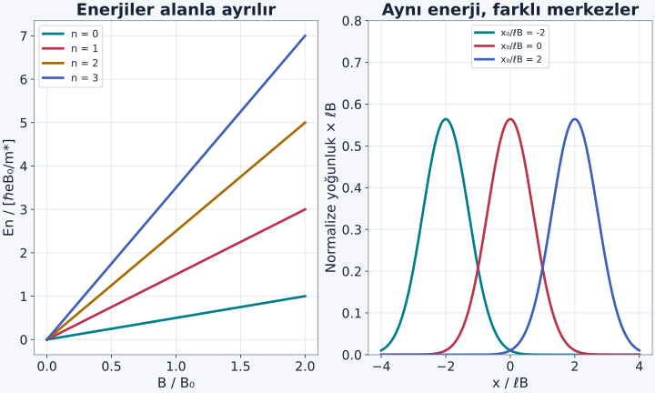
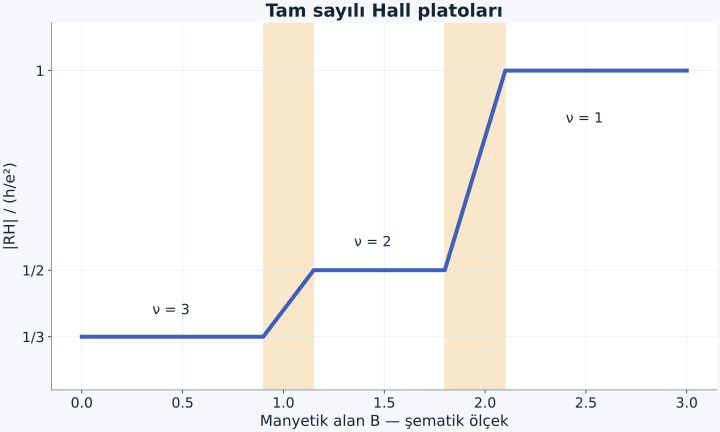

Manyetik alan klasik bir elektronun yolunu büker. Kuantum mekaniğinde aynı alan yalnız yolu eğmekle kalmaz; düzlem içindeki kinetik enerjiyi eşit aralıklı düzeylere ayırır. Çok sayıda elektron bu düzeyleri doldurduğunda, enine elektriksel yanıtın temel sabitlerle belirlenen değerler aldığı bir rejime ulaşabiliriz. Landau düzeylerinden kuantum Hall etkisine giderken enerji sayımı, durum sayımı ve taşınımı birbirinden ayırarak ilerleyeceğiz.

[Kuantum harmonik osilatörü](/blog/kuantum-harmonik-osilatoru/), [etkin kütle](/blog/etkin-kutle-ve-delikler/), [Drude modeli](/blog/elektriksel-iletkenlik-ve-drude-modeli/) ve [Fermi gazı](/blog/fermi-gazi-ve-dejenerasyon-basinci/) ön bilgilerimiz. İlk hesapta elektronlar $xy$ düzleminde, düzgün $\mathbf B=B\hat{\mathbf z}$ alanında hareket eder; $B>0$ alıyoruz. Elektronlar arası etkileşimi ve spin ayrılmasını başlangıçta ihmal edeceğiz. Sonuç tek spin dalı başına sayılacaktır.

## 1. Klasik dönme ölçeği

Elektron yükü $q=-e$, $e>0$; etkin kütlesi $m^*$ olsun. Manyetik kuvvet $\mathbf F=q\mathbf v\times\mathbf B$ hıza diktir, bu yüzden sabit alan tek başına iş yapmaz. Dairesel harekette büyüklükleri eşitlemek:

$$
\frac{m^*v^2}{r}=evB,
\qquad \omega_c=\frac vr=\frac{eB}{m^*}
$$

verir. $\omega_c$ siklotron açısal frekansıdır; radyan/saniye biriminde okunur. Elektronun dönme yönü yük işaretine bağlıdır, fakat enerji aralığında bu frekansın pozitif büyüklüğü kullanılır.

Klasik hesapta hız ve yarıçap sürekli değişebilir. Kuantum hesabında dairesel hareketin enerji ölçeği $\hbar\omega_c$ olacak. Ancak bunu sadece boyut analizinden ilan etmeyelim; Hamiltonyeni bilinen osilatör biçimine dönüştürelim. Bu dönüşüm ayrıca her enerji için neden çok sayıda farklı durum olduğunu da ortaya çıkaracak.

## 2. Vektör potansiyeli seçip Hamiltonyeni yazmak

Manyetik alanı $\mathbf A=(0,Bx,0)$ vektör potansiyeliyle temsil edelim. Rotasyoneli $\nabla\times\mathbf A=B\hat{\mathbf z}$ olur. Elektron için mekanik momentum $\mathbf p+e\mathbf A$ olduğundan:

$$
H=\frac1{2m^*}\left[p_x^2+(p_y+eBx)^2\right].
$$

$\mathbf p=-i\hbar\nabla$ kanonik momentum operatörüdür. $\hbar$ indirgenmiş Planck sabitidir. Seçilen gösterimde $y$ koordinatı Hamiltonyende açıkça bulunmadığı için $y$ yönünde düzlem dalga seçebiliriz:

$$
\psi(x,y)=e^{ik_y y}\varphi(x),\qquad p_y\psi=\hbar k_y\psi.
$$

Buradaki $k_y$ ters uzunluk birimli dalga sayısıdır. Bu seçim elektronun gerçek yörüngesinin düz bir çizgi olduğu anlamına gelmez; yalnız bir özdurumu uygun koordinat gösterimiyle yazıyoruz.

## 3. Kaymış bir harmonik osilatör ortaya çıkar

$p_y$ yerine $\hbar k_y$ koyup kareyi düzenleyelim:

$$
\begin{aligned}
H_{k_y}
&=\frac{p_x^2}{2m^*}+\frac{(eB)^2}{2m^*}
\left(x+\frac{\hbar k_y}{eB}\right)^2\\
&=\frac{p_x^2}{2m^*}+\frac12m^*\omega_c^2(x-x_0)^2,
\end{aligned}
$$

burada $x_0=-\hbar k_y/(eB)$ osilatör merkezidir. Bildiğimiz harmonik osilatör enerjileri:

$$
E_n=\hbar\omega_c\left(n+\frac12\right),
\qquad n=0,1,2,\ldots
$$

olur. Bunlar **Landau düzeyleridir**. Düzeyler arası aralık $\hbar\omega_c$; en düşük enerji sıfır değil $\hbar\omega_c/2$'dir. Başlangıçta enerjiyi düzlem içindeki kinetik hareket için tanımladık; hapseden potansiyelin sabit enerjisi ayrıca eklenebilir.

Enerjinin $k_y$'ye bağlı olmaması dikkat çekicidir. Farklı $k_y$ değerleri farklı merkezler verirken aynı osilatör enerjisini taşır. Bu çokluk düzeylerin **dejenerasyonudur**. Alan sıfırdan farklıyken iki boyuttaki hareketi iki bağımsız serbest momentumla saymıyoruz; osilatör düzeyi ve merkez etiketi kullanıyoruz. [Tong'un manyetik alandaki parçacıklar notları](https://davidtong.org/pdfs/teaching/solid-state-physics/solidstate1.pdf) bu dönüşümü ve merkez sayımını ele alır.

Şekil: Aynı düzeydeki farklı merkezler aynı enerjiye sahiptir. Merkezlerin çizimde ayrık seçilmesi okunurluk içindir; gerçek büyük örnekte çok sık aralıklarla bulunurlar.

## 4. Bir düzey kaç elektron alır?

Dikdörtgen örneğin uzunlukları $L_x,L_y$, alanı $A=L_xL_y$ olsun. $y$ yönünde periyodik sınır koşulu seçersek $k_y=2\pi j/L_y$ ve ardışık dalga sayıları arasındaki fark $2\pi/L_y$ olur. Buna karşılık merkez aralığı:

$$
|\Delta x_0|=\frac{\hbar}{eB}\frac{2\pi}{L_y}
=\frac h{eBL_y}
$$

çıkar. Örnek genişliği $L_x$ boyunca kaç merkez bulunduğunu sayarsak:

$$
N_\phi=\frac{L_x}{|\Delta x_0|}
=\frac{eBA}{h}
=\frac{BA}{\Phi_e},\qquad \Phi_e=\frac he
$$

elde ederiz. Sonuç kenar düzeltmeleri ihmal edilen büyük örnek içindir. $\Phi_e$, **tek elektron yüküne ait akı ölçeğidir**. Süperiletken halkadaki $h/(2e)$ ile aynı değildir. Burada eşleşmiş çiftleri değil, tek elektron orbitallerini sayıyoruz.

Bir spin dalı için birim alan başına durum sayısı $n_\phi=eB/h$ olur. Spin dejenerasyonu çözülmemişse aynı yörüngesel düzey iki spin alabilir. Zeeman ayrılması ve etkileşimler bu iki katlığı kaldırabilir. Dolayısıyla deneyde her basamakta kaç dalın dolduğunu açıkça belirtmek gerekir.

## 5. Manyetik uzunluk ve örnek hesabı

Osilatörün uzaysal ölçeği:

$$
\ell_B=\sqrt{\frac{\hbar}{eB}}
$$

olan **manyetik uzunluktur**. $m^*$ bu ifadede bulunmaz; çünkü $m^*\omega_c=eB$ çarpımında kütle gider. Enerji aralığı ise etkin kütleye güçlü biçimde bağlıdır. Aynı manyetik alanda iki malzemenin orbitallerinin bu temel uzunluk ölçeği aynıyken enerji ayrımları farklı olabilir.

Örnek olarak $B=5{,}0\,\mathrm T$, $m^*=0{,}067m_e$ seçelim; $m_e=9{,}1094\times10^{-31}\,\mathrm{kg}$ elektronun boşluktaki kütlesidir. Önce $\omega_c=eB/m^*\simeq1{,}313\times10^{13}\,\mathrm{s^{-1}}$ bulunur. Sonra:

$$
\begin{aligned}
\hbar\omega_c&\simeq1{,}384\times10^{-21}\,\mathrm J\\
&\simeq8{,}64\,\mathrm{meV},\\
\ell_B&\simeq11{,}47\,\mathrm{nm}.
\end{aligned}
$$

Bir spin dalında $n_\phi=eB/h\simeq1{,}209\times10^{15}\,\mathrm{m^{-2}}$ olur. Alanı $A=1{,}0\,\mu\mathrm m^2=10^{-12}\,\mathrm{m^2}$ olan bölge, her düzeyde yaklaşık 1209 yörüngesel durum içerir. Kenarları sonlu örnekte tam sayı sayımı sınır koşuluyla yapılır; bu yaklaşık ifade büyük örnek yoğunluğunu kullanır.

## 6. Doluluk faktörü bir sayım oranıdır

Elektronların iki boyutlu sayı yoğunluğunu $n_{2D}$ ile gösterelim. **Doluluk faktörü**:

$$
\nu=\frac{n_{2D}}{n_\phi}
=\frac{n_{2D}h}{eB}
$$

olarak tanımlanır. Spin dalları tek tek sayıldığında $\nu=2$, iki dalın tam dolu olabileceği sayıya karşılık gelir. Bu değer tek başına enerji aralığının açık olduğunu kanıtlamaz; spin, düzensizlik ve etkileşim yapısını da bilmeliyiz. İdeal ayrılmış düzeyler için tam sayılar özellikle basit durumlardır.

$B$ artarken düzey başına durum sayısı artar. Sabit elektron sayısında aynı parçacıklar daha az sayıda düzeyi doldurur; doluluk faktörü azalır. Bu iki değişimi ayırmak önemlidir: Enerjiler alanla yükselirken her düzeyin kapasitesi de değişir. Alanı yalnız enerji grafiğinde düzeyleri kaydıran bir düğme gibi düşünürsek Hall sayımının yarısını kaçırırız.

## 7. Enine akımın ölçeğini görmek

Düzleme zayıf elektrik alan uygulandığında klasik yönlendirici merkez sürüklenmesi $\mathbf v_D=\mathbf E\times\mathbf B/B^2$ olur. Bu hızın yönü yüke bağlı değildir; elektrik ve manyetik kuvvetlerin dengesiyle belirlenir. Elektron akımı $\mathbf j=-en_{2D}\mathbf v_D$ olduğundan, örneğin $E_y$ uygulandığında:

$$
j_x=-\frac{en_{2D}}B E_y.
$$

İletkenlik tensörünü $j_x=\sigma_{xx}E_x+\sigma_{xy}E_y$ biçiminde tanımlıyoruz. Böylece elektronlar ve $B>0$ için $\sigma_{xy}<0$ olur. $n_{2D}=\nu eB/h$ yerine konulduğunda:

$$
\sigma_{xy}=-\nu\frac{e^2}{h},\qquad
|\sigma_{xy}|=\nu\frac{e^2}{h}
$$

ölçeği ortaya çıkar. Bu kısa hesap doğru kuantumun büyüklüğünü sezdirir; tek başına sonlu alan aralığında **plato** oluşmasını veya hassas kuantumlanmayı ispatlamaz. Bunun için dolu düzeyler arasındaki enerji/hareketlilik aralığını ve kenar taşınımını da anlamalıyız.

## 8. Örnek: İki dolu dalın direnci ve Hall gerilimi

$n_{2D}=2{,}0\times10^{15}\,\mathrm{m^{-2}}$ ve $\nu=2$ olsun. Gerekli alan:

$$
B=\frac{n_{2D}h}{2e}\simeq4{,}136\,\mathrm T
$$

bulunur. Boyuna iletkenliğin sıfıra yaklaştığı ideal platoda Hall direncinin büyüklüğü:

$$
|R_H|=\frac{h}{\nu e^2}
=\frac{25812{,}807\,\Omega}{2}
\simeq12906{,}4\,\Omega
$$

olur. $I=1{,}0\,\mu\mathrm A$ akımda enine gerilim büyüklüğü $|V_H|=I|R_H|\simeq12{,}906\,\mathrm{mV}$'dir. Gerilimin işareti kontakların hangi sırada tanımlandığına bağlıdır; burada büyüklük hesapladık.

Bu noktada $R_H$ ile üç boyutlu klasik Hall katsayısı karıştırılmamalıdır. İki boyutlu tabakanın enine direnç ölçümünde geometrik kalınlık çarpanı farklı yorumlanır. $\rho$ iki boyutlu özdirenç tensörünü göstersin. Ayrıca $\rho_{xy}=1/\sigma_{xy}$ bağıntısı genel durumda tek başına doğru değildir; tensör terslenir. $\sigma_{xx}\to0$ sınırında büyüklükler için $|\rho_{xy}|=1/|\sigma_{xy}|$ elde edilir.

Tensörün tersini açıkça görmek işaret hatasını önler. Düzlemde dönme simetrili modelde:

$$
\begin{aligned}
\boldsymbol\sigma&=\begin{pmatrix}
\sigma_{xx}&\sigma_{xy}\\-\sigma_{xy}&\sigma_{xx}
\end{pmatrix},\\
\boldsymbol\rho&=\frac1{\sigma_{xx}^2+\sigma_{xy}^2}
\begin{pmatrix}
\sigma_{xx}&-\sigma_{xy}\\\sigma_{xy}&\sigma_{xx}
\end{pmatrix}.
\end{aligned}
$$

Dolayısıyla $\rho_{xy}=-\sigma_{xy}/(\sigma_{xx}^2+\sigma_{xy}^2)$'dir. x yönünde akım verilip y yönü açık bırakıldığında $j_y=0$ olur ve ölçülen $E_y/j_x$ oranı $\rho_{yx}$'tir; $\rho_{xy}$ değildir. Bizim elektron ve alan seçimimizde $\sigma_{xy}<0$, dolayısıyla $\rho_{yx}<0$ çıkar. Kontakların sırasını değiştirmek ölçülen gerilimi ters çevirir, fakat platonun büyüklüğünü değiştirmez. İki boyutta akım yoğunluğu A/m olduğundan bu tensörün birimi doğrudan ohm olur; üç boyuttaki ohm metre ile aynı değildir.

## 9. Platolar için düzensizlik neden yararlı olabilir?

Kusursuz modelde yoğunluk sabitken tam sayı doluluk yalnız belirli alanlarda gerçekleşir. Deneysel platolar ise alan aralıkları boyunca sürer. Gerçek örnekte zayıf düzensizlik Landau düzeylerini genişletir; bazı durumlar örneğin küçük bölgelerine yerelleşir. Bu durumların doluluğu değişirken örneğin bir ucundan ötekine akım taşıyan genişlemiş durum sayısı değişmeyebilir.

Bu nedenle kimyasal potansiyel yerelleşmiş durumlar içinden geçerken Hall yanıtı aynı platoda kalabilir ve boyuna taşınım bastırılabilir. Hareketlilik aralığı, hiç durum bulunmayan katı bir enerji boşluğundan farklıdır: Durumlar vardır ama uzun mesafeli akım taşımazlar. Çok güçlü düzensizlik ise kuantum Hall rejimini bozabilir; “düzensizlik ne kadar çok, o kadar iyi” sonucu çıkmaz. [Tong'un kuantum Hall dersleri](https://davidtong.org/teaching/quantum-hall-effect/) bu yerelleşme ile plato ilişkisinin ayrıntılarını verir.

Şekil: Plato yükseklikleri tam dolu dal sayısına karşılık gelir. Geçişlerin alan konumları ve genişlikleri şematiktir; çizim belirli bir malzemenin veri kümesi değildir.

### Sıcaklık ve saçılma ölçeklerini birlikte kontrol etmek

Landau enerjilerinin ayrık olması, deneyde mutlaka ayrı çizgiler olarak görülecekleri anlamına gelmez. Isıl doluluk yaklaşık $k_BT$ genişliğinde yumuşar. Düzensizlik ve sonlu ömür de düzeyleri genişletir; bu genişliğin enerji ölçeğini $\Gamma$ ile gösterelim. Yörüngesel düzeyleri ayırt edebilmek için genellikle $k_BT$ ve $\Gamma$ büyüklüklerinin $\hbar\omega_c$'den belirgin küçük olması istenir. Spin ayrımını görmek içinse çoğu kez daha küçük Zeeman aralığıyla ayrıca karşılaştırma gerekir.

Örneğimizde $\hbar\omega_c\simeq8{,}64\,\mathrm{meV}$ idi. $T=4\,\mathrm K$ için $k_BT\simeq0{,}345\,\mathrm{meV}$ olur; bu yörüngesel aralıktan yaklaşık yirmi beş kat küçüktür. Isıl yumuşama tek başına düzeyleri tümüyle örtüştürmez. Ancak bu oran spin ayrılmasının da çözüldüğünü kanıtlamaz ve $\Gamma$ hakkında bilgi vermez. Bir ölçek kontrolünü bütün deney koşullarının onayı gibi kullanmamalıyız.

Yüksek hareketlilik, normal taşınımda uzun bir momentum gevşeme süresine işaret edebilir. Fakat Landau düzeylerinin genişliğini belirleyen kuantum ömrü ile taşınım ömrü her zaman aynı değildir; farklı saçılma açıları bu ölçümlere farklı ağırlıklarla girer. Bu yüzden hareketlilik sayısından düzey genişliğini hiçbir ek varsayım olmadan çıkarmayız. Düşük sıcaklık, uygun yoğunluk, yeterince güçlü alan ve uygun düzensizlik yapısı birlikte değerlendirildiğinde kuantum Hall platosunun hangi koşullarda bekleneceği anlam kazanır.

## 10. Kenarlar ve bu yazının sınırı

Sonlu örneğin kenarında hapsetme potansiyeli yükselir. Kenara yaklaşan merkezlerin enerjisi değişir; düzeyler orada yayılımlı dallara dönüşebilir. Bu dallar belirli yönlerde hareket eden kenar kanalları oluşturur. Karşı kenarlardaki yönler ters olabilir. Hacimde boyuna iletim bastırılmışken kenarda akım taşınabilmesi bu yüzden çelişki değildir. Gerçek ölçümde kontaklar, kanalların doluluğu ve dengeye gelmesi de önem taşır.

Burada tam sayılı kuantum Hall etkisine odaklandık. Kesirli doluluklarda görülen kesirli kuantum Hall etkisi, tek elektron Landau düzeylerini doldurmanın ötesinde güçlü çok parçacıklı korelasyonlar gerektirir. Basit formüle kesirli bir $\nu$ yazmak bu fazların açıklamasını vermiş olmaz.

Verilen ölçekler birlikte sağlanmadığında aynı matematiksel düzeyler modelde bulunabilir, fakat ölçümde ayrı ve kararlı platolar olarak görünmeyebilir.

Dolu bir bandın sıradan grup hızlarının toplamı sıfır olabilir; buna rağmen enine kuantum yanıtı sıfır olmak zorunda değildir. Bu farkı daha genel biçimde anlamak için yalnız enerjilerin değil, özdurumların parametre uzayında nasıl değiştiğinin de izini sürmeliyiz. Berry fazı ve bant topolojisi bu soruyu matematiksel olarak ifade eder.
