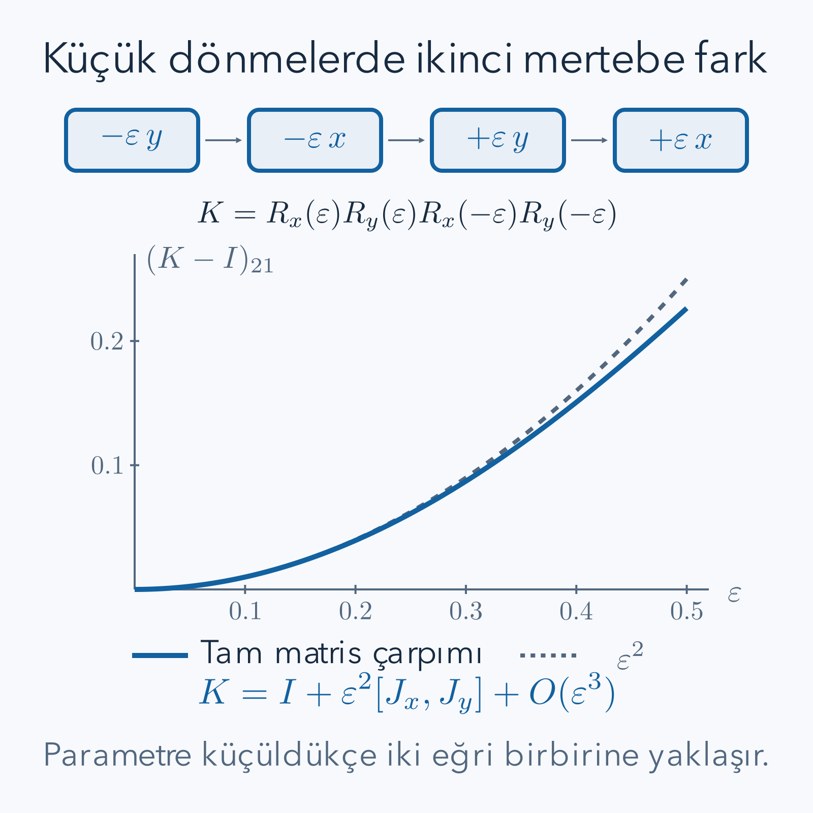

Bir üçgeni kendi üzerine getiren dönmeler arasında küçük bir açı seçemeyiz; izin verilen açılar ayrık basamaklardır. Bir çemberi ise istediğimiz kadar küçük açıyla döndürebiliriz. Bu kez soru şu: **çok küçük bir dönüşümün bilgisinden sonlu büyüklükteki dönüşümü nasıl kurarız?** Türev ile grup işlemini aynı yerde kullanmaya başladığımızda Lie grupları ve Lie cebirleri karşımıza çıkar.

[Grup kuramı yazısındaki](/blog/grup-kurami-ve-simetriler/) birim, ters, bileşke ve temsil kavramlarını kullanacağız. [Türev](/blog/turevin-anlami-ve-temel-kurallari/), [Taylor serisi](/blog/sonsuz-seriler-ve-taylor-yaklasimi/), [matris çarpımı](/blog/matrisler-ve-dogrusal-donusumler/) ve [Hermit ile üniter matrisler](/blog/karmasik-vektorler-hermit-ve-uniter-matrisler/) ön bilgidir. İhtiyacımız olan seri ayrıştırmalarını ve matris çarpımlarını burada açıkça yapacağız. Fizikteki Noether teoremi veya açısal momentum yasaları bu matematik anlatımının ön koşulu değildir.

## 1. Bir grup ne zaman Lie grubudur?

Bir Lie grubu hem grup hem de düzgün bir geometrik uzaydır; çarpma ve ters alma işlemleri bu düzgün yapıyla uyumludur. “Düzgün” derken yerel koordinatlarda gerektiği kadar türev alınabilmesini kastediyoruz. Tam manifold tanımını burada geliştirmeyeceğiz. Matris örneklerinde girişlerin gerçek parametrelere düzgün bağlı olması ve grup işlemlerinin bu parametrelerle türevlenebilir davranması bize somut çalışma alanı sağlar.

İki boyutlu dönmeler $SO(2)$ ile üç boyutlu dönmeler $SO(3)$ bu tür gruplardır. Her biri sonsuz eleman içerir; fakat bu tek başına Lie grubu olmak için yeterli bir tanım değildir. Asıl ek yapı, yakın iki dönüşüm arasındaki değişimi türevle inceleyebilmemizdir. Birim matrisin yakınını bilmek özellikle değerlidir: herhangi bir dönüşümün ardından yapılacak küçük bir hareketi, birimin yakınındaki hareketle tarif edebiliriz.

Lie cebiri ise grubun kendisi değildir. Birimin içinden geçen düzgün eğrilerin başlangıç hızlarını toplayabildiğimiz bir vektör uzayıdır; ayrıca komütatör denen bir işlem taşır. Grubun elemanları sonlu dönüşümler, cebirin elemanları ise küçük dönüşümlerin birinci mertebe yönleridir. Bu ayrımı korumak, bir matrise hem “dönme” hem “dönme üreteci” deyip çelişkiye düşmemizi önler.

## 2. $SO(2)$ eğrisinin başlangıç hızını bulmak

Açıyı radyanla ölçelim. Bir dönme matrisi

$$
R(\theta)=\begin{pmatrix}\cos\theta&-\sin\theta\\\sin\theta&\cos\theta\end{pmatrix}
$$

olsun. $R(0)=I$ olduğundan bu eğri birimden geçer. Her girişin türevini alıp sıfır açıda değerlendirirsek

$$
\begin{aligned}
R'(\theta)&=\begin{pmatrix}-\sin\theta&-\cos\theta\\\cos\theta&-\sin\theta\end{pmatrix},\\
A=R'(0)&=\begin{pmatrix}0&-1\\1&0\end{pmatrix}.
\end{aligned}
$$

$A$ matrisi jeneratör, yani üreteçtir. Küçük $\varepsilon$ açısı için $R(\varepsilon)=I+\varepsilon A+O(\varepsilon^2)$ yazılır. Büyük $O$ işareti, sıfıra yaklaşan parametrenin karesi mertebesinde kalan terimleri gösterir; eşitliğin tam sonlu açı formülü olduğunu söylemez.

Bir $v=(x,y)^T$ vektörüne uygularsak $Av=(-y,x)^T$ bulunur. Bu değişim vektörüne başlangıç vektörünü skaler çarpalım: $x(-y)+yx=0$. İlk değişim başlangıç yönüne diktir. Dönmenin ilk anda uzunluğu değiştirmeyip yönü değiştirmesi böyle okunur. Örneğin $v=(2,0)^T$ için $Av=(0,2)^T$ ve küçük pozitif açıda hareket yukarı doğrudur.

## 3. Üreteç neden antisimetriktir?

Gerçek dönmeler uzunluğu koruduğu için $R(t)^TR(t)=I$ sağlar. $T$, matrisin transpozesini gösterir. Birimden geçen herhangi bir düzgün dönme eğrisinde $R(0)=I$ ve $R'(0)=A$ alalım. Çarpımın türevi

$$
\frac{d}{dt}(R^TR)=(R')^TR+R^TR'
$$

olur. Sağ tarafın sıfırdaki değeri $A^T+A$'dır. Sol tarafta sabit $I$ matrisinin türevi sıfır olduğu için

$$
A^T+A=0,\qquad A^T=-A
$$

elde ederiz. İkiye iki gerçek antisimetrik matrisin köşegen girişleri sıfırdır; köşegen dışındaki iki giriş birbirinin eksisidir. Dolayısıyla hepsi $aA$ biçimindedir. Buradaki $a$ gerçek sayı, aynı yönde ne kadar hızlı dönüldüğünü belirler. $SO(2)$ cebirinin bir boyutlu olması, dönme matrisinin ikiye iki olmasına rağmen yalnız bir bağımsız küçük dönme yönü bulunması demektir.

Bu koşul bir sonlu dönme matrisi için geçerli değildir. Örneğin $R(\pi/2)=A$ tesadüfen aynı sayıları taşır; fakat genel $R(\theta)$ antisimetrik değildir. Üretecin özelliği ile bütün grup elemanlarının özelliğini birbirine taşımamalıyız.

## 4. Matris üssünü seriden kurmak

Bir kare $M$ matrisi için üstel fonksiyonu

$$
e^M=I+M+\frac{M^2}{2!}+\frac{M^3}{3!}+\cdots
$$

serisiyle tanımlarız. Sonlu boyutta bu seri bütün sonlu matrisler için yakınsar; girişleri veya bir matris normu üzerinden mutlak yakınsaklıkla değerlendirilebilir. Üs işareti, matrisin her girişine ayrı ayrı sıradan üstel uygulamak anlamına gelmez. Çarpımlar gerçek matris çarpımlarıdır.

Bizim $A$ matrisinde

$$
A^2=\begin{pmatrix}-1&0\\0&-1\end{pmatrix}=-I,
\quad A^3=-A,\quad A^4=I.
$$

Bu dört terimli örüntü yinelenir. Çift ve tek kuvvetleri ayrı toplayabiliriz:

$$
\begin{aligned}
e^{\theta A}
&=I+\theta A-\frac{\theta^2}{2!}I
-\frac{\theta^3}{3!}A+\frac{\theta^4}{4!}I+\cdots\\
&=I\sum_{n=0}^{\infty}\frac{(-1)^n\theta^{2n}}{(2n)!}
+A\sum_{n=0}^{\infty}\frac{(-1)^n\theta^{2n+1}}{(2n+1)!}\\
&=I\cos\theta+A\sin\theta\\
&=R(\theta).
\end{aligned}
$$

Böylece sinüs ve kosinüsü sonuca sonradan yakıştırmadık; üretecin kuvvetleri bu iki seriyi kendileri seçti. Örneğin $\theta=\pi/2$ için $e^{\theta A}=A$ ve $(1,0)^T$ vektörü $(0,1)^T$ olur. $\theta=0$ için birim çıkması da başlangıç koşulunu doğrular.

## 5. Bir parametreli grup ve diferansiyel denklem

$U(t)=e^{tA}$ ailesinde $U(0)=I$, $U(t)U(s)=U(t+s)$ ve $U(t)^{-1}=U(-t)$ bulunur. Aynı $A$'nın kuvvetleri birbirleriyle değiştiğinden iki üstel serinin çarpımını binom toplamı olarak birleştirebiliriz. Farklı, değişmeli olmayan iki matris için bu adımı genel olarak yapamayız.

Serinin terim terim türevi

$$
\begin{aligned}
\frac{dU}{dt}
&=A+tA^2+\frac{t^2A^3}{2!}+\cdots\\
&=A\left(I+tA+\frac{t^2A^2}{2!}+\cdots\right)=AU
\end{aligned}
$$

verir. Başlangıç vektörü $v_0$ ise $v(t)=U(t)v_0$, $\dot v=Av$ denklemini çözer. $A$ sabitken küçük adımları çarparak da aynı dönüşüme yaklaşırız: $(I+tA/N)^N\to e^{tA}$. Her sonlu yaklaşım tam uzunluk korumaz; limitte doğru dönme ortaya çıkar. Bu nedenle sayısal bir yöntemle tam grup elemanını aynı şey saymamalıyız.

$t$ burada zorunlu olarak fiziksel zaman değildir; açı veya soyut bir grup parametresi olabilir. Birim kontrolü buna göre yapılır: $tA$ boyutsuz olmalıdır. $t$ saniyeyse $A$ saniyenin tersi biriminde bir değişim hızı içerir; $t$ radyanla açıysa kullanılan üreteç boyutsuzdur.

## 6. Üç boyutta üç bağımsız küçük dönme

Sağ el kuralıyla pozitif dönmeler seçelim. Üç gerçek antisimetrik üreteç

$$
J_x=\begin{pmatrix}0&0&0\\0&0&-1\\0&1&0\end{pmatrix},\quad
J_y=\begin{pmatrix}0&0&1\\0&0&0\\-1&0&0\end{pmatrix},\quad
J_z=\begin{pmatrix}0&-1&0\\1&0&0\\0&0&0\end{pmatrix}
$$

olsun. Alt indis, sabit kalan ekseni belirtir. Örneğin $J_x(x,y,z)^T=(0,-z,y)^T$ olur; $x$ bileşeni ilk mertebede değişmez. Genel üçe üç antisimetrik matrisin üç serbest girişi vardır ve $aJ_x+bJ_y+cJ_z$ biçiminde yazılır.

Bu üç matrisin kendileri terslenebilir değildir: örneğin $J_x$ eksen yönünü sıfıra gönderir. Bu bir sorun değildir, çünkü cebir elemanından grup elemanı olmasını istemiyoruz. $e^{\theta J_x}$ ise terslenebilirdir ve $x$ ekseni çevresinde gerçek bir dönmedir. Bir cebirin vektör uzayı olması, iki üreteci toplayabileceğimiz anlamına gelir; iki sonlu dönme matrisini toplamak ise genellikle yeni bir dönme vermez.

## 7. Bir komütatörün dokuz girişini görmek

Komütatör $[B,C]=BC-CB$ olarak tanımlanır. İşlem sırasının en düşük mertebedeki farkını ölçecektir. Yukarıdaki üreteçlerle doğrudan çarpım yapalım:

$$
J_xJ_y=\begin{pmatrix}0&0&0\\1&0&0\\0&0&0\end{pmatrix},\qquad
J_yJ_x=\begin{pmatrix}0&1&0\\0&0&0\\0&0&0\end{pmatrix}.
$$

İlk matrisin ikinci satır birinci sütun girişi, $(0,0,-1)\cdot(0,0,-1)=1$ hesabından gelir. İkinci matrisin birinci satır ikinci sütun girişi, $(0,0,1)\cdot(0,0,1)=1$ olur. Kalan girişler, ilgili satır ve sütunlarda aynı yerde sıfır olmayan çarpan bulunmadığından sıfırdır. Çıkarınca

$$
[J_x,J_y]=\begin{pmatrix}0&-1&0\\1&0&0\\0&0&0\end{pmatrix}=J_z
$$

buluruz. Çarpımlar tek başına antisimetrik değildi; farkları antisimetriktir. Genel olarak $B^T=-B$ ve $C^T=-C$ ise $[B,C]^T=C^TB^T-B^TC^T=CB-BC=-[B,C]$. Cebir, bu ikinci işlem altında da kapanır.

## 8. Küçük kapalı işlem dizisi neden tam kapanmaz?

$B$ ve $C$ sabit üreteçler, $\varepsilon$ küçük gerçek parametre olsun. Dört adımlı çarpımı

$$
K=e^{\varepsilon B}e^{\varepsilon C}e^{-\varepsilon B}e^{-\varepsilon C}
$$

diye seçelim. Sağdan uygulandığı için gerçek hareket sırası $-C,-B,+C,+B$'dir. “Kapalı” sözü parametre adımlarının toplamının sıfır olmasını anlatır; sonucun tam birim olacağını henüz bilmiyoruz.

Her üsteli ikinci mertebeye kadar açarız. İlk iki çarpan

$$
I+\varepsilon(B+C)+\varepsilon^2(B^2/2+BC+C^2/2)+O(\varepsilon^3)
$$

verir. Bunu $I-\varepsilon B+\varepsilon^2B^2/2$ ile çarpınca birinci mertebe $C$ kalır; ikinci mertebe $BC-CB+C^2/2$ olur. Son çarpan $I-\varepsilon C+\varepsilon^2C^2/2$ ile çarpımda doğrusal $C$'ler silinir. Karesel terimler

$$
BC-CB+C^2/2-C^2+C^2/2=BC-CB
$$

şeklinde toplanır. Sonuç

$$
K=I+\varepsilon^2[B,C]+O(\varepsilon^3)
$$

olur. $B=J_x,C=J_y$ seçersek kalıntı küçük bir pozitif $z$ dönmesidir. Parametreyi yarıya indirmek öncü sapmayı yaklaşık dörtte bire indirir. Bu ikinci mertebe etkiyi yalnız birinci mertebe yakınlaştırmalarıyla çarparak güvenilir bulamayız; her üstel içindeki kare terimlerini de tutmamız gerekiyordu.

*Dört işlemde doğrusal adımlar birbirini götürür. İşlem sırasının komütatörü, ikinci mertebede bir kalıntı bırakır; çizim açısal sapmayı öğretim amacıyla büyütür.*

## 9. Sonlu açılarda sıra farkını bağımsız kontrol etmek

Şimdi küçük açı yaklaşımını bırakalım. $X=R_x(\pi/2)$ ve $Y=R_y(\pi/2)$ olsun:

$$
X=\begin{pmatrix}1&0&0\\0&0&-1\\0&1&0\end{pmatrix},\qquad
Y=\begin{pmatrix}0&0&1\\0&1&0\\-1&0&0\end{pmatrix}.
$$

Başlangıç vektörü $e_z=(0,0,1)^T$ için $Ye_z=(1,0,0)^T$ ve $X(Ye_z)=(1,0,0)^T$ bulunur. Ters sırada $Xe_z=(0,-1,0)^T$ ve $Y(Xe_z)=(0,-1,0)^T$ olur. İki farklı sonuç, $XY\ne YX$ demektir.

İki dönüşümün de doksan derece olması ve toplam açıların aynı görünmesi yeterli değildir; eksen bilgisi gerekir. Aynı eksen çevresindeki dönmelerin işlem sırası sonucu değiştirmez; farklı eksenlerde sıra genellikle sonucu değiştirir. Bu nedenle $e^Be^C=e^{B+C}$ eşitliğini koşulsuz kullanmak, somut olarak bu vektör hesabıyla çelişir.

## 10. Üniter grupta iki üreteç geleneği

Karmaşık matrislerde eşlenik transpozeyi $\dagger$ ile gösterelim. Üniter dönüşüm $U^\dagger U=I$ sağlar. $U(0)=I$ ve $U'(0)=A$ için türev alırsak $A^\dagger+A=0$ çıkar. Matematikte kullanılan üreteç böylece anti-Hermittir.

Fizikte sıkça Hermit bir $G$ matrisi seçilir ve

$$
U(t)=e^{-itG},\qquad A=-iG
$$

yazılır. $G^\dagger=G$ ise $A^\dagger=iG=-A$ olduğundan iki gelenek aynı dönüşümü anlatır. Biri Hermit, diğeri anti-Hermit olduğu için bir çelişki yoktur; aralarında $-i$ çarpanı vardır. Boyutlu bir fiziksel gözlenebilir kullanılıyorsa üstelin boyutsuz olması için ayrıca uygun sabitler gerekir. Buradaki $G$'leri boyutsuz alıyoruz.

Örneğin $G=\operatorname{diag}(1,-1)$ seçersek $U(t)=\operatorname{diag}(e^{-it},e^{it})$ olur. Her köşegen girişinin mutlak değeri bir olduğu için karmaşık vektörün normu korunur. Üretecin özdeğerleri gerçekken, dönüşümün özdeğerleri birim çemberdedir; bunlar farklı nesnelerdir.

## 11. Pauli matrisleri ve üstel hesabı

Pauli matrisleri

$$
\sigma_x=\begin{pmatrix}0&1\\1&0\end{pmatrix},\quad
\sigma_y=\begin{pmatrix}0&-i\\i&0\end{pmatrix},\quad
\sigma_z=\begin{pmatrix}1&0\\0&-1\end{pmatrix}
$$

olarak tanımlanır. Her birinin karesi $I$'dir. Örneğin $\sigma_y^2$'nin ilk köşegen girişi $(-i)i=1$, ikincisi $i(-i)=1$ olur. $\sigma_x\sigma_y=i\sigma_z$ ve $\sigma_y\sigma_x=-i\sigma_z$ çarpımları da $[\sigma_x,\sigma_y]=2i\sigma_z$ verir.

Birim gerçek vektör $n=(n_x,n_y,n_z)$ için $N=n_x\sigma_x+n_y\sigma_y+n_z\sigma_z$ tanımlayalım. Farklı Pauli matrislerinin ters sıralı çarpımları toplamda birbirini götürdüğünden $N^2=(n_x^2+n_y^2+n_z^2)I=I$ olur. Çift kuvvetler $I$, tek kuvvetler $N$ verdiği için

$$
\begin{aligned}
e^{-i\theta N/2}
&=I\sum_{m=0}^{\infty}\frac{(-1)^m(\theta/2)^{2m}}{(2m)!}
-iN\sum_{m=0}^{\infty}\frac{(-1)^m(\theta/2)^{2m+1}}{(2m+1)!}\\
&=I\cos(\theta/2)-iN\sin(\theta/2).
\end{aligned}
$$

Bu matris üniterdir; eşlenik transpozesiyle çarpınca çapraz terimler silinir ve $\cos^2(\theta/2)+\sin^2(\theta/2)=1$ kalır. $N$'nin özdeğerleri $+1,-1$ olduğundan üstelin özdeğerleri $e^{-i\theta/2},e^{i\theta/2}$'dir; çarpımları bir, dolayısıyla determinant birdir. Böyle matrislerin grubu $SU(2)$'dir.

## 12. Yarım açının dönmeyle ilişkisini kurmak

Formülde yarım açı bulunması henüz üç boyutlu dönmeyle bağ kurduğumuzu göstermez. Bunun için bir $v=(v_x,v_y,v_z)$ gerçek vektörünü $V=v_x\sigma_x+v_y\sigma_y+v_z\sigma_z$ Hermit matrisine kodlayalım. $U$ ile $V'=UVU^\dagger$ dönüşümü yapalım. Sonuç yine izi sıfır Hermit matristir; dolayısıyla yeni bir gerçek $v'$ vektörüne karşılık gelir.

$z$ ekseni için $U=\operatorname{diag}(e^{-i\theta/2},e^{i\theta/2})$ seçince doğrudan giriş çarpımı

$$
U\sigma_xU^\dagger
=\begin{pmatrix}0&e^{-i\theta}\\e^{i\theta}&0\end{pmatrix}
=\cos\theta\,\sigma_x+\sin\theta\,\sigma_y
$$

verir. Benzer biçimde $U\sigma_yU^\dagger=-\sin\theta\,\sigma_x+\cos\theta\,\sigma_y$ ve $U\sigma_zU^\dagger=\sigma_z$ bulunur. Katsayıları toplarsak

$$
v'_x=v_x\cos\theta-v_y\sin\theta,
\quad v'_y=v_x\sin\theta+v_y\cos\theta,
\quad v'_z=v_z.
$$

Demek ki iki bileşenli karmaşık uzayda yarım açı taşıyan matris, kodlanmış üç boyutlu vektörü tam $\theta$ açısıyla döndürür. Yarım açı bir adlandırma tercihi değil, bu açık çarpımda çıkan ilişkidir.

## 13. $2\pi$, $4\pi$ ve çift örtme sınırı

Üstel formülünde $\theta=2\pi$ koyarsak $\cos\pi=-1$, $\sin\pi=0$ olduğu için $U(2\pi)=-I$ çıkar. $\theta=4\pi$ için $U(4\pi)=I$ olur. Buna karşılık üç boyutlu vektör üzerinde $(-I)V(-I)^\dagger=V$'dir. Hem $U$ hem $-U$, aynı vektör dönmesini verir.

Bu eşlemeye $SU(2)$'nin $SO(3)$'ü çift örtmesi denir. Genel ilişkinin bütün $SO(3)$ dönmelerini kapsadığını kanıtlamak için her dönmenin bir eksen ve açıyla yazılabildiğini ayrıca kullanmak gerekir; bu eksen-açı teoreminin genel ispatını burada yapmıyoruz. Kurduğumuz formül bu anlatımı sağlar ve iki ön görüntünün nasıl oluştuğunu gösterir. Eşlemenin çekirdeği $\{I,-I\}$'dir; grup kuramındaki çekirdeğin bilgi kaybını burada yeniden görüyoruz.

Çekirdeğin daha büyük olmadığını da kontrol edebiliriz. Hiçbir kodlanmış vektörü değiştirmeyen $U$, bütün Pauli matrisleriyle değişmelidir. $\sigma_z$ ile değişme şartı, $U$'nun köşegen dışı girişlerini sıfırlar. Köşegen $\operatorname{diag}(a,b)$ matrisinin $\sigma_x$ ile değişmesi ise $a=b$ şartını verir. Dolayısıyla $U=aI$ olmalıdır. Determinant bir olduğundan $a^2=1$, yani $a=+1$ veya $a=-1$ olur. Aynı dönmeyi veren iki matrisin oranı çekirdekte bulunduğu için her dönmenin en fazla bu iki ön görüntüsü vardır.

Spin yarım temsili, bu iki bileşenli karmaşık vektörler üzerinde çalışır. Bir turun matrisi eksi birimdir. Kuantumda tek bir durumun ortak fazının ölçülmesi ile iki yol arasındaki göreli fazın ölçülmesi farklı sorulardır; bu matematik sonucu tek başına “her ölçüm bir tur sonunda değişir” iddiasına dönüşmez. Burada öğrendiğimiz, temsil uzayındaki dönüşüm ile sıradan uzay vektörünün dönüşümünün aynı matris olmadığıdır.

## 14. İki boyutlu matrisin üç boyutlu uzunluğu koruması

Vektörü $V=v\cdot\sigma$ biçiminde kodladığımızda bu kodun gerçekten uzunlukla uyumlu olduğunu kontrol edelim. Matrisin açık biçimi

$$
V=\begin{pmatrix}v_z&v_x-iv_y\\v_x+iv_y&-v_z\end{pmatrix}
$$

olur. Karesinin ilk köşegen girişi $v_z^2+(v_x-iv_y)(v_x+iv_y)=v_x^2+v_y^2+v_z^2$'dir. İkinci köşegen de aynı toplamı verir; köşegen dışı girişlerde $v_z(v_x-iv_y)+(v_x-iv_y)(-v_z)=0$ bulunur. Sonuç $V^2=\lVert v\rVert^2I$'dir. Dolayısıyla matrisin karesinin izinin yarısı, gerçek vektörün uzunluğunun karesidir.

Dönüşümden sonra $(UVU^\dagger)^2=UV(U^\dagger U)VU^\dagger=UV^2U^\dagger=\lVert v\rVert^2I$ olur. Aradaki üniterlik çarpanı birim verdi; uzunluk böyle korundu. Bu kontrol yalnız $z$ eksenindeki örneğe dayanmaz. Seçtiğimiz herhangi bir $SU(2)$ matrisiyle bu işlem, kodlanmış gerçek vektörler üzerinde uzunluk koruyan doğrusal bir dönüşüm verir.

İki matrisin art arda etkisine de bakalım. Önce $U_1$, sonra $U_2$ uygulanırsa sonuç $U_2(U_1VU_1^\dagger)U_2^\dagger=(U_2U_1)V(U_2U_1)^\dagger$ olur. Demek ki bu eşleme grup çarpımını korur. Daha önce yalnız iki matrisin aynı dönmeyi verdiğini görmüştük; şimdi eşlemenin neden bir homomorfizma olduğunu da kontrol ettik.

Dönüşümün determinantının artı bir olması, birimden başlayan sürekli üstel aile için ayrıca anlaşılır: gerçek ortogonal dönüşümün determinantı yalnız artı veya eksi bir olabilir. Başlangıçta artı birdir ve sürekli değişimle bu iki ayrık değer arasında sıçrayamaz. Bu, uzunluk korumadan yönelim korumaya geçerken kullandığımız ek bilgidir.

## 15. Hermit ve anti-Hermit komütatörlerde işaret hesabı

Pauli matrislerini $G_x=\sigma_x/2$, $G_y=\sigma_y/2$, $G_z=\sigma_z/2$ diye ölçekleyelim. Önceki çarpımlardan $[G_x,G_y]=iG_z$ bulunur. Hermit iki matrisin komütatörü genel olarak Hermit değildir; bu örnekte önündeki $i$ bunu açıkça gösterir. Cebiri Hermit matrislerle anlatan kaynaklarda bu çarpan bu nedenle görünür.

Matematiksel anti-Hermit üreteçler $A_j=-iG_j$ olsun. İki taraftaki sayısal çarpanları dışarı çıkarırsak

$$
[A_x,A_y]=(-i)^2[G_x,G_y]=-iG_z=A_z
$$

olur. Gerçek dönme üreteçlerinde bulduğumuz $[J_x,J_y]=J_z$ ilişkisiyle aynı yapı sabitine ulaştık. Burada matris boyutlarının farklı olması ilişkiyi bozmaz; ilişki, çarpımların farkının hangi üreteç yönüne döndüğünü anlatır.

Yarım açı da bu ölçeklemenin içindedir: $e^{\theta A_z}=e^{-i\theta\sigma_z/2}$. Eğer yanlışlıkla bölü ikiyi kaldırırsak elde ettiğimiz matris hâlâ üniter olabilir, fakat kodlanmış gerçek vektörü $\theta$ yerine iki kat açıyla döndürür. Yalnız üniterlik kontrolü bu hatayı yakalamaz; dönüşümün hangi fiziksel veya geometrik açıya karşılık geldiğini de bir örnek vektör üzerinde sınamak gerekir.

Küçük döngü için de aynı dikkat geçerlidir. Dört çarpanı ters sırada yazarsak komütatör işareti değişebilir. Bu nedenle bir kaynakta eksi işaret gördüğümüzde ilk soru “hangi kaynak yanlış?” olmamalıdır. Önce işlemlerin sağdan mı soldan mı uygulandığını ve döngünün hangi yönde yüründüğünü kontrol ederiz; aynı deneysel veya geometrik işlem dizisini karşılaştırınca işaretler uyuşmalıdır.

## 16. Yerel cebir neyi söyler, neyi söylemez?

Komütatör, birimin yakınındaki dönmelerin sıra farkını hesaplar. Bu yerel bilgi çok güçlüdür; fakat tek başına grubun bütün küresel yapısını belirlemez. $SU(2)$ ile $SO(3)$'ün küçük dönmelerinin cebirleri uygun baz seçimiyle aynı ilişkilere sahiptir. Buna rağmen birinde $2\pi$'lik yolda eksi birim, diğerinde birim görürüz. Küçük komşuluk bilgisi, bütün büyük çevrimlerin nasıl kapandığını tek başına kaydetmez.

Üstel fonksiyonun her Lie grubunda her elemanı tek biçimde verdiğini de söylemiyoruz. $SO(2)$'de bile $\theta$ ve $\theta+2\pi$ aynı dönmedir; üstel haritanın birebir olmadığı daha ilk örnekte görülür. Bu yazıdaki açık matris grupları için kurduğumuz hesaplar yeterlidir. Genel üstel haritanın kapsayıcılığı ve küresel topoloji ayrı teoremler gerektirir.

Hesap yaparken üç kontrol bizi korur: üreteç doğru Hermitlik koşulunu sağlamalı, sonlu dönüşüm doğru normu korumalı ve komütatör işareti seçilen işlem sırasıyla uyuşmalıdır. Bir işaret farkı bulduğumuzda önce dönme yönünü, sağdan uygulama kuralını ve Hermit üreteçteki $-i$ seçimini birlikte kontrol ederiz.

## 17. Küçük adımın sayısal hatasını ölçmek

Bir üretecin tam dönüşüm olmadığını sayıyla da sınayabiliriz. Başlangıç vektörü $(1,0)^T$ ve küçük açı $\varepsilon=0.1$ radyan olsun. Birinci mertebe yaklaşımı $(I+\varepsilon A)v=(1,0.1)^T$ verir. Bu vektörün uzunluğunun karesi $1+0.01=1.01$'dir. Tam dönmenin uzunluğunun karesi ise birdir. Yaklaşım ilk mertebede doğru olsa da ikinci mertebede uzunluğu değiştirmiştir.

Tam sonuç $(\cos0.1,\sin0.1)^T$ olup yaklaşık $(0.995004,0.0998334)^T$'dir. Yatay bileşendeki eksilme birinci mertebe formülünde görünmüyordu. Serinin ikinci terimini ekleyince $I+\varepsilon A+\varepsilon^2A^2/2=I+\varepsilon A-\varepsilon^2I/2$ olur ve vektör $(0.995,0.1)^T$ çıkar. Uzunluğun karesi artık $0.990025+0.01=1.000025$'tir. Hata küçülür, fakat sonlu kesilmiş seri yine tam dönme değildir.

Bu karşılaştırma, küçük döngü hesabında neden ikinci mertebe terimleri tuttuğumuzu açıklar. Aradığımız kalıntı zaten açının karesi mertebesindedir. Aynı mertebedeki bir yaklaşım hatasını ihmal edersek gerçek sıra etkisiyle sayısal hatayı birbirine karıştırabiliriz. Hangi terime kadar doğru sonuç aradığımızı önceden belirlemek, hesabın kaç terimini saklamamız gerektiğini seçer. Seriyi kesmek bir tahmin yöntemidir; tahminin hata mertebesini belirtmek de çözümün parçasıdır.

## 18. Kaynaklar

Yerel grup yapısı, bir parametreli gruplar ve üreteç tanımlarını [Maciej Dunajski, Cambridge: Integrable Systems, bölüm 4.1–4.2](https://www.damtp.cam.ac.uk/user/md327/ISlecture_notes_2026.pdf) ile karşılaştırabilirsiniz. Dönme grupları, Pauli matrisleri ve $SU(2)$–$SO(3)$ ilişkisi için [Hugh Osborn: Group Theory Lecture Notes, bölüm 3](https://www.damtp.cam.ac.uk/user/ho10/GNotes.pdf) birincil ders kaynağıdır. Buradaki seri ve küçük döngü hesapları bu tanımları somut matrislerle bağımsız olarak açar; genel Lie grubu sınıflandırmasını veya bütün temsil kuramını geliştirmez.
