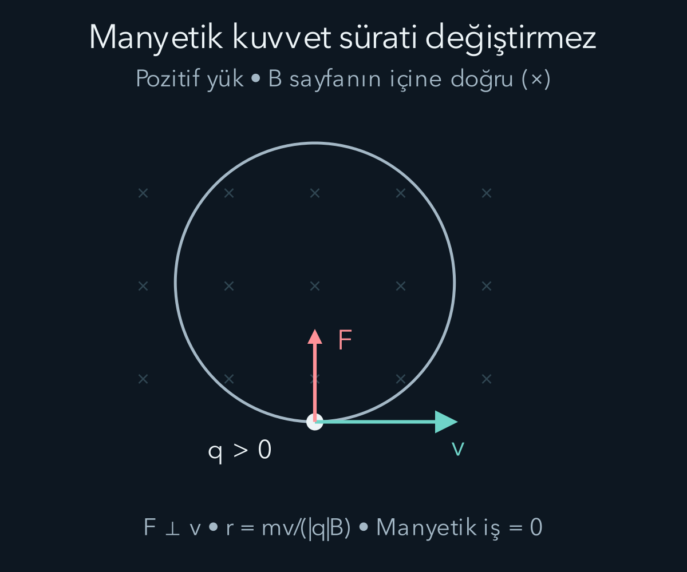
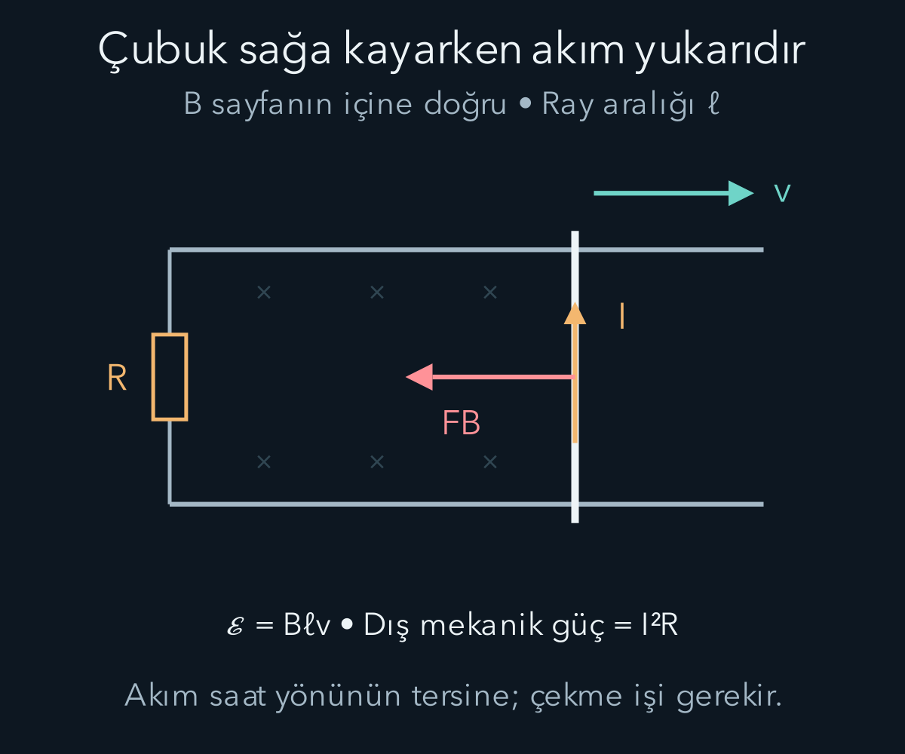

import ArticleVideo from '@/components/ArticleVideo.astro'
import kavram from './media/01-kavram.mp4?url'
import kavramPoster from './media/01-kavram.jpg?url'

Bir elektrik motorunda akım harekete, jeneratörde hareket elektriksel enerji aktarımına katılır. İki düzenekte de manyetik alan bulunur; fakat “manyetik alan enerji üretir” demek, mekanizmanın en önemli noktasını saklar. Manyetik kuvvetin bir yüklü parçacığa yaptığı iş sıfır olabilirken bütün bir devrede elektriksel enerji aktarımı gerçekleşebilir. Bunu anlamak için parçacığın hareketini, iletkenin hareketini ve elektrik alanın etkisini ayrı ayrı takip edeceğiz.

[Elektrik alan ve potansiyel](/blog/elektrik-yuku-alan-ve-potansiyel/) ile [devreler](/blog/kondansatorler-ve-elektrik-devreleri/) yazıları elektriksel önbilgiyi sağlıyor. Matematikte vektörel çarpım, türev ve integral gerekiyor. Sağ el kuralını bir ezber olarak bırakmayacağız: yönü belirlerken önce eksenleri, sonra çarpımdaki sırayı yazacağız. İlk modellerimiz boşlukta, klasik mekanik geçerli olacak kadar düşük hızlarda ve ideal bileşenlerle kurulacak.

## Manyetik alanın kuvvetteki yeri

Yükü $q$, hızı $\mathbf v$ olan bir parçacığın elektrik ve manyetik alanlardan gördüğü toplam Lorentz kuvveti

$$
\mathbf F=q(\mathbf E+\mathbf v\times\mathbf B)
$$

ile verilir. Burada $\mathbf E$ elektrik alan, $\mathbf B$ manyetik alandır. Manyetik alanın SI birimi tesla, sembolü $\mathrm T$ olup $1\,\mathrm T=1\,\mathrm{N/(A\,m)}$ eşitliğini sağlar. Akımın birimi amperdir ve $1\,\mathrm A=1\,\mathrm{C/s}$ olduğundan $qvB$ çarpımının birimi newtona dönüşür.

Vektörel çarpım, iki vektöre de dik bir vektör verir. Hız ile alan arasındaki açı $\theta$ ise manyetik kuvvetin büyüklüğü $|q|vB\sin\theta$ olur. Alan doğrultusunda hareket eden parçacıkta bu kuvvet sıfırdır. Elektrik kuvvetinden farklı olarak manyetik kuvvet yalnız alanın ve yükün bilgisiyle belirlenmez; parçacığın hızı da gerekir. Negatif yük için sağ el kuralıyla bulunan yön ters çevrilir.

Örneğin sağ yönü $+x$, yukarıyı $+y$, sayfadan bize doğru yönü $+z$ seçelim. Hız sağa, alan sayfanın içine doğruysa $\mathbf v=v\hat{\mathbf x}$ ve $\mathbf B=-B\hat{\mathbf z}$ yazılır. Birim vektörler için $\hat{\mathbf x}\times\hat{\mathbf z}=-\hat{\mathbf y}$ olduğundan hız ile alanın çarpımı yukarı yönelir. Pozitif yük yukarı, negatif yük aşağı sapar. İşaretleri bu şekilde izlemek, sayfayı zihinde döndürmeye çalışmaktan daha güvenilirdir.

Manyetik kuvvetin gücü, yani birim zamandaki işi,

$$
P_B=\mathbf F_B\cdot\mathbf v
=q(\mathbf v\times\mathbf B)\cdot\mathbf v=0
$$

olur. Son eşitlik diklikten gelir. Yalnız manyetik kuvvet etkisindeki parçacığın kinetik enerjisi ve sürati değişmez; hız vektörünün yönü değişebilir. Bu sonuç toplam elektriksel kuvvetin işi için geçerli değildir. Elektrik alan varsa $q\mathbf E\cdot\mathbf v$ sıfır olmayabilir.

## Çember ve helis neden ortaya çıkar?

Düzgün, zamandan bağımsız bir manyetik alana dik hızla giren parçacığı düşünelim. Elektrik alanı, başka kuvvetleri ve parçacığın yaydığı ışınımın hareket üzerindeki etkisini ihmal ediyoruz. Manyetik kuvvet her anda hıza dik olduğundan merkezcil kuvvet rolü oynar:

$$
|q|vB=\frac{mv^2}{r},\qquad
r=\frac{mv}{|q|B}.
$$

Burada $m$ kütle, $r$ yörünge yarıçapıdır. Aynı süratte daha ağır parçacık daha geniş çember çizer; daha güçlü alan çemberi daraltır. Açısal hızın büyüklüğü $\omega_c=v/r=|q|B/m$ olur. Bu klasik modelde süratin sadeleşmesi, her manyetik ortamda ve her enerji düzeyinde geçerli evrensel bir sonuç değildir. Işık hızına yaklaşan parçacık için momentum ile hız arasındaki klasik ilişki değişir.

Hızın alana paralel bir bileşeni de varsa onu $v_\parallel$, dik bileşenini $v_\perp$ ile gösteririz. Paralel bileşene manyetik kuvvet etki etmez. Dik bileşen çembersel hareket yaparken paralel bileşen düzgün ilerler; bileşke yörünge bir helistir. Yarıçap formülünde artık toplam sürat yerine $v_\perp$ bulunur. Bir turun süresi $T_c=2\pi m/(|q|B)$, bir turdaki eksensel ilerleme ise $v_\parallel T_c$ olur.

## Akım alan oluşturur, alan akıma kuvvet uygular

Akım çok sayıda yükün düzenli taşınmasını temsil eder. Düz bir tel parçasının tamamı aynı dış manyetik alan içindeyse tel üzerindeki kuvvet

$$
\mathbf F=I\boldsymbol\ell\times\mathbf B
$$

olur. $I$ geleneksel akımın pozitif büyüklüğü, $\boldsymbol\ell$ akım yönünde ve tel uzunluğu büyüklüğünde vektördür. Elektronlar ters yönde hareket etse de elektron yükünün negatif işareti bu geleneksel akım ifadesiyle tutarlıdır. Eğri tel veya değişken alan için tel küçük parçalara ayrılır ve $\mathrm d\mathbf F=I\,\mathrm d\boldsymbol\ell\times\mathbf B$ katkıları toplanır.

Parçacık kuvvetinden tel kuvvetine geçişi görmek için telin kesit alanını $A$, birim hacimdeki taşıyıcı sayısını $n_c$, taşıyıcı başına yükü $q$ ve tel boyunca sürüklenme hızını $\mathbf v_d$ seçelim. Uzunluğu $\ell$ olan parçada $n_cA\ell$ taşıyıcı vardır. Düzgün dış alandaki kuvvetlerin toplamı:

$$
\mathbf F=(n_cA\ell)q\,\mathbf v_d\times\mathbf B.
$$

Akım yoğunluğu $\mathbf J=n_cq\mathbf v_d$ olduğundan $n_cAq\mathbf v_d$ vektörü geleneksel akım yönünde, büyüklüğü $I$ olan bir vektördür. Bu nedenle toplam $I\boldsymbol\ell\times\mathbf B$ biçimine dönüşür. Elektronda hem $q$ hem sürüklenmenin akım yönündeki bileşeni negatiftir; çarpımları geleneksel akım yönünü verir. Telin örgüsüyle taşıyıcıların etkileşimi bu kuvveti telin mekanik hareketine aktarır. Rastgele termal hızlar düzenli bir yön taşımadığından bu ortalama akıma ayrıca aynı işaretli bir katkı yapmaz.

Öte yandan aynı akım çevresinde manyetik alan oluşturur. Kararlı akımların boşluktaki alanı için Biot–Savart yasası,

$$
\mathrm d\mathbf B=\frac{\mu_0}{4\pi}
\frac{I\,\mathrm d\boldsymbol\ell\times\hat{\mathbf r}}{r^2},
$$

biçimindedir. $\mathbf r$ tel elemanından alanın hesaplandığı noktaya gider; $r$ onun uzunluğu, $\hat{\mathbf r}$ birim yönüdür. $\mu_0$ boşluğun manyetik geçirgenliğidir. Hesaplarımızda $\mu_0\approx4\pi\times10^{-7}\,\mathrm{T\,m/A}$ yeterlidir. Güncel SI sisteminde bu eski sayısal ifade tam bir tanım değil, son derece iyi bir yaklaşımdır.

Uzun, düz bir telin çevresinde alan çizgileri merkezleri tel üzerinde bulunan çemberlerdir. Akım yönüne sağ elin başparmağını uzattığımızda kıvrılan parmaklar alanın dolanım yönünü gösterir. Telden dik uzaklık $r$ için

$$
B=\frac{\mu_0 I}{2\pi r}
$$

bulunur. Örneğin $I=5\,\mathrm A$ ve $r=0{,}020\,\mathrm m$ ise $B\approx5{,}0\times10^{-5}\,\mathrm T$ çıkar. Uzaklığı iki katına çıkarmak alanı yarıya indirir. Noktasal elektrik yükünün ters kare davranışıyla bunu karıştırmamak gerekir; kaynakların geometrileri farklıdır.

Alan yönlerinin toplanması da önemlidir. İki paralel telde akımlar aynı yöndeyse teller arasındaki bölgede alan katkıları karşıt yönlü olabilir; dış tarafta ise aynı yönde olabilir. Her telin alan büyüklüğünü bulduktan sonra yönleriyle toplarız. Yalnız büyüklükleri toplamak, elektrik alandaki gibi burada da yanlış sonuç verir. Özellikle alanın sıfır olduğu bir nokta bulmak, akımların sıfır olduğu anlamına gelmez.

Aynı sonuç kararlı durumdaki Ampère yasasıyla daha kısa elde edilir:

$$
\oint\mathbf B\cdot\mathrm d\boldsymbol\ell=\mu_0 I_{\mathrm{iç}}.
$$

Çember boyunca alan teğet ve büyüklüğü sabit olduğu için sol taraf $B\,2\pi r$ olur. Bu sadeleşmeyi sağlayan şey yasanın kendisi değil, telin simetrisidir. Rastgele biçimli bir akım dağılımında aynı integral, alanı tek başına hemen vermez. Zamanla değişen elektrik alanlarda bu denklemin tamamlanması gerekecek.

Çok sarımlı uzun bir bobinin ortasında, uçlardan yeterince uzakta alan yaklaşık düzgündür. Birim uzunluktaki sarım sayısı $n$ ise boşlukta $B\approx\mu_0nI$ elde edilir. Bu sonuç, sonlu bobinin dışında alanın her yerde kesin sıfır olduğunu söylemez. Gerçek bobinlerin uç alanları ve içine konan maddenin tepkisi ayrıca değerlendirilir.

## Akı, alan ile yüzeyin ortak bilgisidir

Bir yüzeyden geçen manyetik akı

$$
\Phi_B=\int_S\mathbf B\cdot\hat{\mathbf n}\,\mathrm dA
$$

ile tanımlanır. $S$ yüzey, $\hat{\mathbf n}$ seçtiğimiz birim normaldir. Akının birimi weberdir: $1\,\mathrm{Wb}=1\,\mathrm{T\,m^2}$. Alan düzgün ve yüzey düzse $\Phi_B=BA\cos\theta$ yazılabilir. Buradaki açı alan ile yüzeyin kendisi arasında değil, yüzeyin normali arasındadır. Alan yüzeye paralelse akı sıfır olur.

Akı bir noktadaki alan değildir. Alanın büyüklüğü değişmeden yüzey alanı veya yüzeyin yönü değişirse akı değişebilir. Normal yönünü ters seçersek akının işareti tersine döner; fiziksel olay değişmez. Tutarlı olmak için yüzeyin sınırındaki pozitif dolaşım yönünü de ters çevirmeliyiz. Normal ile dolaşım yönü sağ el kuralıyla bağlanır.

Sabit bir kapalı yol için Faraday yasası,

$$
\mathcal E=\oint\mathbf E\cdot\mathrm d\boldsymbol\ell
=-\frac{\mathrm d\Phi_B}{\mathrm dt}
$$

der. $\mathcal E$ elektromotor kuvvet adını taşır ama kuvvet birimiyle ölçülmez; birimi volttur. Kapalı yol boyunca birim yük başına dolaşımsal enerji aktarımını anlatır. Akı değiştiğinde elektrik alanın kapalı yol integrali sıfır olmayabilir. Dolayısıyla önceki elektrostatik yazıda kullandığımız, elektrik alanı yalnız tek değerli bir skaler potansiyelin eksi gradyanı olarak yazma işlemi bu durumda yeterli değildir.

Eksi işareti Lenz yasasını içerir: devrede oluşabilecek akımın manyetik etkisi, onu oluşturan akı değişimine karşı koyar. Bu, akımın her zaman dış alana ters alan ürettiği anlamına gelmez. Dış akı azalıyorsa indüklenen akım aynı yönde alan oluşturarak azalmaya karşı koyabilir. Karşı çıkılan nicelik mevcut akının kendisi değil, değişimidir.

Bir sonraki örnekte iletkenin kendisi hareket edecek. Bu durumda sabit yolun yalnız elektrik alan integralini kullanmak yetmez. Hareket eden kapalı bir iletken çevrimin yerel hızını $\mathbf u$ ile gösterelim; bu, yük taşıyıcısının toplam hızı $\mathbf v$ ile aynı nicelik değildir. Kesintisiz, düzgün hareket eden çevrim için toplam elektromotor kuvvet

$$
\mathcal E=\oint_{C(t)}(\mathbf E+\mathbf u\times\mathbf B)\cdot d\boldsymbol\ell
=-\frac{d}{dt}\int_{S(t)}\mathbf B\cdot\hat{\mathbf n}\,dA
$$

olur. $C(t)$ anlık çevrim, $S(t)$ onun sınırlandırdığı yönlü yüzeydir. Sağ tarafta hem alanın hem yüzeyin zamanla değişimini izleriz. Çevrim sabitse $\mathbf u=0$ olur ve az önce yazdığımız yasa geri gelir. Dönen çerçeve ile aşağıdaki kayan çubukta ise hareketten gelen katkı da gerekir; aynı akı hesabı bunları birlikte kapsar.

Akı değişimini daha somut görmek için alanı sabit tutup bir çerçeveyi döndürelim. Çerçevenin alanı $A$, normalinin alanla yaptığı açı $\theta=\omega t$ olsun; $\omega$ sabit açısal hızdır. Başlangıçta normal alanla aynı yöndedir. Bir sarım için

$$
\Phi_B(t)=BA\cos(\omega t),\qquad
\mathcal E(t)=BA\omega\sin(\omega t)
$$

elde edilir. İkinci bağıntı kosinüsün türevindeki eksiyle Faraday yasasının eksisinin birbirini götürmesinden gelir. Akının en büyük olduğu anda elektromotor kuvvet sıfırdır; çünkü akının anlık değişimi o anda sıfırdır. Çerçeve normalinin alana dik olduğu anda akı sıfırdan geçer fakat değişim hızı en büyüktür. Dolayısıyla büyük akıyla büyük indüklenen gerilimi eş anlamlı sayamayız.

Örneğin $B=0{,}20\,\mathrm T$, $A=0{,}010\,\mathrm{m^2}$ ve $\omega=100\,\mathrm{rad/s}$ seçilirse gerilimin tepe değeri $BA\omega=0{,}20\,\mathrm V$ olur. Aynı akıyı gören, aynı yönde sarılmış on sarım seri bağlandığında tepe değeri $2{,}0\,\mathrm V$ olur. Sarım sayısı alanı veya açısal hızı değiştirmemiş, her sarımdaki elektromotor kuvvetin devre boyunca toplanmasını sağlamıştır. Bu ifade mekanik sürücünün yük altında hızını koruduğu ideal durumda kullanılır.

İndüksiyondan söz etmek mutlaka sürekli bir akım bulunduğu anlamına da gelmez. Devre açıkken iletken içindeki yükler kısa süre yeniden dağılabilir; uçlarda yük birikmesi bir elektrik alan ve ölçülebilir gerilim oluşturabilir. Fakat kapalı iletim yolu yoksa basit doğru akım modelinde sürekli dolaşan akım bulunmaz. Devre kapatıldığında akımın büyüklüğü yalnız akı değişiminden değil, direnç ve indüktans gibi devre özelliklerinden de etkilenir. Bu ayrım gerilim üreten bir düzenekle güç sağlayan bir düzeneğin neden aynı çalışma koşullarına sahip olmadığını açıklar.

## Hareket eden çubukta işaret ve enerji hesabı

Yatay iki iletken rayı solda bir dirençle birleştirelim. Sağdaki dikey iletken çubuk raylar üzerinde sağa doğru sabit $v$ hızıyla kaysın. Ray aralığı $\ell$, düzgün manyetik alan sayfanın içine doğru olsun. Devrenin toplam direnci $R$; ray ve çubuk dirençlerini bunun içinde düşünüyoruz. Özindüksiyonu ihmal ederek akımın anlık devre bağıntısıyla bulunabildiği sınırı ele alıyoruz.

Yüzey normalini dışarı, pozitif dolaşımı saat yönünün tersine seçelim. Çubuğun soldaki kenara uzaklığı $x$ ise

$$
\Phi_B=-B\ell x,\qquad
\mathcal E=-\frac{\mathrm d\Phi_B}{\mathrm dt}=B\ell v.
$$

Sonuç pozitif olduğundan akım saat yönünün tersinedir: sağdaki çubuk üzerinde yukarı akar. Aynı yönü çubukla taşınan pozitif yüklere etkiyen $q\mathbf v\times\mathbf B$ kuvvetinden de buluruz. Sabit yol örneğinden farklı olarak burada iletken hareket eder; elektromotor kuvvete yükler üzerindeki hareketten kaynaklanan manyetik katkı da dahildir.

Şimdi $B=0{,}50\,\mathrm T$, $\ell=0{,}40\,\mathrm m$, $v=3{,}0\,\mathrm{m/s}$ ve $R=2{,}0\,\Omega$ alalım. Önce gerilimi, ardından akımı buluruz:

$$
\mathcal E=0{,}50\times0{,}40\times3{,}0=0{,}60\,\mathrm V,
\qquad I=\frac{0{,}60}{2{,}0}=0{,}30\,\mathrm A.
$$

Çubuktaki akım yukarı, alan içeri olduğundan tel üzerindeki manyetik kuvvet sola yönelir. Büyüklüğü $F_B=I\ell B=0{,}060\,\mathrm N$ olur. Çubuğu sabit hızda tutmak için aynı büyüklükte sağa doğru dış kuvvet uygulamalıyız. Sağladığımız mekanik güç

$$
P_{\mathrm{dış}}=F_{\mathrm{dış}}v=0{,}18\,\mathrm W
$$

iken dirençteki güç $I^2R=(0{,}30)^2\times2{,}0=0{,}18\,\mathrm W$ çıkar. İşaretin enerjiyle tutarlılığı burada görünür: çubuğu çekmek iş gerektirir ve bu iş dirençte iç enerjiye dönüşür. Manyetik alan kendiliğinden enerji veren bir depo gibi kullanılmamıştır.

Bu sonuç tek parçacık için bulduğumuz sıfır manyetik işle çelişmez. Yükün toplam hızı, çubuğun sürüklenme hızıyla tel boyunca akıma katılan hareketi birlikte içerir. Kuvvet bu toplam hıza diktir. İletkeni çeken dış etken, yükler ile örgü arasındaki etkileşimler ve elektrik alan birlikte enerji aktarımını sağlar. Yalnız çubuğun hareket yönüne bakıp parçacığın tam hızını unutmak, görünürdeki çelişkiyi doğurur.

<ArticleVideo src={kavram} poster={kavramPoster} title="Akının değişimi ve indüksiyon" caption="Kosinüs biçiminde değişen manyetik akı ile onun eksi türevi olan sinüs biçimindeki elektromotor kuvvet karşılaştırılır. Her eğri kendi genliğine göre ölçeklenmiştir." />

## Bobin neden akım değişimine karşı çıkar?

Bir bobinin kendi akımı da içinden manyetik akı geçirir. Geometri sabit ve manyetik tepki doğrusal olduğunda toplam akı bağlanımı $N\Phi_B=LI$ yazılabilir. $N$ sarım sayısı, $L$ özindüktanstır; her sarımdaki akının aynı olduğu basit model kullanılmıştır. $L$ birimi henridir: $1\,\mathrm H=1\,\mathrm{V\,s/A}$. Bobinin kendi indüklediği elektromotor kuvvet $-L\,\mathrm dI/\mathrm dt$ olur.

Devre hesabında akımın girdiği ucu pozitif seçerek bobin üzerindeki gerilim düşümünü $V_L=L\,\mathrm dI/\mathrm dt$ yazarız. İki işaret aynı olayı farklı tanımlarla anlatır. Akım artarken bobin gerilim düşümü gerektirir; akım azalırken depoladığı enerjiyi devreye geri verebilir. Doğrusal ideal bobindeki enerji, güç bağıntısının integraliyle bulunur:

$$
P_L=V_LI=LI\frac{\mathrm dI}{\mathrm dt},\qquad
U_B=\int_0^I LI'\,\mathrm dI'=\frac12LI^2.
$$

Buradaki $I'$ integralin geçici değişkenidir. Enerji depolanması dirençteki sürekli iç enerji artışıyla aynı davranış değildir. Gerçek bobin ayrıca tel direncine ve çekirdek kayıplarına sahip olabilir; ideal model bu etkileri ayrı bileşenlerde toplar.

## Bir akımın kurulma süresi

İdeal sabit gerilim kaynağı $V_0$, direnç $R$ ve bobin $L$ seri bağlı olsun. Başlangıçta akım sıfırken devre kapatıldığında

$$
L\frac{\mathrm dI}{\mathrm dt}+RI=V_0,
\qquad I(t)=\frac{V_0}{R}\left(1-e^{-t/\tau}\right),
\qquad \tau=\frac LR
$$

elde edilir. Çözümü kontrol etmek için türevini alıp ilk denkleme koyabiliriz: bobin terimi $V_0e^{-t/\tau}$, direnç terimi $V_0(1-e^{-t/\tau})$ olur ve toplamları kaynağı verir. Başlangıç koşulu da $I(0)=0$ ile sağlanır.

$V_0=12\,\mathrm V$, $R=6\,\Omega$, $L=3\,\mathrm H$ seçersek son akım $2\,\mathrm A$, zaman sabiti $0{,}50\,\mathrm s$ olur. Bir saniye sonra akım $2(1-e^{-2})\approx1{,}73\,\mathrm A$ değerindedir. Çok uzun zaman sonra bobindeki enerji $\tfrac12\times3\times2^2=6\,\mathrm J$ olur. Kararlı akımda ideal bobinin gerilimi sıfıra iner; bu, içinde alan ve enerji bulunmadığı anlamına gelmez.

Akımı bir anda kesmeye çalışmak, sonlu indüktans için çok büyük bir gerilim gerektirebilir. Bu nedenle boşta bırakılan gerçek bobin kıvılcım veya başka devre yolları oluşturabilir. Akımın bir direnç üzerinden güvenle dolaşabildiği ideal boşalma devresinde ise $I(t)=I_0e^{-Rt/L}$ olur. Başlangıçtaki manyetik enerji giderek dirençte iç enerjiye dönüşür.

Elektrik alanın yüklerle, manyetik alanın akımlarla ilişkisini ayrı ayrı kurduk. İndüksiyon, değişen manyetik alanın dolaşımlı elektrik alanla bağlantısını gösterdi. Bir sonraki adım, değişen elektrik alanın da manyetik alan denkleminde neden yer alması gerektiğini ve iki alanın boşlukta birlikte nasıl ilerleyebildiğini açıklamak olacak.

## Kaynaklar

- [OpenStax — Manyetik alanda yüklü parçacığın hareketi](https://openstax.org/books/university-physics-volume-2/pages/11-3-motion-of-a-charged-particle-in-a-magnetic-field).
- [OpenStax — Biot–Savart yasası](https://openstax.org/books/university-physics-volume-2/pages/12-1-the-biot-savart-law) ve [uzun düz telin alanı](https://openstax.org/books/university-physics-volume-2/pages/12-2-magnetic-field-due-to-a-thin-straight-wire).
- [OpenStax — Solenoidler ve toroidler](https://openstax.org/books/university-physics-volume-2/pages/12-6-solenoids-and-toroids).
- [OpenStax — Faraday yasası](https://openstax.org/books/university-physics-volume-2/pages/13-1-faradays-law) ve [hareket kaynaklı elektromotor kuvvet](https://openstax.org/books/university-physics-volume-2/pages/13-3-motional-emf).
- [OpenStax — RL devreleri](https://openstax.org/books/university-physics-volume-2/pages/14-4-rl-circuits).
- [NIST — SI yeniden tanımı ve fiziksel sabitler](https://www.nist.gov/news-events/news/2021/12/updates-fundamental-constants-reflect-redefinition-international-system).
