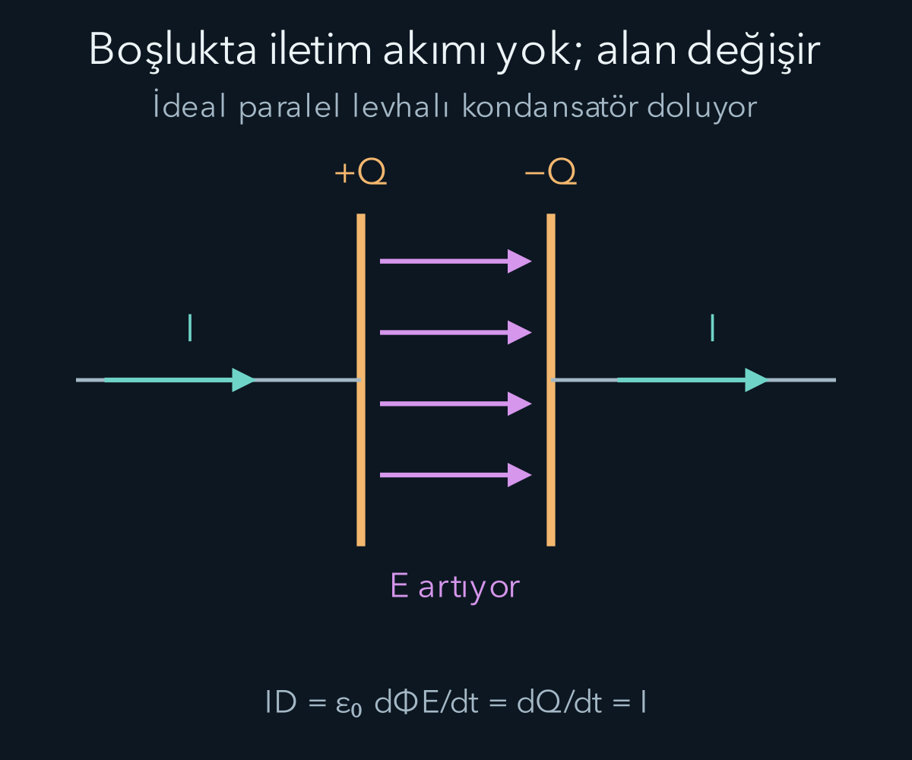
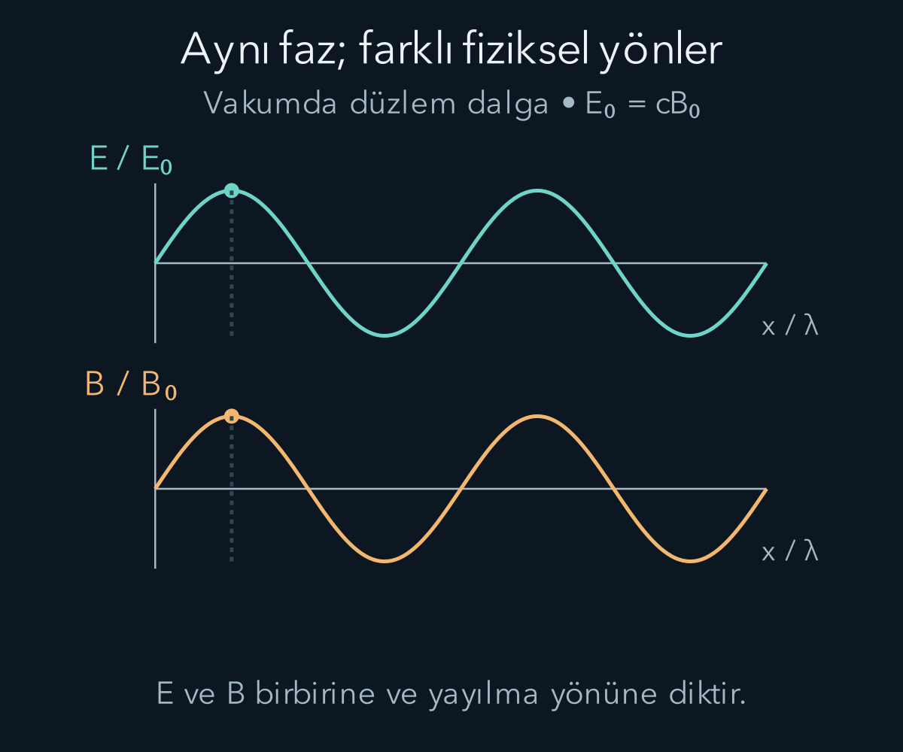

import ArticleVideo from '@/components/ArticleVideo.astro'
import kavram from './media/01-kavram.mp4?url'
import kavramPoster from './media/01-kavram.jpg?url'

Bir kondansatörü dolduran telden akım geçerken levhalar arasındaki boşluktan elektronların geçmesi gerekmez. Buna rağmen devrede manyetik alan vardır. Manyetik alanın kapalı bir yol çevresindeki dolaşımını hesaplarken, aynı yolun içine gerdiğimiz hayali yüzeye göre iki farklı sonuç bulmamalıyız. Bu basit tutarlılık isteği, önceki yazıdaki akım yasasının neden eksik olduğunu gösterecek ve bizi ışığın hızına kadar götürecek.

Bu yazı [elektrik alan](/blog/elektrik-yuku-alan-ve-potansiyel/), [devreler](/blog/kondansatorler-ve-elektrik-devreleri/) ve [indüksiyon](/blog/manyetizma-ve-elektromanyetik-induksiyon/) üzerine kuruluyor. Matematiksel dil için [akı, dolaşım ve integral teoremleri](/blog/vektor-alanlari-ve-integral-teoremleri/), dalga biçimlerini yorumlamak için [dalga denklemi](/blog/dalgalar-ve-dalga-denklemi/) gerekli. Amacımız dört denklemi bir liste olarak ezberlemek değil; neyi sınırladıklarını, birbirleriyle neden tutarlı olduklarını ve belirli koşullarda hangi dalgayı ürettiklerini görmek.

## Alan, kaynak ve bölgeyi ayırmak

Elektrik alanı $\mathbf E(\mathbf r,t)$, manyetik alanı $\mathbf B(\mathbf r,t)$ ile gösterelim. $\mathbf r$ konum, $t$ zamandır. Kaynakları anlatmak için hacim başına yük olan $\rho$ yük yoğunluğunu ve $\mathbf J$ akım yoğunluğunu kullanacağız. Bunların birimleri sırasıyla $\mathrm{C/m^3}$ ve $\mathrm{A/m^2}$ olur. Bir yüzeyden geçen yük akımı $I=\int\mathbf J\cdot\hat{\mathbf n}\,\mathrm dA$ ile hesaplanır.

“Boşluk denklemleri” dediğimizde maddelerin kutuplanma ve mıknatıslanmasını ayrı malzeme bağıntılarıyla modellemediğimiz temel biçimi kastediyoruz. Bu denklemlerde yükler ve akımlar bulunabilir. Daha sonra “kaynaksız boşluk bölgesi” dediğimizde ise ayrıca o bölgede $\rho=0$ ve $\mathbf J=0$ alacağız. Alanı oluşturan antenin incelenen bölgenin dışında bulunması, dalganın orada ilerlemesine engel değildir.

Boşluğun elektrik geçirgenliği $\varepsilon_0$, manyetik geçirgenliği $\mu_0$ sabitleri elektrik ve manyetik niceliklerin SI birimleri arasındaki ilişkiyi kurar. Yaklaşık değerler olarak $\varepsilon_0=8{,}854\times10^{-12}\,\mathrm{F/m}$ ve $\mu_0=1{,}257\times10^{-6}\,\mathrm{H/m}$ kullanılabilir. Bu yuvarlatılmış değerleri çok basamaklı kesin sonuç üretmek için kullanmayacağız.

## Dört integral denklemi ne söyler?

Önce kapalı bir yüzey seçelim. $\partial V$ simgesi bir $V$ hacminin sınır yüzeyini, $\hat{\mathbf n}$ dışa bakan birim normali göstersin. Elektrik için Gauss yasası

$$
\oint_{\partial V}\mathbf E\cdot\hat{\mathbf n}\,\mathrm dA
=\frac{Q_{\mathrm{iç}}}{\varepsilon_0}
$$

şeklindedir. $Q_{\mathrm{iç}}$ yüzeyin içinde kalan toplam yüktür. Denklem net dış elektrik akısını sınırlar. İçeride net yük sıfır olduğunda alanın her noktada sıfır olması gerekmez; yüzeye giren ve çıkan katkılar birbirini götürebilir.

Manyetik alan için karşılığı

$$
\oint_{\partial V}\mathbf B\cdot\hat{\mathbf n}\,\mathrm dA=0
$$

olur. Kullandığımız klasik elektromanyetizma modelinde ayrı manyetik yükler bulunmaz. Bir mıknatısın kuzey ucunu çevreleyen kapalı yüzeye de alan geri dönen yollar üzerinden girer. Mıknatısı kesmek, bu denkleme göre tek başına bir kuzey manyetik yükü elde etme işlemi değildir. Sıfır net manyetik akı, açık bir yüzeyden geçen manyetik akının sıfır olmasını da gerektirmez.

Şimdi açık bir $S$ yüzeyinin sınırı olan kapalı $C$ yolunu düşünelim. Yüzey normalini ve yolun pozitif dolaşımını sağ el kuralıyla eşleyelim. Sabit yüzey ve yol için diğer iki denklem

$$
\oint_C\mathbf E\cdot\mathrm d\boldsymbol\ell
=-\frac{\mathrm d}{\mathrm dt}\int_S\mathbf B\cdot\hat{\mathbf n}\,\mathrm dA,
$$

$$
\oint_C\mathbf B\cdot\mathrm d\boldsymbol\ell
=\mu_0\int_S\mathbf J\cdot\hat{\mathbf n}\,\mathrm dA
+\mu_0\varepsilon_0\frac{\mathrm d}{\mathrm dt}
\int_S\mathbf E\cdot\hat{\mathbf n}\,\mathrm dA
$$

biçimindedir. Birincisi Faraday yasasıdır. İkincisi Ampère–Maxwell yasasıdır; önceki kararlı akım ifadesine elektrik akısının değişimi eklenmiştir. Yüzey integraliyle çizgi integralini karıştırmamak gerekir: biri alandan geçen akıyı, diğeri sınır çevresindeki dolaşımı toplar. Alanın değişmesi ile alanın uzayda dolaşımlı yapısı bu denklemlerde bağlanır.

## Kondansatörün boşluğunda eksik kalan terim

Paralel levhalı, arası boşluk olan bir kondansatörün levha alanına $A$, pozitif levhadaki yüke $Q(t)$ diyelim. Kenar etkilerini ihmal ettiğimiz yaklaşık düzgün alan modelinde

$$
E(t)=\frac{Q(t)}{\varepsilon_0A},\qquad
\Phi_E=EA=\frac{Q}{\varepsilon_0}.
$$

Dolayısıyla elektrik akısının türevi

$$
I_d=\varepsilon_0\frac{\mathrm d\Phi_E}{\mathrm dt}
=\frac{\mathrm dQ}{\mathrm dt}=I
$$

olur. $I_d$ yer değiştirme akımı adı verilen niceliktir. Birimi amperdir; fakat burada boşluktan taşınan bir yük akışı anlamına gelmez. Değişen alanın manyetik dolaşım denklemine yaptığı katkının akım birimiyle ifade edilmesidir.

Aynı kapalı yol için seçilen bir yüzey teli keserken, diğer yüzey kondansatör levhaları arasından geçirilebilir. İlkinde iletim akımı, ikincisinde elektrik akısının değişimi katkı sağlar. Tam denklem aynı dolaşımı verir. Böylece hesap, hayali yüzeyin biçimine bağlı bir fizik sonucu üretmez. Basit paralel levha modeli bu gerekliliğin sayısal karşılığını görünür kılar; genel tutarlılık yük korunumuyla birlikte sağlanır.

Örneğin alan $2{,}0\times10^9\,\mathrm{V/(m\,s)}$ hızıyla artarken levha alanı $0{,}010\,\mathrm{m^2}$ olsun. Elektrik akısının türevi alan ile bu değişim hızının çarpımıdır. Böylece

$$
I_d=(8{,}854\times10^{-12})(0{,}010)(2{,}0\times10^9)
=1{,}77\times10^{-4}\,\mathrm A
$$

buluruz. Yani yaklaşık $0{,}177\,\mathrm{mA}$ iletim akımıyla aynı manyetik dolaşım katkısı oluşur. Büyük görünen alan değişim hızının küçük bir akım vermesinde $\varepsilon_0$ katsayısı rol oynar. Birimleri yazmak, yalnız sayısal büyüklüklere bakarak yanlış sezgi kurmamızı önler.

## Aynı yasaların yerel dili

Alanlar yeterince düzgün olduğunda Gauss ve Stokes teoremleri integral denklemlerini noktasal türev biçimine dönüştürür:

$$
\nabla\cdot\mathbf E=\frac{\rho}{\varepsilon_0},\qquad
\nabla\cdot\mathbf B=0,
$$

$$
\nabla\times\mathbf E=-\frac{\partial\mathbf B}{\partial t},\qquad
\nabla\times\mathbf B=\mu_0\mathbf J+
\mu_0\varepsilon_0\frac{\partial\mathbf E}{\partial t}.
$$

$\nabla\cdot$ diverjans, yani küçük bir hacimdeki net dış akı yoğunluğudur. $\nabla\times$ curl veya rotasyonel, küçük bir çevredeki yönlü dolaşımı temsil eder. $\partial/\partial t$ işareti konumu sabit tutarak zamana göre türev aldığımızı belirtir. Bunlar dört yeni yasa değildir; aynı yasaların yerel anlatımıdır. Tekil noktasal yükler veya yüzey yükü gibi keskin ideal modellerde integral biçim daha doğrudan kullanılabilir; sıradan türev hesabının geçerli olmadığı sınırları dikkatle ele almak gerekir.

Bu biçim yük korunumu açısından hemen sınanabilir. Son denklemin diverjansını alalım. Bir curl alanının diverjansı sıfırdır:

$$
0=\mu_0\nabla\cdot\mathbf J+
\mu_0\varepsilon_0\frac{\partial}{\partial t}
(\nabla\cdot\mathbf E).
$$

Elektrik Gauss yasasını yerine koyup $\mu_0$ ile bölersek

$$
\frac{\partial\rho}{\partial t}+\nabla\cdot\mathbf J=0
$$

elde edilir. Buna süreklilik denklemi denir. Küçük bir bölgeden dışarı net akım çıkıyorsa içerideki yük azalır. Yer değiştirme terimini silseydik yalnız $\nabla\cdot\mathbf J=0$ kalır, yükün zamanla biriktiği kondansatör gibi durumları bu biçimde temsil edemezdik.

## Dalga denklemini birlikte çıkarmak

Şimdi yük ve akım bulunmayan düzgün bir boşluk bölgesine geçelim. Faraday denkleminin iki tarafının curl işlemini alalım:

$$
\nabla\times(\nabla\times\mathbf E)
=-\frac{\partial}{\partial t}(\nabla\times\mathbf B)
=-\mu_0\varepsilon_0\frac{\partial^2\mathbf E}{\partial t^2}.
$$

İkinci eşitlikte kaynaksız Ampère–Maxwell denklemi kullanıldı. Sol tarafı açmak için bir vektör analiz özdeşliğine ihtiyaç vardır:

$$
\nabla\times(\nabla\times\mathbf E)
=\nabla(\nabla\cdot\mathbf E)-\nabla^2\mathbf E.
$$

$\nabla^2$ Laplace işlemcisidir; bir skaler fonksiyonda üç uzaysal ikinci türevin toplamını alır, vektörde her bileşene ayrı uygulanır. Özdeşlik, curl tanımını iki kez açıp karışık türevlerin sırasını değiştirmekle doğrulanır. Bunun için ilgili türevlerin düzgünlüğünü varsayıyoruz. Kaynaksız bölgede diverjans sıfır olduğundan sol taraf yalnız $-\nabla^2\mathbf E$ kalır. Eksi işaretleri sadeleşir:

$$
\nabla^2\mathbf E=\mu_0\varepsilon_0
\frac{\partial^2\mathbf E}{\partial t^2}.
$$

İki curl işlemini içeren özdeşliğin bir bileşenini açmak, bu türetimdeki en sık atlanan adımı görünür kılar. $\partial_x$, $x$'e göre kısmi türevin kısaltması olsun. Sol tarafın $x$ bileşeni:

$$
\begin{aligned}
[\nabla\times(\nabla\times\mathbf E)]_x
&=\partial_y(\partial_xE_y-\partial_yE_x)\\
&\quad-\partial_z(\partial_zE_x-\partial_xE_z)\\
&=\partial_x(\partial_yE_y+\partial_zE_z)\\
&\quad-\partial_y^2E_x-\partial_z^2E_x.
\end{aligned}
$$

Karışık türevlerin sırasını değiştirmek için alanın ilgili ikinci türevlerinin sürekli olduğunu kullandık. Son ifadeye birbirini götüren $+\partial_x^2E_x-\partial_x^2E_x$ terimlerini ekleyince:

$$
\partial_x(\nabla\cdot\mathbf E)-\nabla^2E_x
$$

elde edilir. Diğer iki bileşen de aynı çevrimsel işlemden gelir. Böylece Laplace işlemcisi dışarıdan eklenmiş bir dalga varsayımı değil, Maxwell denklemlerindeki uzaysal türevlerin birleşimidir.

Aynı işlemler manyetik alan için de aynı dalga denklemini verir. Daha önce gördüğümüz $\nabla^2u=(1/v^2)\partial_t^2u$ biçimiyle karşılaştırınca yayılma hızı

$$
c=\frac{1}{\sqrt{\mu_0\varepsilon_0}}
$$

olur. SI tanımında boşluktaki ışık hızı tam olarak $299\,792\,458\,\mathrm{m/s}$ değerindedir. Yaklaşık katsayılarla yaptığımız hesap bunu yaklaşık $3{,}00\times10^8\,\mathrm{m/s}$ olarak verir. Bu sonuç, ışığın elektromanyetik dalga olarak anlaşılmasının temel bağlantısıdır. Dalgayı taşımak için gerilmiş tel veya hava gibi bir mekanik ortam varsaymadık.

Dalga denklemini elde etmek, herhangi iki dalga fonksiyonunu elektrik ve manyetik alan diye seçebileceğimiz anlamına gelmez. İkinci mertebe dalga denklemi Maxwell sisteminin bir sonucudur; başlangıçtaki alanlar ayrıca diverjans koşullarını ve birbirleriyle ilişkilerini sağlamalıdır. Örneğin ilerleyen bir elektrik dalgası yazıp manyetik alanı her yerde sıfır seçersek elektrik alan tek başına kendi dalga denklemini sağlayabilir. Fakat zamana bağlı elektrik alan, Ampère–Maxwell denkleminde sıfır olmayan bir terim üretir; manyetik alanı sıfır seçmemiz o denklemi bozar.

Bu ayrım matematikte bir eşitliğin karesini alırken ortaya çıkan ek çözümlere benzer: zorunlu bir sonuç elde etmek, başlangıçtaki bütün koşulları saklamış olduğumuzu garanti etmez. Bu nedenle birazdan seçeceğimiz dalga biçimini yalnız dalga denklemine değil, asıl alan denklemlerine de yerleştireceğiz. Başlangıç verileri alanın o anda nasıl dağıldığını, sınır koşulları ise iletken yüzeyler veya başka ortamlarla karşılaştığında nasıl davranabileceğini belirler. Dört yasa tek başına belirli bir antenin dalga biçimini söylemez; antenin geometrisi ve onu süren akım da problemin verileridir.

## İki alanın yönünü ve fazını bulmak

$x$ doğrultusunda ilerleyen, alanları yalnız $x$ ve $t$ değişkenlerine bağlı bir düzlem dalga seçelim. “Düzlem” sözcüğü aynı fazdaki noktaların düzlemler oluşturduğunu anlatır. Sonsuz enine genişlik idealizasyonudur; gerçek bir ışının sınırlı bir bölümünü yaklaşık anlatabilir.

Elektrik alanın $y$, manyetik alanın $z$ doğrultusunda olduğunu deneyelim:

$$
\mathbf E=E_0\cos(kx-\omega t)\hat{\mathbf y},\qquad
\mathbf B=B_0\cos(kx-\omega t)\hat{\mathbf z}.
$$

$E_0$ ve $B_0$ pozitif tepe genlikleridir. $k=2\pi/\lambda$ dalga sayısı, $\lambda$ dalga boyu, $\omega=2\pi f$ açısal frekans, $f$ frekanstır. Fazı sabit tutmak $x=(\omega/k)t+\text{sabit}$ verdiğinden bu biçim sağa ilerler. Dalga denklemi $\omega=ck$ ilişkisini gerektirir.

Faraday yasasının $z$ bileşeni $\partial_x E_y=-\partial_t B_z$ olur. Türevleri açıkça alırsak iki taraf sırasıyla $-kE_0\sin(kx-\omega t)$ ve $-\omega B_0\sin(kx-\omega t)$ verir. Buradan

$$
\frac{E_0}{B_0}=\frac\omega k=c
$$

bulunur. Ampère–Maxwell yasasını da ayrı kontrol edelim. Bu dalgada sıfır olmayan curl bileşeni $-\partial_xB_z$ olduğundan

$$
-\partial_xB_z=\mu_0\varepsilon_0\partial_tE_y
\quad\Longrightarrow\quad
kB_0\sin(kx-\omega t)
=\mu_0\varepsilon_0\omega E_0\sin(kx-\omega t).
$$

Bütün konum ve zamanlarda eşitlik için $kB_0=\mu_0\varepsilon_0\omega E_0$ gerekir. $\omega=ck$, $E_0=cB_0$ ve $\mu_0\varepsilon_0=1/c^2$ yazdığımızda sağ taraf $kB_0$ olur. Böylece seçilen iki alanın hem Faraday hem Ampère–Maxwell yasasını sağladığını gördük.

Alanlar bu ilerleyen dalgada aynı fazdadır: aynı konum ve zamanda birlikte sıfırdan geçerler. Bir alanın önce oluşup daha sonra diğerinin onun yerini aldığı bir sıra yoktur. İkisi aynı elektromanyetik çözümün birlikte bulunan bileşenleridir.

Diverjans denklemleri de yönleri sınırlar. Yalnız $x$ boyunca değişen dalgada $\nabla\cdot\mathbf E=\partial_xE_x=0$ olduğundan salınımlı boyuna elektrik bileşeni bulunmaz; manyetik alan için de aynısı geçerlidir. Sabit arka plan alanları bu ifadeyle yasaklanmaz, fakat dalganın salınımlı parçası eninedir. Duran dalgalar veya kaynak yakınındaki genel alanlar için “her yerde $E=cB$ ve aynı faz” sonucu çıkaramayız.

<ArticleVideo src={kavram} poster={kavramPoster} title="Elektromanyetik dalgada ortak faz" caption="Vakumdaki düzlem dalganın elektrik ve manyetik alanları ayrı grafiklerde kendi genliklerine bölünerek gösterilir. Fazları aynıdır; fiziksel yönleri birbirine ve yayılmaya diktir." />

## Alanın taşıdığı enerji

Boşluktaki elektrik ve manyetik alanın toplam enerji yoğunluğu

$$
u=\frac{\varepsilon_0E^2}{2}+\frac{B^2}{2\mu_0}
$$

ile verilir. Burada $u$ birim hacim başına enerjidir ve birimi $\mathrm{J/m^3}$ olur. İlerleyen düzlem dalgada $B=E/c$ kullanıldığında iki terim birbirine eşittir; toplam $u=\varepsilon_0E^2$ çıkar. Bu eşit paylaşım genel bir elektrostatik veya manyetostatik alana ait değildir.

Enerjinin akışını Poynting vektörü

$$
\mathbf S=\frac{1}{\mu_0}\mathbf E\times\mathbf B
$$

anlatır. Birimi $\mathrm{W/m^2}$ olup yönü enerji akışının yönüdür. Bizim dalgamızda $\hat{\mathbf y}\times\hat{\mathbf z}=\hat{\mathbf x}$ olduğundan akış sağadır. Alanlar birlikte işaret değiştirince vektörel çarpım yine sağa yönelir; her yarım periyotta enerjinin geri dönmesi gerekmez.

Bir periyot boyunca ortalama enerji akış yoğunluğuna ışınım şiddeti diyelim ve $\mathcal I$ ile gösterelim. Akım sembolüyle karışmaması için farklı yazıyoruz. Kosinüsün karesinin dönem ortalaması $1/2$ olduğundan

$$
\mathcal I=\langle S\rangle
=\frac12\varepsilon_0cE_0^2
$$

elde edilir. Örneğin $E_0=300\,\mathrm{V/m}$ için $B_0\approx1{,}00\times10^{-6}\,\mathrm T$ ve $\mathcal I\approx119{,}5\,\mathrm{W/m^2}$ olur. Dalgaya dik duran $0{,}020\,\mathrm{m^2}$ yüzeyin tamamında şiddet aynıysa gelen ortalama güç yaklaşık $2{,}39\,\mathrm W$ olur. Yüzey eğikse geometrik izdüşüm, dalga düzgün değilse yüzey integrali gerekir.

## Enerji korunumu ve geçerlilik sınırı

Bu enerji tanımları birbirinden kopuk ek bilgiler değildir. Maxwell denklemleri ve bir vektör özdeşliği birlikte

$$
\frac{\partial u}{\partial t}+\nabla\cdot\mathbf S
=-\mathbf J\cdot\mathbf E
$$

enerji dengesini verir. Sol taraf alan enerjisinin yerel değişimini ve dışarı akışını, sağ taraf alanın yüklere aktardığı gücün eksisini içerir. Bir dirençte $\mathbf J$ ile $\mathbf E$ aynı yöndeyse alan yükler üzerinde pozitif iş yapar. Bu yüzden alanın enerjisi, akışla beslenmediği durumda azalır. Birim hacim üzerinden kurulan denklem, devredeki güç hesabının uzaya dağılmış karşılığıdır.

Enerji denkleminin kaynağını kısa bir hesapla izleyebiliriz. Ampère–Maxwell denklemini $\mathbf E$ ile, Faraday denklemini $\mathbf B$ ile noktasal çarpalım. Bunları

$$
\nabla\cdot(\mathbf E\times\mathbf B)
=\mathbf B\cdot(\nabla\times\mathbf E)
-\mathbf E\cdot(\nabla\times\mathbf B)
$$

özdeşliğinde yerine koyduğumuzda alanların zaman türevleri ortaya çıkar. $\mathbf E\cdot\partial_t\mathbf E=\tfrac12\partial_t(E^2)$ bağıntısı, elektrik terimini enerji yoğunluğunun türevine dönüştürür; manyetik terim için de aynı işlem geçerlidir. Geriye kalan yük terimi $-\mathbf J\cdot\mathbf E$ olur. Böylece enerji yoğunluğundaki yarım katsayılarının ve akış vektöründeki vektörel çarpımın keyfi seçimler olmadığı görülür. Bir hacimde integrali alındığında dışarı akan enerji, içeride azalan alan enerjisi ve yüklere aktarılan iş aynı denklemde buluşur.

Elektromanyetik dalga momentum da taşır. Düz yüzeye dik gelen ve tamamen soğurulan dalganın ortalama ışınım basıncı $p=\mathcal I/c$ olur; ideal tam yansımada momentum değişimi iki kat olduğundan $p=2\mathcal I/c$ çıkar. Önceki şiddet örneğinde soğurucu yüzey için yaklaşık $3{,}99\times10^{-7}\,\mathrm{Pa}$ buluruz. Küçük olması, basıncın sıfır olduğu anlamına gelmez. Bu sonuçları gelişigüzel geliş açılarına veya kısmi yansımalara aynı biçimde uygulamayız.

Dalgayı tanımlayan frekans ile genlik farklı bilgileri taşır. Örneğin boşlukta dalga boyu $600\,\mathrm{nm}$ olan dalga için bir nanometrenin $10^{-9}\,\mathrm m$ olduğunu kullanırsak

$$
f=\frac c\lambda\approx\frac{3{,}00\times10^8}{6{,}00\times10^{-7}}
=5{,}00\times10^{14}\,\mathrm{Hz}
$$

buluruz. Bir salınım yaklaşık $2{,}00\times10^{-15}\,\mathrm s$ sürer. Elektrik genliğini iki katına çıkarmak bu frekansı değiştirmez, fakat ortalama şiddeti dört katına çıkarır. Renkle ilişkili frekans bilgisini parlaklıkla ilişkili enerji akışından ayırmak, daha sonraki ışık deneylerini doğru okumak için gereklidir. Burada hâlâ sürekli klasik alanları kullanıyoruz; tek tek ışık algılama olaylarının neden ayrı paketler halinde görüldüğünü bu hesap açıklamış değildir.

Madde içinde yüklerin alanlara verdiği tepki yayılmayı değiştirir. Basit, homojen, doğrusal, kayıpsız ve frekanstan bağımsız bir modelde $v=1/\sqrt{\mu\varepsilon}$ yazılabilir. Gerçek maddelerde tepki frekansa bağlı olabilir; soğurma ve dağılım görülebilir. Bu nedenle boşluktaki düzlem dalga sonucunu, bir malzemenin bütün frekanslarına değişmeden taşımak doğru olmaz.

Bir dalganın uzak noktaya varması zaman alır. Örneğin boşlukta üç metrelik yol yaklaşık on nanosaniyede aşılır; bir nanosaniye saniyenin milyarda biridir. Çok kısa zamanlarda çalışan devrelerin bütün noktalarını aynı anda aynı gerilimde kabul eden yaklaşım bu gecikmeyi gözden kaçırabilir. Maxwell denklemleri, ışığı açıklamanın yanında önceki devre modellerinin hangi zaman ve uzunluk ölçeklerinde yaklaşım olduğunu da gösterir.

## Kaynaklar

- [OpenStax — Maxwell denklemleri ve elektromanyetik dalgalar](https://openstax.org/books/university-physics-volume-2/pages/16-1-maxwells-equations-and-electromagnetic-waves).
- [OpenStax — Düzlem elektromanyetik dalgalar](https://openstax.org/books/university-physics-volume-2/pages/16-2-plane-electromagnetic-waves).
- [OpenStax — Elektromanyetik dalgaların taşıdığı enerji](https://openstax.org/books/university-physics-volume-2/pages/16-3-energy-carried-by-electromagnetic-waves) ve [ışınım basıncı](https://openstax.org/books/university-physics-volume-2/pages/16-4-momentum-and-radiation-pressure).
- [The Feynman Lectures — Boşlukta Maxwell denklemlerinin çözümleri](https://www.feynmanlectures.caltech.edu/II_20.html) ve [alan enerjisi ile momentumu](https://www.feynmanlectures.caltech.edu/II_27.html).
- [NIST — Boşluktaki ışık hızı](https://physics.nist.gov/cuu/Constants/Value/c.html).
