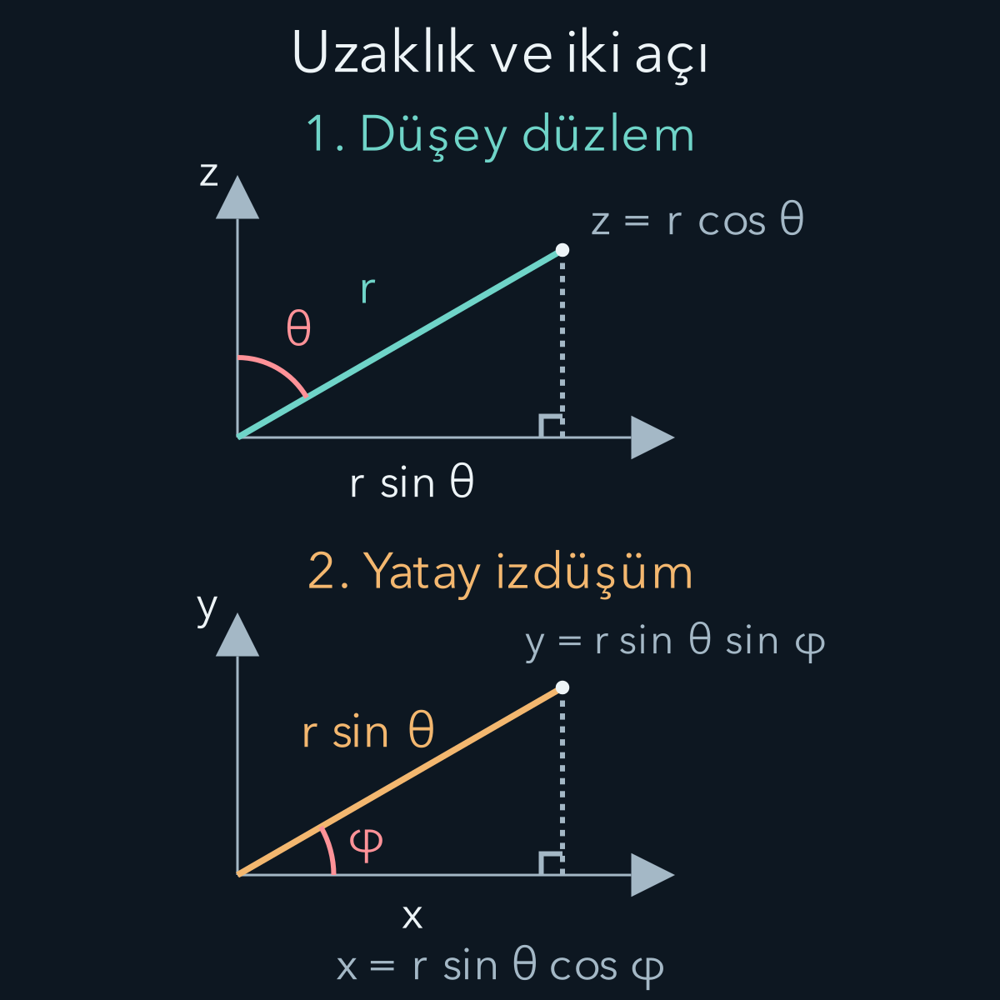
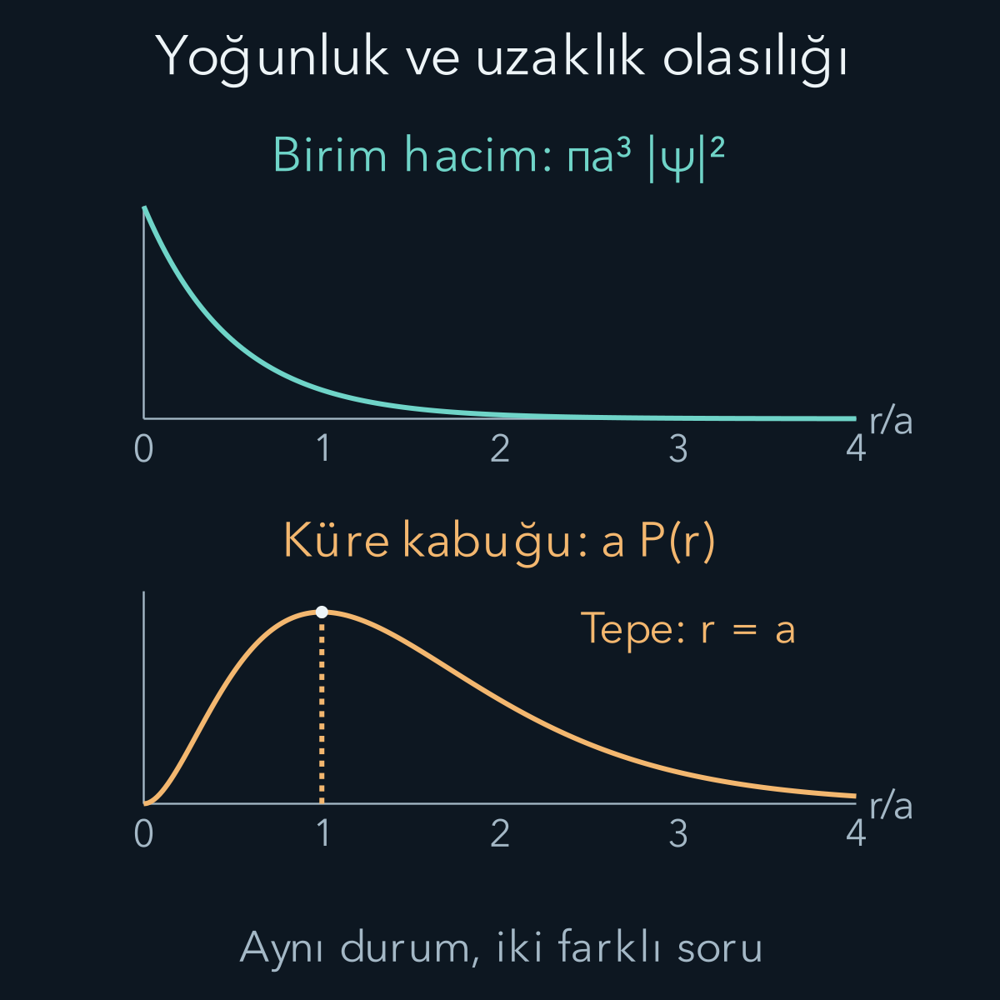

import ArticleVideo from '@/components/ArticleVideo.astro'
import kavram from './media/01-kavram.mp4?url'
import kavramPoster from './media/01-kavram.jpg?url'

Bir elektronun protona bağlanmasını anlatmak için düz bir doğru üzerindeki kuyudan üç boyutlu uzaya geçmemiz gerekir. Etkileşimin şiddeti, seçilen yönden çok elektronla protonun arasındaki uzaklığa bağlıdır. Bu **merkezi potansiyel** yapısı, uzaklığı ve yönü ayrı değişkenlerle ele almamızı sağlar. Enerji düzeyleri, izin verilen uzaysal dalga fonksiyonlarının koşullarından çıkacaktır.

[Bir önceki yazıda açısal momentumu](/blog/kuantumda-acisal-momentum/) kurduk; $L^2$ özdeğerlerinin $\hbar^2l(l+1)$, $L_z$ özdeğerlerinin $\hbar m$ olduğunu gördük. Burada $\hbar=h/(2\pi)$ indirgenmiş Planck sabitidir. [Schrödinger denklemi](/blog/schrodinger-denklemi-ve-olasilik-akimi/), [elektrik potansiyeli](/blog/elektrik-yuku-alan-ve-potansiyel/) ve [normalleştirme](/blog/dalga-fonksiyonu-konum-ve-momentum/) kullanılacak. Küresel koordinatları, hacim elemanını ve radyal fonksiyonun anlamını bu yazıda kuracağız; bunları önceden bilindiği varsayılan kısa yollar olarak kullanmayacağız.

## 1. Önce iki parçacıklı modeli belirtelim

Elektronun kütlesi $m_e$, protonunki $m_p$ olsun. İki konumun farkı $\mathbf r=\mathbf r_e-\mathbf r_p$, aralarındaki uzaklık $r=|\mathbf r|$'dir. Kütle merkezinin serbest hareketini ayırınca iç hareketin kinetik enerjisi **indirgenmiş kütle** ile yazılır:

$$
\mu=\frac{m_em_p}{m_e+m_p},\qquad
\frac1\mu=\frac1{m_e}+\frac1{m_p}.
$$

Bu son eşitliğin anlamını kütle merkezi çerçevesinde görebiliriz. İki parçacığın momentumları eşit büyüklükte ve zıt yöndedir. Ortak büyüklüğe $p$ dersek toplam kinetik enerji $p^2/(2m_e)+p^2/(2m_p)=p^2/(2\mu)$ olur. Böylece protonun sonlu kütlesini, göreli hareket denkleminde tek bir kütleye dahil ederiz.

Hidrojen için yalnız elektrostatik Coulomb etkileşimini alalım:

$$
V(r)=-\frac{C}{r},\qquad
C=\frac{e^2}{4\pi\varepsilon_0}.
$$

$e>0$ temel yük büyüklüğü, $\varepsilon_0$ boşluğun elektriksel geçirgenliğidir. $C$ enerji çarpı uzunluk birimindedir. Potansiyelin sıfırı sonsuz uzaklıkta seçildiğinden bağlı durumların enerjisi negatiftir. Spin etkileşimleri, görelilik düzeltmeleri, protonun sonlu boyutu ve dış alanlar şimdilik bu Hamiltonyende yoktur.

## 2. Küresel koordinatlar bir noktayı nasıl tarif eder?

$r\ge0$ başlangıca uzaklık olsun. $\theta$ açısını pozitif $z$ ekseninden ölçelim; $0\le\theta\le\pi$. $\varphi$ açısı, noktanın $xy$ düzlemindeki izdüşümünün pozitif $x$ ekseniyle yaptığı yön açısıdır; $0\le\varphi<2\pi$. Bu tanımlar bazı kitaplarda farklı harflerle verilebilir; önemli olan hangi açının nereden ölçüldüğüdür.

Düşey bileşen $z=r\cos\theta$, yatay izdüşümün uzunluğu $r\sin\theta$ olur. Bu yatay uzunluğu iki eksene ayırırsak:

$$
\begin{aligned}
x&=r\sin\theta\cos\varphi,\\
y&=r\sin\theta\sin\varphi,\\
z&=r\cos\theta.
\end{aligned}
$$

Örneğin $r=2$, $\theta=60^\circ$, $\varphi=30^\circ$ için aynı uzunluk biriminde $x=3/2$, $y=\sqrt3/2$, $z=1$ çıkar. Kontrol edelim: $x^2+y^2+z^2=9/4+3/4+1=4=r^2$. Açılar radyanla türevlenirken kullanılacak; derece burada yalnız tanıdık bir sayısal örnek içindir.

Şeklin iki paneli okunaklılık için ayrı ölçeklerle çizildi. İlkinde uzaklığı düşey ve yatay parçalara, ikincisinde yatay parçayı x ve y bileşenlerine ayırıyoruz.

Başlangıç noktasında yön açıları tekil görünür; aynı $r=0$ noktasını bütün açılar temsil eder. Bu, fiziksel uzayın orada bozulduğu anlamına gelmez. Koordinat sisteminin bazı noktaları tarif etmek için gereğinden fazla açı bilgisi kullanmasıdır. Fiziksel çözümün başlangıçtaki davranışını ayrıca düzenli seçmemiz gerekir.

## 3. Hacim elemanındaki fazladan çarpanlar

Küçük bir küresel hücrenin radyal kenarı $dr$'dir. Kutupsal açı boyunca yay uzunluğu yaklaşık $r\,d\theta$, azimut boyunca yay uzunluğu yaklaşık $r\sin\theta\,d\varphi$ olur. Bu üç dik küçük uzunluğu çarparız:

$$
\boxed{dV=r^2\sin\theta\,dr\,d\theta\,d\varphi.}
$$

Dolayısıyla üç boyutlu normalleştirme $\int|\psi|^2dV=1$ biçimindedir. $\psi$ birimi uzunluğun eksi üç bölü ikinci kuvvetidir; yoğunluğu $|\psi|^2$ birim hacim başına olasılık verir. Tek boyuttaki $dx$ integralini yalnız $dr$ ile değiştirip açısal ve $r^2$ çarpanlarını atamayız.

Açısal ölçüye $d\Omega=\sin\theta\,d\theta\,d\varphi$ denir. Bütün yönler için integrali $\int d\Omega=(2\pi)(2)=4\pi$ olur. Bu yüzden ince bir tam küre kabuğunun hacmi yaklaşık $4\pi r^2dr$'dir. Uzaklık arttıkça aynı kalınlıktaki kabukta daha fazla hacim vardır; biraz sonra radyal olasılık tepesini belirleyen şey tam bu çarpandır.

## 4. Açısal kısmı ayırmak

Üç boyutlu Hamiltonyen:

$$
H=-\frac{\hbar^2}{2\mu}\nabla^2-\frac Cr
$$

olsun. $\nabla^2$ Laplace işleci, Kartezyen koordinatlarda üç ikinci türevin toplamıdır. Bu işleci yeni koordinatlarda doğrudan ezberlemek yerine, küçük hücredeki değişimlerden kuralım. Bir $f$ fonksiyonunun gradyanı, her yöndeki değişimin gerçek yol uzunluğuna bölünmesiyle bulunur. Az önceki üç kenarı kullanınca gradyanın radyal, kutupsal ve azimut bileşenleri sırasıyla:

$$
\partial_r f,\qquad \frac1r\partial_\theta f,
\qquad \frac1{r\sin\theta}\partial_\varphi f
$$

olur. $\partial_r$ kısaltması, öteki değişkenleri sabit tutarak r'ye göre türev almak demektir. Laplasyen, bu gradyan alanının küçük hücreden net dış akısının hücre hacmine bölünmesidir. Bu nedenle yalnız türevleri değil, karşılıklı yüzlerin alanlarını da hesaba katmalıyız.

Örneğin radyal iki yüzün alanı $r^2\sin\theta\,d\theta\,d\varphi$ ile değişir. Dış yüzdeki akıdan iç yüzdeki akıyı çıkarınca $\partial_r(r^2\partial_r f)\sin\theta\,dr\,d\theta\,d\varphi$ kalır. Hacme bölmek, $r^{-2}\partial_r(r^2\partial_r f)$ sonucunu verir. Kutupsal yüzlerde alan $r\sin\theta\,dr\,d\varphi$, azimut yüzlerinde $r\,dr\,d\theta$'dır. Gradyan bileşenlerini bu alanlarla çarpıp karşılıklı farkları aynı şekilde alırsak:

$$
\begin{aligned}
\nabla^2f={}&\frac1{r^2}\partial_r(r^2\partial_r f)\\
&+\frac1{r^2\sin\theta}
\partial_\theta(\sin\theta\,\partial_\theta f)\\
&+\frac1{r^2\sin^2\theta}\partial_\varphi^2f.
\end{aligned}
$$

Bu hesap, küresel hücrelerin farklı uzaklıklarda farklı büyüklükte olmasının türev işlemini de etkilediğini gösterir. Açıların radyan olması yay uzunluğu ifadelerinde kullanıldı. Eksen üzerindeki görünür payda sıfırları yine koordinat tekilliğidir; düzgün fiziksel fonksiyonun uygun sınırı alınır. Açısal terimleri $L^2$ ile toplarsak yararlı kısa yazım:

$$
\nabla^2=\frac1{r^2}\frac{\partial}{\partial r}
\left(r^2\frac{\partial}{\partial r}\right)
-\frac{L^2}{\hbar^2r^2}
$$

biçimindedir. Bu eşitlik aynı diferansiyel işlecin yeni koordinatlarla yazılmasıdır. İlk kısım uzaklık değişimini, ikinci kısım açısal değişimi taşır. Yukarıdaki son iki satırın toplamı bu nedenle $-L^2f/(\hbar^2r^2)$'dir. Eksi işareti kinetik enerjideki eksiyle birleşerek radyal denklemde pozitif açısal katkı oluşturacaktır.

Merkezi potansiyel hiçbir yönü seçmediğinden enerji özfonksiyonlarını $\psi(r,\theta,\varphi)=R(r)Y_{lm}(\theta,\varphi)$ biçiminde seçebiliriz. $Y_{lm}$, $L^2$ ve $L_z$ ortak açısal özfonksiyonuna verilen **küresel harmonik** adıdır. Bunları $\int|Y_{lm}|^2d\Omega=1$ ile normalleştiririz. Örneğin $Y_{00}=1/\sqrt{4\pi}$ bütün yönlerde sabittir; $Y_{10}=\sqrt{3/(4\pi)}\cos\theta$ ise ekvator düzleminde sıfır olur.

Bu adlandırma yeni bir fizik varsayımı eklemez. Önceki yazının $|l,m\rangle$ durumlarının yön değişkenleriyle gösterimidir. Tam bir durumda farklı $l,m$ değerleri üst üste gelebilir; burada enerji denklemini çözmek için ortak özdurum bazını seçiyoruz.

Ayrılma seçiminin cebirini de görelim. $H(RY)=E(RY)$ içinde radyal türev yalnız R'ye, açısal türev yalnız Y'ye etki eder. $RY$ sıfır olmayan bölgede denklemi bu çarpıma bölüp $r^2$ ile çarpalım. Radyal terimleri bir tarafa alırsak:

$$
\frac{(r^2R')'}R
+\frac{2\mu}{\hbar^2}(Er^2+Cr)
=\frac{L^2Y}{\hbar^2Y}.
$$

Sol taraf yalnız uzaklığa, sağ taraf yalnız yönlere bağlıdır. Eşitliğin bağımsız uzaklık ve açı değişimleri boyunca geçerli olması için her iki taraf aynı sabit olmalıdır. Açısal momentumun düzenli özfonksiyonları bu sabiti $l(l+1)$ seçer. Bölmeyi düğümlerde yapamayız; elde edilen diferansiyel denklem süreklilikle o noktalarda da uygulanır. Böylece simetrinin sağladığı ortak özbaz seçimi, açık bir değişken ayırma hesabına dönüşür.

## 5. Radyal denklem ve başlangıç koşulu

Çarpım biçimini enerji denklemine koyup açısal özdeğeri kullanalım:

$$
-\frac{\hbar^2}{2\mu r^2}(r^2R')'
+V_{\mathrm{etkin}}(r)R=ER,
$$

$$
V_{\mathrm{etkin}}(r)=
\frac{\hbar^2l(l+1)}{2\mu r^2}-\frac Cr.
$$

$u(r)=rR(r)$ tanımı hesabı sadeleştirir. $R=u/r$ olduğundan $r^2R'=ru'-u$, bunun türevi $ru''$ olur. Bütün denklemi $r$ ile çarptığımızda:

$$
\boxed{-\frac{\hbar^2}{2\mu}u''+V_{\mathrm{etkin}}u=Eu.}
$$

Bu, yarı doğru $r>0$ üzerinde bir boyutlu denkleme benzer. Etkin potansiyeldeki pozitif $1/r^2$ katkısına merkezkaç terimi denir; $l=0$ için sıfırdır. Burada klasik bir yörüngeye yerleştirilmiş dış kuvvet eklemiyoruz; açısal türevlerin radyal denkleme katkısını görüyoruz.

Normalleştirme de aynı dönüşümle sadeleşir. Önce çarpımın mutlak karesini hacim elemanına koyalım:

$$
1=\left(\int_0^\infty r^2|R|^2dr\right)
\left(\int |Y_{lm}|^2d\Omega\right).
$$

İkinci parantezi bire eşitlediğimiz için ilk parantez de bir olmalıdır. $r^2|R|^2=|u|^2$ eşitliği artık radyal normu $\int_0^\infty|u|^2dr=1$ yapar. Demek ki normalize açısal çarpanla genel bir ayrılmış durumda radyal yoğunluk $P(r)=r^2|R(r)|^2=|u(r)|^2$'dir. Bütün yönlerde aynı olmayan durumlarda bile açısal integral bu sonucu verir; $4\pi r^2|\psi(r)|^2$ kısa biçimi ise küresel simetrik yoğunluk için kullanılabilir. Birim kontrolünde R uzunluğun eksi üç bölü ikinci, u eksi bir bölü ikinci kuvvetini taşır. Coulomb Hamiltonyeninin fiziksel düzenli çözümünde $u(0)=0$ ve uzakta azalma şartları uygulanır. $u$ ile $R$ aynı fonksiyon değildir: Temel durumda $u(0)=0$ iken $R(0)$ sonlu ve sıfırdan farklıdır. Ayrıca $r$ negatif değerlere uzatılmış bir konum koordinatı değil, iki parçacık arasındaki uzaklıktır.

## 6. Enerjiyi seçen koşul

Bağlı enerji $E<0$ için $\kappa=\sqrt{-2\mu E}/\hbar$ tanımlayalım. Doğal uzunluk ölçeği $a=\hbar^2/(\mu C)$, boyutsuz uzaklık $\rho=2\kappa r$ olsun. Başlangıç yakınındaki düzenli çözüm $u\sim r^{l+1}$, büyük uzaklıktaki azalan çözümün baskın üstel çarpanı $e^{-\kappa r}$ olur. Bu iki davranışı ayırarak:

$$
u(\rho)=\rho^{l+1}e^{-\rho/2}v(\rho)
$$

yazalım. Sabit normalleştirme katsayısı daha sonra belirlenecek. Türevleri yerine koyup ortak çarpanı sadeleştirmek:

$$
\begin{aligned}
\rho v''+(2l+2-\rho)v'\\
+(\lambda-l-1)v=0,
\end{aligned}
\qquad \lambda=\frac1{\kappa a}
$$

denklemini verir. Şimdi $v=\sum_{q=0}^\infty b_q\rho^q$ kuvvet serisini deneyelim. $q$ burada seri teriminin negatif olmayan tam sayı indeksidir. Aynı $\rho$ kuvvetlerinin katsayılarını eşitleyince:

$$
b_{q+1}=\frac{q+l+1-\lambda}{(q+1)(q+2l+2)}b_q
$$

Katsayıları eşleştirmek için önce türevleri açalım: $v'=\sum_{q\ge1}q b_q\rho^{q-1}$, $v''=\sum_{q\ge2}q(q-1)b_q\rho^{q-2}$ yazılır. $\rho v''$ ve $(2l+2)v'$ terimlerinde indeksi bir kaydırınca $\rho^q$ katsayıları sırasıyla $(q+1)q b_{q+1}$ ve $(2l+2)(q+1)b_{q+1}$ olur. Öteki iki terimden $-qb_q$ ile $(\lambda-l-1)b_q$ gelir. Toplam katsayı sıfır olmalıdır:

$$
\begin{aligned}
&(q+1)(q+2l+2)b_{q+1}\\
&\quad +(\lambda-l-1-q)b_q=0.
\end{aligned}
$$

İkinci terimi sağa geçirip $b_{q+1}$'in katsayısına böldüğümüzde yukarıdaki bağıntı bulunur. Böylece bir katsayıdan ötekini hesaplayabiliriz. Büyük $q$ için oran yaklaşık $1/q$ olur; sonlanmayan düzenli seri, uzakta üstel büyüyen davranış üretir ve baştaki azalma çarpanına rağmen norm bozulur. Kabul edilen bağlı çözümlerde seri bir polinomda durmalıdır.

En yüksek derece $N\ge0$ olsun. $b_{N+1}=0$ için payın sıfırlanması gerekir: $\lambda=N+l+1$. Bu pozitif tam sayıya $n$ diyelim. Böylece $n=N+l+1$, $\kappa=1/(na)$ ve:

$$
\boxed{E_n=-\frac{\hbar^2}{2\mu a^2n^2}.}
$$

$$
E_n=-\frac{\mu C^2}{2\hbar^2n^2}.
$$

Enerji değerleri önceden eklenen bir yörünge kuralından gelmedi; düzenlilik ve normalleştirme çözümü seçti. Sonlanan polinomlar ilgili Laguerre polinomları olarak adlandırılır. Bu adı bilmek formülün neden kesikli enerji verdiğini anlamanın önkoşulu değildir; burada katsayı bağıntısı aynı seçimi açıkça gösterdi.

Seri koşulunu küçük bir örnekte deneyelim. $n=2,l=0$ için $\lambda=2$'dir. İlk katsayı bağıntısı $b_1=(1-2)b_0/2=-b_0/2$ verir. Bir sonraki adımda pay $1+0+1-2=0$ olduğundan $b_2=0$ olur; bütün daha yüksek katsayılar da sıfırdır. Polinom $v=b_0(1-\rho/2)$ biçimindedir. Bu durumda $\rho=r/a$ olduğu için radyal çözümde $1-r/(2a)$ çarpanı belirir. Biraz sonra göreceğimiz 2s düğümü bu çarpanın sıfırından gelir.

$n=2,l=1$ seçersek ilk adımın payı zaten $0+1+1-2=0$ olur ve polinom sabit kalır. Buna karşılık başta ayırdığımız $\rho^{l+1}$ çarpanı artık $\rho^2$'dir. $u$'yu $r$'ye bölerek $R$'ye döndüğümüzde $r e^{-r/(2a)}$ davranışı elde edilir. Aynı $n$ aynı enerjiyi verirken iki farklı $l$ için radyal biçimlerin farklı oluşunu yalnız bu iki kısa katsayı hesabından bile görebiliriz. Normalleştirme her biçimin sabit katsayısını ayrıca belirler.

## 7. n, l ve m sayılarının farklı işleri

$n$ baş kuantum sayısıdır ve $1,2,3,\ldots$ değerlerini alır. $N=n-l-1\ge0$ olduğundan $l=0,1,\ldots,n-1$ olur. Her $l$ için $m=-l,-l+1,\ldots,l$ değerleri vardır. $n$ bu ideal modelde enerjiyi, $l$ açısal momentumun karesini, $m$ seçilen bileşeni belirler.

$l=0,1,2,3$ durumlarına sırasıyla s, p, d, f harfleriyle de ad verilir. Örneğin 2p, $n=2,l=1$ demektir; tek başına hangi $m$ değerinin seçildiğini söylemez. 1p diye bir durum yoktur, çünkü $n=1$ için $l$ yalnız sıfır olabilir. Bir sembol listesini ezberlemek yerine sayılar arasındaki koşulu kullanmak hataları önler.

Sabit $n$ için uzaysal durum sayısı:

$$
\sum_{l=0}^{n-1}(2l+1)=n^2
$$

olur. Örneğin $n=3$ için $1+3+5=9$ farklı uzaysal durum aynı enerjiye sahiptir. Aynı enerjiye sahip bağımsız durumlara dejenerasyon diyoruz. Spin bağımsız biçimde dahil edilip onun iki yönelimi de aynı enerjide tutulursa sayı $2n^2$ olur. Buradaki sayma, bir atomda aynı anda bu kadar elektron bulunduğu iddiası değildir; tek parçacık durumlarının sayısıdır.

Merkezi potansiyelin dönme simetrisi farklı $m$ değerlerinin aynı enerjiye sahip olmasını açıklar. Farklı $l$ değerlerinin de yalnız $n$'ye bağlı aynı enerjiyi vermesi Coulomb potansiyelinin ek özel yapısıdır. Her merkezi potansiyelde bu daha büyük dejenerasyonu bekleyemeyiz.

## 8. Temel durumun normunu ve boyutunu bulmak

$n=1,l=0$ için polinom sabittir ve:

$$
\psi_{100}(r)=\frac{1}{\sqrt{\pi a^3}}e^{-r/a}
$$

elde edilir. Bütün yönlerde aynı değerdedir; fakat uzaklığa göre azalır. Normu kontrol edelim:

$$
\int|\psi|^2dV=\frac4{a^3}\int_0^\infty r^2e^{-2r/a}dr=1.
$$

Son integral $2!/(2/a)^3=a^3/4$'tür. Genel $\int_0^\infty r^k e^{-br}dr=k!/b^{k+1}$ sonucu pozitif $b$ ve tam sayı $k\ge0$ için parçalı integrasyonun tekrarıyla bulunur. Böylece kullanılan normalleştirme katsayısını bağımsız kontrol etmiş oluruz.

Protonu sonsuz ağır kabul edersek $\mu\to m_e$ ve $a$ alışılmış Bohr yarıçapı $a_0\approx0{,}0529\,\mathrm{nm}$ olur. Sonlu proton kütlesi kullanıldığında $a$ biraz daha büyüktür. Enerji ölçeği yaklaşık $13{,}6\,\mathrm{eV}$'dir; dolayısıyla $E_1\approx-13{,}6\,\mathrm{eV}$ ve $E_2\approx-3{,}40\,\mathrm{eV}$ bulunur. Bu yuvarlatılmış değerler küçük düzeltmeleri ayırt edecek hassasiyette değildir.

Temel çözümün enerji denklemine uyduğunu da doğrudan sınayabiliriz. Yalnız r'ye bağlı bir fonksiyon için Laplasyen $\psi''+2\psi'/r$ olur. Üstel fonksiyonun türevleri $\psi'=-\psi/a$ ve $\psi''=\psi/a^2$'dir. Bu yüzden Hamiltonyenin uygulanışı:

$$
\begin{aligned}
H\psi={}&-\frac{\hbar^2}{2\mu a^2}\psi\\
&+\frac1r\left(\frac{\hbar^2}{\mu a}-C\right)\psi.
\end{aligned}
$$

sonucunu verir. a'nın tanımı sayesinde parantezdeki uzaklığa bağlı katsayı sıfırlanır. Geriye yalnız E'nin temel durum değeri kalır. Bu kontrol, hem üstel azalma uzunluğunu hem de enerji işaretini birbirine bağlar. İki büyüklüğü birbirinden bağımsız seçerseydik aynı dalga fonksiyonu her uzaklıkta enerji denklemini sağlayamazdı.

Böyle bir durağan durumun tam zaman bağımlılığı ortak bir fazdır. Bu faz yoğunluğun mutlak karesini değiştirmez; dolayısıyla ölçüm dağılımı zamanla sabit kalır. Sabit yoğunluğu, elektronun kesin bir noktada beklemesi olarak yorumlamayız. Aynı hazırlanışı tekrar edip konumu ölçtüğümüzde farklı sonuçlar elde edebiliriz; sabit olan bu sonuçların olasılık yasasıdır. Atomun üç boyutlu çizimini yorumlarken bu farkı korumak gerekir.

## 9. Merkezde yoğunluk büyükken en olası uzaklık neden sıfır değil?

Birim hacim başına yoğunluk $|\psi_{100}|^2=e^{-2r/a}/(\pi a^3)$ merkezde en büyüktür. Fakat $r$ ile $r+dr$ arasında bulunma olasılığı bütün küre kabuğunu kapsar. **Radyal olasılık yoğunluğu**:

$$
\begin{aligned}
P(r)&=4\pi r^2|\psi_{100}(r)|^2\\
&=\frac{4r^2}{a^3}e^{-2r/a}.
\end{aligned}
$$

olur. $P(r)dr$ boyutsuz olasılıktır; $P$ birimi uzunluğun tersidir. $P(0)=0$ çıkar, çünkü merkezdeki sonsuz ince kabuğun hacmi sıfıra gider. Belirli tek bir noktanın olasılığı zaten sürekli dağılımda sıfırdır; sonlu bir hacim veya uzaklık aralığı hakkında olasılık hesaplarız.

$P$'nin türevi $P'(r)=(8r/a^3)e^{-2r/a}(1-r/a)$ olur. Pozitif uzaklıktaki maksimum $r=a$'dadır. Ortalama uzaklık ise $\langle r\rangle=\int rP(r)dr=3a/2$ çıkar. En olası uzaklık, ortalama uzaklık ve yoğunluğun maksimum noktası birbirinden farklı kavramlardır.

Somut bir bölge olasılığı için $0<r<a$ aralığını alalım. $s=r/a$ değişkeniyle integral $4\int_0^1s^2e^{-2s}ds$ olur. Bir asal fonksiyon $-e^{-2s}(2s^2+2s+1)$ olduğundan:

$$
\Pr(r<a)=1-5e^{-2}\approx0{,}3233.
$$

Yani yaklaşık yüzde $32{,}33$ olasılıkla bu yarıçapın içinde ölçeriz. $a$ en olası uzaklık olsa da durumun bütün olasılığı bu yüzeyde toplanmaz. Bohr yarıçapını kesin bir elektron yörüngesi gibi çizmek bu dağılımı kaybeder.

<ArticleVideo src={kavram} poster={kavramPoster} title="Küre kabuklarını toplayarak olasılık bulmak" caption="Üstteki daire, bir küre kabuğunun merkezden geçen kesitidir. Yarıçap büyürken alttaki radyal yoğunluk grafiğinde aynı uzaklığa kadar alan birikir. Yarıçap bir a olduğunda toplam yaklaşık 0,323'tür. Daire bir elektron yörüngesi, hareket de elektronun izlediği yol değildir." />

## 10. Düğümler, enerji farkları ve modelin sınırı

Uyarılmış durumlarda dalga fonksiyonunun sıfır olduğu yüzeyler bulunabilir. 2s durumunun radyal çarpanı $(2-r/a)e^{-r/(2a)}$ biçimindedir; $r=2a$ küresinde sıfır olur. 2p durumunun radyal kısmında pozitif uzaklıkta böyle bir düğüm yoktur, fakat $m=0$ açısal çarpanı $\cos\theta$ nedeniyle ekvator düzlemi düğümdür. Bir düğüm eğrinin küçük görünmesi değil, genliğin tam sıfır olmasıdır.

İdeal Coulomb özdurumlarında pozitif uzaklıktaki radyal düğüm sayısı $n-l-1$'dir. Açısal yapı farklı olduğu için aynı enerjiye sahip durumların uzaysal dağılımları farklı olabilir. Orbital çizimleri bu dağılımın belirli kesitlerini veya seçilmiş eş yoğunluk yüzeylerini gösterir; atomun sert sınırı değildir.

$2\to1$ enerji farkı yaklaşık $(-3{,}40)-(-13{,}6)=10{,}2\,\mathrm{eV}$ olur. Uygun bir ışımalı geçişte foton bu enerjiyi taşır; $hc\approx1240\,\mathrm{eV\,nm}$ ile dalga boyu yaklaşık $121{,}6\,\mathrm{nm}$ bulunur. Enerji farkını bilmek tek başına geçişin hangi etkileşimle izinli olduğunu söylemez. [Parite seçim kuralında](/blog/kuantumda-simetri-ve-parite/) gördüğümüz gibi bağlaşım matris elemanı da gerekir.

Bu model hidrojenin temel yapısını açıklar; bütün tayf ayrıntılarını değil. Görelilik, spinle yörünge etkileşimi ve elektromanyetik alanın kuantum düzeltmeleri bazı dejenerasyonları kaldırır. Çok elektronlu atomlarda elektronların birbirlerini itmesi de eklenir; tek elektronun Coulomb sonucu her elektrona bağımsız uygulanarak tam çözüm elde edilmez. Burada elde edilen enerji ve olasılıklar, belirtilen iki parçacıklı göreli olmayan Coulomb modelinin sonuçlarıdır.

## Kaynaklar

Radyal denklem, kuvvet serisi ve enerji koşulu [MIT OCW, Quantum Physics I: Lectures 21 and 22, Hydrogen Atom](https://ocw.mit.edu/courses/8-04-quantum-physics-i-spring-2016/e34ceed6a6ec944a3c761fcbbf48be5f_MIT8_04S16_LecNotes22.pdf) ile; küresel koordinatlar, kuantum sayıları ve temel durum [OpenStax, The Hydrogen Atom](https://openstax.org/books/university-physics-volume-3/pages/8-1-the-hydrogen-atom) ile karşılaştırıldı. Kullanılan semboller, ara hesaplar, örnek bölge olasılığı ve Manim çizimleri bu yazı için düzenlenmiştir.

Kaynak bağlantıları ve ilgili bölümler 12 Ekim 2026 tarihinde doğrudan kontrol edildi.
