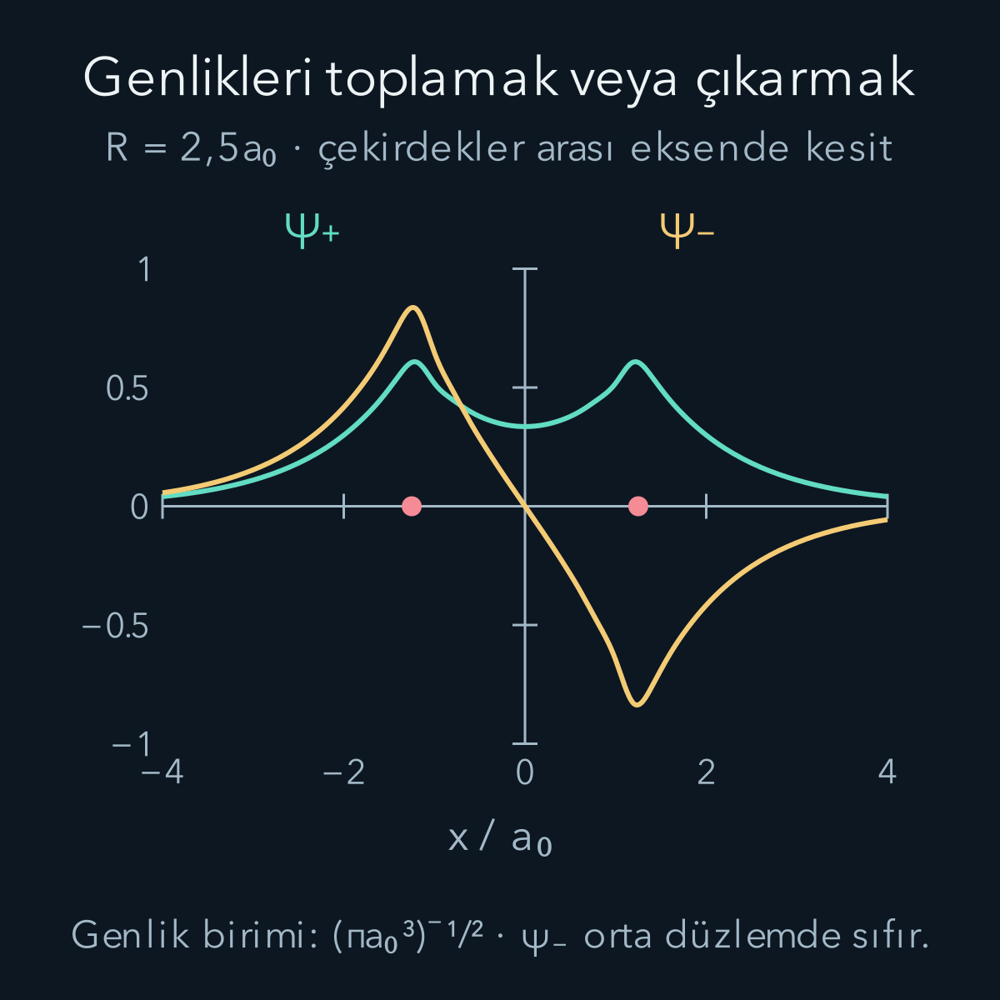
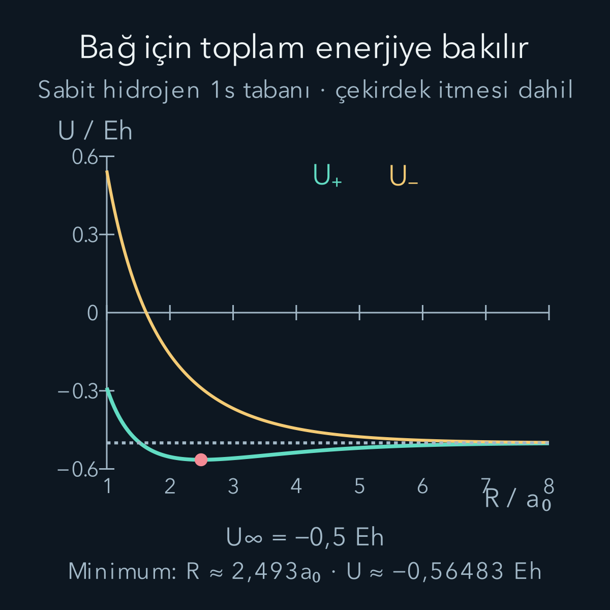

import ArticleVideo from '@/components/ArticleVideo.astro'
import kavram from './media/01-kavram.mp4?url'
import kavramPoster from './media/01-kavram.jpg?url'

İki pozitif çekirdeği yaklaştırdığımızda birbirlerini iterler. Buna rağmen aralarına bir elektron koymak bağlı bir sistem oluşturabilir. Elektron, iki çekirdeğe sırayla tutunan küçük bir bilye gibi davranmaz; tek bir kuantum durumunun genliği iki merkeze birden yayılabilir. Bağlanmanın koşulu, bu ortak durumun **toplam** enerjisinin ayrılmış parçaların enerjisinden düşük olmasıdır.

[Çok elektronlu atomlarda](/blog/cok-elektronlu-atomlar-ve-periyodik-tablo/) orbitalin bütün ortak durum olmadığını gördük. Burada en sade molekül olan $\mathrm H_2^+$ iyonunu, iki proton ve tek elektronla inceleyeceğiz. [Hidrojenin 1s orbitali](/blog/merkezi-potansiyel-ve-hidrojen-atomi/), [varyasyon ilkesi](/blog/varyasyon-yontemi/) ve [matris özdeğerleri](/blog/ozdegerler-ozvektorler-ve-kosegenlestirme/) ön bilgilerimizdir. Yeni güçlük, elektronla birlikte çekirdeklerin de hareket edebilmesidir.

## 1. Önce hızlı ve yavaş hareketi ayırmak

Elektron kütlesi $m_e$, proton kütlesi $m_p$ olsun; $m_p/m_e\approx1836$'dır. Aynı kuvvet altında ağır parçacık daha küçük ivme kazanır. Bu, elektron durumunun çekirdek geometrisindeki değişime birçok koşulda daha hızlı uyum sağlayabileceğini düşündürür. Ancak elektronları belirli bir yörüngede dönen cisimler saymıyoruz; karşılaştırdığımız şey kuantum durumlarının değişim zamanlarıdır.

Bütün elektron koordinatlarını r, bütün çekirdek koordinatlarını R ile topluca gösterelim. Tam Hamiltonyen:

$$
H=T_N+H_e(\mathbf R)+V_{NN}(\mathbf R).
$$

$T_N$ çekirdek kinetik enerjisi, $H_e$ elektron kinetiği ile elektron–çekirdek ve varsa elektron–elektron etkileşimleri, $V_{NN}$ çekirdekler arası itmedir. Önce R'yi sabit bir parametre kabul edip:

$$
H_e(\mathbf R)\psi_n(\mathbf r;\mathbf R)
=E_n^{e}(\mathbf R)\psi_n(\mathbf r;\mathbf R)
$$

elektronik denklemini çözeriz. Noktalı virgül, çekirdek geometrisinin burada değişken olarak türevlenecek koordinattan çok bir parametre gibi ele alındığını hatırlatır. Her geometri farklı elektronik enerji verir. Ardından çekirdeklerin üzerinde hareket edeceği enerji yüzeyi:

$$
U_n(\mathbf R)=E_n^e(\mathbf R)+V_{NN}(\mathbf R)
$$

olur. İki atomlu molekülde yönelimden bağımsız temel enerji için geometri çoğunlukla çekirdekler arası tek uzaklık R ile ifade edilir; yüzey yerine bir eğri çizeriz.

## 2. Born–Oppenheimer hangi terimleri ihmal eder?

Toplam fonksiyonu yaklaşık $\Psi(\mathbf r,\mathbf R)=\psi_n(\mathbf r;\mathbf R)\chi_n(\mathbf R)$ biçiminde yazmak isteriz. $\chi_n$ çekirdek hareketinin dalga fonksiyonudur. Fakat $T_N$ bu çarpıma uygulanınca yalnız $\chi_n$'nin türevleri çıkmaz; elektronik fonksiyon da R'ye bağlıdır. Bir çekirdek koordinatı için:

$$
\begin{aligned}
\nabla_R^2(\psi\chi)
={}&\psi\nabla_R^2\chi\\
&+2(\nabla_R\psi)\cdot(\nabla_R\chi)\\
&+\chi\nabla_R^2\psi.
\end{aligned}
$$

İlk terim beklediğimiz çekirdek hareketini, diğerleri elektronik ve çekirdek hareketinin bağlaşmasını gösterir. En sade Born–Oppenheimer yaklaşımında uygun biçimde küçük olan bu bağlaşmaları ihmal ederiz. Böylece çekirdek denklemi $[T_N+U_n]\chi_n\approx E\chi_n$ olur. Daha hassas hesaplarda köşegen düzeltmeler ve farklı elektronik durumlar arasındaki bağlaşmalar geri eklenir.

Elektronik enerji aralığı $\Delta E$ için doğal yanıt zamanı kabaca $\tau_e\sim\hbar/\Delta E$'dir. Çekirdek titreşim frekansı $\omega_N\sim\sqrt{k/M}$, zaman ölçeği $1/\omega_N$ olur; k enerji eğrisinin eğriliği, M uygun çekirdek indirgenmiş kütlesidir. Benzer bağ uzunluğu ve elektronik enerji ölçeklerinde titreşim enerjisi elektronik enerjiden yaklaşık $\sqrt{m_e/M}$ çarpanı kadar küçük olabilir. Proton kütlesiyle bu oran yaklaşık $0{,}023$'tür; bu bir ölçek kestirimidir, her molekül için ölçülmüş oran değildir.

Büyük kütle farkı tek başına yeterli değildir. İki elektronik yüzey çok yaklaşırsa $\Delta E$ küçülür; çekirdek yavaş hareket etse bile bir yüzeyden diğerine geçiş önemli olabilir. Kaçınılan kesişmeler, çok atomlu moleküllerde konik kesişmeler veya hızlı çarpışmalar, tek yüzey yaklaşımının sınırlarıdır. [MIT'nin Born–Oppenheimer ders notları](https://ocw.mit.edu/courses/5-80-small-molecule-spectroscopy-and-dynamics-fall-2008/324ac306fb7640d1eacc5139b6a7d771_08_580ln_576.pdf), ihmal edilen türevleri ve enerji aralıklarının rolünü ayrıntılı olarak ele alır.

## 3. İki proton, tek elektron

İki protonu A ve B noktalarına sabitleyelim. Aralarındaki fiziksel uzaklık R, elektronun onlara uzaklıkları $r_A,r_B$ olsun. Bohr yarıçapı $a_0=0{,}52918$ ångström, Hartree enerjisi $E_h=27{,}2114$ eV ile boyutsuz uzaklığı $\rho=R/a_0$ olarak tanımlayalım. Aşağıdaki integrallerde elektron koordinatları da $a_0$ cinsindendir.

Elektronik Hamiltonyenin boyutsuz biçimi:

$$
h=\frac{H_e}{E_h}
=-\frac12\nabla^2-\frac1{r_A}-\frac1{r_B}.
$$

Bu, görelilik dışı Coulomb modelidir; küçük manyetik ve ışınımsal düzeltmeleri içermiyoruz. Burada elektron–elektron itmesi yoktur; sistemde yalnız bir elektron vardır. Protonların birbirini itmesi ise boyutsuz $1/\rho$ enerjisidir. Onu elektronik çözümden sonra **bir kez** ekleyeceğiz.

Ayrılma eşiği, bir temel durum hidrojen atomu ve çok uzaktaki protondur. Bu son durumun enerjisi $-E_h/2$'dir. Bağlanmayı sıfır enerjiyle değil, aynı parçacıkları içeren bu eşikle karşılaştırmalıyız. Negatif enerji, elektronun bütünüyle serbest durumundan düşük olmak demektir; molekülün ayrılmış hidrojen ve protondan daha kararlı olduğunu tek başına göstermez.

## 4. İki atomik orbitalden iki birleşim

A ve B merkezlerine yerleşmiş normalize hidrojen 1s orbitalleri:

$$
\phi_A=\pi^{-1/2}e^{-r_A},
\qquad
\phi_B=\pi^{-1/2}e^{-r_B}
$$

olsun. Sabit hidrojen genişliğini kullanıyoruz; orbitallerin şekillerini ayrıca eniyilemeyeceğiz. Elektronik denemeyi $\psi=c_A\phi_A+c_B\phi_B$ olarak kurmak, atomik orbitallerin doğrusal birleşimi yaklaşımıdır.

İki merkez eşdeğer olduğu için simetriye uygun seçenekler toplam ve farktır. Fakat orbitaller farklı merkezlerde diye ortogonal olmaz. Örtüşme integrali:

$$
S(\rho)=\langle\phi_A|\phi_B\rangle
=\int\phi_A\phi_B\,d^3r
$$

pozitiftir. Orbitalleri gerçek seçtik. Toplamın norm karesi $1+1+2S$, farkınki $1+1-2S$ olduğundan:

$$
\psi_\pm=
\frac{\phi_A\pm\phi_B}{\sqrt{2(1\pm S)}}.
$$

$\rho>0$ için iki merkez farklıdır ve $S<1$ olur. Merkezler tam çakıştığında fark fonksiyonu sıfıra gider; yazdığımız normalizasyonu doğrudan o tek noktaya koyamayız. Moleküler bağ minimumumuz bu sınırdan uzaktadır.

## 5. Girişim yoğunluğu nerede değiştirir?

Genliği karesine alırsak:

$$
|\psi_\pm|^2=
\frac{\phi_A^2+\phi_B^2\pm2\phi_A\phi_B}
{2(1\pm S)}.
$$

Artı birleşimde iki merkezin arasındaki genlikler aynı işaretle toplanır. Eksi birleşimde orta düzlemde $r_A=r_B$ olduğu için tam iptal olur. Bu düğüm düzleminde elektron bulunma yoğunluğu sıfırdır. Renk veya işaret, elektronun yükünün artı ve eksi oluşunu göstermez; iki durumda da aynı negatif yüklü elektron vardır.

Genliklerin toplanmasını “elektron sayısı arttı” diye okumamak gerekir. İki fonksiyon da normalize edilmiştir ve ikisinde de tek elektron vardır. Yoğunluk yalnız yeniden dağılır. Ayrıca bağın nedeni yalnız orta noktadaki yüksek yoğunluk değildir: Kinetik enerji, iki çekirdeğin çekimi ve çekirdeklerin itmesi birlikte değerlendirilir. Özellikle düğüm oluşması dalga fonksiyonunun uzaysal değişimini, dolayısıyla kinetik enerjiyi etkiler.

## 6. Örtüşmeyi gerçekten hesaplamak

İki merkezli integraller için uzatılmış küresel koordinatlar kullanışlıdır. Boyutsuz uzaklıklarla:

$$
\mu=\frac{r_A+r_B}{\rho},\qquad
\nu=\frac{r_A-r_B}{\rho}.
$$

Üçgen eşitsizliği $1\le\mu<\infty$ ve $-1\le\nu\le1$ sınırlarını verir. Üçüncü değişken çekirdek ekseni çevresindeki $0\le\varphi<2\pi$ açısıdır. Hacim elemanı:

$$
d^3r=\frac{\rho^3}{8}(\mu^2-\nu^2)
\,d\mu\,d\nu\,d\varphi.
$$

Bu koordinat değişiminin geometrik katsayısı, iki merkeze uzaklıkların birlikte değişmesini hesaba katar. $\phi_A\phi_B=\pi^{-1}e^{-\rho\mu}$ olduğundan açı integrali $2\pi$ verir; 1/π ile sadeleşince:

$$
\begin{aligned}
I_\nu(\mu)&=\int_{-1}^{1}(\mu^2-\nu^2)d\nu,\\
S&=\frac{\rho^3}{4}\int_1^\infty e^{-\rho\mu}I_\nu(\mu)d\mu\\
&=\frac{\rho^3}{2}\int_1^\infty
 e^{-\rho\mu}\left(\mu^2-\frac13\right)d\mu.
\end{aligned}
$$

İç integralde $\int_{-1}^1d\nu=2$, $\int_{-1}^1\nu^2d\nu=2/3$ kullandık. Kalan integral iki kez kısmi integrasyonla:

$$
\boxed{S=e^{-\rho}\left(1+\rho+\frac{\rho^2}{3}\right)}
$$

olur. S boyutsuzdur, uzaklık büyüdükçe sıfıra gider. Böylece birbirinden çok uzak orbitaller için alışılmış $1/\sqrt2$ katsayısı geri gelir.

## 7. Enerji matrisinde örtüşmenin rolü

Boyutsuz matris elemanlarını $h_{AA}=\langle A|h|A\rangle$, $h_{AB}=\langle A|h|B\rangle$ diye tanımlayalım. Simetriden $h_{BB}=h_{AA}$ ve gerçek orbitallerle $h_{BA}=h_{AB}$ olur. Özdeğer denklemi sıradan birim matris yerine örtüşme matrisi içerir:

$$
\mathbf H=\begin{pmatrix}h_{AA}&h_{AB}\\h_{AB}&h_{AA}\end{pmatrix},
\qquad
\mathbf S=\begin{pmatrix}1&S\\S&1\end{pmatrix}.
$$

Katsayıları $\mathbf c=(c_A,c_B)^T$ sütununda toplarsak denklem:

$$
\mathbf H\mathbf c=\epsilon\mathbf S\mathbf c.
$$

$\epsilon=E_e/E_h$ elektronik enerji oranıdır. $c_B=\pm c_A$ koyarsak:

$$
\epsilon_\pm=\frac{h_{AA}\pm h_{AB}}{1\pm S}.
$$

Paydadaki S'yi unutmak, normalize olmayan bir durumun enerjisini hesaplamak anlamına gelir. Aynı ihmal hem durumun olasılık yorumunu hem enerji minimumunu bozar.

Hidrojen orbitaline kendi tek merkezli Hamiltonyeni uygulandığında $-\phi/2$ çıkar. Bu bilgiyle gerekli iki yeni integrali tanımlayalım:

$$
C=\left\langle A\left|\frac1{r_B}\right|A\right\rangle,
\qquad
K=\left\langle A\left|\frac1{r_A}\right|B\right\rangle.
$$

Böylece $h_{AA}=-1/2-C$ ve $h_{AB}=-S/2-K$ elde edilir. Buradaki K tek elektronlu iki merkez integralidir; helyumdaki iki elektronun değiş tokuş integralinin aynısı değildir. Aynı harfin farklı bağlamlarda kullanılabildiğini açık tutmak gerekir.

## 8. Kalan integraller ve sayısal örnek

A merkezli küresel yoğunluğun B'deki $1/r_B$ ortalaması, küresel kabukların açısal ortalamasıyla:

$$
\begin{aligned}
C&=\frac4\rho\int_0^\rho r^2e^{-2r}dr
+4\int_\rho^\infty re^{-2r}dr\\
&=\frac{1-(1+\rho)e^{-2\rho}}\rho
\end{aligned}
$$

olur. İlk integral B'ye göre içteki kabukları, ikincisi dıştaki kabukları toplar. K için aynı iki merkezli koordinatlarda $r_A=\rho(\mu+\nu)/2$ kullanırız. Hacim çarpanındaki $(\mu^2-\nu^2)/(\mu+\nu)$ ifadesi $\mu-\nu$ olur. ν'ya göre tek terim integralde silinir:

$$
K=\rho^2\int_1^\infty\mu e^{-\rho\mu}d\mu
=(1+\rho)e^{-\rho}.
$$

Sonuç olarak elektronik ve toplam enerjiler:

$$
\epsilon_\pm=-\frac12-\frac{C\pm K}{1\pm S},
$$

$$
\boxed{\frac{U_\pm}{E_h}
=-\frac12-\frac{C\pm K}{1\pm S}+\frac1\rho.}
$$

Bu iki orbital modelinin üniversite düzeyindeki kurulumu [Fitzpatrick'in moleküller ders notlarında](https://farside.ph.utexas.edu/teaching/362k/09_Molecules.pdf) incelenebilir. Burada bütün sayıları aynı sabit 1s tabanıyla üretiyoruz.

$\rho=2{,}5$ için ara değerler $S\approx0{,}458308$, $C\approx0{,}390567$, $K\approx0{,}287297$ olur. Artı durumun elektronik enerjisi:

$$
\begin{aligned}
\epsilon_+&=-0{,}5-
\frac{0{,}390567+0{,}287297}{1+0{,}458308}\\
&\approx-0{,}964829.
\end{aligned}
$$

Çekirdek itmesi $1/2{,}5=0{,}4$ Hartree'dir; toplam $U_+/E_h\approx-0{,}564829$ çıkar. Bu, ayrılma eşiği $-0{,}5$'ten düşüktür. Eksi durum için aynı işlem $U_-/E_h\approx-0{,}290642$ verir; bu uzaklıkta eşikten yüksektir. Elektronik enerjiyi tek başına karşılaştırmış olsaydık protonları yaklaştırmanın bedelini unutmuş olurduk.

## 9. Enerji minimumundan bağ uzaklığına

$U_+(R)$ eğrisini çeşitli uzaklıklarda hesapladığımızda bir minimum bulunur. Bu deneme ailesinde sayısal minimizasyon:

$$
\begin{aligned}
R_*&\approx2{,}49283a_0\approx1{,}31915\ \text{Å},\\
U_+(R_*)&\approx-0{,}564831E_h
\end{aligned}
$$

verir. Bu bir model sonucudur; gerçek molekülün hassas denge uzaklığı diye sunulmamalıdır. Hidrojen orbitallerinin genişliğini sabitlemiş olmamız, elektronun bağ ortamında yeniden şekillenmesini kısıtlar. Daha esnek elektronik hesaplar minimumu değiştirir.

Kuyunun tabanından ayrılma eşiğine gereken enerjiye burada $D_e$ diyelim:

$$
\begin{aligned}
D_e&=-\frac12E_h-U_+(R_*)\\
&\approx0{,}064831E_h\\
&\approx1{,}76414\ \mathrm{eV}.
\end{aligned}
$$

$D_e$'yi pozitif bağ çözme enerjisi olarak tanımladık. Bazı kaynaklar bağlanma enerjisini ters işaretle, molekül enerjisi eksi ayrılma enerjisi olarak verir; sayıları karşılaştırırken tanımı kontrol etmek gerekir.

<ArticleVideo src={kavram} poster={kavramPoster} title="Hidrojen molekül iyonunun enerji minimumu" caption="Çekirdek uzaklığı değişirken aynı sabit 1s deneme modelinin toplam enerjisi izleniyor. Hareket, gerçek bir titreşim çözümü değil enerji eğrisini tarayan bir gösterimdir; aradaki çizgi bağ şemasıdır." />

Varyasyon ilkesinin hangi enerjiye uygulandığını burada da dikkatle ayıralım. Her sabit R için deneme elektronik enerjisi, o geometrideki tam elektronik temel enerjiye üst sınırdır. Aynı pozitif çekirdek itmesini iki tarafa eklemek, toplam sabit çekirdek enerjisi için de üst sınırı korur. Fakat tahmini eğrinin minimumunun konumu için böyle tek yönlü bir hata garantisi yoktur: Yaklaşık denge uzaklığı gerçek uzaklıktan büyük de küçük de çıkabilir.

Ayrılma eşiğinin altında bir elektronik minimum bulmak, çekirdeklerin de kuantum hareketi hesaba katıldığında bütün bağlanma sorularını kendiliğinden çözmez. Çok sığ veya çok dar bir çekici bölge, çekirdek kinetik enerjisi nedeniyle beklenen bağlı titreşim durumunu taşımayabilir. Burada hesapladığımız kuyunun enerji kazancını gösteriyoruz; tam moleküler özdurum için çekirdek denklemini de çözmek gerekir. Bu ayrım özellikle zayıf bağlı sistemlerde belirleyicidir.

Enerji eğrisini fiziksel bir yaklaşma öyküsüyle de karıştırmamalıyız. İki serbest parçanın çarpışıp kararlı molekülde kalabilmesi için enerji ve momentum korunmalıdır; fazla enerjinin ışınım, üçüncü parçacık veya başka bir kanal üzerinden uzaklaşması gerekebilir. Bir bağlı düzeyin varlığı, her düşük enerjili çarpışmanın o düzeyde sonlanacağını söylemez.

## 10. Çekirdekler minimumda tamamen durmaz

$U'(R_*)=0$ koşulu ortalama kuvvetin sıfır olduğu klasik dengeyi işaretler; $U''(R_*)>0$ küçük sapmalarda geri çağırıcı davranış verir. Fakat kuantum çekirdek durumu, tek bir R noktasına sonsuz kesinlikle sıkışamaz. Minimum çevresinde:

$$
\begin{aligned}
U(R)&\approx U(R_*)+\frac12k(R-R_*)^2,\\
k&=U''(R_*).
\end{aligned}
$$

yazarsak bir titreşim osilatörü elde ederiz. Eşit iki protonun göreli hareketindeki indirgenmiş kütle $\mu_N=m_p/2$ ve açısal titreşim frekansı $\omega=\sqrt{k/\mu_N}$ olur. Burada türev fiziksel R'ye göredir; k'nın birimi enerji/uzunluk karesidir. Boyutsuz eğrinin ikinci türevini kullanırsak onu $E_h/a_0^2$ ile çarpmalıyız.

Titreşim temel enerjisi harmonik yaklaşımda minimumun yaklaşık $\hbar\omega/2$ üstündedir. Gerçek titreşim temel düzeyinden ayrılma için gereken $D_0$, bu nedenle kuyunun derinliği $D_e$'den küçüktür. Dönme, anharmoniklik ve Born–Oppenheimer dışı düzeltmeler daha ayrıntılı spektroskopide eklenir. Elektronik minimum bulmak ile molekülün bütün ölçülebilir enerji düzeylerini çözmek aynı işlem değildir.

## 11. Bir elektrondan çok elektronlu bağa

Nötr $\mathrm H_2$ molekülünde ikinci elektron da düşük enerjili bağlayıcı uzaysal orbitale ters spinle yerleşebilir. Tam iki elektronlu durum yine antisimetriyi sağlamalıdır. Üstelik elektron–elektron itmesi eklenir; $\mathrm H_2^+$ enerjisini ikiyle çarpmak doğru molekül enerjisini vermez.

Basit moleküler orbital sayımında bağ mertebesi $(N_{\text{bağlayıcı}}-N_{\text{karşı}})/2$ diye tanımlanır. Bu modele göre tek bağlayıcı elektron yarım, iki bağlayıcı elektron bir mertebe verir. Karşı bağlayıcı orbitalin dolması enerji kazancını azaltır. Ancak bu sayı tek başına her molekülün bağlı olup olmadığını kanıtlayan evrensel bir test değildir. Elektronik korelasyon, farklı orbitaller ve zayıf uzun menzilli etkileşimler de önem taşıyabilir.

Özellikle iki atom çok uzaklaştırıldığında tek bir kapalı kabuk determinantı, elektronların ayrı atomlara doğru biçimde dağılmasını anlatmakta yetersiz kalabilir. Böyle bir durumda farklı yapılandırmaların birleşimi gerekir. Bağın anlaşılması, “elektronlar ortaklaşa kullanılır” cümlesinden daha kesin bir ölçüte dayanır: İzinli ortak durumun, bütün itme ve hareket terimleriyle hesaplanan toplam enerjisi, uygun ayrılma eşiğinin altına inmelidir.
