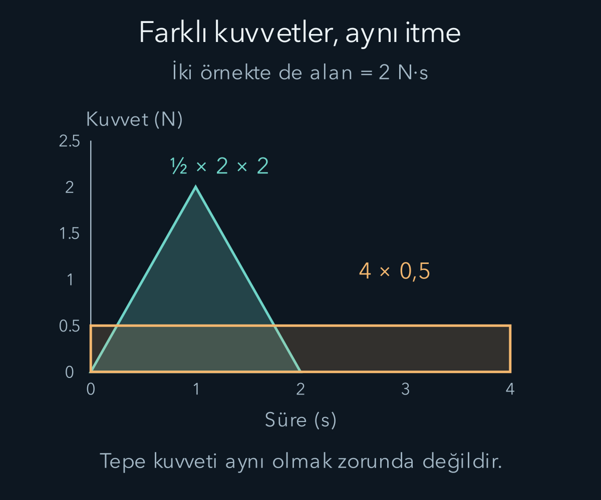
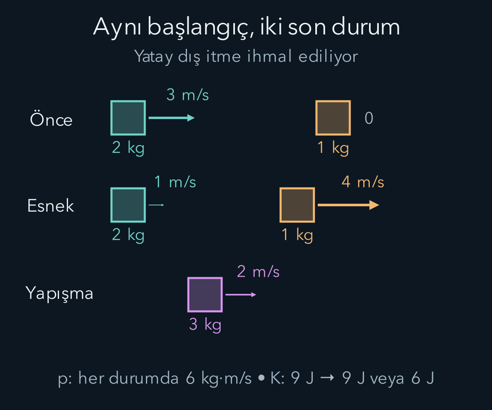

import ArticleVideo from '@/components/ArticleVideo.astro'
import kavram from './media/01-kavram.mp4?url'
import kavramPoster from './media/01-kavram.jpg?url'

İki araba kısa süreliğine çarpıştığında temas kuvveti hızla büyür, sonra küçülür. Bu kuvvetin her andaki ayrıntısını bilmek zor olabilir. Yine de arabaların çarpışma öncesi ve sonrası hareketi arasında güçlü bir ilişki kurabiliriz. Bunun için kuvveti bu kez yol boyunca değil zaman boyunca toplayacağız. Ortaya çıkan nicelik itme; değişimini izlediğimiz nicelik momentumdur.

[İş ve enerji yazısında](/blog/is-enerji-ve-korunum/) kuvvetin yaptığı işi kinetik enerji değişimiyle bağladık. Bu yazıda yönlü hızları, Newton'un ikinci ve üçüncü yasalarını ve belirli integrali kullanacağız. Bütün örnekler klasik mekanik kapsamında, kütleleri sabit cisimlerle kurulacak. Çarpışmada korunacak niceliği seçerken sistem sınırını ve dış etkileri açıkça belirleyeceğiz.

## 1. Momentum yön bilgisini korur

Bir cismin klasik doğrusal momentumu:

$$
\mathbf p=m\mathbf v
$$

olarak tanımlanır. $m$ kütle, $\mathbf v$ hızdır. Momentumun yönü hızın yönüdür ve SI birimi kilogram metre bölü saniyedir. Aynı hızla giden iki cismin kütlesi farklıysa momentumları da farklıdır. Aynı kütle ve süratle zıt yönlere giden iki cismin momentumları zıt, kinetik enerjileri ise eşittir.

Bu ayrımı sayısal görelim. Bir kilogramlık iki cisimden biri sağa üç, öteki sola üç metre bölü saniye hızla gitsin. Sağı pozitif seçersek toplam momentum $3+(-3)=0\,\mathrm{kg\,m/s}$ olur. Toplam kinetik enerji ise $\tfrac12(1)(3^2)+\tfrac12(1)((-3)^2)=9\,\mathrm J$ çıkar. Toplam momentumun sıfır olması, bütün parçaların durduğu veya enerjinin sıfır olduğu anlamına gelmez.

Momentum ile enerji farklı sorulara cevap verir. Momentum doğrultuları birlikte izler; enerji hareketin karesel büyüklüklerini toplar. Birinin korunduğunu bilmek ötekinin aynı mekanik biçimde korunacağını otomatik olarak söylemez. Çarpışma hesabında hangi eşitliği kullanabileceğimizi etkileşimin özellikleri belirleyecek.

## 2. Kuvvet zaman boyunca etki ettiğinde

Kütle sabitse momentumun zamana göre türevi:

$$
\frac{d\mathbf p}{dt}=m\frac{d\mathbf v}{dt}=m\mathbf a
=\mathbf F_{\mathrm{net}}
$$

olur. İki an arasında integral alalım:

$$
\mathbf J=\int_{t_1}^{t_2}\mathbf F_{\mathrm{net}}(t)\,dt
=\mathbf p_2-\mathbf p_1.
$$

$\mathbf J$ **itme** niceliğidir. Birimi newton saniyedir; bu da kilogram metre bölü saniyeye eşittir. İtme, kuvvetin kendisi değildir. Büyük kuvvet kısa süre, daha küçük kuvvet daha uzun süre etkileyerek aynı momentum değişimini oluşturabilir.

Kuvvet sabitse $\mathbf J=\mathbf F\Delta t$ yazılır. Değişkense ortalama kuvveti kullanarak yine $\mathbf J=\overline{\mathbf F}\Delta t$ elde edilir. Ortalama kuvvet, temas boyunca ölçülen bütün değerlerin zaman ağırlıklı ortalamasıdır. Bu değeri bilmek, kuvvetin en büyük değerini bilmek değildir. Aynı alanı veren iki kuvvet-zaman eğrisinin tepe değerleri farklı olabilir.

İş ve itmeyi karıştırmamak için birimlere bakabiliriz. İşte kuvveti yer değiştirmeyle çarptık; sonuç joule oldu. İtmede kuvveti süreyle çarpıyoruz; sonuç momentum birimidir. Bir kuvvetin uzun süre etkimesi tek başına ne kadar iş yaptığını söylemez. Cismin kuvvet yönündeki hareketi de gerekir.

## 3. Geri seken topun momentum değişimi

Kütlesi $0{,}20\,\mathrm{kg}$ olan bir top sağa $6\,\mathrm{m/s}$ ile duvara gelsin ve sola $4\,\mathrm{m/s}$ ile ayrılsın. Sağ yönü pozitif seçtiğimiz için başlangıç hızı artı altı, son hız eksi dörttür. Momentum değişimi:

$$
\Delta p=0{,}20(-4)-0{,}20(6)
=-0{,}8-1{,}2=-2{,}0\,\mathrm{kg\,m/s}.
$$

Topun sürati yalnız iki metre bölü saniye azaldı diye hız değişimini eksi iki alamayız. Yön de değiştiğinden hız değişimi eksi on metre bölü saniyedir. Duvarın topa uyguladığı itme sola yönlüdür. Temas süresi $0{,}020\,\mathrm s$ ise ortalama yatay kuvvet $-2{,}0/0{,}020=-100\,\mathrm N$ olur.

Aynı momentum değişimi $0{,}10\,\mathrm s$ boyunca oluşsaydı ortalama kuvvetin büyüklüğü yirmi newton olurdu. Sürenin uzaması aynı toplam etkiyi daha düşük ortalama kuvvetle sağlayabilir. Ancak yalnız bu ortalamadan maksimum kuvveti veya bir gerçek nesnenin hasarını çıkaramayız; kuvvetin zaman dağılımı, temas alanı ve malzeme davranışı ayrıca önemlidir.

Bu hesapta yerçekiminin yatay bileşeni yoktur. Düşey momentum değişimini incelemek istersek ağırlığı ve diğer düşey etkileşimleri ayrıca hesaba katmamız gerekir. “Çarpışma çok kısa” varsayımı bazı dış itmeyi küçük kılabilir; bütün yönlerde her kuvveti koşulsuz yok etmez.

## 4. Toplam momentum neden korunur?

İki cismi birlikte sistem seçelim. Birincinin momentumu $\mathbf p_1$, ikincininki $\mathbf p_2$ olsun. Her birine Newton yasasını yazıp topladığımızda aralarındaki iç kuvvetler, üçüncü yasaya göre eşit ve zıt olduklarından sadeleşir. Dış kuvvetler kalır:

$$
\frac{d}{dt}(\mathbf p_1+\mathbf p_2)
=\mathbf F_{\mathrm{dış,net}}.
$$

Toplam momentumu $\mathbf P=\mathbf p_1+\mathbf p_2$ yazarsak $d\mathbf P/dt=\mathbf F_{\mathrm{dış,net}}$ olur. Net dış kuvvet sıfırsa toplam momentum sabittir. Daha genel olarak bir zaman aralığındaki değişim toplam dış itmeye eşittir.

Yalıtılmış sistemde dış etkileşim yoktur. Fakat pratikte tam yalıtım olmasa da belirli bir doğrultudaki dış itme ihmal edilecek kadar küçük olabilir. Buz üzerinde kısa çarpışma sırasında yatay sürtünme küçükken iki cismin yatay momentumunu yaklaşık korunmuş alabiliriz. Düşeyde ağırlık ve normal kuvvet ayrı dengelenir. Korunum iddiasını hangi doğrultuda ve hangi süre için kurduğumuzu söylemek gerekir.

Top-duvar örneğinde yalnız topun momentumu korunmadı; duvar dış kuvvet uyguladı. Duvarı ve Dünya'yı sisteme dahil edersek topun momentum değişimine karşılık onların da momentum değişimini düşünürüz. Çok büyük kütle aynı momentum değişiminde çok küçük hız değişimi gösterir. Dünya'nın hareketini gözle görememek, momentum hesabından çıkarılabileceği anlamına gelmez.

Elektromanyetik alanların dinamik olduğu daha genel sistemlerde alanın kendisi de momentum taşıyabilir. Burada Newton tipi mekanik parçacık etkileşimleriyle sınırlıyız. İleride alanları öğrendiğimizde toplam sistem hesabının kapsamı genişleyecek; korunum fikri korunurken sistemin içerdiği nicelikler tamamlanacaktır.

## 5. Birlikte hareket edilen tam esnek olmayan çarpışma

Birinci arabanın kütlesi iki kilogram, başlangıç hızı sağa üç metre bölü saniye olsun. Bir kilogramlık ikinci araba başlangıçta dursun. Çarpışmadan sonra arabalar birbirine yapışıp ortak $v_f$ hızıyla ilerlesin. Yatay dış itmenin ihmal edilebildiğini varsayıyoruz.

Momentum korunumu:

$$
(2\,\mathrm{kg})(3\,\mathrm{m/s})+(1\,\mathrm{kg})(0)
=(3\,\mathrm{kg})v_f
$$

verir. Ortak hız sağa iki metre bölü saniyedir. Bu sonuca ulaşırken çarpışma kuvvetinin her andaki değerini bilmedik. Yapışma koşulu iki bilinmeyen son hızı tek bir ortak hız haline getirdiği için momentum denklemi yeterli oldu.

Başlangıç kinetik enerjisi dokuz joule, son kinetik enerji $\tfrac12(3)(2^2)=6\,\mathrm J$ olur. Üç joulelik azalma iç enerji, biçim değişikliği ve ses gibi başka biçimlere dönüşmüştür. Toplam enerji korunur; fakat iki arabanın öteleme kinetik enerjisi korunmaz. Böyle çarpışmaya **tam esnek olmayan çarpışma** denir.

“Tam” sözcüğü bütün kinetik enerjinin sıfırlandığını söylemez. Örnekte sistemin ortak hareketi devam ediyor ve altı joule kinetik enerji kalıyor. Sözcük, çarpışan parçaların sonrasında aynı hızla hareket etmesine işaret eder. Başlangıç toplam momentumu sıfır olsaydı ortak son hız sıfır çıkabilirdi; bu ayrı bir başlangıç durumudur.

## 6. Esnek çarpışmada iki korunum birlikte

**Esnek çarpışmada**, sistemin toplam momentumu yanında toplam kinetik enerjisi de çarpışma öncesi ve sonrası aynıdır. Çarpışma sırasında cisimler veya aradaki etkileşim geçici olarak enerji depolayabilir; önemli olan başlangıç ve son kinetik enerjilerin eşit olmasıdır. Gerçek cisimlerde bu modelin ne kadar iyi olduğu malzemeye ve koşullara bağlıdır.

Aynı iki araba için son hızları $v_1$ ve $v_2$ yazalım. Bir boyutlu momentum ve enerji eşitlikleri, sayıları SI birimlerinde kullanarak:

$$
6=2v_1+v_2,
\qquad 9=v_1^2+\frac12v_2^2
$$

olur. İlkinden $v_2=6-2v_1$ bulup ikinciye koyalım:

$$
9=v_1^2+\frac12(6-2v_1)^2
=3v_1^2-12v_1+18.
$$

Her iki taraftan dokuz çıkarıp üçe bölersek $v_1^2-4v_1+3=0$, yani $(v_1-1)(v_1-3)=0$ elde ederiz. Köklerden $v_1=3$, $v_2=0$ başlangıç hızlarını aynen verir; etkileşim öncesi durumla aynı cebirsel çözümdür. Çarpışma sonrasında birbirinden ayrılan çözüm $v_1=1\,\mathrm{m/s}$, $v_2=4\,\mathrm{m/s}$ olur.

Kontrol edelim: Son momentum $2(1)+1(4)=6$, son kinetik enerji $\tfrac12(2)(1^2)+\tfrac12(1)(4^2)=1+8=9$ çıkar. Hafif arabanın daha büyük süratle ayrılması korunumla çelişmez. Enerjinin nasıl dağıldığı kütlelere ve etkileşimin esnekliğine bağlıdır.

Bir boyutlu esnek çarpışmada yaklaşma ve ayrılma göreli süratleri eşittir. Yukarıdaki örnekte başlangıç göreli sürat üç, son ayrılma sürati $4-1=3\,\mathrm{m/s}$ olur. Bu ilişki momentum ve enerji denklemlerini çarpanlara ayırarak türetilebilir; genel çarpışmalarda varsayım olarak kullanılamaz. Enerji kaybı varsa ayrılma sürati farklılaşabilir.

## 7. Kütle merkezinin hareketi

Bir sistemin parçalarını tek bir konumla özetlemek için **kütle merkezi** tanımlanır:

$$
\mathbf R=\frac{\sum_i m_i\mathbf r_i}{M},
\qquad M=\sum_i m_i.
$$

$\mathbf r_i$ her parçanın konumu, $M$ toplam kütledir. Bu, kütlelerle ağırlıklandırılmış konum ortalamasıdır. Kütlelerin eşit olduğu iki parçanın kütle merkezi ortadadır. Bir parça daha ağırsa merkez o parçaya daha yakın bulunur; mutlaka maddenin dolu olduğu bir noktada bulunması gerekmez.

İki kilogramlık cisim sıfır metre, bir kilogramlık cisim altı metre konumunda olsun. Kütle merkezi $(2\times0+1\times6)/3=2\,\mathrm m$ konumundadır. Ağır cisme uzaklığı iki metre, hafif cisme uzaklığı dört metredir. Bu değerler ağırlıklı ortalamanın geometrik anlamını gösterir.

Kütleler sabitken türev alırsak $M\dot{\mathbf R}=\sum_i m_i\mathbf v_i=\mathbf P$ olur. Bir kez daha türev:

$$
M\ddot{\mathbf R}=\mathbf F_{\mathrm{dış,net}}
$$

verir. Böylece sistemin kütle merkezi, toplam kütle orada toplanmış ve net dış kuvvet ona uygulanıyormuş gibi ivmelenir. İçeride parçalar karmaşık biçimde hareket etse bile dış kuvvet sıfırken merkez sabit hızlı gider. Bu sonuç, her parçanın aynı hızla gittiği anlamına gelmez.

<ArticleVideo src={kavram} poster={kavramPoster} title="Yapışan iki eşit kütle" caption="Hareketli cisim, duran eşit kütleli cisme yapışır. Dış itme yokken ortak hız ilk hızın yarısıdır; momentum korunurken kinetik enerji azalır." />

## 8. Kütle merkeziyle enerji kaybını anlamak

Her parçanın hızını kütle merkezi hızı ve merkeze göre hızı olarak ayırabiliriz. Bu ayrımda toplam kinetik enerji iki parçaya bölünür: Kütle merkezinin ortak hareket enerjisi ve parçaların merkeze göre hareket enerjisi. Çapraz terimler, merkeze göre toplam momentum sıfır olduğu için yok olur.

Bu ayrımı cebirde de görelim. Kütle merkezi hızına $\mathbf V$, merkeze göre hızlara $\mathbf u_i$ diyelim; böylece $\mathbf v_i=\mathbf V+\mathbf u_i$ olur. Kareyi açıp her parçanın enerjisini toplarsak:

$$
K=\frac12\sum_i m_i(\mathbf V+\mathbf u_i)\cdot(\mathbf V+\mathbf u_i)
=\frac12MV^2+\mathbf V\cdot\sum_i m_i\mathbf u_i+\frac12\sum_i m_i u_i^2.
$$

Tanım gereği $\sum_i m_i\mathbf u_i=\mathbf P-M\mathbf V=0$ olduğundan orta terim sıfırdır. Ortak hareket enerjisi $\tfrac12MV^2$, kalan terim merkeze göre hareket enerjisidir. Dolayısıyla merkezin hızını değiştirmeden de göreli hareket enerjisi iç enerjiye dönüşebilir.

İki arabalı örnekte toplam momentum altı, toplam kütle üç olduğundan kütle merkezi hızı her iki çarpışma türünde de iki metre bölü saniyedir. Ortak hareketin kinetik enerjisi altı jouledür. Başlangıçtaki dokuz joulenin kalan üç joulesi, arabaların kütle merkezine göre birbirine yaklaşma hareketine aittir.

Yapışmalı sonuçta iki araba da kütle merkeziyle aynı hızda gittiği için bu göreli hareket ortadan kalkar. Üç joulelik azalmayı böylece doğrudan görebiliriz. Esnek sonuçta göreli hareket enerjisi geri kazanılır; arabalar merkeze göre ters yönlerde ayrılır. Aynı momentum korunurken farklı kinetik enerji sonuçlarının mümkün olması artık yalnız iki denklem arasındaki fark olarak kalmaz, hareketin yapısında görünür olur.

Bu açıklama, toplam momentumu sıfır yapmanın özel bir referans sistemi seçimi olabileceğini de gösterir. Kütle merkeziyle birlikte giden gözlemci için toplam momentum sıfırdır. Yerdeki gözlemci başka toplam momentum ve toplam kinetik enerji değerleri bulur; fakat iki gözlemci aynı çarpışmayı kendi tutarlı koordinatlarında anlatır.

## 9. Sisteme madde girip çıkarsa

Buraya kadar sistemin aynı parçaları içerdiğini kabul ettik. Bir roket yakıt gazlarını dışarı atarken “roket” diye izlediğimiz nesne zamanla madde kaybeder. Rokete yalnız $d(mv)/dt$ yazıp bunu dış kuvvete eşitlemek, dışarı çıkan gazın momentumunu hesaptan düşürebilir. Açık sistemde kütle akışının taşıdığı momentum ayrıca değerlendirilmelidir.

Bu durum momentum korunumunun bozulması değildir. Roket ve henüz atılmamış, sonra atılmış bütün yakıtı uygun bir sistem olarak birlikte izlediğimizde toplam momentum bilançosu kurulabilir. Roketin ileri hareketi, gazların geriye taşıdığı momentumla ilişkilidir. Havanın bulunması bu etkileşim için zorunlu değildir; roket uzay boşluğunda da gazla momentum alışverişi yapar.

Kütle akışı problemlerinde hangi hızın yere göre, hangisinin rokete göre verildiği de önem taşır. Bir denklemin tanıdık görünmesi, bütün değişken kütle durumlarını aynı biçimde çözmemizi sağlamaz. Bu yazının sabit kütleli çarpışma sonuçlarını koruyup daha genel durumu ayrı bir bilanço problemi olarak görmemiz yeterli.

Bir cismin parçalanması da aynı sistem düşüncesiyle okunabilir. Başlangıçta duran bir düzenek iki parçaya ayrılırken dış itme küçükse parçaların momentumları eşit büyüklükte ve ters yönlü olur. Kütleler eşit değilse süratler eşit olmak zorunda değildir. Hafif parça, aynı momentum büyüklüğü için daha hızlı gider. Ayrılma sonrasında toplam kinetik enerji başlangıçtakinden büyük olabilir; artan enerji düzeneğin başlangıçta depoladığı iç enerjiden gelir.

Bu örnekte kinetik enerjinin artması, esnek olmayan etkileşimlerde enerjinin her zaman azalacağını sanmanın da eksik olduğunu gösterir. Pasif bir çarpışmada mekanik enerji iç enerjiye dönüşebilir; iç enerji açığa çıkaran bir süreçte dönüşüm ters yönde gerçekleşebilir. Korunum yasası toplam hesabı ister. Cisimlerin yalnız öteleme kinetik enerjisine bakıp sistemin bütün enerjisi hakkında hüküm vermek için yeterli bilgi yoktur. Denklemleri kurarken hangi enerji deposunun başlangıçta bulunduğunu da belirtmemiz gerekir.

## 10. Korunumu kullanırken hangi bilgi gerekir?

Bir çarpışmada toplam momentum eşitliği, sistemin her yönü için birer denklem sağlar. İki boyutta son hızların iki bileşeni varsa bilinmeyen sayısı artar. Kütleler ve ilk hızlar bilinse bile yalnız momentum korunumu son durumları tek başına belirlemeyebilir. Etkileşim geometrisi, esneklik veya ölçülen bir saçılma açısı gibi ek bilgi gerekir.

Çarpışma türünü söylemeden otomatik olarak kinetik enerjiyi korumak yanlış olur. Tersine, kinetik enerji azaldığında momentumun da aynı oranda azaldığını düşünmek yanlıştır. Her niceliğin korunma koşulunu ayrı denetlemek gerekir. Sistemin dışında bir duvar, zemin veya itici varsa onların itmesi belirli bir yönde önemli olabilir.

Momentum, kuvvetin zaman boyunca etkisini; enerji, kuvvetin hareket boyunca etkisini düzenledi. Bir sonraki adımda etkileşimlerin dönme hareketi üzerindeki etkisini izleyeceğiz. Konum ile momentumun birlikte oluşturduğu açısal momentum ve kuvvetin dönmeye etkisi olan tork, bu hesabın yönlü uzantılarını kuracak.

## Kaynaklar

- [OpenStax — İtme ve çarpışmalar](https://openstax.org/books/university-physics-volume-1/pages/9-2-impulse-and-collisions).
- [OpenStax — Doğrusal momentumun korunumu](https://openstax.org/books/university-physics-volume-1/pages/9-3-conservation-of-linear-momentum).
- [OpenStax — Çarpışma türleri](https://openstax.org/books/university-physics-volume-1/pages/9-4-types-of-collisions).
- [OpenStax — Kütle merkezi](https://openstax.org/books/university-physics-volume-1/pages/9-6-center-of-mass).
