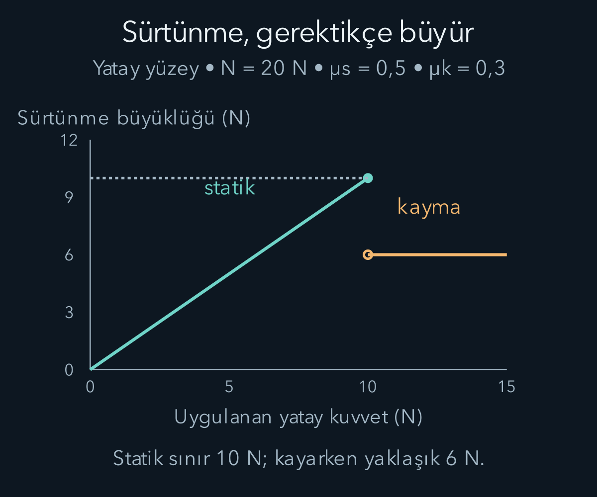
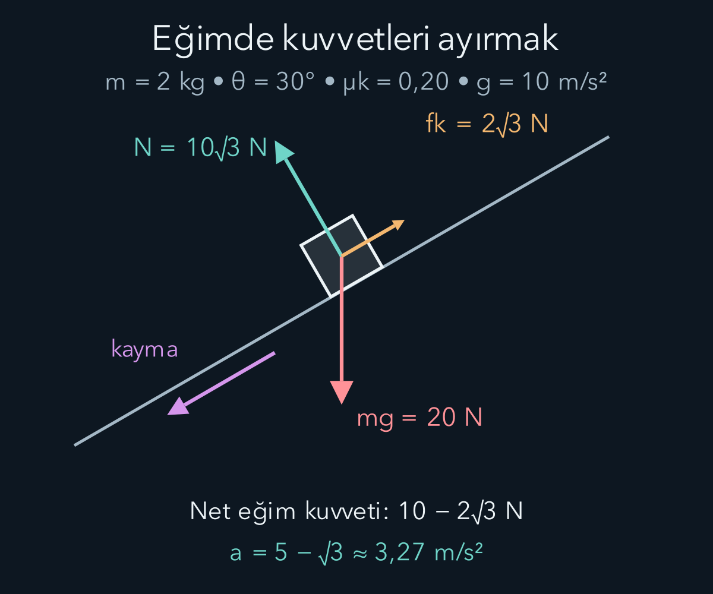

import ArticleVideo from '@/components/ArticleVideo.astro'
import kavram from './media/01-kavram.mp4?url'
import kavramPoster from './media/01-kavram.jpg?url'

Bir kutuyu itip bıraktığımızda çoğu zaman bir süre sonra durur. Bu gözlem, hareketin sürmesi için sürekli kuvvet gerektiğini düşündürebilir. Fakat aynı kutu daha kaygan bir yüzeyde daha uzun gider. Yavaşlamayı hareketin doğal sonu saymak yerine, yüzey ve hava ile etkileşimin sonucu olarak değerlendirdiğimizde bambaşka bir düzen ortaya çıkar: Net kuvvet, hızı korumak için değil hızı değiştirmek için gereklidir.

[Konum, hız ve ivmeyi](/blog/hareket-konum-hiz-ve-ivme/) tanımladık. Şimdi bu nicelikleri etkileşimlerle bağlayacağız. Vektör toplamını, bileşenleri ve sinüs ile kosinüsü kullanacağız. Kuvveti yalnız bir sayı olarak değil, belirli bir cismin başka bir cisme uyguladığı yönlü etki olarak okuyacağız. Hangi cismi incelediğimiz, kuracağımız denklemin ilk ve en önemli seçimidir.

**Ön bilgi bağlantıları:** [Vektör bileşenleri](/blog/vektorler-ve-bilesenleri/), [dik üçgende sinüs ve kosinüs](/blog/dik-ucgende-trigonometri/) ve [ölçme ile birimler](/blog/fizikte-olcme-birimler-ve-modeller/). Eğimin açısı değişse de düşey ağırlığın yönü değişmez; değişen, seçtiğimiz eksenlere göre bileşenleridir.

## 1. Eylemsizlik ve referans sistemi

**Newton'un birinci yasası**, net kuvvet sıfırken bir cismin sabit hız vektörüyle hareketini sürdürdüğünü söyler. Durmak bu ifadenin özel halidir: Sabit hız sıfır olabilir. Sabit hızın hem büyüklüğü hem yönü değişmez. Dolayısıyla net kuvvetsiz hareket düz çizgidir; sabit süratle dönmek bu kapsamda değildir.

Bu yasayı doğrudan kullanabildiğimiz referans sistemlerine **eylemsiz sistemler** deriz. Bir eylemsiz sisteme göre sabit hızla ötelenen başka bir sistem de eylemsizdir. Hızlanan bir otobüsün içindeyse serbest bırakılmış bir cisim otobüse göre geriye kayabilir. Otobüs sisteminin ivmesi hesaba katılmadan bu görüntüyü açıklamak yanlış kuvvetler aramamıza yol açar.

Dünya üzerindeki kısa süreli ve küçük ölçekli birçok mekanik deneyde yere bağlı sistemi yaklaşık eylemsiz kabul ederiz. Dünya döndüğünden bu tam bir ifade değildir. Dönen referansın etkileri deneyin hassasiyeti veya uzunluğu arttıkça önem kazanabilir. Birinci yasa yalnız ikinci yasaya sıfır koymak için gereken bir cümle değildir; yasaları hangi referans sisteminde yorumladığımızı da belirler.

Eylemsizlik, cismin hareket durumunu değiştirmeye karşı gösterdiği davranıştır. “İleriye doğru taşıyan eylemsizlik kuvveti” diye ek bir kuvvet tanımlamayacağız. Net kuvvet olmadığında hareketi sürdüren ayrı bir itici aramak gerekmez. Bu ayrım, gerçek etkileşimleri gösteren çizimlerin gereksiz oklarla dolmasını önler.

## 2. Net kuvvet ve ikinci yasa

Bir cismin üzerine etki eden kuvvetlerin vektörel toplamına **net kuvvet** diyelim. Sabit kütleli bir parçacık için, eylemsiz referans sisteminde:

$$
\sum_i\mathbf F_i=m\mathbf a.
$$

Sigma işareti kuvvetleri topladığımızı, $m$ kütleyi, $\mathbf a$ ivmeyi gösterir. Kütle pozitif bir skaler niceliktir; yön taşımaz. Net kuvvet ile ivme aynı yöndedir. Bu denklem hızı değil, hızın değişim oranını belirler. Cismin o anda hangi yönde hareket ettiğini öğrenmek için başlangıç hızını da bilmemiz gerekir.

SI kuvvet birimi **newton**, $\mathrm N$ ile gösterilir ve $1\,\mathrm N=1\,\mathrm{kg\,m/s^2}$ olur. İki kilogramlık bir cisme sağa sekiz newton, sola iki newton uygulanırsa net kuvvet sağa altı newtondur. İvme $6/2=3\,\mathrm{m/s^2}$ sağa çıkar. İki kuvvetin büyüklüklerini gelişigüzel toplamak, soldaki kuvvetin yönünü kaybettirirdi.

Bileşenlere ayrılmış biçim $\sum F_x=ma_x$ ve $\sum F_y=ma_y$ olur. İki denklem aynı vektörel ilişkinin iki yüzüdür. Bir yönde ivmenin sıfır olması, o yönde hiç kuvvet olmadığı anlamına gelmez; kuvvetler dengelenebilir. Denge, net kuvvetin sıfır olmasıdır. Bu nedenle sabit hızlı hareket de dengedeki hareket olabilir.

## 3. Kütle ile ağırlığı ayırmak

Kütle, ikinci yasada kuvvet ile ivmeyi bağlayan niceliktir ve kilogramla ölçülür. **Ağırlık** ise kütleçekimin cisme uyguladığı kuvvettir. Yeryüzüne yakın bölgede yerçekimi ivmesini $\mathbf g$ yazarsak ağırlık $\mathbf W=m\mathbf g$ olur. Büyüklüğü $W=mg$ ve birimi newtondur.

Üç kilogramlık bir cisim için örnek hesabında $g=10\,\mathrm{m/s^2}$ seçersek ağırlık otuz newton çıkar. Aynı cisim başka bir gökcisminin yüzeyine taşındığında kütlesi aynı kalırken yerel yerçekimi nedeniyle ağırlığı değişebilir. Kilogram ile newtonu birbirinin yerine kullanmak bu iki farklı bilgiyi karıştırır.

Tartının okuduğu kuvvet çoğu düzende destek kuvvetidir. Yukarı ivmelenen bir asansörde duran kişinin destek kuvveti ağırlığından büyük olabilir. Yukarı yönü pozitif seçip $N-mg=ma$ yazarsak $N=m(g+a)$ elde ederiz. Asansör yukarı giderken yavaşlıyorsa ivmesi aşağı yönlüdür ve destek kuvveti azalabilir. Hızın yönü ile ivmenin yönünü ayırmak burada somut bir ölçüm farkı doğurur.

## 4. Kuvvet çizimi bir envanterdir

Bir **serbest cisim diyagramında** seçtiğimiz cismi çevresinden ayırır, yalnız o cismin üzerine etki eden kuvvetleri çizeriz. Her okun hangi etkileşimden geldiğini söyleyebilmeliyiz. Yerçekimi, yüzey teması, ip gerilmesi veya yay etkisi gibi bir kaynağı olmayan “hareket kuvveti” eklemeyiz.

Masa üzerindeki kitaba aşağı doğru Dünya'nın kütleçekimi, yukarı doğru masanın normal kuvveti etkir. **Normal kuvvet**, temas yüzeyine dik kuvvet bileşenidir; her zaman düşey olmak zorunda değildir. Kitap düşey ivmelenmiyorsa ve başka düşey kuvvet yoksa büyüklüğü ağırlığa eşit olur. Eşitlik, normal kuvvetin değişmez tanımı değil, bu özel durumun denge sonucudur.

Kitabı aşağı bastırırsak masa daha büyük normal kuvvet uygular. Kitabı yukarı çeken bir ip eklersek normal kuvvet azalabilir. Temas kesilirse normal kuvvet sıfırdır; sıradan bir masa kitabı kendine doğru çekemez. Hesap negatif bir normal kuvvet gerektiriyorsa temas varsayımını yeniden değerlendirmemiz gerekir.

**Gerilme kuvveti**, gergin ipin bağlandığı cismi ip doğrultusunda çekmesidir. Esnek bir ip itme iletemez. Kütlesiz ip ve sürtünmesiz, kütlesiz makara gibi ideal kabullerde aynı ipin gerilme büyüklüğü belirli durumlarda eşit alınabilir. Gerçek ipin kütlesi veya makaranın dönme etkisi önemliyse bu eşitlik ayrıca incelenir. Bir kuvvetin adını bilmek, onun değerini peşinen bilmek değildir.

## 5. Yay kuvvetinin yönü

Bir yayın denge uzunluğundan uzamasını $x$ ile gösterelim. Denge noktasından sağa uzamayı pozitif seçersek ideal yay kuvveti:

$$
F_x=-kx
$$

olur. $k$ pozitif yay sabitidir ve birimi newton bölü metredir. Eksi işareti yayın denge konumuna döndüren yönde kuvvet uyguladığını söyler. Yay sağa uzamışsa kuvvet sola; sola sıkışmışsa kuvvet sağadır.

Yay sabiti $200\,\mathrm{N/m}$ olan bir yay $0{,}03\,\mathrm m$ uzatıldığında kuvvet $-6\,\mathrm N$ çıkar. Santimetreyi doğrudan üç olarak yazmak sonucu yüz kat büyütürdü. Denklemdeki $x$ yayın toplam uzunluğu değil, denge uzunluğuna göre değişimidir. İşaret ve başlangıç noktası bu nedenle beraber belirtilmelidir.

Bu doğrusal ilişki **Hooke yasası** diye bilinen bir malzeme modelidir. Bütün yaylarda her uzama için geçerli bir temel yasa değildir. Çok büyük deformasyonda doğrusal davranış bozulabilir veya kalıcı biçim değişikliği oluşabilir. Yayın hareketini sonra diferansiyel denklemle çözerken kullandığımız kuvvet yasasının bu aralıkta geçerli olduğunu varsayacağız.

## 6. Sürtünme tek bir sabit kuvvet değildir

Bir kutuyu hafifçe itip hareket ettiremediğimizde yatay uygulama kuvveti başka bir kuvvetle dengelenir. Temas yüzeyleri birbirine göre kaymıyorsa bu kuvvete **statik sürtünme** deriz. Basit kuru sürtünme modelinde büyüklük:

$$
0\le f_s\le\mu_s N
$$

aralığındadır. $\mu_s$ boyutsuz statik sürtünme katsayısıdır. Eşitlik yalnız kayma eşiğinde sağlanır. Gereken sürtünme iki newtonsa, üst sınır on newton olsa bile gerçek statik sürtünme iki newton olabilir.

Kayma başladığında sık kullanılan yaklaşık model $f_k=\mu_kN$ biçimindedir. Kinetik sürtünmenin yönü, iki yüzeyin temas noktasındaki göreli kaymasına karşıdır. Bu, her durumda cismin yere göre hızına karşıdır demek değildir. Hareketli bir bant üzerindeki kutu, bantla arasındaki kayma azalacak yönde sürtünme kuvveti alarak hızlanabilir.

Sürtünme katsayıları temas eden malzemelere ve yüzey durumuna bağlıdır. Bu basit modelde görünür temas alanı doğrudan formülde yer almaz; bundan bütün gerçek temasların alandan bağımsız olduğu sonucu çıkmaz. Yağlama, sıcaklık, deformasyon ve hız gibi etkiler daha ayrıntılı modeller gerektirebilir. Modelin hesap kolaylığını, evrensel ve kusursuz bir davranış iddiasına dönüştürmemeliyiz.

## 7. Eğik düzlemde bütün hesabı kurmak

Kütlesi iki kilogram olan bir kutu, yatayla otuz derece açı yapan eğimde aşağı doğru kayıyor olsun. İvme hesabında $g=10\,\mathrm{m/s^2}$, kinetik sürtünme katsayısı $\mu_k=0{,}20$ alınsın. Eksenlerden birini eğim boyunca aşağı, diğerini yüzeyden dışarı doğru seçelim. Böylece hareket boyunca gerekli bileşenleri doğrudan kullanabiliriz.

Ağırlık yirmi newtondur. Eğim doğrultusundaki bileşeni $mg\sin30^\circ=10\,\mathrm N$, yüzeye doğru bileşeni $mg\cos30^\circ=10\sqrt3\,\mathrm N$ olur. Kutunun yüzeye dik ivmesi sıfırsa:

$$
N-mg\cos30^\circ=0,
\qquad N=10\sqrt3\,\mathrm N.
$$

Kayma aşağı yönlü olduğundan sürtünme yukarı yönlüdür. Büyüklüğü $f_k=0{,}20(10\sqrt3)=2\sqrt3\,\mathrm N$ bulunur. Eğim boyunca ikinci yasa:

$$
mg\sin30^\circ-f_k=ma
$$

ve ardından:

$$
a=\frac{10-2\sqrt3}{2}\,\mathrm{m/s^2}
=(5-\sqrt3)\,\mathrm{m/s^2}
\approx3{,}27\,\mathrm{m/s^2}
$$

verir. Sürtünmesiz olsaydı ivme beş metre bölü saniye kare olacaktı. Bulduğumuz küçülme, kuvvetin yönüyle uyumludur. Aynı kutu eğim üzerinde yukarı doğru kayıyor olsaydı sürtünme aşağı yönlenirdi; denklemdeki işaret fiziksel kayma yönüne göre yeniden yazılmalıydı.

Şekilde oklar kuvvetlerin yönünü gösterir; ok uzunlukları ölçekli değildir.

Başlangıçta duran bir kutunun kayıp kaymayacağını anlamak için kinetik katsayıyı kullanmayız. Durması için gereken statik sürtünme $mg\sin\theta$ değeridir; kullanılabilir üst sınır $\mu_smg\cos\theta$ olur. Dolayısıyla basit modelde durabilme koşulu $\tan\theta\le\mu_s$ çıkar. Bu adımda $0\le\theta<90^\circ$ kabul ettik; dolayısıyla $mg\cos\theta$ pozitiftir. Eşitsizliğin iki tarafını bu pozitif büyüklüğe bölersek $\sin\theta/\cos\theta\le\mu_s$ elde ederiz. Soldaki oran tanjanttır. Kütle iki tarafta sadeleşir. Bu sonuç, yüzey özelliklerinin ve katsayının aynı kaldığı kabulü altında geçerlidir.

## 8. Etki ve tepki farklı cisimler üzerindedir

Newton'un üçüncü yasası, iki cismin birbirine uyguladığı kuvvetleri bağlar:

$$
\mathbf F_{A\to B}=-\mathbf F_{B\to A}.
$$

Alt indis okun yönünü açıklar: Soldaki kuvvet A'nın B'ye uyguladığı kuvvettir. Sağdaki B'nin A'ya uyguladığı kuvvettir. Eşit büyüklükte ve ters yönlüdürler, fakat **aynı cisme uygulanmazlar**. Bu yüzden tek bir cismin kuvvet toplamında birbirlerini yok etmezler.

Kitabın ağırlığı ile masanın kitaba uyguladığı normal kuvveti, büyüklükleri eşit olsa bile etki-tepki çifti değildir. İkisi de kitap üzerindedir. Kitabın ağırlığının eşi, kitabın Dünya'ya uyguladığı kütleçekim kuvvetidir. Masanın kitaba uyguladığı kuvvetin eşi ise kitabın masaya uyguladığı temas kuvvetidir. Eş büyüklük görmek tek başına doğru eşleştirme yapıldığını göstermez.

İki patencinin birbirini ittiğini düşünelim. Kuvvetler eşittir ama kütleleri farklıysa ivmeleri farklı büyüklükte olur. İkinci yasa her patenciye ayrı uygulanır. Hafif patencinin daha büyük ivmelenmesi, ona daha büyük kuvvet uygulandığı anlamına gelmez. Aynı etkileşimi iki farklı cismin hareketi üzerinden okuruz.

<ArticleVideo src={kavram} poster={kavramPoster} title="Net kuvvetten ivmeye" caption="2 kg kütleye yatayda 10 N ve ters yönde 6 N etki eder. Düşey kuvvetler dengedeyken yatay net kuvvet 4 N, ivme sağa doğru 2 m/s² olur." />

### İki cismi tek sistem seçmek

Bir kilogram ve iki kilogram kütleli iki kutu, yatay ve sürtünmesiz zeminde birbirine hafif bir iple bağlansın. Sağdaki iki kilogramlık kutuyu sağa altı newtonla çekelim. İp gergin kaldığı için iki kutunun yatay ivmesi aynıdır. İki kutuyu birlikte sistem seçersek ip kuvvetleri içeride kalır ve toplam üç kilogramlık sisteme dışarıdan altı newton uygulanır. Ortak ivme iki metre bölü saniye karedir.

Şimdi yalnız soldaki bir kilogramlık kutuya bakalım. Ona yatayda etki eden tek kuvvet ip gerilmesidir. İkinci yasa gerilmenin iki newton olduğunu verir. Sağdaki kutuda ise sağa altı newton, sola iki newton vardır; net dört newton, iki kilogramlık kütleye bölününce yine aynı ivme çıkar. Sistem sınırını değiştirdik ama fiziksel sonuç değişmedi.

Bu hesap gerilmenin dışarıdan uygulanan altı newtona eşit olmak zorunda olmadığını gösterir. İp kuvveti, bütün sisteme uygulanan kuvvetin adı değildir; iki kutu arasındaki etkileşimin büyüklüğüdür. Aynı zamanda iç kuvvetleri toplamda elemenin onları yok saymak olmadığını görürüz. Ortak hareketi bulurken sadeleşirler; ayrı parçaların hareketini veya ipin dayanıklılığını incelerken yeniden gerekirler. Bir sistemin sınırını çizmek böylece yalnız görsel bir hazırlık değil, hangi kuvvetin hangi denklemde yer alacağını belirleyen fiziksel karardır.

## 9. Merkezcil kuvvet yeni bir kuvvet türü değildir

Dairesel harekette merkeze yönelen ivmenin büyüklüğünü önceki yazıda $v^2/R$ bulmuştuk. İkinci yasa bu hareketin gerektirdiği merkez yönlü net kuvvet bileşenini verir:

$$
\sum F_{\text{merkez}}=m\frac{v^2}{R}.
$$

Bu toplamı gerilme, kütleçekim, normal kuvvet veya sürtünme sağlayabilir. Kuvvet çizimine bunların yanına ayrıca bir “merkezcil kuvvet” oku eklemek aynı etkiyi iki kez sayabilir. Merkezcil sözcüğü kuvvetin kaynağını değil, hareket içindeki yönsel görevini anlatır.

Yatay düzlemde ip ucunda dönen bir cisimde merkez yönünü gerilme sağlayabilir. İp koparsa gerilme ortadan kalkar. Başka yatay kuvvet yoksa cisim o anki teğet hız yönünde gider; merkezin doğrudan dışına doğru hız kazanmış olmaz. Önceki hareketin çember olması, sonrasında da çemberi takip etmesini zorunlu kılmaz.

Sürat de değişiyorsa merkez yönlü bileşenin yanında teğetsel net kuvvet bileşeni bulunur. Bunlar dik doğrultularda farklı işler görür: Biri hızın yönünü, öteki süratini değiştirir. Tek bir net kuvvet vektörünün bu bileşenlere ayrılması, vektör hesabını fiziksel bir açıklamaya dönüştürür.

## 10. Bir denklemin kullanılma sınırı

Buradaki ikinci yasa sabit kütleli parçacık modeli içindir. Yakıt atan bir roketi, kütlesi değişen kutuya aynı formülü düşünmeden yazarak çözmeyiz; çıkan maddenin taşıdığı hareket bilgisini de hesaba katmak gerekir. Büyük cisimler dönüyorsa yalnız kütle merkezinin hareketini bulmak bütün hareketi anlatmaz. İlerleyen yazılarda momentum ve dönme bu eksikleri tamamlayacak.

Newton mekaniği günlük hız ve ölçeklerde çok güçlüdür. Işık hızına yakın hareketlerde klasik momentum bağıntısı değişir; kuantum deneylerinde ise parçacığın durumunu belirli bir yörüngeyle anlatmak yeterli olmayabilir. Bu sınırlar, günlük bir eğik düzlem hesabını anlamsızlaştırmaz. Hangi varsayımların uygun olduğunu kontrol etmemiz gerektiğini gösterir.

Bir kuvvet problemi çözerken önce cismi, referans sistemini ve etkileşimleri belirledik; sonra eksenlere ayırıp denklemleri yazdık. Bu sıra cebirin önüne fiziksel anlamı yerleştirdi. Sonraki adımda kuvvetin bir yol boyunca etkisini biriktirerek iş ve enerji kavramlarına geçeceğiz.

## Kaynaklar

- [OpenStax — Newton'un birinci yasası](https://openstax.org/books/university-physics-volume-1/pages/5-2-newtons-first-law) ve [ikinci yasası](https://openstax.org/books/university-physics-volume-1/pages/5-3-newtons-second-law).
- [OpenStax — Newton'un üçüncü yasası](https://openstax.org/books/university-physics-volume-1/pages/5-5-newtons-third-law).
- [OpenStax — Sürtünme](https://openstax.org/books/university-physics-volume-1/pages/6-2-friction) ve [merkezcil kuvvet](https://openstax.org/books/university-physics-volume-1/pages/6-3-centripetal-force).
