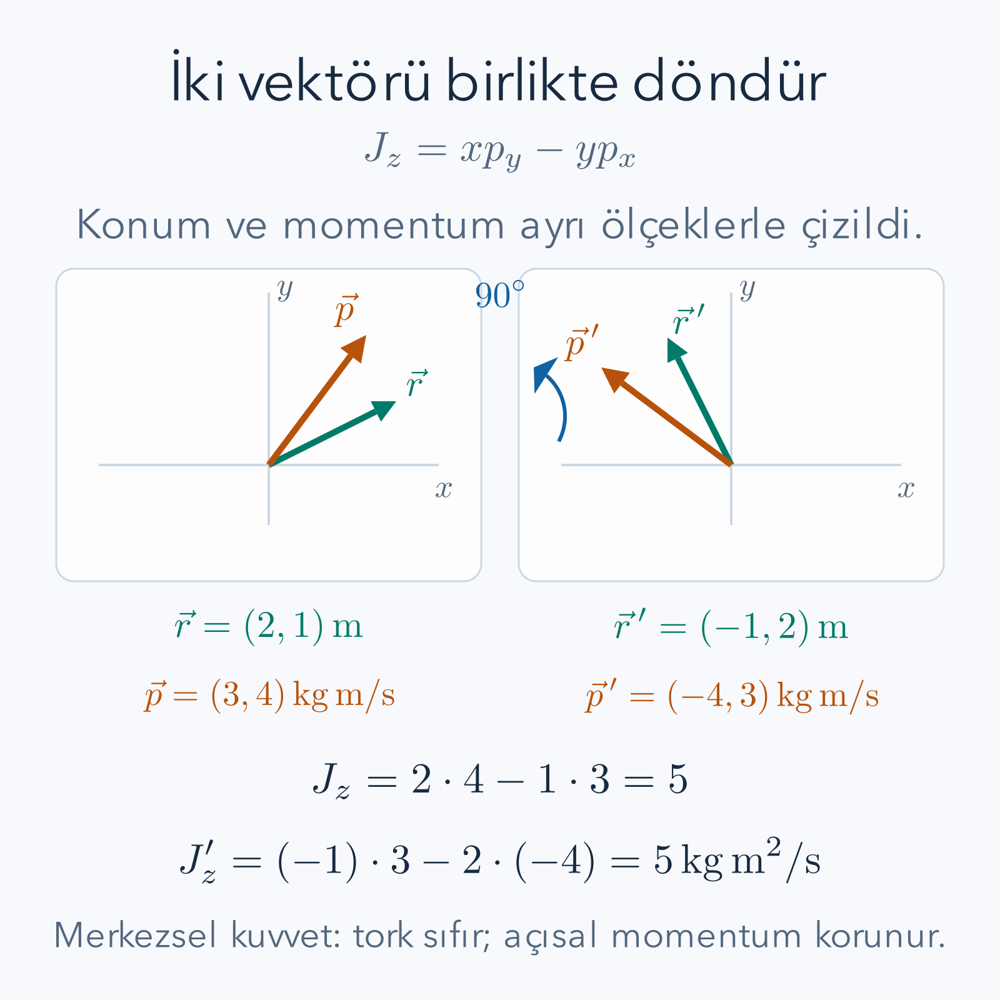

Sürtünmesiz bir masa üzerindeki iki cisim birbirini iterken ayrı hızları değişir; buna rağmen toplam momentumları sabit kalabilir. Bir merkez çevresindeki hareketin açısal momentumu, durgun bir yay sisteminin de enerjisi korunabilir. Bunları ayrı ayrı kurallar olarak öğrenmek mümkündür. **Noether teoremi**, bu korunumları ortak bir hesapta birleştirir: uygun bir sürekli dönüşüm hareketin etkisini değiştirmiyorsa, hareket boyunca sabit kalan bir nicelik üretilebilir.

Bu ders [Lagrange mekaniği](/blog/lagrange-mekanigi/), [klasik Hamilton mekaniği](/blog/klasik-hamilton-mekanigi/), [varyasyon hesabı](/blog/varyasyon-hesabi-ve-euler-lagrange/) ve [dönme ile açısal momentum](/blog/donme-tork-ve-acisal-momentum/) üzerine kuruludur. Sürekli dönüşümlerin matematiksel tarafı için [Lie grupları](/blog/lie-gruplari-ve-lie-cebirleri/) de yardımcıdır; fakat gerekli küçük dönme formülünü burada türeteceğiz. Amaç bir sloganı ezberlemek değil, verilen bir sistemde hangi dönüşümün gerçekten simetri olduğunu hesapla sınamaktır.

## 1. Simetri Bir Resmin Görünüşünden Fazlasıdır

Bir şekil döndürüldüğünde aynı görünüyorsa geometrik simetriden söz ederiz. Mekanikte ise karşılaştırılan şey yalnız şekil değil, hareketi belirleyen etkidir. Bir deney düzeneğini başka yere taşıdığımızda aynı hareket yasalarını verip vermediğini sorarız. Taşınan sistemin dış kuvvetlerle ilişkisi bu sorunun parçasıdır. Yalnız bir cismin resmini kaydırıp duvara bağlı yayı eski yerde bırakmak ile bütün yalıtılmış sistemi taşımak farklı dönüşümlerdir.

Bir **sürekli dönüşüm**, sıfırdan başlayıp küçük gerçek parametrelerle değiştirilebilen bir dönüşüm ailesidir. Öteleme uzaklığı veya dönme açısı bu parametre olabilir. Ayna yansıması gibi yalnız ayrı seçenekleri olan dönüşümler bu girişteki türetimin kapsamına girmez. Teorem küçük parametreye göre türev alacağı için süreklilikten de fazlası, gerekli türevlerin varlığı gerekir.

Sistem $n$ bağımsız koordinatla tarif edilsin ve Lagrange fonksiyonu $L(q,\dot q,t)$ olsun. Önce zamanı değiştirmeyen dönüşümleri ele alacağız. Yeni yol $q_i'(t)=q_i(t)+\varepsilon\eta_i(q,t)+O(\varepsilon^2)$ biçiminde yazılsın. $\varepsilon$ dönüşüm parametresidir; $\eta_i$ o dönüşümün birinci derecedeki yönüdür. $O(\varepsilon^2)$, küçük parametrenin karesi ve daha yüksek mertebeli katkıları topluca gösterir. Birinci türevde bu katkılar kaybolacaktır.

## 2. Sabit Zamandaki Değişim Nasıl Tanımlanır?

$\delta q_i=\partial q_i'/\partial\varepsilon|_0=\eta_i$ yazalım. Buradaki $\delta$ tam değişim değil, parametre başına birinci dereceden değişimdir; gerçek küçük fark yaklaşık $\varepsilon\delta q_i$ olur. Zaman değişmediği için hızdaki değişim $\delta\dot q_i=d\eta_i/dt$'dir. $\eta_i$ konuma ve zamana bağlıysa bu türev de zincir kuralı içerir:

$$
\frac{d\eta_i}{dt}
=\sum_j\frac{\partial\eta_i}{\partial q_j}\dot q_j
+\frac{\partial\eta_i}{\partial t}.
$$

Örneğin sabit bir uzay ötelemesinde $\eta=1$ seçilebilir; hıza ek değişim gelmez. Düzlemsel dönmede ise $\eta_x=-y$, $\eta_y=x$ olacağı için hızlar da birbirine karışır. Her dönüşümde yalnız konumu değiştirip hızı eski bırakmak fiziksel olarak farklı bir yol üretir ve simetri testini bozar.

Varyasyon hesabındaki durağanlık testinde uçları sıfırlanan keyfî değişimler kullanmıştık. Burada $\eta_i$ belirli bir fiziksel dönüşümden gelir ve uçlarda sıfır olmak zorunda değildir. İki işlem aynı rolü oynamaz. Keyfî sabit uçlu değişimler hareket denklemini türetir; seçilen simetri değişimi o denklemlerin sonuçları arasından korunmuş niceliği çıkarır. Sınır terimini bu kez atmayacak, tam tersine kullanacağız.

## 3. Her Değişim İçin Geçerli Bir Özdeşlik

Kanonik momentum $p_i=\partial L/\partial\dot q_i$ olsun. Zamanı sabit tutan bir değişimde zincir kuralı

$$
\delta L=\sum_i\left(L_{q_i}\eta_i+p_i\dot\eta_i\right)
$$

verir. $p_i\dot\eta_i$ terimini çarpım kuralıyla $d(p_i\eta_i)/dt-\dot p_i\eta_i$ olarak yazarsak

$$
\boxed{\delta L=
\sum_i(L_{q_i}-\dot p_i)\eta_i
+\frac{d}{dt}\left(\sum_i p_i\eta_i\right).}
$$

Bu bir cebirsel özdeşliktir; henüz seçilen yolun hareket denklemini sağlamasını istemedik. İlk parantez Euler–Lagrange denkleminin eksi işaretli sol tarafıdır. Gerçek hareket üzerinde $L_{q_i}-\dot p_i=0$ olur ve bütün değişim yalnız toplam zaman türevine iner.

Türetimdeki mantığı ayıralım. Önce zincir kuralı herhangi düzgün yolda geçerli bir bağıntı verdi. Sonra hareket denklemiyle sınırlayarak ilk toplamı sıfırladık. Eğer hareket denklemini sağlamayan bir eğri kullanırsak aynı korunumu beklemeyiz. Noether niceliği, bütün hayalî yolların değil, fiziksel çözüm yollarının sabitidir.

## 4. Etkinin Sınır Terimine Kadar Simetrisi

En basit simetri $\delta L=0$ koşuludur. Fakat gerekli genel koşul daha esnektir:

$$
\delta L=\frac{dB}{dt}.
$$

$B(q,t)$ dönüşüme ait bir sınır fonksiyonudur. Etki değişimi $\delta S=B(t_b)-B(t_a)$ olur. Sabit uçlarda bu ek katkı hareket denklemlerini değiştirmez; dolayısıyla Lagrange fonksiyonunun tam aynı kalması gerekmez. “Simetri”, burada etki yoğunluğunun toplam türeve kadar değişmezliğini ifade eder. Bu eşitliğin yalnız tek bir çözümde tesadüfen değil, izinli yollar için dönüşüm özelliği olarak sağlanmasını isteriz.

Önceki özdeşliği gerçek hareket üzerinde kullanıp iki toplam türevi eşitlersek

$$
\frac{dB}{dt}=\frac{d}{dt}\left(\sum_i p_i\eta_i\right),
\qquad
\boxed{Q=\sum_i p_i\eta_i-B,\quad \frac{dQ}{dt}=0}
$$

buluruz. $Q$ korunmuş Noether niceliğidir. Fizikte bu niceliğe bazen **yük** denir; burada mutlaka elektrik yükü anlamına gelmez. Birim, dönüşüm parametresinin birimine bağlıdır. Ötelemede momentum, açısal dönüşümde açısal momentum üretilecektir.

$B$'yi keyfî seçerek istediğimiz korunum sonucunu üretemeyiz. Önce dönüşümü ve Lagrange fonksiyonunu verip $\delta L$'yi hesaplarız; bu değişimin gerçekten uygun bir toplam türev olup olmadığını sınarız. Sonradan yalnız seçilen çözüm üzerindeki integrali $B$ diye adlandırmak, simetriyi bütün yollarda kanıtlamaz. Teoremin açıklayıcı gücü bu sırayı korumaktan gelir.

## 5. Tam Örnek: Serbest Parçacıkta Uzay Ötelemesi

Kütlesi $m$ olan serbest parçacık doğru üzerinde hareket etsin: $L=m\dot x^2/2$. Uzay ötelemesini $x'=x+\varepsilon$ alalım; $\varepsilon$ uzunluk birimindedir ve $\eta=1$ olur. Zaman türevinde sabit öteleme kaybolduğu için $\dot x'=\dot x$'tir. Lagrange fonksiyonu değişmez: $\delta L=0$, dolayısıyla $B=0$ seçilir.

Noether niceliği $Q=p\eta=p=m\dot x$ çıkar. $dQ/dt=0$ demek $m\ddot x=0$ demektir. Bu, kuvvetsiz cismin hızının değişmemesidir. Teorem Newton yasasına ek bir farklı hareket dayatmadı; aynı hareketin, konuma bağlı olmayan düzenekten kaynaklanan korunumunu ortaya çıkardı.

$m=2\,\mathrm{kg}$, $x(0)=1\,\mathrm m$, $\dot x(0)=3\,\mathrm{m/s}$ seçersek çözüm $x(t)=1+3t$ metre ve momentum $6\,\mathrm{kg\,m/s}$ olur. Sistemi $5\,\mathrm m$ sağa taşıyan yol $x'(t)=6+3t$'dir. Hız, kinetik enerji ve momentum aynıdır. İki yol aynı başlangıç konumunu paylaşmaz; fiziksel simetrinin anlamı başlangıç koşullarının da dönüşmesiyle bir çözümün başka çözüme gitmesidir.

Bu örnekte koordinat başlangıcını değiştirmekle fiziksel sistemi taşımak aynı cebirsel ifadeyi verebilir; fakat yorumları farklıdır. Etiket değişikliğinde aynı olayı farklı sayılarla anlatırız. Aktif dönüşümde düzenek sabitken başka bir olası hareket kurarız. Korunumla ilişkilendirdiğimiz soru, yasaların bu aktif dönüşüme izin verip vermediğidir. Her koordinat yeniden adlandırması kendiliğinden yeni bir korunmuş nicelik üretmez.

## 6. Tam Örnek: İç Kuvvetler ve Toplam Momentum

İki parçacığın konumları $x_1,x_2$, kütleleri $m_1,m_2$ olsun. Etkileşim yalnız aralarındaki uzaklığa bağlıysa

$$
L=\frac12m_1\dot x_1^2+\frac12m_2\dot x_2^2
-\frac12k(x_1-x_2)^2
$$

gibi bir model kurabiliriz. Burada sıfır doğal uzunluklu ideal doğrusal etkileşim kullanıyoruz; parçacıkların çarpışması veya gerçek yay geometrisi modele katılmıyor. Her iki konumu aynı miktarda öteleyelim. Fark $(x_1+\varepsilon)-(x_2+\varepsilon)=x_1-x_2$ kalır. İki hız da değişmez. Dolayısıyla $\eta_1=\eta_2=1$, $B=0$ ve

$$
Q=p_1+p_2=m_1\dot x_1+m_2\dot x_2
$$

korunur. Ayrı ayrı öteleme simetri değildir; yalnız bir parçacığı taşımak aradaki uzaklığı değiştirir.

Sayısal olarak $m_1=2\,\mathrm{kg}$, $m_2=1\,\mathrm{kg}$, $k=4\,\mathrm{N/m}$ ve bir anda $x_1=0.50\,\mathrm m$, $x_2=0$ olsun. Kuvvetler $F_1=-k(x_1-x_2)=-2\,\mathrm N$ ve $F_2=+2\,\mathrm N$ olur. İvmeler farklıdır: $\ddot x_1=-1\,\mathrm{m/s^2}$, $\ddot x_2=2\,\mathrm{m/s^2}$. Buna rağmen toplam momentumun türevi $m_1\ddot x_1+m_2\ddot x_2=-2+2=0$'dır.

Bu andaki hızlar $\dot x_1=1\,\mathrm{m/s}$, $\dot x_2=-0.50\,\mathrm{m/s}$ ise toplam momentum $1.50\,\mathrm{kg\,m/s}$ olur. Kütle merkezinin hızı $1.50/(2+1)=0.50\,\mathrm{m/s}$'dir. İç salınımlar sürerken kütle merkezi bu hızla ilerler. Korunum toplamın sabitliğini söyler; tek tek hızların sabitliğini söylemez. Dışarıdan bir duvar kuvveti ekleseydik ortak ötelemenin simetri olup olmadığını yeniden incelemek zorunda kalırdık.

## 7. Küçük Dönmeden Açısal Momentuma

Düzlemde dönme açısını $\varepsilon$ ile gösterelim. Dönme matrisi

$$
\begin{aligned}
x'&=x\cos\varepsilon-y\sin\varepsilon,\\
y'&=x\sin\varepsilon+y\cos\varepsilon
\end{aligned}
$$

olsun. $\varepsilon=0$'da türev alırsak $\eta_x=-y$, $\eta_y=x$ bulunur. Hızlar için de $\delta\dot x=-\dot y$, $\delta\dot y=\dot x$'tir. Merkezsel potansiyelli $L=m(\dot x^2+\dot y^2)/2-V(r)$ alalım; $r=\sqrt{x^2+y^2}$ uzaklıktır.

Kinetik terimin değişimi $m\dot x(-\dot y)+m\dot y(\dot x)=0$ olur. Potansiyelde de $\delta(r^2)=2x(-y)+2y(x)=0$ çıkar; dolayısıyla $r>0$ için $\delta r=0$ ve $\delta V=0$'dır. Orijinde potansiyelin Kartezyen türevlerinin düzgün varlığını ayrıca isteriz. Böylece $B=0$ ve

$$
Q=p_x(-y)+p_yx=xp_y-yp_x=J_z
$$

korunur. $J_z$, düzleme dik eksen etrafındaki açısal momentumdur. Eksi işareti dönüşüm yönünden türedi; çapraz çarpımı yalnız hatırlayıp koymadık.

*Dönme hem konumu hem momentumu aynı açıyla taşır. Şekildeki iki durum için $J_z=xp_y-yp_x$ aynıdır; yalnız konumu döndürüp momentumu sabit bırakmak simetri dönüşümü değildir.*

## 8. Tam Örnek: Döndürülmüş Durumun Kontrolü

Bir anda konum $\mathbf r=(2,1)\,\mathrm m$, momentum $\mathbf p=(3,4)\,\mathrm{kg\,m/s}$ olsun. Açısal momentum $J_z=2(4)-1(3)=5\,\mathrm{kg\,m^2/s}$ çıkar. İki vektörü de $90^\circ$ döndürürsek $\mathbf r'=(-1,2)$, $\mathbf p'=(-4,3)$ olur. Yeni çapraz çarpım $(-1)(3)-2(-4)=-3+8=5$'tir. Konum uzunluğu $\sqrt5$, momentum uzunluğu $5$ olarak kalır; merkezsel potansiyel ve kinetik enerji de değişmez.

Korunumu hareket denklemiyle ayrıca sınayalım:

$$
\frac{dJ_z}{dt}
=\dot x p_y+x\dot p_y-\dot y p_x-y\dot p_x.
$$

$p_x=m\dot x$, $p_y=m\dot y$ olduğundan ilk ve üçüncü terim birbirini götürür. Merkezsel kuvvet $\mathbf F=f(r)\mathbf r$ ise kalan ifade $x f(r)y-y f(r)x=0$ olur. Bu, kuvvet doğrultusunun konuma paralel olmasından kaynaklanan sıfır torktur. Noether hesabı aynı olguyu dönme simetrisi tarafından yakaladı.

Yatay ve düşey doğrultularda farklı yay sabitleri kullanırsak $V=(k_xx^2+k_yy^2)/2$ olur. Değişim $\delta V=k_xx(-y)+k_yyx=(k_y-k_x)xy$'dir. Genel durumda sıfır değildir. Dolayısıyla açısal momentum korunumu ancak $k_x=k_y$ olduğunda bu dönme simetrisinden çıkar. Sistemin resminin merkezde durması tek başına izotropik olduğu anlamına gelmez; katsayılar da sınanmalıdır.

## 9. Zamanı da Değiştirince İki Farklı Varyasyon

Enerji için zamanı ötelemek gerekir; zamanı sabit tutan formülü dikkatsizce kullanamayız. Genel küçük dönüşümü

$$
t'=t+\varepsilon\tau(q,t),
\qquad
q_i'(t')=q_i(t)+\varepsilon\eta_i(q,t)
$$

diye tanımlayalım. $\tau$ zaman değişiminin, $\eta_i$ olayla birlikte koordinat değişiminin parametre başına katsayısıdır. Aynı eski zamanda karşılaştırılan **düşey varyasyon** ise

$$
\delta_0q_i=\eta_i-\dot q_i\tau
$$

olur. Neden eksi işareti var? Yeni eğriyi yeni olay zamanında değil eski $t$'de örneklemek için zaman kaymasını geri almalıyız. Birinci derecede bu geri kayma $-\varepsilon\tau\dot q_i$ konum farkı üretir. Olayla birlikte değişim ve aynı zamandaki değişim, zaman dönüşüyorsa aynı sayı değildir.

Hız dönüşümünü de bölüm kuralıyla bulabiliriz:

$$
\frac{dq_i'}{dt'}=
\frac{\dot q_i+\varepsilon\dot\eta_i}
{1+\varepsilon\dot\tau}
=\dot q_i+\varepsilon(\dot\eta_i-\dot q_i\dot\tau)
+O(\varepsilon^2).
$$

Son adımda $1/(1+u)=1-u+O(u^2)$ açılımı kullanıldı. Zaman aralığının ölçüsü de değişir: $dt'=(1+\varepsilon\dot\tau)dt$. Etkinin simetri koşulu bu ölçü çarpanını da içermelidir. Yalnız $L$'nin değişimini hesaplamak bu nedenle eksik kalır.

## 10. Genel Noether Niceliğinin Türetimi

Dönüşmüş etkiyi eski $t$ değişkeniyle yazalım. $L\,dt$ çarpımının parametre başına değişimine $\Delta(L\,dt)/dt$ dersek

$$
\mathcal D=
\sum_iL_{q_i}\eta_i
+\sum_i p_i(\dot\eta_i-\dot q_i\dot\tau)
+L_t\tau+L\dot\tau
$$

bulunur. Simetri koşulu $\mathcal D=\dot B$'dir. Hamilton fonksiyonunu $H=\sum_i p_i\dot q_i-L$ diye tanımlayıp son ifadeyi düzenleyelim. Hareket denklemleri üzerinde $L_{q_i}=\dot p_i$ ve $\dot H=-L_t$ olduğundan

$$
\begin{aligned}
\mathcal D
&=\sum_i(\dot p_i\eta_i+p_i\dot\eta_i)
-H\dot\tau+L_t\tau\\
&=\frac{d}{dt}\left(\sum_i p_i\eta_i\right)
-H\dot\tau-\dot H\tau\\
&=\frac{d}{dt}\left(\sum_i p_i\eta_i-H\tau\right).
\end{aligned}
$$

Sonuç, zaman da dönüşürken korunmuş niceliğin

$$
\boxed{Q=\sum_i p_i\eta_i-H\tau-B}
$$

olduğudur. Önceki formül $\tau=0$ özel durumudur. İşaretlerimizin tutarlılığını düşey varyasyonla denetleyebiliriz: $\sum_i p_i\delta_0q_i+L\tau=\sum_i p_i\eta_i-H\tau$ çıkar. Böylece iki farklı varyasyon tanımı aynı sınır niceliğini verir.

## 11. Tam Örnek: Zaman Ötelemesi ve Enerji

Zaman ötelemesi $t'=t+\varepsilon$, $q_i'(t')=q_i(t)$ olsun. Bu tanımda $\tau=1$, $\eta_i=0$'dır. Sabit zamanlarda karşılaştırılan değişim ise $\delta_0q_i=-\dot q_i$ olur. Lagrange fonksiyonunun açık zaman bağımlılığı yoksa dönüşüm etkiyi değiştirmez; $B=0$ seçilir ve genel formül $Q=-H$ verir. $-H$ sabitse $H$ de sabittir. Eksi işareti zaman ötelemesinin seçilen yönünden gelir; fiziksel enerji korunumu onun işaretine bağlı değildir.

$m=2\,\mathrm{kg}$ ve $k=8\,\mathrm{N/m}$ yayı için $x(0)=0.10\,\mathrm m$, hız $0.20\,\mathrm{m/s}$ olsun. Enerji $H=0.08\,\mathrm J$ çıkar. Biraz önce veya sonra başlatılmış aynı deneyin katsayıları değişmediği için zaman ötelemesi simetridir. Bu durum yayın herhangi bir uzay ötelemesine de simetrik olduğu anlamına gelmez. Denge noktası uzayda ayrıcalıklı bir yer belirler; zamanın ayrıcalıklı başlangıcı ise yoktur.

Uzay ötelemesi testini aynı yayda yapalım. $x'=x+\varepsilon$ için $\delta L=-kx$ olur. $B(x,t)$ türünde bir fonksiyonun türevi $B_x\dot x+B_t$'dir. Bu ifade bütün yollar için $-kx$ olacaksa önce hız katsayısı $B_x=0$ olmalıdır; fakat o zaman $B_t$ konuma bağlı olamaz. Dolayısıyla bu öteleme bir sınır terimiyle de kurtarılamaz. Momentumun değişimi zaten $\dot p=-kx$'tir. Denge noktasını sabit tutup yalnız cismi kaydırmak sistemin enerjisini değiştirir.

## 12. Sınır Terimi Neden Gereklidir? Sabit Hız Dönüşümü

Serbest parçacığa bu kez $x'=x+\varepsilon t$ dönüşümü uygulayalım. Parametre $\varepsilon$ hız birimindedir, $\eta=t$, $\tau=0$ olur. Hız değişimi bir olduğundan $\delta L=m\dot x$ çıkar. Bu sıfır değildir; fakat $d(mx)/dt$'dir. Dolayısıyla $B=mx$ seçilir ve

$$
Q=pt-mx
$$

korunur. $p=m\dot x$ ile türev alırsak $\dot Q=\dot p\,t+p-m\dot x=0$ olur; serbest harekette $\dot p=0$ kullandık. Önceki sayısal örnekte $x=1+3t$, $p=6$, $m=2$ olduğundan $Q=6t-2(1+3t)=-2\,\mathrm{kg\,m}$ sabittir.

Bu dönüşüm bir Galile hız dönüşümünün aktif biçimidir. Sonlu parametrede kinetik enerji değişimine $m\varepsilon^2/2$ terimi de eklenir; etki farkı yine uygun bir sınır terimidir. Burada teoremin birinci dereceden sürümünü türettiğimiz için doğrusal terim yeterlidir. Sadece $\delta L=0$ koşulunu kabul etmiş olsaydık bu gerçek mekanik simetriyi kaçıracaktık. $B$ düzeltmesinin pratik değeri budur.

## 13. Zamanla Değişen Düzenek Enerjiyi Nasıl Değiştirir?

Dış bir düzenek yayın sertliğini zamanla değiştiriyor olsun: $k=k(t)>0$. Lagrange fonksiyonu $L=m\dot x^2/2-k(t)x^2/2$'dir. Denklem $m\ddot x+k(t)x=0$ olur. Mekanik enerji $H=m\dot x^2/2+k(t)x^2/2$'dir; fakat açık zaman bağımlılığı nedeniyle zaman ötelemesi artık simetri değildir.

Doğrudan türevle enerji akışını bulalım:

$$
\begin{aligned}
\dot H
&=m\dot x\ddot x+\frac12\dot k\,x^2+kx\dot x\\
&=\dot x(m\ddot x+kx)+\frac12\dot k\,x^2\\
&=\frac12\dot k\,x^2.
\end{aligned}
$$

Bir anda $x=0.20\,\mathrm m$ ve $\dot k=3\,\mathrm{N/(m\,s)}$ ise enerji artış hızı $\frac12(3)(0.20)^2=0.06\,\mathrm W$ olur. Düzenek sertliği azaltırsa işaret tersine döner; alt sistem enerji kaybedebilir. Bu, bütün kapalı sistem için enerji yasasının bozulması değildir. Dış sürücünün enerjisini başlangıçtaki tek koordinatlı modele katmadık. Enerji kaybı veya kazancı, seçilen sistem sınırına göre anlam kazanır.

Benzer biçimde viskoz dirençte enerji ısıya aktarılır. Parçacığın mekanik Lagrange modeli tek başına bu çevreyi içermez. Noether teoremini, hangi serbestlik derecelerini içerdiğini bilmediğimiz bir açık sisteme “mutlaka şu nicelik korunur” diye uygulayamayız. Önce etkili modelin zaman, konum ve dönüşüm koşullarını belirtmek gerekir.

## 14. Teoremin Söylediği ve Sınırları

Bir koordinatın Lagrange fonksiyonunda görünmemesi, o koordinatın sabit ötelemesinin simetri olduğunu hızlıca gösterir; buna çevrimsel koordinat denir. Fakat simetriler yalnız bu kadar basit biçimde görünmez. Dönme örneğinde iki Kartezyen koordinat birlikte değişirken korunmuş açısal momentum elde ettik. Uygun kutupsal koordinata geçince aynı simetri açının görünmemesi olarak okunabilir. Koordinat seçimi bir simetriyi görünür kılar; onu yoktan üretmez.

Bu derste sonlu sayıda mekanik koordinat için Noether'in birinci teoremini türettik. Alan kuramında koordinatların yerini uzay ve zamana bağlı alanlar alır; korunmuş tek sayıdan önce yerel bir akım ve süreklilik denklemi ortaya çıkar. Ayrıca uzay ve zamanda keyfî fonksiyonlarla yapılan yerel ayar dönüşümleri çoğu zaman aynı fiziksel durumun farklı betimlemeleridir. Böyle bir betimleme serbestliğinin her parametresine otomatik bağımsız ölçülebilir yük atayamayız. Sınır koşulları, global simetri ve kısıt yapısı ayrıca incelenmelidir.

Korunum niceliği de tek başına bütün yörüngeyi vermeyebilir. Toplam momentum iki cismin kütle merkezi hareketini belirledi; iç uzaklığın salınımını ayrıca çözmek gerekir. Açısal momentum bir merkezsel hareketi sınırladı; yarıçapın zamanını hesaplamak için enerji ve hareket denklemleri gerekir. Simetri hesap sayısını azaltır, başlangıç koşullarının yerini almaz.

Uygulanabilir sıra artık açıktır: sistemin Lagrange fonksiyonunu ve dönüşümünü belirleriz, hız ve gerekirse zaman ölçüsü değişimini hesaplarız, değişimin toplam türev olup olmadığını sınarız ve yalnız ondan sonra Noether niceliğini yazarız. Son adımda türevini doğrudan alıp hareket denklemiyle sıfır olduğunu kontrol ederiz. Öteleme, dönme, zaman kayması ve sabit hız dönüşümü boyunca aynı yöntem çalıştı; farklı korunum yasalarının ortak matematiksel kaynağı bu hesaptır.

## 15. İki Cisim Örneğini Bütün Zamanda Çözmek

Toplam momentumun yalnız tek anda sıfır türeve sahip olmadığını daha güçlü bir örnekle görelim. Altıncı bölümdeki iki cisim için kütle merkezi konumunu $X=(m_1x_1+m_2x_2)/(m_1+m_2)$, göreli konumu $r=x_1-x_2$ diye tanımlayalım. Toplam kütle $M=m_1+m_2$ olsun. İki hareket denklemini topladığımızda $M\ddot X=0$ çıkar. Farklarını kütlelere bölünmüş biçimde alırsak

$$
\ddot r=-k\left(\frac1{m_1}+\frac1{m_2}\right)r
$$

bulunur. İlk denklem serbest kütle merkezi hareketi, ikincisi ise iç salınımdır. Böylece toplam momentumun korunurken tek tek hızların neden değişebildiğini bütün çözüm üzerinde görebiliriz. İç kuvvetlerin yönleri ters olsa da farklı kütleler farklı ivmeler kazanır.

Verdiğimiz başlangıç sayıları için $M=3\,\mathrm{kg}$, $X(0)=1/3\,\mathrm m$, $\dot X(0)=0.50\,\mathrm{m/s}$ olur. Göreli başlangıç konumu $r(0)=0.50\,\mathrm m$, göreli hız $\dot r(0)=1.50\,\mathrm{m/s}$'dir. Göreli açısal frekans $\Omega=\sqrt{4(1/2+1)}=\sqrt6\,\mathrm{s^{-1}}$ çıkar. Çözümler

$$
\begin{aligned}
X(t)&=\frac13+0.50t,\\
r(t)&=0.50\cos(\sqrt6\,t)
+\frac{1.50}{\sqrt6}\sin(\sqrt6\,t)
\end{aligned}
$$

şeklindedir; uzaklıklar metre ve zaman saniye cinsindedir. Başlangıç konumu ve hızı yerine koymak iki sabiti ayrı ayrı kontrol eder. Bu çözümden tek tek konumları çıkarmak için $x_1-x_2=r$ ve $2x_1+x_2=3X$ doğrusal sistemini çözebiliriz. İlk eşitlikten $x_2=x_1-r$ yazıp ikincisine koyunca $3x_1-r=3X$ bulunur. Dolayısıyla $x_1=X+r/3$, $x_2=X-2r/3$ olur.

Şimdi türevleri toplam momentumda kullanalım. Birinci hız $\dot X+\dot r/3$, ikinci hız $\dot X-2\dot r/3$'tür. Toplam $2(\dot X+\dot r/3)+(\dot X-2\dot r/3)=3\dot X=1.50$ çıkar. Göreli hız hangi anda ne olursa olsun katsayılar tam iptal olur. Korunumun burada sayısal bir tesadüf olmadığını, bütün zaman fonksiyonunda gerçekleştiğini gördük. Noether hesabında ortak ötelemenin yalnız kütle merkezini değiştirmesi aynı ayrışmayı önceden haber veriyordu.

Bu örnek ayrıca bir simetriyi fiziksel olarak sınamanın yolunu gösterir. Bütün sistemi aynı miktarda taşıdığımızda göreli konum ve iç enerji değişmez. Buna karşılık kütle merkezinin konumu değişebilir; yasalar bu mutlak konuma bakmaz. Korunan nicelik merkez konumunun kendisi değil, ona eşlenik toplam momentumdur. Hız dönüşümü örneğinde korunmuş niceliğin farklı olmasının nedeni de farklı bir dönüşüm seçmiş olmamızdır. Simetri ile korunum arasındaki eşleme, yalnız “sistem aynı görünüyor” yargısından daha ayrıntılıdır; dönüşümün her koordinatta ne yaptığını belirtir.

Son olarak dışarıdan iki cisme aynı yönde sabit kuvvet uygularsak göreli hareket yine bazı koşullarda aynı biçimde kalabilir; fakat toplam momentumun türevi dış kuvvetlerin toplamı olur. İç hareketin değişmemesi, ortak ötelemenin bütün sistem için önceki korunum sonucunu otomatik koruduğunu söylemez. Hangi dönüşümde etki farkının tam sıfır, hangi durumda yalnız sınır terimi olduğunu tekrar hesaplamak gerekir. Teorem bir örnek üzerinde öğrenildikten sonra koşulları kaldırılan her modele aynı niceliği taşımak güvenilir değildir.

Teoremin yerel hesabında korunan niceliğe sabit bir sayı eklemek sonucu değiştirmez. Aynı şekilde dönüşüm parametresini ters yönde tanımlamak niceliğin işaretini çevirebilir. Enerji için elde ettiğimiz $-H$ bunun örneğiydi. Fiziksel içerik, hangi başlangıç değerinin zaman boyunca değişmeden kaldığıdır; yalnız formülün önündeki işarete bakarak iki kaynağın çeliştiğini söyleyemeyiz. Önce dönüşüm ve varyasyon tanımlarını karşılaştırmalıyız.

Bir başka yararlı denetim, korunmuş niceliğin birimidir. Uzay ötelemesinde parametre uzunluk olduğu için etki değişiminin parametreye bölünmesi momentum birimi üretir. Dönmede açı boyutsuzdur; aynı yapı açısal momentum birimindedir. Zaman ötelemesinde parametre saniyedir ve sonuç enerji birimi taşır. Bu üç birim, türetimdeki $p\eta$ ve $H\tau$ terimlerinin aynı dönüşüm için neden uyumlu olduğunu kontrol eder. Birim denetimi simetriyi kanıtlamaz; fakat yanlış dönüşüm katsayısını veya unutulmuş zaman terimini yakalayabilir. Soyut formülle sayısal örnek arasında kurduğumuz köprü bu küçük kontrollerle sağlamlaşır.

Bir simetri sonucunu sayısal çizimde sınarken de küçük bir ayrım önemlidir. Yaklaşık hesapta çok küçük bir salınım görülmesi analitik korunumu çürütmez; zaman adımı ve yuvarlama hatası ölçülmelidir. Tersine, kısa bir aralıkta düz görünen grafik de genel bir korunum kanıtı değildir. Burada türetim bütün çözüm için sıfır türev verdi; sayısal örnekler ise cebir ve işaretleri bağımsız yoldan denetledi. Kanıt ve hesap kontrolü farklı ama birbirini tamamlayan işlerdir.

## Kaynaklar

Bu yazının örnekleri ve ara hesapları özgün ders akışı içinde kurulmuştur. Biçimsel koşulları karşılaştırmak için:

- [David Tong, Classical Dynamics, bölüm 2.4](https://www.damtp.cam.ac.uk/user/tong/dynamics/dynhtml/S2.html): mekanikte sürekli simetriler ve korunmuş nicelikler.
- [Iain W. Stewart, MIT 8.09 Advanced Classical Mechanics, bölüm 1.3](https://ocw.mit.edu/courses/8-09-classical-mechanics-iii-fall-2014/d9bac33f6c60b304dc0398e99b327102_MIT8_09F14_full.pdf): simetri, enerji ve momentum ilişkisi.
- [David Tong, Classical Field Theory, bölüm 1.3](https://www.damtp.cam.ac.uk/user/tong/qft/qfthtml/S1.html): toplam türeve kadar simetri koşulunun alan kuramındaki biçimi; alan uzantısı bu derste ispatlanmamıştır.
