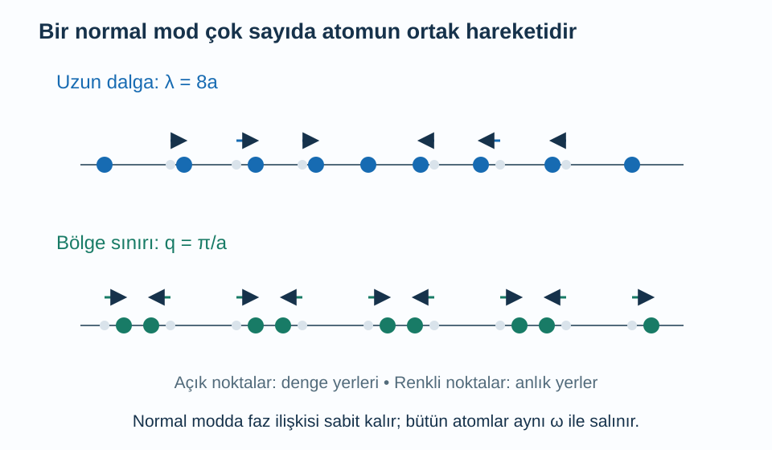
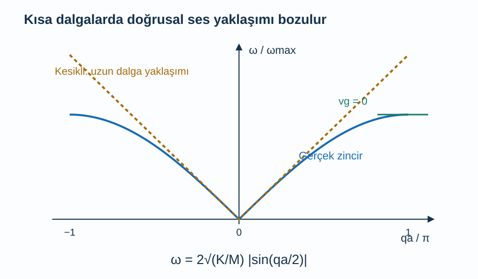

Kristal çizimlerinde atomları sabit noktalar halinde gösteririz. Gerçekte atomlar denge konumları çevresinde hareket eder. Bir atomun yer değiştirmesi komşusunu etkiler; komşunun hareketi de bir sonrakine aktarılır. Bu bağlı hareketler, sesin katı içinde yayılmasından ısı sığasına kadar birçok özelliğin temelidir. Kuantum dilinde bunları anlatan uyarımlara fonon deriz.

Ön bilgilerimiz [dalgalar](/blog/dalgalar-ve-dalga-denklemi/), [kuantum harmonik osilatörü](/blog/kuantum-harmonik-osilatoru/), [ters örgü](/blog/ters-orgu-ve-bragg-kirinimi/) ve [Bose–Einstein dağılımı](/blog/bose-einstein-ve-fermi-dirac-dagilimlari/). Önce atomları klasik yay-kütle sistemi olarak ele alacağız. Ortak hareket biçimlerini bulduktan sonra her bağımsız biçimi kuantumlayacağız. Bu sıra, fononun tek bir atomun başka adı olmadığını açık tutar.

## 1. Bir zincirin hareket denklemi

Bir doğru üzerinde eşit aralıklı, özdeş atomlardan oluşan zincir düşünelim. Denge aralığı $a$, her atomun kütlesi $M$ olsun. $j$ tam sayı etiketli atomun konumunu $x_j=ja+u_j(t)$ yazalım. $u_j(t)$, atomun denge konumundan küçük yer değiştirmesi; $t$ zamandır. Şimdilik yalnız zincir doğrultusundaki hareketi tutuyoruz.

Komşu atomlar arasındaki bağın küçük uzamalarda yay gibi davrandığını kabul edelim. Yay sabiti $K>0$ olsun; birimi $\mathrm{N/m}$'dir. Sağ bağın uzaması $u_{j+1}-u_j$, sol bağın uzaması $u_j-u_{j-1}$ olur. Sağ bağın kuvveti $K(u_{j+1}-u_j)$, sol bağın kuvveti $-K(u_j-u_{j-1})$'dir. Toplayınca Newton denklemi:

$$
M\frac{d^2u_j}{dt^2}=K(u_{j+1}+u_{j-1}-2u_j)
$$

çıkar. Ortadaki $-2u_j$ terimi iki bağın ortak katkısıdır. Bütün atomları aynı miktarda kaydırırsak sağ taraf sıfır olur; hiçbir bağ uzamadığından geri çağırıcı kuvvet doğmaz. Bu basit kontrol denklemin işaretlerini sınamak için yararlıdır.

Yay yaklaşımının nedeni, düzgün bir potansiyelin kararlı minimumu yakınında ilk sıfır olmayan değişimin çoğunlukla ikinci dereceden olmasıdır. Büyük yer değiştirmelerde üçüncü ve daha yüksek dereceli terimler önem kazanır. Bu **anharmonik** terimleri burada ilk adımda dışarıda bırakıyoruz; sonraki ısı taşınımında neden önemli oldukları ortaya çıkacak.

## 2. Normal mod: Her atom ayrı frekansta değil

Bir **normal mod**, bütün atomların tek bir ortak açısal frekansla salındığı, aralarındaki genlik ve faz ilişkilerinin zamanla korunduğu hareket biçimidir. Düzgün zincirde şu deneme çözümünü kullanabiliriz:

$$
u_j(t)=A e^{i(qja-\omega t)}.
$$

$A$ yer değiştirme genliği, $q$ dalga sayısı, $\omega$ açısal frekanstır. Fiziksel yer değiştirme bu karmaşık ifadenin gerçek kısmıdır. Karmaşık gösterim cebiri kısaltır; atomun konumunun karmaşık sayı olduğu anlamına gelmez.

Komşu atomlar için $u_{j+1}=u_je^{iqa}$ ve $u_{j-1}=u_je^{-iqa}$, zamanın ikinci türevi için $d^2u_j/dt^2=-\omega^2u_j$ elde edilir. Denklemde yerine koyup ortak genliğe böldüğümüzde:

$$
\begin{aligned}
-M\omega^2&=K(e^{iqa}+e^{-iqa}-2)\\
&=2K[\cos(qa)-1].
\end{aligned}
$$

$1-\cos x=2\sin^2(x/2)$ özdeşliğini kullanıp iki tarafın işaretini değiştirirsek:

$$
\begin{aligned}
\omega^2(q)&=\frac{4K}{M}\sin^2\left(\frac{qa}2\right)\\
\omega(q)&=2\sqrt{\frac KM}\left|\sin\frac{qa}2\right|.
\end{aligned}
$$

Pozitif frekans kolunu seçtiğimiz için mutlak değer bulunur. Bu ilişki **dağılım bağıntısıdır**: farklı dalga sayılı ortak titreşimlerin hangi frekanslarda salındığını söyler. [Tong'un fonon notları](https://davidtong.org/pdfs/teaching/solid-state-physics/solidstate4.pdf) tek ve iki atomlu zincirleri bu normal mod yaklaşımıyla kurar.

Uzun dalgada yakın komşuların yer değiştirmeleri birbirine yakındır. Bölge sınırında ise komşuların faz farkı $\pi$ olur; bir atom sağa kayarken yanındaki sola kayar. Oklar hız yerine yer değiştirmeyi gösterir.

## 3. Neden yalnız bir Brillouin bölgesi yeter?

$q$ yerine $q+2\pi/a$ yazarsak atom noktalarındaki faz çarpanı $e^{i2\pi j}=1$ olur. Dolayısıyla aynı yer değiştirme dizisini tekrar etiketlemiş oluruz. Bağımsız dalga sayıları için $-\pi/a\le q<\pi/a$ aralığını seçebiliriz. Bölge uçlarını iki ayrı bağımsız durum olarak saymayız.

$N$ atomlu periyodik zincirde ayrıca $u_{j+N}=u_j$ şartı vardır. Bu, $e^{iqNa}=1$ ve $q=2\pi m/(Na)$ verir; $m$ tam sayıdır. Birinci bölgede tam $N$ bağımsız dalga sayısı bulunur. Başlangıçta $N$ yer değiştirme koordinatı vardı; normal modlara geçince de $N$ bağımsız hareket koordinatı olur. Fiziksel serbestlik derecesi yaratmadık, aynı sistemi daha kolay bir bazda yazdık.

Gerçek yer değiştirmeler için pozitif ve negatif dalga sayılı karmaşık bileşenlerin katsayıları ilişkili olur. Bu ayrıntı, her yönü dikkatsizce iki kez saymamak açısından önemlidir. Normal mod sayımını toplam gerçek serbestlik derecesiyle kontrol etmek güvenli bir yöntemdir. Üç boyutlu $N$ atomlu bir kristalde küçük titreşimler için toplam $3N$ mod beklenir.

## 4. Uzun dalga limitinde ses hızı

$|qa|\ll1$ olduğunda sinüs küçük açısına yakındır: $\sin(qa/2)\simeq qa/2$. Dağılım bağıntısı:

$$
\begin{aligned}
\omega(q)&\simeq a\sqrt{\frac KM}|q|\\
&\equiv v_s|q|
\end{aligned}
$$

olur. Burada $v_s=a\sqrt{K/M}$ uzun dalga ses hızıdır. $\sqrt{K/M}$ birimi ters saniye, $a$ birimi metre olduğundan sonuç metre/saniyedir. Küçük dalga sayısında frekansın dalga sayısıyla doğrusal olması, sürekli ortamın ses dalgası resmini geri verir.

Dalga paketinin grup hızı $v_g=d\omega/dq$'dur. Pozitif $q$ için:

$$
v_g(q)=a\sqrt{\frac KM}\cos\left(\frac{qa}2\right).
$$

$q=0$'a sağdan yaklaşırken $v_s$'ye gider, bölge sınırı $q=\pi/a$'da sıfır olur. Frekansın büyük olması paketin hızlı enerji taşıdığı anlamına gelmez. Bölge sınırında atomlar titreşmeye devam ederken eğri yataylaşır ve grup hızı sıfırlanır. Bu ayrım ısı iletiminde neden bütün modların eşit katkı vermediğini anlamamıza yardım eder.

## 5. Sayısal örnek: Bir zincirin frekans ölçeği

$K=20\,\mathrm{N/m}$, $M=5{,}0\times10^{-26}\,\mathrm{kg}$ ve $a=0{,}30\,\mathrm{nm}=3{,}0\times10^{-10}\,\mathrm m$ seçelim. Önce:

$$
\begin{aligned}
\sqrt{K/M}&=\sqrt{4{,}0\times10^{26}}\,\mathrm{s^{-1}}\\
&=2{,}0\times10^{13}\,\mathrm{s^{-1}}
\end{aligned}
$$

buluruz. Ses hızı $v_s=(3{,}0\times10^{-10})(2{,}0\times10^{13})=6000\,\mathrm{m/s}$ olur. Bölge sınırındaki en büyük açısal frekans $\omega_{\max}=2\sqrt{K/M}=4{,}0\times10^{13}\,\mathrm{rad/s}$'dir. Sıradan frekans $\nu_{\max}=\omega_{\max}/(2\pi)\simeq6{,}366\times10^{12}\,\mathrm{Hz}$ olur.

Açısal frekansla frekansı karıştırırsak $2\pi$ çarpanı kadar hata yaparız. İndirgenmiş Planck sabiti $\hbar=1{,}05457\times10^{-34}\,\mathrm{J\,s}$ ile bir fononun sınırdaki enerjisi:

$$
\begin{aligned}
\hbar\omega_{\max}
&=(1{,}05457\times10^{-34})(4{,}0\times10^{13})\,\mathrm J\\
&\simeq0{,}02633\,\mathrm{eV}.
\end{aligned}
$$

Yarı bölge noktasında $q=\pi/(2a)$ için sinüs ve kosinüs $1/\sqrt2$ olur. Frekans $\omega=2{,}828\times10^{13}\,\mathrm{rad/s}$, grup hızı $v_g=4243\,\mathrm{m/s}$ çıkar. Aynı zincirde farklı dalga sayıları farklı enerji ve farklı taşıma hızı taşır.

Kesikli doğru küçük dalga sayısındaki yaklaşımdır. Bölgenin tamamına uzatıldığında gerçek eğriyle aynı kalmaz; kristalin ayrık yapısı kısa dalgalarda görünür hale gelir.

## 6. Normal modu kuantumlamak

Uygun normal koordinatlara geçtiğimizde harmonik zincirin enerjisi bağımsız osilatör enerjilerinin toplamına ayrılır. Her sonlu frekanslı mod, daha önce çözdüğümüz kuantum harmonik osilatörünün biçimini taşır. $q$ modunun enerji düzeyleri:

$$
\begin{aligned}
E_{n_q}&=\hbar\omega_q\left(n_q+\frac12\right)\\
n_q&=0,1,2,\ldots
\end{aligned}
$$

olur. $\omega_q$ o modun frekansı, $n_q$ uyarım sayısıdır. Modun uyarımını bir artırmak sisteme $\hbar\omega_q$ enerji ekler. Bu bir birim uyarıma **fonon** deriz. $n_q$ aynı atomun titreşim sayısı değil, bütün kristale yayılabilen bir ortak modun kuantum doluluğudur.

Sıfır nokta enerjisi $\hbar\omega_q/2$, temel durumda bile bulunur. Bu enerji, klasik anlamda atomun belirli bir sinüs yörüngesinde gezdiği anlamına gelmez; konum ve momentum dalgalanmaları vardır. Tam $q=0$ akustik mod ise serbest kristalin topluca ötelenmesine karşılık gelir ve sıfır frekanslıdır. Onu sonlu frekanslı bir bağlı osilatör gibi kullanmak yerine sınır koşulları ve kütle merkezinin hareketiyle ayrı ele alırız.

Fononlar bozonik uyarımlardır; aynı moda çok sayıda fonon eklenebilir. Ancak elektron sayısından farklı olarak fonon sayısı termal dengede korunmaz. Kristal ısıtılınca veya soğuyunca fononlar oluşabilir ve yok olabilir. Denge Bose dağılımında fonon kimyasal potansiyelinin sıfır olması bu korunmama özelliğiyle ilişkilidir.

## 7. Sayısal örnek: Bir mod ne kadar dolu?

Sonlu frekanslı bir modun ortalama fonon sayısı:

$$
\bar n=\frac1{e^{\hbar\omega/(k_BT)}-1}
$$

olur. $k_B$ Boltzmann sabiti, $T$ mutlak sıcaklıktır. Enerjisi $\hbar\omega=20\,\mathrm{meV}=0{,}020\,\mathrm{eV}$ olan bir mod seçelim. $T=300\,\mathrm K$ için $k_BT=0{,}025852\,\mathrm{eV}$ ve boyutsuz oran $0{,}020/0{,}025852\simeq0{,}77363$ olur. Böylece:

$$
\begin{aligned}
\bar n&=\frac1{e^{0{,}77363}-1}\\
&\simeq0{,}8564.
\end{aligned}
$$

Kesirli ortalama fonon sayısı bir ölçümde fononun kesirli bulunduğu anlamına gelmez. Farklı ölçümlerde sıfır, bir, iki ve daha yüksek sayılar çıkabilir; dağılımın ortalaması kesirlidir. Modun ortalama enerjisi $\hbar\omega(\bar n+1/2)\simeq27{,}13\,\mathrm{meV}$ olur; bunun $10\,\mathrm{meV}$'lik kısmı sıfır nokta katkısıdır.

$T=50\,\mathrm K$ için $k_BT\simeq4{,}3087\,\mathrm{meV}$, oran yaklaşık $4{,}6418$ ve $\bar n\simeq0{,}009734$ çıkar. Modun termal uyarımı çok azalmıştır. Aynı sıcaklıkta daha düşük frekanslı bir mod ise daha kolay uyarılabilir. Bu nedenle ısı sığasını bulmak için tek frekans değil, bütün mod dağılımı gerekir.

## 8. Faz hızı ile enerji taşıma hızı

Bir sinüs dalgasındaki sabit faz noktasını izlersek $q x-\omega t$ sabit kalmalıdır. Zamana göre türev alındığında $q\,dx/dt-\omega=0$ ve **faz hızı** $v_{\mathrm{faz}}=\omega/q$ elde edilir. Bu hız, tek bir tepenin ilerleme hızıdır. Birçok yakın dalga sayısının oluşturduğu paketin zarfı ise $v_g=d\omega/dq$ ile hareket eder. Dağılım doğrusal olduğunda iki değer eşit olabilir; genel eğride farklıdır.

Zincir örneğinde bölge sınırındaki pozitif dalga sayısı $q=\pi/a$ için faz hızı $v_{\mathrm{faz}}=\omega_{\max}a/\pi=2v_s/\pi$ olur. Sayılarımızla yaklaşık $3820\,\mathrm{m/s}$ çıkar. Aynı noktada grup hızının sıfır olduğunu bulmuştuk. Dolayısıyla sonlu bir faz hızı görmek, o noktada dar bir dalga paketinin aynı hızla enerji taşıdığını kanıtlamaz.

Tam bölge sınırındaki yer değiştirme örüntüsü, komşu atomların zıt fazda titreştiği özel bir sınır hareketidir. Gerçek bir enerji paketi tek bir kusursuz dalga sayısından oluşmaz; yakın dalga sayılarının toplamıdır. Bu nedenle taşıma hesabında eğrinin yerel eğimine bakarız. Faz ve grup hızının ayrılması, örgü titreşimlerini gözle görülür bir yay dalgası benzetmesinden daha doğru bir matematiksel tanıma taşır.

## 9. Bir hücrede birden fazla atom varsa

Üç boyutta ilkel hücrede $r$ atom bulunursa her dalga vektöründe $3r$ titreşim dalı vardır. Bunların üçü uzun dalga limitinde frekansı sıfıra giden **akustik dallardır**; atomlar yaklaşık birlikte öteleme hareketi yapar. Kalan $3r-3$ dal genellikle hücre içindeki atomların birbirine göre hareketlerini içerir ve **optik dal** diye adlandırılır.

“Optik” adı, bazı kristallerde bu göreli hareketin elektrik dipolünü değiştirmesiyle ışıkla bağlaşabilmesinden gelir. Her optik modun her polarizasyonda optik olarak etkin olması gerekmez. Akustik modlar da yalnız duyulabilir frekanslarla sınırlı değildir. Bu terimler frekansın insan duyusuna uygunluğunu değil, dalın uzun dalga davranışını sınıflandırır.

Harmonik yaklaşımda modlar birbirinden bağımsızdır. Gerçek kristalde anharmonik terimler, kusurlar ve sınırlar modlar arasında enerji aktarımına ve saçılmaya yol açar. [MIT'nin örgü titreşimleri ders dizisi](https://ocw.mit.edu/courses/6-730-physics-for-solid-state-applications-spring-2003/pages/lecture-notes/) tek atomlu zincirden iki atomlu hücreye ve ısı sığasına geçişi birlikte sunar. Fononu hem enerji düzeyi hesabı hem kolektif hareket olarak görmek, sonraki termodinamik adımın temelini oluşturur.
