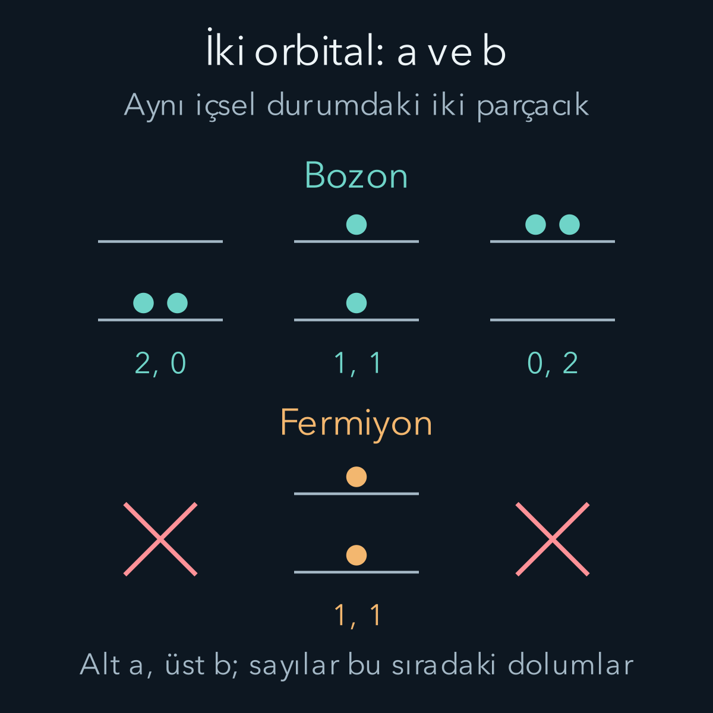
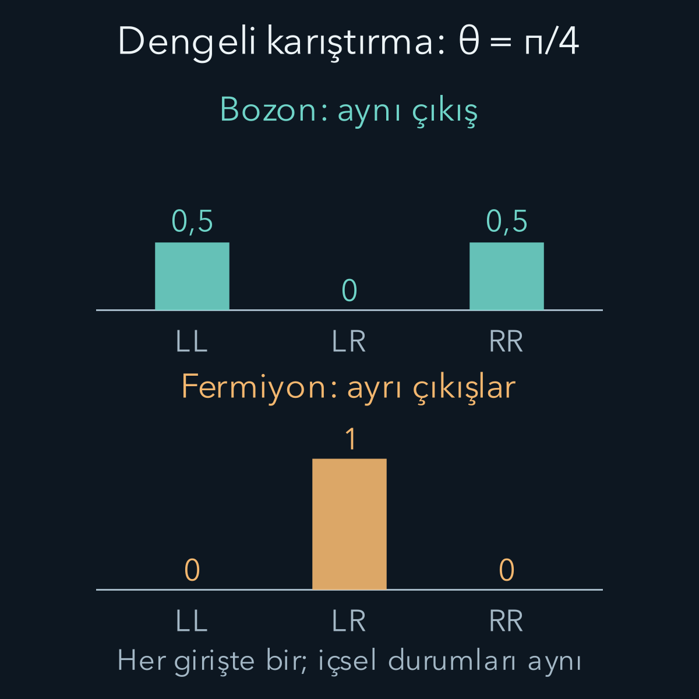

import ArticleVideo from '@/components/ArticleVideo.astro'
import kavram from './media/01-kavram.mp4?url'
import kavramPoster from './media/01-kavram.jpg?url'

İki elektronu farklı kutulara koyabiliriz; fakat birinin üzerine onu bütün deneyler boyunca tanımlayan görünmez bir seri numarası yazamayız. Elektronların kütlesi, yükü ve spini aynı türün özellikleridir. Farklı konumlarda veya farklı enerjilerde bulunmaları onları farklı parçacık türlerine dönüştürmez. Kuantum hesabında bu özdeşlik, çok parçacıklı durumların hangi biçimleri alabileceğini sınırlar.

[Önceki yazıda](/blog/acisal-momentumlarin-toplanmasi/) iki spin yarımın tekli ve üçlü birleşimlerini kurduk. Burada o birleşimlerin değiş tokuş altında nasıl davrandığını uzaysal durumla birlikte ele alacağız. [Tensör çarpımı](/blog/tensor-carpimi-ve-dolaniklik/), [genlik ile olasılık ayrımı](/blog/kuantum-durumu-superpozisyon-ve-born-kurali/) ve [sonsuz kuyu](/blog/sonsuz-potansiyel-kuyusu/) örneği hesaplar için yeterli önbilgidir. Yeni konu, sıradan bir olasılık toplamının yerine ne zaman genlik toplamı koymamız gerektiğidir.

## 1. Benzer görünmek ile özdeş olmak

İki aynı renk topu, üzerlerindeki küçük çiziklerden veya kesintisiz izlediğimiz yörüngelerinden ayırabiliriz. Kuantum özdeşliği daha güçlüdür: Aynı türden parçacıkların içsel özellikleri aynıdır; duruma yapay olarak eklenen “birinci” ve “ikinci” etiketleri gözlenebilir bir kimlik değildir.

Bu, iki elektronun aynı durumda bulunduğu anlamına gelmez. Birisi soldaki dalga paketinde, diğeri sağdakinde olabilir. Sol ve sağ bölgeleri ayrı ayrı adresleyebiliriz. Fakat dalga paketleri örtüştüğünde “sonda solda bulunan, başta hangi elektrondu?” sorusu, bütün deneyler için belirli bir klasik yörüngeyle cevaplanamaz. Hesabımız, erişilemeyen etiketlere bağlı sonuç üretmemelidir.

Yine de matematikte koordinat yuvalarını ayırmak için 1 ve 2 kullanacağız. $q_1$ birinci yuvanın bütün değişkenlerini, $q_2$ ikincininkileri göstersin. Burada $q$ yalnız konum olmayabilir; spin gibi içsel durum etiketlerini de kapsar. Tam dalga fonksiyonu $\Psi(q_1,q_2)$ bu iki yuvaya bağlıdır. Etiketleri araç olarak kullanmak ile onları fiziksel kimlik saymak farklıdır.

## 2. Değiş tokuş işleci

$P_{12}$ işleci, iki yuvanın tüm değişkenlerini yer değiştirir:

$$
(P_{12}\Psi)(q_1,q_2)=\Psi(q_2,q_1).
$$

İşlemi iki kez yapınca başlangıca döneriz; dolayısıyla $P_{12}^2=I$ olur. Burada $I$ birim işleçtir. Eğer $\Psi$ bir özdurum ve $P_{12}\Psi=\eta\Psi$ ise ikinci uygulama $\eta^2\Psi=\Psi$ verir. Sıfır olmayan bir durumda $\eta^2=1$, yani $\eta=+1$ veya $-1$ çıkar.

Artı özdeğerli duruma simetrik, eksi özdeğerliye antisimetrik deriz. “Antisimetrik” sözcüğü olasılığın negatif olduğu anlamına gelmez: Genlik işaret değiştirir; mutlak karesi değişmez. Her iki durumda da $|\Psi(q_2,q_1)|^2=|\Psi(q_1,q_2)|^2$ olur.

Burada cebir tek başına doğanın hangi durumları seçtiğini kanıtlamadı. Sıradan üç boyutlu uzayda özdeş **bozonların** tam durumu simetrik, özdeş **fermiyonların** tam durumu antisimetrik alınır. Bozonların spini tam sayı, fermiyonlarınki yarım tam sayıdır. Elektron spin yarım olduğundan fermiyondur. Spin ile istatistik arasındaki bu bağlantının genel açıklaması göreli kuantum alan kuramına dayanır; $P_{12}^2=I$ hesabı o açıklamanın yerine geçmez. Burada bağlantıyı deneyle uyumlu bir fizik ilkesi olarak kullanıyoruz.

Değiş tokuş burada iki parçacığı laboratuvarda fiziksel yollardan dolaştırma işlemi değildir. Aynı durumu matematikte hangi koordinat yuvasıyla tarif ettiğimizi değiştiriyoruz. Bu nedenle dışarıdan uygulanan bir dönme, bir parçacığı bir konumdan başka konuma taşıma ve etiketleri değiştirme birbirinden ayrı işlemlerdir. Ölçülebilir bir toplam enerji veya toplam konum sayımı, etiketlerin hangisine birinci dediğimize bağlı olamaz.

Hamiltonyen de özdeşlik koşuluna uyarsa $[H,P_{12}]=0$ olur. Bunun anlamı, önce etiketleri değiştirip sonra zaman evrimi uygulamanın ters sırayla aynı sonucu vermesidir. Başlangıçta simetrik hazırlanan durum bu evrimle antisimetrik hâle gelmez. Böylece simetri yalnız bir başlangıç fotoğrafının özelliği olarak kalmaz; özdeş parçacıkların etkileşimleri boyunca korunur. Parçacıkların birbirlerine kuvvet uygulaması bu gerekliliği kaldırmaz, yalnız izinli uzay içindeki hareketi değiştirir.

## 3. İki ortogonal durumdan ortak durum kurmak

$|a\rangle$ ve $|b\rangle$ normalize, birbirine dik tek parçacık durumları olsun: $\langle a|a\rangle=\langle b|b\rangle=1$, $\langle a|b\rangle=0$. Kısa yazımda $|ab\rangle=|a\rangle_1\otimes|b\rangle_2$ diyelim. Değiş tokuş $|ab\rangle$ ile $|ba\rangle$'yı birbirine götürür. Uygun birleşimler:

$$
\begin{aligned}
|ab\rangle_+&=\frac{|ab\rangle+|ba\rangle}{\sqrt2},\\
|ab\rangle_-&=\frac{|ab\rangle-|ba\rangle}{\sqrt2}.
\end{aligned}
$$

olur. Alt artı ve eksi simetriyi belirtir. Normalizasyonu açarsak dört iç çarpım gelir. İki doğrudan terim birer, iki çapraz terim $\langle a|b\rangle\langle b|a\rangle=0$ olduğundan norm karesi $(1+1)/2=1$ çıkar.

Bu payda her durumda otomatik olarak $\sqrt2$ değildir. Normalize fakat örtüşen durumlar için $s=\langle a|b\rangle$ dersek, payın norm karesi $2\pm2|s|^2$ olur. Payda bunun kareköküdür. Böylece neden önce ortogonallik varsaydığımızı görürüz. $|a\rangle=|b\rangle$ olduğunda simetrik normalize durum doğrudan $|aa\rangle$'dır; önceki $\sqrt2$ formülüne körlemesine yerleştirmek fazla norm üretir.

## 4. Pauli ilkesi bir sıfırlanma hesabıdır

Antisimetrik birleşimde iki tek parçacık durumu aynıysa:

$$
|aa\rangle-|aa\rangle=0.
$$

Sıfır vektörün normunu bire çıkaramayız; hiçbir ölçüm için toplam olasılık taşımaz. Bu nedenle iki özdeş fermiyon aynı **tam tek parçacık durumunu** işgal edemez. Pauli dışarlama ilkesi dediğimiz kısıt budur. Hesaba ayrıca iki parçacığı iten yeni bir kuvvet eklemedik.

“Tam” sözcüğü kritiktir. Bir uzaysal orbital, yalnız konuma bağlı normalize bir dalga fonksiyonudur. Aynı orbitalde bir spin yukarı ve bir spin aşağı elektron bulunabilir; çünkü $\phi(\mathbf r)|\uparrow\rangle$ ile $\phi(\mathbf r)|\downarrow\rangle$ farklı, ortogonal tam durumlardır. Bir orbitalin en çok iki elektron alması, elektronun iki spin durumuyla birlikte anlaşılır. Üçüncü elektron aynı iki tam durumdan birini tekrarlamak zorunda kalır.

Buna karşılık bütün spinleri aynı hazırlanmış elektronlarda içsel spin çarpanı simetriktir. Tam durumun antisimetrik kalması için uzaysal kısım antisimetrik olmalıdır. Bu özel koşulda aynı konuma ait iki uzaysal değişkeni eşitleyince $\Psi(x,x)=-\Psi(x,x)$, dolayısıyla $\Psi(x,x)=0$ çıkar. Farklı spinleri olan elektronlar için bu uzaysal sıfırlanmayı koşulsuz ileri süremeyiz.

## 5. İki elektronun spin ve uzay parçaları

Durum uzaysal ve spin çarpanı olarak ayrılabiliyorsa, değiş tokuş işareti iki çarpanın işaretlerinin çarpımıdır. Önceki yazının tekli spin durumu:

$$
\chi_s=\frac{|\uparrow\downarrow\rangle-|\downarrow\uparrow\rangle}{\sqrt2}
$$

antisimetriktir. Dolayısıyla iki elektron için bunu simetrik bir uzaysal durumla çarparız. Üçlü spin durumları simetrik olduğundan, onların uzaysal çarpanı antisimetrik olmalıdır. İki eksi işaretin çarpımı artı olacağı için antisimetrik uzay ile antisimetrik spini bir araya getirmek elektronların istediği toplam işareti vermez.

Örneğin aynı $\phi$ orbitalindeki iki elektronun durumu $\phi(\mathbf r_1)\phi(\mathbf r_2)\chi_s$ olabilir. Uzaysal çarpım değişmez; spin kısmı işaret değiştirir. Bu anlatım, elektronların her anda belirli karşıt klasik yönlerde döndüğü anlamına gelmez; singletin ortak eksende ölçülen sonuçları karşıttır.

Aynı orbital örneğinde spin sonuçlarını da açıkça yazabiliriz. $\sigma_1,\sigma_2$ spin değişkenleri olsun. Tam fonksiyonun $\uparrow\uparrow$ ve $\downarrow\downarrow$ bileşenleri sıfırdır. Diğer ikisi:

$$
\begin{aligned}
\Psi(\mathbf r_1\uparrow,\mathbf r_2\downarrow)
&=\frac{\phi(\mathbf r_1)\phi(\mathbf r_2)}{\sqrt2},\\
\Psi(\mathbf r_1\downarrow,\mathbf r_2\uparrow)
&=-\frac{\phi(\mathbf r_1)\phi(\mathbf r_2)}{\sqrt2}.
\end{aligned}
$$

Spinleri ayırmayan bir konum ölçümünde ortogonal spin sonuçlarının olasılıklarını toplarız. İki yarım katkı, $|\phi(\mathbf r_1)|^2|\phi(\mathbf r_2)|^2$ yoğunluğunu verir. Dolayısıyla konumları eşitlediğimizde bu yoğunluk genel olarak sıfırlanmaz. Antisimetrinin istediği şey, **konum ve spin birlikte** değiştirildiğinde genliğin işaret çevirmesidir. İki konumu eşitlemek, iki tam tek parçacık durumunu eşitlemekle aynı işlem değildir. Pauli ilkesini yalnız elektronların konumda birbirinden uzak kalması şeklinde okumamak için bu ayrımı hesap üzerinde görmek yararlıdır.

Bu işaretleri uzayda da sayıya dönüştürebiliriz. Uzunluğu L olan sonsuz kuyunun ilk iki orbitalini alalım:

$$
\begin{aligned}
u_1(x)&=\sqrt{\frac2L}\sin\frac{\pi x}L,\\
u_2(x)&=\sqrt{\frac2L}\sin\frac{2\pi x}L.
\end{aligned}
$$

Burada $u_1,u_2$ fonksiyon adları, $0<x<L$ aralığı kuyunun içidir. Birer orbital doluysa uzaysal birleşim $\Psi_\pm(x_1,x_2)=[u_1(x_1)u_2(x_2)\pm u_2(x_1)u_1(x_2)]/\sqrt2$ olur. $x_1=L/4$ ve $x_2=3L/4$ seçelim. Bu noktalarda ilk orbitalin değerleri aynı, $1/\sqrt L$'dir; ikinci orbitalin değerleri sırasıyla $+\sqrt{2/L}$ ve $-\sqrt{2/L}$ olur. Doğrudan ürün $-\sqrt2/L$, değiş tokuş ürünü $+\sqrt2/L$ çıkar. Toplamda birbirlerini götürürler; farkta $-2\sqrt2/L$ verirler. Normalizasyon paydasını da katınca $\Psi_+=0$ ve $\Psi_-=-2/L$ buluruz.

Dolayısıyla bu iki koordinattaki ortak yoğunluklar sıfır ve $4/L^2$'dir. Bu, antisimetrik durumun her yerde daha küçük yoğunluk taşıdığı anlamına gelmez. Her ikisi de normalize olduğundan bir yerde azalan ağırlık başka yerlere dağılır. Tek bir sürekli konum noktasının olasılığı sıfırdır; hesapladığımız büyüklük yoğunluktur. Küçük iki aralığa ait etiketli ortak olasılık yaklaşık $|\Psi(x_1,x_2)|^2\Delta x_1\Delta x_2$ olur. Aralıklar ayrıysa ve yalnız “her aralıkta bir parçacık” diye sayıyorsak, ters etiketli yerleşimin de aynı olasılığını ekleriz. Böylece gözlenmeyen etiketler ölçüm sonucunda kalmaz.

Öte yandan $x_1=x_2=L/4$ seçildiğinde bu kez simetrik genlik $2/L$, antisimetrik genlik sıfırdır. Aynı iki orbital, seçilen simetriye göre farklı konum korelasyonları oluşturur. Bu örnekte uzaysal artı ve eksi seçeneklerini fiziksel parçacığa atarken spin koşulunu korumamız gerekir: elektronlarda artı uzay tekli spinle, eksi uzay üçlü spinle tamamlanır.

## 6. Kısıt enerji tablosunu değiştirir

Etkileşmeyen iki parçacık ve tek parçacık enerjileri $\varepsilon_a<\varepsilon_b$ olan iki orbital düşünelim. Toplam Hamiltonyen $H=h_1+h_2$ olduğunda ürün durumunun enerjisi tek parçacık enerjilerinin toplamıdır. $|ab\rangle$ ile $|ba\rangle$ aynı $\varepsilon_a+\varepsilon_b$ enerjisine sahiptir; simetrik veya antisimetrik birleşimleri de aynı enerji özdurumlarıdır.

İçsel durumları aynı iki bozonun en düşük enerjisi $2\varepsilon_a$ olur; ikisi a orbitalini doldurabilir. Aynı içsel durumdaki iki fermiyon için bu dolum yasaktır. En düşük seçenek bir a ve bir b ile $\varepsilon_a+\varepsilon_b$'dir. Örneğin $\varepsilon_a=1\,\mathrm{eV}$ ve $\varepsilon_b=4\,\mathrm{eV}$ ise iki enerji sırasıyla 2 ve 5 eV çıkar.

Bu farkı gerçek iki elektronun her durumda 5 eV taşıdığı biçiminde okumayalım. Karşıt spin durumlarına izin verilirse iki elektron aynı uzaysal orbitalde bulunabilir. Ayrıca gerçek elektronlar birbirlerini elektriksel olarak iter; etkileşmeyen modelimiz bu ek enerjiyi içermiyor. Önce hangi durumlara izin verildiğini, sonra hangi Hamiltonyenin onların enerjisini verdiğini ayrı ayrı belirlemeliyiz.

Şekildeki dolumları sayarken etiketlerin nasıl ortadan kalktığına da dikkat edelim. İki bozon için a'da iki, her orbitalde bir ve b'de iki olmak üzere üç bağımsız dolum vardır. “Birinci a'da, ikinci b'de” ile tersini iki ayrı fiziksel dolum saymayız; izinli simetrik birleşimde bunlar zaten birlikte bulunur. Aynı içsel durumdaki iki fermiyon için iki orbital arasında yalnız bir dolum kalır. Böylece tek parçacık uzayında iki seçenek olması, her istatistik için iki parçacık uzayının aynı boyutta olması demek değildir.

Bu sayma orbital enerjilerini değiştirmedi. Değişen, o enerjilerle kurulan hangi çok parçacıklı durumların kullanılabildiğidir. İki parçacığı ayrı ayrı ölçtüğümüzde sonuçlar bu nedenle bağımsız iki seçim gibi dağılamayabilir. Ortak durumdaki kısıt, etkileşme bulunmasa bile korelasyon üretir. Enerji örneğiyle konum örneğini birleştiren temel nokta bu ortak durum koşuludur.

## 7. Eksi işaret neden ölçülebilir bir fark yaratır?

Bütün durumun $-1$ ile çarpılması ölçüm olasılığını değiştirmez. Öyleyse fermiyonun eksi işareti neden önemlidir? Çünkü $|ab\rangle-|ba\rangle$, $|ab\rangle+|ba\rangle$'nın bütünüyle eksiyle çarpılması değildir. İki alternatifin **göreli** işareti değişir. Farklı ölçüm bazına geçince bu iki katkı aynı sonuca ulaşabilir ve birbirini güçlendirebilir veya silebilir.

Bunu iki ortogonal çıkış modu $|L\rangle$ ve $|R\rangle$ ile hesaplayalım. Mod, parçacığın bulunabileceği tek parçacık durumunu belirtir; L ve R iki ayrı çıkış yolu olabilir. Kayıpsız bir dönüştürücünün iki giriş durumu üzerindeki etkisini şu gerçek katsayılarla seçelim:

$$
\begin{aligned}
|a\rangle&\longmapsto c|L\rangle+s|R\rangle,\\
|b\rangle&\longmapsto-s|L\rangle+c|R\rangle.
\end{aligned}
$$

burada $c=\cos\theta$, $s=\sin\theta$ ve $\theta$ karıştırma açısıdır. Normlar $c^2+s^2=1$, iç çarpım $-cs+sc=0$ olduğundan dönüşüm üniterdir. İkinci satırdaki eksi keyfî bir kayıp değildir; seçtiğimiz faz konvansiyonunda sütunların dik kalmasını sağlar.

Birinci ürünün dönüşümü $-cs|LL\rangle+c^2|LR\rangle-s^2|RL\rangle+sc|RR\rangle$ olur. İkinci ürünün dönüşümü $-sc|LL\rangle-s^2|LR\rangle+c^2|RL\rangle+cs|RR\rangle$'dır. Şimdi iki ifadeyi toplamak veya çıkarmak fiziksel farkı görünür kılar.

## 8. Aynı dönüştürücü, farklı sayım olasılıkları

Simetrik giriş için sonuç:

$$
\begin{aligned}
|ab\rangle_+\longmapsto{}&-\sqrt2cs|LL\rangle\\
&+(c^2-s^2)|LR\rangle_+\\
&+\sqrt2cs|RR\rangle.
\end{aligned}
$$

Burada $|LR\rangle_+=(|LR\rangle+|RL\rangle)/\sqrt2$ birer parçacığın iki ayrı çıkışta bulunduğu normalize durumdur. Aynı çıkışta iki parçacık bulunmasını temsil eden $|LL\rangle$ ve $|RR\rangle$ zaten normalize edilmiştir. Üç olasılık:

$$
\begin{aligned}
P_{LL}=P_{RR}&=\frac12\sin^2(2\theta),\\
P_{LR}&=\cos^2(2\theta)
\end{aligned}
$$

çıkar. Toplamları birdir. Antisimetrik girişte ise LL ve RR genlikleri birbirini götürür; LR ile RL farkının katsayısı $c^2+s^2=1$ olur. Dolayısıyla çıkış yine $|LR\rangle_-$'dır ve birer parçacık bulma olasılığı her açıda birdir.

$\theta=\pi/8$ için bozon olasılıkları sırayla $1/4,1/2,1/4$; $\theta=\pi/4$ için $1/2,0,1/2$ olur. Son durumda iki çıkış simetriktir ama parçacıklar birer birer paylaşılmaz: Her deneyde ikisi aynı çıkışta bulunur. Hangi çıkış olduğu rastgeledir. Fermiyonlar ise verdiğimiz aynı içsel durum koşulunda ayrı çıkışlarda bulunur.

<ArticleVideo src={kavram} poster={kavramPoster} title="İki modda değiş tokuş girişimi" caption="Aynı üniter dönüştürücünün θ açısı 0 ile π/4 arasında taranıyor. Üstte simetrik, altta antisimetrik iki parçacık girişi var. LL ve RR aynı çıkışta iki sayımı, LR iki çıkışta birer sayımı gösterir. Her açı ayrı bir deney ayarıdır; parçacıkların yörüngeleri çizilmiyor." />

Karşılaştırma için ayırt edilebilir iki parçacığı aynı tek parçacık dönüşümünden geçirebiliriz. Birini a, diğerini b girişine hazırlarsak LL olasılığı $c^2s^2$, RR de $c^2s^2$ olur. Ayrı çıkış olasılığı $c^4+s^4$'tür. Dengeli ayarda sonuçlar $1/4,1/2,1/4$ çıkar. Burada son parçacıkları ayıran içsel kayıtlar alternatifleri ortogonal tuttuğundan, ilgili sayımda iki değiş tokuş genliği arasında aynı girişim oluşmaz.

Bu karşılaştırma, girişlerde birer parçacık hazırlanmasını ve dönüşümün ikisinin de ilgili durumuna aynı biçimde etki etmesini varsayar. Bozon örneğinde zamanlama, frekans veya içsel durum gibi başka bir özellik hangi girişten geldiğini ayırt ettirirse kusursuz girişim kaybolabilir. Dolayısıyla deneyde aynı türden olmak gereklidir ama tek başına ideal sayım tablosunu sağlamaz; hazırlanış ve ayırt edilebilirlik de denetlenir.

## 9. İşaret konvansiyonu ile fiziksel kısıtı ayırmak

Fermiyon durumunu $|ab\rangle_-$ yerine $|ba\rangle_-$ sırasıyla yazmak bütün vektörü eksiyle çarpar. Bu genel fazın gözlenebilir etkisi yoktur. Fakat aynı yazım içinde iki ürün arasındaki eksiyi artıya çevirmek simetri sınıfını değiştirir. Sabit bir orbital sırası seçmek işaret hesabını tutarlı tutar.

İki parçacık farkının determinant gösterimini açmak da bu işaret düzenini kontrol etmenin bir yoludur. Ortonormal tam tek parçacık fonksiyonları a ve b için:

$$
\Psi(q_1,q_2)=\frac1{\sqrt2}
\begin{vmatrix}
a(q_1)&b(q_1)\\
a(q_2)&b(q_2)
\end{vmatrix}.
$$

İki satırlı determinant, sol üst ile sağ alt elemanın çarpımından sağ üst ile sol alt elemanın çarpımını çıkarır. Böylece daha önceki antisimetrik toplamı aynen verir. q değişkeninin spini de içerdiğini korursak bu formül aynı uzaysal orbitaldeki karşıt spin örneğini de kapsar; sütunları yalnız uzaysal fonksiyon sanarsak izinli bir elektron durumunu yanlışlıkla sıfırlayabiliriz.

Daha çok fermiyonda benzer yapı Slater determinantıyla kurulur. Determinantın sütunları tek parçacık durumlarını, satırları koordinat yuvalarını içerir. İki satırın değişimi işaret çevirir; iki aynı sütun determinantı sıfırlar. Böylece değiş tokuş ve Pauli koşulları aynı matematiksel yapı içinde korunur. Ortonormal N tek parçacık durumu kullanıldığında normalleştirme katsayısı $1/\sqrt{N!}$ olur; faktöriyel, değişik yerleşimlerin sayısını karşılar. Her çok fermiyonlu durum tek bir determinant olmak zorunda değildir; etkileşen sistemlerde birden fazla izinli determinantın tutarlı toplamına gerek duyulabilir.

Bozonları “her zaman birbirini çeken”, fermiyonları “her zaman birbirini iten” parçacıklar diye düşünmek bu yüzden yanıltıcıdır. Hesapladığımız fark, etkileşme eklemeden de ortaya çıktı. Ayrıca her bozon durumunda aynı çıkışta toplanma şart değildir; giriş durumu ve ölçüm düzeneği belirleyicidir. Uzaysal örtüşmenin ihmal edilebildiği, ayrı bölgelerde adreslenen parçacıklarda değiş tokuşun bazı ölçümlerdeki etkisi çok küçük olabilir. Tam durumun simetri koşulu yine geçerlidir; deneyin hangi ayrıntıları çözebildiği değişir.

## Kaynaklar

Değiş tokuş işleci, simetrileştirme ve Pauli koşulu [MIT OCW, Quantum Physics III, Chapter 8: Identical Particles](https://ocw.mit.edu/courses/8-06-quantum-physics-iii-spring-2018/fb48dd49e8649557f1715f0415de4f4d_MIT8_06S18ch8.pdf) ile kontrol edildi. Ayırt edilemeyen alternatiflerin genliklerini birleştirme gerekçesi [The Feynman Lectures, Cilt III, Bölüm 4: Identical Particles](https://www.feynmanlectures.caltech.edu/III_04.html) üzerinden doğrulandı. İki modun seçilen gerçek dönüşümü, sayısal karşılaştırmalar ve Manim görselleri bu anlatım için özgün olarak hazırlandı.

Kaynak bağlantıları ve ilgili bölümler 12 Ekim 2026 tarihinde doğrudan kontrol edildi.
