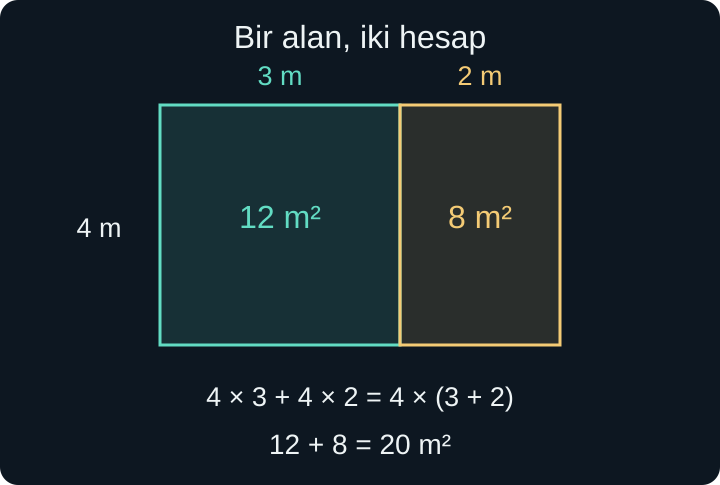
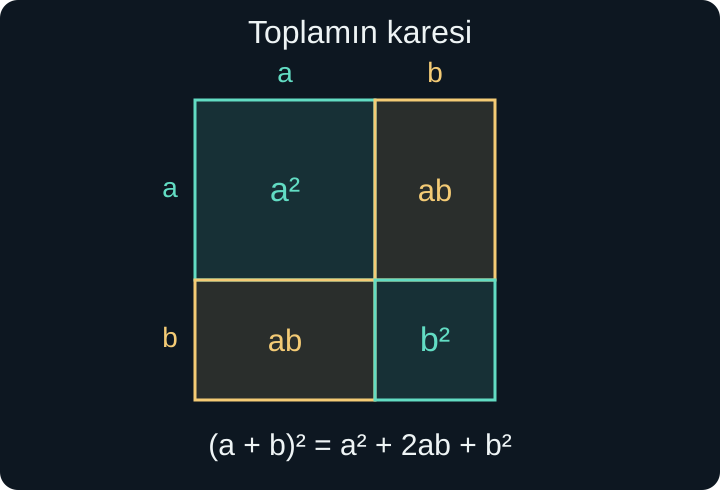

import ArticleVideo from '@/components/ArticleVideo.astro'
import kavram from './media/01-kavram.mp4?url'
import kavramPoster from './media/01-kavram.jpg?url'

Kenarları 4 metre ve 3 metre olan bir bahçenin yanına, aynı genişlikte 2 metrelik bir bölüm eklendiğini düşünelim. Eski alan $4\times3=12$, eklenen alan $4\times2=8$ metrekaredir. Bütün bahçeyi tek bir dikdörtgen olarak ölçersek $4(3+2)=20$ metrekare buluruz. Parçaları toplayarak da $12+8=20$ elde ederiz.

Aynı alanın iki hesabı, cebirdeki iki yönlü bir hareketi gösteriyor: $4(3+2)$ ifadesini $4\times3+4\times2$ biçiminde **açabilir**, toplamı yeniden ortak çarpan kullanarak **çarpım** biçimine getirebiliriz. Bu yazıda bu iki yönü, daha büyük harfli ifadeleri okuyabilmek için kullanacağız.

[Önceki yazıda](/blog/harfler-esitlikler-ve-denklemler/) terim, katsayı, yerine koyma ve eşitliği koruyan işlemleri kurduk. Burada ayrıca üs kurallarını ve kesirlerin dört işlemini kullanacağız. Bir ifadeyi sadeleştirmekle denklem çözmek arasındaki ayrımı koruyacağız: Ortada bir eşitlik koşulu yoksa, harfin değerini aramıyoruz.

## 1. Alanı Bölmek, Dağılmayı Görmek

Bahçenin ortak genişliğine $a$, iki bölümün uzunluklarına $b$ ve $c$ diyelim. Bütün uzunluk $b+c$, alan $a(b+c)$ olur. İki parçanın alanları ise $ab$ ve $ac$'dir. Örtüşmeyen parçalar bütünü doldurduğu için:

$$
a(b+c)=ab+ac.
$$

Bu eşitlik, **dağılma özelliğidir**. Uzunluklarla başladığımız için şekilde $a$, $b$ ve $c$ pozitiftir. Cebirsel eşitlik ise negatif sayılar ve sıfır için de geçerlidir; bu daha genel geçerlik aritmetiğin dağılma kuralına dayanır. Negatif sayıya geometrik bir kenar uzunluğu uydurmamız gerekmez.

Sol taraftan sağa giderken parantezin dışındaki $a$'yı içerideki **her** terimle çarparız. Sağdan sola giderken iki terimde de bulunan ortak $a$ çarpanını görünür kılarız. Alan şekli bu iki yazımın aynı miktarı anlattığını gösterir; bir biçim parçaları, diğeri bütünün kenarlarını öne çıkarır.

Eksi işareti bulunduğunda da kural değişmez. $3(x-4)=3x-12$ olur. Parantezin dışındaki sayı negatifse her terimin işareti buna göre değişir: $-2(x-5)=-2x+10$. Sadece ilk terimi çarpmak, bütünü değil bir parçayı dönüştürmek olur.

## 2. Polinom Nedir?

$x$ bir gerçek sayı değişkeni olsun. $3x^2-5x+7$ ifadesi sonlu sayıda terimin toplamıdır. Her terimde $x$, sıfır veya pozitif tam sayı kuvvetiyle bulunur. Böyle ifadelere, tek değişkenli durumda, **polinom** denir.

Bu örnekte terimler $3x^2$, $-5x$ ve 7'dir. Katsayılar sırasıyla 3, $-5$ ve 7'dir. Sabit terim olan 7, $x$'e bağlı değildir. $x^0=1$ gösterimi uygun olduğunda onu sıfırıncı kuvvetli terim olarak düşünebiliriz; polinomu $x=0$ noktasında değerlendirmek için $0^0$ hesaplamaya gerek yoktur, sabit terim doğrudan 7'dir.

Bir terimdeki üs onun **derecesidir**. Düzenlenmiş bir polinomda katsayısı sıfır olmayan en yüksek kuvvet, polinomun derecesini verir. $3x^2-5x+7$ ikinci derecedir. $8x^3+x-1$ üçüncü, sıfır olmayan sabit bir polinom sıfırıncı derecedir. Sıfır polinomunun derecesini burada tanımlamıyoruz.

$1/x=x^{-1}$ ve $\sqrt{x}=x^{1/2}$ ifadeleri bu tanıma göre $x$'te polinom değildir. Sorun harf içermeleri değil, üslerinin izin verilen türde olmamasıdır. Buna karşılık $\frac12x^2+\sqrt2x-3$ bir polinomdur: Katsayılar kesirli veya irrasyonel olabilir; değişkenin kuvvetleri 2, 1 ve 0'dır.

Şimdilik tek değişkenli ifadeler üzerinde duruyoruz. $2xy+3x$ gibi birden fazla değişken içeren polinomlar da vardır; ancak burada “derece” dediğimizde hangi değişkene göre konuştuğumuzu belirttiğimiz basit çerçeve yeterlidir.

### Dereceyi okumadan önce aynı kuvvetleri toplamak

$5x^3+2x-5x^3+4$ yazımında üçüncü kuvvet görünür, fakat iki küplü terimin toplamı sıfırdır. İfade bütün $x$ değerlerinde $2x+4$'e eşittir. Bu yüzden düzenlenmiş polinom birinci derecedir. Dereceyi belirlerken yalnız en büyük görünen üsse bakmak, birbirini götüren terimleri hesaba katmamış olur. Benzer biçimde $x^2-x^2+7$ sabit 7 polinomudur; seçilen $x$ sayısı sonucu değiştirmez.

Bir terimin katsayısının sıfır olması ile değişkenin belirli bir değerde sıfır olması da ayrıdır. $3x^2$ polinomunun katsayısı 3'tür ve derecesi 2'dir. $x=0$ seçince değeri sıfır olur; fakat polinomun derecesi bu değerlendirmeyle değişmez. Derece, tek bir girdide çıkan sonucu değil, değişkenin farklı değerleri için kullandığımız ifadenin yapısını anlatır. $\sqrt2x$ teriminde de kökün altında yalnız sabit 2 vardır, değişken $x$ kökün dışında ve birinci kuvvettedir. Bu nedenle irrasyonel bir katsayı polinom olmayı bozmaz. Önce değişkenin nerede durduğunu belirlemek, biçimsel tanımın neden bu örnekleri farklı sınıflandırdığını açıklar.

## 3. Benzer Terimleri Birleştirmek

$4x^2+3x-2x^2+5x-6$ ifadesinde kareli terimleri kendi aralarında, birinci kuvvetli terimleri kendi aralarında birleştirebiliriz:

$$
(4-2)x^2+(3+5)x-6=2x^2+8x-6.
$$

**Benzer terimler**, değişken kısmı ve üsleri aynı olan terimlerdir. $4x^2$ ile $-2x^2$ benzerdir; $4x^2$ ile $3x$ değildir. Birinde dört adet “$x$'in karesi”, diğerinde üç adet “$x$” vardır. Bunları katsayılarını toplayarak tek terime dönüştüremeyiz.

Bu ayrımı sayıyla da kontrol edebiliriz. $x=2$ için $x^2+x=4+2=6$ olur. $2x^2$ ise 8 eder. Dolayısıyla $x^2+x=2x^2$ bir özdeşlik değildir. Bazı seçilmiş sayılarda aynı çıkmaları, her sayıda aynı olduklarını göstermez.

Polinomları çıkarırken ikinci polinomun tamamının işaretini değiştirmek gerekir:

$$
(3x^2+x-4)-(x^2-2x+5)
$$

$$
\begin{aligned}
&=3x^2+x-4-x^2+2x-5\\
&=2x^2+3x-9.
\end{aligned}
$$

Parantez önündeki eksi, içerideki her terimi $-1$ ile çarpar. Sabit terimin işareti de, eksiyle yazılmış terimin işareti de değişir. Düzenleme bittikten sonra en yüksek kuvveti kontrol ederiz; başlangıçta görünen yüksek dereceli terimler birbirini götürmüş olabilir.

## 4. İki Parantezi Çarpmak

$(x+2)(x+3)$ ifadesinde ilk parantezin tamamı ikinci parantezi çarpar. Dağılmayı iki kez uygularız:

$$
(x+2)(x+3)=x(x+3)+2(x+3)
$$

$$
=x^2+3x+2x+6=x^2+5x+6.
$$

Her terimin diğer parantezdeki her terimle çarpıldığını görmek önemlidir. İlk ve son terimleri çarpmak yeterli olmaz; aradaki iki çarpım $3x$ ve $2x$, sonucun $5x$ kısmını oluşturur.

Aynı işlem farklarda da geçerlidir:

$$
\begin{aligned}
(x+4)(x-2)&=x^2-2x+4x-8\\
&=x^2+2x-8.
\end{aligned}
$$

Açılmış biçim, benzer terimleri toplamayı kolaylaştırır. Çarpım biçimi ise hangi iki parçanın çarpıldığını gösterir. “En sade biçim” her zaman “en az parantez” demek değildir; kullanacağımız işe göre bir biçim daha uygun olur.

### İki parantezi bir çarpım tablosuyla izlemek

$(2x+1)(x-3)$ çarpımında ilk parantezde iki, ikincide iki terim vardır. Hiçbir eşleşmeyi atlamamak için önce $2x$'i ikinci parantezin tamamıyla, sonra 1'i aynı parantezle çarparız. Dört katkı sırasıyla $2x^2$, $-6x$, $x$ ve $-3$ olur. Orta terimlerin toplamı $-6x+x=-5x$ olduğundan:

$$
\begin{aligned}
(2x+1)(x-3)
&=2x^2-6x+x-3\\
&=2x^2-5x-3.
\end{aligned}
$$

Burada $2x\times x=2x^2$ çarpımı, iki $x$ çarpanının birleşmesidir; $2x+x=3x$ toplamıyla karıştırılmamalıdır. Çarpma ve toplama farklı satırlarda farklı görevler yapar.

Kolay bir sayısal kontrol için $x=4$ seçelim. İlk biçim $(8+1)(4-3)=9$ verir. Açılmış biçim $2\times16-5\times4-3=32-20-3=9$ verir. Bu uyum bütün değerler için ispat değildir, fakat işaret ve eksik çarpım hatasını yakalamaya yardım eder. Genel geçerliliği sağlayan şey, önceki satırda dağılma özelliğiyle dört çarpımı eksiksiz kurmamızdır. İki parantezin yalnız ilk ve son terimlerini çarpsaydık $2x^2-3$ kalır ve $x=4$ için 29 bulurduk; unutulan iki katkının toplamı $-20$'dir.

## 5. Toplamın Karesindeki İki Dikdörtgen

Kenarı $a+b$ olan bir kareyi, her kenarında $a$ ve $b$ uzunlukları ayırarak dört parçaya bölelim. Bir parça $a$ kenarlı kare, bir parça $b$ kenarlı kare, diğer iki parça ise kenarları $a$ ve $b$ olan dikdörtgenlerdir.

Dört alanın toplamı büyük karenin alanına eşittir:

$$
(a+b)^2=a^2+ab+ab+b^2
=a^2+2ab+b^2.
$$

Ortadaki $2ab$ terimi, şekildeki iki dikdörtgenin toplamıdır. Bu yüzden bir toplamın karesini alırken yalnızca iki sayının karesini toplamak eksik kalır. Örneğin $a=3$, $b=2$ için büyük karenin alanı 25'tir. İki küçük karenin alanları $9+4=13$ eder; eksik 12, iki tane $3\times2$ dikdörtgenidir.

<ArticleVideo src={kavram} poster={kavramPoster} title="Bir karenin dört parçası" caption="Kenarı a + b olan kare, a² ve b² kareleri ile iki ab dikdörtgenine ayrılıyor. Orta terimin neden 2ab olduğu alanlarla görünür oluyor." />

Cebirsel olarak $(a+b)(a+b)$ çarpımını açtığımızda da aynı dört terim çıkar. Alan modeli pozitif uzunluklarda sezgi verir; çarpma kuralları eşitliği bütün gerçek $a$ ve $b$ değerlerine taşır. Her izin verilen değerde doğru olan bu tür eşitliklere **özdeşlik** diyoruz.

## 6. Farkın Karesi ve İki Kare Farkı

Toplamın karesinde $b$ yerine $-b$ koyarsak:

$$
\begin{aligned}
(a-b)^2&=a^2+2a(-b)+(-b)^2\\
&=a^2-2ab+b^2.
\end{aligned}
$$

Son terim pozitiftir, çünkü $(-b)^2=b^2$ olur. Örneğin $(x-4)^2=x^2-8x+16$'dır. Ortadaki terim iki ifadenin çarpımının iki katıdır; yalnızca $-4x$ yazmak doğru olmaz.

Başka bir kullanışlı çarpımda orta terimler birbirini götürür:

$$
(a+b)(a-b)=a^2-ab+ab-b^2=a^2-b^2.
$$

Bu, **iki kare farkı** özdeşliğidir. $x^2-25=(x-5)(x+5)$ yazabiliriz, çünkü $25=5^2$'tir. Burada $x$'in değerini bulmadık; aynı ifadeyi çarpım biçimine dönüştürdük.

İki kural birbirine karıştırılmamalıdır. $(a-b)^2$ bir farkın karesidir; $a^2-b^2$ ise iki karenin farkıdır. $a=7$, $b=2$ için ilki $5^2=25$, ikincisi $49-4=45$ olur. Parantez, hangi bütünün karesini aldığımızı belirler.

Bu özdeşlikler zihinden hesapta da işe yarar. $49^2=(50-1)^2=2500-100+1=2401$ olur. $53\times47=(50+3)(50-3)=2500-9=2491$ hesabında ise iki kare farkını kullandık. Sayıları ezberlenmiş bir şablona zorlamıyor, uygun yapıyı fark ediyoruz.

### Tam kareyi tanırken yalnız uçlara bakmamak

$x^2+10x+25$ ifadesinin ilk ve son terimleri kare olduğu için $(x+5)^2$ adayı akla gelir. Fakat adayın doğruluğu orta terimin de uygun olmasına bağlıdır. Açılımda orta terim $2\times x\times5=10x$ olur; burada gerçekten eşleşir. Buna karşılık $x^2+8x+25$ ifadesi aynı uç terimlere sahip olsa da $(x+5)^2$ değildir. Aradaki $2x$ farkını görmezden gelemeyiz.

Farkın karesinde de son terimin artı olması gerekir: $(x-5)^2=x^2-10x+25$. Eksi işareti iki çapraz çarpıma girer; son çarpım $(-5)(-5)$ olduğundan pozitiftir. $x^2-25$ ise bir kare açılımı değil, iki karenin farkıdır ve $(x-5)(x+5)$ olur. Kontrol için $x=6$ seçtiğimizde $(x-5)^2=1$, $x^2-25=11$ çıkar. Birbirine benzeyen semboller aynı miktarı anlatmıyor. Özdeşlik kullanırken önce hangi parçanın kare, hangi parçanın toplam veya fark olduğunu okumak; sonra bütün terimleri geri açarak denetlemek gerekir. Uç terimler bize aday verir, ortadaki terim o adayın gerçekten uyup uymadığını belirler.

İki kare farkı, [köklü ifadelerde](/blog/usler-ve-kokler/) ertelediğimiz iki terimli paydayı da açıklayabilir. $1/(\sqrt3-\sqrt2)$ ifadesini ele alalım. Payda pozitiftir ve sıfır değildir; çünkü $\sqrt3>\sqrt2$. Payı ve paydayı $\sqrt3+\sqrt2$ ile çarparsak kesrin değerini değiştirmeyiz:

$$
\begin{aligned}
\frac1{\sqrt3-\sqrt2}
&=\frac{\sqrt3+\sqrt2}{(\sqrt3-\sqrt2)(\sqrt3+\sqrt2)}\\
&=\frac{\sqrt3+\sqrt2}{3-2}\\
&=\sqrt3+\sqrt2.
\end{aligned}
$$

Yalnız iki terimin arasındaki işareti değiştirdiğimiz bu çarpana **eşlenik** deriz. Onu seçme nedenimiz, açılımda $+\sqrt6$ ve $-\sqrt6$ katkılarının birbirini götürmesi, geriye köksüz $3-2$ kalmasıdır. Paydayı tek başına eşleniğiyle değiştirmedik; bütün kesri değeri 1 olan bir oranla çarptık. Sonucu başlangıç paydasıyla çarparak kontrol ederiz: $(\sqrt3+\sqrt2)(\sqrt3-\sqrt2)=1$.

## 7. Ortak Çarpan ve Gruplama

**Çarpanlara ayırma**, bir toplamı veya farkı çarpım biçiminde yazmaktır. İlk bakılacak yer ortak çarpandır:

$$
6x^2+9x=3x(2x+3).
$$

İki terimde de 3 ve $x$ çarpanları bulunur. Parantezin içinde kalanları, her terimi ortak $3x$ çarpanının katı olarak yazarak buluruz. Bu özdeşlik $x=0$ için de doğrudur; yazımın doğruluğunu doğrulamak için parantezi geri açmamız yeterlidir. Burada $x$'e bölünmüş bir denklem kurmuyoruz.

Dört terimde ilk bakışta ortak çarpan görünmeyebilir:

$$
x^2+3x+2x+6.
$$

İlk iki ve son iki terimi ayrı ayrı gruplayalım:

$$
x(x+3)+2(x+3).
$$

Bu kez iki terimde de $x+3$ vardır. Onu ortak çarpan olarak alırsak $(x+2)(x+3)$ elde ederiz. Gruplamanın başarısı, parantezlerin aynı hâle gelmesine dayanır. Her rastgele gruplama bunu sağlamayabilir.

$x^2+7x+12$ ifadesinde orta terimi neden $3x+4x$ diye ayırabiliriz? Çünkü $3+4=7$ ve $3\times4=12$ olur. Böylece $x^2+3x+4x+12=x(x+3)+4(x+3)=(x+4)(x+3)$ bulunur. Bu düşünce, baş katsayısı 1 olan bazı ikinci derece ifadelerde işe yarar; her polinomun tam sayılı böyle bir çarpımı olacağını varsayamayız.

Çarpanlara ayırdıktan sonra geri çarpmak küçük ama güçlü bir denetimdir. $(x+4)(x+3)$ açıldığında başlangıçtaki üç terimi eksiksiz vermelidir. Sonuç benzer görünüyorsa değil, aynı ifadeye dönüyorsa işlem doğrudur.

Ortak çarpanı bulduğumuzda parantezin içinde ne kaldığını bölme düşüncesiyle kontrol edebiliriz, ancak işlemimizin bir özdeşlik yazmak olduğunu koruruz. $12x^2-8x$ için her terim $4x$ çarpanını içerir: $12x^2=(4x)(3x)$, $-8x=(4x)(-2)$. Dolayısıyla sonuç $4x(3x-2)$'dir. Parantez içindeki eksi işareti, ikinci terimin negatif olmasından gelir. Geri çarpınca $12x^2-8x$ aynen dönmelidir.

Ortak çarpanın mutlaka mümkün olan en büyüğü seçilmesi zorunlu değildir. $2x(6x-4)$ da doğru bir yazımdır; fakat parantezin içinde hâlâ ortak 2 bulunduğu için daha ileri ayrılabilir. Bütün terimlerde $x$ bulunmuyorsa onu dışarı alamayız: $12x^2-8$ içinde sabit $-8$, genel olarak bir $x$ çarpanı taşımaz. Ortak sözcüğü, çarpanın her terimde bulunmasını ister. Ayrıca $4x$ dışarı yazmak $x=0$ değerini yasaklamaz; bu değerde başlangıç ve sonuç birlikte sıfırdır. Sadeleştirme için sıfır olmayan çarpana bölmekle, ifadeyi bir çarpım olarak yeniden yazmak ayrı işlemlerdir.

### İlk katsayı bir değilse gruplamayı hazırlamak

$6x^2+7x-3$ ifadesini çarpanlara ayırmak isteyelim. Ortadaki $7x$'i, birazdan aynı parantezi elde edebileceğimiz iki terime böleceğiz. $6\times(-3)=-18$ çarpımına ve 7 toplamına sahip iki tam sayı ararız. 9 ve $-2$ bu koşulları sağlar. Dolayısıyla:

$$
6x^2+7x-3=6x^2+9x-2x-3.
$$

$7x$ yerine $9x-2x$ yazmak ifadenin değerini değiştirmez. İlk iki terimden $3x$, son iki terimden $-1$ ortak çarpanını çıkaralım:

$$
3x(2x+3)-1(2x+3).
$$

Artık aynı $2x+3$ parantezi iki kez görünüyor. Dağılma özelliğini ters yönde kullanınca:

$$
6x^2+7x-3=(3x-1)(2x+3)
$$

elde ederiz. Bu aramada neden özellikle $6\times(-3)$ çarpımı kullanıldı? İki parantezli bir açılımda baş terim iki baş katsayının, sabit terim iki sabitin çarpımından gelir. Orta terim ise çapraz iki çarpımın toplamıdır. Örneğimizin doğru çarpımını açarken çapraz katkılar $9x$ ile $-2x$ olur. Bu iki katkının sayısal katsayılarını çarparsak $9\times(-2)=-18$ elde ederiz; aynı sonuç baş katsayı ile sabit terimin çarpımı $6\times(-3)$'ten gelir. Çarpanların yerini değiştirebilmemiz bu iki hesabı eşit kılar.

Bu nedenle orta terimi ayıracak sayılardan hem toplamın 7 olmasını hem çarpımın $-18$ olmasını istedik. Yalnız toplamı sağlamak yetmezdi: $8+(-1)=7$ doğrudur ama bu seçim gruplar arasında gerekli ortak çarpanı oluşturmaz. Arama bir aday bulma yoludur; sonucun asıl doğrulaması parantezleri geri açmaktır.

Seçtiğimiz iki sayının çarpımını ve toplamını denetlememizin amacı, bu ortak parantezi oluşturabilmekti. Bulduğumuz son biçimi açarak yöntemin başarısını bağımsız kontrol edebiliriz: $6x^2+9x-2x-3=6x^2+7x-3$.

Yalnızca $x=1$ koyup iki tarafta da 10 görmek, özdeşliğin bütün $x$ değerlerinde doğru olduğunu kanıtlamaz. Genel kontrol, parantezleri harflerle açarak aynı ifadeye ulaşmaktır. Sayısal deneme olası bir hatayı çabuk yakalar; cebirsel geri açılım ise bütün izin verilen değerleri birden kapsar.

Bu tam sayılı aramanın her ifadede başarılı olacağını da varsaymayalım. Örneğin $x^2+1$ için çarpımı 1, toplamı 0 olan iki gerçek sayı yoktur; gerçek sayılarda iki birinci derece çarpan elde edemeyiz. “Hemen iki tam sayı bulamadım” ise tek başına böyle bir imkânsızlık kanıtı değildir. Şimdiki yöntem uygun bir çarpanlaşma aramak içindir; hangi ikinci derece ifadenin hangi sayılar içinde çarpanlara ayrılabileceğini sonraki konularda ayrıca inceleyeceğiz.

## 8. Cebirsel Kesirde Sadeleştirme

Payı ve paydası polinom olan kesirli ifadeye **rasyonel ifade** denir. $\frac{x^2-9}{x-3}$ buna bir örnektir. İlk iş, paydanın hangi değerde sıfır olduğunu görmektir. Burada $x=3$ yasaktır; sıfıra bölme tanımlı değildir.

İki kare farkını kullanalım:

$$
\begin{aligned}
\frac{x^2-9}{x-3}&=\frac{(x-3)(x+3)}{x-3}\\
&=x+3,\qquad x\ne3.
\end{aligned}
$$

Sadeleşen şey, toplam içindeki bir terim değil, payın ve paydanın **tamamını çarpan ortak çarpandır**. $x-3$ sıfır olmadığı için kendisine bölündüğünde 1 eder. Son ifade $x=3$ için kendi başına tanımlı görünse de başlangıçtaki kesir tanımsızdır. Eşitlik, yalnızca $x\ne3$ koşuluyla geçerlidir.

Buna karşılık $\frac{x+3}{x}$ ifadesindeki $x$'leri çizip 3 bırakamayız. Pay $x$ ile 3'ün toplamıdır. Geçerli ayrım:

$$
\frac{x+3}{x}=\frac{x}{x}+\frac3x
=1+\frac3x,\qquad x\ne0
$$

biçimindedir. $x=3$ seçince başlangıç ifadesi 2 eder; yanlış sadeleştirme 3 verirdi. Tek bir sayısal kontrol, iddia edilen genel kuralın yanlışlığını hemen gösterebilir.

Sadeleştirmede eski tanım koşulunu korumak için iki bilgiyi birlikte taşıyabiliriz: yeni hesap kuralı ve izin verilen girdiler. Yukarıdaki kesir için yeni kural $x+3$, izin verilen girdiler ise 3 dışındaki gerçek sayılardır. $x=4$ koyarsak ilk kesir $7/1=7$, yeni kural da 7 verir. $x=3$ koymaya çalışınca ilk kesirde $0/0$ oluşur; bunu 6 sayısı olarak okuyamayız. Böylece “aynı ifade” derken ortak tanım bölgesini kastettiğimiz anlaşılır. Koşulu yazmak hesabın dışında bir uyarı değil, eşitliğin hangi değerler için söylendiğinin bir parçasıdır.

## 9. Kesirlerle İşlemler Aynı Mantığı İzler

Çarpmada payları ve paydaları çarparız, ortak çarpanları sadeleştiririz:

$$
\begin{aligned}
&\frac{x^2-4}{x+1}\cdot\frac{x+1}{x+2}\\
&\quad=\frac{(x-2)(x+2)(x+1)}{(x+1)(x+2)}\\
&\quad=x-2.
\end{aligned}
$$

Başlangıçtaki paydalardan $x\ne-1$ ve $x\ne-2$ koşulları gelir. Sonuç yazılırken bu koşullar korunur. $x=2$ ise yasak değildir; payın sıfır olması, payda sıfır değilken, geçerli bir sıfır sonucu verir.

Toplamada önce ortak payda gerekir:

$$
\begin{aligned}
\frac1x+\frac1{x+1}&=\frac{x+1}{x(x+1)}+\frac{x}{x(x+1)}\\
&=\frac{2x+1}{x(x+1)}.
\end{aligned}
$$

Burada $x\ne0,-1$ olmalıdır. Paydaları doğrudan toplayıp $2/(2x+1)$ yazamayız; sayısal kesirlerde geçersiz olan işlem, harfler eklenince geçerli hâle gelmez.

Ortak paydada ilk kesrin neden $x+1$ ile genişletildiğini açalım. İlk payda $x$'tir; hedef payda $x(x+1)$ olduğuna göre eksik çarpan $x+1$'dir. İkinci payda $x+1$ olduğundan onun eksik çarpanı $x$ olur. Her kesrin payı da aynı çarpanla çarpılmalıdır; bu yüzden yeni paylar $x+1$ ve $x$ olur. Toplayınca $(x+1)+x=2x+1$ elde ederiz. Tanım koşulları bu genişletme çarpanlarının sıfır olmadığını da garanti eder. Ortak paydayı yazıp payları olduğu gibi bırakmak, kesirlerin değerini değiştirmek olurdu.

Çıkarmada payın tamamına dikkat edelim:

$$
\begin{aligned}
\frac2{x-1}-\frac1{x+1}&=\frac{2(x+1)-(x-1)}{(x-1)(x+1)}\\
&=\frac{x+3}{x^2-1}.
\end{aligned}
$$

Payda $x\ne1,-1$ koşulunu verir. Paydaki $-(x-1)$, $-x+1$ olur; son sabitin 3 çıkması bu işaret değişimine bağlıdır.

Bölmede ikinci kesrin tersini alıp çarparız, ama **bölen kesrin kendisi sıfır olamaz**:

$$
\frac{x}{x-1}\div\frac{x+2}{x-1}
=\frac{x}{x-1}\cdot\frac{x-1}{x+2}
=\frac{x}{x+2}.
$$

İlk kesirlerin tanımlı olması için $x\ne1$, bölenin sıfır olmaması için ayrıca $x\ne-2$ gerekir. Sonuçtaki payda yalnızca ikinci yasağı gösterir; ilkini unutmamak bize düşer. Koşulları işlemden önce yazmak bu yüzden yararlıdır.

## 10. Çarpan Ararken İşareti de Taşımak

Bazen ortak çarpanı pozitif seçmek ifadeyi gereksiz yere karıştırır. $-3x^2+12x$ için $3x(-x+4)$ doğrudur. Aynı ifade $-3x(x-4)$ biçiminde de yazılabilir. İkinci biçimde ortak çarpan negatiftir; parantezi açarsak $(-3x)x=-3x^2$ ve $(-3x)(-4)=12x$ elde ederiz. İki biçimin de doğruluğu geri çarparak anlaşılır.

Benzer bir işaret ilişkisi $a-b$ ile $b-a$ arasında vardır:

$$
a-b=-(b-a).
$$

Örneğin $5-2=3$ iken $2-5=-3$'tür. Bu yüzden $\frac{a-b}{b-a}$ ifadesi, $a\ne b$ koşuluyla, $-1$ eder. Pay ve paydada aynı harflerin görünmesi yeterli değildir; hangi sırada çıkarıldıkları da ifadenin değerini belirler.

Gruplamada bu ilişkiyi kullanabiliriz:

$$
x^2-3x-2x+6=x(x-3)-2(x-3).
$$

Son iki terimi $-2(x-3)$ olarak yazdık; $-2x+6$ ifadesinin işaretleri böyle doğru kalır. Artık ortak parantez açıkça görünür ve sonuç $(x-2)(x-3)$ olur. Açarsak $x^2-5x+6$ elde ederiz. Her adımda yalnızca bir görünüş değişikliği yapıyoruz; $x$'in seçilebilecek değerlerine yeni bir koşul eklemiyoruz.

## 11. Bir Uzunluk Formülünü Yeniden Okumak

Kenar uzunluğu $x$ metre olan kare bir alanın her kenarını 2 metre artırdığımızı düşünelim. Burada $x>0$ olsun. Yeni alan $(x+2)^2$, eski alan $x^2$ metrekaredir. Alan artışını bulmak için yenisinden eskisini çıkarırız:

$$
\begin{aligned}
(x+2)^2-x^2&=(x^2+4x+4)-x^2\\
&=4x+4.
\end{aligned}
$$

Sonuç, eklenen alanın her başlangıç boyutunda aynı olmadığını söylüyor. $x=3$ için artış 16 metrekare, $x=5$ için 24 metrekaredir. Her iki durumda kenara 2 metre eklenmesine rağmen, yeni kenar şeritlerinin uzunluğu başlangıç boyutuna bağlıdır. Harfli ifade bu bağımlılığı tek bir satırda görünür kılar.

Aynı hesabı iki kare farkıyla da yapabiliriz. Büyük karenin kenarı $x+2$, küçük karenin kenarı $x$ olduğundan:

$$
\begin{aligned}
&(x+2)^2-x^2\\
&\quad=((x+2)-x)((x+2)+x)\\
&\quad=2(2x+2)=4x+4.
\end{aligned}
$$

Birbirinden farklı iki dönüşüm aynı sonucu verdi. İlk yol alanı dört parçaya ayırmayı, ikinci yol iki kare farkını vurguluyor. Hangisini seçtiğimiz bilgiyi değiştirmiyor; hesabın hangi yapısını görmek istediğimizi değiştiriyor.

Burada $4x+4$ yazımındaki sayıların birimleri bağlamdan gelir. $x$ metre cinsinden sayısal kenar uzunluğu olarak tanımlandığı için bu ifadenin sayısal sonucu metrekare cinsinden alan artışıdır. Fiziksel büyüklükleri birimleriyle yazsaydık $4\,\text{m}\cdot x+4\,\text{m}^2$ derdik. Uzunlukla alanı doğrudan toplamadığımızdan emin olmak, harfli hesapları gerçek ölçümlere bağlar.

## 12. Hangi Biçim Hangi Bilgiyi Gösterir?

$x^2+6x+9$ ile $(x+3)^2$ aynı ifadedir. Açılmış biçim terimleri ve dereceyi gösterir; kare biçimi ise ifadenin gerçek sayılarda negatif olamayacağını görünür kılar. $(x-2)(x+5)$ biçimi de hangi değerlerde çarpımın sıfır olacağını fark ettirir. Bu bağlantıyı ikinci derece denklemlerde kullanacağız.

Bir ifadeyi dönüştürmeden önce amacımızı söylemek yararlıdır: Sayısal değer mi hesaplıyoruz, benzer terimleri mi topluyoruz, ortak çarpan mı arıyoruz, kesir mi sadeleştiriyoruz? Bütün işlemler aynı kurallara dayansa da uygun yazım biçimi amaca göre değişir.

Sonraki yazıda tek bir sayıya eşit olma koşulundan, bir aralık içinde kalma koşuluna geçeceğiz. Bu kez çözümleri yalnızca hesaplamak değil, kümeler ve sayı doğrusu üzerinde doğru göstermek de işimizin bir parçası olacak.

## Kaynaklar

- [OpenStax — Add and Subtract Polynomials](https://openstax.org/books/elementary-algebra-2e/pages/6-1-add-and-subtract-polynomials): Polinom, derece ve benzer terim tanımları.
- [OpenStax — Special Products](https://openstax.org/books/elementary-algebra-2e/pages/6-4-special-products): Kare açılımları ve iki kare farkı.
- [OpenStax — Greatest Common Factor and Factor by Grouping](https://openstax.org/books/elementary-algebra-2e/pages/7-1-greatest-common-factor-and-factor-by-grouping): Ortak çarpan ve gruplama.
- [OpenStax — Simplify Rational Expressions](https://openstax.org/books/elementary-algebra-2e/pages/8-1-simplify-rational-expressions): Tanım kısıtları ve sadeleştirme koşulları.
- [OpenStax — Multiply and Divide Rational Expressions](https://openstax.org/books/elementary-algebra-2e/pages/8-2-multiply-and-divide-rational-expressions): Bölmede bölenin sıfır olmaması koşulu.

Kaynaklar kavramların doğrulanması için kullanıldı; açıklamalar ve görsel örnekler özgün olarak hazırlandı.
