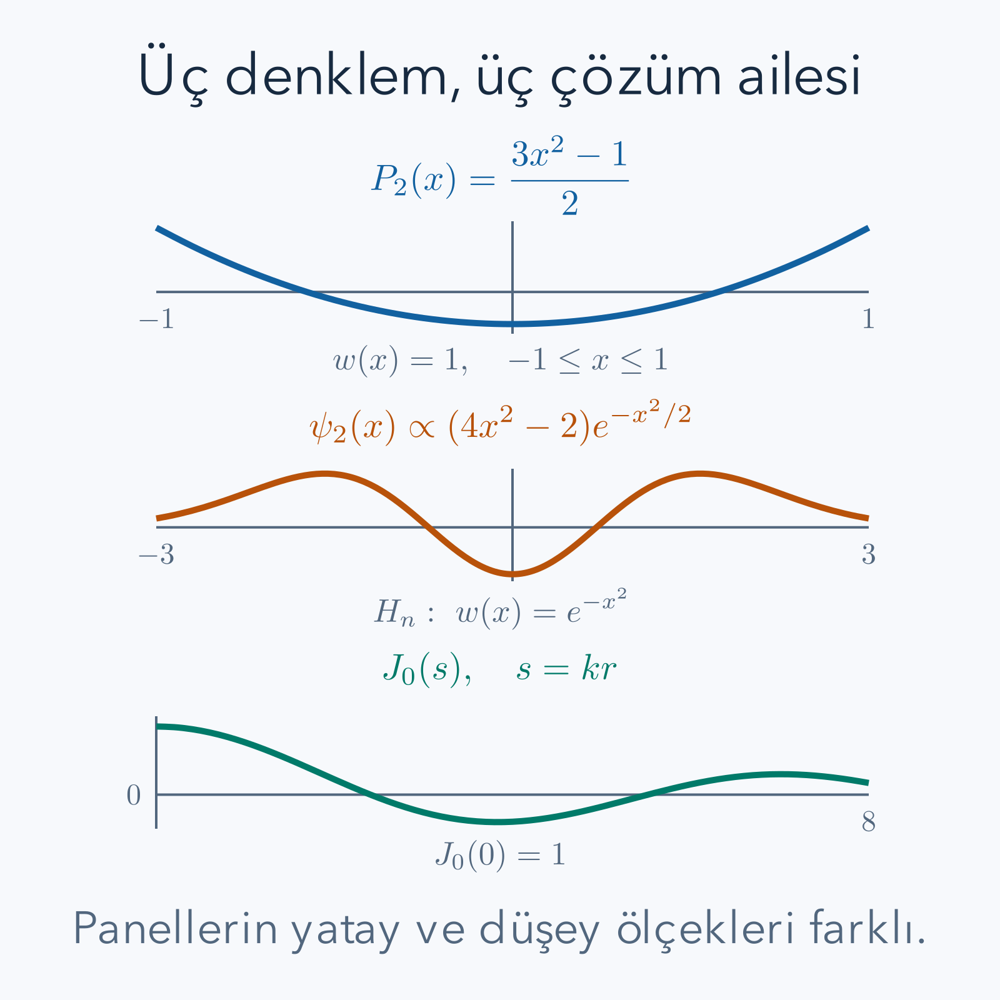

Bir diferansiyel denklemin çözümüne isim vermek, hesabı bırakmak değildir. Sinüsün de bir tanımı, diferansiyel denklemi ve başlangıç koşulu vardır. Legendre, Hermite ve Bessel isimleri, farklı geometrilerde sürekli yeniden karşılaşılan çözümleri kısa biçimde çağırmamızı sağlar. Bu yazıda isimlerin arkasındaki işlemleri kuracağız: katsayılar nereden gelir, seri neden bazen kesilir, hangi çözüm fiziksel aralıkta kalır?

Önce [kuvvet serileri ve Taylor yaklaşımı](/blog/sonsuz-seriler-ve-taylor-yaklasimi/), [ikinci derece diferansiyel denklemler](/blog/ikinci-derece-diferansiyel-denklemler/), [çok katlı integraller ve koordinatlar](/blog/cok-katli-integraller-ve-koordinatlar/) okunabilir. Yeni dizideki [kısmi diferansiyel denklemler](/blog/kismi-diferansiyel-denklemler/) değişken ayırmanın nedenini, [Sturm–Liouville kuramı](/blog/sturm-liouville-ve-ozfonksiyonlar/) ise ağırlık ve sınır koşulunun önemini açıklar. Burada gerekli seri ve normalizasyon adımlarını yeniden yapacağız; karmaşık analiz bilmek gerekmiyor.

## 1. Geometri hangi aileyi seçer?

Düz bir telin titreşiminde sabit katsayılı bir denklem çıkar; sinüsler uygundur. Küre üzerinde kutup açısına göre değişen bir alanın denklemi farklıdır. Bir disk üzerindeki titreşimde merkezden uzaklık önemlidir ve alan halkalarının çevresi yarıçapla büyür. Bir yay potansiyelindeki kuantum dalgasında ise sonsuzda küçülme koşulu vardır. Bu üç durumda aynı sinüs listesinin bütün işi yapması beklenemez.

Bir çözüm ailesini seçerken üç ayrı soruyu tutacağız. Denklem ne söylüyor? Çözüm hangi aralıkta tanımlı? Başlangıç, sınır veya sonlu olma koşulu ne istiyor? Yalnız denklemi çözmek ikinci dereceden problemde iki serbest sabit bırakır. Uygun koşullar bunları azaltır; bazı problemlerde izinli bir parametreyi de seçer. Özel fonksiyonlar bu sürecin sonunda ortaya çıkan matematiksel araçlardır.

*Eğriler aşağıda türetilen formüllerden çizildi. Hermite panelinde yalnız polinom değil, sonsuzda küçülen Gauss çarpanlı biçim gösteriliyor; panellerin yatay ölçekleri farklıdır.*

## 2. Kuvvet serisiyle bilinmeyeni kurmak

Gerçek değişkeni $x$, bilinmeyen fonksiyonu $y$, sabit katsayıları $a_k$ ile gösterelim. Sıfır çevresinde

$$
y(x)=\sum_{k=0}^{\infty}a_kx^k
=a_0+a_1x+a_2x^2+a_3x^3+\cdots
$$

yazmayı deneyelim. Sonsuz toplamın türevini terim terim almak, yakınsaklık aralığının içindeki kuvvet serileri için geçerlidir. Bu aralığın uçlarını ayrıca incelemek gerekir. Önce ilk türevde sabit terim yok olur; sonra ikinci türevde doğrusal terim de yok olur:

$$
\begin{aligned}
y'&=\sum_{k=1}^{\infty}k a_kx^{k-1},\\
y''&=\sum_{k=2}^{\infty}k(k-1)a_kx^{k-2}.
\end{aligned}
$$

Denklemde aynı kuvvetleri toplamak için ikinci satırda $j=k-2$ diyelim. Eski $k=2$ başlangıcı yeni $j=0$ olur, $k=j+2$ yerine yazılır:

$$
y''=\sum_{j=0}^{\infty}(j+2)(j+1)a_{j+2}x^j.
$$

Toplam indisinin ismi sonucu değiştirmez; bundan sonra yine $k$ kullanabiliriz. Burada katsayıyı veya başlangıcı değiştirmeden yalnız sembol değiştirmek yeterli olmazdı. İndis kaydırmanın amacı her toplamda $x^k$ elde etmektir.

İşlemi ilk birkaç terimden de okuyabiliriz. İkinci türevde sabit terim başlangıç serisinin ikinci derece teriminden, doğrusal terim üçüncü derece teriminden gelir. Dolayısıyla yeni serideki sıfırıncı katsayı eski sıfırıncı katsayı değildir. İki basamak öteden gelen katsayıya, iki türev sırasında inen ardışık sayılar çarpılır. Yazımdaki her parçanın bir görevi vardır: üs yeni dereceyi, katsayı alt indisi eski terimi, iki sayı ise türev çarpanlarını izler. Bir indis işlemini kontrol ederken toplamın ilk iki terimini elle açmak çoğu yazım hatasını yakalar.

Ayrıca başlangıç katsayılarını belirlemek ile sonsuz serinin yakınsaklığını kanıtlamak farklı işlerdir. Bir cebir bağıntısını sonsuza kadar yazabilmek, elde edilen toplamın her noktada sonlu olduğunu söylemez. Denklemin sıradan noktalarında yerel seri kuramı kullanılabilir; tekil uçlarda ise düzenlilik veya sınır koşulu ayrıca incelenir. Bu nedenle aşağıda polinom çözümler özellikle değerlidir: sonlu toplam oldukları için yakınsaklık sorunu yaşamazlar, türevleri her noktada açıktır ve uç değerlerini doğrudan yerine koyabiliriz. Yakınsak kuvvet serisi bir aralık boyunca sıfırsa her katsayısı sıfırdır. Diferansiyel denklem bu özellik sayesinde sonsuz sayıdaki cebir ilişkisine dönüşür.

## 3. Legendre denklemi ve katsayı bağıntısı

Boyutsuz değişken $x$ için $-1\leq x\leq1$ aralığında

$$
(1-x^2)y''-2xy'+\lambda y=0
$$

denklemini inceleyelim. $\lambda$ şimdilik gerçek bir parametredir. Küresel açısal problemlerde çoğu kez $x=\cos\theta$ olur; $\theta$ kutup açısıdır. Bu değişkenin sonlu aralığı geometri nedeniyle doğar. Denklemdeki $1-x^2$ uçlarda sıfır olduğundan uçlar sıradan nokta değildir; sıfır çevresindeki seri tek başına uçlardaki davranışı garanti etmez.

Seriyi yerleştirmek için üç katkıyı ayrı yazalım:

$$
\begin{aligned}
y''&=\sum_{k=0}^{\infty}(k+2)(k+1)a_{k+2}x^k,\\
-x^2y''&=-\sum_{k=0}^{\infty}k(k-1)a_kx^k,\\
-2xy'&=-\sum_{k=0}^{\infty}2ka_kx^k.
\end{aligned}
$$

Son iki toplamı sıfırdan başlatabiliriz; eklenen terimler $k(k-1)$ veya $k$ nedeniyle sıfırdır. $\lambda y$ katkısını da ekleyip $x^k$ katsayısını sıfırlayalım:

$$
\begin{aligned}
(k+2)(k+1)a_{k+2}
+\bigl[\lambda-k(k-1)-2k\bigr]a_k&=0,\\
(k+2)(k+1)a_{k+2}
+\bigl[\lambda-k(k+1)\bigr]a_k&=0,\\
a_{k+2}&=\frac{k(k+1)-\lambda}{(k+2)(k+1)}a_k.
\end{aligned}
$$

Payda $k\geq0$ için sıfır değildir. Çift katsayılar yalnız $a_0$'a, tek katsayılar yalnız $a_1$'e bağlıdır. İki başlangıç katsayısı ikinci dereceden denklemin iki bağımsız çözümünü taşır. Bu ayrım ayrıca çift ve tek fonksiyonları seçmemizi kolaylaştırır.

Başlangıç değerleri açısından da aynı yapı vardır. Seriyi sıfırda değerlendirmek sabit katsayıyı verir; bir kez türev alıp sıfırda değerlendirmek doğrusal katsayıyı verir. Dolayısıyla başlangıçta fonksiyonun değeri ve eğimi, iki dalın ölçeğini seçer. Sadece çift çözüm istemek başlangıç eğimini sıfır yapmak demektir. Sadece tek çözüm istemek başlangıç değerini sıfır yapmak demektir. Böyle okuyunca parite, sonradan fark edilen bir görsel özellik olmaktan çıkar; katsayı hesabına baştan uygulanabilecek somut bir koşul olur.

## 4. İlk üç Legendre polinomunu gerçekten üretmek

$n$ sıfır veya pozitif tam sayı olmak üzere $\lambda=n(n+1)$ seçersek $k=n$ adımında pay sıfır olur. $n$ ile aynı paritedeki seri orada kesilir; karşı paritedeki seri genel olarak kesilmez. Kesilen çözümü $P_n$ ile gösterir, ölçeğini $P_n(1)=1$ koşuluyla belirleriz. Bu bir normalizasyon uzlaşımıdır; birim norm anlamına gelmez.

$n=0$ için $\lambda=0$ olur. Çift dalda $a_2=0$ ve sonraki çift katsayılar sıfırdır. $a_0=1$, $a_1=0$ seçimi $P_0=1$ verir. $n=1$ için $\lambda=2$'dir. Tek dalda $k=1$ payı $2-2=0$ olduğundan $a_3=0$ çıkar. $a_0=0$, $a_1=1$ seçimi $P_1=x$ üretir.

$n=2$ için $\lambda=6$'dır. Çift dalın ilk adımı

$$
a_2=\frac{-6}{2}a_0=-3a_0
$$

olur. İkinci adımda $a_4=(6-6)a_2/12=0$'dır. Bu nedenle $y=a_0(1-3x^2)$ yazılır. Birdeki değer $-2a_0$ olduğundan $-2a_0=1$ seçeriz; $a_0=-1/2$ bulunur:

$$
P_2(x)=\frac{3x^2-1}{2}.
$$

Şimdi denkleme geri dönelim. $P_2'=3x$, $P_2''=3$ olduğundan

$$
\begin{aligned}
(1-x^2)P_2''-2xP_2'+6P_2
&=3-3x^2-6x^2+3(3x^2-1)\\
&=3-3+(-3-6+9)x^2=0.
\end{aligned}
$$

Bu kontrol hem katsayıyı hem özdeğeri doğrular. Sadece $P_2(1)=1$ kontrolü denklemi doğrulamaya yetmezdi.

## 5. Legendre için norm ve ağırlık hesabı

Denklemi $-[(1-x^2)y']'=\lambda y$ biçiminde yazabiliriz; türevi açınca eksi işaretli Legendre denklemi elde edilir. Burada Sturm–Liouville ağırlığı $w(x)=1$'dir. Uçlarda düzenli polinomlar için sınır terimindeki $1-x^2$ sıfır olur. Dolayısıyla farklı dereceler birbirine diktir. Genel norm formülünü ezberlemek yerine ikinci derecede integral alalım:

$$
\begin{aligned}
\int_{-1}^{1}P_2(x)^2\,dx
&=\frac14\int_{-1}^{1}(9x^4-6x^2+1)\,dx\\
&=\frac14\left(9\frac25-6\frac23+2\right)\\
&=\frac14\left(\frac{18}{5}-4+2\right)=\frac25.
\end{aligned}
$$

Çift kuvvet için $\int_{-1}^{1}x^{2j}dx=2/(2j+1)$ kullandık; bu, $x^{2j+1}/(2j+1)$ ilkel fonksiyonunun iki uçtaki farkıdır. Birim normlu biçim $\phi_2=\sqrt{5/2}\,P_2$ olur. Ayrıca

$$
\int_{-1}^{1}P_2P_0\,dx
=\frac12\left(3\frac23-2\right)=0
$$

hesabı dikliği somutlaştırır. İkinci norm koşulu ile birdeki değer koşulu farklıdır: $\phi_2(1)=\sqrt{5/2}$ olur. Hesapta hangi ölçeğin kullanıldığını açık tutmak katsayı hatalarını önler.

## 6. Hermite denkleminde iki farklı indis bağıntısı

Bütün gerçek doğru üzerinde, boyutsuz $x$ için fizikçi Hermite denklemi

$$
y''-2xy'+2ny=0
$$

olsun. $n$ yine negatif olmayan tam sayıdır. Seri yerleştirince

$$
\begin{aligned}
(k+2)(k+1)a_{k+2}+(2n-2k)a_k&=0,\\
a_{k+2}&=\frac{2(k-n)}{(k+2)(k+1)}a_k
\end{aligned}
$$

çıkar. Bu, **tek bir polinom içindeki katsayıları** bağlayan bağıntıdır. $k=n$ adımında seri kesilir. Polinomun en yüksek kuvvetinin katsayısını $2^n$ seçmek fizikçi uzlaşımını verir; bu seçimle $H_0=1$, $H_1=2x$ olur.

$n=2$ için $a_2=-2a_0$'dır. En yüksek katsayıyı $a_2=4$ seçince $a_0=-2$ çıkar; $H_2=4x^2-2$ elde edilir. Türevleri $H_2'=8x$, $H_2''=8$'dir:

$$
H_2''-2xH_2'+4H_2
=8-16x^2+16x^2-8=0.
$$

Bir de **farklı derecelerdeki polinomları** bağlayan

$$
H_{n+1}=2xH_n-2nH_{n-1}
$$

bağıntısı vardır. İki bağıntı aynı işlem değildir. İkincisinin kaynağını görmek için türev üretme tanımını açalım.

## 7. Hermite aile bağıntısının türetilmesi

$g(x)=e^{-x^2}$ diyelim. Fizikçi polinomları

$$
H_n(x)=(-1)^n e^{x^2}\frac{d^ng}{dx^n}
$$

ile de tanımlanır. Bu tanımın bütün derecelerde seri çözümüyle eşdeğerliğine dair genel kuramı burada kanıtlamıyoruz; aşağıdaki cebir aile bağıntısını ve ilk örnekleri doğrudan gösterir. $g'=-2xg$ eşitliğinin $n$ kez türevini alırken çarpım kuralında yalnız iki terim kalır: $x$'in ikinci ve daha yüksek türevleri sıfırdır. $n\geq1$ için

$$
g^{(n+1)}=-2\left(xg^{(n)}+n g^{(n-1)}\right).
$$

Burada $n$ katsayısı, türevlerden birinin $x$'e uygulanabileceği $n$ ayrı seçimden gelir. İki tarafı $(-1)^{n+1}e^{x^2}$ ile çarparsak ilk terim $2xH_n$, ikinci terim $-2nH_{n-1}$ olur. Özellikle $H_2=2x(2x)-2(1)=4x^2-2$ yeniden bulunur.

Bazı kaynaklar olasılıkçı Hermite polinomlarını kullanır; onların ikinci polinomu $x^2-1$'dir. Bu farklılık fiziksel bir çelişki değildir, değişken ve ölçek seçimidir. Bu yazıdaki $H_n$ her zaman fizikçi biçimidir. Bir tablodan formül taşırken yalnız isme bakmak yerine $H_1$ ve Gaussian ağırlığı karşılaştırmak gerekir.

## 8. Gaussian ağırlık ve dalga fonksiyonu

Hermite denklemini $e^{-x^2}$ ile çarpınca

$$
-\frac{d}{dx}\left(e^{-x^2}H_n'\right)
=2n e^{-x^2}H_n
$$

olur. Bu kez ağırlık $w=e^{-x^2}$'dir. Polinom kendi başına sonsuzda küçülmez; ağırlıklı iç çarpımda integrallenebilir. Örneğin $H_1=2x$ büyür, ama $H_1^2e^{-x^2}$ sonsuzda sıfıra gider.

Boyutsuz osilatör dalga fonksiyonunun biçimi $\psi_n=N_nH_n e^{-x^2/2}$'dir. Olasılıkta kare aldığımız için $|\psi_n|^2=N_n^2H_n^2e^{-x^2}$ çıkar. Polinomun ağırlığı ile dalga fonksiyonunun Gauss çarpanı arasındaki iki katsayısı bu nedenle vardır. $H_n$'yi doğrudan dalga fonksiyonu saymak sonsuz norm verir.

Temel Gaussian integral $I_0=\int_{-\infty}^{\infty}e^{-x^2}dx$ için kare alıp düzlemde kutupsal koordinata geçelim. İntegrand pozitif olduğundan çarpım integrali geçerlidir:

$$
I_0^2=\int_0^{2\pi}\!d\theta\int_0^\infty e^{-r^2}r\,dr
=2\pi\left[-\frac12e^{-r^2}\right]_0^\infty=\pi.
$$

$I_0$ pozitif olduğundan $I_0=\sqrt\pi$'dir. $M_j=\int x^{2j}e^{-x^2}dx$ gösteriminde integral bütün doğru üzerindedir. $xe^{-x^2}dx=-\tfrac12d(e^{-x^2})$ ile kısmi integrasyon yapalım. İntegrandın bir çarpanını $u=x^{2j-1}$, diğerini $dv=xe^{-x^2}dx$ seçeriz. O zaman $du=(2j-1)x^{2j-2}dx$ ve $v=-e^{-x^2}/2$ olur:

$$
\begin{aligned}
M_j&=\left[-\frac{x^{2j-1}e^{-x^2}}2\right]_{-\infty}^{\infty}
+\frac{2j-1}{2}\int_{-\infty}^{\infty}x^{2j-2}e^{-x^2}dx\\
&=\frac{2j-1}{2}M_{j-1}.
\end{aligned}
$$

Sınır terimi sıfırdır; üstel küçülme sabit dereceli polinomun büyümesinden baskındır. Burada bir momenti iki derece aşağı indirdik; tekrar ederek bütün çift momentleri temel Gaussian integraline bağlayabiliriz. Tek kuvvetli momentlerse simetrik aralıkta tek integrand oldukları için sıfırdır. Böylece ağırlıkla yapılan hesaplar için ayrı bir ezber listesi yerine iki işlem yeter: tekliği kontrol etmek ve çift momentte kısmi integrasyon uygulamak. Bu nedenle $M_1=\sqrt\pi/2$, $M_2=3\sqrt\pi/4$ olur.

## 9. İkinci Hermite durumunu normalleştirmek

$H_2^2=(4x^2-2)^2=16x^4-16x^2+4$ olduğundan

$$
\begin{aligned}
\int_{-\infty}^{\infty}H_2^2 e^{-x^2}dx
&=16M_2-16M_1+4M_0\\
&=(12-8+4)\sqrt\pi=8\sqrt\pi.
\end{aligned}
$$

Normun bir olması için $N_2^2(8\sqrt\pi)=1$ gerekir. Pozitif ölçek seçersek $N_2=1/\sqrt{8\sqrt\pi}$ bulunur. Ayrıca $\int H_2H_0e^{-x^2}dx=4M_1-2M_0=0$'dır. Dikliği ve normu ayrı integrallerle kontrol ettik.

Denklem kontrolü de yapılabilir. $h=H_2$ ve $\psi=he^{-x^2/2}$ için çarpım kuralını iki aşamada uygulayalım. Gauss çarpanının türevi $-xe^{-x^2/2}$ olduğundan önce

$$
\psi'=e^{-x^2/2}(h'-xh)
$$

bulunur. Şimdi bu iki çarpanı yeniden türevleyelim. Parantezin türevi $h''-h-xh'$'dir; özellikle $xh$ çarpımında hem $x$ hem $h$ türevlenir:

$$
\begin{aligned}
\psi''&=-xe^{-x^2/2}(h'-xh)
+e^{-x^2/2}(h''-h-xh')\\
&=e^{-x^2/2}[h''-2xh'+(x^2-1)h].
\end{aligned}
$$

verir. Hermite denklemi $h''-2xh'=-4h$ dediğinden $\psi''=(x^2-5)\psi$ olur. Dolayısıyla $-\psi''+x^2\psi=5\psi$ sağlanır. Polinom denklemi ile osilatör denklemi arasındaki dönüşümü bir formül aktarımıyla bırakmamış olduk.

Fiziksel konum $q$ uzunluk birimindeyse $x=q/\ell$ yazılır; $\ell$ pozitif uzunluk ölçeğidir. $dq=\ell dx$ olduğundan fiziksel dalga fonksiyonunda ayrıca $\ell^{-1/2}$ gerekir. Aksi halde boyutsuz değişkendeki birim norm, konum integralinde $\ell$ verir.

## 10. Diskte neden Bessel denklemi çıkar?

Yarıçapı $R>0$ olan diskte $u(r,\theta)$ alanının Helmholtz denklemini ele alalım. $r$ merkezden uzaklık, $\theta$ açıdır; $k$ ters uzunluk birimli pozitif dalga sayısıdır. Kutupsal koordinattaki Laplasyen

$$
\nabla^2u=u_{rr}+\frac1r u_r+\frac1{r^2}u_{\theta\theta}
$$

şeklindedir ve denklem $\nabla^2u+k^2u=0$ olur. $1/r$ terimi, dışarı doğru giderken aynı kalınlıktaki halkanın alanının büyümesini yansıtır. Merkezde koordinat tekilliği vardır; alanın kendisinin tekil olması gerekmez.

$u=F(r)\Theta(\theta)$ ayırmasını, çarpanların sıfır olmadığı açık parçalar üzerinde yerine koyup $r^2/(F\Theta)$ ile çarpalım:

$$
\frac{r^2F''+rF'+k^2r^2F}{F}
=-\frac{\Theta''}{\Theta}=m^2.
$$

Sol taraf yalnız $r$, sağ taraf yalnız $\theta$ içerdiği için ortak değer sabittir. Açı denklemi $\Theta''+m^2\Theta=0$ olur. Tek değerli alanın $2\pi$ sonra aynı olması $m$'yi tam sayı seçer; $m\geq0$ almak radyal denkleme yeterlidir. $s=kr$, $F(r)=Y(s)$ dersek $F'=kY'$, $F''=k^2Y''$ yazılır ve

$$
s^2Y''+sY'+(s^2-m^2)Y=0
$$

çıkar. Bessel denklemi budur. Yeni $s$ boyutsuzdur; denklemin terimleri aynı birime sahiptir.

## 11. Merkezde düzgün çözüm ve J0 serisi

Dairesel simetride $m=0$'dır; açıya bağımlılık yoktur. $Y=\sum a_js^j$ yazıp $s^2Y''+sY'+s^2Y=0$ denklemine koyalım. İlk iki katkının toplamında $j(j-1)+j=j^2$ olur. $s^2Y$ terimi iki indis kaydırır:

$$
\sum_{j=0}^{\infty}j^2a_js^j
+\sum_{j=2}^{\infty}a_{j-2}s^j=0.
$$

$s^1$ katsayısı $a_1=0$ verir. $j\geq2$ için $j^2a_j+a_{j-2}=0$, yani $a_j=-a_{j-2}/j^2$ bulunur. $a_0=1$ seçimiyle

$$
\begin{aligned}
a_2&=-\frac14, &a_4&=\frac1{64}, &a_6&=-\frac1{2304},\\
J_0(s)&=1-\frac{s^2}{4}+\frac{s^4}{64}-\frac{s^6}{2304}+\cdots\\
&=\sum_{j=0}^{\infty}\frac{(-1)^j}{(j!)^2}\left(\frac{s^2}{4}\right)^j.
\end{aligned}
$$

Ardışık terimlerin mutlak oranı $s^2/[4(j+1)^2]$'dir; her sabit $s$ için sıfıra gider. Seri tüm gerçek eksende yakınsar. İlk dört terimi denkleme koyunca $s^2,s^4,s^6$ terimleri iptal olur; kalan $-s^8/2304$ kesilen serinin hatasına aittir. Tam seri her derecede iptal sağlar.

İkinci bağımsız çözümün neden dışlandığını da görebiliriz. $J_0$'ın sıfır olmadığı merkez çevresinde mertebe düşürme, ikinci çözümü $J_0(s)\int ds/[sJ_0(s)^2]$ biçiminde verir. $J_0(0)=1$ olduğundan integrand başta $1/s$ gibi davranır; integral $\log s$ içerir. Standart ölçekli bu ikinci çözüme $Y_0$ denir. Merkezde sonlu alan istiyorsak katsayısı sıfır olmalıdır; halka biçimli, merkezi çıkarılmış bir bölgede aynı gerekçe geçmez.

Mertebe düşürmenin burada kullandığımız adımını da açalım. $J=J_0$, $Y=Jv$ yazıp $Y''+Y'/s+Y=0$ denklemine koyalım. Bu işlem $s>0$ ve $J\ne0$ olan merkez komşuluğunda yapılır. Çarpım türevlerini açınca $v$ ile çarpılan $J''+J'/s+J$ terimi sıfır olur; geriye

$$
Jv''+\left(2J'+\frac Js\right)v'=0
$$

kalır. $sJ$ ile çarparsak sol taraf $(sJ^2v')'$ olur. Bir kez integral alınca $sJ^2v'=C$ bulunur; $C$ sabittir. İkinci integral tam yukarıdaki ifadeyi verir. Böylece logaritmik davranışın kaynağı, merkez çevresinde paydanın yaklaşık yarıçapın kendisi olmasıdır. Bölme işlemi Bessel fonksiyonunun köklerinden geçirilerek uygulanmadı; yalnız sıfır olmadığı küçük bir bölgede kullanıldı.

Bu yerel hesap, tekil çözümü dışlama gerekçesini de netleştirir. Denklemin kendi katsayıları merkezde koordinat nedeniyle tekildir; kabul edilen fiziksel alan ise sonlu olmalıdır. Bir çözümün tekilliği bütün ikinci dereceden denklemi geçersiz kılmaz. İki bağımsız daldan hangisini kabul ettiğimizi ayrıca belirtir. Merkez fiziksel bölgenin dışında bırakılırsa logaritmik dalın yasaklanması için bu argüman kalmaz; bu kez iç ve dış kenar koşulları iki dalın karışımını belirleyebilir.

## 12. Küçük bir Bessel sayısını kontrol etmek

$s=1$ için ilk dört terim

$$
1-\frac14+\frac1{64}-\frac1{2304}
=0.7651909722\ldots
$$

verir. Sonraki terim $1/147456\approx0.0000067817$'dir. Terimler bu noktada azalan ve işaret değiştiren olduğundan tam toplam ilk dört terimden büyük, beş terimli toplamdan küçüktür. Birkaç terim daha eklenince $J_0(1)\approx0.7651976866$ bulunur. Bu yaklaşımın hata sınırı, seri yapısından gelir; yalnız ondalık basamakların benzemesine dayanmaz.

Merkezde $J_0'(0)=0$ da seriden çıkar. Bu, düzgün dairesel simetrik yüzeyin merkezde tercih edilen bir yatay yön göstermemesiyle uyumludur. Merkez eğimini sıfır seçmek ile dış kenardaki değeri sıfır seçmek iki farklı koşuldur. İlki düzgün çözümü, ikincisi izinli dalga sayısını belirler.

## 13. Kenar koşulu kökleri nasıl seçer?

Disk kenarında $u(R)=0$ olsun. Düzenli radyal çözüm $F(r)=C J_0(kr)$ olduğundan sıfır olmayan $C$ için $J_0(kR)=0$ gerekir. $J_0$'ın ilk pozitif kökünü $\alpha_1$ ile gösterelim. Seri kullanılarak aralık daraltma yöntemiyle $\alpha_1\approx2.4048255577$ bulunur; dolayısıyla ilk radyal modun dalga sayısı $k_1=\alpha_1/R$ olur. Buradaki sayısal kök kapalı bir basit kesir değildir.

$R=2$ metre seçersek $k_1\approx1.2024127789$ ters metredir. Merkezde $F(0)=C$, kenarda $F(2)=0$ olur. Yarıçapı iki katına çıkarıp aynı modu seçersek dalga sayısı yarıya iner. Kenardaki türev sıfır istenseydi denklem $J_0'(kR)=0$ olurdu; aynı kök listesi kullanılamazdı.

Bessel normunda alan elemanını unutmamak gerekir. Açısal çarpanı $1/\sqrt{2\pi}$ seçince açısal çarpanın mutlak karesinin açı integrali bir verir. $R=1$ için radyal koşul

$$
1=C^2\int_0^1rJ_0(\alpha_1r)^2\,dr
$$

olur. Buradaki $r$ ağırlığı diskin $r\,dr\,d\theta$ alan elemanından gelir. Sayısal integral yaklaşık $0.1347570620$ olduğundan $C\approx2.724107445$ bulunur. Birim yarıçapta birim normlu tam alan $C J_0(\alpha_1r)/\sqrt{2\pi}$'dir. Bu normu hesaplamak için ileri Bessel integral kimliği varsaymadık; seriden fonksiyon üretip sayısal integral aldık.

Ondalık değerin nasıl üretildiğini de belirtelim. $N$ pozitif tam sayı, $h=1/N$, $r_j=(j+1/2)h$ olsun. Aralığı eşit hücrelere ayırıp her hücrenin ortasında integrandı örnekleyerek

$$
I_N=h\sum_{j=0}^{N-1}r_jJ_0(\alpha_1r_j)^2
$$

toplamını kurarız. Bu orta nokta yöntemidir; hücre genişliği ile yükseklik çarpılıp alanlar toplanır. Fonksiyon burada düzgün olduğu için çözünürlük arttıkça toplam integrale yaklaşır. Önce bin hücre, sonra iki bin hücre kullanıp değerlerin değişimini izleyebiliriz. Sonra on bin ve yirmi bin hücreyle gösterilen basamakları denetleriz. Sayısal yöntemin sonlu çözünürlüğü ile Bessel serisini sonlu terimde kesmenin hatası iki ayrı hata kaynağıdır; ikisi ayrı küçültülür.

Kök hesabında da benzer açıklık gerekir. Önce fonksiyonun zıt işaret aldığı iki pozitif sayı seçilir. Aralığın orta noktası denenir; aynı işaretli uç orta noktayla değiştirilir. Her adım kökü içeren aralığı yarıya indirir. İlk kökün yaklaşık değeri bu tekrarın sonucudur. Değerin kendisini tabloya bakarak kullanmak mümkün olsa da, aralık daraltma yöntemi neden belirli basamaklara güvenebildiğimizi gösterir. Ayrıca aradığımız kökün ilk pozitif kök olması ayrı kontrol ister; başlangıçtan itibaren seri eğrisi veya uygun kök yerleştirme bilgisi izlenir.

## 14. Aynı fonksiyonun ölçeği hangi bilgiyi değiştirir?

Homojen diferansiyel denklemde bir çözümü sabit bir sayıyla çarpmak yine çözüm verir. Bunun nedeni bütün terimlerin aynı katsayıyla çarpılmasıdır. Bu serbestlik, dalın fiziksel şeklini değiştirmeden büyüklüğünü seçmemize izin verir. Legendre polinomunda birdeki değeri sabitledik; Hermite polinomunda en yüksek kuvvetin katsayısını sabitledik; Bessel fonksiyonunda merkezdeki değeri sabitledik. Üçü de bir ölçek seçimi olduğu halde aynı türden koşullar değildir.

Birim norm ise ayrıca hesaplanır. Elimizdeki çözümün karesini doğru ağırlıkla integre edip pozitif normun kareköküne böleriz. Bu işlem işareti seçmez; çözümün negatifini almak aynı normu verir. Gerçek fonksiyon için genel bir eksi işaretin fiziksel alan yönünü değiştirebileceği, kuantum durumunda ise genel fazın farklı yorumlandığı unutulmamalıdır. Matematiksel normalizasyonun söylediği yalnız ölçüye göre toplam karesel büyüklüğün bir olduğudur.

Yaklaşık çözüm kontrolünde de norm ve denklem birbirinden ayrılır. Bir eğriyi birim normlu yapmak onun diferansiyel denklemi doğru çözdüğünü kanıtlamaz. Tersine denklemi sağlayan bir eğri istenen sınır koşuluna uymayabilir. Bu yazıda her ailede üç aşama izlememizin nedeni budur: önce yerel denklem, sonra kabul edilen dal ve sınır, sonunda seçilen ölçek. Biri eksik kalırsa aynı isimli özel fonksiyonun yanlış örneğini kullanmak mümkündür.

## 15. Üç ailenin ortaklığı ve hesabın sınırı

Legendre örneğinde sonlu aralık ve birim ağırlık; Hermite örneğinde bütün doğru ve Gaussian ağırlık; Bessel örneğinde disk ve radyal ağırlık kullandık. Her birinde norm, yalnız fonksiyonun karesini gelişigüzel toplamak değildir. Değişken dönüşümü, geometri veya denklemin öz-adjoint biçimi hangi ölçünün kullanılacağını söyler.

Seri yöntemi de her yerde aynı güvenceyi vermez. Sıradan nokta çevresinde kuvvet serisi uygundur; Bessel merkezindeki gibi baş katsayının sıfır olduğu noktada genel çözüm için kuvvet çarpanı içeren Frobenius yöntemi gerekebilir. Burada yalnız merkezde analitik olan $m=0$ dalını kurduk. Genel mertebedeki bütün Bessel çözümlerini veya özel fonksiyonların tamlık teoremlerini kanıtlamadık.

Buna karşılık elde ettiğimiz örnekler bütündür: katsayılar üretildi, denklemde kontrol edildi, uygun aralık ve koşullar belirtildi, norm hesaplandı. Yeni bir özel fonksiyonla karşılaşınca aynı sorular sorulabilir. Adı değil, çözdüğü denklem, seçilen dal ve kullanılan ölçü hesabı güvenilir kılar. Özellikle başlangıç değeriyle norm koşulunu birbirinden ayırmak, aynı çözümün farklı kitaplarda farklı katsayılarla görünmesini anlaşılır hale getirir. Karşılaştırma yaparken önce bu katsayı uzlaşımı kontrol edilir.

## Kaynaklar

- [NIST DLMF, klasik ortogonal polinomların tanımları ve ağırlıkları](https://dlmf.nist.gov/18.3): Legendre ve fizikçi Hermite uzlaşımlarını karşılaştırmak için.
- [NIST DLMF, polinomların yineleme bağıntıları](https://dlmf.nist.gov/18.9): derece bağıntılarının standart gösterimi için.
- [NIST DLMF, Bessel denklemi ve birinci tür çözümler](https://dlmf.nist.gov/10.2): Bessel ailesinin denklem ve seri tanımı için.

Bu başvuru kaynakları ailelerin daha geniş özelliklerini içerir; burada kullanılan düşük dereceli polinomlar, katsayı bağıntıları ve norm örnekleri metinde ayrıca türetildi.
