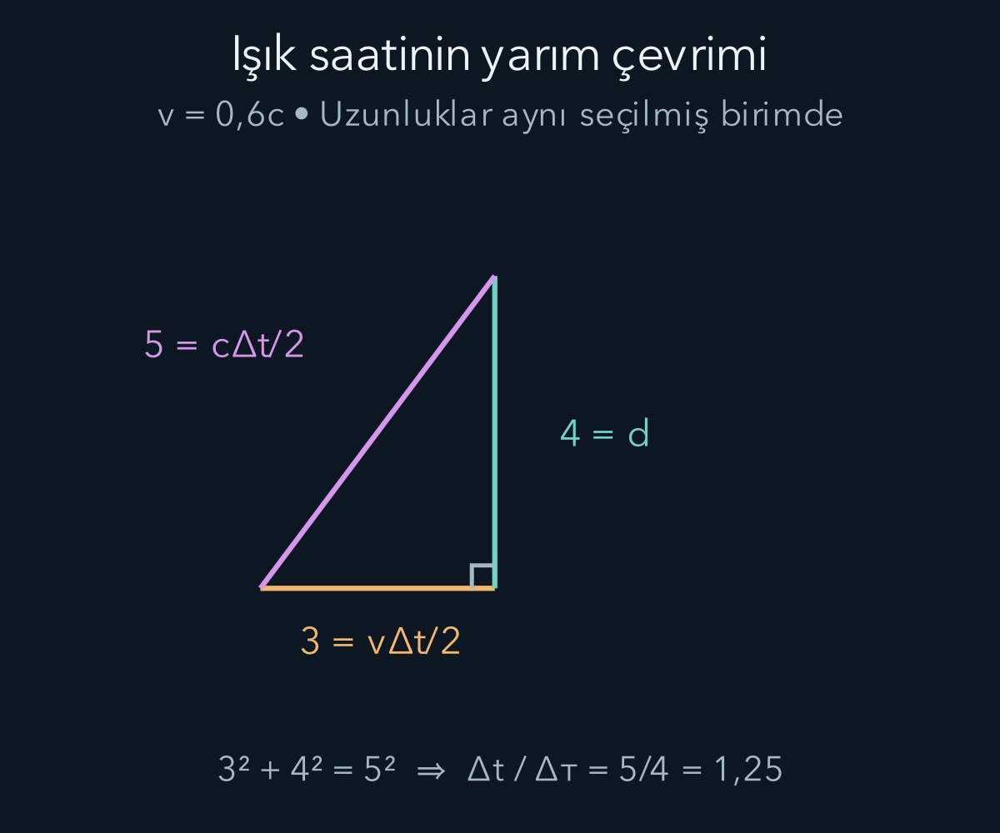
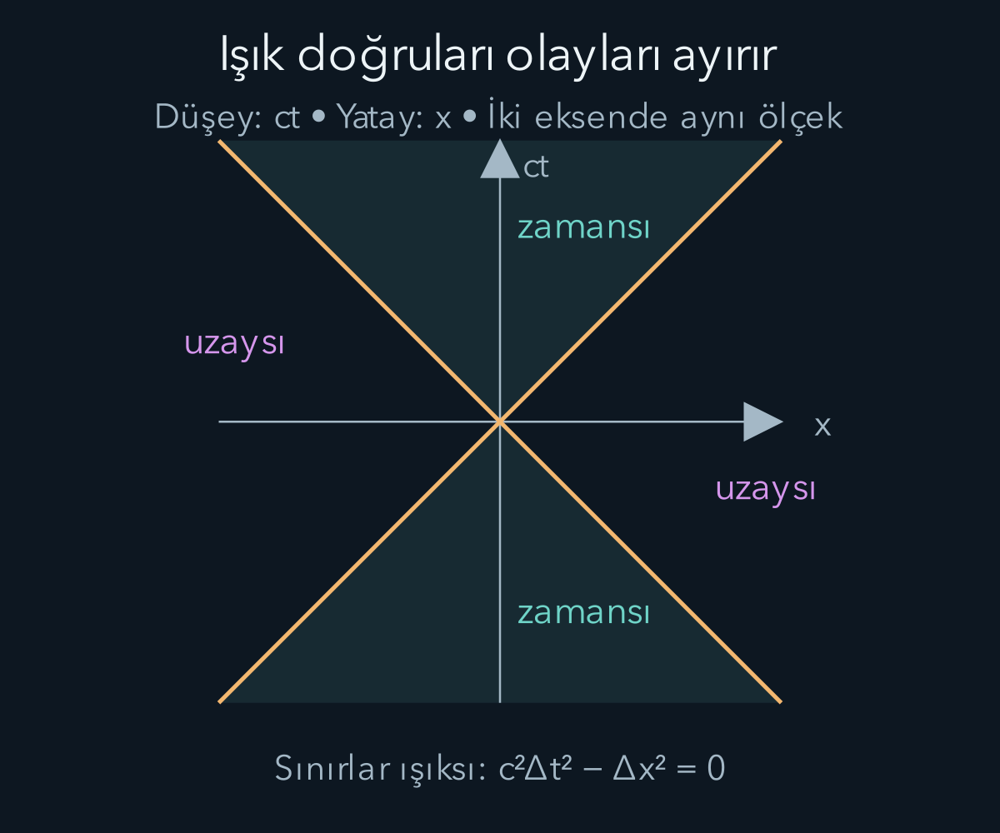

import ArticleVideo from '@/components/ArticleVideo.astro'
import kavram from './media/01-kavram.mp4?url'
import kavramPoster from './media/01-kavram.jpg?url'

Bir trenin içinde yürüyen kişinin yere göre hızı, gündelik koşullarda trenin hızıyla yürüme hızının toplamıdır. Aynı toplama kuralını ışığa uygularsak farklı bir sonuç bekleriz: ışığa doğru hareket eden gözlemci ışığı daha hızlı ölçmelidir. Oysa özel göreliliğin dayandığı deneysel yapı, boşluktaki ışık hızının bütün eylemsiz gözlemciler için aynı olduğunu söyler. Değiştirmemiz gereken şey ışığın yanında koşma biçimimiz değil, uzak olayların konum ve zamanlarını karşılaştırma kuralımızdır.

Bu yazıda [hareket ve referans sistemleri](/blog/hareket-konum-hiz-ve-ivme/), [enerji](/blog/is-enerji-ve-korunum/) ve [ışığın dalga özellikleri](/blog/isik-girisim-kirinim-ve-kutuplanma/) bilgisini kullanacağız. Karekök, denklem düzenleme ve Pisagor teoremi yeterli başlangıç araçlarıdır. Kütleçekimin uzay zamanı eğmesini incelemeyeceğiz; burada aynı doğrultuda sabit hızlarla hareket eden ideal sistemleri karşılaştırıyoruz.

## 1. Önce neyin ölçüldüğünü belirlemek

Bir lambanın yanması veya bir parçacığın detektöre çarpması bir **olaydır**. Bir boyutta olayı $(x,t)$ çiftiyle yazarız: $x$ konum, $t$ zamandır. İki gözlemci aynı olaya farklı koordinatlar verebilir. Olayın kendisi değişmez; onu sayılarla tanımlayan koordinat sistemi değişir.

**Eylemsiz sistem**, serbest cisimlerin düzgün doğrusal hareket yaptığı referans sistemidir. Birbirine göre sabit hızla hareket eden eylemsiz sistemlerin hiçbiri fizik yasaları bakımından ayrıcalıklı değildir. Özel göreliliğin ilk ilkesi, fizik yasalarının bu sistemlerde aynı biçimde olmasıdır. İkincisi, boşlukta ışığın hızının kaynağın ve gözlemcinin hareketinden bağımsız olarak $c$ olmasıdır. $c=299\,792\,458\ \mathrm{m/s}$ değerini yaklaşık hesaplarda $3{,}00\times10^8\ \mathrm{m/s}$ alacağız.

Bir ışık sinyalinin gözümüze ulaşma zamanı ile olayın koordinat zamanı aynı şey değildir. Uzak lambanın ne zaman yandığını söylemek için ışığın yolculuk süresini hesaba katmalı ve farklı yerlerdeki saatleri bir eşzamanlama kuralıyla ayarlamalıyız. Aşağıda aynı sistemde duran saatlerin Einstein ışık sinyali yöntemiyle eşzamanlandığını kabul ediyoruz. Böylece görsel gecikmeyi zaman genişlemesiyle karıştırmıyoruz.

## 2. Işık saati ve öz zaman

Aralarında $d$ uzaklığı bulunan iki ayna düşünelim. Işık alttaki aynadan üsttekine gider ve geri döner. Aynalarla birlikte duran gözlemci için bir tam gidiş dönüşün süresi $\Delta\tau=2d/c$ olur. Buradaki $\tau$, saatin kendi yolunda ölçtüğü **öz zamandır**. Başlangıç ve bitiş olayları saatin durduğu sistemde aynı konumda gerçekleşir.

Saat, laboratuvara göre yatay yönde $v$ hızıyla hareket etsin; ayna aralığı hareket yönüne dik olsun. Laboratuvarda ışığın yarım yolculuğu bir dik üçgenin eğik kenarıdır. Sürenin yarısında saat $v\Delta t/2$ kadar ilerler, ışık $c\Delta t/2$ yol alır. Pisagor bağıntısı:

$$
\left(\frac{c\Delta t}{2}\right)^2
=d^2+\left(\frac{v\Delta t}{2}\right)^2.
$$

İki tarafı dörtle çarpıp zaman terimlerini toplarsak $(c^2-v^2)\Delta t^2=4d^2$ çıkar. $2d=c\Delta\tau$ olduğundan:

$$
\Delta t=\frac{\Delta\tau}{\sqrt{1-v^2/c^2}}
=\gamma\Delta\tau,
\qquad \gamma=\frac1{\sqrt{1-v^2/c^2}}.
$$

$\gamma$ boyutsuz **Lorentz çarpanıdır**; $|v|<c$ için tanımlıdır ve en az birdir. Örneğin $v=0{,}6c$ için $1-v^2/c^2=0{,}64$, karekök $0{,}8$, dolayısıyla $\gamma=1{,}25$ bulunur. Hareketli saatin iki tıklaması arasında kendi ölçümü 4 saniyeyse laboratuvar koordinatları arasında 5 saniye geçer.

<ArticleVideo src={kavram} poster={kavramPoster} title="Işık saatinin üçgeni" caption="Işığın yarım çevrimde aldığı dik ve eğik yollar aynı üçgende karşılaştırılır. v=0,6c için Pisagor bağıntısı, koordinat süresinin özsürenin 1,25 katı olduğunu verir." />

Bu sonuç saatin bozulduğunu söylemez. Işık saati yalnızca ilkeleri görünür kılan bir modeldir. Fizik yasaları aynı olduğundan ideal saatlerin farklı mekanizmaları aynı öz zamanı göstermelidir. Karşılaştırmada hangi iki olayın seçildiği belirleyicidir; farklı deneylerdeki süreleri yalnızca ‘hareketli saat’ etiketiyle karşılaştıramayız.

## 3. Lorentz dönüşümünü kurmak

İşaretleri baştan sabitleyelim: $S'$ sistemi, $S$ sistemine göre pozitif $x$ yönünde $v$ hızıyla gitsin. Başlangıç noktaları $t=t'=0$ anında çakışsın. Uzay ve zamanın homojenliği doğrusal bir dönüşüme götürür. $S'$ başlangıcı $x=vt$ üzerinde bulunduğundan konum dönüşümü $x'=A(x-vt)$ biçimindedir. Burada $A$ yalnız göreli hıza bağlı bir katsayıdır.

Zamanı $t'=Bt+Dx$ olarak yazalım. Başlangıçtan sağa giden ışık için $x=ct$ ve $x'=ct'$; sola giden için $x=-ct$ ve $x'=-ct'$ olmalıdır. Bu iki koşul sırasıyla $A(c-v)=c(B+Dc)$ ve $A(c+v)=c(B-Dc)$ verir. Toplayınca $B=A$, çıkarınca $D=-Av/c^2$ buluruz. Dolayısıyla:

$$
x'=A(x-vt),\qquad t'=A\left(t-\frac{vx}{c^2}\right).
$$

Sistemlerin eşdeğerliği ve uzayın yönler arasında ayrıcalık taşımaması nedeniyle ters dönüşüm aynı katsayıyla, $v$ yerine $-v$ konarak yazılır. $x=A(x'+vt')$ içine yukarıdaki ifadeleri koyarsak $x=A^2(1-v^2/c^2)x$ elde ederiz. $v=0$ sınırında kimlik dönüşümüne sürekli bağlanan pozitif kökü seçince $A=\gamma$ çıkar. Sonuç:

$$
\boxed{x'=\gamma(x-vt),\qquad
 t'=\gamma\left(t-\frac{vx}{c^2}\right).}
$$

Dik yönler için $y'=y$ ve $z'=z$ olur. Zaman denklemindeki $vx/c^2$ ifadesinin birimi saniyedir: $(\mathrm{m/s})\mathrm m/(\mathrm{m^2/s^2})=\mathrm s$. Bu basit kontrol, yanlış yere yazılmış bir ışık hızı kuvvetini hemen ortaya çıkarabilir.

## 4. Eşzamanlılık neden ortak değildir?

$S$ sisteminde aynı anda gerçekleşen iki olay için $\Delta t=0$ olsun. Zaman dönüşümünü olayların farkına uygularsak:

$$
\Delta t'=-\gamma\frac{v\Delta x}{c^2}.
$$

Olaylar farklı konumdaysa bu değer genellikle sıfır değildir. Örneğin $S$'de 300 metre arayla aynı anda yanan iki lamba ve $v=0{,}6c$ için, sağdaki olay eksi soldaki olay farkını alalım. $\Delta x=300\ \mathrm m$ olduğundan:

$$
\Delta t'=-1{,}25\frac{0{,}6\times300}{3{,}00\times10^8}
=-7{,}5\times10^{-7}\ \mathrm s.
$$

Negatif işaret, $S'$ koordinatlarında sağdaki lambanın daha önce yandığını belirtir. Lambalardan gelen ışığın göze farklı sürelerde ulaşması zaten düzeltilmiştir; sonuç hâlâ kalır. Eşzamanlılığın göreli olması, aynı noktadaki bir saat okumasının belirsizleşmesi anlamına gelmez. Uzak olayların hangi zaman dilimine birlikte yerleştirileceği değişir.

## 5. Uzunluk ölçerken iki ucu aynı anda seçmek

$S'$ içinde duran bir çubuğun kendi sistemindeki uzunluğuna $L_0$ diyelim. Bu **öz uzunluktur**. Laboratuvar, hareketli çubuğun iki ucunun konumunu kendi saatlerine göre aynı anda kaydeder. Dolayısıyla laboratuvar ölçümünde $\Delta t=0$ ve $L=\Delta x$ olur. Konum dönüşümünden:

$$
L_0=\Delta x'=\gamma\Delta x=\gamma L,
\qquad L=\frac{L_0}{\gamma}.
$$

Öz uzunluğu 10 metre olan çubuk $0{,}6c$ hızında geçiyorsa laboratuvarda 8 metre ölçülür. Ölçüm hareket doğrultusundadır; dik uzunluklar bu dönüşümde değişmez. Bir ucun konumunu şimdi, diğerininkini daha sonra alırsak çubuğun hareketini de sonuca katmış oluruz. Bu yüzden eşzamanlılık şartı uzunluk tanımının parçasıdır.

Çubuğun fotoğrafını çekmek aynı işlem değildir. Farklı noktalardan çıkan ışık farklı zamanlarda kameraya ulaşır; görünüşte dönme gibi ek optik etkiler oluşabilir. Uzunluk daralması, koordinat ölçümüne ilişkin kesin bir sonuçtur; tek bir fotoğrafın bütün görsel ayrıntılarını tek başına açıklamaz.

## 6. Hızları doğru birleştirmek

Bir cismin $S$'deki hızı $u=dx/dt$, $S'$'deki hızı $u'=dx'/dt'$ olsun. Dönüşümün diferansiyellerini oranlayalım:

$$
u'=\frac{\gamma(dx-vdt)}{\gamma(dt-vdx/c^2)}
=\frac{u-v}{1-uv/c^2}.
$$

Ters biçimi $u=(u'+v)/(1+u'v/c^2)$ olur. Trenin hızı $0{,}6c$, içinden ileri doğru fırlatılan cismin trene göre hızı da $0{,}6c$ ise yere göre hız $1{,}2c$ değildir:

$$
u=\frac{1{,}2c}{1+0{,}36}=0{,}88235\ldots c.
$$

Işık için $u'=c$ yazdığımızda $u=(c+v)/(1+v/c)=c$ çıkar. Gündelik hızlarda $u'v/c^2$ çok küçüktür ve payda yaklaşık birdir; eski toplama kuralını iyi bir yaklaşım olarak geri buluruz. Böylece klasik mekaniğin başarısı silinmez, hangi küçük oran sayesinde çalıştığı anlaşılır.

## 7. Uzay zaman aralığı ve neden-sonuç sırası

Bir boyutta iki olay arasındaki değişmeyen birleşimi şu işaret seçimiyle tanımlayalım:

$$
s^2=c^2\Delta t^2-\Delta x^2.
$$

Üç boyutta ayrıca $-\Delta y^2-\Delta z^2$ eklenir. Bazı kaynaklar tüm işaretleri ters seçer; fizik aynı kalır. Bizim seçimimizde $s^2>0$ zamansı, $s^2=0$ ışıksı, $s^2<0$ uzaysı ayrımdır. Bu değişmezliği açıkça kontrol edelim. Kareleri açınca karışık terimler $-2v\Delta t\,\Delta x$ ve $+2v\Delta t\,\Delta x$ olarak gelir ve birbirini götürür:

$$
\begin{aligned}
c^2\Delta t'^2-\Delta x'^2
&=\gamma^2\left[c^2\left(\Delta t-\frac{v\Delta x}{c^2}\right)^2-(\Delta x-v\Delta t)^2\right]\\
&=\gamma^2\left[(c^2-v^2)\Delta t^2-\left(1-\frac{v^2}{c^2}\right)\Delta x^2\right]\\
&=\gamma^2\left(1-\frac{v^2}{c^2}\right)(c^2\Delta t^2-\Delta x^2).
\end{aligned}
$$

Son satırdaki ilk iki çarpanın çarpımı birdir. Bu nedenle bütün eylemsiz sistemler $s^2$ üzerinde uzlaşır.

Zamansı ayrılmış iki olayı ışıkaltı bir yol birleştirebilir. Geleceğe yönelmiş böyle bir yolun başlangıç ve bitiş sırası, zaman yönünü koruyan Lorentz dönüşümleriyle tersine dönmez. Uzaysı ayrılmış olaylarda ise $|\Delta x|>c|\Delta t|$ olduğu için birinden çıkan ışık diğerine zamanında yetişemez. Bu olayların sırası farklı sistemlerde değişebilir; bu, kurulmuş bir nedensel etkinin ters çevrilmesi değildir.

Örneğin aynı anda 300 metre uzakta olan iki olayın $s^2$ değeri $-90\,000\ \mathrm{m^2}$ olur. Zaman farkı bir sistemde sıfır olsa da olaylar aynı olay değildir. Konum ve zaman farklarını tek başlarına korumak yerine bu birleşimi korumak, özel göreliliğin geometrik özünü gösterir.

## 8. Enerji ve momentumun yeni bağıntısı

Durgun kütlesi $m>0$ olan parçacığın hızı $u$ olsun. Bu kez Lorentz çarpanını parçacık hızıyla $\gamma_u=1/\sqrt{1-u^2/c^2}$ tanımlarız. Göreli momentum ve toplam enerji:

$$
p=\gamma_u mu,\qquad E=\gamma_u mc^2
$$

biçimindedir. Burada $m$ değişmeyen durgun kütledir; ‘hızla artan kütle’ diline ihtiyacımız yoktur. Bu ifadelerin enerji ve momentum korunumuyla uyumlu fiziksel yasalar olduğunu kabul ediyoruz; yalnızca ışık saatinin geometrisinden enerji tanımını türetmiş sayılmayız.

İki ifadenin karelerini uygun birimlerle çıkaralım:

$$
E^2-p^2c^2
=\gamma_u^2m^2c^4(1-u^2/c^2)=m^2c^4.
$$

Böylece $E^2=p^2c^2+m^2c^4$ bağıntısı çıkar. Durgun parçacıkta $p=0$ olduğundan $E_0=mc^2$; kinetik enerji ise $K=E-E_0=(\gamma_u-1)mc^2$ olur. Küçük hızlarda $\gamma_u\approx1+u^2/(2c^2)$ yaklaşımı $K\approx mu^2/2$ verir. Önceki enerji formülü, toplam enerjinin durgunluk katkısı çıkarılmış küçük hız sınırıdır.

Küçük hız yaklaşımındaki katsayıyı görmek için $z=u^2/c^2$ diyelim. $f(z)=(1-z)^{-1/2}$ fonksiyonunun sıfır çevresindeki ilk iki Taylor terimi $f(0)+f'(0)z$ olur. Burada $f(0)=1$ ve $f'(z)=\tfrac12(1-z)^{-3/2}$ olduğundan $f'(0)=1/2$ bulunur. Bu nedenle:

$$
\begin{aligned}
\gamma_u-1&\approx\frac z2=\frac{u^2}{2c^2},\\
K&\approx\frac{u^2}{2c^2}mc^2=\frac12mu^2.
\end{aligned}
$$

Durgunluk enerjisi çıkarıldıktan sonra kalan ilk terim klasik kinetik enerjidir. Yaklaşımın küçük değişkeni metre/saniye cinsinden hız sayısı değil, boyutsuz $u^2/c^2$ oranıdır. Hız ışık hızına yaklaştığında atılan terimler küçük kalmaz; bu iki terimli açılım yerine tam köklü ifadeyi kullanırız.

$u=0{,}6c$ için $E=1{,}25mc^2$, $K=0{,}25mc^2$ ve $p=0{,}75mc$ bulunur. Kontrol olarak $1{,}25^2-0{,}75^2=1$ eşitliği enerji-momentum bağıntısını sağlar. Kütleli parçacığın hızı $c$'ye yaklaşırken $\gamma_u$ sınırsız büyür; sonlu enerji vererek parçacığı ışık hızına ulaştıramayız.

Kütlesiz parçacıklarda $m=0$ için aynı bağıntı $E=pc$ verir; burada $p$ momentum büyüklüğüdür. Bu, fotonun enerjisiz olduğunu söylemez. Kütlesiz parçacık için durgun sistem kurup $E=mc^2$ hesabı yapmak yanlıştır: fotonun durgun sistemi yoktur. Işığın enerji taşıması, birazdan inceleyeceğimiz kuantum deneylerinde frekansla ilgili yeni bir soruya dönüşecek. Görelilik enerji ile momentumu bağlar; bir ışık kuantumunun enerjisinin frekansla nasıl değiştiğini tek başına belirlemez.

## 9. Tek bir olay çiftini iki sistemde izlemek

Şimdi birbirinden ayrı kuralları aynı örnek üzerinde birleştirelim. Laboratuvarda A olayı başlangıçta, B olayı 5 saniye sonra ve 900 milyon metre ileride gerçekleşsin. İki olayı birleştiren düzgün hareketin hızı, yolun süreye bölümüdür: $u=(9{,}00\times10^8\ \mathrm m)/(5\ \mathrm s)=1{,}80\times10^8\ \mathrm{m/s}=0{,}6c$. Bu hareketle birlikte giden sisteme geçersek B olayının konumu başlangıca göre değişmemelidir. Formülün bunu gerçekten verdiğini kontrol edelim.

Konum farkı $\Delta x'=1{,}25[9{,}00\times10^8-(1{,}80\times10^8)5]=0$ olur. Zaman için önce çıkarılacak terimi hesaplarız: $v\Delta x/c^2=(1{,}80\times10^8)(9{,}00\times10^8)/(9{,}00\times10^{16})=1{,}8\ \mathrm s$. Dolayısıyla $\Delta t'=1{,}25(5-1{,}8)=4\ \mathrm s$ çıkar. Aynı olay çifti laboratuvarda 5 saniye, birlikte hareket eden saatte 4 saniye aralıkla gerçekleşir. Burada iki farklı yolculuğun saatlerini karşılaştırmadık; koordinatları değişen aynı iki fiziksel olayı kullandık.

Aralık hesabı da bağımsız bir kontrol sağlar. Laboratuvarda $c^2\Delta t^2-\Delta x^2=(9\times10^{16})25-81\times10^{16}=144\times10^{16}\ \mathrm{m^2}$ olur. Hareketli sistemde konum farkı sıfır olduğu için sonuç yalnız $c^2(4\ \mathrm s)^2=(9\times10^{16})16$'dır; yine aynı sayı bulunur. Formüllerin birbirini desteklemesi, gelişigüzel bir ‘zaman yavaşlıyor’ yorumundan daha güçlüdür.

Bu örnekte metre cinsinden büyük sayılar kullanmak zorunda değiliz. Bir ışık saniyesi, ışığın bir saniyede aldığı uzaklıktır. Uzaklığı ışık saniyesi, zamanı saniye cinsinden ifade edersek A ile B arasındaki sayılar 3 ve 5 olur. Aralık hesabı $5^2-3^2=16$ biçimine iner. Bu birim seçimi $c$'nin fiziksel rolünü ortadan kaldırmaz; birimleri ona göre düzenler.

## 10. Karşılıklı zaman genişlemesi bir çelişki mi?

A gözlemcisi B'nin saatini yavaş bulurken B'nin A'nın saatini yavaş bulması ilk anda olanaksız görünebilir. Bu yargıların kurulmasında kullanılan olay çiftlerini yazınca düğüm çözülür. A, kendi sistemindeki farklı yerlerde duran eşzamanlanmış saatlerle B'nin tek saatini karşılaştırır. B ise kendi sistemindeki saat ağıyla A'nın tek saatini karşılaştırır. Uzak saatlerin eşzamanlanması iki sistemde aynı olmadığı için karşılaştırmalar aynı üç veya dört olayı seçmez.

Yalnız bir fotoğraftan ‘saat şu oranda yavaş’ sonucu da çıkaramayız. Saatten gelen ardışık ışık sinyalleri, kaynak yaklaşırken veya uzaklaşırken farklı yol uzunlukları kat eder. Alınan sinyal frekansında Doppler etkisi de vardır. Koordinat zaman genişlemesi, yayılma gecikmeleri düzeltildikten sonra saat olaylarının karşılaştırılmasıdır. Bu ayrımı korumak, gözlenen sinyal aralığıyla hesaplanan öz zamanı birbirine karıştırmayı önler.

İki kişi ayrılıp yeniden aynı yerde buluşursa saat okumaları doğrudan karşılaştırılabilir. Ancak yeniden buluşabilmek için en az birinin hızının veya yönünün değişmesi gerekir. Böyle bir yolculuk artık baştan sona tek bir sabit hızlı Lorentz dönüşümüyle anlatılmaz. Her düzgün hareket parçasındaki öz zamanları toplayabiliriz. Daha genel bir düzgün yol için öz zaman $\int\sqrt{1-u(t)^2/c^2}\,dt$ olur; $u(t)$ laboratuvara göre anlık hızdır. Farkı açıklayan şey yalnız ‘ivme saati bozar’ iddiası değil, uzay zamanda izlenen yolların farklı olmasıdır.

Enerji tarafında da benzer bir dikkat gerekir. Bir cismin toplam enerjisi gözlemciye bağlı olabilir; durgun kütlesi ise aynı cisim için değişmez. Bir elektronun laboratuvarda kinetik enerjisinin bulunması, elektrona eşlik eden sistemde de aynı kinetik enerjiyi bulmamızı gerektirmez. Buna karşılık enerji-momentum birleşimi her iki sistemde aynı durgun kütleyi verir. Görelilikte değişen koordinat nicelikleriyle değişmeyen birleşimleri ayırmak, kuantum ışık olaylarının hesabında da kullanacağımız temel alışkanlıktır.

Bu nedenle her yeni hesapta önce sistemi, sonra olayları, sonra birimleri yazacağız. Son sayının anlamını ancak bu üç seçim tamamlandığında okuyabiliriz.

## Kaynakça

Aşağıdaki açık kaynaklar 11 Ekim 2026 tarihinde doğrudan kontrol edildi. Metin, hesap örnekleri ve şekiller bu yazı için özgün olarak hazırlandı.

- [OpenStax — The Lorentz Transformation](https://openstax.org/books/university-physics-volume-3/pages/5-5-the-lorentz-transformation): Koordinat dönüşümü ve uzay zaman aralığı.
- [OpenStax — Relativistic Energy](https://openstax.org/books/university-physics-volume-3/pages/5-9-relativistic-energy): Durgunluk enerjisi ve enerji-momentum bağıntısı.
