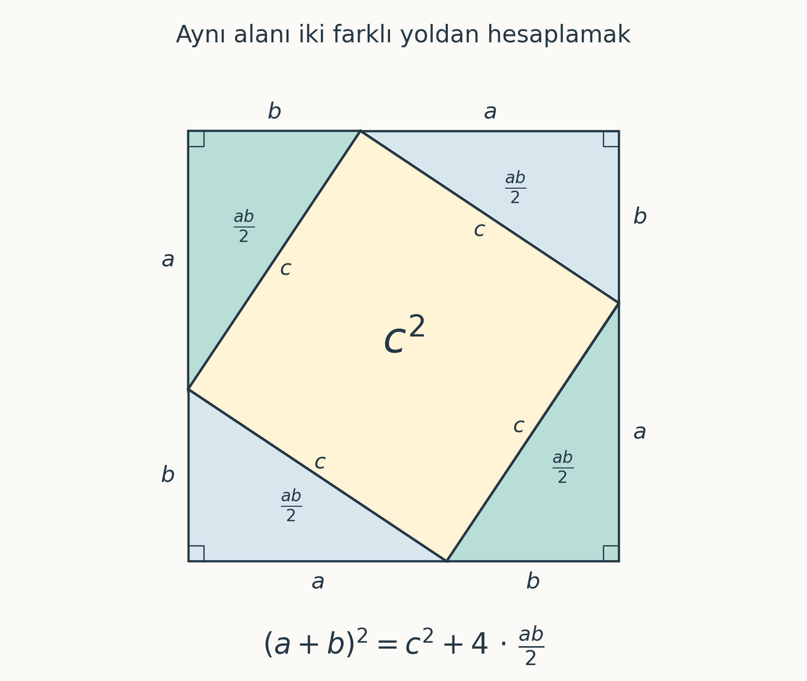

import ArticleVideo from '@/components/ArticleVideo.astro'
import teoreminAnlami from './media/01-teoremin-anlami.mp4?url'
import teoreminAnlamiPoster from './media/01-teoremin-anlami.jpg?url'
import alanIspati from './media/02-alan-ispati.mp4?url'
import alanIspatiPoster from './media/02-alan-ispati.jpg?url'
import karelerinTasinmasi from './media/03-karelerin-tasinmasi.mp4?url'
import karelerinTasinmasiPoster from './media/03-karelerin-tasinmasi.jpg?url'
import kokIki from './media/04-kok-iki.mp4?url'
import kokIkiPoster from './media/04-kok-iki.jpg?url'

Pisagor teoremi, okul yıllarından aklımızda kalan en tanıdık matematiksel ifadelerden biri:

$$
a^2+b^2=c^2
$$

Bir dik üçgen çizilir, iki kenarın uzunluğu verilir ve üçüncüsü sorulur. Sayıları formüle yerleştirir, işlemleri yapar ve sonucu buluruz. Bu işlem zamanla o kadar alışıldık hâle gelir ki formülün arkasındaki düşünceyi gözden kaçırabiliriz.

Oysa bu eşitliği anlamaya çalışmak bizi oldukça geniş bir alana götürür: geometrik şekillerin alanlarına, matematiksel ispatın nasıl çalıştığına, irrasyonel sayılara ve yüzyıllar boyunca çözüm beklemiş problemlere.

Bu yolculuğa teoremin tam olarak ne söylediğiyle başlayalım.

## 1. Pisagor Teoremi Nedir?

Pisagor teoremi, düzlem geometrisinde bir dik üçgenin kenar uzunlukları arasındaki ilişkiyi açıklar. Dik açıyı oluşturan kenarların uzunluklarına $a$ ve $b$, dik açının karşısındaki en uzun kenara, yani **hipotenüse**, $c$ dersek:

$$
a^2+b^2=c^2
$$

eşitliği geçerlidir.

Bu ifadenin geometrik anlamı, kenarların üzerine çizilen karelerde saklıdır. Dik kenarlar üzerine çizilen iki karenin alanlarının toplamı, hipotenüs üzerine çizilen karenin alanına eşittir.

Örneğin dik kenarları 3 ve 4 birim olan bir üçgende:

$$
3^2+4^2=9+16=25
$$

olduğundan hipotenüsün uzunluğu 5 birimdir.

Burada 9, 16 ve 25 sayıları, üçgenin kenarları üzerine çizilebilen karelerin alanlarını temsil eder. Böylece bir uzunluk problemi, alanlar arasındaki bir ilişkiyle çözülür.

Teoremi kullanırken dik açı koşuluna dikkat etmek gerekir. Her üçgenin kenarlarını bu eşitliğe yerleştiremeyiz. İlişkinin geçerliliği, üçgenin geometrik yapısına bağlıdır.

<ArticleVideo
  src={teoreminAnlami}
  poster={teoreminAnlamiPoster}
  title="Dik üçgenin kenarlarına kurulan kareler ve alan eşitliği"
  caption="Dik kenarlardaki iki karenin alanları toplamı, hipotenüsteki karenin alanına eşittir."
/>

### Aranan kenar hipotenüs değilse

5 metre uzunluğunda düz bir merdiven, düşey bir duvara dayansın. Merdivenin alt ucu duvardan yatayda 3 metre uzakta olsun. Zeminle duvarın dik olduğu ideal modelde, merdiven dik açının karşısında bulunduğu için hipotenüstür. Duvara ulaşılan yüksekliğe $h$ diyelim; $h$ bir uzunluktur ve pozitif olmalıdır.

$$
3^2+h^2=5^2.
$$

Burada 3 ile 5'i doğrudan kareleyip toplamayız; 5 zaten hipotenüstür. İki taraftan $3^2=9$ çıkararak bilinmeyenin karesini yalnız bırakırız:

$$
h^2=25-9=16.
$$

$h^2=16$ denkleminin gerçek sayı çözümleri 4 ve $-4$'tür. Fakat $h$ yüksekliğin uzunluğunu anlattığı için $h=4$ metre seçilir. Kontrol: $3^2+4^2=9+16=25=5^2$. Ayrıca 4 metrelik dik kenar, 5 metrelik hipotenüsten kısa olmalıdır; sonuç bu koşulu da sağlar.

Bu örnekte $h=5-3=2$ demek, **uzunlukların kareleri arasındaki** ilişkiyi uzunlukların kendileri arasındaki çıkarma sanmak olurdu. 2'yi yerine koyunca $3^2+2^2=13$ çıkar; 25 olmadığı için modelin eşitliği sağlanmaz.

### Verilen üç uzunlukla dikliği denetlemek

Kenarları 5, 12 ve 13 santimetre olan bir üçgende önce en uzun kenarı, yani 13'ü belirleriz. $5^2+12^2=25+144=169=13^2$ olduğundan Pisagor teoreminin tersine göre 13 santimetrelik kenarın karşısındaki açı diktir. Aynı kontrolü 5, 12 ve 14 için yaparsak $169\ne196$ bulunur; bu üçgen dik değildir.

Ters çıkarımın neden geçerli olduğunu ayrıca gerekçelendirelim. Verilen üçgende en uzun kenar $c$ olsun ve $a^2+b^2=c^2$ sağlansın. Şimdi dik kenarları $a$ ve $b$ olan yeni bir dik üçgen kuralım. Onun hipotenüsüne $d$ dersek, Pisagor bu yeni üçgende $d^2=a^2+b^2$ verir. Verilen eşitlikle birlikte $d^2=c^2$ olur. İkisi de pozitif uzunluk olduğu için $d=c$'dir. Böylece iki üçgenin üçer kenarı eşleşir; [KKK eşliği](/blog/eslik-benzerlik-ve-olcek/) gereği açıları da eşleşir. Yeni üçgenin dik açısına karşılık gelen eski açı da diktir. Doğru teoremi geriye doğru yalnız varsaymadık; ayrıca eşlik kullanarak tersini gösterdik.

Üç uzunluğun önce üçgen oluşturabilmesi gerekir. Örneğin 2, 3 ve 8 için ilk sorun diklik değil, $2+3<8$ olduğu için üçgenin kapanamamasıdır. Ölçümle elde edilen uzunluklarda küçük farkların bulunabileceğini de ayırırız: yaklaşık bir eşitlik, ideal geometrik teoremin tam eşitliğiyle aynı kanıt değildir. Buradaki hesaplar, verilen uzunlukların tam kabul edildiği matematiksel örneklerdir.

Formülü kullanmadan önce harfleri şekle bağlayalım. $a$ ile $b$ birbirine dik olan iki kenarın uzunluklarıdır; $c$, dik açının karşısında bulunan üçüncü kenardır. Harfler değişebilir, fakat bu görevler değişmez. Bir soruda en uzun kenara $x$ denmişse hipotenüs $x$ olur ve formülün tek başına duran karesi $x^2$ olmalıdır. Dik açı işareti verilmeden üç kenara rastgele $a,b,c$ yazmak teoremin koşulunu sağlamaz.

Kareleri toplamak ile uzunlukları toplamak da farklı işlemlerdir. $a=3$, $b=4$ için önce $a^2=9$ ve $b^2=16$ bulunur; bu iki karenin alanları toplamı 25'tir. Aradığımız kenar alan değil uzunluk olduğundan son adımda karekök alıp 5 buluruz. $c=25$ yazsaydık $c^2=625$ olur, başlangıç eşitliği bozulurdu. $c=3+4=7$ yazmak ise iki dik kenar boyunca gidilen kırık yolun uzunluğunu verir. Düz uzaklığın başka bir ölçü olduğunu, sonuçları yeniden formüle koyarak ayırt edebiliriz.

## 2. Pisagor Teoreminin Tarihsel Yolculuğu

Teorem Pisagor’un adını taşısa da onunla bağlantılı matematiksel bilgiler çok daha eskiye uzanır.

Babil matematiğinden kalan tabletler, dik üçgenler ve karelerin köşegenleri üzerine yapılan hesapları günümüze taşır. Yale Babil Koleksiyonu’ndaki **YBC 7289** adlı tablet, bir kare çizimiyle birlikte $\sqrt{2}$ için oldukça hassas bir yaklaşık değer içerir. Bu çalışma, Pisagor’un yaşadığı dönemden bin yılı aşkın süre öncesine aittir. [Yale’ın tablet hakkındaki incelemesi](https://news.yale.edu/2016/04/11/3800-year-journey-classroom-classroom)

Teoremin ilk kez kim tarafından ispatlandığını belirlemek ise daha güçtür. Pisagor’un bizzat bir ispat geliştirdiğini kesin biçimde gösteren tarihsel kanıt bulunmaz; ona ilişkin anlatıların önemli bir bölümü çok daha sonraki kaynaklardan gelir.

Bu tarih, matematiksel bilginin farklı toplumların katkılarıyla geliştiğini gösterir. Hesaplama yöntemleri, geometrik gözlemler ve ispatlar zaman içinde birbirini beslemiştir.

Biz de aynı soruyu kendimiz sorabiliriz: Bu eşitlik birkaç örnekte çalışıyor olabilir; bütün dik üçgenlerde geçerli olduğunu nasıl gösterebiliriz?

## 3. Formül Neden Doğru?

Pisagor teoremini anlamanın en anlaşılır yollarından biri, aynı şeklin alanını iki farklı biçimde hesaplamaktır.

Dik kenarları $a$ ve $b$, hipotenüsü $c$ olan bir üçgen düşünelim. Bu üçgenden dört tane alıp aşağıdaki gibi yerleştirelim:

Dıştaki büyük karenin her bir kenarı $a+b$ uzunluğundadır. Dolayısıyla alanı:

$$
(a+b)^2
$$

olur.

İçeride kalan şeklin dört kenarı da üçgenlerin hipotenüslerinden oluşur ve $c$ uzunluğundadır. Ayrıca bir dik üçgenin iki dar açısının toplamı $90^\circ$ olduğundan, yerleşimde ortadaki şeklin her köşesi de $90^\circ$ olur. Böylece ortada gerçekten bir kare bulunduğunu söyleyebiliriz. Bu karenin alanı $c^2$’dir.

Dört üçgenin her birinin alanı ise:

$$
\frac{ab}{2}
$$

kadardır. Büyük karenin alanını, bu dört üçgenin alanlarıyla ortadaki karenin alanını toplayarak da hesaplayabiliriz:

$$
(a+b)^2=4\cdot\frac{ab}{2}+c^2
$$

Sol taraftaki ifadeyi açalım:

$$
a^2+2ab+b^2=2ab+c^2
$$

İki taraftan da $2ab$ çıkarınca:

$$
\boxed{a^2+b^2=c^2}
$$

elde ederiz.

Bu işlemlerde kenarlara belirli sayılar vermedik. Akıl yürütmemiz, herhangi bir dik üçgen için aynı şekilde çalışıyor. İspatın gücü burada ortaya çıkıyor: **Eşitliğin neden bütün dik üçgenlerde geçerli olduğunu açıklayabiliyoruz.**

<ArticleVideo
  src={alanIspati}
  poster={alanIspatiPoster}
  title="Dört eş üçgenin yeniden yerleştirilmesiyle Pisagor teoreminin alan ispatı"
  caption="Aynı dış karede aynı dört üçgen yeniden yerleşiyor. Geriye kalan alan değişmiyor: a² + b² = c²."
/>

Ortadaki dörtgenin kare olduğuna karar verirken iki ayrı koşulu denetledik: dört kenarın eşitliği ve köşelerin dikliği. Dört eşit kenar tek başına yeterli değildir; eğik bir eşkenar dörtgen de çizilebilir. Üçgenin dar açılarına $\alpha$ ve $\beta$ dersek $\alpha+\beta=90^\circ$ olur. Yerleşimde ortadaki köşeyle bu iki açı bir doğru açı oluşturur. Bu nedenle orta köşe $180^\circ-(\alpha+\beta)=90^\circ$'dir. Kare alanını kullanmayı haklı çıkaran eksik halka budur.

Alan eşitliğinin cebirinde de bir geçişi açalım. $(a+b)^2$, $(a+b)(a+b)$ anlamındadır. Dağılma özelliğiyle $a^2+ab+ba+b^2$ elde edilir; iki eş çarpımın toplamı $2ab$ olur. Bu yüzden $(a+b)^2$ ifadesini $a^2+b^2$ diye açamayız. İspatta iki tarafta görünen $2ab$ terimleri, dört üçgenin toplam alanını temsil eder. Onları iki taraftan çıkardığımızda aynı parçaları hesap dışına alırız. Kalan alanların eşitliği, kenar karelerinin bağıntısını verir; şekil ile cebir aynı çıkarma işlemini anlatır.

## 4. Bir Karenin Köşegeni: √2 ve İrrasyonel Sayılar

Şimdi kenar uzunluğu 1 birim olan bir kare çizelim ve karşılıklı iki köşesini birleştirelim.

Köşegen, kareyi iki eş dik üçgene ayırır. Bu üçgenlerden birine Pisagor teoremini uygularsak, köşegenin uzunluğu $d$ için:

$$
d^2=1^2+1^2=2
$$

buluruz. Uzunluk pozitif olduğundan:

$$
d=\sqrt{2}
$$

olur.

Bu uzunluk yaklaşık olarak $1{,}41421356\ldots$ birimdir. Çizdiğimiz karenin belirli, sonlu bir köşegeni vardır. Buna karşılık onun uzunluğunu iki tam sayının oranıyla tam olarak ifade edemeyiz.

<ArticleVideo
  src={kokIki}
  poster={kokIkiPoster}
  title="Birim karenin köşegen uzunluğunun karekök iki olarak hesaplanması"
  caption="Kenarları 1 birim olan karenin köşegeni √2 birimdir; animasyonda bu uzunluk c ile gösteriliyor."
/>

Bunu göstermek için **olmayana ergi** yöntemini kullanabiliriz: Önce $\sqrt{2}$’nin bir kesir olarak yazılabildiğini kabul eder, bu kabulün sonuçlarını inceleriz.

Varsayalım ki:

$$
\sqrt{2}=\frac{p}{q}
$$

Burada $p$ ve $q$ pozitif tam sayılar olsun. Kesri tamamen sadeleştirmiş olalım; yani bu iki sayının 1’den büyük ortak böleni bulunmasın.

İki tarafın karesini aldığımızda:

$$
2=\frac{p^2}{q^2}
$$

ve buradan:

$$
p^2=2q^2
$$

elde ederiz.

Sağ taraf 2’nin katı olduğuna göre $p^2$ çifttir. Karesi çift olan bir tam sayının kendisi de çifttir; çünkü tek bir sayının karesi her zaman tek olur.

O hâlde $p=2k$ yazabiliriz. Bunu eşitliğe yerleştirelim:

$$
(2k)^2=2q^2
$$

$$
4k^2=2q^2
$$

$$
q^2=2k^2
$$

Bu kez $q^2$’nin, dolayısıyla $q$’nun da çift olduğunu görüyoruz.

Böylece hem $p$ hem de $q$ çift çıktı. İkisi de 2’ye bölünebiliyor. Ancak başlangıçta kesri tamamen sadeleştirdiğimizi söylemiştik. Ulaştığımız sonuç, başlangıç koşulumuzla çelişiyor.

Dolayısıyla $\sqrt{2}$, iki tam sayının oranı olarak yazılamaz. **İrrasyonel bir sayıdır.**

Buradaki sonsuzluk, sayının büyüklüğüyle ilgili değildir. $\sqrt{2}$, 1 ile 2 arasında sonlu bir sayıdır. Sonsuza uzanan şey, ondalık gösterimindeki basamaklardır; üstelik bu basamaklar bir noktadan sonra sabit bir döngüyle tekrar etmez.

Birim karenin köşegeni, böylece sayı anlayışımızı genişletir: Kesirlerle ifade edemediğimiz uzunluklar da vardır.

İrrasyonellik ispatında kullanılan “karesi çift olan tam sayı çifttir” adımı neden geçerlidir? Bir tek tam sayı $2k+1$ biçimindedir; $k$ burada herhangi bir tam sayıdır. Karesini açınca:

$$
\begin{aligned}
(2k+1)^2&=4k^2+4k+1\\
&=2(2k^2+2k)+1
\end{aligned}
$$

çıkar. Bu da ikiyle bölündüğünde 1 artan, yani tek bir sayıdır. Demek ki karesi çift olan sayı tek olamaz; çift olmak zorundadır. Hem $p$ hem $q$ için kullandığımız adımın dayanağı budur.

Kesri başlangıçta sadeleştirilmiş seçmemiz de önemlidir. Herhangi bir kesirde pay ve payda ortak çarpan taşıyabilir; bunda çelişki yoktur. Fakat bütün ortak çarpanları baştan sadeleştirdiğimiz hâlde ikisinin de yeniden 2'ye bölündüğünü bulursak ilk kabulle uyuşmayan bir sonuca ulaşırız. Bu çelişki, karekökün bulunmadığını değil, onun iki tam sayının oranıyla yazılamadığını söyler. Geometride belirli bir köşegen ve sayı doğrusunda belirli bir uzunluk vardır; yalnız kesir biçimindeki gösterim ona yetmez.

## 5. Pisagor Üçlüleri ve Sayılar Arasındaki Örüntüler

Bazı dik üçgenlerin üç kenarı da tam sayı uzunluklarına sahiptir:

$$
3^2+4^2=5^2
$$

$$
5^2+12^2=13^2
$$

$$
8^2+15^2=17^2
$$

Eşitliği sağlayan bu pozitif tam sayı gruplarına **Pisagor üçlüleri** denir.

<ArticleVideo
  src={karelerinTasinmasi}
  poster={karelerinTasinmasiPoster}
  title="3–4–5 üçgeninde 9 ve 16 birim karenin 25 birimlik kareyi doldurması"
  caption="3–4–5 örneğinde 9 ve 16 birim kare, şekilleri ve alanları değişmeden 25 birimlik kareyi dolduruyor."
/>

Bu üçlüleri belirli bir yöntemle üretebiliriz. $m>n>0$ olacak şekilde iki tam sayı seçelim ve:

$$
\begin{aligned}
a&=m^2-n^2,\\
b&=2mn,\\
c&=m^2+n^2
\end{aligned}
$$

tanımlarını kullanalım.

Örneğin $m=2$, $n=1$ seçersek:

$$
a=3,\qquad b=4,\qquad c=5
$$

elde ederiz. $m=3$, $n=2$ seçtiğimizde ise 5–12–13 üçlüsüne ulaşırız.

Yöntemin neden çalıştığını cebirle görebiliriz:

$$
\begin{aligned}
&(m^2-n^2)^2+(2mn)^2\\
&\quad=m^4+2m^2n^2+n^4\\
&\quad=(m^2+n^2)^2
\end{aligned}
$$

Başlangıçta birbirinden ayrı görünen örnekler, böylece ortak bir yapının parçaları hâline gelir. Örüntüyü fark etmek bizi bir tahmine götürür; cebirsel açıklama da bu tahmini gerekçelendirir.

Üçlü üretme formülündeki iptali ayrı ayrı görelim. İlk karenin açılımında $m^4-2m^2n^2+n^4$, ikinci karenin açılımında $4m^2n^2$ bulunur. Ortadaki terimler $-2m^2n^2+4m^2n^2=2m^2n^2$ verir. Toplam bu nedenle $(m^2+n^2)^2$ olur. Seçtiğimiz $m>n>0$ koşulu $m^2-n^2$ ile $2mn$ uzunluklarının pozitif olmasını sağlar. Burada sadece birkaç sayının tesadüfen uyuşmasını değil, seçilen her uygun $m,n$ için çalışan bir kuralı gösteriyoruz.

Örneğin $m=4$, $n=1$ seçersek dik kenarlar $16-1=15$ ve $2\times4\times1=8$, hipotenüs $16+1=17$ olur. Bağımsız kontrol $15^2+8^2=225+64=289=17^2$ verir. Elde edilen üçgeni iki kat büyütürsek 30, 16, 34 kenarları çıkar. Her kare dört katına çıktığı için aynı eşitlik korunur. Dolayısıyla bir üçlünün bütün pozitif tam sayı katları da üçlüdür. Farklı görünen örneklerin bazılarının yalnız aynı biçimin büyütülmüş kopyaları olduğunu bu yolla anlayabiliriz.

Üretilen üç pozitif sayı gerçekten bir üçgen oluşturuyor mu? Önce $c-a=2n^2>0$ ve $c-b=(m-n)^2>0$ olduğundan en uzun kenar adayının $c$ olduğunu görürüz. Dolayısıyla kapanma için denetlenecek asıl koşul $a+b>c$'dir. Tanımları yerine koyunca:

$$
\begin{aligned}
a+b-c
&=(m^2-n^2)+2mn-(m^2+n^2)\\
&=2n(m-n)>0.
\end{aligned}
$$

Son işaret, $n>0$ ve $m>n$ koşullarından gelir. Böylece formül yalnız kareler eşitliğini sağlamaz; elde edilen uzunluklar üçgen eşitsizliğini de sağlar. Pisagor'un tersini bu gerçek üçgene uygulayıp dikliğini söyleyebiliriz.

## 6. Pisagor Teoreminin Kullanım Alanları

Pisagor teoremi, birbirine dik iki yöndeki uzaklıkları tek bir mesafe hesabında birleştirmemizi sağlar.

Örneğin bir noktadan 6 metre doğuya ve ardından 8 metre kuzeye ilerlediğimizi düşünelim. Yürüdüğümüz toplam yol 14 metredir. Başlangıç ve bitiş noktaları arasındaki kuş uçuşu mesafe ise:

$$
d=\sqrt{6^2+8^2}=\sqrt{100}=10
$$

metredir.

Aynı ilişki, düz bir koordinat sisteminde iki nokta arasındaki mesafeyi hesaplamak için kullanılır. Noktalar $(x_1,y_1)$ ve $(x_2,y_2)$ ise yatay ve düşey uzaklıklar bir dik üçgenin iki kenarını oluşturur:

$$
d=\sqrt{(x_2-x_1)^2+(y_2-y_1)^2}
$$

Bilgisayar grafiklerinde iki nesnenin birbirine ne kadar yakın olduğunu hesaplamak veya bir oyun karakterinin hedefe uzaklığını bulmak için bu bağıntıdan yararlanabiliriz.

İnşaatta da teoremin tersinden faydalanılır. Kenarları 3, 4 ve 5 birim olan bir üçgen oluşturulduğunda, 3 ve 4 birimlik kenarların arasındaki açı diktir. Bu ilişki, bir köşenin dikliğini kontrol etmenin geometrik temelini verir.

Bütün bu örneklerde yaptığımız şey, fiziksel bir durumu uzunluklar ve açılarla temsil etmektir. Kurduğumuz model duruma uygun olduğunda, matematik doğrudan ölçmenin zor olduğu bir mesafeyi hesaplamamıza yardımcı olur.

Uzaklık formülünde indisleri birer etiket olarak okuyalım: $(x_1,y_1)$ başlangıç noktasının, $(x_2,y_2)$ bitiş noktasının koordinatlarıdır. $x_2-x_1$ yatay, $y_2-y_1$ düşey değişimdir. Bunlar sola veya aşağı gidildiğinde negatif olabilir; dik üçgenin kenar uzunlukları ise bu farkların mutlak değerleridir. Kare alındığında işaret kaybolduğu için uzaklık formülünde mutlak değerler ayrıca görünmez. Aynı tür uzunlukları, aynı birimde ölçtüğümüzü varsayarız.

Örneğin $A=(1,5)$ ve $B=(7,-3)$ olsun. Yatay değişim $7-1=6$, düşey değişim $-3-5=-8$'dir. Dik üçgenin kenarları 6 ve 8 birimdir; uzaklık $\sqrt{36+64}=10$ bulunur. Noktaların sırasını ters çevirirsek değişimler $-6$ ve 8 olur; kareler yine 36 ve 64'tür. Uzaklığın hangi noktadan başladığımıza bağlı olmaması gerekir ve hesap bunu doğrular. İşaretleri kare almadan önce toplamak, örneğin $6-8=-2$ yazmak, iki dik doğrultuyu aynı doğru üzerindeymiş gibi birleştirdiği için uzaklık vermez.

## 7. Pisagor’dan Fermat’ın Son Teoremine

Pisagor üçlüleriyle uğraşırken denklemde küçük bir değişiklik yapabiliriz: Kareler yerine küpler kullanırsak ne olur?

$$
a^3+b^3=c^3
$$

Bu eşitliği sağlayan pozitif tam sayılar bulunabilir mi? Daha genel olarak:

$$
a^n+b^n=c^n
$$

denkleminde $n$, 2’den büyük bir tam sayı olduğunda durum nasıldır?

**Fermat’ın Son Teoremi**, bu koşullarda denklemi sağlayan pozitif tam sayılar $a$, $b$ ve $c$ bulunmadığını söyler.

Burada sayıların pozitif tam sayı olması belirleyicidir. Örneğin gerçek sayılara izin verirsek:

$$
1^3+1^3=(\sqrt[3]{2})^3
$$

eşitliğini rahatlıkla yazabiliriz. Fermat’ın önermesi, çözümleri belirli bir sayı kümesinde aradığımızda ortaya çıkar.

İfadesi bu kadar kısa olan problemin genel ispatı yüzyıllar boyunca matematikçileri uğraştırdı. Andrew Wiles, Richard Taylor’ın da katkısıyla 1994 yılında genel ispatı tamamladı.

Bir denklemdeki üssü değiştirmek, bizi tamamen farklı bir matematiksel probleme götürebilir. Sorunun kolay anlaşılması, çözümünün de kolay olacağı anlamına gelmez.

## 8. Pisagor Teoreminin Düşünme Biçimimize Katkısı

Pisagor teoremi üzerinden birbirini tamamlayan birkaç düşünme adımını izleyebiliyoruz.

Önce bir ilişki fark ediyoruz: Bazı sayıların kareleri arasında belirli bir eşitlik var. Ardından geometrik bir düzen kurarak bu eşitliğin bütün dik üçgenler için neden geçerli olduğunu gösteriyoruz. Teoremi birim kareye uyguladığımızda, kesirlerle ifade edilemeyen bir uzunlukla karşılaşıyoruz. Denklemdeki üsleri değiştirdiğimizde ise yeni bir araştırma sorusu ortaya çıkıyor.

Bu süreçte her adım, kullandığımız kavramları biraz daha dikkatli tanımlamamızı gerektiriyor. Üçgenin dik olması, kesrin sadeleştirilmiş olması veya çözümlerin pozitif tam sayılarda aranması, ulaştığımız sonucun ayrılmaz parçaları.

Bir formülü gerçekten anlamak, onun hangi koşullarda çalıştığını ve neden doğru olduğunu açıklayabilmekle derinleşiyor. Pisagor teoremine bu gözle baktığımızda, tanıdık bir eşitliğin içinde yeni sorular bulabiliyoruz.

Bir karenin köşegenini çizmek bile, bildiğimizi düşündüğümüz sayılara yeniden bakmamız için yeterli olabiliyor.

## Kaynakça

Bu yazının çıkış noktası, Marcel Danesi’nin kitabındaki “Pisagor Teoremi: Matematiğin Doğuşu” bölümüdür. Babil tabletine ilişkin bilgiler için aşağıdaki Yale News yazısından da yararlanılmıştır.

- **Marcel Danesi — [Pisagor’un Mirası: 10 Muhteşem Fikir Üzerinden Matematik](https://www.ketebe.com/pisagorun-mirasi-marcel-danesi).** Çeviren: Emre Bekman. Ketebe Yayınları, 2021. Özellikle 1. bölüm.

- **Yale News — [A 3,800-year journey from classroom to classroom](https://news.yale.edu/2016/04/11/3800-year-journey-classroom-classroom).** Patrick Lynch, 11 Nisan 2016. Babil döneminden kalan YBC 7289 tabletini ve karekök iki hesabını anlatan yazı.

Çevrimiçi kaynaklara erişim tarihi: 20 Eylül 2026.
