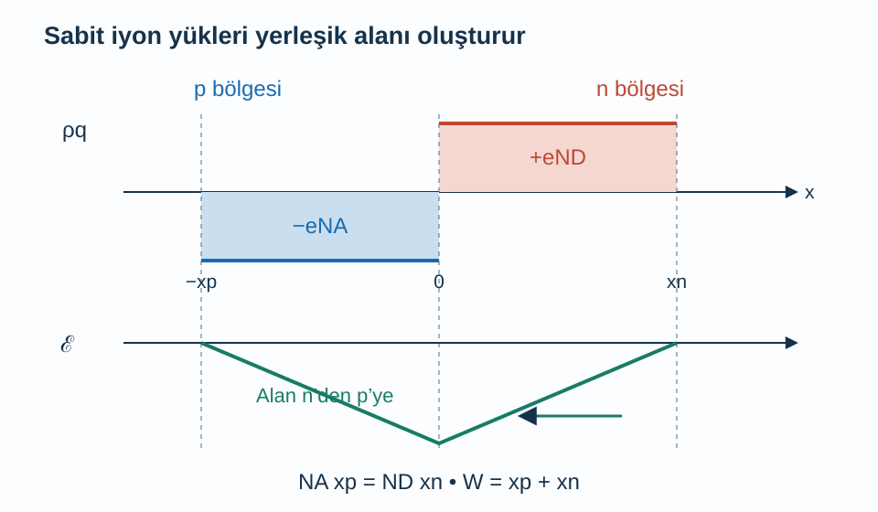
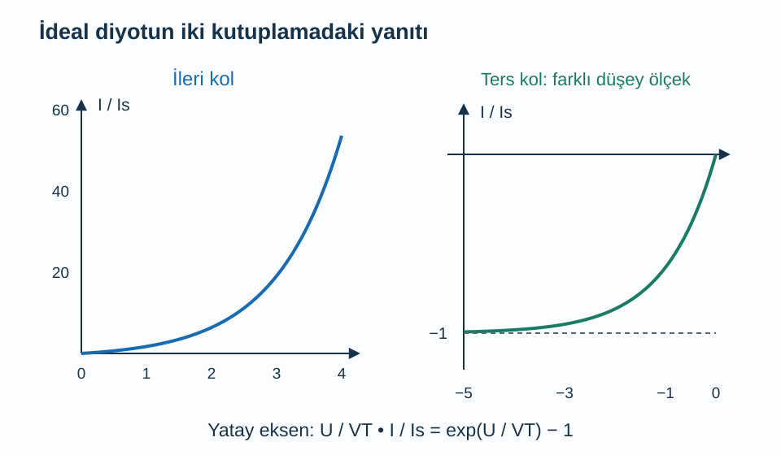

Ayrı ayrı nötr olan p tipi ve n tipi iki bölgeyi tek kristalin içinde yan yana getirdiğimizde sınırda bir elektrik alanı oluşabilir. Bunun nedeni dışarıdan pil bağlamamız değildir. Hareketli taşıyıcıların yoğunluk farkı nedeniyle yayılması, geride hareketsiz katkı iyonlarını bırakır. Bu yükler taşıyıcıların daha fazla yayılmasına karşı koyan bir alan kurar. p–n ekleminin davranışı bu karşılıklı süreçten doğar.

Ön bilgilerimiz [yarı iletkenler ve katkılama](/blog/yari-iletkenler-ve-katkilama/), [elektriksel iletkenlik](/blog/elektriksel-iletkenlik-ve-drude-modeli/) ve [etkin kütle ve delikler](/blog/etkin-kutle-ve-delikler/). Tek boyutlu, ani katkı değişimli, aynı yarı iletkenden yapılmış bir eklem kullanacağız. Katkılar tam iyonlaşmış, bölgeler dejenere olmayan durumda ve sıcaklık her yerde aynı olsun. Önce dış gerilimsiz termal dengeyi, sonra küçük ve orta ileri gerilim altında ideal diyot yaklaşımını inceleyeceğiz.

## 1. Eklemin iki yanındaki taşıyıcılar

Sınırı $x=0$ noktasına, p bölgesini sola, n bölgesini sağa yerleştirelim. p tarafında akseptör yoğunluğu $N_A$, n tarafında donör yoğunluğu $N_D$ olsun. Eklemin uzağındaki nötr bölgelerde yaklaşık $p_p=N_A$, $n_n=N_D$ yazılır. İlk alt indis taşıyıcı türünü, ikinci alt indis bölgeyi anlatır. Azınlık yoğunlukları ise öz taşıyıcı yoğunluğu $n_i$ kullanılarak $n_p=n_i^2/N_A$ ve $p_n=n_i^2/N_D$ olur.

Elektronlar yoğun oldukları sağ taraftan sola, delikler yoğun oldukları sol taraftan sağa yayılma eğilimindedir. Buna **difüzyon** denir. Elektronlarını kaybeden sağ bölgede pozitif donör iyonları, deliklerini kaybeden sol bölgede negatif akseptör iyonları açığa çıkar. İyonlar kristaldeki yerlerinde kalır; elektron ve delikler gibi serbestçe karşı tarafa akmazlar.

Bu sabit yüklerin alanı pozitif taraftan negatif tarafa, yani n bölgesinden p bölgesine yönelir. Koordinat seçimimizde alanın $x$ bileşeni negatiftir. Elektronun kuvveti alanın tersine, deliğin kuvveti alan yönündedir. Böylece alanın oluşturduğu sürüklenme akımları, difüzyon akımlarını dengeleyebilir. Termal dengede toplam akım sıfırdır; bu sonuç içeride elektrik alanı sıfır demek değildir.

## 2. Tükenim yaklaşımı hangi kolaylığı sağlar?

Sınır çevresinde hareketli çoğunluk taşıyıcılarının sayısının büyük ölçüde azaldığı bölgeye **tükenim bölgesi** denir. Yaklaşık modelde bu bölgedeki hareketli yükleri sabit katkı iyonlarının yanında ihmal ederiz. p tarafındaki genişlik $x_p>0$, n tarafındaki genişlik $x_n>0$, toplam genişlik $W=x_p+x_n$ olsun.

Hacim yük yoğunluğunu $\rho_q(x)$ ile gösterelim; birimi $\mathrm{C/m^3}$'tür. Temel yük büyüklüğü $e>0$ kullanıldığında, $-x_p<x<0$ aralığında $\rho_q=-eN_A$, $0<x<x_n$ aralığında $\rho_q=+eN_D$ alırız. Bölgenin dışında yaklaşık nötrlük nedeniyle yük yoğunluğunu sıfır sayarız. Sınırlar gerçekte bu kadar keskin değildir; tükenim yaklaşımı hesaplanabilir bir ilk modeldir.

Toplam negatif ve pozitif yükün eşit büyüklükte olması gerekir:

$$
\begin{aligned}
eN_Ax_p&=eN_Dx_n\\
N_Ax_p&=N_Dx_n.
\end{aligned}
$$

Bu eşitlik eşit genişlik şartı değildir. Katkısı daha düşük olan tarafta aynı yükü biriktirmek için daha büyük genişlik gerekir. Örneğin $N_A=10N_D$ ise $x_n=10x_p$ olur. Eklemin alanı bu denklemde iki tarafta ortak olduğu için sadeleşmiştir.

Şekilde hareketli taşıyıcıların azalması, bütün madde yoğunluğunun azalması anlamına gelmez. Kristalin atomları ve bağları yerindedir. Dengeyi oluşturan yük, büyük nötr arka plan üzerindeki küçük bir farktır.

## 3. Poisson denkleminden alanı bulmak

Elektrik alanının bileşenini $\mathcal E(x)$, yarı iletkenin dielektrik geçirgenliğini $\varepsilon$ ile gösterelim. Bir boyutta Gauss yasası:

$$
\frac{d\mathcal E}{dx}=\frac{\rho_q}{\varepsilon}
$$

olur. p tarafında sağ taraf sabittir. Alanın $x=-x_p$ sınırında sıfır olduğunu kullanarak integrasyon yaparsak:

$$
\mathcal E(x)=-\frac{eN_A}{\varepsilon}(x+x_p)
\quad(-x_p<x<0)
$$

buluruz. n tarafında alanın $x=x_n$ sınırında sıfır olması şartıyla:

$$
\mathcal E(x)=\frac{eN_D}{\varepsilon}(x-x_n)
\quad(0<x<x_n)
$$

elde edilir. Her iki ifade kendi aralığında negatiftir. $x=0$ noktasındaki değerlerin eşit olması, az önceki yük dengesi koşulunu yeniden verir. Alan grafiği sıfırdan negatif bir tepeye inen ve yeniden sıfıra çıkan iki doğru parçasıdır.

Elektriksel potansiyel $\phi$ için $\mathcal E=-d\phi/dx$ tanımlanır. n tarafıyla p tarafı arasındaki yerleşik potansiyel farkı $V_{bi}=\phi_n-\phi_p>0$ olsun. Alan grafiğinin negatif işaretli integralini alarak:

$$
\begin{aligned}
V_{bi}&=-\int_{-x_p}^{x_n}\mathcal E(x)\,dx\\
&=\frac{e}{2\varepsilon}(N_Ax_p^2+N_Dx_n^2)
\end{aligned}
$$

buluruz. Alan grafiğinin iki üçgeninin alanlarını toplamak aynı sonucu verir. [MIT'nin eklem elektrostatik notları](https://ocw.mit.edu/courses/6-012-microelectronic-devices-and-circuits-fall-2009/c053714447998e522f02db0776987091_MIT6_012F09_lec04.pdf) tükenim yaklaşımı ile daha tam Poisson çözümünü karşılaştırır.

## 4. Yerleşik potansiyeli taşıyıcı oranından bulmak

Dengede kimyasal potansiyel kristal boyunca ortaktır. Elektronun elektriksel potansiyel enerjisi $-e\phi$ olduğundan, potansiyelin yüksek olduğu n tarafında bant kenarları daha aşağıdadır. Boltzmann doluluğu kullanıldığında elektron yoğunlukları oranı:

$$
\frac{n_n}{n_p}=e^{eV_{bi}/(k_BT)}
$$

olur. $k_B$ Boltzmann sabiti, $T$ mutlak sıcaklıktır. Nötr bölgelerdeki yoğunlukları yerine koyarsak oran $N_D/(n_i^2/N_A)=N_AN_D/n_i^2$ olur. Doğal logaritma alıp $e/(k_BT)$ ile bölerek:

$$
V_{bi}=\frac{k_BT}{e}\ln\left(\frac{N_AN_D}{n_i^2}\right)
$$

elde ederiz. Logaritmanın içi boyutsuzdur; bütün yoğunlukların aynı hacim biriminde yazılması gerekir. $V_T=k_BT/e$ ifadesine **termal gerilim** denir. $300\,\mathrm K$ için yaklaşık $25{,}852\,\mathrm{mV}$'tur.

Bu iç potansiyel farkı, eklemin uçlarına voltmetre bağlayıp sürekli enerji elde edebileceğimiz bir pil gerilimi değildir. Ölçüm devresindeki temaslar ve elektrokimyasal denge birlikte değerlendirilir. Termal dengede devreyi dolaşarak net iş çıkarılamaz; içeride alan olması tek başına bir enerji kaynağı oluşturmaz.

## 5. Sayısal örnek: Genişlik ve en büyük alan

$T=300\,\mathrm K$, $n_i=10^{10}\,\mathrm{cm^{-3}}$, $N_A=N_D=10^{16}\,\mathrm{cm^{-3}}$ alalım. Önce yoğunluk oranı $10^{32}/10^{20}=10^{12}$ olur. Böylece:

$$
\begin{aligned}
V_{bi}&=0{,}025852\ln(10^{12})\,\mathrm V\\
&\simeq0{,}7143\,\mathrm V.
\end{aligned}
$$

Yük dengesiyle $x_p=N_DW/(N_A+N_D)$ ve $x_n=N_AW/(N_A+N_D)$ yazıp potansiyel denklemine koyduğumuzda:

$$
W=\sqrt{\frac{2\varepsilon V_{bi}}e
\left(\frac1{N_A}+\frac1{N_D}\right)}
$$

çıkar. Şimdi metre birimine geçmeliyiz: $10^{16}\,\mathrm{cm^{-3}}=10^{22}\,\mathrm{m^{-3}}$. Geçirgenliği $\varepsilon=11{,}7\varepsilon_0$, $\varepsilon_0=8{,}85419\times10^{-12}\,\mathrm{F/m}$ model değeri seçelim. Hesap:

$$
\begin{aligned}
W&\simeq4{,}298\times10^{-7}\,\mathrm m\\
&=0{,}4298\,\mathrm{\mu m}
\end{aligned}
$$

verir. Katkılar eşit olduğundan her taraftaki genişlik $0{,}2149\,\mathrm{\mu m}$'dir. Alan üçgeninin alanı $V_{bi}=|\mathcal E_{\max}|W/2$ olduğu için en büyük alan büyüklüğü $2V_{bi}/W\simeq3{,}324\times10^6\,\mathrm{V/m}$ olur. Küçük bir mesafeye yayılan volt altı potansiyel, büyük bir yerel alan oluşturabilir.

## 6. Dış gerilim engeli nasıl değiştirir?

Uygulanan gerilimi $U=\phi_{p,\text{uç}}-\phi_{n,\text{uç}}$ diye tanımlayalım. $U>0$ **ileri kutuplamadır**. İdeal durumda eklemin etkin potansiyel engeli $V_{bi}-U$ olur; taşıyıcı enjeksiyonu kolaylaşır. $U<0$ ters kutuplamadır, engel ve tükenim genişliği artar. Tükenim modeli geçerli kaldığı sürece genişlik formülünde $V_{bi}$ yerine $V_{bi}-U$ kullanılır.

Önceki ekleme $U=-5{,}0\,\mathrm V$ uygulandığında potansiyel farkı $5{,}7143\,\mathrm V$ olur. Genişlik karekök ile değiştiğinden $W=0{,}4298\sqrt{5{,}7143/0{,}7143}\simeq1{,}216\,\mathrm{\mu m}$ bulunur. Bu sonuç kırılma olmadığını ve kullanılan yaklaşımın sürdüğünü varsayar. Ters gerilimi sınırsız artırırsak aynı basit modelle devam edemeyiz.

## 7. İleri akımın üstel bağı nereden gelir?

İleri gerilim, eklem kenarındaki azınlık yoğunluklarını denge değerlerinin $e^{U/V_T}$ katına çıkarır. p tarafına enjekte edilen elektron fazlalığı $\delta n(0)=n_{p0}(e^{U/V_T}-1)$ olsun; $n_{p0}=n_i^2/N_A$ denge azınlık yoğunluğudur. Benzer biçimde n tarafındaki delik fazlalığı $\delta p(0)=p_{n0}(e^{U/V_T}-1)$ olur.

Eklemin uzağına doğru ölçülen uzaklığa $s$ diyelim. Nötr bölgede sabit difüzyon katsayısı $D_n$ ve azınlık ömrü $\tau_n$ ile durağan fazla elektron denklemi $D_n\,d^2\delta n/ds^2-\delta n/\tau_n=0$ biçimindedir. Uzakta fazlalığın sıfıra gitmesi, çözümü $\delta n(s)=\delta n(0)e^{-s/L_n}$ yapar; $L_n=\sqrt{D_n\tau_n}$ difüzyon uzunluğudur.

Sınırdaki türev $-\delta n(0)/L_n$ olduğundan elektron difüzyon akımının büyüklüğü $eD_n\delta n(0)/L_n$ olur. Delik katkısını da ekleyip eklem alanı $A$ ile çarparsak:

$$
\begin{aligned}
I&=I_s(e^{U/V_T}-1)\\
I_s&=eA\left(\frac{D_nn_{p0}}{L_n}+\frac{D_pp_{n0}}{L_p}\right).
\end{aligned}
$$

$D_p$ delik difüzyon katsayısı, $L_p$ delik difüzyon uzunluğu, $I_s$ pozitif doyma akımı parametresidir. Bu **ideal diyot denklemi**, düşük enjeksiyon, yeterince uzun nötr bölgeler ve tükenim bölgesindeki yeniden birleşmenin ihmal edildiği koşullara dayanır. [MIT'nin akım-gerilim ders notları](https://ocw.mit.edu/courses/6-012-microelectronic-devices-and-circuits-fall-2009/a342ce0afb84bfa8e5b7dc819ff3e9bc_MIT6_012F09_lec06.pdf) ideal ve gerçek davranışın ayrımını işler.

Şekil akımı $I_s$'ye, gerilimi $V_T$'ye bölerek gösterir. Gerçek diyodun kırılma ve seri direnç bölgeleri bu eğrinin kapsamına dahil değildir.

## 8. Tükenim bölgesi yük depolar mı?

Ters kutuplamada akım küçük olsa bile eklemin yük dağılımı gerilimle değişir. Bu nedenle eklem bir **kapasitans** gösterebilir. Ters gerilimin pozitif büyüklüğüne $V_R=-U$ diyelim. Simetrik katkılı örnekte iki tarafın genişliği $W/2$ olduğundan, bir taraftaki sabit yükün büyüklüğü $Q=eNAW/2$ olur. Burada $N=N_A=N_D$ ortak katkı yoğunluğu, $A$ eklem alanıdır. Karşı taraftaki yük eşit ve zıt işaretlidir.

Genişlik denkleminden $W^2=4\varepsilon(V_{bi}+V_R)/(eN)$ yazabiliriz. İki tarafın $V_R$'ye göre türevini alırsak $2W\,dW/dV_R=4\varepsilon/(eN)$ olur. Bunu $dQ/dV_R=(eNA/2)dW/dV_R$ içine koyduğumuzda:

$$
\begin{aligned}
C_j&=\frac{dQ}{dV_R}\\
&=\frac{\varepsilon A}{W}
\end{aligned}
$$

elde ederiz. $C_j$ küçük sinyal eklem kapasitansıdır; birimi faraddır. Ters gerilim arttıkça tükenim genişliği büyür, kapasitans küçülür. Bu sonuç iki iletken levha arasında boşluk varmış gibi birebir bir fiziksel yapı kurmaz; gerilim değişimine karşı yük değişiminin benzer matematik taşıdığını gösterir.

Kapasitans ölçümü böylece tükenim bölgesinin genişliği ve katkı profili hakkında bilgi taşıyabilir. İleri gerilimde enjekte edilen azınlık taşıyıcılarının depolanması başka bir kapasitans katkısı getirir. Buradaki tükenim hesabını her kutuplamada tek başına kullanmamalıyız. Yavaş denge elektrostatik modeli ile hızlı zaman yanıtı arasında da taşıyıcıların yetişebilmesi koşulu bulunur.

## 9. Sayısal örnek: Küçük gerilim artışı büyük akım değişimi

$T=300\,\mathrm K$ ve $I_s=10^{-12}\,\mathrm A$ olan ideal modelde $U=0{,}50\,\mathrm V$ seçelim. Üstteki boyutsuz sayı $U/V_T=0{,}50/0{,}025852\simeq19{,}34$ olur. Dolayısıyla:

$$
\begin{aligned}
I&=10^{-12}(e^{19{,}34}-1)\,\mathrm A\\
&\simeq2{,}510\times10^{-4}\,\mathrm A\\
&=0{,}2510\,\mathrm{mA}.
\end{aligned}
$$

Gerilim $0{,}55\,\mathrm V$ olduğunda aynı hesap $I\simeq1{,}736\,\mathrm{mA}$ verir. Yalnız $0{,}05\,\mathrm V$ artış akımı yaklaşık $6{,}92$ kat büyütmüştür. Bu oranı doğrudan $e^{0{,}05/V_T}$ ile de denetleyebiliriz; ileri akımlar büyükken eksi bir terimi ihmal edilebilir.

Bu üstel ilişki diyodun belirli bir gerilimde aniden açılan kusursuz anahtar olmadığını gösterir. Sık kullanılan sabit eşik gerilimi yaklaşımı, belirli bir akım aralığındaki devre hesaplarını basitleştirir. Gerçek akım sıcaklığa, doyma akımına, yeniden birleşmeye ve seri dirence bağlıdır. İleri gerilim büyüdüğünde yüksek enjeksiyon, ters gerilim büyüdüğünde tünelleme veya çığ kırılması temel modeli değiştirebilir. Eklemin anlaşılması için hem uzaysal yük dağılımını hem taşıyıcıların denge dışı hareketini birlikte tutmak gerekir.
