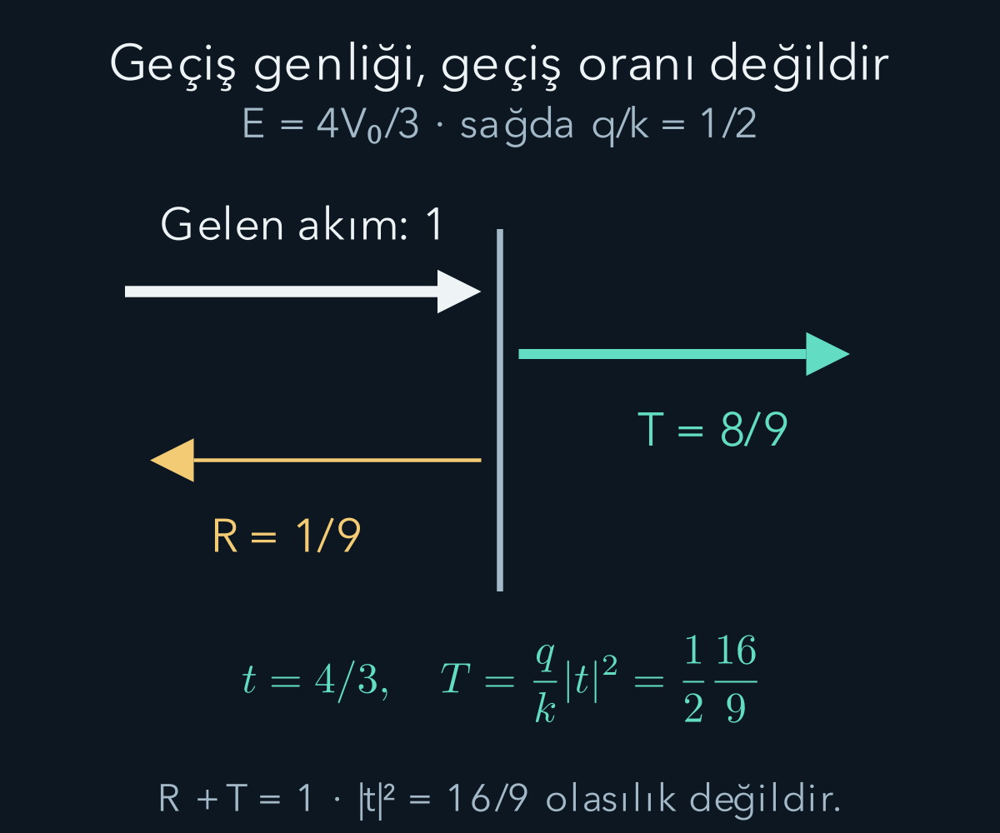
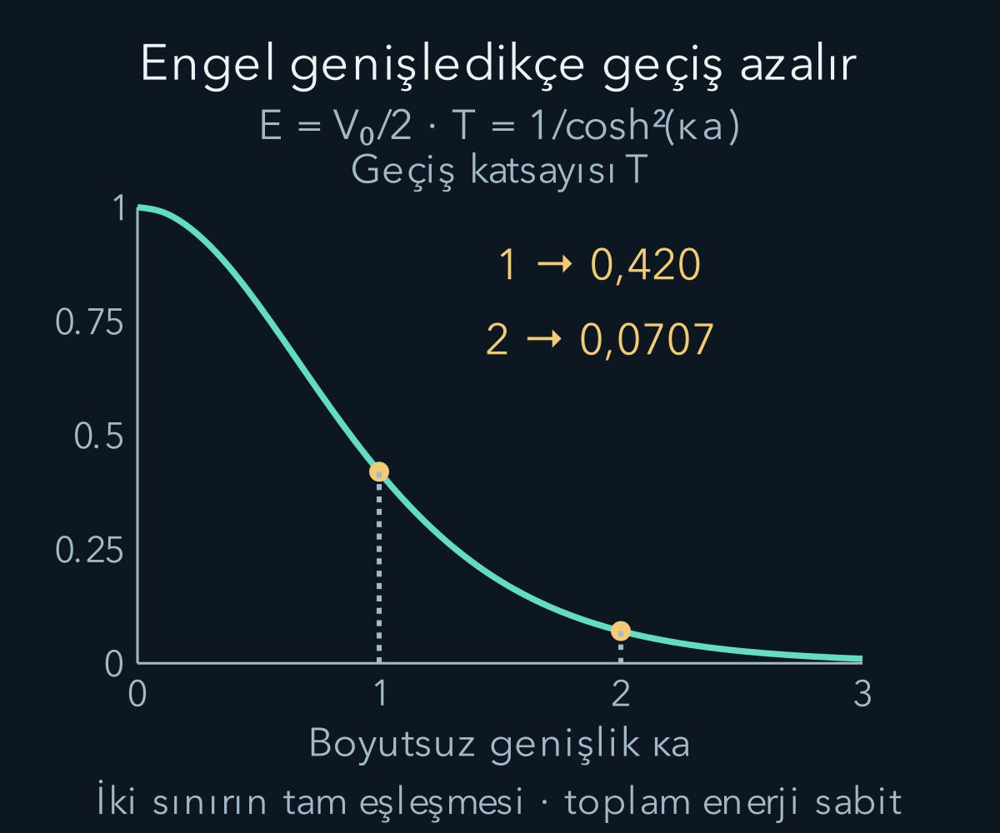

import ArticleVideo from '@/components/ArticleVideo.astro'
import kavram from './media/01-kavram.mp4?url'
import kavramPoster from './media/01-kavram.jpg?url'

Klasik bir parçacığın kinetik enerjisi negatif olamaz. Toplam enerjisi bir potansiyel engelinden küçükse, klasik modelde o bölgeye geçemez. Kuantum dalga fonksiyonu ise böyle bir bölgede hemen sıfır olmak zorunda değildir. Sonlu bir engelin öte tarafında akım bulunabilmesi, **tünelleme** dediğimiz olgunun temelidir. Bunu ‘parçacık kısa süreliğine enerji ödünç alır’ diye açıklamaya gerek yoktur.

[Schrödinger denklemi ve akımı](/blog/schrodinger-denklemi-ve-olasilik-akimi/) ile [sonsuz kuyu](/blog/sonsuz-potansiyel-kuyusu/) ön bilgilerimizdir. Burada kütlesi $m$ olan göreli olmayan parçacık, gerçek ve zamandan bağımsız bir boyutlu potansiyelle etkileşecek. Kütle bütün bölgelerde aynı; potansiyel basamakları sonlu olacak. Bu koşullarda dalga fonksiyonunu ve birinci türevini sınırlarda sürekli eşleştireceğiz.

## 1. Gelen, yansıyan ve geçen dalga

Önce $x<0$ bölgesinde $V=0$, $x>0$ bölgesinde $V=V_0>0$ olan bir basamak seçelim. Parçacık soldan gelsin. Durağan enerjisi $E>V_0$ olduğunda iki tarafta da salınımlı çözümler vardır. Sol dalga sayısı $k=\sqrt{2mE}/\hbar$, sağ dalga sayısı $q=\sqrt{2m(E-V_0)}/\hbar$ olsun.

Ortak zaman çarpanı $e^{-iEt/\hbar}$'ı geçici olarak yazmayalım. Gelen genliği bir seçersek:

$$
u_L(x)=e^{ikx}+r e^{-ikx},\qquad
u_R(x)=t e^{iqx}
$$

olur. $r$ yansıma genliği, $t$ geçiş genliğidir; bunlar genel olarak karmaşık sayılardır. Sağdan ayrıca gelen bir dalga olmadığını deneyin sınır koşulu olarak belirledik. Gelen dalga genliğini bir seçmek, sonsuz düzlem dalgayı birim toplam olasılığa normalleştirdiğimiz anlamına gelmez; akım oranı hesabında referans ölçeğidir.

Dalga sayılarının birimi ters uzunluktur. $E>V_0$ olduğunda sağdaki kinetik enerji daha küçük, dolayısıyla $q<k$ olur. Bunun sonucu yalnız dalga boyunun uzaması değildir; aynı genlikteki sağ dalganın taşıdığı akım da farklıdır. Geçiş olasılığını hesaplarken bu hız etkisini korumalıyız.

## 2. Sonlu basamakta eşleştirme

$x=0$ noktasında fonksiyon sürekliliği $1+r=t$ verir. Türevlerin sürekliliği $ik(1-r)=iqt$ olur. İkinci ifadede $i$ sadeleşir. İlk ifadeyi kullanıp $k(1-r)=q(1+r)$ yazalım. Terimleri topladığımızda $k-q=(k+q)r$ çıkar. Böylece:

$$
r=\frac{k-q}{k+q},\qquad t=\frac{2k}{k+q}.
$$

$k=q$ sınırında potansiyel farkı yoktur; $r=0$, $t=1$ bulunur. Basamak sıfıra giderken yansımanın kaybolması beklenen kontroldür. Buna karşılık $V_0>0$ için $E$ engelden büyük olsa bile yansıma genliği sıfır olmayabilir. Kuantum yansıması yalnız klasik olarak yasak bölgelere özgü değildir.

Bu sonuçta dalga fonksiyonunun türevini eşleştirmeyi unutsaydık iki bilinmeyen için yalnız bir denklem kalırdı. Rastgele seçilen $r$ ve $t$ değerleri norm akımını korumayabilirdi. Sınır koşulları, farklı bölgelerdeki matematiksel çözümleri aynı fiziksel duruma bağlar.

## 3. Genlik karesi ile akım oranı

Bir $Ae^{ikx}$ bileşeninin akımı $j=(\hbar k/m)|A|^2$ idi. Gelen akım $j_{\mathrm{gel}}=\hbar k/m$, yansıyanın işaretli akımı $j_{\mathrm{yan}}=-(\hbar k/m)|r|^2$, geçen akım $j_{\mathrm{geç}}=(\hbar q/m)|t|^2$ olur. Pozitif yansıma ve geçiş katsayılarını:

$$
R=\frac{|j_{\mathrm{yan}}|}{j_{\mathrm{gel}}}=|r|^2,
\qquad T=\frac{j_{\mathrm{geç}}}{j_{\mathrm{gel}}}
=\frac qk|t|^2
$$

diye tanımlarız. Genlikleri yerine koyunca $R=(k-q)^2/(k+q)^2$ ve $T=4kq/(k+q)^2$ bulunur. Toplamın payı $(k-q)^2+4kq=(k+q)^2$ olduğundan $R+T=1$ olur. Gerçek durağan potansiyelde olasılık akımı korunmuştur.

Örneğin $E=4V_0/3$ seçersek $q/k=\sqrt{(E-V_0)/E}=1/2$ olur. Genlikler $r=1/3$, $t=4/3$ çıkar. $|t|^2=16/9$ birden büyüktür ama geçiş katsayısı değildir. Hız oranıyla çarpınca $T=(1/2)(16/9)=8/9$, yansıma $R=1/9$ olur. Bu örnek, neden $T=|t|^2$ kuralını her sınırda kullanamayacağımızı açıkça gösterir.

## 4. Enerji basamaktan küçükse

Şimdi $0<E<V_0$ olsun. Sağ bölgede $\kappa=\sqrt{2m(V_0-E)}/\hbar>0$ tanımlayalım. Denklem salınımlı değil üstel çözümler verir. Sağ bölge sonsuza uzandığı için büyüyen $e^{\kappa x}$ terimini fiziksel saçılma koşuluyla dışlarız; $u_R=t e^{-\kappa x}$ kalır. Böyle azalan uzantıya **evanesan dalga** denir.

Eşleştirme bu kez $1+r=t$ ve $ik(1-r)=-\kappa t$ verir. Çözüm:

$$
r=\frac{k-i\kappa}{k+i\kappa},\qquad
 t=\frac{2k}{k+i\kappa}
$$

olur. Pay ve paydanın mutlak değerleri eşit olduğu için $|r|=1$; yani $R=1$'dir. Sağdaki azalan dalga sıfır değildir, fakat $u_R^*u_R'=-\kappa|t|^2e^{-2\kappa x}$ gerçektir. Dolayısıyla $j_R=0$ olur.

Sonsuza kadar uzanan yasak yarı uzayda azalan kuyruk bulunması, sonsuza doğru geçen bir akım bulunduğunu göstermez. Yerel yoğunluk ile akım farklıdır. Sonlu bir engelin diğer tarafında yeniden salınımlı bölge bulunması, bu problemden farklı bir sınır değer problemidir; tünelleme için onu kurmamız gerekir.

## 5. Sızma uzunluğunun anlamı

Azalan genlik $e^{-\kappa x}$ için $\ell=1/\kappa$ doğal sönme uzunluğudur. Bir $\ell$ mesafede genlik $e^{-1}$ katına, yoğunluk $e^{-2}$ katına iner. Genlik ve yoğunluğun azalma uzunlukları tanıma göre ikilik çarpanla farklı olabilir. Hangi eğriden söz ettiğimizi belirtmeliyiz.

$V_0-E$ büyüdükçe $\kappa$ büyür ve kuyruk daha kısa olur. Kütle büyüdükçe de aynı enerji farkında sızma ölçeği küçülür. Bu eğilim, ağır parçacıkların aynı engel koşullarında neden daha güçlü bastırılma gösterebildiğini açıklar. Fakat sonlu engelin tam geçiş katsayısı yalnız tek bir sınırdaki kuyruk yüksekliği değildir; iki sınırın birlikte eşleşmesi gerekir.

Evanesan bölgedeki denklem, klasik kinetik enerjiyi negatif yapan bir hız tanımlamamızı istemez. Toplam enerji özdeğeri gerçek ve sabittir; uzaysal çözümün biçimi değişmiştir. ‘Sanal momentum’ kısaltması bazen hesapta kullanılır, ama parçacığın ölçülebilir momentumunun sanal sayı çıktığı anlamına gelmez.

## 6. Sonlu dikdörtgen engeli kurmak

Şimdi potansiyel yalnız $0<x<a$ aralığında $V_0$, dışarıda sıfır olsun. $a>0$ engel genişliğidir ve yine $0<E<V_0$ seçelim. Sol ve sağ dış bölgelerde aynı $k=\sqrt{2mE}/\hbar$ kullanılır. Üç çözüm:

$$
u_I=e^{ikx}+r e^{-ikx},\quad
u_{II}=A e^{\kappa x}+B e^{-\kappa x},\quad
u_{III}=t e^{ikx}
$$

biçimindedir. Engel sonlu olduğu için içeride hem büyüyen hem azalan terimi tutarız. $e^{\kappa x}$ bu sonlu aralıkta sonsuza gitmez; sağ sınırdaki eşleştirme için gereklidir. Yalnız azalan terimi bırakmak genel olarak dört sınır koşulunu sağlayamaz.

Sıfır sınırında $1+r=A+B$ ve $ik(1-r)=\kappa(A-B)$ olur. Sağ sınırda $Ae^{\kappa a}+Be^{-\kappa a}=te^{ika}$ ve $\kappa(Ae^{\kappa a}-Be^{-\kappa a})=ikte^{ika}$ bulunur. Dört bilinmeyen genlik için dört doğrusal denklem elde ettik. Enerji korunumu bu denklemlerde zaten aynı $E$'nin bütün bölgelerde kullanılmasıyla korunur.

## 7. Geçiş formülünün cebirsel yolu

Uzun katsayı çözümünü kısaltmak için sağ sınırdaki değer ve türevi sola taşıyalım. $C=\cosh(\kappa a)$, $S=\sinh(\kappa a)$ tanımlarıyla:

$$
u(0)=te^{ika}\left(C-i\frac{k}{\kappa}S\right),
\qquad
u'(0)=te^{ika}(-\kappa S+ikC).
$$

Bu ifadeler iki üstel çözümün toplam ve farkından gelir. Soldaki $u(0)=1+r$ ve $u'(0)=ik(1-r)$ eşitliklerini kullanıp ikincisini $ik$'ye bölerek toplayalım. $r$ terimleri yok olur ve:

$$
t=\frac{e^{-ika}}{\cosh(\kappa a)+
 i\frac{\kappa^2-k^2}{2k\kappa}\sinh(\kappa a)}
$$

elde edilir. Dış bölgelerde dalga sayıları eşit olduğundan bu kez $T=|t|^2$ doğrudur. Payın mutlak değeri birdir. Paydanın karesinde $\cosh^2=1+\sinh^2$ kullanıp $k^2+\kappa^2=2mV_0/\hbar^2$ yazarsak:

$$
\boxed{T=\left[1+
\frac{V_0^2}{4E(V_0-E)}\sinh^2(\kappa a)\right]^{-1}.}
$$

Formülün nereden geldiğini dört eşleştirme koşulundan ve kısa eliminasyon adımından gördük. $T$ sıfırla bir arasındadır; karşılık gelen yansıma katsayısı gerçek statik engelde $R=1-T$ olur. Sol ve sağ potansiyeller farklı olsaydı son adımda yine dalga sayısı oranını kullanmamız gerekirdi.

## 8. İki genişlik için tam sonuç

$E=V_0/2$ seçildiğinde $k=\kappa$ ve enerji çarpanı $V_0^2/[4E(V_0-E)]=1$ olur. Böylece $T=1/[1+\sinh^2(\kappa a)]=1/\cosh^2(\kappa a)$ çıkar. $\kappa a=1$ için $\cosh1=(e+e^{-1})/2\approx1{,}543$ ve $T\approx0{,}420$ bulunur.

Aynı enerji ve yüksekliği koruyup genişliği iki katına çıkarırsak $\kappa a=2$ olur. $\cosh2\approx3{,}762$ ve $T\approx0{,}0707$ çıkar. Genişlik iki kat olurken geçiş olasılığı yalnız yarıya düşmemiştir; yaklaşık altıda birine inmiştir. Üstel sönme, engel genişliğine güçlü duyarlılık üretir.

Örneği gerçek bir ölçeğe bağlayalım: elektron için $V_0=2\ \mathrm{eV}$, $E=1\ \mathrm{eV}$ alırsak $\kappa\approx5{,}12\ \mathrm{nm^{-1}}$ olur. $\kappa a=1$ koşulu yaklaşık $a=0{,}195\ \mathrm{nm}$ verir. Genişlik $0{,}390\ \mathrm{nm}$ olduğunda ikinci sonuç elde edilir. Bu, atomik uzunluk ölçeklerinde küçük mesafe farklarının büyük geçiş değişimleri yaratabileceğini gösterir.

<ArticleVideo src={kavram} poster={kavramPoster} title="Engel içindeki azalan çözüm" caption="E<V₀ bölgesindeki üstel çözümlerden azalan dal gösterilir. Sonlu engelin tam çözümü, artan ve azalan dalların sınır koşullarıyla eşleştirilmesini gerektirir." />

## 9. İnce ve kalın engel sınırları

$a\to0$ iken $\sinh(\kappa a)\to0$ ve $T\to1$ olur. Sabit sonlu yükseklikte genişliği sıfıra inen engelin etkisinin kaybolması beklenir. Bu limit, yükseklik aynı anda büyütülerek sonlu alanlı delta engeli elde edilen farklı limit değildir. Hangi parametrelerin sabit tutulduğunu belirtmeden iki sonucu karşılaştıramayız.

$\kappa a\gg1$ olduğunda $\sinh(\kappa a)\approx e^{\kappa a}/2$ olur. Baskın terimi kullanınca $T\approx[16E(V_0-E)/V_0^2]e^{-2\kappa a}$ bulunur. Bu yaklaşık biçim, kalın engelin üstel baskılamasını görünür kılar. İnce engelde aynı yaklaşımı kullanmak yanlış sonuç verebilir; özellikle olasılığın birden büyük çıkması yaklaşımın kapsam dışına taşındığını gösterebilir.

Burada genel değişken potansiyeller için WKB yaklaşımını kullanmadık. Dikdörtgen engelde sabit katsayılı denklemleri tam çözdük. Başka bir engelin biçimini yalnız aynı genişlik ve yüksekliğe bakarak bu formüle koymak ek yaklaşım gerektirir. Potansiyelin uzaysal profili fiziksel sonuca etki eder.

## 10. Durağan akımdan paket olasılığına

Tek enerjili düzlem dalgalar bütün uzaya yayıldıkları için normalleştirilebilir tek parçacık paketleri değildir. Yine de akım oranı, dar enerji dağılımlı bir gelen paketin çok tekrarında ölçülen yansıma ve geçiş oranlarını belirleyen temel bileşendir. Farklı enerjili bileşenlerin geçişleri farklıysa, geçen paketin biçimi gelen paketten değişebilir.

Uygun normalleştirilmiş paket hesabında, çok geç zamanlarda yansıyan ve geçen parçalar uzayda ayrıldığında her parçanın yoğunluğunu ilgili bölgede integre ederiz. Toplamları bir olur. Dar enerji bandında bu integraller, merkez enerjideki $R$ ve $T$ değerlerine yaklaşır. Geniş bantta tek bir enerjiye ait katsayıyı bütün paketin kesin olasılığı saymayız.

Geçen kısmın genlik veya şekil değişimini bir klasik parçacığın engel içinde kesin yörüngesine çevirmek gerekmez. Dalga fonksiyonu, sınır koşulları ve akım hesabı deneyin olasılıklarını zaten verir. Bu modelden çıkarılmayan bir yol öyküsü eklemek, açıklamayı daha somut yapıyor gibi görünürken yanlış fizik ekleyebilir.

## 11. Tünelleme enerji korunumunu bozmaz

Potansiyel zamanla değişmediği için durağan saçılma çözümünde toplam enerji bütün bölgelerde aynı $E$'dir. Engel dışındaki potansiyeller eşitse geçen parçacığın asimptotik enerji dağılımı, enerji seçilimine bağlı ağırlıklar dışında aynı bileşen enerjilerini taşır. Engel içinde kısa süre için daha yüksek bir toplam enerji kullanmadık.

‘Belirsizlik ilkesi enerji borç almaya izin verir’ açıklaması bu hesabın parçası değildir. Tünelleme süresini tanımlamak ise ayrı ve dikkatli bir sorundur; farklı deney düzenleri farklı zaman niceliklerini ölçebilir. Bir darbenin tepe konumundaki kaymayı doğrudan tek parçacığın uçuş süresi veya ışık üstü bilgi aktarımı sayamayız.

Schrödinger modelinin kendisi göreli olmayan bir yaklaşımdır. Bu nedenle ondan evrensel ışık üstü iletişim iddiaları çıkarmak ayrıca geçersiz olur. Burada gösterdiğimiz somut sonuç, sonlu engelin iki yanını aynı enerjiyle bağlayan, olasılık akımını koruyan çözümlerin sıfırdan farklı geçiş katsayısı üretmesidir.

## 12. Engel içindeki iki üstel nasıl akım taşır?

Tek bir gerçek azalma biçiminin net akım taşımadığını gördük. Sonlu engelde ise $u=Ae^{\kappa x}+Be^{-\kappa x}$ iki karmaşık katsayı içerir. Çarpımı açınca $u^*u'$ içinde $\kappa|A|^2e^{2\kappa x}$ ve $-\kappa|B|^2e^{-2\kappa x}$ terimleri gerçektir. Sanal kısım yalnız çapraz terimlerden gelir: $\kappa(B^*A-A^*B)=2i\kappa\operatorname{Im}(B^*A)$. Dolayısıyla içerideki akım $j=(2\hbar\kappa/m)\operatorname{Im}(B^*A)$ olur.

Bu değer konumdan bağımsızdır; durağan yoğunluğun süreklilik denklemiyle uyumludur. Her üstel tek başına sıfır akım taşıyabilirken uygun karmaşık birleşimleri net akım taşıyabilir. Bu, genliklerin girişiminin yalnız görünür dalgalı yoğunluk üretmekten daha geniş bir rolü olduğunu gösterir. Dışarıdaki geçen akımı sağlayan şey, engel içindeki iki sınırın birlikte belirlediği bu faz ilişkisidir.

Tam eşik $E=V_0$ noktasında kullanılan $\kappa$ sıfıra gider. Formülde görünürde sıfıra bölme bulunsa da fiziksel limit sonludur. $\sinh(\kappa a)\approx\kappa a$ ve $\kappa^2=2m(V_0-E)/\hbar^2$ ifadelerini birlikte kullanınca $T\to[1+mV_0a^2/(2\hbar^2)]^{-1}$ elde edilir. Engel içi denklem bu sınırda $u''=0$ olup doğrusal çözümler verir.

Eşiğin tam üzerinde salınımlı, tam altında üstel çözümler kullanılması, fiziksel geçiş katsayısının zorunlu olarak sıçradığı anlamına gelmez. Doğru limit, iki matematiksel biçimin birbirine nasıl bağlandığını gösterir. Formüldeki tek bir paydaya bakıp bütün fiziksel sonucu sonsuz ilan etmek yerine birlikte sıfıra giden çarpanların oranını incelemek gerekir.

Böyle sınır kontrolleri, uzun bir eşleştirme hesabında kaybolabilecek işaret ve çarpan hatalarını yakalamak için özellikle yararlıdır.

## 13. Hangi üç soruyu ayrı tutmalıyız?

Bir bölgede dalga fonksiyonu sıfır mı, o bölgede yoğunluk var mı, sınırdan net akım geçiyor mu? Bunlar aynı soru değildir. Sonsuz basamak altındaki evanesan kuyruk, ilk iki soruda sıfır olmayan genlik ve yoğunluk verirken net akımda sıfır verebilir. Sonlu engelde iki üstel bileşenin karmaşık ilişkisi sıfır olmayan akımı mümkün kılar.

Geçiş genliği $t$, onun mutlak değer karesi ve fiziksel geçiş katsayısı $T$ de aynı nesne değildir. Dış bölge hızları eşitse son ikisi çakışır; eşit değilse hız oranı gerekir. Her yeni saçılma probleminde önce akımı yazmak, yanlış normalleştirme hatasını önler.

Şimdi kuantum durumunun sınırlarla nasıl davrandığını birkaç somut modelde gördük. Bir sonraki adımda iki ölçümün birbiriyle uyuşmasını veya uyuşmamasını işleç çarpımlarının sırasıyla ifade edeceğiz. Belirsizlik ilişkisini, tünelleme için ek bir enerji kuralı gibi değil, aynı hazırlığın ölçüm dağılımlarını bağlayan kesin bir eşitsizlik olarak kuracağız.

## Kaynakça

Aşağıdaki açık kaynaklar 11 Ekim 2026 tarihinde yeniden doğrudan kontrol edildi. Metin, hesap örnekleri ve şekiller bu yazı için özgün olarak hazırlandı.

- [OpenStax — Quantum Tunneling of Particles through Potential Barriers](https://openstax.org/books/university-physics-volume-3/pages/7-6-the-quantum-tunneling-of-particles-through-potential-barriers): Sonlu engel ve tünelleme modeli.
- [MIT OpenCourseWare — Quantum Physics II Lecture Notes](https://ocw.mit.edu/courses/8-05-quantum-physics-ii-fall-2013/pages/lecture-notes/): Saçılma, eşleştirme ve akım korunumu.
