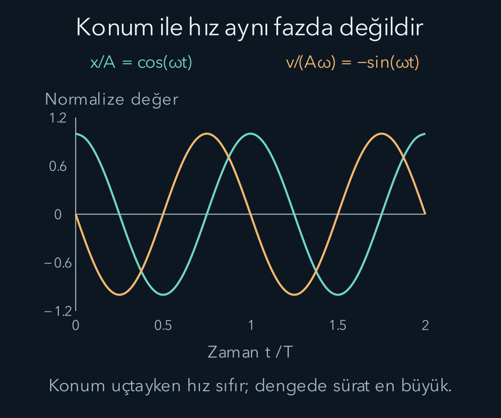
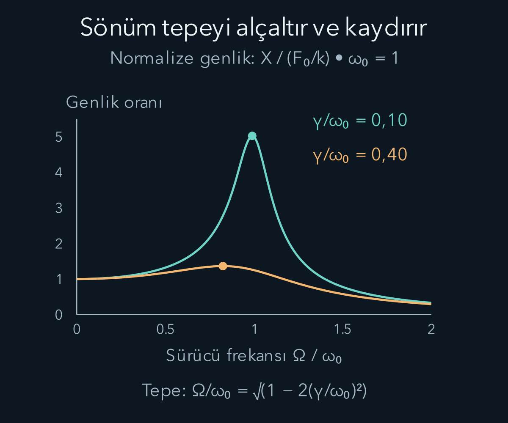

import ArticleVideo from '@/components/ArticleVideo.astro'
import kavram from './media/01-kavram.mp4?url'
import kavramPoster from './media/01-kavram.jpg?url'

Bir yayı çekip bıraktığımızda kütle denge noktasına gelir, fakat orada durmak yerine öteki tarafa geçer. Yay bu kez ters yönde kuvvet uygular. Hareket bir süre ileri geri tekrar eder. Bu basit düzenek, müzik aletlerinden moleküllere kadar pek çok olayda karşılaşacağımız salınım dilinin başlangıcıdır. Tekrarlama, geri çağırıcı etki ve hareketin devam etme eğilimi birlikte görünür hale gelir.

[Kütleçekim yazısında](/blog/kutlecekim-ve-yorungeler/) sürekli eğrilen yörüngeleri gördük; şimdi bir denge konumunun çevresindeki tekrarlanan harekete dönüyoruz. [Newton yasaları](/blog/newton-yasalari-ve-kuvvetler/) ve [enerji](/blog/is-enerji-ve-korunum/) burada doğrudan kullanılacak. Matematik tarafında [ikinci mertebe diferansiyel denklemleri](/blog/ikinci-derece-diferansiyel-denklemler/) ve [özdeğerleri](/blog/ozdegerler-ozvektorler-ve-kosegenlestirme/) görmüştük. Bu bilgileri hazır bir formül listesi gibi kullanmayacağız; her katsayının mekanik düzende neyi temsil ettiğini belirleyeceğiz.

## 1. Dengeye doğru kuvvetin denklemi

Yatay, sürtünmesiz bir düzlemdeki $m$ kütlesini ideal bir yaya bağlayalım. Yay sabiti $k$ pozitif olsun. Denge konumundan sağa doğru yer değiştirmeyi $x$ ile gösterelim. Yayın kuvveti $F_x=-kx$ olduğundan Newton yasası:

$$
m\ddot x=-kx,
\qquad \ddot x+\omega_0^2x=0,
\qquad \omega_0=\sqrt{\frac{k}{m}}
$$

verir. Noktalar zamana göre türevi gösterir. $\omega_0$ doğal açısal frekanstır. Birim denetiminde $k/m$ saniyenin karesinin tersi olduğundan karekök saniyenin tersini verir. Açısal değişimi vurgulamak için radyan bölü saniye deriz.

Kuvvet dengeye doğru olduğu için, pozitif yer değiştirmede ivme negatiftir. Ancak hızın yönü bundan hemen çıkmaz. Kütle sağ tarafta sola gidiyor da olabilir, sağa gidip yavaşlıyor da olabilir. Kuvvetin yönünü konumdan, hareket yönünü hızdan okuruz. Bu ayrım bir salınımın dörtte birlik bölümlerini anlamak için önemlidir.

Çözüm $x(t)=A\cos(\omega_0t+\phi)$ biçiminde yazılabilir. $A$ negatif olmayan genlik, yani dengeden en büyük uzaklıktır. $\phi$ başlangıç fazıdır; hareketin başlangıç anında çevrimin neresinde olduğunu belirler. Kosinüs seçmek özel bir fizik varsayımı değildir. Sinüs ve kosinüsün genel doğrusal birleşimi aynı genlik-faz biçiminde yazılabilir.

## 2. Frekans, dönem ve faz

Bir tam salınımda faz $2\pi$ radyan artar. Bu nedenle dönem $T=2\pi/\omega_0$, frekans $f=1/T=\omega_0/(2\pi)$ olur. Frekans saniyedeki çevrim sayısıdır ve hertz ile ölçülür. Açısal frekansla frekans aynı sayı değildir; aralarında iki pi çarpanı vardır.

Örneğin $m=0{,}50\,\mathrm{kg}$, $k=8\,\mathrm{N/m}$ seçelim. Doğal açısal frekans $\sqrt{8/0{,}50}=4\,\mathrm{rad/s}$, dönem $\pi/2\,\mathrm s\approx1{,}57\,\mathrm s$, frekans yaklaşık $0{,}637\,\mathrm{Hz}$ olur. Kütleyi artırmak hareketi yavaşlatır; yayı sertleştirmek hızlandırır. İdeal doğrusal modelde genlik dönemi değiştirmez.

Başlangıçta kütleyi sağa on santimetre çekip durgun bırakalım. $x(0)=0{,}10\,\mathrm m$, $v(0)=0$ koşullarına uygun olarak $A=0{,}10\,\mathrm m$, $\phi=0$ seçilir. Konum $x=0{,}10\cos(4t)$, hız $v=-0{,}40\sin(4t)$, ivme $a=-1{,}60\cos(4t)$ olur; sayısal katsayıların birimleri sırasıyla metre, metre bölü saniye ve metre bölü saniye karedir.

Başlangıç konumu sıfırken pozitif hız verilseydi faz başka olurdu. Genlik ve faz, iki başlangıç bilgisini taşır. Aynı yay-kütle düzeni farklı başlangıçlarda aynı doğal frekansta fakat farklı genlik ve fazlarda salınabilir. Doğal frekans düzeneğin, başlangıç fazı seçilen hareketin özelliğidir.

Genlik ve fazı genel başlangıç verilerinden bulmak için çözümü önce $x=C\cos(\omega_0t)+D\sin(\omega_0t)$ yazabiliriz. $t=0$ koymak $C=x_0$ verir. Türev alıp aynı anda değerlendirmek ise $v_0=\omega_0D$, yani $D=v_0/\omega_0$ verir. Böylece:

$$
x(t)=x_0\cos(\omega_0t)
+\frac{v_0}{\omega_0}\sin(\omega_0t).
$$

$v_0/\omega_0$ uzunluk boyutundadır; iki katsayı aynı tür niceliktir. $A\cos(\omega_0t+\phi)$ açılımıyla karşılaştırınca $A\cos\phi=x_0$ ve $-A\sin\phi=v_0/\omega_0$ bulunur. Kareleri toplamak:

$$
A=\sqrt{x_0^2+\left(\frac{v_0}{\omega_0}\right)^2}
$$

sonucunu verir. Örneğin $x_0=0$ ve $v_0>0$ için $\phi=-\pi/2$ seçimi gerekir; konum başlangıçta sıfırken hemen sonra pozitife gider. Yalnız $\cos\phi=0$ bilgisini kullanıp $+\pi/2$ seçmek başlangıç hızının yönünü ters çevirirdi. İki başlangıç koşulunu birlikte kullanmamızın nedeni budur.

## 3. Enerji nerede bulunur?

İdeal salınımda toplam mekanik enerji:

$$
E=\frac12m\dot x^2+\frac12kx^2=\frac12kA^2
$$

olarak sabittir. Uç noktalarda hız sıfırdır; enerji yayın potansiyel enerjisidir. Denge noktasında yay potansiyeli seçtiğimiz sıfırına iner, sürat en büyük değerine çıkar. Kütle bu noktada net kuvvet sıfır olduğu için durmaz; zaten sahip olduğu hızla ilerler.

Sayısal örnekte toplam enerji $\tfrac12(8)(0{,}10)^2=0{,}040\,\mathrm J$ olur. En büyük sürat $A\omega_0=0{,}40\,\mathrm{m/s}$ verir. Bunu kinetik enerjiye koyarsak $\tfrac12(0{,}50)(0{,}40)^2=0{,}040\,\mathrm J$ elde ederiz. İki farklı ifade aynı fiziksel hesabı doğrular.

Konum ve hız grafiklerinin tepe noktaları aynı anda oluşmaz. Konumun uç noktasında hız sıfır, konum sıfır olduğunda hızın mutlak değeri en büyüktür. Aralarında çeyrek çevrimlik faz farkı bulunur. Bu durum, bir sinüsün türevinin kosinüs olmasının hareket üzerindeki anlamıdır.

## 4. Küçük salınımlar neden bu kadar yaygındır?

Her geri çağırıcı kuvvet tam doğrusal değildir. Fakat düzgün bir potansiyel enerji fonksiyonunun kararlı denge noktası çevresinde Taylor yaklaşımı kullanabiliriz. Dengeyi $x=0$ seçersek birinci türev sıfırdır. İkinci türev pozitifse:

$$
U(x)\approx U(0)+\frac12U''(0)x^2
$$

ve kuvvet $F_x\approx-U''(0)x$ olur. Böylece yerel etkili yay sabiti $k_{\mathrm{etkin}}=U''(0)$ tanımlanır. Yaya fiziksel olarak benzemeyen bir sistem bile küçük sapmalarda aynı denklemi izleyebilir.

Bu yaklaşımın koşulu sapmanın, daha yüksek kuvvetli terimlerin küçük kaldığı aralıkta olmasıdır. Genlik büyüdüğünde kübik veya daha yüksek katkılar önemli hale gelebilir. Dönem genliğe bağlı olabilir, dalga biçimi sinüs olmaktan uzaklaşabilir. Basit harmonik hareket, her periyodik hareketin adı değildir; belirli bir doğrusal geri çağırıcı ilişkiyi anlatır.

Denge noktasındaki ikinci türev sıfırsa bu ikinci derece yaklaşım karar vermez. Potansiyelin daha yüksek terimlerine bakmak gerekir. İkinci türev negatifse denge yerel maksimumdur ve küçük sapmalar salınım yerine büyüme gösterebilir. Matematikteki yerel eğrilik, fiziksel kararlılığın anlamını belirler.

## 5. Sarkaçta küçük açı koşulu

Uzunluğu $\ell$ olan kütlesiz ipte noktasal $m$ kütlesi düşünelim. İp gergin, bağlantı sürtünmesiz ve yerçekimi sabit olsun. Aşağı düşeyden ölçülen açıyı $\theta$ ile gösterelim. Ağırlığın teğetsel bileşeni $-mg\sin\theta$ olur. Teğetsel ivme $\ell\ddot\theta$ olduğundan:

$$
\ddot\theta+\frac{g}{\ell}\sin\theta=0.
$$

Bu denklem henüz basit harmonik değildir. Küçük ve radyanla yazılmış açılar için $\sin\theta\approx\theta$ kullanınca $\omega_0=\sqrt{g/\ell}$ ve $T\approx2\pi\sqrt{\ell/g}$ elde edilir. Kütle sadeleşir; ideal küçük açı döneminde kütle bulunmaz.

On derece yaklaşık $0{,}175$ radyandır. Bu açıda sinüsün açıdan göreli farkı yaklaşık yüzde yarımdır. Otuz derecede fark yüzde dört buçuğa yaklaşır. Bu karşılaştırma kuvvet yaklaşımının hatasını gösterir; dönem hatasıyla birebir aynı sayı değildir. “Küçük açı” tek bir kutsal sınır değil, gereken doğruluğa göre değerlendirdiğimiz yaklaşımdır.

Uzunluğu bir metre, örnek yerçekimi ivmesi on metre bölü saniye kare olan sarkacın küçük salınım dönemi yaklaşık $2\pi/\sqrt{10}=1{,}99$ saniyedir. Büyük genlikte tam sinüs terimini tutmak gerekir ve dönem bu basit sonuçtan farklılaşır. İpin esnemesi veya kütlenin boyutu önemliyse sarkaç modeli de ayrıca değiştirilir.

## 6. Sönüm enerjiyi başka biçimlere taşır

Gerçek bir salınım çoğu zaman giderek küçülür. Hıza orantılı bir direnç modeli seçelim: $F_{\mathrm{sönüm}}=-b\dot x$. $b$ pozitif katsayıdır ve birimi kilogram bölü saniyedir. Denklem:

$$
m\ddot x+b\dot x+kx=0
$$

olur. Direncin her sistemde hıza doğrusal olduğunu iddia etmiyoruz; bu, belirli hız ve ortam aralıklarında kullanılabilen bir modeldir. Kuru sürtünme veya yüksek hızlı akış başka bağıntılar gerektirebilir.

Enerjinin türevini alırsak $dE/dt=\dot x(m\ddot x+kx)=-b\dot x^2$ bulunur. Sağ taraf pozitif olamaz; mekanik enerji azalır. Azalma sistemin ve çevrenin iç enerjilerine dönüşebilir. Kütlenin hızı anlık olarak sıfırken bu sönüm kuvveti de sıfırdır; buna rağmen hareketin tüm çevrimi boyunca enerji kaybı oluşur.

$\gamma=b/(2m)$ tanımıyla denklem $\ddot x+2\gamma\dot x+\omega_0^2x=0$ olur. Zayıf sönümde, yani $\gamma<\omega_0$ iken:

$$
x=Ae^{-\gamma t}\cos(\omega_dt+\phi),
\qquad \omega_d=\sqrt{\omega_0^2-\gamma^2}.
$$

Genlik zarfı üstel küçülür; salınım açısal frekansı doğal frekanstan biraz düşüktür. Genlik başlangıcın yarısına $t=(\ln2)/\gamma$ süresinde iner. Zarfın karakteristik zamanı $1/\gamma$ olup, bu süre sonunda genlik başlangıcın $1/e$ katıdır.

## 7. Kritik ve aşırı sönüm

Karakteristik denklemin kökleri $-\gamma\pm\sqrt{\gamma^2-\omega_0^2}$ biçimindedir. $\gamma=\omega_0$ olduğunda kökler çakışır ve çözüm $(C_1+C_2t)e^{-\omega_0t}$ olur. Bu duruma **kritik sönüm** deriz. Daha büyük sönümde iki farklı negatif gerçek kökten gelen üstel terimler vardır; tekrarlı sinüslü salınım görülmez.

Aşırı sönümlü sistemde direnç daha büyük olsa da dengeye dönüş mutlaka daha hızlı değildir. Çok büyük direnç, hareketi son derece yavaşlatabilir. Kritik sönüm, belirli standart başlangıç koşullarında aşım yapmadan hızlı dönüş sınırını temsil eder. Her başlangıç hızı ve her “en hızlı” ölçütü için koşulsuz bir slogan olarak kullanılmamalıdır.

Sönüm türünü yalnız grafiğin ilk parçasına bakarak kesin söylemek de güç olabilir. Başlangıç koşulları iki üstel terimin katsayılarını belirler. Ölçüm gürültüsü ve sınırlı gözlem süresi davranışın bazı bölümlerini gizleyebilir. Fiziksel parametreleri çıkarırken hem denklem hem veri aralığı birlikte değerlendirilir.

## 8. Dış kuvvetle zorlanan salınım

Düzeneğe periyodik $F_0\cos(\Omega t)$ kuvveti uygulayalım. $F_0$ kuvvet genliği, $\Omega$ sürücünün açısal frekansıdır. Doğal frekansla aynı olmak zorunda değildir. Denklem:

$$
m\ddot x+b\dot x+kx=F_0\cos(\Omega t)
$$

olur. Pozitif sönüm altında başlangıç koşullarından gelen geçici çözüm zamanla küçülür. Geriye sürücü frekansında salınan kararlı çözüm kalır: $x=A(\Omega)\cos(\Omega t-\delta)$.

Katsayı eşleştirmesini açmak için önce aynı çözümü $x=C\cos(\Omega t)+D\sin(\Omega t)$ biçiminde yazalım. Buradaki $C,D$ sabit katsayılardır. Türevleri alıp denkleme koyunca kosinüs ve sinüs çarpanları ayrı ayrı şu koşulları verir:

$$
(k-m\Omega^2)C+b\Omega D=F_0,
\qquad (k-m\Omega^2)D-b\Omega C=0.
$$

Bu iki eşitliğin karelerini toplayınca çapraz terimler birbirini götürür. Geriye $[(k-m\Omega^2)^2+(b\Omega)^2](C^2+D^2)=F_0^2$ kalır. Genlik-faz yazımını açtığımızda $C=A\cos\delta$, $D=A\sin\delta$ olduğundan $C^2+D^2=A^2$ olur. Pozitif genliği seçerek:

$$
A(\Omega)=\frac{F_0}{\sqrt{(k-m\Omega^2)^2+(b\Omega)^2}}
$$

olur. Faz gecikmesi için $\cos\delta=(k-m\Omega^2)/Z$, $\sin\delta=b\Omega/Z$ yazılabilir; $Z=\sqrt{(k-m\Omega^2)^2+(b\Omega)^2}$ paydadaki pozitif köktür. Bu yeni simge, yukarıdaki sinüs katsayısı $D$ ile paydanın karışmasını önler. Bu iki bağıntı fazın doğru bölgesini seçer. Yalnız tanjant kullanmak, kosinüsün negatif olduğu yüksek frekans bölgesindeki işareti kaçırabilir.

Çok yavaş zorlamada kütle kuvveti yaklaşık izler ve genlik $F_0/k$ değerine yaklaşır. Çok yüksek frekansta eylemsizlik baskındır; genlik yaklaşık $F_0/(m\Omega^2)$ olur ve hareket kuvvete neredeyse ters fazdadır. Doğal frekansta ise faz gecikmesi yarım pi radyandır. Bu farklı bölgeler, genliğin yalnız kuvvet büyüklüğüne bağlı olmadığını gösterir.

### Kararlı yanıt hemen oluşmaz

Kuvveti açtığımız anda kütle mutlaka kararlı çözümün gerektirdiği konumda ve hızda değildir. Toplam çözüme, başlangıç koşullarını sağlayan bir serbest hareket eklenir. Sönüm varsa bu geçici katkı zamanla azalır. Deneyde genlik ölçerken yeterince beklememiz gerekmesinin nedeni budur. Frekansı çok hızlı değiştirirsek ölçtüğümüz hareket, her frekansta yerleşmiş yanıtın eğrisini doğrudan izlemeyebilir.

Aynı nedenle sürücü kapandığında salınım bir anda kesilmez. Kütlenin o andaki konumu ve hızı, serbest sönümlü hareketin yeni başlangıç koşullarıdır. Sistem bir süre depolanmış mekanik enerjisiyle salınır ve sönüm bu enerjiyi azaltır. Kararlı zorlanmış hareket ile geçici serbest hareketi ayırmak, bir grafikte görülen büyüme veya küçülmenin kaynağını doğru yorumlamamızı sağlar.

Faz gecikmesinin de enerji aktarımıyla ilişkisi vardır. Dış kuvvetin anlık gücü kuvvet ile hızın çarpımıdır. Kuvvet bazen hareketi desteklerken bazen ona karşı iş yapabilir. Yerleşmiş hareketin bir çevriminde ortalama olarak verilen enerji, sönümün aynı çevrimde uzaklaştırdığı enerjiye eşittir. Genliğin sabit kalması enerji aktarımının durduğu anlamına gelmez; giriş ve çıkış dengelenir.

Bu yüzden “rezonansta sistem durmadan enerji biriktirir” cümlesi pozitif sönümlü kararlı durum için doğru değildir. Büyük fakat sabit bir genlikte de sürekli enerji akışı bulunabilir. İdeal sıfır sönüm sınırında ise bu dengeyi sağlayan kayıp mekanizması kalmadığı için ayrı bir çözüm gerekir. Bir sınır değerini formüle koymadan önce çözümün dayandığı fiziksel durumu kontrol ederiz.

## 9. Rezonansın yeri sönüme bağlıdır

**Rezonans**, belirli frekanslarda yanıtın belirgin biçimde büyümesidir. Yer değiştirme genliğinin tepesini bulmak için genlik paydasının karesini en küçük yapan frekansı ararız. Paydanın karesini $m^2$ ile bölüp $D_*(\Omega)=(\omega_0^2-\Omega^2)^2+4\gamma^2\Omega^2$ yazalım. Türevi

$$
D_*'(\Omega)=4\Omega(\Omega^2-\omega_0^2+2\gamma^2)
$$

olur. Sıfırdan farklı frekansta türevin sıfır olması, parantez içini sıfıra eşitlememizi gerektirir. Buradan pozitif frekans tepesini:

$$
\Omega_{\mathrm{tepe}}=\sqrt{\omega_0^2-2\gamma^2}
$$

olarak buluruz; bunun için $\gamma<\omega_0/\sqrt2$ olmalıdır. Daha güçlü sönümde yer değiştirme genliğinin sıfırdan farklı bir tepe frekansı bulunmayabilir. Bu yüzden “rezonans her zaman doğal frekansta olur” cümlesi ölçülen büyüklük ve sönüm belirtilmeden eksiktir.

Zayıf sönümde tepe doğal frekansa yakındır ve daha yüksektir. Sönüm artınca eğri alçalır ve genişler. Pozitif sönümde genlik sonludur. Sönüm tam sıfırken sürücü frekansı doğal frekansa eşitse kararlı genlik formülünün paydası sıfıra gider; sonlu, yerleşmiş bir kararlı çözüm varsayımı artık geçerli değildir. İdeal denklemin rezonans çözümünde genlik zamanla büyür.

Örneğin sönümsüz ve başlangıçta durgun sistemde rezonansın özel çözümü $x=(F_0/(2m\omega_0))t\sin(\omega_0t)$ biçimindedir. Zaman çarpanı büyümeyi açıkça gösterir. Gerçek sistemde doğrusal modelin sınırları, enerji kayıpları veya malzeme sınırları bu ideal büyümeyi değiştirir. Sonsuz genlik fiziksel bir son durum olarak öngörülmüş olmaz.

<ArticleVideo src={kavram} poster={kavramPoster} title="Sönümlü salınımın zarfı" caption="Dışarıdan sürülmeyen, zayıf sönümlü salınımın genliği üstel bir zarf içinde küçülür. Enerji çevreye aktarılırken hareketin salınımlı biçimi sürer." />

## 10. İki kütle birlikte salınırsa

İki eşit $m$ kütlesini, iki sabit duvar arasında üç eşit $k$ yayla bağlayalım. Dengeye göre yer değiştirmeler $x_1$ ve $x_2$ olsun. Sol kütleye sol yay $-kx_1$, orta yay $k(x_2-x_1)$ kuvveti uygular. Sağ kütlede benzer hesap:

$$
m\ddot x_1=-2kx_1+kx_2,
\qquad m\ddot x_2=kx_1-2kx_2
$$

verir. Denklemler bağlıdır: Bir kütlenin ivmesi diğerinin konumuna da bağlıdır. İki özel hareketi seçerek yapıyı sadeleştirebiliriz.

Birinci harekette $x_1=x_2$ olsun. Orta yayın uzaması değişmez; her kütle yalnız kendi dış yayının geri çağırıcı etkisini hisseder. Açısal frekans $\omega_+=\sqrt{k/m}$ olur. İkinci harekette $x_1=-x_2$ olsun. Orta yay da daha güçlü geri çağırır ve frekans $\omega_-=\sqrt{3k/m}$ olur. Bütün parçaların tek frekans ve sabit genlik oranıyla salındığı bu özel hareketlere **normal mod** denir.

Matris yazımı $\ddot{\mathbf x}=-(k/m)\begin{pmatrix}2&-1\\-1&2\end{pmatrix}\mathbf x$ biçimindedir. Sütun vektörü $\mathbf x=(x_1,x_2)^T$ iki konumu taşır. Matrisin özvektörleri $(1,1)^T$ ve $(1,-1)^T$, özdeğerleri bir ve üçtür. Özdeğerler frekansların karesindeki katsayıları verdi. Böylece daha önce öğrendiğimiz doğrusal cebir, iki cismin gerçek hareketini ayıran bir araç haline geldi.

## 11. Genel hareket normal modların toplamıdır

İlk anda yalnız sol kütle bir miktar yer değiştirmiş, sağ kütle dengede olsun. Bu başlangıç $(1,0)^T=\tfrac12(1,1)^T+\tfrac12(1,-1)^T$ biçiminde iki moda ayrılır. Her mod kendi frekansında evrilir; sonra iki çözümü toplarız. Denklem doğrusal olduğu için toplam da çözümdür. Başlangıç hızları varsa her moda ayrıca uygun sinüs katkısı eklenir.

İki frekans zamanla farklı fazlar biriktirdiğinden enerji bir kütlede daha belirgin görünürken sonra ötekine aktarılabilir. Tek kütleyi izlerken düzensiz sanılan hareket, iki düzenli salınımın birleşimi olabilir. Bununla birlikte her karmaşık hareketi iki sinüsle anlatamayız; burada iki serbest koordinatı olan doğrusal bir model kurduk.

Kütle ve yay sayısı arttıkça normal mod sayısı artar. Bir telin küçük parçalarını birbirine bağlı çok sayıda salınıcı olarak düşündüğümüzde, yerel salınımın uzay boyunca nasıl yayıldığı sorusu ortaya çıkar. Sonraki yazıda bu düşünceyi dalga denklemine bağlayacağız.

## Kaynaklar

- [OpenStax — Basit harmonik hareket](https://openstax.org/books/university-physics-volume-1/pages/15-1-simple-harmonic-motion) ve [sarkaçlar](https://openstax.org/books/university-physics-volume-1/pages/15-4-pendulums).
- [OpenStax — Sönümlü](https://openstax.org/books/university-physics-volume-1/pages/15-5-damped-oscillations) ve [zorlanmış salınımlar](https://openstax.org/books/university-physics-volume-1/pages/15-6-forced-oscillations).
- [MIT OpenCourseWare — Bağlı salınıcılar ve normal modlar](https://ocw.mit.edu/courses/8-03sc-physics-iii-vibrations-and-waves-fall-2016/pages/part-i-mechanical-vibrations-and-waves/lecture-4/).
