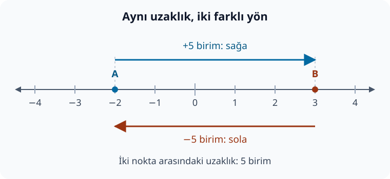

import ArticleVideo from '@/components/ArticleVideo.astro'
import yuruyus from './media/01-yol-ve-yer-degistirme.mp4?url'
import yuruyusPoster from './media/01-yol-ve-yer-degistirme.jpg?url'

Bir yerin konumunu eksi üç metre diye anlatabiliriz; fakat iki yer arasındaki uzaklığa eksi üç metre demeyiz. Aynı metre birimiyle yazılan bu iki bilgi neden farklıdır? Sayı doğrusunu, bu ayrımı en baştan kurmak için kullanacağız. [Pisagor](/blog/pisagor-teoremi/) ve [kosinüs teoremi](/blog/pisagorun-otesi-kosinus-teoremi/) yazılarındaki uzunluk ve izdüşüm sorularıyla da bağlantı kuracağız; bu konuları önceden bilmek gerekmiyor.

Bu soruyu cevaplamak için bir çizgi üzerinde yürüyeceğiz. Önce bulunduğumuz yeri, sonra yaptığımız hareketi, en sonunda iki yer arasındaki uzaklığı sayılarla anlatacağız.

Bu yazıda tam sayıları kullanacağız: sıfır, birer birer saydığımız pozitif sayılar ve onların negatif karşılıkları. Kesirler, üsler veya denklem çözme bilgisi gerekmiyor. Toplama ve çıkarmayı da çizgi üzerindeki hareketlerden kuracağız.

## 1. Bir Başlangıç Noktası Seçmek

Yere düz bir çizgi çizdiğimizi düşünelim. Üzerinde bir nokta seçip buraya **0** yazalım. Bu, konumları tarif ederken kullanacağımız başlangıç, yani referans noktası olsun.

Ardından bir uzunluk seçelim. İster bir santimetre ister bir metre olsun; buna **bir birim** diyelim. Çizgi üzerinde bu uzunluğu değiştirmeden art arda işaretleyelim. İşaretler arasındaki aralıkların eşit olması gerekiyor.

Sağa doğru ilk işarete 1, sonrakine 2, ardından gelene 3 yazabiliriz. Pozitif sayılar bizi sıfırın sağına götürür. Genellikle başlarındaki artı işaretini yazmayız: 3 ve +3 aynı sayıdır.

Sıfırın solunda da yerler var. Oradaki işaretlere sırasıyla −1, −2, −3 yazalım. Bir sayının başındaki eksi işareti, onun negatif olduğunu belirtir. Bu sayı doğrusunda negatif konumlar sıfırın solundadır.

**Sıfır ne pozitiftir ne de negatiftir.** Başlangıç noktamızın kendisidir.

Şekildeki çizgi iki uçta da devam eder. Görselde yalnızca üzerinde çalıştığımız kısmını gösteriyoruz.

Sağı pozitif seçmek bir uzlaşmadır. Tersini de seçebilirdik. Ancak bir hesap boyunca seçtiğimiz yönü tutarlı kullanmalıyız.

### İşaretleri değil, aralıkları sayıyoruz

Sıfırdan üçe giderken çizgide 0, 1, 2 ve 3 yazan dört işaret görürüz. Buna rağmen uzaklık üç birimdir. Çünkü uzaklığı noktaların sayısı değil, aralarında geçtiğimiz eş aralıkların sayısı belirler: sıfırdan bire bir, birden ikiye bir, ikiden üçe bir aralık vardır. Başlangıç noktasını ilk adım diye sayarsak sonucu bir fazla buluruz. Cetvelde ölçüm yaparken de ölçtüğümüz nesnenin iki ucundaki çizgileri değil, bu çizgiler arasındaki uzunluğu karşılaştırırız.

Ayrıca çizimde birim aralığını iki kat büyük çizebiliriz. Kâğıt üzerindeki 0 ile 1 birbirinden daha uzak görünür; fakat temsil edilen sayı yine bir birimdir. Bir haritayı büyütmek nasıl şehirlerin gerçek uzaklığını değiştirmiyorsa sayı doğrusunu büyütmek de sayıları değiştirmez. Bu yüzden bir noktanın sayısını yalnız ekrandaki uzaklığına bakarak değil, çizimde belirtilen ölçeğe göre okuruz. Ölçek, çizilen aralığın hangi miktarı temsil ettiğini söyleyen bilgidir.

## 2. Konum ile Uzaklık Aynı Bilgi Değildir

Bir arkadaşımız sıfırın üç birim sağında, bir başkası üç birim solunda dursun. Konumları 3 ve −3’tür. İkisi de başlangıç noktasına üç birim uzaktadır.

Demek ki konumu anlatan sayı iki bilgi taşır: sıfıra ne kadar uzak olduğumuz ve sıfırın hangi tarafında bulunduğumuz.

Uzaklık sorusu ise yalnızca aradaki aralığın büyüklüğünü sorar. Bu nedenle uzaklık negatif olmaz. İki nokta aynı yerdeyse aralarındaki uzaklık sıfırdır.

Sayıların sırasını da çizgiden okuyabiliriz. Sağa gittikçe sayılar büyür. Örneğin −1, −4’ün sağındadır; bu yüzden −1 daha büyüktür. Şöyle yazarız:

$$
-1>-4
$$

Buradaki $>$ işareti “büyüktür” diye okunur. Ters yöndeki $<$ işareti “küçüktür” demektir. İşaretin açık tarafı büyük sayıya bakar.

−4 sıfıra daha uzak olsa da −1’den küçük bir sayıdır. **Bir sayının büyüklük sırası ile sıfıra uzaklığı farklı sorulardır.** Sayıların sıralanması ve sıfıra uzaklıkları için [OpenStax’ın tam sayılar bölümü](https://openstax.org/books/prealgebra-2e/pages/3-1-introduction-to-integers) ek örnekler sunar.

### İki negatif sayıyı karşılaştırırken

$-7$ ile $-2$ karşılaştırmasında önce yalnız 7 ve 2 rakamlarına bakmak yanıltır. İki sayı da sıfırın solundadır. $-7$'den $-2$'ye ulaşmak için beş birim sağa gideriz; sağa doğru sayılar büyüdüğünden $-7<-2$ olur. Sıfıra uzaklıkları sorulsaydı cevaplar 7 ve 2 olurdu ve ilk uzaklık daha büyük çıkardı. “Daha büyük” sözünü hangi soruya cevap olarak kullandığımızı açık tutmalıyız.

Bu ayrımı borç örneğiyle de okuyabiliriz. Yalnız borcu gösteren işaretli bir hesapta $-7$ birim, $-2$ birime göre daha düşük bir bakiyedir. Borcun miktarı ise 7 birimdir ve 2 birim borçtan fazladır. Sayı doğrusu işaretli bakiyeyi, sıfıra uzaklık borcun büyüklüğünü temsil eder. Benzetmede her şeyi borç saymıyoruz; aynı iki sayıyla iki farklı karşılaştırma yapılabileceğini gösteriyoruz.

## 3. Toplama: Bulunduğumuz Yerden Hareket Etmek

Şimdi −2 konumunda duralım. Sağa doğru beş birim ilerlersek sırayla şu konumlardan geçeriz:

$$
-2\;\longrightarrow\;-1\;\longrightarrow\;0\;\longrightarrow\;1\;\longrightarrow\;2\;\longrightarrow\;3
$$

Beş aralık ilerledik ve 3’e ulaştık. Bunu bir işlemle yazabiliriz:

$$
-2+5=3
$$

Burada −2 başlangıç konumumuz, +5 sağa doğru yaptığımız değişim, 3 ise son konumumuzdur. Eşitlik işareti, sol taraftaki işlemin değerinin sağdaki sayıyla aynı olduğunu söyler.

Bu kez 2’den başlayıp sola dört birim ilerleyelim. Sırasıyla 1, 0, −1 ve −2’ye ulaşırız:

$$
2+(-4)=-2
$$

Parantez, eklediğimiz sayının −4 olduğunu belirginleştiriyor. Negatif bir sayı eklemek, seçtiğimiz sayı doğrusunda sola ilerlemek anlamına geliyor.

Dolayısıyla toplamanın sonucu her zaman başlangıçtaki sayıdan büyük olmak zorunda değildir. Sonucun hangi yönde değişeceğini eklediğimiz sayının işareti belirler. Sıfır eklersek bulunduğumuz yerde kalırız. Bu hareket yorumunu [tam sayılarda toplama](https://openstax.org/books/prealgebra-2e/pages/3-2-add-integers) örneklerinde de kullanabiliriz.

### Sağ ve sol adımlar birbirini nasıl götürür?

$-4+6$ işlemini düşünelim. Sıfırdan dört birim sola gidip ardından altı birim sağa gidebiliriz. Sağa giden adımların ilk dördü, sola giden dört adımın etkisini geri alır; sıfıra döneriz. İki sağ adım daha kaldığı için sonuç 2 olur. Bu, bir pozitif ve bir negatif sayıyı toplarken neden büyük uzaklıktan küçük uzaklığı çıkardığımızı açıklar. Ortak bölüm birbirini götürür, fazla kalan yön sonucun işaretini belirler.

Aynı işlemde sayıları yalnız rakamlarına bakarak toplayıp $-10$ yazmak, altı sağ adımı da sol adımmış gibi saymak olurdu. Sonucun pozitif olacağını baştan da kestirebiliriz: sağa hareket altı, sola hareket dört birimdir. Ayrıca ters kontrol yapabiliriz. Sonuç 2'den altı birim sola gidersek yeniden $-4$'e ulaşırız. Eklediğimiz hareketi geri aldığımızda başlangıca dönmemiz, hesabın yön ve miktar bakımından tutarlı olduğunu gösterir.

## 4. Çıkarma: Başlangıçtan Sona Ne Kadar Değiştik?

Şeklimizdeki iki noktayı tekrar kullanalım. A, −2’de; B, 3’te olsun. A’dan B’ye gitmek için beş birim sağa ilerlediğimizi sayarak gördük.

Bu değişimi bulmak için **son konumdan başlangıç konumunu çıkarırız**:

$$
3-(-2)=5
$$

Bu satırda iki ayrı eksi işareti var. İlki çıkarma işlemini, parantezin içindeki ikincisi başlangıç sayısının negatif olduğunu gösteriyor.

Neden sonuç 5? Çıkarma burada “−2’ye ne eklersem 3 olur?” sorusunun cevabını veriyor. Az önce −2’ye 5 ekleyince 3’e ulaştık.

Negatif bir sayıyı çıkarmak, onun pozitif karşılığını eklemekle aynı sonucu verir. Bu örneği şöyle de yazabiliriz:

$$
3-(-2)=3+2=5
$$

Sayı doğrusunda −2’ye karşılık gelen hareket iki birim soladır. Bu hareketi geri almak iki birim sağa gitmektir. Çıkarmayı ters yöndeki hareketi ekleyerek düşünmek, işaretlerin neden değiştiğini görmemizi sağlar. [OpenStax — Tam sayılarda çıkarma](https://openstax.org/books/prealgebra-2e/pages/3-3-subtract-integers)

Şimdi aynı yolu ters yönde gidelim: 3’ten −2’ye.

$$
-2-3=-5
$$

Bu sefer değişim negatiftir; beş birim sola gittik. Gidişte de dönüşte de iki nokta arasındaki uzaklık beş birimdir. Değişimin işareti hareketin yönünü ayırır.

### Çıkarmada iki eksi neden tek bir bilgi değildir?

$-4-(-6)$ ifadesinde başlangıç sayısı $-4$, çıkarılan sayı $-6$'dır. Soruyu “$-6$'ya ne eklersem $-4$ olur?” diye okursak cevap iki sağ adım, yani $+2$ çıkar. Parantezin önündeki çıkarma işareti, içindeki sayının işaretinden farklı görev yapar. Parantezi görmezden gelip $-4-6=-10$ hesaplamak, eksi altıyı çıkarmak yerine artı altıyı çıkarmaktır; başka bir soruyu çözmüş oluruz.

Hesabı üç kısa satırla izleyebiliriz:

$$
\begin{aligned}
-4-(-6)&=-4+6,\\
&=2,\\
2+(-6)&=-4.
\end{aligned}
$$

Son satır çıkarma sonucunu kontrol eder: bulunan farka çıkarılan sayıyı ekleyince ilk sayı geri gelir. Bu kontrolün sayı doğrusundaki karşılığı, yaptığımız değişimin tersini izlemektir. “İki eksi artı yapar” sözünü her eksi gördüğümüz yere uygulamıyoruz; burada belirli olarak negatif bir sayının çıkarılmasını, onun karşıtını eklemeye dönüştürüyoruz.

## 5. Mutlak Değer: Sıfıra Olan Uzaklık

Bir sayının sıfıra olan uzaklığını anlatmak için **mutlak değer** kullanırız. Sayıyı iki dik çizginin arasına yazarız:

$$
|3|=3,\qquad |-3|=3,\qquad |0|=0
$$

$|-3|$ ifadesi “eksi üçün mutlak değeri” diye okunur. −3’ün sıfıra uzaklığı üç birimdir.

Mutlak değeri yalnızca “eksi işaretini silmek” diye ezberlemek yerine, sayı doğrusunda sıfıra uzaklık olarak düşünelim. Böylece çizgilerin içinde bir işlem olduğunda da anlamını koruyabiliriz. Önce içerideki işlemi yapar, sonra çıkan sayının sıfıra uzaklığını buluruz:

$$
|2-5|=|-3|=3
$$

İki konumun farkı bize aralarındaki işaretli değişimi veriyordu. Bu değişimin mutlak değeri, iki nokta arasındaki uzaklığı verir:

$$
\text{Uzaklık}=|\text{son konum}-\text{başlangıç konumu}|
$$

Örneğimizde:

$$
|3-(-2)|=|5|=5
$$

Ters yönde hesaplayınca da:

$$
|-2-3|=|-5|=5
$$

buluruz. Başlangıç ile sonun yer değiştirmesi, iki nokta arasındaki uzaklığı değiştirmez.

İki nokta sıfırın farklı taraflarındaysa aralarındaki uzaklık, sıfıra kadar gidişle sıfırdan sonraki gidişin toplamıdır. $-2$ ile 3 arasında önce iki, sonra üç birim bulunduğundan beş buluruz. Fakat iki nokta aynı taraftaysa sıfıra uzaklıkları toplayamayız. Örneğin 2 ile 7 arasında yalnızca beş birim vardır; $2+7=9$ hesabı iki nokta arasındaki yolu saymaz. Fark alıp mutlak değer kullanmak her iki yerleşimde de aynı soruya cevap verir. Bu yüzden uzaklık kuralını “iki sayının işaretlerini silip topla” diye kısaltmak doğru değildir.

### Sıfır noktasını değiştirirsek uzaklık değişir mi?

Bir koridorda iki kapının konumları, seçtiğimiz başlangıca göre 2 metre ve 7 metre olsun. İlk kapıdan ikinciye değişim $7-2=5$ metredir. Şimdi cetveli oynatmadan yalnızca sıfır kabul ettiğimiz yeri üç metre sağa taşıyalım. İlk kapı yeni sıfırın bir metre solunda, ikinci kapı dört metre sağında kalır. Yeni konum sayıları $2-3=-1$ ve $7-3=4$ olur.

Kapılar hareket etmedi. İki konumun sayı değeri değişmesine rağmen aralarındaki değişim yine:

$$
4-(-1)=4+1=5\ \text{metre}
$$

çıkar. Her iki konumdan da aynı 3'ü çıkardığımız için fark korunmuştur. Bu örnek, **konumun bir başlangıç noktasına göre, uzaklığın ise iki noktayı karşılaştırarak** belirlendiğini gösterir. Bir yere “eksi bir metre” demek, oranın uzunluğunun negatif olduğu anlamına gelmez; yeni başlangıcın hangi tarafında olduğunu söyler.

Peki sıfırı aynı bırakıp pozitif yönü sola seçersek? İlk kapının konumu $-2$, ikincinin konumu $-7$ olur. İlkinden ikinciye değişim bu kez $-7-(-2)=-5$ metredir. Yer değiştirme sayısının işareti tersine döndü, çünkü sağa gitmek artık negatif yönü ifade ediyor. Uzaklık ise $|-5|=5$ metredir.

Bu iki değişikliği ayrı düşünmek gerekir: sıfırı taşımak konum sayılarını, eksenin yönünü ters çevirmek işaretleri değiştirir. Fiziksel kapılar ve aralarındaki mesafe aynı kalır. Bir sayı doğrusu çiziminde önce sıfırı, birim aralığını ve pozitif yönü belirtmemizin nedeni budur. Bir çizimden sayı okurken bu üç bilgi verilmemişse yalnız çizginin üzerindeki noktalara bakarak konum belirleyemeyiz.

## 6. Alınan Yol ile Yer Değiştirme

Şimdi tek seferde durmayalım. −2’den 3’e yürüyelim, ardından geri dönüp 1’de duralım.

İlk bölümde beş birim sağa gittik. İkinci bölümde iki birim sola geldik. Toplam yürüdüğümüz yol:

$$
5+2=7\text{ birim}
$$

Başlangıç ile son konum arasındaki değişim ise:

$$
1-(-2)=3\text{ birim}
$$

İşaret pozitif olduğundan, başladığımız yerin üç birim sağında bitirdik. Hareketleri toplayarak da aynı sonucu bulabiliriz:

$$
5+(-2)=3
$$

| Sorduğumuz soru | Bu yürüyüşteki cevap |
| --- | --- |
| Nereden başladık? | −2 konumundan |
| Nerede bitirdik? | 1 konumunda |
| Toplam ne kadar yol yürüdük? | 7 birim |
| Başlangıca göre yer değiştirmemiz ne oldu? | +3 birim; sağa doğru |
| Başlangıç ve bitiş noktaları ne kadar uzak? | 3 birim |

Bir boyutta yer değiştirmeyi işaretli bir sayıyla ifade edebiliyoruz. İleride düzlemde hareketleri anlatırken yönü belirtmek için vektörler kullanacağız. Şimdilik bu ayrım yeterli: Alınan yol, hareketin bütün parçalarının uzunluklarını toplar; yer değiştirme, başlangıç ile sonu karşılaştırır.

<ArticleVideo
  src={yuruyus}
  poster={yuruyusPoster}
  title="Sayı doğrusunda alınan yol ve yer değiştirme"
  caption="Nokta −2’den 3’e gidip 1’e dönüyor. Dönüşte alınan yol büyümeye devam ederken yer değiştirme oku kısalıyor: toplam yol 7 birim, yer değiştirme +3 birim."
/>

### Aynı yere dönmek, hiç yürümemek değildir

Bir kişi 1 konumundan $-3$'e, oradan tekrar 1'e yürüsün. İlk hareket dört birim sola, ikincisi dört birim sağadır. Yer değiştirme $1-1=0$ olur; başlangıç ve bitiş aynıdır. Alınan yol ise $4+4=8$ birimdir. Sıfır yer değiştirme, hareketin bütün ayrıntılarını söylemez. Aynı yerde bekleyen kişiyle gidip dönen kişinin son konumu aynı olabilir, fakat yürüdükleri yollar farklıdır.

Önceki örnekte de her hareket parçasının uzunluğunu pozitif saydık. Alınan yolu hesaplarken sola giden bölümü negatif yazıp sağa giden bölümden çıkarsaydık, yol yerine yer değiştirmeyi hesaplamış olurduk. Bu nedenle önce soruyu bir cümleyle belirlemek işe yarar: “Nerede bitti?” sorusu için son konum, “Başlangıca göre ne değişti?” için işaretli fark, “Ne kadar yürüdü?” için bütün parçaların uzunlukları gerekir. İşlem seçimi bu anlamdan sonra gelir.

## 7. Negatif İzdüşüme Geri Dönmek

Bu bağlantıyı ilk kez okuyorsak yatay izdüşümü şöyle düşünebiliriz: Eğik bir çubuğun ucundan yatay çizgiye dik bir çizgi indirir, çizgilerin buluştuğu noktaya bakarız. Bu nokta çubuğun ucunun yataydaki yerini gösterir. Nokta, seçilen başlangıcın solundaysa yatay konumu negatiftir. Burada açı veya üçgen hesabı yapmıyoruz; yalnız bir noktanın sağda mı solda mı olduğunu sayı doğrusuyla anlatıyoruz.

Bu ayak, başlangıcın üç birim solundaysa yatay konumuna −3 deriz. Başlangıca uzaklığı ise $|-3|=3$ birimdir. Çubuğun fiziksel uzunluğu da negatif olmaz.

Böylece ilk sorumuzu cevaplayabiliriz: Negatif çıkan şey, seçtiğimiz başlangıç ve yöne göre ifade ettiğimiz **işaretli konumdur**. Uzunluk hesabıyla yön bilgisini aynı şeymiş gibi okumamalıyız.

Bir sonraki çalışmada sayıların başka bir kullanımına geçeceğiz: Eş büyüklükte grupları birleştirmek ve bir bütünü eş parçalara ayırmak. Çarpma ve bölmenin anlamını kurduktan sonra kesirleri ele alacağız.

## Kaynakça

Yürüyüş örnekleri, şekil, Manim animasyonu ve Türkçe anlatım bu yazı için hazırlanmıştır. Standart tanımlar ve ek okuma için:

- [OpenStax — Prealgebra 2e, 3.1: Introduction to Integers](https://openstax.org/books/prealgebra-2e/pages/3-1-introduction-to-integers). Sayı doğrusu, sıralama ve mutlak değer.
- [OpenStax — Prealgebra 2e, 3.2: Add Integers](https://openstax.org/books/prealgebra-2e/pages/3-2-add-integers). Tam sayılarda toplama.
- [OpenStax — Prealgebra 2e, 3.3: Subtract Integers](https://openstax.org/books/prealgebra-2e/pages/3-3-subtract-integers). Çıkarma ile karşıt sayıyı eklemek arasındaki bağ.

Çevrimiçi kaynaklara erişim tarihi: 28 Eylül 2026.
