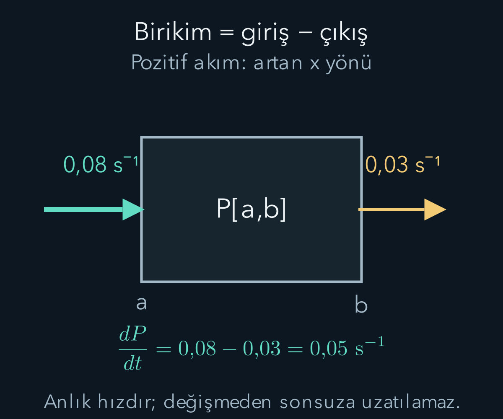
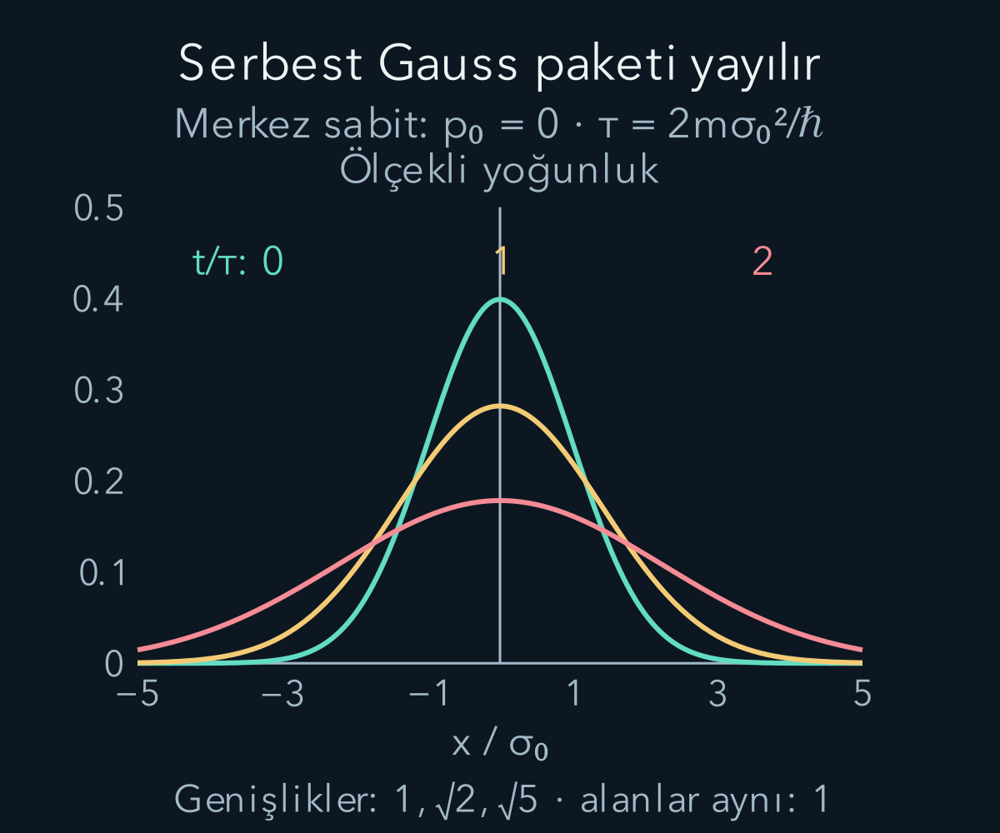

import ArticleVideo from '@/components/ArticleVideo.astro'
import kavram from './media/01-kavram.mp4?url'
import kavramPoster from './media/01-kavram.jpg?url'

Bir dalga fonksiyonunu normalleştirmek, yalnız bir andaki olasılık dağılımını tanımlar. Daha sonra nerede bulunabileceğimizi hesaplamak için bu fonksiyonun zamanla nasıl değiştiğini bilmeliyiz. [Hamiltonyenin zaman evrimini](/blog/hamiltonyen-ve-kuantum-zaman-evrimi/) şimdi [sürekli konum gösterimine](/blog/dalga-fonksiyonu-konum-ve-momentum/) uygulayacağız. Ortaya çıkan Schrödinger denklemi hem yayılmayı hem potansiyelin etkisini aynı yapıda toplar.

Bir boyutta, kütlesi $m>0$ olan ve hızları göreli olmayan bir parçacık ele alıyoruz. Spin etkilerini ve manyetik vektör potansiyelini bu modelin dışında tutuyoruz. Potansiyel enerji $V(x,t)$ gerçek değerli olsun. Fonksiyonların ve sınır koşullarının Hamiltonyeni öz-eşlenik yapacak biçimde seçildiğini varsayıyoruz. Bu koşullar toplam olasılığın korunması için yalnız teknik ayrıntılar değildir.

## 1. Kinetik enerjiden ikinci türeve

Klasik göreli olmayan enerji $H=p^2/(2m)+V$ biçimindeydi. Konum gösteriminde momentumun uygun fonksiyonlarda $\hat p=-i\hbar\partial_x$ işleci olduğunu gördük. İki kez uygulayınca $(-i)^2=-1$ nedeniyle $\hat p^2=-\hbar^2\partial_x^2$ olur. Böylece Hamiltonyenin etkisi:

$$
\hat H\psi=-\frac{\hbar^2}{2m}\frac{\partial^2\psi}{\partial x^2}+V(x,t)\psi
$$

olarak yazılır. Potansiyel terimi fonksiyonu bulunduğu konumdaki enerji değeriyle çarpar. Kinetik terim ise ikinci uzay türeviyle komşu konumlardaki genliklerin ilişkisini kullanır. İkinci türevin görünmesi, klasik kuvvet denklemindeki ikinci **zaman** türeviyle aynı şey değildir.

Bu Hamiltonyeni durum evrim yasasına koyunca:

$$
\boxed{i\hbar\frac{\partial\psi}{\partial t}
=-\frac{\hbar^2}{2m}\frac{\partial^2\psi}{\partial x^2}+V\psi.}
$$

elde edilir. Bu, burada kullandığımız bir boyutlu Schrödinger denklemidir. $\partial$ sembolü kısmi türevdir: zaman türevinde konumu, konum türevinde zamanı sabit tutarız. Denklemi yazmak, başlangıç fonksiyonunu ve sınır koşullarını vermenin yerine geçmez; hepsi birlikte bir evrim problemi oluşturur.

## 2. Birim ve işaret kontrolü

$\hbar^2/(m)$ birimi $\mathrm{kg\,m^4/s^2}$ olur. İkinci konum türevi fonksiyonun birimine ek olarak $\mathrm{m^{-2}}$ getirir. Çarpım enerji birimiyle dalga fonksiyonu biriminin çarpımıdır. $V\psi$ de aynı birime sahiptir. Sol tarafta $\hbar\partial_t$ enerji birimi verir; üç terim tutarlıdır.

Kinetik terimin önündeki eksi işareti negatif kinetik enerji demek değildir. Örneğin $e^{ikx}$ için ikinci türev $-k^2e^{ikx}$ olur. Hamiltonyendeki eksiyle çarpılınca $+\hbar^2k^2/(2m)$ elde edilir. İkinci türevin işaretini dikkate almadan ön katsayıyı enerji işareti sanmamalıyız.

Daha genel olarak uygun sınır koşullarında kısmi integrasyon $\langle K\rangle=(\hbar^2/2m)\int|\psi'|^2dx\ge0$ verir. Bu bağıntıda sınır teriminin yok olduğunu kullandık. Böylece kinetik enerji ortalamasının negatif olmadığı, yalnız düzlem dalga örneğinde değil geniş bir uygun fonksiyon sınıfında görülür.

Bu kısmi integrasyonun adımlarını, fonksiyon ve türevlerinin sonsuzda yeterince hızlı azaldığı bütün doğru için yazalım:

$$
\begin{aligned}
\langle K\rangle
&=-\frac{\hbar^2}{2m}\int\psi^*\psi''\,dx\\
&=-\frac{\hbar^2}{2m}[\psi^*\psi']_{-\infty}^{\infty}\\
&\quad+\frac{\hbar^2}{2m}\int\psi^{*'}\psi'\,dx\\
&=\frac{\hbar^2}{2m}\int|\psi'|^2\,dx.
\end{aligned}
$$

İlk türev bir çarpandan ötekine aktarılırken eksi işareti doğdu; Hamiltonyendeki eksiyle birleşince integralin katsayısı pozitif oldu. Sınır terimini sıfırlayan varsayımı ayrıca kullandık. Sonlu bir kutuda fonksiyonun uçlarda sıfır olması da aynı sınır terimini yok edebilir; başka sınır koşullarında o terimi incelemeden silmeyiz. Son integral, fonksiyonun uzayda ne kadar değiştiğini ölçer; yüksek uzaysal değişim kinetik enerjiye katkı yapar.

## 3. Durağan çözümleri ayırmak

Potansiyel zamanla değişmiyorsa $\psi(x,t)=u(x)T(t)$ çarpım biçiminde çözümler arayabiliriz. Denklemde yerine koyup sıfır olmayan bölgede $uT$'ye böldüğümüzde:

$$
i\hbar\frac{T'}T
=-\frac{\hbar^2}{2m}\frac{u''}u+V(x).
$$

Sol taraf yalnız zamana, sağ taraf yalnız konuma bağlıdır. Bütün konum ve zamanlarda eşit kalmaları için ortak bir sabite eşit olmaları gerekir; bu sabite $E$ diyeceğiz. Sonuçlar $T(t)=e^{-iEt/\hbar}$ ve:

$$
-\frac{\hbar^2}{2m}u''(x)+V(x)u(x)=Eu(x)
$$

olur. İkinci denklem **zamandan bağımsız Schrödinger denklemi**, yani enerji özdeğer problemidir. Ayırma işlemindeki bölme, düğüm noktalarında doğrudan yapılmasa da elde edilen diferansiyel denklem çözümün uygun devamıyla bütün bölgede kullanılır.

$E$'nin gerçek olması yalnız ‘enerji gerçek olmalı’ isteğinden değil, uygun öz-eşlenik Hamiltonyenin spektral özelliğinden gelir. Her seçilen gerçek sayı mutlaka normalleştirilebilir bağlı durum üretmez. Sınır koşulları ve uzaklıkta davranış, hangi enerjilerin mümkün olduğunu seçer. Bir sonraki potansiyel kuyusu örneğinde bu seçimi açıkça hesaplayacağız.

## 4. Durağanlık ile hareketsizlik aynı değildir

$\psi=u e^{-iEt/\hbar}$ için yoğunluk $|\psi|^2=|u|^2$ olur; zaman çarpanı global faz olarak kaybolur. Bu nedenle konum dağılımı durağandır. Ancak bu sonuç tek başına olasılık akımının sıfır olduğu anlamına gelmez. Sürekli akan bir nehirde su yüksekliği sabit olabilir; benzetmede önemli olan yerel birikimle akışın farklı nicelikler olmasıdır.

Örneğin ideal düzlem dalganın yoğunluğu sabittir, fakat belirli yönlü momentumu vardır. Bütün doğru üzerinde normalleşmediğini biliyoruz; bu yüzden onu tek başına sonlu toplam olasılıklı paket saymıyoruz. Yerel akım ve saçılma hesabında bileşen olarak kullanabiliriz. Normalleştirilebilir, gerçek seçilebilen bağlı enerji özfonksiyonlarında ise akım sıfır çıkar.

Farklı enerjilerin süperpozisyonunda yoğunluk genel olarak zamanla değişir. İki terimin çarpımından $e^{-i(E_2-E_1)t/\hbar}$ gibi göreli fazlar doğar. Bu yüzden yalnız ayrı durağan yoğunlukları olasılıklarla toplayarak her süperpozisyonun yoğunluğunu bulamayız; girişim terimlerini de korumamız gerekir.

## 5. Olasılığın yerel korunumu

Yoğunluk $\rho=\psi^*\psi$ olsun. Zamana göre türev alırsak $\partial_t\rho=\psi^*\partial_t\psi+\psi\partial_t\psi^*$ elde ederiz. Schrödinger denklemi ve eşleniği şu ifadeleri verir:

$$
\partial_t\psi=\frac{i\hbar}{2m}\psi''-\frac{iV}{\hbar}\psi,
\qquad
\partial_t\psi^*=-\frac{i\hbar}{2m}\psi^{*''}+\frac{iV}{\hbar}\psi^*.
$$

Bunları yoğunluk türevine koyduğumuzda gerçek potansiyel terimleri birbirini götürür. Kalan:

$$
\partial_t\rho=\frac{i\hbar}{2m}
(\psi^*\psi''-\psi\psi^{*''}).
$$

Parantezin $\partial_x(\psi^*\psi'-\psi\psi^{*'})$ olduğunu çarpım kuralıyla kontrol edebiliriz. Çapraz birinci türev çarpımları birbirini götürür. Böylece:

$$
\boxed{\partial_t\rho+\partial_x j=0},\qquad
j=\frac{\hbar}{2mi}(\psi^*\psi'-\psi\psi^{*'})
=\frac\hbar m\operatorname{Im}(\psi^*\psi')
$$

sonucuna ulaşırız. $j$ **olasılık akımıdır**. $\operatorname{Im}$ karmaşık sayının sanal kısmını alır. Denklem, bir bölgede olasılık birikmesinin o bölge sınırlarındaki giriş ve çıkış akımıyla belirlendiğini söyler.

## 6. Bir aralıktaki olasılık nasıl değişir?

$P_{[a,b]}(t)=\int_a^b\rho(x,t)dx$ tanımlayalım. Uygun düzgünlükte integral içinde zaman türevi alıp süreklilik denklemini kullanabiliriz:

$$
\frac{dP_{[a,b]}}{dt}
=-\int_a^b\partial_xj\,dx=j(a,t)-j(b,t).
$$

Soldan giren akım sağdan çıkandan büyükse içerideki olasılık artar. Eşitse bölgede birikim olmaz. İşaret seçimi açık: pozitif $j$, artan $x$ yönünde akışı gösterir. Negatif akım ters yöndedir; negatif olasılık anlamına gelmez.

Bir boyutta $\rho$ birimi metre başına, $j$ birimi saniye başınadır. $j\,dt$ bir noktadan geçen işaretli olasılık miktarı ölçeğindedir. Tek parçacık dalga fonksiyonu için bu, doğrudan amper cinsinden elektrik akımı değildir. Uygun yük ve parçacık sayısı modeli eklendiğinde elektrik akımıyla ilişkilendirilebilir; kavramları birimlerini söylemeden özdeşleştirmiyoruz.

Bütün doğru üzerinde sınır akımları yoksa $d\int\rho dx/dt=0$ olur ve norm korunur. Sonlu bir bölgede toplam olasılık azalabilir; parçacığın dışarı bulunma olasılığı artıyordur. Alt bölgedeki azalmanın kendisi kuantum kuramında toplam olasılığın kaybolduğu anlamına gelmez.

## 7. Akımı doğrudan hesaplamak

Sabit genlikli $\psi=Ae^{ikx-i\omega t}$ bileşeninde $\psi'=ik\psi$ olur. Dolayısıyla $\psi^*\psi'=ik|A|^2$ ve $j=(\hbar k/m)|A|^2$ çıkar. $p=\hbar k$ kullandığımızda $j=(p/m)\rho$ bulunur. Göreli olmayan serbest parçacıkta $p/m$ hız ölçeğidir.

$k$ işareti değişince yoğunluk değişmez, akım ters döner. Birbirine eşit genlikli sağa ve sola giden iki dalganın gerçek duran dalga birleşiminde net akım sıfır olabilir. Bu, yerel yoğunluğun mutlaka sıfır olduğu anlamına gelmez; zıt akış katkıları dengelenmiştir. Sonraki saçılma hesabında yansıma ve geçiş oranlarını genlik karelerinden önce bu akımlarla tanımlayacağız.

Gauss paketinin başlangıç fazı $e^{ip_0(x-x_0)/\hbar}$ ise, önceki türev hesabından $j(x,0)=(p_0/m)\rho(x,0)$ elde edilir. Genlik zarfının türevi gerçek bir katkı verir ve sanal kısma girmez. Ancak paket yayıldıkça konuma bağlı ek faz gelişebilir; her anda akımı yalnız sabit başlangıç hızına bağlamak doğru değildir.

## 8. Serbest paketin yayılması

$V=0$ olduğunda momentum bileşeninin enerjisi $E(p)=p^2/(2m)$ olur. Başlangıç momentum fonksiyonu $\phi(p,0)$ için zaman evrimi $\phi(p,t)=\phi(p,0)e^{-ip^2t/(2m\hbar)}$'dir. Momentum olasılık yoğunluğu değişmez; fazı değişir. Ters Fourier dönüşümü farklı momentum bileşenlerini yeniden bir araya getirir.

Başlangıç konum standart sapmasına $\sigma_0$ diyelim. Önceki yazıdaki momentum Gauss fonksiyonunu ters dönüşüme koyup $q=p-p_0$ değişkenini seçelim. $q$, momentumun ortalamasından farkıdır. Ayrıca boyutsuz zaman $\eta=\hbar t/(2m\sigma_0^2)$ ve paket merkezine göre konum $X=x-x_0-p_0t/m$ tanımlayalım. Üstelin $q$'ya bağlı kısmı şöyle gruplanır:

$$
-\frac{\sigma_0^2}{\hbar^2}q^2
-\frac{it}{2m\hbar}(q^2+2p_0q)
+\frac{i(x-x_0)}{\hbar}q
=-\frac{\sigma_0^2}{\hbar^2}(1+i\eta)q^2+\frac{iX}{\hbar}q.
$$

$q$'dan bağımsız faz ise $e^{ip_0(x-x_0)/\hbar-ip_0^2t/(2m\hbar)}$ olur. İntegrali hesaplamak için $a=\sigma_0^2(1+i\eta)/\hbar^2$ ve $b=iX/\hbar$ yazalım. Kareye tamamlama, $-aq^2+bq=-a(q-b/(2a))^2+b^2/(4a)$ verir. Gerçek kısmı pozitif olan $a$ için kullanılan Gauss integralinin biçimi:

$$
\int_{-\infty}^{\infty}e^{-aq^2+bq}\,dq
=\sqrt{\frac\pi a}\,e^{b^2/(4a)},
\qquad \operatorname{Re}a>0.
$$

Bu koşul integrali yakınsak tutar; bizde $\operatorname{Re}a=\sigma_0^2/\hbar^2>0$'dır. Karmaşık karekökün dalını $t=0$'da pozitif değerden sürekli ilerleyecek biçimde seçeriz. Başlangıç normalleştirme katsayısıyla Fourier katsayısını da birleştirince:

$$
\psi(x,t)=\frac{1}{(2\pi\sigma_0^2)^{1/4}}
\frac{1}{\sqrt{1+i\eta}}
\exp\!\left[-\frac{X^2}{4\sigma_0^2(1+i\eta)}\right]
e^{ip_0(x-x_0)/\hbar-ip_0^2t/(2m\hbar)}.
$$

Yoğunluk için mutlak değerin karesini alalım. Son fazın mutlak değeri birdir. $|1+i\eta|=\sqrt{1+\eta^2}$ olduğu için ön katsayının karesi $1/[\sqrt{2\pi}\sigma_0\sqrt{1+\eta^2}]$ olur. Üstel için $\operatorname{Re}[1/(1+i\eta)]=1/(1+\eta^2)$ kullanılır. Böylece:

$$
\rho(x,t)=\frac{1}{\sqrt{2\pi}\sigma_0\sqrt{1+\eta^2}}
\exp\!\left[-\frac{X^2}{2\sigma_0^2(1+\eta^2)}\right].
$$

Bunu standart Gauss yoğunluğuyla karşılaştırdığımızda merkez ve standart sapma açıkça okunur:

$$
x_c(t)=x_0+\frac{p_0}{m}t,
\qquad
\sigma(t)=\sigma_0\sqrt{1+\left(\frac{\hbar t}{2m\sigma_0^2}\right)^2}.
$$

Genişlik artarken yükseklik aynı oranla azalır; değişkeni $u=(x-x_c)/\sigma(t)$ yapınca normalleşme integrali yine bir olur.

Yayılmanın nedeni, farklı momentum bileşenlerinin farklı grup hızlarına sahip olmasıdır. $\omega(k)=\hbar k^2/(2m)$ için grup hızı $d\omega/dk=\hbar k/m$ çıkar. Faz hızı $\omega/k=\hbar k/(2m)$ farklıdır. Dalganın tek tepesinin hızıyla paketin merkezinin hızını özdeşleştirmemeliyiz.

<ArticleVideo src={kavram} poster={kavramPoster} title="Sabit yoğunlukta olasılık akımı" caption="İdeal düzlem dalgasının gerçek kısmı ilerlerken mutlak değerinin karesi sabittir. Buna rağmen momentum yönünde akım vardır; dalga tüm gerçek doğru üzerinde normalize değildir." />

## 9. Yayılma süresine sayısal örnek

Doğal yayılma süresini $\tau=2m\sigma_0^2/\hbar$ olarak tanımlayalım. $t=\tau$ olduğunda genişlik başlangıcın $\sqrt2$ katıdır. Elektron kütlesi $m_e\approx9{,}11\times10^{-31}\ \mathrm{kg}$ ve $\sigma_0=1\ \mathrm{nm}$ için:

$$
\tau\approx\frac{2(9{,}11\times10^{-31})(10^{-9})^2}{1{,}055\times10^{-34}}
\approx1{,}73\times10^{-14}\ \mathrm s.
$$

Bu yaklaşık 17,3 femtosaniyedir; femtosaniye saniyenin $10^{-15}$ katıdır. Bu sürede genişlik yaklaşık 1,41 nanometre olur. Başlangıç genişliğini iki kat artırırsak $\tau$ dört kat büyür. Daha dar hazırlık, daha geniş momentum dağılımı nedeniyle daha hızlı yayılır.

Ortalama momentum sıfır olsa bile yayılma olur. Merkez yerinde kalır, sağa ve sola giden momentum bileşenleri dağılımı genişletir. ‘Ortalama hız sıfır’ ile ‘durum hiç değişmez’ aynı ifade değildir. Başlangıç konum paketi bir serbest enerji özdurumu olmadığı için durağan kalmasını beklemeyiz.

## 10. Potansiyel sınırında hangi koşullar gerekir?

Potansiyel sonlu bir basamakla değişsin. Enerji denkleminde ikinci türev bulunduğu için, sabit kütleli ve delta türü tekillik içermeyen bu durumda $u$ ve $u'$ sınırda süreklidir. Türev sürekliliğini denklemi sınırın çok dar bir çevresinde integre ederek görebiliriz: sonlu potansiyel ve sonlu fonksiyon terimlerinin integralleri aralık sıfıra giderken kaybolur, türev sıçraması da sıfır kalır.

Fonksiyonun kendisinde sıçrama olsaydı türevlerde daha güçlü tekil katkılar oluşurdu; sonlu basamak bunları dengeleyemezdi. Bu yüzden iki taraftaki çözümleri rastgele sabitlerle bırakmak yerine hem fonksiyonu hem türevini eşleştiririz. Bu eşleştirme, ileride geçiş ve yansıma genliklerini belirleyecek.

Delta biçiminde ideal bir tekil potansiyelde türev sıçrayabilir; aynı süreklilik kuralını aynen taşıyamayız. Sonsuz duvar da sonlu basamakla aynı problem değildir ve ayrıca sınır koşuluyla tanımlanır. Fiziksel modelin sınırını belirtmeden ezber bir ‘her yerde iki türev de sürekli’ kuralı kullanmak yanlıştır.

## 11. Korunan enerji, değişen konum dağılımı

Serbest Gauss paketinin momentum dağılımı değişmediği için enerji ortalaması sabittir. $\langle p^2\rangle=p_0^2+(\Delta p)^2$ olduğundan $\langle H\rangle=[p_0^2+\hbar^2/(4\sigma_0^2)]/(2m)$ olur. Konum yayılması için dışarıdan sürekli enerji eklemek gerekmez; aynı enerji dağılımının bileşenleri farklı fazlarla birleşmektedir.

Bu, bir gazın ısınarak genleşmesiyle aynı mekanizma değildir. Tek parçacık saf durumunun yayılımından söz ediyoruz; sıcaklık tanımlamadık. Enerji ortalamasının sabit kalması da parçacığın her tekil enerji ölçümünde aynı sonucu vereceği anlamına gelmez. Başlangıç dağılımının enerji yayılımı bulunabilir ve korunabilir.

Schrödinger denklemi göreli olmayan yaklaşımdır. Çok yüksek momentum bileşenleri veya ışık hızına yakın hareketler için onu eksiksiz nedensel teori gibi kullanamayız. Matematiksel Gauss fonksiyonunun sonsuz kuyruklarını, ölçülebilir bilgiyi ışık üstü gönderen bir mekanizma diye yorumlamıyoruz. Fiziksel uygulamada baskın momentum ölçeklerinin bu yaklaşımın geçerlilik aralığında olması gerekir.

## 12. Aynı yoğunluk, farklı akım

Belirli bir anda iki durumun yoğunluğu aynı olsun. Birinci dalga fonksiyonu gerçek bir Gauss zarfı $g(x)$, ikincisi $g(x)e^{ik_0x}$ olsun. İki durumda da yoğunluk $g(x)^2$'dir. Birincinin akımı sıfırdır; çünkü $g(x)g'(x)$ gerçektir. İkincinin türevinde ek $ik_0g$ terimi bulunduğu için akım $\hbar k_0g^2/m$ olur. Aynı konum fotoğrafı, sonraki hareketi belirlemek için yeterli değildir.

Bu örnek klasik mekanikte aynı konumda bulunan iki cismin farklı hızlarla hareket edebilmesini hatırlatır. Ancak kuantumda eksik bilgi, yalnız tek bir hız sayısı olarak eklenmez; bütün dalga fonksiyonunun faz yapısında bulunabilir. Konuma göre doğrusal olmayan bir faz, farklı bölgelerde farklı akım örüntüsü oluşturabilir. Böylece olasılık yoğunluğu zamanla şekil değiştirebilir.

Akımın gerçek sayı olması da tanımdan kontrol edilebilir. $z=\psi^*\psi'$ dersek ikinci terim onun eşleniği $z^*$'dır. $z-z^*=2i\operatorname{Im}z$ olduğundan $1/(2i)$ ile çarpılması gerçek bir sonuç verir. Akım ifadesinde eşlenik veya eksi işareti unutmak bu temel özelliği bile bozabilir.

Bir hesapta bütün doğru üzerinde norm korunsa da seçilmiş aralığın olasılığı sabit kalmayabilir. Örneğin sol sınırda akım saniye başına 0,08 ve sağ sınırda 0,03 ise aralıktaki olasılığın anlık değişim hızı saniye başına 0,05'tir. Bu sayıları uzun bir süre boyunca sabit kabul etmek için ek bilgi gerekir; süreklilik denklemi öncelikle o andaki yerel dengeyi verir. Olasılık birden büyük olmaya başlayacak biçimde doğrusal artışı sınırsız uzatamayız.

Anlık hızla sonlu zaman aralığındaki toplam değişimin ayrımı burada da korunur.

## 13. Başlangıç değeri ile sınır değerinin görevleri

Başlangıç fonksiyonu hangi durumun hazırlandığını belirler. Sınır koşulları ise parçacığın nerede hareket edebildiğini ve Hamiltonyenin nasıl tanımlandığını belirler. Bir enerji özdeğer problemini çözmekle genel başlangıç durumunun zaman evrimini bulmak ilişkili ama farklı işlerdir. Önce özdurumları bulup sonra başlangıcı bu bazda açmak, iki işi birbirine bağlayan yöntemdir.

Süreklilik denklemi bu hesap boyunca bir kontrol sağlar: yoğunluğun değişimi akımla uyuşmalı, kapalı bütün sistemin toplam normu korunmalıdır. Bir grafikte tepe azalırken alan da gerekçesiz azalıyorsa, yalnız ‘paket yayıldı’ demek yeterli olmaz; normalleşme veya sınırdan akış hesabı incelenmelidir.

Şimdi dalga fonksiyonunun nasıl evrildiğini ve olasılığın nasıl taşındığını biliyoruz. Sırada sınırların seçici etkisi var: parçacığın iki duvar arasında bulunması istendiğinde her enerji mümkün kalmayacak. Kuantalanmış enerjileri bir kural olarak ezberlemek yerine, diferansiyel denklem ile uç koşullarının birlikte nasıl seçtiğini göstereceğiz.

## Kaynakça

Aşağıdaki açık kaynaklar 11 Ekim 2026 tarihinde yeniden doğrudan kontrol edildi. Metin, hesap örnekleri ve şekiller bu yazı için özgün olarak hazırlandı.

- [OpenStax — The Schrödinger Equation](https://openstax.org/books/university-physics-volume-3/pages/7-3-the-schrodinger-equation): Zamana bağlı ve bağımsız denklemler.
- [Caltech, Feynman Lectures — Operators](https://www.feynmanlectures.caltech.edu/III_20.html): Enerji ve momentumun konum gösterimi.
- [MIT OpenCourseWare — Quantum Physics II Lecture Notes](https://ocw.mit.edu/courses/8-05-quantum-physics-ii-fall-2013/pages/lecture-notes/): Sürekli durumlarda dinamik ve olasılık korunumu.
