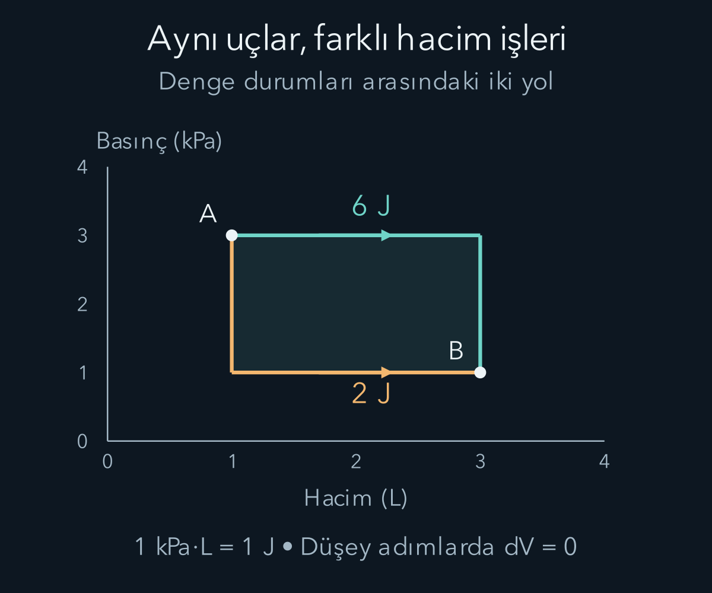
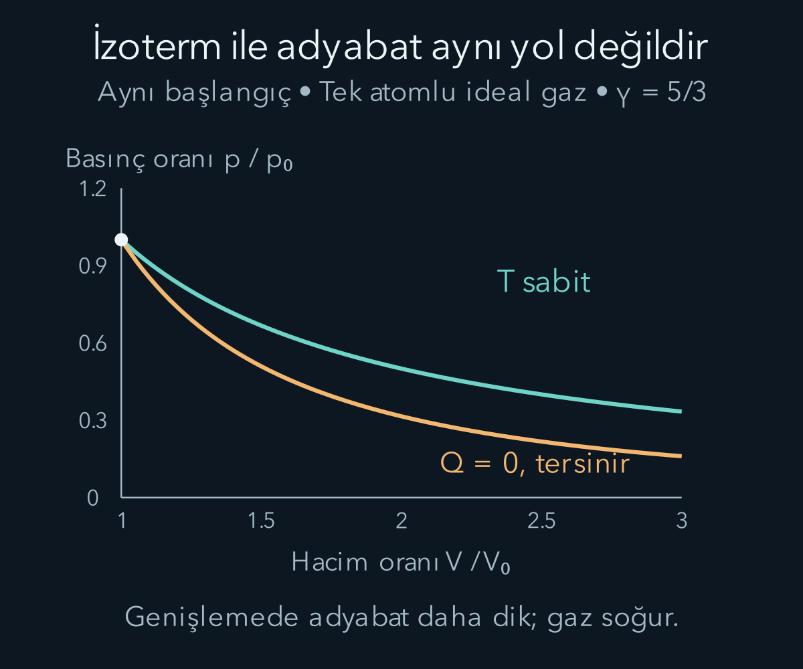

import ArticleVideo from '@/components/ArticleVideo.astro'
import kavram from './media/01-kavram.mp4?url'
import kavramPoster from './media/01-kavram.jpg?url'

Bir bisiklet pompasını hızlıca sıkıştırdığımızda içindeki hava ısınabilir. Bir fincandaki sıcak su ise çevresine enerji aktarırken soğur. İlk olayda mekanik iş, ikinci olayda sıcaklık farkından kaynaklanan aktarım öne çıkar. İkisini ortak bir enerji hesabında birleştirmek için sıcaklık, ısı ve iç enerjiyi birbirinden ayırmamız gerekir.

[Fourier ve dalga paketlerinin](/blog/fourier-serileri-ve-dalga-paketleri/) ardından, bu yazıda hareketin çok sayıda tanecikten oluşan sistemlerdeki enerji hesabına geçiyoruz. Önceki yazılarda kuvvet, iş, enerji ve olasılık dağılımlarını kurduk. Burada çok sayıda parçacığın her birini ayrı ayrı izlemek yerine basınç, hacim ve sıcaklık gibi toplu nicelikleri kullanacağız. Tek bir taneciğin hızını bilmekle bir gazın sıcaklığını bilmek farklı bilgi düzeyleridir. Mikroskobik hareket ile makroskobik ölçüm arasındaki bağı ideal gaz modeli üzerinden kuracağız.

## 1. Sıcaklık neyi karşılaştırır?

İki cisim arasında enerji alışverişine izin verdiğimizde, uzun süre sonra sıcaklık farkından kaynaklanan net aktarım durabilir. Bu duruma **ısıl denge** denir. Termodinamiğin sıfırıncı yasası, A ve B ayrı ayrı C ile ısıl dengedeyse A ile B'nin de birbirleriyle ısıl dengede olduğunu söyler. Böylece ortak bir sıcaklık değeriyle denge sınıflarını tanımlayabiliriz.

Termometre kendi fiziksel özelliğini ölçer: Bir sıvının hacmi, bir elektriksel özellik veya başka bir sıcaklık bağımlı nicelik değişir. Termometreyi ölçülecek cisimle ısıl dengeye getirdiğimizde onun sıcaklığını temsil eden bir okuma yapabiliriz. Aletin dengeye ulaşması zaman alabilir; çok küçük bir cismi büyük bir termometreyle ölçmek cismin durumunu da değiştirebilir.

Sıcaklık, cismin içerdiği toplam enerji değildir. Aynı sıcaklıktaki küçük bir bardak su ile büyük bir su deposu aynı toplam iç enerjiye sahip olmak zorunda değildir. Madde miktarı ve maddenin türü önemlidir. Sıcaklık, ısıl alışverişin yönüyle ve mikroskobik hareket dağılımıyla ilişkilidir; bir enerji deposunun doğrudan büyüklüğünü tek başına vermez.

## 2. Kelvin ve Celsius arasında

Termodinamik sıcaklık $T$ ile gösterilir ve SI birimi kelvin, $\mathrm K$ olur. Celsius sıcaklığına $t_C$ dersek $T/\mathrm K=t_C/{}^\circ\mathrm C+273{,}15$ ilişkisi vardır. Yirmi Celsius derece, iki yüz doksan üç virgül on beş kelvindir. Bir kelvinlik sıcaklık farkı ile bir Celsius derecelik fark eş büyüklüktedir; sıfır noktaları farklıdır.

Gaz yasalarında ve sıcaklık oranlarında mutlak kelvin ölçeğini kullanırız. Yirmi Celsius derece, on Celsius derecenin termodinamik olarak iki katı sıcaklık değildir. Oran sırasıyla kelvin değerleriyle kurulmalıdır. Celsius sayılarının birbirine bölünmesi, sıfırın seçimine bağlı olduğundan bu fiziksel oranı vermez.

Mutlak sıfır, kelvin ölçeğinin sıfır noktasıdır. Klasik ideal gazın sıcaklığı sıfıra yaklaşırken kullandığımız model gerçek maddelerde bir aşamada yetersiz hale gelir; yoğunlaşma veya kuantum etkileri önem kazanabilir. Formüle sıfır koyarak bütün atomların her tür hareketinin mutlaka durduğunu söylemek doğru değildir. Bu yazıda sıradan pozitif sıcaklıklı klasik denge sistemlerini ele alıyoruz.

## 3. Isı, iç enerji ve iş

**İç enerji** $U$, sistemin toplam hareketinden ayrı olarak içindeki mikroskobik hareket ve etkileşimlerle ilişkili enerji toplamıdır. Gaz kabının bütünü masanın üzerinde ilerliyorsa bu toplu hareketin kinetik enerjisini iç enerjiye dahil etmeyiz. Moleküllerin birbirlerine göre hareketleri, dönmeleri ve etkileşimleri ise modele göre iç enerjiye katkı verebilir.

**Isı** $Q$, sıcaklık farkı nedeniyle sistem sınırından aktarılan enerjidir. Sistem “içinde şu kadar ısı bulundurur” demek yerine “iç enerjisi şu değerdedir” demek daha doğrudur. Isı bir süreçte aktarımı, iç enerji bir durumu anlatır. Aynı son duruma ulaşırken farklı ısı ve iş alışverişleri yapılabilir.

**İş** de sınırdan enerji aktarımıdır fakat sıcaklık farkıyla tanımlanmaz. Pistonla sıkıştırma mekanik işin örneğidir. Elektriksel yollarla da iş aktarımı yapılabilir. Bu yazıda çoğunlukla kapalı, madde alışverişi yapmayan bir gaz sistemini ve hacim değişimiyle yapılan işi inceleyeceğiz. Madde girip çıkan açık sistemlerde enerji taşıyan akışlar ayrıca eklenir.

## 4. İlk yasanın işaretlerini sabitlemek

Isı sisteme giriyorsa $Q$ pozitif, sistem çevreye iş yapıyorsa $W$ pozitif olsun. Bu seçimle termodinamiğin birinci yasası:

$$
\Delta U=Q-W
$$

olur. Sistem dışarıya iş yaptığında iç enerjiden pay çıkar. Çevre sistemi sıkıştırarak onun üzerinde iş yaptığında $W$ negatiftir ve eksi negatif katkı iç enerjiyi artırabilir. Bazı kaynaklar sistem üzerinde yapılan işi pozitif seçer; o zaman formülde artı işareti görünür. Fizik değişmez, işaret tanımı değişir.

Bir gaza üç yüz joule ısı verilip gaz çevreye yüz joule iş yaparsa iç enerji iki yüz joule artar. Isı alışverişi olmadan çevre gaz üzerinde yüz joule iş yaparsa bizim seçimimizde $W=-100\,\mathrm J$ ve $\Delta U=100\,\mathrm J$ olur. İşaretleri ezberlemek yerine enerji girişini ve çıkışını sözle de takip edebiliriz.

İlk yasa enerji korunumu hesabıdır. Enerjinin hangi yönde kendiliğinden aktarılabileceğini tek başına söylemez. Soğuk bir cisimden sıcak bir cisme enerji geçişi, ek koşullar bilinmeden yalnız bu eşitlikle yasaklanamaz. Süreçlerin yönünü ikinci yasada ayrıca ele alacağız.

## 5. Basınç ve hacim işi

Basınç $p$, yüzeye dik kuvvetin alana oranıdır. SI birimi pascal, $\mathrm{Pa}$, newton bölü metre karedir. Alanı $A$ olan piston gaz tarafından dışa doğru $dx$ kadar itilirse hacim değişimi $dV=A\,dx$ olur. Çevrenin karşı basıncı $p_{\mathrm{dış}}$ ise yapılan küçük iş:

$$
\delta W=p_{\mathrm{dış}}A\,dx=p_{\mathrm{dış}}\,dV
$$

olur. Gazın basıncının iyi tanımlandığı, pistonun çok küçük basınç farklarıyla hareket ettiği tersinir sınırda $p_{\mathrm{dış}}\approx p$ kullanabiliriz. Böylece $W=\int p\,dV$ yazılır. Hızlı ve dengeden uzak bir süreçte gazın tek bir iç basıncını her an bu formüle koymak doğru olmayabilir.

Hacim artarsa $dV$ pozitif ve sistemin yaptığı iş pozitiftir. Hacim azalırsa iş negatiftir. Basınç-hacim grafiğindeki eğri altı alan iş verir. Birim çarpımı pascal metre küp, yani newton metre olduğundan joule çıkar. Sabit hacimde basınç değişse bile bu tür hacim işi sıfırdır.

## 6. İdeal gaz modeli ve madde miktarı

İdeal gazda taneciklerin hacmini toplam hacme göre küçük, aralarındaki sürekli etkileşim enerjisini ihmal edilebilir kabul ederiz. Çarpışmalar basıncı ve dengeyi kurar. Denge bağıntısı:

$$
pV=Nk_BT=nRT
$$

biçimindedir. $N$ tanecik sayısı, $k_B$ Boltzmann sabiti, $n$ mol cinsinden madde miktarıdır. Bir mol, Avogadro sabiti $N_A$ kadar belirli tanecik içerir; $N=nN_A$ ve $R=N_Ak_B$ olur. $R\approx8{,}314\,\mathrm{J/(mol\,K)}$ gaz sabitidir. Hangi taneciği saydığımız, atom mu molekül mü olduğu, madde miktarı tanımında belirtilmelidir.

Bu denklemde basınç mutlak basınçtır. Atmosfere göre fark gösteren bir ölçüm aletinin değerini doğrudan kullanmak gerekirse önce referans basıncı hesaba katılır. Sıcaklık kelvinle, hacim metreküple kullanılırsa SI birimleri tutarlı olur. Bir litre $10^{-3}\,\mathrm m^3$ olduğundan litreyi doğrudan metreküp gibi yazamayız.

İdeal gaz denklemi bir durum denklemidir; basınç, hacim, sıcaklık ve madde miktarını bağlar. Bir süreçte ne kadar ısı aktarılacağını tek başına söylemez. Bunun için iç enerjinin durumla ilişkisi ve izlenen yol gerekir. Özellikle yoğun gazlarda, düşük sıcaklıkta veya yoğunlaşma yakınında ideal yaklaşım bozulabilir.

## 7. Sıcaklıkla tanecik hareketini bağlamak

Kenar uzunluğu $L$ olan bir kutudaki tek taneciği düşünelim. Tanecik kütlesi $m_0$, duvara dik hız bileşeni $v_x$ olsun. Esnek çarpışmada momentumun bu bileşeni ters döner; duvara aktarılan büyüklük $2m_0|v_x|$ olur. Aynı duvara yeniden gelme süresi $2L/|v_x|$ olduğundan ortalama kuvvet $m_0v_x^2/L$ çıkar.

Bütün taneciklerin katkısını toplayıp duvar alanına bölersek $pV=Nm_0\langle v_x^2\rangle$ bulunur. Açılı parantez, tanecikler üzerinden ortalamayı gösterir. Dengedeki yönsüz dağılımda üç doğrultunun kare ortalamaları eşittir; dolayısıyla $\langle v_x^2\rangle=\langle v^2\rangle/3$ olur. İdeal gaz denklemiyle karşılaştırınca:

$$
\frac12m_0\langle v^2\rangle=\frac32k_BT
$$

elde edilir. Sıcaklık, bu klasik modelde ortalama öteleme kinetik enerjisine bağlandı. Taneciklerin hepsinin aynı hızda gittiğini söylemedik; bir dağılımın ortalamasını kullandık. Ortalama hız vektörü sıfır olabilirken hız karesinin ortalaması pozitif olabilir.

Tek atomlu klasik ideal gazda iç enerji yalnız bu öteleme katkısıyla $U=\tfrac32Nk_BT=\tfrac32nRT$ olur; seçilen sabit enerji sıfırı ayrıca eklenebilir. Çok atomlu moleküllerde dönme ve titreşim gibi iç hareketler katkı sağlayabilir. Bu yüzden üç bölü iki katsayısını her maddeye ve her sıcaklığa uygulamayız.

## 8. Isı kapasitesi ve sabit hacim süreci

**Isı kapasitesi**, belirli süreç koşullarında sıcaklığı değiştirmek için gereken ısıyla ilişkilidir. Mol başına kapasite kullanırsak sabit hacimde $\delta Q=nC_V\,dT$ yazarız. Sabit hacim işi sıfır olduğundan ilk yasa $dU=\delta Q$ Tek atomlu ideal gaz için $C_V=\tfrac32R$ çıkar.

Bir mol gazı sabit hacimde üç yüz kelvinden üç yüz yirmi kelvine ısıtalım. İç enerji artışı $\Delta U=(3/2)(1)(8{,}314)(20)\approx249{,}4\,\mathrm J$ olur. Hacim işi sıfırdır ve gereken ısı aynı değerdir. Basınç sıcaklıkla orantılı arttığından son basıncın ilkine oranı $320/300$ olur.

Isı kapasitesi genel olarak sıcaklığa bağlı olabilir. O zaman $nC_V\Delta T$ yerine $n\int C_V(T)\,dT$ kullanırız. Faz değişimi sırasında sıcaklık sabit kalırken enerji aktarımı gerçekleşebilir; burada kullanılan tek fazlı ideal gaz ilişkisi o durumu anlatmaz. “Enerji verilirse sıcaklık mutlaka artar” düşüncesi bu nedenle evrensel değildir.

## 9. Sabit basınçta ve sabit sıcaklıkta

Sabit basınçta ideal gazın işi $W=p\Delta V=nR\Delta T$ olur. İlk yasadan $Q=n(C_V+R)\Delta T$ bulunur; dolayısıyla molar kapasite $C_p=C_V+R$ olur. Gazı aynı sıcaklık artışına ulaştırmak için sabit basınçta daha fazla ısı gerekir, çünkü iç enerji artışının yanında çevreye iş yapılır.

Bir mol tek atomlu gazın yirmi kelvinlik artışında iç enerji yine yaklaşık iki yüz kırk dokuz joule artar. Ancak iş yaklaşık yüz altmış altı joule, gereken ısı yaklaşık dört yüz on altı joule olur. İç enerji farkı sıcaklığa bağlı kaldı, ısı ve iş izlenen koşula göre değişti. Bu, durum fonksiyonuyla süreç niceliğinin somut ayrımıdır.

**İzotermal** süreçte sıcaklık sabittir. İdeal gazın iç enerjisi değişmez; dolayısıyla $Q=W$ olur. Tersinir genişlemede $p=nRT/V$ bağıntısını integrale koyarız:

$$
W=nRT\ln\frac{V_2}{V_1}.
$$

Bir mol gaz üç yüz kelvinde hacmini iki katına çıkarırsa iş $8{,}314(300)\ln2\approx1729\,\mathrm J$ olur. Aynı miktarda ısı sisteme girer. Sıcaklığın sabit kalması ısı alışverişinin sıfır olduğunu göstermez; giren enerji yapılan işi dengeler.

## 10. Isı alışverişi olmadan: adyabatik süreç

**Adyabatik** süreçte $Q=0$ kabul edilir. Bu, sistemin ısıl olarak yalıtılmasıyla veya ısı aktarımının süreç süresine göre çok küçük kalmasıyla yaklaşık sağlanabilir. İlk yasa $\Delta U=-W$ olur. Gaz genişleyerek pozitif iş yapıyorsa iç enerjisi ve ideal gazda sıcaklığı düşebilir. Sıkıştırmada bunun tersi gerçekleşir.

Tersinir, yalnız hacim işi yapan ideal gaz sürecinde ve sabit ısı kapasitelerinde $nC_VdT=-p\,dV$ olur. İdeal gaz denklemini yerleştirip ayırırsak $dT/T=-(R/C_V)dV/V$ elde edilir. $C_p-C_V=R$ olduğundan $R/C_V=\gamma-1$ olur. İki denge ucu arasında integral aldığımızda

$$
\ln\frac{T_2}{T_1}=-(\gamma-1)\ln\frac{V_2}{V_1}
$$

elde ederiz. İki tarafın üstelini alıp hacim oranını karşıya taşırsak $T_2V_2^{\gamma-1}=T_1V_1^{\gamma-1}$ çıkar. Sıcaklık yerine $T=pV/(nR)$ koymak da ikinci bağıntıyı verir:

$$
TV^{\gamma-1}=\text{sabit},\qquad
pV^\gamma=\text{sabit},\qquad \gamma=\frac{C_p}{C_V}
$$

Tek atomlu ideal gaz için $\gamma=5/3$ olur. “Adyabatik” koşulu tek başına bu kuvvet yasasını garanti etmez; tersinirlik ve model koşulları da gerekir.

Başlangıç sıcaklığı üç yüz kelvin olan böyle bir gaz hacmini iki katına çıkarırsa son sıcaklık $300/2^{2/3}\approx189\,\mathrm K$ olur. Bu, ideal ve tek fazlı modelin sayısal sonucudur; seçilen gerçek gaz bu sıcaklık ve basınçlarda ideal kalıyor mu ayrıca kontrol edilir. Sabit sıcaklık sürecinde aynı hacim artışında sıcaklık düşmemişti; iki yol fiziksel olarak farklıdır.

<ArticleVideo src={kavram} poster={kavramPoster} title="Enerjinin giriş ve çıkışı" caption="Sisteme 100 J ısı girer ve sistem çevresine 40 J iş yapar. Seçilen işaret kuralıyla iç enerji artışı 60 J olur." />

### Serbest genişleme aynı adyabatik eğriyi izlemez

Isıl olarak yalıtılmış bir kabın yarısında ideal gaz, diğer yarısında boşluk olsun. Aradaki bölme kaldırıldığında gaz boş bölgeye yayılır. Dışarıya karşı itilen bir piston bulunmadığı ve dış karşı basınç sıfır olduğu için hacim işi sıfırdır. Isı alışverişi de sıfır kabul edildiğinden ilk yasa iç enerji değişiminin sıfır olduğunu söyler. İdeal gazın iç enerjisi yalnız sıcaklığa bağlı olduğu için başlangıç ve son denge sıcaklıkları eşittir.

Bu süreç adyabatiktir, fakat tersinir değildir. Gazın hacmi büyürken sıcaklığı tersinir adyabatik örnekteki gibi azalmadı. Burada ara durumlarda bütün gaza tek bir denge basıncı atayıp basınç-hacim eğrisi çizmek de uygun değildir. Başlangıç ve son denge durumlarını karşılaştırabiliriz; aradaki hızlı, düzensiz süreç aynı tür denge durumları dizisi değildir.

Bu örnek üç ayrımı birlikte gösterir. Isı alışverişinin olmaması sıcaklığın mutlaka değişeceğini söylemez. Hacmin değişmesi mutlaka pozitif iş yapılması demek değildir; karşı kuvvet gerekir. Adyabatik sözcüğü ise tek başına tersinirlik sağlamaz. İlk yasayı işaretleri ve sistem sınırını açık tutarak kullandığımızda bu durumların hepsi aynı enerji hesabına uyar.

## 11. Bir çevrimi kapatmak

Bir sistem birkaç süreçten sonra başlangıç durumuna dönerse iç enerji değişimi sıfırdır. Buna **çevrim** deriz. Birinci yasadan çevrim boyunca toplam ısı aktarımı toplam yapılan işe eşit olur. Basınç-hacim grafiğinde kapalı eğrinin yönlü alanı net hacim işidir. Genişleme yüksek, sıkışma düşük basınçta olursa sistem net iş verebilir.

Bu durum sistemin sonsuz enerji ürettiği anlamına gelmez. Başlangıç durumuna dönerken çevreyle ısı ve iş alışverişi gerçekleşmiştir. Bir motorun iş üretmesi, enerji hesabındaki kaynak ve alıcıların da izlenmesini gerektirir. İlk yasa toplam miktarı kısıtlar; alınan ısının ne kadarının işe dönüştürülebileceği sorusu için ikinci yasaya ihtiyaç vardır.

Sıcaklık bir denge özelliği, iç enerji bir durum fonksiyonu, ısı ve iş süreç boyunca aktarım biçimleri olarak ayrıldı. Bir sonraki yazıda neden bazı enerji dönüşümlerinin tersinin kendiliğinden gerçekleşmediğini entropi üzerinden inceleyeceğiz.

## Kaynaklar

- [OpenStax — Sıcaklık ve ısıl denge](https://openstax.org/books/university-physics-volume-2/pages/1-1-temperature-and-thermal-equilibrium).
- [OpenStax — İdeal gazın moleküler modeli](https://openstax.org/books/university-physics-volume-2/pages/2-1-molecular-model-of-an-ideal-gas).
- [OpenStax — Termodinamiğin birinci yasası](https://openstax.org/books/university-physics-volume-2/pages/3-3-first-law-of-thermodynamics).
- [OpenStax — İdeal gazda adyabatik süreçler](https://openstax.org/books/university-physics-volume-2/pages/3-6-adiabatic-processes-for-an-ideal-gas).
