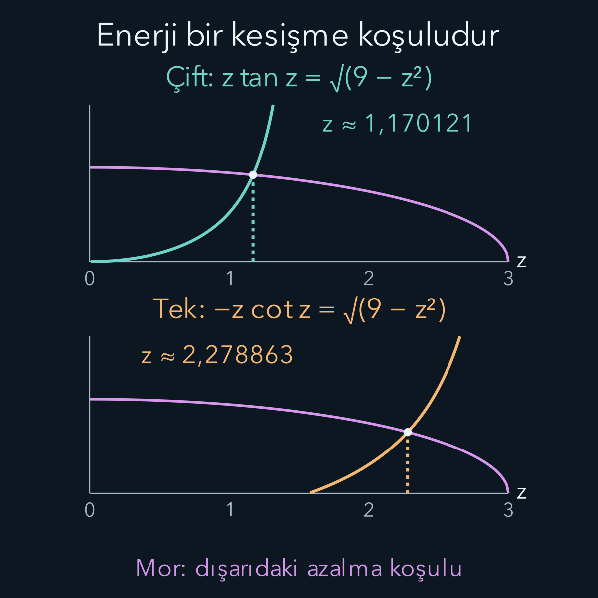
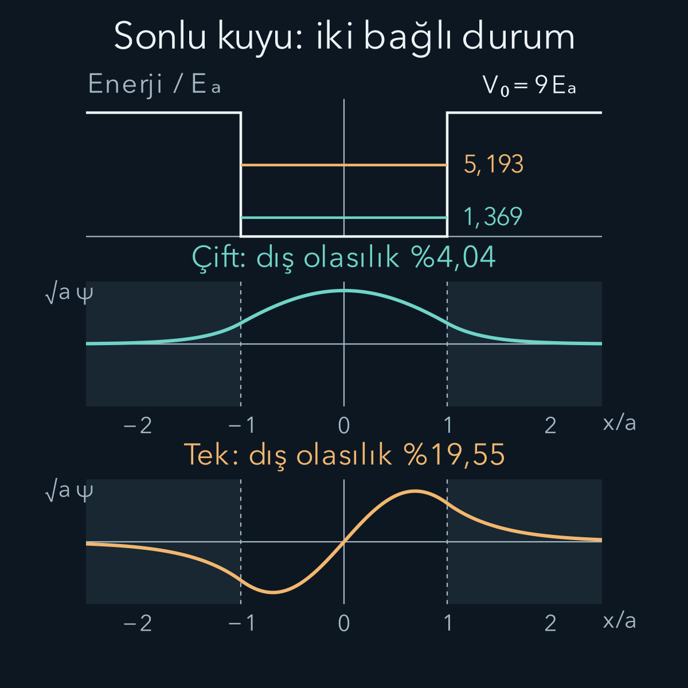

import ArticleVideo from '@/components/ArticleVideo.astro'
import kavram from './media/01-kavram.mp4?url'
import kavramPoster from './media/01-kavram.jpg?url'

Bir parçacığı iki sonsuz duvar arasına koyduğumuzda dalga fonksiyonunun duvarlarda sıfır olmasını istemiştik. Gerçek bir bağlanma bölgesinin çevresi ise her zaman sonsuz yüksek değildir. Parçacığın enerjisi çevredeki potansiyel enerjiden küçük olsa bile dalga fonksiyonu sınırda kesilmez. Bölgenin dışında azalan kuyruklar oluşur. Bu değişiklik hem izin verilen enerjileri hem de parçacığı nerede bulabileceğimizi etkiler.

[Önceki yazıda Bell korelasyonlarını](/blog/bell-esitsizligi-ve-kuantum-korelasyonlari/) ele aldık. Şimdi tek parçacığın uzaydaki bağlanmasına dönüyoruz. Buradaki hesap için [sonsuz kuyu](/blog/sonsuz-potansiyel-kuyusu/), [potansiyel basamağı](/blog/potansiyel-basamagi-ve-tunelleme/) ve [olasılık akımı](/blog/schrodinger-denklemi-ve-olasilik-akimi/) yeterlidir. Türev, bir fonksiyonun eğimini; normalleştirme, bütün uzaydaki olasılıkların toplamını bir yapmayı anlatır. Sinüs, kosinüs ve azalan üstel fonksiyonları aynı çözümün parçaları olarak birleştireceğiz.

## 1. Kuyunun genişliği, derinliği ve enerji sıfırı

Konumu $x$, parçacığın kütlesini $m$ ile gösterelim. Kuyunun yarı genişliği $a>0$, duvar yüksekliği $V_0>0$ olsun. Tam genişlik $2a$'dır. Potansiyel enerjiyi:

$$
V(x)=\begin{cases}
0,&|x|<a,\\
V_0,&|x|>a
\end{cases}
$$

diye seçiyoruz. Burada $|x|$, başlangıca uzaklıktır. Sınırın tek bir noktasındaki değer integral olasılıkları etkilemez. Enerji sıfırını kuyunun dibine koyduk. Başka bir kaynak dışarıdaki potansiyeli sıfır seçebilir; o durumda bütün enerjilerden $V_0$ çıkarılır. Fiziksel farklar değişmez.

Toplam enerjiye $E$ diyelim. **Bağlı durum**, bütün doğru üzerinde normalleştirilebilen ve uzakta azalan bir enerji özdurumudur. Bu modelde bağlı enerjiler $0<E<V_0$ aralığındadır. Üst sınır, dış bölgede üstel azalma gerektiğinden gelir. Alt sınır, kinetik enerjinin ve seçtiğimiz potansiyelin negatif olmamasından gelir. Tam $E=0$ durumunda ikisinin ortalaması da sıfır olmalıydı; bu, tüm doğru üzerinde normalleşebilen sıfır olmayan bir çözüme izin vermez.

$E>V_0$ olursa dış bölgede salınan çözümler vardır. Bunlar saçılma durumlarını kurmak için kullanılır. Tek bir kesin enerjili saçılma dalgası bütün doğru üzerinde sıradan biçimde normalleştirilemez; farklı enerjileri bir araya getiren dalga paketi normalleştirilebilir. Bağlı durumla saçılma durumunun ayrımı, yalnız grafiğin ortada büyük görünmesi değildir.

## 2. İçeride salınım, dışarıda üstel azalma

Zamandan bağımsız Schrödinger denklemi:

$$
-\frac{\hbar^2}{2m}\psi''(x)+V(x)\psi(x)=E\psi(x)
$$

olsun. $\psi$ uzaysal dalga fonksiyonu, iki üst çizgi ikinci türev, $\hbar$ indirgenmiş Planck sabitidir. Enerji özdurumunun zaman çarpanı $e^{-iEt/\hbar}$ olur; bu ortak faz olasılık yoğunluğunu değiştirmez.

İçeride $V=0$ yazıp ikinci türevi yalnız bırakalım:

$$
\begin{aligned}
\psi''&=-\frac{2mE}{\hbar^2}\psi=-k^2\psi,\\
k&=\frac{\sqrt{2mE}}{\hbar}.
\end{aligned}
$$

$k$ dalga sayısıdır ve uzunluğun tersi birimindedir. Bu denklemin genel çözümü $A\cos(kx)+B\sin(kx)$'tir. $A$ ve $B$, konuma bağlı olmayan katsayılardır; sınır koşulları ile normalleştirme bunları belirler. Kosinüs ile sinüsün ikinci türevi fonksiyonun kendisinin $-k^2$ katını verdiğinden denklemi doğrudan doğrulayabiliriz.

Dışarıda ise $V=V_0>E$ olur:

$$
\begin{aligned}
\psi''&=\frac{2m(V_0-E)}{\hbar^2}\psi=\kappa^2\psi,\\
\kappa&=\frac{\sqrt{2m(V_0-E)}}{\hbar}>0.
\end{aligned}
$$

Sağ tarafta büyüyen $e^{\kappa x}$ çözümünü atarız; karesi sonsuza doğru büyüdüğü için normalleştirilemez. Sağda $e^{-\kappa x}$, solda $e^{\kappa x}$ kalır. Soldaki üstel, $x$ eksi sonsuza giderken azalır. İki tarafta aynı işaretli üssü düşünmeden kullanmak, bir uçta büyüyen yanlış bir çözüm üretir.

Burada enerjiyi aramakla normalleştirme katsayısını aramak farklı işlerdir. Schrödinger denklemi doğrusaldır: bir çözümü sabit bir sayıyla çarpmak onu yine çözüm yapar. Bu nedenle diferansiyel denklem tek başına eğrinin toplam büyüklüğünü belirleyemez. Önce içeride ve dışarıda aynı eğriye ait olabilecek bir şekil ararız; sonra o şeklin mutlak karesinin integralini bire eşitleriz. Normalleştirme, sınırda uyuşmayan iki eğriyi birbirine uyduramaz. Bu ayrım, neden bir katsayıyı istediğimiz gibi değiştirmekle her enerjiyi kabul edemediğimizi açıklar.

## 3. Aynalama hesabı nasıl azaltır?

Potansiyel başlangıcın iki yanında aynıdır: $V(-x)=V(x)$. Bu simetriyi kullanarak çözümleri iki aileye ayırabiliriz. **Çift fonksiyon** için $\psi(-x)=\psi(x)$; **tek fonksiyon** için $\psi(-x)=-\psi(x)$ olur. Çift çözüm içeride kosinüs, tek çözüm sinüs biçimindedir. Buradaki tek ve çift sözcükleri enerji sıra numarasını değil aynalamadaki işareti anlatır.

Neden bu aileler yeterlidir? Bir çözümü aynaladığımızda aynı enerjide yine çözüm elde ederiz. Çözümle aynasının toplamı çift, farkı tek olur. Tek boyutlu bu düzenli bağlı durum probleminde aynı enerjiye ait bağımsız iki çözüm bulunmaz; enerji özdurumları belirli aynalama işaretiyle seçilir. Bunun için duvarların ve kütlenin iki tarafta aynı olması gerekir.

Çift çözümü bütün bölgelerde şöyle yazabiliriz:

$$
\psi_{\text{ç}}(x)=
\begin{cases}
A\cos(kx),&|x|\le a,\\
A\cos(ka)e^{-\kappa(|x|-a)},&|x|\ge a.
\end{cases}
$$

Bu yazım fonksiyonun sınırdaki değerini otomatik eşitler. Tek çözümde içeride $A\sin(kx)$, sağda $A\sin(ka)e^{-\kappa(x-a)}$ bulunur; sol parça sağ parçanın aynasının eksi işaretlisidir. Tek çözüm başlangıçta sıfırdır. Dalga fonksiyonunun eksi değerler alması negatif olasılık değildir; olasılık yoğunluğu her zaman $|\psi|^2$'dir.

Belirli enerjili çözümleri iki ailede aramak, her hazırlanmış durumun mutlaka çift veya tek olduğu anlamına gelmez. Örneğin farklı enerjili bir çift çözümle bir tek çözümün toplamı da bir kuantum durumu oluşturabilir. Ancak iki parçanın zaman çarpanları farklıdır; bu toplamın tek bir kesin enerjisi yoktur. Burada yaptığımız hesap, böyle durumları kurabileceğimiz enerji özfonksiyonlarını bulmaktır. Aynalama işaretini enerji özdurumları için kullanmamızın nedeni budur; parçacığın her ölçümde kuyunun aynı tarafında görünmesini varsaymıyoruz.

## 4. Türevi eşleştirmek enerjiyi seçer

Potansiyelin sıçraması sonlu ve kütle her yerde aynı olduğunda hem $\psi$ hem $\psi'$ süreklidir. Denklemde ikinci türevin integrali, sınırın iki yanındaki birinci türev farkını verir. Sınırı çevreleyen aralık sıfıra küçüldükçe sonlu potansiyel teriminin integrali sıfıra gider; türevde sonlu bir sıçrama kalamaz. Bu gerekçe sonsuz duvara veya delta biçiminde tekil potansiyele aynen uygulanmaz.

Çift çözümün $x=a$ noktasındaki iç türevi $-Ak\sin(ka)$, dış türevi $-A\kappa\cos(ka)$'dır. Eşitleyelim:

$$
\begin{aligned}
-Ak\sin(ka)&=-A\kappa\cos(ka),\\
\boxed{k\tan(ka)}&=\boxed{\kappa.}
\end{aligned}
$$

Tek çözümde iç türev $Ak\cos(ka)$, dış türev $-A\kappa\sin(ka)$ olduğundan:

$$
\begin{aligned}
Ak\cos(ka)&=-A\kappa\sin(ka),\\
\boxed{-k\cot(ka)}&=\boxed{\kappa.}
\end{aligned}
$$

$\tan$ sinüsün kosinüse, $\cot$ kosinüsün sinüse oranıdır. Bölme yaparken paydanın sıfır olmadığı fiziksel kökleri ararız. Buradaki denklemlerde $k$ ile $\kappa$ bağımsız değildir; ikisi de aynı $E$ enerjisinden hesaplanır. Herhangi bir enerji seçip iki taraftaki türevleri ayrı ayrı ayarlayamayız.

## 5. Birimleri kaldırınca kök problemi görünür

Üç boyutsuz sayı tanımlayalım:

$$
z=ka,\qquad y=\kappa a,\qquad
z_0=\frac{a\sqrt{2mV_0}}{\hbar}.
$$

$k^2+\kappa^2=2mV_0/\hbar^2$ eşitliğini $a^2$ ile çarparsak $z^2+y^2=z_0^2$ buluruz. Böylece:

$$
\begin{aligned}
z\tan z&=\sqrt{z_0^2-z^2}&&\text{(çift)},\\
-z\cot z&=\sqrt{z_0^2-z^2}&&\text{(tek)},
\end{aligned}
$$

Her iki denklem için arama aralığı:

$$
0<z<z_0.
$$

Bu denklemler genellikle sinüs ve karekökü tersine çeviren basit bir formülle çözülmez. Grafik çizerek veya aralığı daraltarak kök buluruz. Sol ve sağ tarafın kesişmesi aynı anda dalga denklemini, sınır sürekliliğini ve uzakta azalmayı sağlar. Grafikteki her kesişme bir bağlı enerji demektir.

Şekilde düşey asimptotların üzerinden eğri birleştirilmedi. Tanjantın sonsuza gittiği noktada çizginin bir uçtan diğerine atlaması kök değildir. Sayısal kök ararken de böyle bir süreksizliği işaret değişimi sanmak yanlış enerji üretebilir.

## 6. İki enerji düzeyini sayıyla bulmak

$z_0=3$ seçelim. Çift ailenin ilk kökü $0<z<\pi/2$ aralığındadır. $f(z)=z\tan z-\sqrt{9-z^2}$ tanımıyla $f(1{,}10)\approx-0{,}630$, $f(1{,}20)\approx0{,}337$ bulunur. Fonksiyon bu aralıkta sürekli olduğundan arada en az bir kök vardır. Orta noktayı deneyip işaret değişiminin kaldığı yarıyı seçerek aralığı daraltabiliriz.

Örneğin $f(1{,}15)\approx-0{,}201$, $f(1{,}175)\approx0{,}0517$ olduğundan kök bu iki sayı arasındadır. İşlemi sürdürmek $z_1\approx1{,}170121$ verir. Tek ailenin $\pi/2<z<3$ aralığındaki kökü ise $z_2\approx2{,}278863$ olur. Bu kuyu için başka bağlı kök yoktur; sıradaki çift dalın başlangıcı $\pi>3$ arama bölgesinin dışındadır.

Aralığı ikiye bölme işleminin hata bilgisi de açıktır. Başlangıç aralığı genişliği $0{,}10$ ise on bölmeden sonra genişlik $0{,}10/2^{10}\approx0{,}0000977$ olur. Bu aralığın orta noktası kökten en fazla yarı genişlik kadar uzaktadır. Daha fazla basamak yazmak için bölmeyi sürdürürüz; ekranda çok basamak görünmesi tek başına doğruluk kanıtı değildir. Ayrıca kökü özgün eşleştirme denklemine geri koyarak iki tarafın farkının küçüldüğünü kontrol ederiz. İlk adımda sürekli bir dal seçmemiz bu garantinin temelidir.

Enerji birimi olarak $E_a=\hbar^2/(2ma^2)$ tanımlayalım. O zaman $E=z^2E_a$, $V_0=z_0^2E_a=9E_a$ olur. Sonuçlar:

| Büyüklük | Temel (çift) | İlk uyarılmış (tek) |
| --- | --- | --- |
| $z$ | 1,170121 | 2,278863 |
| $E/E_a$ | 1,369183 | 5,193215 |
| $E/V_0$ | 0,152131 | 0,577024 |
| $\kappa a$ | 2,762393 | 1,951098 |

Örneğin seçtiğimiz sistemde $E_a=0{,}20\,\mathrm{eV}$ ise duvar yüksekliği $1{,}80\,\mathrm{eV}$, enerjiler yaklaşık $0{,}27384\,\mathrm{eV}$ ve $1{,}03864\,\mathrm{eV}$ olur. Bu bir malzeme ölçümü değil, enerji ölçeği belirtilmiş model örneğidir. Her iki enerjinin de duvar yüksekliğinin altında kaldığını kontrol edebiliriz.

## 7. Kuyruğun uzunluğu ve toplam olasılığı

Sağdaki genlik sınırdan $s=x-a$ uzaklıkta $e^{-\kappa s}$ ile azalır. $s=1/\kappa$ olduğunda genlik $1/e$ katına, yoğunluk $1/e^2$ katına düşer. Bu nedenle **genlik sızma uzunluğu** $\ell=1/\kappa$'dır. Yoğunluğun $1/e$ azalma uzunluğu ise $1/(2\kappa)$ olur. Hangi büyüklüğün azaldığını belirtmeden iki uzunluğu karıştırmamalıyız.

Temel durum için $\ell/a=1/2{,}762393\approx0{,}3620$; uyarılmış durumda $\ell/a\approx0{,}5125$ çıkar. Enerji duvar yüksekliğine yaklaştıkça $V_0-E$ küçülür, $\kappa$ azalır ve kuyruk uzar. Bu sonuç, dışarıdaki olasılığın da mutlaka aynı oranda büyüdüğünü söylemez; sınırdaki genlik ve normalleştirme birlikte hesaba katılmalıdır.

Çift çözümde iç bölge integralini $\cos^2 u=(1+\cos2u)/2$ özdeşliğiyle alırız:

$$
\int_{-a}^a\cos^2(kx)\,dx
=a+\frac{\sin(2ka)}{2k}.
$$

İki dış kuyruğun toplam katkısı $\cos^2(ka)/\kappa$ olur. Dolayısıyla:

$$
\begin{aligned}
A^{-2}&=a+\frac{\sin(2ka)}{2k}
+\frac{\cos^2(ka)}{\kappa},\\
P_{\text{dış}}&=A^2\frac{\cos^2(ka)}{\kappa}.
\end{aligned}
$$

Dış katkının nereden geldiğini açıkça yazalım. Sağ kuyrukta $s=x-a$ değişkeni sıfırdan sonsuza gider. Yoğunlukta üstel iki katına çıktığı için:

$$
\begin{aligned}
P_{\text{sağ}}
&=A^2\cos^2(ka)\int_0^\infty e^{-2\kappa s}\,ds,\\
&=\frac{A^2\cos^2(ka)}{2\kappa}.
\end{aligned}
$$

Sol kuyruğun yoğunluğu aynı olduğundan toplamı bunun iki katıdır. Burada genlikleri toplamıyoruz; uzayın birbirinden ayrı iki bölgesinin olasılıklarını topluyoruz. Tek dalga fonksiyonunun sol taraftaki işareti eksi olsa da mutlak kare bu işareti kaldırır, dolayısıyla onun iki kuyruk olasılığı da birbirine eşittir.

$A$ birimi uzunluğun eksi yarım kuvvetidir; normalleştirme integralini boyutsuz yapar. Yukarıdaki temel durum için $P_{\text{dış}}\approx0{,}04043$, yani yaklaşık yüzde $4{,}04$ bulunur. Tek durumda iç integraldeki sinüs teriminin işareti eksi olur ve dış katkıda kosinüsün yerini sinüs alır. Aynı hesap ilk uyarılmış durum için yaklaşık yüzde $19{,}55$ verir.

Grafikte dalga fonksiyonları ayrı panellerdedir; eğri yüksekliği enerji değildir. Yatay koordinat $x/a$, düşey koordinat $\sqrt a\,\psi$ olduğundan ikisi de boyutsuzdur. Bu ölçekle eğrinin mutlak karesinin yatay koordinata göre integrali birdir. Kuyunun dışındaki renkli alanlar hesaplanan dış olasılıkların bulunduğu bölgeleri gösterir.

## 8. Dışarıda bulunmak neden sürekli kaçış değildir?

Gerçek seçilmiş bir enerji özfonksiyonu için olasılık akımı $j=(\hbar/m)\operatorname{Im}(\psi^*\psi')$ sıfırdır. Burada $\operatorname{Im}$ karmaşık sayının sanal kısmıdır. Hem fonksiyon hem türevi gerçek olduğunda çarpımın sanal kısmı kalmaz. Üstel kuyruk vardır ama dışarı doğru sürekli bir olasılık taşınması yoktur.

Bu yüzden bağlı durumdaki kuyruk, her saniye belli bir miktar parçacığın dışarı kaçtığı anlamına gelmez. Ayrıca dışarıda yerelleştiren bir konum ölçümü durumun kendisini değiştirir; ölçümden sonraki durumun yine başlangıçtaki kesin enerjili özdurum olması gerekmez. Klasik parçacık yörüngesi üzerinden 'orada kinetik enerji negatif olmalı' demek dalga fonksiyonuna uygun değildir. Enerji özdurumu uzayın tamamına yayılan tek bir çözümdür.

Duvar yüksekliğini artırdığımızda kuyruk kısalır ve sabit genişlikteki düşük düzeyler sonsuz kuyu sonuçlarına yaklaşır. $2a$ genişlikli sonsuz kuyuda $E_n=n^2\pi^2E_a/4$ olur. İlk değerler $2{,}4674E_a$ ve $9{,}8696E_a$'dır; sonlu kuyunun karşılık gelen enerjilerinden büyüktür. Dalganın dışarı uzanabilmesi, katı uç koşulunu gevşetir.

<ArticleVideo src={kavram} poster={kavramPoster} title="Derinleşen kuyuda temel durumun kuyruğu" caption="Yarı genişlik sabitken boyutsuz kuyu derinliği z₀ artırılır. Her karede yeni kuyunun normalize temel durumu hesaplanır. Görüntü gerçek zamanlı Schrödinger evrimi değil, farklı durağan problemlerin karşılaştırmasıdır. Kesikli çizgiler x/a = ±1 sınırlarını gösterir." />

## 9. Eşik ve modelin sınırları

Her pozitif $z_0$ için ilk çift kök vardır. $z=0$ yakınında $z\tan z$ sıfırdan başlarken sağ taraf pozitiftir. Eğer $z_0<\pi/2$ ise sağ taraf $z\to z_0$ giderken sıfıra iner ve sol taraf pozitiftir; daha derin kuyuda ise sol taraf ilk asimptota yaklaşırken sınırsız büyür. Her durumda arada kesişme oluşur. Bir boyutlu bu çekici kare kuyu ne kadar sığ olursa olsun en az bir bağlı duruma sahiptir.

İlk tek durum ancak $z_0>\pi/2$ olduğunda ortaya çıkar. Tam eşikte $\kappa=0$ olur; dış çözüm azalmayan sabit veya doğrusal biçime döner ve bütün doğru üzerinde normalleşmez. Bu nedenle eşik noktasını bağlı düzey diye saymayız. Üç boyutlu kuyuların eşik davranışını bu tek boyutlu sonuçtan doğrudan çıkaramayız.

Sığ kuyu sınırında ne olduğuna da yaklaşık bakabiliriz. $z_0$ çok küçükse ilk kök de küçüktür. Küçük açılarda $\tan z\approx z$ kullanınca çift koşul $y\approx z^2$ olur. Çember bağıntısı $z^2+y^2=z_0^2$ içinde $y^2$ daha küçük bir katkıdır; ilk yaklaşımda $z^2\approx z_0^2$, dolayısıyla $y\approx z_0^2$ bulunur. Bağlanma enerjisi, dış eşikle düzey arasındaki farktır:

$$
V_0-E=E_a y^2\approx E_a z_0^4=\frac{V_0^2}{E_a}.
$$

Bu ifade yalnız $z_0\ll1$ koşulunda kullanılmalıdır. Derinliği iki kat yapmak bu sınırda bağlanma enerjisini yaklaşık dört kat yapar; fakat enerji hâlâ dış eşikten ölçülmektedir. Dibinden ölçülen $E$ ile eşikten ölçülen $V_0-E$ aynı nicelik değildir. Sığ kuyu zayıf bağlar ve uzun kuyruk oluşturur. 'Bağlı' sözcüğü, parçacığı mutlaka dar bir aralıkta bulacağımız anlamına gelmez.

Son olarak aynı boyutsuz kuyunun farklı fiziksel sistemlerde kurulabildiğini görelim. $z_0^2=2ma^2V_0/\hbar^2$ sabit tutulursa enerji oranları ve $x/a$ cinsinden dalga şekilleri aynıdır. Kütleyi sabit tutup yarı genişliği iki katına çıkarırken derinliği dörtte bire indirmek bu çarpımı değiştirmez. Buna karşılık $E_a$ dörtte bire iner; boyutsuz grafiği aynı görünen iki sistemin elektronvolt cinsinden enerjileri farklı olur. Grafiklerin eksenlerini ölçekleriyle birlikte okumak bu nedenle hesap kadar gereklidir.

Model, sabit kütleli tek parçacık ve zamandan bağımsız gerçek bir potansiyel içindir. Gerçek bir yarıiletken kuyusunda etkin kütle bölgeler arasında değişebilir; o zaman türev eşleştirmesi de ilgili Hamiltonyene göre yeniden kurulmalıdır. Etkileşen çok parçacıklar, ışıkla geçişler veya kayıplar bu iki enerji kökünün tek başına anlattığı süreçler değildir.

## Kaynaklar

Eşleştirme koşulları ve bağlı durum sınıflaması [MIT OCW, Quantum Physics I, Lecture 11: The Finite Square Well](https://ocw.mit.edu/courses/8-04-quantum-physics-i-spring-2016/a565b327f85c7721b18f1074dbd69ede_MIT8_04S16_LecNotes11.pdf) ile; boyutsuz kök yöntemi [MIT OCW, Applied Nuclear Physics, Lecture 3: Bound States in One Dimensional Systems](https://ocw.mit.edu/courses/22-101-applied-nuclear-physics-fall-2006/2ce2c6faced53733c1a4665c07d7921c_lec03.pdf) ile karşılaştırıldı. Kaynaklardaki enerji sıfırı ve genişlik sembolleri değişebilir. Buradaki açıklama, $z_0=3$ örneği, sayısal olasılıklar ve Manim çizimleri bu yazı için hazırlanmıştır.

Kaynak bağlantıları ve ilgili denklemler 12 Ekim 2026 tarihinde yeniden kontrol edildi.
