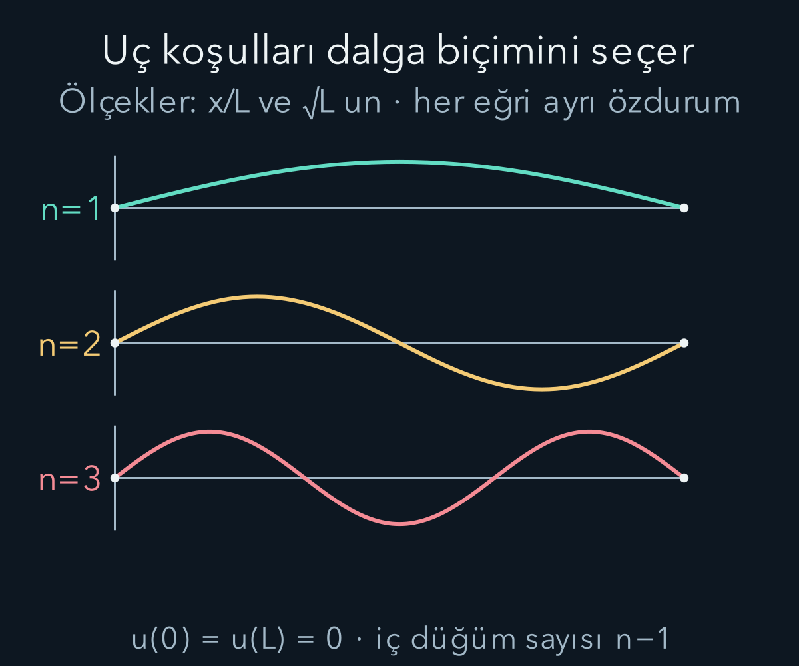
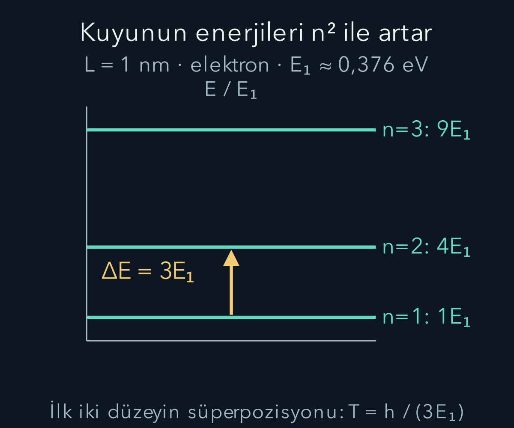

import ArticleVideo from '@/components/ArticleVideo.astro'
import kavram from './media/01-kavram.mp4?url'
import kavramPoster from './media/01-kavram.jpg?url'

Bir ipi iki ucundan sabitlediğimizde her dalga boyu duran dalga oluşturamaz. Uç koşulları belirli biçimleri seçer. Kuantumda bir parçacığı iki ideal duvar arasında sınırlamak da benzer bir matematiksel seçime yol açar. Ancak burada dalga fonksiyonu bir ipin yüksekliği değildir; ölçüm olasılıklarını veren kuantum durumudur. Sınırlar, izin verilen enerji değerlerini seçer.

[Schrödinger denklemi](/blog/schrodinger-denklemi-ve-olasilik-akimi/), [dalga fonksiyonunun normalleştirilmesi](/blog/dalga-fonksiyonu-konum-ve-momentum/) ve trigonometrik integraller bu yazının ön bilgileridir. Bir boyutta $0<x<L$ aralığını ele alacağız. $L>0$ kutunun uzunluğu, $m$ parçacık kütlesidir. Duvarları sonsuz yüksek ideal engellerle temsil edeceğiz; bu modelin gerçek maddi duvarlara yalnız belirli koşullarda yaklaşım olduğunu akılda tutacağız.

## 1. Modeli sınır koşullarıyla tanımlamak

Kutunun içinde potansiyel enerjiyi sıfır seçelim. Dışarıda sonsuz potansiyel yazımı, parçacığın dışarıda bulunma olasılığını sıfıra zorlayan ideal sınırın kısa anlatımıdır. Matematiksel olarak iç bölgede $H=-\hbar^2\partial_x^2/(2m)$ işleciyle ve $u(0)=u(L)=0$ uç koşullarıyla çalışırız. Bunlara Dirichlet sınır koşulları denir.

Sonsuz potansiyeli sıradan sonlu bir sayı gibi denklem içine koyup sonsuzla çarpma yapmayacağız. Fiziksel limitin sonucu olan uç koşullarını kullanacağız. Sonlu basamakta dalga fonksiyonu ve türevinin sürekliliğini tartışmıştık. Sonsuz duvar probleminde dalga fonksiyonu uçta sıfırdır; iç türevin dışarıdaki sıfır fonksiyonun türeviyle eşit olmasını ayrıca istemeyiz.

Bu ayrım önemlidir. Hem fonksiyonu hem türevini başlangıç ucunda sıfıra zorlarsak ikinci mertebe denklemde yalnız sıfır çözüm kalabilir. Normalleşebilir bir durum elde etmek için problemin gerçek sınır koşullarını doğru sayıda ve doğru yerde uygulamalıyız. Uçlar, parçacığın her an duvara çarptığı iki kesin konum değildir; durum fonksiyonunun izin verilen davranışını belirler.

## 2. Sıfır ve negatif enerji neden olmaz?

İç bölgede enerji özdeğer denklemi $-\hbar^2u''/(2m)=Eu$'dur. Önce $E=0$ durumunda $u''=0$ olur; genel çözüm $u=Ax+B$'dir. $u(0)=0$ koşulu $B=0$, $u(L)=0$ koşulu $AL=0$ verir. $L>0$ olduğu için $A=0$; yalnız sıfır fonksiyonu kalır ve bu normalleştirilemez.

Negatif enerji çözümünü kısaca yazmak için iki hiperbolik fonksiyon tanımlayalım: $\sinh z=(e^z-e^{-z})/2$ ve $\cosh z=(e^z+e^{-z})/2$. Bunlar üstel fonksiyonların farkı ve toplamıdır; $z>0$ için $e^z>e^{-z}$ olduğundan $\sinh z>0$ olur.

$E<0$ için $\kappa=\sqrt{-2mE}/\hbar>0$ tanımlayalım. Denklem $u''=\kappa^2u$ olur; çözüm $u=A\sinh(\kappa x)+B\cosh(\kappa x)$ şeklindedir. İlk uç $B=0$ yapar. İkinci uçta $A\sinh(\kappa L)=0$ gerekir. Pozitif $\kappa L$ için sinh sıfır olmadığından yine $A=0$ çıkar.

Aynı sonucu enerji formundan görebiliriz: normalize bir uygun durum için enerji ortalaması $\hbar^2/(2m)\int_0^L|u'|^2dx$'dir ve negatif olamaz. Sıfır olması türevin sıfır olmasını, dolayısıyla sabit fonksiyonu gerektirir; sıfır uç koşulları bu sabiti de sıfırlar. Kutudaki en düşük enerji bu nedenle kesin olarak pozitiftir.

## 3. Pozitif enerji için izin verilen dalga sayıları

$E>0$ için $k=\sqrt{2mE}/\hbar$ tanımlayalım. Denklem $u''+k^2u=0$ olur. Genel çözüm $u=A\sin(kx)+B\cos(kx)$'tir. $u(0)=0$ önce kosinüs terimini kaldırır; $B=0$ olur. Sonra $u(L)=A\sin(kL)=0$ koşulunu uygularız.

Sıfır olmayan çözüm istediğimiz için $A=0$ seçemeyiz. Sinüsün sıfırları $kL=n\pi$ verir. $k>0$ nedeniyle $n=1,2,3,\ldots$ alırız. Negatif $n$ değerleri aynı sinüs fonksiyonunu yalnız ortak eksi işaretiyle tekrar eder; yeni fiziksel enerji durumu üretmez. $n=0$ ise sıfır fonksiyonudur.

Böylece:

$$
k_n=\frac{n\pi}{L},\qquad
\boxed{E_n=\frac{n^2\pi^2\hbar^2}{2mL^2}
=\frac{n^2h^2}{8mL^2}.}
$$

Enerji kuantalanması burada bağımsız bir tam sayı buyruğu olarak eklenmedi. Diferansiyel denklemle iki uç koşulunun birlikte sağlanması, izin verilen $k$ ve dolayısıyla enerji dizisini seçti. Enerjiler $1,4,9,16,\ldots$ oranında büyür; ardışık enerji aralıkları eşit değildir.

## 4. Normalleştirme ve diklik

$u_n(x)=A_n\sin(n\pi x/L)$ olsun. Norm koşulu $|A_n|^2\int_0^L\sin^2(n\pi x/L)dx=1$ verir. $\sin^2\theta=(1-\cos2\theta)/2$ özdeşliğiyle integral $L/2$ olur; kosinüsün sınırdaki sinüs katkıları sıfırlanır. Ortak fazı sıfır seçersek:

$$
\boxed{u_n(x)=\sqrt{\frac2L}\sin\left(\frac{n\pi x}{L}\right),\quad 0<x<L.}
$$

$L^{-1/2}$ birimi önceki sürekli normalleşme kuralıyla uyumludur. Farklı $n$ ve $r$ değerlerinde sinüs çarpımını kosinüs farkına dönüştürerek $\int_0^Lu_nu_rdx=0$ buluruz. Her birinin normu birdir; fonksiyonlar ortonormaldir.

Uygun $L^2$ başlangıç durumları bu sinüs bazında açılabilir. Fakat yalnız bir fonksiyonun toplamını yazabilmekle o fonksiyonun enerji işleci tanım kümesinde bulunması aynı şey değildir. Enerjisi sonlu veya iki kez türevlenebilir durum gerektiğinde ek koşullar korunur. Bu yazının tekil enerji özfonksiyonları bütün ilgili işlemler için yeterince düzgündür.

## 5. Dalga fonksiyonu ile yoğunluğu ayırmak

$n=1$ fonksiyonu iç bölgede tek işaretlidir ve merkezde en büyüktür. $n=2$ fonksiyonu merkezde sıfırdan geçer ve işaret değiştirir. Yoğunluk ise her durumda $\rho_n=(2/L)\sin^2(n\pi x/L)$ olduğundan negatif değildir. Dalga fonksiyonunun negatif olması, negatif bulunma olasılığı anlamına gelmez.

$n$ durumunda kutu içinde $n-1$ düğüm vardır. Düğümde dalga fonksiyonu sıfırdır; yakınındaki küçük aralığın olasılığı da buna göre düşüktür. Tek noktanın olasılığı zaten sürekli modelde sıfır olduğu için, fiziksel olarak anlamlı karşılaştırma küçük ama sonlu aralıkların integralleridir.

Durağan durumun yoğunluğu zamanla değişmez. Bunu parçacığın klasik olarak aynı noktada hareketsiz durduğu şeklinde yorumlamayız. Enerjisi $E_n>0$'dır; konum ölçümleri bir dağılım verir. Model, ölçümler arasında her an hangi klasik yolu izlediğini ayrıca belirtmez. Bir grafiğin sabit kalmasıyla tek parçacığın kesin konumunun sabit olması farklı iddialardır.

## 6. Bir elektron için enerji ölçeği

Kutunun uzunluğu $L=1\ \mathrm{nm}=10^{-9}\ \mathrm m$ ve parçacık elektron olsun. $h\approx6{,}626\times10^{-34}\ \mathrm{J\,s}$, $m_e\approx9{,}11\times10^{-31}\ \mathrm{kg}$ değerleriyle temel enerji:

$$
E_1\approx\frac{(6{,}626\times10^{-34})^2}{8(9{,}11\times10^{-31})(10^{-9})^2}
\approx6{,}02\times10^{-20}\ \mathrm J
\approx0{,}376\ \mathrm{eV}.
$$

İkinci enerji $4E_1\approx1{,}504\ \mathrm{eV}$, üçüncü $9E_1\approx3{,}384\ \mathrm{eV}$ olur. İlk iki düzeyin farkı $3E_1\approx1{,}128\ \mathrm{eV}$'dur. $E_2$ ile farkı aynı sayı değildir; ölçülebilir geçiş enerjisinde başlangıç enerjisini çıkarmayı unutmamalıyız.

Uzunluğu iki kat artırırsak bütün enerjiler dörtte bire düşer. Kütleyi iki kat artırırsak yarıya düşer. Bu ölçek ilişkileri birim kontrolünden fazlasını verir: daha dar bir bölgeye sınırlama, daha yüksek uzaysal değişim ve daha yüksek kinetik enerji gerektirir. Gerçek bir yapıya uygularken duvar yüksekliğinin ilgili enerjilere göre çok büyük olup olmadığını ayrıca denetlemek gerekir.

## 7. Konum ortalaması ve ikinci moment

Yoğunluk kutu merkezine göre simetriktir; $x$ ile $L-x$ aynı yoğunluğa sahiptir. Bu nedenle $\langle x\rangle=L/2$ olur. Bütün $n$ durumlarında ortalama merkezdir; bu, merkezde ölçülme olasılığının her durumda yüksek olduğu anlamına gelmez. Örneğin $n=2$ için merkezin kendisi düğümdür.

İkinci momenti hesaplamak için sinüs karesini açalım:

$$
\langle x^2\rangle
=\frac1L\int_0^Lx^2\left[1-\cos\left(\frac{2n\pi x}{L}\right)\right]dx.
$$

İlk integral $L^2/3$ verir. İkinci integralde iki kez kısmi integrasyon yapılır; sinüs sınır terimleri sıfırlanır ve $\int_0^Lx^2\cos(2n\pi x/L)dx=L^3/(2n^2\pi^2)$ bulunur. Böylece $\langle x^2\rangle=L^2[1/3-1/(2n^2\pi^2)]$ olur.

İki kısmi integrasyonun nerede kullanıldığını görmek için $q=2n\pi/L$ ve $J=\int_0^Lx^2\cos(qx)\,dx$ diyelim. İlk adımda $x^2$ türevlenir, kosinüs integre edilir:

$$
J=\left[\frac{x^2\sin(qx)}q\right]_0^L
-\frac2q\int_0^Lx\sin(qx)\,dx.
$$

$qL=2n\pi$ olduğundan ilk sınır terimi sıfırdır. Kalan integralde bu kez $x$ türevlenir:

$$
\begin{aligned}
\int_0^Lx\sin(qx)\,dx
&=\left[-\frac{x\cos(qx)}q\right]_0^L\\
&\quad+\left[\frac{\sin(qx)}{q^2}\right]_0^L\\
&=-\frac Lq.
\end{aligned}
$$

Sonuç $J=(-2/q)(-L/q)=2L/q^2$ olur. $q^2=4n^2\pi^2/L^2$ yerine konunca $J=L^3/(2n^2\pi^2)$ bulunur. İkinci momentin önündeki $1/L$ ile çarpılınca katkının birimi $L^2$ olur. Böylece iki sınır değerlendirmesinde sinüsün sıfır, kosinüsün bir olmasını ayrı ayrı kullandık.

Varyans için ortalama karesi $L^2/4$ çıkarılır:

$$
(\Delta x)^2=L^2\left(\frac1{12}-\frac1{2n^2\pi^2}\right).
$$

Temel durumda $\Delta x\approx0{,}181L$'dir. $n$ büyüdükçe değer $L/\sqrt{12}$'ye yaklaşır; bu, düzgün konum dağılımının standart sapmasıdır. Yoğunluk nokta nokta düz bir çizgiye dönüşmez; hızlı salınımlar yeterince kaba konum çözünürlüğünde ortalanabilir.

## 8. Momentum hakkında dikkatli konuşmak

Gerçek $u_n$ için $\int_0^Lu_n(-i\hbar u_n')dx=-i\hbar[u_n^2]_0^L/2=0$ bulunur. Bu sıfır ortalama, momentumun her ölçümde sıfır olduğu anlamına gelmez. Kinetik enerji pozitif olduğuna göre momentum yayılımı vardır.

Ancak sonlu aralıkta önemli bir incelik bulunur: yalnız Dirichlet uç koşullarıyla $-i\hbar\partial_x$ ifadesini öz-eşlenik momentum gözlenebiliri diye tanımlamak yeterli değildir. Duvarlı kutunun Hamiltonyeni iyi tanımlı olabilirken momentum ölçümünün fiziksel düzenini ayrıca belirtmemiz gerekir. Kutuyu kaldırıp serbest uzayda momentum ölçmek, somut bir seçenektir.

Bu serbest bırakma düzeninde başlangıç fonksiyonunu dışarıda sıfırla genişletip Fourier dönüşümü alırız. Momentum ortalaması sıfır, ikinci momenti $\hbar^2\int|u_n'|^2dx=n^2\pi^2\hbar^2/L^2$ olur. Bu ikinci momenti türev normu biçiminde kullanmak, sıfırla genişletilmiş fonksiyonun ikinci türevindeki sınır inceliklerini gizlememeyi sağlar. Sonuç $\Delta p=n\pi\hbar/L$'dir.

Duran sinüsü iki üstele ayırmak, serbest bırakma momentum dağılımının yalnız iki keskin değerden oluştuğunu göstermez. Sonlu bölgedeki zarf Fourier dönüşümünü genişletir. Tam belirli momentum düzlem dalgası bütün doğru üzerinde normalleşmediği için bu ayrımı daha önce görmüştük.

## 9. Temel enerjinin sıfırdan büyük olması

Temel durumda $\Delta x\Delta p=\hbar\sqrt{\pi^2/12-1/2}\approx0{,}568\hbar$ olur. Bu değer $\hbar/2$'den büyüktür; Gauss paketi gibi alt sınırı eşitlemez. Sınırlar altında seçilen sinüs biçimi farklıdır. Belirsizlik ilişkisi bütün olası şekillerin aynı çarpıma sahip olduğunu söylemez.

Temel enerjiye bazen sıfır nokta enerjisi denir. Bu enerjiyi açıklamak için parçacığın duvarlar arasında minik klasik sıçramalar yaptığını varsaymamız gerekmiyor. Sıfır uç koşullarıyla normalize edilmiş sabit bir fonksiyon olamaz; fonksiyon uzayda değişmek zorundadır. Türev normundan gelen kinetik enerji bu nedenle sıfır olamaz.

Enerji sıfırını sonradan sabit bir miktarla kaydırmak mümkündür, fakat düzey farklarını ve temel durumun kinetik yayılımını ortadan kaldırmaz. ‘En düşük enerji sıfır seçilebilir’ ifadesiyle ‘parçacığın kinetik enerjisi ve momentum yayılımı yoktur’ ifadesini karıştırmamalıyız.

## 10. İki durağan durumdan hareketli yoğunluk

Başlangıç durumunu $(u_1+u_2)/\sqrt2$ seçelim. Ortonormallik nedeniyle normu birdir. Zamanla:

$$
\psi(x,t)=\frac{u_1(x)e^{-iE_1t/\hbar}+u_2(x)e^{-iE_2t/\hbar}}{\sqrt2}
$$

olur. Fonksiyonlar gerçek olduğundan yoğunluk:

$$
\rho(x,t)=\frac{u_1^2+u_2^2}{2}
+u_1u_2\cos\left(\frac{(E_2-E_1)t}{\hbar}\right).
$$

İlk iki katkı durağandır; üçüncü girişim katkısı zamanla değişir. Kutunun sol ve sağ tarafında $u_2$ işaret değiştirdiği için olasılık bir taraftan diğerine kayar. Toplam integralde $\int u_1u_2dx=0$ olduğundan norm yine birdir.

Yoğunluğun periyodu $T=2\pi\hbar/(E_2-E_1)=h/(3E_1)$ olur. Bir nanometrelik elektron kutusunda yaklaşık $3{,}67\times10^{-15}\ \mathrm s$ bulunur. Bu süre, her olayda parçacığın bir duvardan diğerine klasik geçiş süresi olarak yorumlanmaz; aynı hazırlıkların konum dağılımının tekrar süresidir.

<ArticleVideo src={kavram} poster={kavramPoster} title="Sonsuz kuyuda farklı özdurumlar" caption="n=1, 2 ve 3 özfonksiyonları karşılaştırılır. Her biri kuyunun uçlarında sıfırdır; sırayla gösterilmeleri bir durumun kendiliğinden diğerine geçtiği anlamına gelmez." />

## 11. Sol yarının olasılığını hesaplamak

Her tekil özdurumda simetriden sol yarının olasılığı $1/2$'dir. Süperpozisyonda ise girişim integralini ekleriz. $u_1u_2=(1/L)[\cos(\pi x/L)-\cos(3\pi x/L)]$ olduğundan sıfırdan $L/2$'ye integral $4/(3\pi)$ verir. Sonuç:

$$
P_{\mathrm{sol}}(t)=\frac12+\frac4{3\pi}
\cos\left(\frac{3E_1t}{\hbar}\right).
$$

Başlangıçta yaklaşık $0{,}924$, yarım periyotta yaklaşık $0{,}076$ bulunur. Her iki değer de sıfırla bir arasındadır. Yoğunluğu yalnız iki özdurum yoğunluğunun yarı yarıya toplamı saysaydık sürekli $1/2$ bulur ve girişimi tamamen kaçırırdık.

Bu değişim süreklilik denklemiyle de uyumludur. Duvarlarda akım sıfırdır; fakat kutunun iç orta noktasından olasılık akabilir. Sol yarının olasılık değişimi, merkezdeki akımın eksi işaretlisidir. Böylece sınırların bütün normu korumasıyla kutunun alt bölgelerindeki dağılımın değişmesi birlikte mümkündür.

## 12. Belirli bir konum aralığını saymak

Tek bir $n$ özdurumunda sol uçtan $b$ konumuna kadar bulunma olasılığını doğrudan integre edebiliriz. $0\le b\le L$ için $P(0\le x\le b)=b/L-\sin(2n\pi b/L)/(2n\pi)$ bulunur. İlk terim düzgün dağılımın vereceği uzunluk oranıdır; ikinci terim kuantum yoğunluğunun dalgalanmasını ekler. Uç kontrolleri doğrudur: $b=0$ için sıfır, $b=L$ için bir elde edilir.

Temel durumda $b=L/4$ seçersek $P=1/4-1/(2\pi)\approx0{,}091$ olur. Kutunun ilk çeyreği toplam uzunluğun yüzde yirmi beşi olduğu hâlde olasılığın yaklaşık yüzde dokuzunu taşır. Çünkü temel durum yoğunluğu duvarda sıfır olup merkeze doğru yükselir. Aynı nedenle orta yarıdaki olasılık $1/2+1/\pi\approx0{,}818$'dir. Bölgenin uzunluk oranını olasılıkla özdeşleştirmek, ancak yoğunluk düzgünse doğrudur.

İlk iki özdurumun eşit süperpozisyonunda enerji ölçümü ise her zaman $E_1$ ve $4E_1$ sonuçlarını yarı yarıya verir. Ortalama enerji $5E_1/2$, ikinci moment $17E_1^2/2$ ve varyans $9E_1^2/4$ olur. Standart sapma $3E_1/2$'dir. Konum olasılığı zamanla bir yandan diğerine kayarken bu enerji istatistiklerinin hiçbiri değişmez; kapalı sistemin sabit Hamiltonyen evrimiyle uyumludur.

Enerji dağılımıyla konum dağılımının farklı zaman davranışı, aynı durumun farklı ölçümlere farklı cevaplar vermesinin başka bir örneğidir. Tek bir eğriye bakıp sistemin bütün fiziksel bilgisi sabit veya değişken diye karar veremeyiz. Hangi gözlenebilirin hangi dağılımını incelediğimizi her adımda belirtmek, özellikle yoğunluk animasyonlarını doğru yorumlamak için gereklidir. Süperpozisyon yoğunluğundaki yer değiştirme, tek parçacığın izlenen klasik konumu olarak okunmamalıdır.

Duvarları yavaş veya hızlı değiştirmek de bu yazıdaki sabit kutu evriminden farklı bir işlemdir. Uzunluk zamanla değişirse Hamiltonyen ve sınırlar da değişir; enerji alışverişi olabilir. Yukarıdaki uzunlukla ters kare ölçeklemesi, farklı sabit kutuların enerji düzeylerini karşılaştırır. Tek bir kutuyu hareket ettirirken durumun nasıl uyarılacağını kendi başına belirlemez. Böyle bir süreç için değişen sınırların dinamiği ayrıca çözülmelidir.

## 13. Modelin gerçek sistemlerdeki yeri

Sonsuz duvar, fiziksel bir malzemenin sonsuz enerjiye sahip olduğu iddiası değildir. Duvar yüksekliği ilgili parçacık enerjilerine göre büyükse ve dışarıdaki küçük sızma etkisi önemsizse yararlı bir yaklaşım olabilir. Sonlu duvarlarda dalga fonksiyonu engel içine uzanır; enerji değerleri ve izin verilen bağlı durum sayısı değişir.

Daha dar kuyularda enerji büyüdüğü için göreli olmayan yaklaşımı da kontrol etmek gerekir. Yalnız uzunluğu küçültüp formülün her ölçekte aynı doğrulukla geçerli olduğunu söylemeyiz. Atomik yapılar, etkin kütle, etkileşimler ve üç boyutlu geometri gibi ek fizik içerebilir. Basit modelin gücü, bunları gizlemek değil, sınır koşulunun kuantalanmayı nasıl ürettiğini açıkça göstermesidir.

Bir sonraki adımda duvarı sonlu yapacağız. Enerjisi bir engelin yüksekliğinden küçük olan bir durumda dalga fonksiyonunun engel içine nasıl girdiğini ve sonlu engelin öte tarafında neden akım bulunabildiğini hesaplayacağız. Böylece tünellemeyi enerji korunumu bozuluyormuş gibi anlatmadan, aynı diferansiyel denklem ve akım diliyle inceleyebileceğiz.

## Kaynakça

Aşağıdaki açık kaynaklar 11 Ekim 2026 tarihinde yeniden doğrudan kontrol edildi. Metin, hesap örnekleri ve şekiller bu yazı için özgün olarak hazırlandı.

- [OpenStax — The Quantum Particle in a Box](https://openstax.org/books/university-physics-volume-3/pages/7-4-the-quantum-particle-in-a-box): Enerji özdurumları ve sonsuz kuyu modeli.
- [MIT OpenCourseWare — Quantum Physics II Lecture Notes](https://ocw.mit.edu/courses/8-05-quantum-physics-ii-fall-2013/pages/lecture-notes/): Sınır koşulları, işleçler ve bağlı durumlar.
