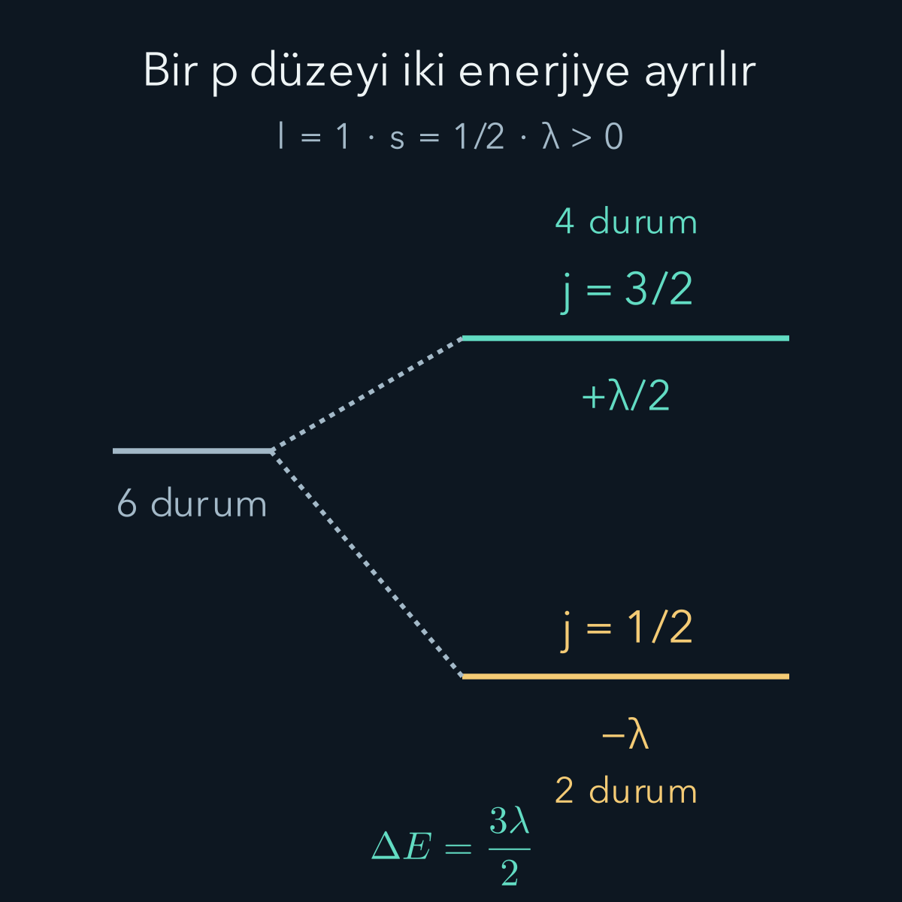
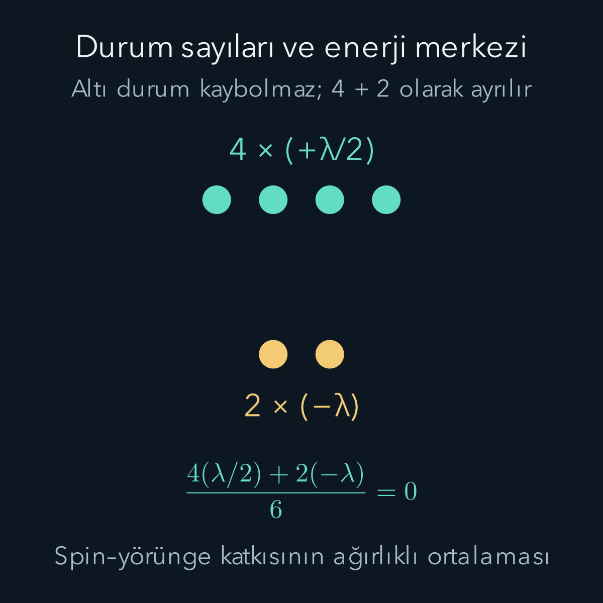

import ArticleVideo from '@/components/ArticleVideo.astro'
import kavram from './media/01-kavram.mp4?url'
import kavramPoster from './media/01-kavram.jpg?url'

Hidrojenin en basit enerji hesabında aynı baş kuantum sayısına sahip pek çok durum eşenerjiliydi. Daha hassas bir ölçümde tek bir düzeyin birbirine çok yakın parçalara ayrıldığını görürüz. Atomun üzerine ayrıca mıknatıs koymadan da bir ayrım olabilir. Bunun nedenlerinden biri, elektronun spin açısal momentumu ile uzaysal hareketinden doğan yörüngesel açısal momentumun etkileşmesidir.

[Hidrojen atomu](/blog/merkezi-potansiyel-ve-hidrojen-atomi/), [açısal momentumların toplanması](/blog/acisal-momentumlarin-toplanmasi/), [pertürbasyon teorisi](/blog/zamandan-bagimsiz-perturbasyon-teorisi/) ve [Zeeman etkisi](/blog/dejenerasyon-ve-zeeman-etkisi/) bu hesabın ön bilgileridir. Burada önce iki açısal momentumu ayıracak, sonra etkileşim Hamiltonyenini tanıtıp onun enerji düzeylerini hesaplayacağız. Kullanacağımız model, görelilikten gelen küçük bir düzeltmenin düşük enerjili biçimidir. Tam bir Dirac denklemi çözümü yapmayacağız; buna karşılık seçtiğimiz spin–yörünge katkısının hesabını sonuçlandıracağız.

## 1. İki açısal momentum aynı şey değildir

Yörüngesel açısal momentum $\mathbf L=\mathbf r\times\mathbf p$ olarak tanımlanır. $\mathbf r$ çekirdeğe göre konum operatörü, $\mathbf p$ momentum operatörüdür. Çapraz çarpım bileşenleri, örneğin $L_z=xp_y-yp_x$, uzaysal dalga fonksiyonuna etki eder. “Yörüngesel” sözcüğü elektronun küçük bir gezegen gibi önceden belirlenmiş çember çizdiği anlamına gelmez.

Spin açısal momentumu $\mathbf S$ ise elektronun içsel serbestlik derecesidir. Elektron için spin kuantum sayısı $s=1/2$'dir. Büyüklüklerin karelerinin özdeğerleri:

$$
\begin{aligned}
L^2&\longrightarrow\hbar^2l(l+1),\\
S^2&\longrightarrow\hbar^2s(s+1)
=\frac34\hbar^2.
\end{aligned}
$$

$\hbar$ indirgenmiş Planck sabiti, $l=0,1,2,\ldots$ yörüngesel kuantum sayısıdır. $l=0,1,2,3$ için kullanılan harfler sırasıyla s, p, d, f'dir. Buradaki küçük s harfiyle adlandırılan orbital ile spin kuantum sayısı $s$ farklı kavramlardır.

Uzaysal ve spin işlemleri farklı çarpanlara etki ettiğinden $[L_i,S_j]=0$ olur. Toplam açısal momentumu $\mathbf J=\mathbf L+\mathbf S$ diye tanımlarız. Enerji operatörü bu iki hareketi bağladığında ayrı ayrı $L_z$ ve $S_z$ yerine toplam $J^2$ ve $J_z$ etiketleri daha kullanışlı hale gelir.

## 2. Çekirdeğin elektrik alanından spin bağlantısına

Elektronun spinine bağlı manyetik momenti yaklaşık $\boldsymbol\mu_s=-e\mathbf S/m_e$'dir. Burada $e>0$ temel yükün büyüklüğü, $m_e$ elektron kütlesidir. Eksi işaret elektron yükünün negatif olmasından gelir. Bir manyetik momentin manyetik alandaki enerji katkısı $-\boldsymbol\mu_s\cdot\mathbf B$ biçimindedir.

Çekirdek laboratuvarda esas olarak elektrik alan üretir. Ancak elektrik ve manyetik alanlar gözlem çerçevesinden bağımsız ayrı kutular değildir. Hareketli elektronla ilişkilendirilen çerçevede elektrik alanın bir kısmı manyetik etki olarak görünür. Bu düşünce spin ile uzaysal hareketin neden bağlanabileceğini açıklar. Fakat yalnız bu basit alan dönüşümünü alıp katsayıyı tamamlanmış sayarsak iki kat büyük sonuç buluruz. İvmelenen çerçevenin dönüşüyle ilişkili **Thomas presesyonu** hesaba katıldığında gerekli $1/2$ çarpanı gelir.

Merkezî potansiyel enerjisi $V(r)$ için, düşük hızlı elektronun doğru etkin katkısını şu biçimde kullanacağız:

$$
H_{\mathrm{so}}=
\frac{1}{2m_e^2c^2r}\frac{dV}{dr}
\,\mathbf L\cdot\mathbf S.
$$

$r=|\mathbf r|$ çekirdeğe uzaklık, $c$ ışık hızı, alt “so” spin–orbit kısaltmasıdır. Bu formül Thomas çarpanını içerir. Elektronun küçük anomal manyetik moment düzeltmesini, çekirdeğin hareketini ve çekirdek spinini burada ihmal ediyoruz. Kökeni açıklamak için kullandığımız çerçeve resmi katsayının tam türetimi değildir; formül görelilikli kuramın düşük hız açılımından alınan başlangıç girdisidir.

Potansiyel enerjiyle elektrik potansiyelini de ayıralım. Elektrik potansiyeli volt, $V(r)$ ise joule birimindedir. Formülde kullanılan $dV/dr$, elektrik alanın kendisi değil potansiyel enerjinin türevidir. Birim denetiminde $\mathbf L\cdot\mathbf S$ açısal momentumun karesini taşır; öndeki katsayıyla çarpıldığında enerji elde edilir.

## 3. Radyal katsayıyı enerji ölçeğine dönüştürmek

Önce belirli bir $n,l$ hidrojen altuzayında birinci mertebe pertürbasyon hesabı yapalım. $n$ baş kuantum sayısıdır. Radyal fonksiyon henüz pertürbe edilmemiş hidrojen çözümüdür. Açısal operatörden ayrı olarak radyal beklentiyi alıp:

$$
\lambda_{nl}=\hbar^2
\left\langle
\frac{1}{2m_e^2c^2r}\frac{dV}{dr}
\right\rangle_{nl}
$$

tanımlayalım. $\lambda_{nl}$ enerji birimindedir. Belirli altuzayda indisleri kısaltıp $\lambda$ yazarsak etkin açısal Hamiltonyen:

$$
H_{\mathrm{so}}^{(nl)}
=\lambda\frac{\mathbf L\cdot\mathbf S}{\hbar^2}
$$

olur. Bu yeniden yazımda $\hbar^2$'yi özellikle ayırdık; böylece birazdan bulacağımız özdeğerleri doğrudan enerji ölçeği $\lambda$ ile çarpacağız. Kaynaklarda $\xi\mathbf L\cdot\mathbf S$ biçimi görülürse $\xi=\lambda/\hbar^2$ olduğunu kontrol etmek gerekir; iki katsayının birimi aynı değildir.

Düzeltmenin küçük olması, bu altuzayın diğer enerjilere göre güçlü biçimde karışmamasını sağlar. Ancak aynı enerjiye sahip durumların kendi arasındaki karışımı ihmal edemeyiz. Dejenere pertürbasyonun yaptığı iş, bu altuzayda $H_{\mathrm{so}}$'yu köşegenleştirmektir. Toplam açısal momentum bazı tam da bunu sağlayacak.

## 4. Nokta çarpımını toplamın karesinden bulmak

Toplamın karesini açalım:

$$
\begin{aligned}
J^2&=(\mathbf L+\mathbf S)^2\\
&=L^2+S^2+2\mathbf L\cdot\mathbf S.
\end{aligned}
$$

Dolayısıyla $\mathbf L\cdot\mathbf S=(J^2-L^2-S^2)/2$. Ortak özdurumları $|n,l,s;j,m_j\rangle$ ile gösterelim. $j$ toplam açısal momentum kuantum sayısı, $m_j$ toplamın seçtiğimiz $z$ eksenindeki izdüşüm etiketidir. $J^2$ özdeğeri $\hbar^2j(j+1)$, $J_z$ özdeğeri $\hbar m_j$ olur. Enerji kayması:

$$
\boxed{\Delta E_{nlj}
=\frac{\lambda_{nl}}2
\left[j(j+1)-l(l+1)-\frac34\right].}
$$

$\Delta E$ burada yalnız spin–yörünge katkısıdır. Formülde $m_j$ yoktur. Dış alan olmadığından hiçbir uzay yönü ayrıcalıklı değildir; aynı $j$ grubundaki $2j+1$ farklı izdüşüm aynı enerjiye sahiptir. Etkileşim bütün dejenerasyonu kaldırmaz.

Açısal momentum toplama kuralına göre $l\ge1$ için $j=l+1/2$ veya $j=l-1/2$ olabilir. İki dalı açıkça hesaplayalım. Üst dalda:

$$
\begin{aligned}
j(j+1)&=(l+\tfrac12)(l+\tfrac32)\\
&=l^2+2l+\tfrac34.
\end{aligned}
$$

Bundan $l(l+1)=l^2+l$ ve $3/4$ çıkarınca $l$ kalır. Alt dalda $(l-1/2)(l+1/2)=l^2-1/4$ olur; aynı çıkarma $-(l+1)$ verir. Sonuç:

$$
\begin{aligned}
\Delta E_+&=\frac{\lambda l}{2},\\
\Delta E_-&=-\frac{\lambda(l+1)}2,\\
\Delta E_+-\Delta E_-&=\frac{\lambda(2l+1)}2.
\end{aligned}
$$

$\lambda>0$ ise $j=l+1/2$ dalı üsttedir. İşaret farklı bir etkin modelde değişirse sıralama da değişebilir; yalnız “büyük $j$ her zaman büyük enerji” diye bağımsız bir kural yoktur.

## 5. Bir p düzeyindeki altı durumu saymak

$p$ durumu için $l=1$'dir. Etkileşimden önce üç $m_l$ değeri ve iki spin izdüşümü vardır: $(2l+1)(2s+1)=3\times2=6$ durum. Etkileşimle bunlar $j=3/2$ ve $j=1/2$ gruplarına ayrılır:

$$
\begin{array}{c|c|c}
j&\Delta E&2j+1\\\hline
3/2&+\lambda/2&4\\
1/2&-\lambda&2
\end{array}
$$

Dört artı iki yine altıdır. Durumları silmedik veya yeni durum üretmedik; farklı enerjiye sahip uygun birleşimler bulduk. İki grubun ayrımı $3\lambda/2$'dir.

Örneğin $\lambda=2\,\mathrm{meV}$ seçilmiş bir etkin modelde üst kayma $+1\,\mathrm{meV}$, alt kayma $-2\,\mathrm{meV}$, aradaki fark $3\,\mathrm{meV}$ olur. meV, elektronvoltun binde biridir. Bu sayılar hidrojenin gerçek katsayısı değildir; önce cebri görünür kılan bir örnektir. Hidrojen için $\lambda$'yı birazdan radyal integralden hesaplayacağız.

Durum sayılarıyla ağırlıklandırılmış ortalama kayma da iyi bir kontrol sağlar:

$$
\frac{4(\lambda/2)+2(-\lambda)}6=0.
$$

Bu sıfır, iki enerji çizgisinin aritmetik ortalaması değildir. Üst çizgi dört, alt çizgi iki farklı kuantum durumu temsil ettiği için ağırlıklar gereklidir. Aynı iz denetimi genel $l$ için de çalışır: $(2l+2)(\lambda l/2)+(2l)(-\lambda(l+1)/2)=0$.

## 6. Ürün bazında karışımı elle görmek

Toplam kuantum sayısını kullanmak hesabı çok kısalttı. Aynı sonucu küçük bir matrisle kontrol edelim. $l=1$ ve $m_j=1/2$ altuzayında iki ürün durumu vardır:

$$
|a\rangle=|m_l=0,\uparrow\rangle,
\qquad
|b\rangle=|m_l=1,\downarrow\rangle.
$$

Oklar $m_s=\pm1/2$ spin izdüşümünü gösterir. Her iki durum için $m_l+m_s=1/2$'dir. Nokta çarpımını merdiven operatörleriyle:

$$
\mathbf L\cdot\mathbf S
=L_zS_z+\tfrac12(L_+S_-+L_-S_+)
$$

yazabiliriz. $L_\pm=L_x\pm iL_y$ ve $S_\pm=S_x\pm iS_y$ izdüşümü bir basamak artırır veya azaltır. İlk terimin $a$ üzerindeki değeri sıfır, $b$ üzerindeki değeri $-\hbar^2/2$'dir. Ayrıca $L_+|l=1,m_l=0\rangle=\hbar\sqrt2|1,1\rangle$ ve $S_-|\uparrow\rangle=\hbar|\downarrow\rangle$. Öndeki yarım çarpanla köşegen dışı eleman $\hbar^2/\sqrt2$ olur.

Böylece $(a,b)$ bazında:

$$
\frac{H_{\mathrm{so}}}{\lambda}
=\begin{pmatrix}
0&1/\sqrt2\\
1/\sqrt2&-1/2
\end{pmatrix}.
$$

Boyutsuz özdeğeri $\varepsilon$ dersek determinant koşulu $\varepsilon^2+\varepsilon/2-1/2=0$ olur. Bu polinom $(\varepsilon-1/2)(\varepsilon+1)$ diye ayrılır. Bulduğumuz enerjiler yine $\lambda/2$ ve $-\lambda$'dır.

Üst dalın normalize özvektörü $\sqrt{2/3}|a\rangle+\sqrt{1/3}|b\rangle$, alt dalınki $\sqrt{1/3}|a\rangle-\sqrt{2/3}|b\rangle$ seçilebilir. Katsayıların kareleri her vektörde bire toplanır ve iki vektörün iç çarpımı sıfırdır. Bu, etkileşimin “spin yukarıysa şu enerji” şeklinde okunamayacağını gösterir: doğru enerji durumları spin ile yörünge izdüşümlerinin belirli birleşimleridir.

## 7. Hidrojenin radyal integralini tamamlamak

Sonsuz ağır, noktasal çekirdek yaklaşımında hidrojen için $V(r)=-k/r$ yazalım; $k=e^2/(4\pi\epsilon_0)$, $\epsilon_0$ boşluğun elektriksel geçirgenliğidir. Türev $dV/dr=k/r^2$ olduğundan:

$$
\lambda_{nl}=\frac{k\hbar^2}{2m_e^2c^2}
\langle r^{-3}\rangle_{nl}.
$$

$2p$ durumunda normalize radyal fonksiyon:

$$
R_{21}(r)=\frac{1}{2\sqrt6\,a_0^{3/2}}
\frac{r}{a_0}e^{-r/(2a_0)}
$$

olur; $a_0$ Bohr yarıçapıdır. Radyal hacim elemanı $r^2dr$ olduğu için beklentiye ayrıca bu çarpanı koymalıyız:

$$
\begin{aligned}
\langle r^{-3}\rangle_{21}
&=\int_0^\infty |R_{21}(r)|^2r^{-3}r^2\,dr\\
&=\frac{1}{24a_0^5}
\int_0^\infty r e^{-r/a_0}\,dr\\
&=\frac{1}{24a_0^3}.
\end{aligned}
$$

Son satırda $u=r/a_0$ dönüşümü yaptık: integral $a_0^2\int_0^\infty u e^{-u}du=a_0^2$ olur. Boyutun ters uzunluğun küpü çıkması beklenen denetimdir.

$\alpha=k/(\hbar c)$ ince yapı sabiti ve $a_0=\hbar/(m_ec\alpha)$ olduğundan katsayı:

$$
\lambda_{21}=\frac{m_ec^2\alpha^4}{48}
$$

şekline sadeleşir. $m_ec^2\approx511000\,\mathrm{eV}$ ve $\alpha\approx1/137{,}036$ kullanırsak $\lambda_{21}\approx30{,}2\,\mu\mathrm{eV}$ buluruz. $\mu\mathrm{eV}$ elektronvoltun milyonda biridir. Böylece $2p_{3/2}$ için yaklaşık $+15{,}1\,\mu\mathrm{eV}$, $2p_{1/2}$ için $-30{,}2\,\mu\mathrm{eV}$ ve aralarındaki spin–yörünge ayrımı $45{,}3\,\mu\mathrm{eV}$ çıkar. Alt indisler $j$ değeridir.

Bu küçük enerjiyi kaba hidrojen düzeyiyle karşılaştıralım: $E_2\approx-3{,}4\,\mathrm{eV}$. Ayrımın bu büyüklüğe oranı yaklaşık $1{,}33\times10^{-5}$'tir. Pertürbasyon fikrinin neden işe yaradığını görüyoruz; buna rağmen hassas bir tayf ölçümü küçük farkı ayırt edebilir.

Bir enerji diyagramı ile bir tayf çizgisini de ayırmalıyız. Diyagram atomun olası enerji sonuçlarını gösterir; tayf ise iki durum arasındaki geçişte verilen veya alınan enerji farkını gösterir. Aynı alt düzeye bağlanan iki üst p dalı varsa iki geçişin enerjileri arasındaki fark bu üst dalların ayrımıdır. Fakat bir dalın spin–yörünge kaymasını doğrudan ışığın toplam enerjisi sayamayız. Örneğin $2p$ ile $1s$ arasındaki kaba fark elektronvolt ölçeğindedir; hesapladığımız mikroelektronvolt ayrım bu büyük farkın üzerinde küçük bir değişikliktir. Ayrıca iki durum arasında enerji farkı bulunması, seçilen dış etkinin onları mutlaka bağlayacağı anlamına gelmez. Geçişi belirleyen matris elemanı ayrı olarak hesaplanmalıdır; bu yazıda yalnız atomun enerji özdurumlarını bulduk.

## 8. S orbitalleri ve ince yapının diğer parçaları

$l=0$ için $\mathbf L$ o açısal altuzayda sıfırdır. Dolayısıyla bu modelde spin–yörünge katkısı yoktur; yalnız $j=1/2$ vardır. $l\ge1$ için yazılabilen genel $\langle r^{-3}\rangle$ formülüne $l=0$ koyup sonsuz bir sayı ile sıfırı çarpmaya çalışmak doğru değildir. Önce operatörün hangi altuzayda ne yaptığını belirlemeliyiz.

Spin–yörünge etkileşimi **ince yapının tamamı değildir**. Aynı düşük hız mertebesinde göreli kinetik enerji düzeltmesi de vardır:

$$
H_{\mathrm{kin}}=-\frac{p^4}{8m_e^3c^2}.
$$

Bu terim, göreli enerji $\sqrt{m_e^2c^4+p^2c^2}$ ifadesinin küçük $p/(m_ec)$ için açılmasından gelir. Spin yönüne bağlı bir manyetik etkileşim değildir; klasik kinetik enerjinin yaklaşık biçiminin düzeltilmesidir.

Ayrıca Darwin katkısı denen bir terim vardır. Düşük enerjili etkin Hamiltonyende potansiyelin uzaysal ikinci türevlerinin toplamıyla, yani Laplasyeniyle orantılıdır: $H_D=\hbar^2\nabla^2V/(8m_e^2c^2)$. Coulomb potansiyelinde bu katkı çekirdeğin bulunduğu noktada yoğunlaşır ve özellikle s durumlarında önemlidir. Burada noktasal dağılım hesabını veya Dirac kuramındaki kökenini türetmiyoruz. Verdiğimiz ayrım, s durumunda spin–yörünge sıfır diye bütün göreli düzeltmelerin sıfır olmayacağını açıklamak içindir.

$2p$ altuzayında göreli kinetik düzeltme iki $j$ dalına eşit katkı yapar ve Darwin katkısı bu yaklaşımda sıfırdır. Dolayısıyla bu iki p dalının aralarındaki birinci mertebe ince yapı farkını spin–yörünge hesabı verir. Fakat yazdığımız $+15{,}1$ ve $-30{,}2$ değerleri, tam ince yapı enerji kaymaları diye sunulamaz: ortak kinetik kayma henüz eklenmedi. Çekirdek spiniyle bağlaşan aşırı ince yapı ve kuantum elektrodinamik düzeltmeleri de ayrı fizik içerir.

<ArticleVideo src={kavram} poster={kavramPoster} title="Bir p düzeyinin spin-yörünge ayrılması" caption="Altı durum, dört durumlu j=3/2 ve iki durumlu j=1/2 gruplarına ayrılır. Enerji katkıları +λ/2 ve −λ, aralarındaki fark 3λ/2 olur. Hareket eden çizgiler Hamiltonyenin ayrımını gösteren bir şemadır; elektronun uzaydaki yörüngesi değildir." />

## 9. Zeeman hesabının önündeki enerji ölçeği

Dış manyetik alan eklendiğinde Zeeman enerjisi ile atomun iç spin–yörünge ayrımını karşılaştırırız. Zeeman etkisi çok küçükse önce bu yazıdaki $j,m_j$ durumlarını bulmak, sonra alanın onlara yaptığı düzeltmeyi hesaplamak uygundur. Dış alan iç ayrımla yarışacak kadar büyürse bu basit sıralama değişir; spin ve yörünge izdüşümlerinin ayrı ayrı iyi etiket olduğu başka bir yaklaşım gerekebilir.

Dolayısıyla önceki Zeeman tartışmasındaki “alan, iç enerji ayrımına göre zayıf” koşulunun somut bir kaynağını artık hesaplayabiliyoruz. Yeni bilgi yalnız bir enerji formülü değil, hangi bazı hangi fiziksel ölçekte seçmek gerektiğidir. Radyal hareket bağlaşımın büyüklüğünü belirledi, açısal momentum cebri olası enerji kaymalarını ve durum sayılarını verdi.

## Kaynaklar ve kapsam

Etkin spin–yörünge Hamiltonyenindeki Thomas çarpanı ve açısal özdeğer yapısı için [Richard Fitzpatrick, Fine Structure of Hydrogen](https://farside.ph.utexas.edu/teaching/qmech/lectures/node107.html); kinetik, spin–yörünge ve Darwin katkılarının ayrımı için [David Tong, Atoms, bölüm 7.1](https://www.damtp.cam.ac.uk/user/tong/aqm/aqmseven.pdf) kullanıldı. Matris örneği, radyal integral, birim dönüşümleri ve sayısal değerler ayrıca denetlendi. Kapsamımız tek elektronlu atomun birinci mertebe etkin spin–yörünge hesabıdır.
