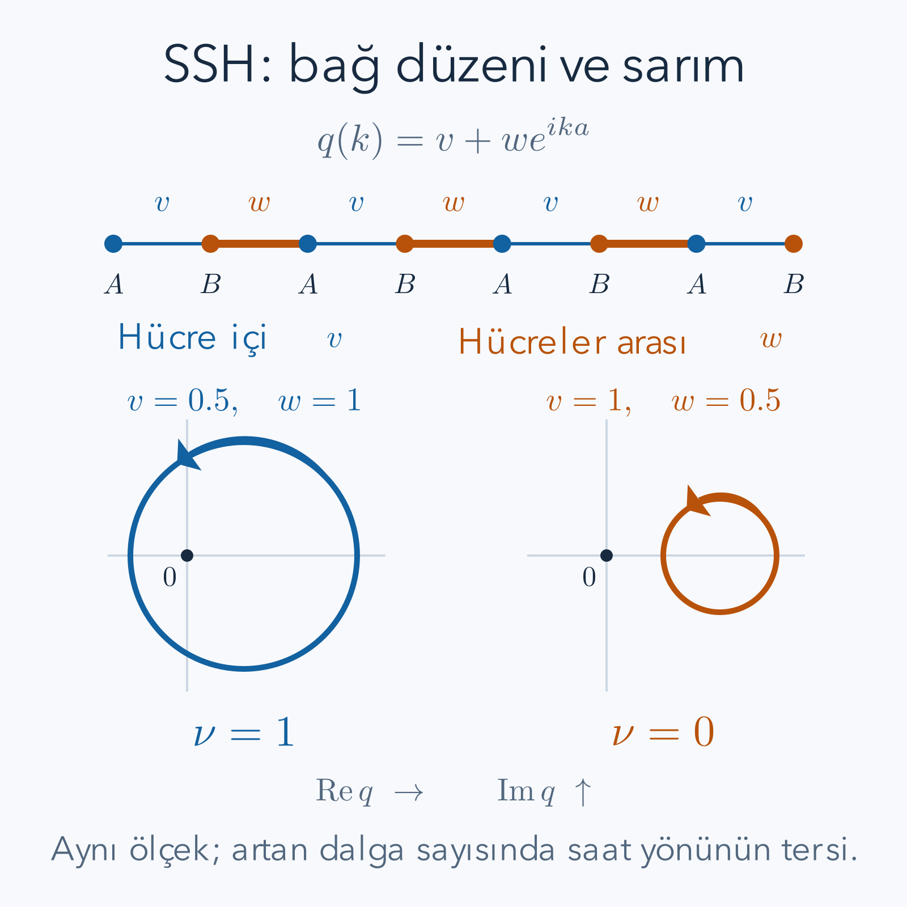

Bir zincirde güçlü ve zayıf bağlar sırayla dizilsin. Zincirin ortasında hangi atomun nerede olduğundan çok bağların tekrar etmesi önemlidir. Peki zinciri kestiğimizde ne olur? Bazen uçta, iç bölgenin enerji aralığında yerleşmiş bir kuantum durumu kalır. Aynı iki bağ şiddeti yer değiştirdiğinde ise bu durum kaybolabilir. SSH modeli, iç bölgenin bant yapısıyla fiziksel sınırdaki durumlar arasındaki ilişkiyi küçük matrislerle inceleyebildiğimiz bir örnektir.

Ön bilgilerimiz [kristaller ve enerji bantları](/blog/kristaller-ve-enerji-bantlari/), [özdeğerler ve köşegenleştirme](/blog/ozdegerler-ozvektorler-ve-kosegenlestirme/) ve [Berry fazı ve topolojik bantlar](/blog/berry-fazi-ve-topolojik-bantlar/). Düzlemde bir eğrinin bir noktayı kaç kez dolandığının matematiği için [topoloji ve sarım sayısı](/blog/topoloji-ve-sarim-sayisi/) kullanılabilir. Yine de burada sarımın hangi eğriye ait olduğunu ve zincirde neye karşılık geldiğini sıfırdan belirleyeceğiz.

## 1. Modelin fiziksel varsayımları

SSH adı Su, Schrieffer ve Heeger'in modelinden gelir. Her hücrede $A$ ve $B$ adını verdiğimiz iki yerel durum olsun. Bunlar iki atomun birer orbitali gibi düşünülebilir. Hücreyi $n$ tamsayısıyla, hücreler arası tekrar uzunluğunu $a$ ile göstereceğiz. $a$ bir uzunluktur; hücre içindeki iki orbital arasındaki uzaklığın da $a$ olması gerekmez.

Bir parçacığın komşu orbitaller arasında geçişini tutan sıkı bağ yaklaşımını kullanıyoruz. Orbitallerin birbirinden çok bağımsız yerel durumlar oluşturabildiği, uzak komşu geçişlerin daha küçük olduğu varsayılır. Elektronlar arası etkileşimleri ve spini bu ilk modelde dışarıda bırakıyoruz. Böylece çok elektronlu bir yalıtkanı tartışırken, tek parçacık bantlarının nasıl doldurulduğunu ayrıca belirtmek gerekir.

Hücre içindeki $A_n$ ile $B_n$ arasındaki gerçek geçiş enerjisi $v$, $B_n$ ile $A_{n+1}$ arasındaki enerji $w$ olsun. Bu yazıda ikisi de pozitiftir. Baz vektörlerini $|n,A\rangle$ ve $|n,B\rangle$ yazıyoruz; farklı etiketlerin iç çarpımı sıfır, aynı etiketin normu birdir. Ortak yerel enerji sıfır alınır ve iki alt örgüye farklı yerel potansiyel konulmaz. Bu son koşul koruyucu simetrinin temelidir.

## 2. Hamiltonyeni gerçek uzayda yazmak

$N$ hücreli açık zincirin Hamiltonyeni

$$
\begin{aligned}
H={}&v\sum_{n=1}^{N}
\left(|n,A\rangle\langle n,B|+|n,B\rangle\langle n,A|\right)\\
&+w\sum_{n=1}^{N-1}
\left(|n+1,A\rangle\langle n,B|+|n,B\rangle\langle n+1,A|\right)
\end{aligned}
$$

olur. İlk satır hücre içini, ikinci satır hücreler arasını bağlar. Her geçişin ters yönlü eşleniği de yazıldığı için $H$ Hermittir. $w$ toplamının $N-1$'de bitmesi, son hücreden sonra yeni bir orbital bulunmadığını açıkça belirtir. Periyodik zincirde ayrıca son $B$ ilk $A$'ya bağlanır.

Genel durumu

$$
|\psi\rangle=\sum_n(A_n|n,A\rangle+B_n|n,B\rangle)
$$

biçiminde yazalım. Burada büyük harfli $A_n,B_n$ karmaşık olasılık genlikleridir; alt örgü adlarıyla aynı harfi kullanıyoruz ama bunlar sayıdır. $H|\psi\rangle=E|\psi\rangle$ denkleminde her orbitalin katsayısını eşitlemek

$$
EA_n=vB_n+wB_{n-1},
\qquad
EB_n=vA_n+wA_{n+1}
$$

verir. Sol uçta $B_0=0$, sağ uçta $A_{N+1}=0$ konur. Örneğin $A_n$'ya $B_n$ üzerinden $v$, önceki hücrenin $B_{n-1}$'inden $w$ geçişi gelir. Bu indis takibi, birazdan Fourier üstelinin işaretini belirleyecek.

## 3. Fourier konvansiyonunu sabitleyelim

Önce periyodik büyük zincirin iç bölgesini ele alalım. Hücre koordinatı $x_n=na$ ve izinli dalga sayıları $k=2\pi j/(Na)$ olsun. Genlikleri

$$
A_n=\frac1{\sqrt N}\sum_k e^{ikna}A_k,
\qquad
B_n=\frac1{\sqrt N}\sum_k e^{ikna}B_k
$$

ile tanımlıyoruz. Hücre içi orbital konumlarının ek fazlarını bu konvansiyona dahil etmiyoruz. Bu açık seçim, farklı kaynaklarda görülebilecek işaret ve baz farklarını açıklamak için gereklidir.

İlk genlik denkleminde $B_{n-1}$ yerine Fourier açılımını koyarsak

$$
B_{n-1}=\frac1{\sqrt N}\sum_k e^{ikna}e^{-ika}B_k
$$

olur. İkinci denklemdeki $A_{n+1}$ ise $e^{ika}$ çarpanı getirir. Her $k$ için bağımsız iki bileşenli denklem

$$
H(k)\begin{pmatrix}A_k\\B_k\end{pmatrix}
=E\begin{pmatrix}A_k\\B_k\end{pmatrix},
\qquad
H(k)=\begin{pmatrix}
0&v+we^{-ika}\\
v+we^{ika}&0
\end{pmatrix}
$$

çıkar. Alt sol eleman üst sağın karmaşık eşleniğidir. Bu kontrol Hermitliğin Fourier dönüşümünde kaybolmadığını gösterir. $k$'nın birimi ters uzunluk, $ka$ boyutsuz açıdır.

## 4. İki bant ve enerji aralığı

Üst sağ elemana $h(k)=v+we^{-ika}$ diyelim. Karakteristik determinant

$$
\begin{aligned}
\det[H(k)-EI]&=(-E)(-E)-h(k)h(k)^*\\
&=E^2-|h(k)|^2
\end{aligned}
$$

olduğundan enerjiler

$$
E_\pm(k)=\pm\sqrt{v^2+w^2+2vw\cos(ka)}
$$

olur. Karekökün içini bulmak için $(v+we^{-ika})(v+we^{ika})$ çarpımını açtık; iki çapraz terim $2vw\cos(ka)$ verdi. Gerçek pozitif bağlarda en küçük mutlak enerji $ka=\pi$'de $|v-w|$'dir. İki bant arasındaki tam aralık

$$
E_{\rm gap}=2|v-w|
$$

çıkar. En büyük mutlak enerji $ka=0$'da $v+w$'dir.

Spinsiz, etkileşimsiz ve yarı dolu zincirde hücre başına bir elektron varsa alt bant dolu, üst bant boştur. Kimyasal potansiyel sıfır civarında bu aralığın içindeyse iç bölge yalıtkandır. “Bantta aralık var” derken doluluk ve Fermi enerjisi koşulunu da bu nedenle ekliyoruz. Aralığın kapanması $v=w$ durumunda gerçekleşir; bu noktada izole dolu bant üzerinden tanımlayacağımız topolojik sınıflama kesintiye uğrar.

## 5. Örnek 1: Aynı spektrum iki farklı bağ düzeni

Önce $v=0.5\,\mathrm{eV}$, $w=1\,\mathrm{eV}$ alalım. $ka=0$ için mutlak enerji $1.5\,\mathrm{eV}$, $ka=\pi$ için $0.5\,\mathrm{eV}$ olur. Orta noktada $ka=\pi/2$ ve kosinüs sıfırdır:

$$
E_\pm=\pm\sqrt{0.5^2+1^2}\,\mathrm{eV}
=\pm\sqrt{1.25}\,\mathrm{eV}
\approx\pm1.118034\,\mathrm{eV}.
$$

Tam bant aralığı bir elektronvolttur. Şimdi bağları değiştirip $v=1$, $w=0.5$ yaparsak enerji formülündeki $v^2+w^2$ ve $vw$ değişmez. Her $k$ noktasında aynı iki enerji bulunur. Dolayısıyla yalnız enerji grafiği iki düzeni ayırt etmeye yetmez.

Fark özvektörlerin faz yapısındadır. Birazdan göreceğimiz çember birinci durumda orijini içine alır, ikinci durumda almaz. Açık zincir aynı uçtan sonlandırıldığında bu fark sınır durumlarında görünür. Bu örnek, bir topolojik ayrımı yalnız “bir malzemenin aralığı büyük, öbürünün küçük” cümlesiyle anlatamayacağımızı gösterir. İki düzenin aynı enerji aralığına sahip olması topolojik olarak aynı olmalarını gerektirmez.

## 6. Pauli vektörü ve orijini saran çember

Pauli matrislerini $\sigma_x=\left(\begin{smallmatrix}0&1\\1&0\end{smallmatrix}\right)$ ve $\sigma_y=\left(\begin{smallmatrix}0&-i\\i&0\end{smallmatrix}\right)$ alalım. $d_x\sigma_x+d_y\sigma_y$ matrisinin üst sağ elemanı $d_x-id_y$'dir. Bizim Hamiltonyenimizle karşılaştırınca

$$
\mathbf d(k)=\big(v+w\cos(ka),\ w\sin(ka),\ 0\big)
$$

buluruz. $d_z=0$ olduğu için vektör bir düzlemde kalır. Bu vektörün düzlemdeki karmaşık karşılığı

$$
q(k)=d_x+id_y=v+we^{ika}=h(k)^*
$$

olsun. $q$ ile üst sağ elemanı aynı diye adlandırmadık; biri diğerinin eşleniğidir. Böylece sarımın işaretini hangi nesne için söylediğimiz belirli kalır.

$k$ bir Brillouin bölgesini artan yönde dolaştığında $q(k)$, merkezi gerçek eksende $v$, yarıçapı $w$ olan çemberi saat yönünün tersinde izler. $w>v$ ise orijin içeridedir ve sarım bir; $v>w$ ise dışarıdadır ve sarım sıfırdır. $v=w$'de eğri orijinden geçer; hem $q$ sıfır olur hem enerji aralığı kapanır. Sıfırdan geçen bir eğri için fazı sürekli tanımlayamadığımızdan sarım sayısı o noktada tanımsızdır.

*Her iki çemberin enerjileri uygun bağ değişimi altında aynı olabilir. Ayırt edici bilgi, seçili hücre ve alt örgü konvansiyonunda özvektörün dolaşımıdır. Uçtaki kesim de bu konvansiyonla birlikte belirtilir.*

## 7. Sarım sayısından özvektör fazına

Aralık açıkken $q(k)=|q(k)|e^{i\varphi(k)}$ yazabiliriz. Buradaki $\varphi$ açısı, tur boyunca artıp $2\pi$ farkla bitebilir. Alt bandın normalize özvektörü

$$
|u_-(k)\rangle=\frac1{\sqrt2}\begin{pmatrix}-e^{-i\varphi(k)}\\1\end{pmatrix}
$$

seçilebilir. Matrisle çarpınca üst bileşen $|q|e^{-i\varphi}/\sqrt2$, alt bileşen $-|q|/\sqrt2$ olur; bunlar $-|q|u_-$'nin bileşenleridir. Norm da iki adet $1/2$ toplamından birdir.

Berry bağlantısı bu konvansiyonda

$$
\begin{aligned}
i\langle u_-|\partial_k u_-\rangle
&=\frac i2(-e^{i\varphi})(i e^{-i\varphi}\partial_k\varphi)\\
&=\frac12\partial_k\varphi
\end{aligned}
$$

çıkar. Brillouin bölgesi integrali $\gamma=\pi\nu$ verir; burada

$$
\nu=\frac1{2\pi}\int_{-\pi/a}^{\pi/a}\partial_k\varphi\,dk
$$

sarım sayısıdır. Berry fazını $2\pi$ modunda karşılaştırırız; tek başına her gerçek değer ölçülebilir mutlak faz değildir. Bir boyutlu sarım ile iki boyutlu Chern sayısını da aynı integral saymıyoruz. Burada kapalı bir eğrinin bir noktayı dolaşması var; Chern hesabında iki boyutlu parametre yüzeyindeki eğrilik yer alır.

Sarım, düzgün deformasyonda eğri orijini kesmedikçe değişmez. Fakat bu geometrik cümlenin fiziksel karşılığı, $d$ vektörünün aynı düzlemde kalmasını sağlayan simetrinin korunmasıdır. Vektörü düzlemin dışına çıkaran yeni terimler eklersek çember resmi tek başına aynı koruma iddiasını sürdüremez.

## 8. Açık zincirde sıfır enerjili çözümü aramak

Şimdi zinciri sol uçta $A_1$ ile başlatalım ve sağa sonsuza uzatalım. $E=0$ ve bütün $B_n=0$ olan bir durum deneyelim. İlk genlik denklemi otomatik sıfır olur. İkinci denklem

$$
0=vA_n+wA_{n+1}
$$

verir. $w$ sıfır olmadığından bölüp

$$
A_{n+1}=-\frac vwA_n,
\qquad
A_n=A_1\left(-\frac vw\right)^{n-1}
$$

buluruz. Son formül ardışık yerine koymalarla gelir: $A_2=-(v/w)A_1$, $A_3=(v/w)^2A_1$ ve devamı. Eksi işareti komşu dolu $A$ genliklerinin fazlarının $\pi$ farklı olduğunu söyler; negatif olasılık anlamına gelmez.

$r=v/w$ dersek norm koşulu

$$
1=|A_1|^2\sum_{j=0}^{\infty}r^{2j}
=\frac{|A_1|^2}{1-r^2}
$$

olur. Geometrik seri yalnız $r<1$ için yakınsar. Dolayısıyla $A_1=\sqrt{1-r^2}$ gerçek pozitif seçilebilir. $v>w$ durumunda genlik büyür ve bu sol uç çözümü normalize edilemez. Sonucun yönü, hangi orbitalin solda bırakıldığına bağlıdır; başka sonlandırma için hesabı yeniden kurmak gerekir.

## 9. Örnek 2: Uç durumunun olasılıklarını gerçekten toplayalım

$v/w=1/2$ için $A_1=\sqrt3/2$ ve

$$
A_n=\frac{\sqrt3}{2}\left(-\frac12\right)^{n-1},
\qquad
p_n=|A_n|^2=\frac34\left(\frac14\right)^{n-1}
$$

olur. İlk dört hücredeki olasılıklar sırasıyla $0.75$, $0.1875$, $0.046875$, $0.01171875$'tir. Toplamları $0.99609375$ çıkar. Geri kalan bütün kuyruğun olasılığı $1/256=0.00390625$'tir. Bu kuyruk ihmal edildiğinde ilk dört sayının tam bire eşit olmasını beklemeyiz.

Kontrolü doğrudan Schrödinger denkleminde de yapabiliriz. $n=1$ için $vA_1+wA_2=(0.5)(\sqrt3/2)+1(-\sqrt3/4)=0$ olur. $n=2$ için $0.5(-\sqrt3/4)+1(\sqrt3/8)=0$ elde edilir. Bu iptaller, bütün $B$ orbitallerinde sıfır genliğin neden korunabildiğini açıklar: komşu iki $A$ katkısı birbirini yok eder.

Ortalama hücre konumunu da hesaplayalım. $j=n-1$ ve $x=r^2$ için geometrik serinin türevi $\sum_{j\geq0}jx^j=x/(1-x)^2$ verir. Dağılımın katsayısı $1-x$ olduğundan $\langle n-1\rangle=x/(1-x)=1/3$ çıkar. Başlangıç hücresine göre ortalama uzaklık $a/3$'tür. Bu sayı sönüm uzunluğuyla aynı tanım değildir; dağılımın ilk momentidir.

## 10. Örnek 3: Sönüm uzunluğu ve topolojik olmayan düzen

Genlik zarfını $|A_n|=|A_1|e^{-(n-1)a/\xi}$ biçiminde yazalım. $r^{n-1}=e^{(n-1)\ln r}$ ile karşılaştırırsak

$$
\xi=\frac a{\ln(w/v)}
$$

buluruz. Bu genliğin sönüm uzunluğudur; olasılık $e^{-2x/\xi}$ gibi azaldığı için olasılık zarfının e-kat uzunluğu $\xi/2$'dir. $r=1/2$ ve $a=0.4\,\mathrm{nm}$ için $\ln2\approx0.693147$ ve $\xi\approx0.577078\,\mathrm{nm}$ olur. Bir hücre ilerlediğimizde genlik yarıya, olasılık dörtte bire iner; üstel tanımı bunu doğrular.

$v$ ile $w$ eşitliğe yaklaşırken logaritma sıfıra yaklaşır ve $\xi$ büyür. Aralığın kapanmasına yakın uç durumu iç bölgeye yayılır. Tam eşitlikte seri normlanmaz; sonsuz zincirde ayrı, yerelleşmiş sol uç durumu kalmaz. Bu, sarım değişiminin gerçekleştiği kritik noktayla tutarlıdır.

Karşılaştırma için $v=1$, $w=0.5$ alırsak aynı bağıntı $A_n=A_1(-2)^{n-1}$ verir. İlk terim sıfır değilse norm sınırsız büyür. $A_1=0$ seçilirse bütün durum sıfır vektörüdür ve fiziksel durum sayılmaz. Böylece bu sonlandırmada topolojik olmayan düzende normalize edilebilir sıfır enerjili sol uç çözümü bulunmadığını yalnız bir resme dayanarak değil, norm denetimiyle göstermiş olduk.

## 11. Sonlu zincirde neden tam sıfır beklemeyiz?

$N$ hücreli sonlu zincirde sol uç adayı sağ sınır koşulunu tam sağlayamaz. $B_n=0$ çözümünde son denklem $0=vA_N$ ister; $v$ pozitifken ve $A_N$ küçük ama sıfır değilken bu koşul sağlanmaz. Sol adayın $H$ altında kalan tek artığı son $B_N$ bileşeninde $vA_N$'dir. Böylece sonsuz zincir çözümünü kesmenin hatası somut olarak görülür.

Sağ uçta benzer şekilde $B$ alt örgüsüne yerleşen bir aday vardır. İki uç dalga fonksiyonunun örtüşmesi, yaklaşık iki durumlu alt uzayda küçük bir $\varepsilon$ bağlaşımı oluşturur. Köşegen enerjiler sıfırken etkin matrisin özdeğerleri $\pm|\varepsilon|$ olur. Uçlar uzaklaştıkça bağlaşım genellikle $r^N$ ölçeğinde küçülür ama genel sonlu zincirde tam sıfır değildir. $v=0$ limitinde iki uç gerçekten ayrılır; o zaman sıfır özdeğerleri tamdır.

Örneğin $r=1/2$ için sonlu kesilmiş sol adayın normalizasyonu $C_N=\sqrt{(1-r^2)/(1-r^{2N})}$'dir. $N=8$ ve $v=0.5\,\mathrm{eV}$ ile artık normu $vC_Nr^{N-1}\approx0.003383\,\mathrm{eV}$ bulunur. Bu sayı gerçek iki özenerjiyi hesaplamanın yerine geçmez; adayın tam özdurum olmadığını ölçer. Küçük artık ile tam sıfır arasındaki ayrımı korumalıyız.

## 12. Kiral simetri neyi korur?

$\Gamma$ operatörü bütün $A$ genliklerini değiştirmesin, bütün $B$ genliklerinin işaretini çevirsin. İki bileşenli gösterimde $\Gamma=\sigma_z$ ve $\Gamma^2=I$'dır. Hamiltonyen yalnız $A$ ile $B$ arasında geçiş içerdiğinden

$$
\Gamma H\Gamma=-H
$$

olur. Buna kiral veya alt örgü simetrisi diyoruz; burada parçacığın uzayda sağa dönmesi anlamında kullanılmıyor. Eğer $H|\psi\rangle=E|\psi\rangle$ ise $H\Gamma|\psi\rangle=-E\Gamma|\psi\rangle$ çıkar. Enerjiler sıfır etrafında eşlenir. İzole bir sınırdaki tek sıfır modunu eşlenecek başka mod olmadan sıfırdan uzaklaştırmak bu simetri altında mümkün değildir.

Bağların düzensiz değişmesi öteleme simetrisini bozabilir; bu yüzden tek bir $k$ ile bant çizmek artık uygun olmayabilir. Yine de yalnız karşı alt örgüler arasında geçiş tutuluyorsa kiral simetri kalır. Uç yinelemesi yerel oranlarla $A_{n+1}=-(v_n/w_n)A_n$ biçimine dönüşür. Yerelleşme, bu oranların çarpımının büyük uzaklıkta sönmesine bağlıdır. “Her bozukluk zararsızdır” demek yerine hangi simetrinin ve iç bölge aralığının korunduğunu sorarız.

$A$ ve $B$ için zıt yerel enerjiler ekleyen $m\sigma_z$ terimi ise kiral simetriyi bozar; çünkü $\Gamma(m\sigma_z)\Gamma=m\sigma_z$ olur. Uç enerjisi sıfırdan kayabilir. Düzlem dışındaki $d_z$ bileşeni, iki sarım resmini aralığı kapatmadan bağlayan deformasyonlara izin verebilir. Koruma, modelin izin verdiği dönüşümlerin sınıfına bağlıdır.

## 13. Hücre seçimi, fiziksel kesim ve yorum

Zincirin birim hücresini bir orbital kaydırarak yeniden tanımlarsak hangi bağa hücre içi dediğimiz değişebilir. Hesaplanan sarım da bu baz seçimine bağlı olarak kayabilir. Bundan fiziksel bir belirsizlik çıkmaz: gerçek açık zincirin hangi bağı kestiğini ve dışarıdaki vakumla nasıl eşleştiğini de birlikte belirtmeliyiz. Etiketleri değiştirirken fiziksel uç aynı bırakılırsa sınırdaki ek orbital bilgisi hesapta görünmelidir.

Güçlü hücreler arası bağları kesen, $A_1$ ve $B_N$ orbitallerini uçta bırakan sonlandırmada $w>v$ düzeni uç durumlarını taşır. Başka kesimle güçlü ikilileri bütün bırakmak farklı sınır problemi oluşturur. Bu nedenle topolojik iç bölge bilgisi, sınır koşulları bilinmeden her yüzeyde aynı mikroskobik dalga fonksiyonunu vermez. İç bölge ile sınır ilişkisi bir çift taraflı karşılaştırmadır.

Bu modelin sınırı da fiziksel sonucudur: bir boyutta uç, başlı başına uzun bir iletken tel değildir. Uçta yerelleşmiş durum bulmak tek başına iki uç arasında büyük akım veya kusursuz iletkenlik kanıtlamaz. Yine de küçük bir zincirde açıkça hesapladığımız olgu önemlidir: enerji özdeğerleri aynı görünse bile özvektörlerin sürekli yapısı ve korunmuş simetri, sınırda farklı durumlar gerektirebilir.

## 14. Dört orbitalde tam sonlu zincir hesabı

Sonsuz zincirin uç çözümünün sonlu zincirde neden yalnız yaklaşık kaldığını küçük bir matriste tamamen görebiliriz. İki hücre, yani dört orbital seçelim. Baz sırası $A_1,B_1,A_2,B_2$ olsun. Açık zincirin matrisi

$$
H=\begin{pmatrix}
0&v&0&0\\
v&0&w&0\\
0&w&0&v\\
0&0&v&0
\end{pmatrix}
$$

olur. Sol ve sağın yansıma simetrisi sayesinde genlikleri $B_2=sA_1$ ve $A_2=sB_1$, $s=\pm1$ seçebiliriz. Bu seçim uçlarla iç orbitalleri keyfî eşitlemek değildir; yansımanın artı ve eksi özuzaylarını ayrı çözmektir. İlk denklem $EA_1=vB_1$, ikincisi $EB_1=vA_1+s wB_1$ verir. Birinci denklemle $B_1$ yerine $EA_1/v$ koyarsak

$$
E^2-s w E-v^2=0
$$

çıkar. Burada $v$ pozitif olduğu için bölme geçerlidir. İkinci derece denklemin kökleri $E=(s w\pm\sqrt{w^2+4v^2})/2$'dir. İki $s$ değeri birlikte dört enerjiyi verir. Hiçbirini sayısal köşegenleştirme programına bırakmadan çözdük.

Önceki parametrelerde $\sqrt{w^2+4v^2}=\sqrt2$ elektronvolttur. Büyük enerji çifti yaklaşık artı ve eksi $1.207107$ elektronvolt, küçük çift yaklaşık artı ve eksi $0.207107$ elektronvolt olur. Küçük çift sıfır değildir. Zincir sadece iki hücre uzunluğunda olduğu için uçlar güçlü biçimde birbirini görür. Bu değerleri sonsuz zincirin bir elektronvoltluk iç bölge aralığıyla karşılaştırırken küçük örnekte ayrı bir sürekli bant bulunmadığını da hatırlarız; yalnız dört ayrık seviye vardır.

Küçük pozitif enerji için $s=-1$ kolunu alalım. İlk denklemden $B_1/A_1=E/v\approx0.414214$ olur. Yansımadan $A_2=-B_1$ ve $B_2=-A_1$ çıkar. Normalize olasılıkların uçlarda daha büyük olduğunu bu vektörde doğrudan görürüz; fakat aynı özdurum iki ucu birden kapsar. Tek başına sol uçta hazırlanmış bir durum, küçük enerji çiftinin süperpozisyonu olur ve zamanla sağ uçla salınım yapabilir. Sonlu örnekte “sol uç özdurumu” ifadesinin yaklaşık oluşu yalnız enerji konusunda değil, uzaysal yerleşim konusunda da önemlidir.

## 15. Bağ değişimi aralığı nasıl kapatır?

Topolojik ve topolojik olmayan parametreleri bağlayan açık bir yol seçelim: $v(s)=0.5+0.5s$, $w(s)=1-0.5s$, burada $s$ sıfır ile bir arasındadır. Bağların toplamı sabit kalır; fakat farkları $v-w=s-0.5$ olur. $s=0.5$'te bağlar eşittir ve $ka=\pi$ noktasında enerji aralığı kapanır. Çemberin yarıçapı ile merkez uzaklığı da aynı anda eşitlenir; geometrik eğri orijine değmeden sarımını değiştiremez.

Şimdi bu yolu düzlemin dışına çıkaran yerel enerji farkına izin verelim. Yola $m(s)\sigma_z$ eklenirse enerji karesi önceki mutlak değer karesine $m(s)^2$ eklenerek bulunur. Örneğin $m(s)=m_*\sin(\pi s)$ seçilebilir; başlangıç ve bitişte sıfır, ortada sıfır olmayan bir katsayıdır. Bağların eşit olduğu anda bile enerji aralığı $2|m_*|$ olur. Başlangıç ve bitiş Hamiltonyenlerini aralık kapatmadan bağlamış olduk ama yol boyunca kiral simetriyi bozduk.

Bu hesap bir çelişki değildir. Topolojik ayrımın korunacağı iddiasında hangi simetrileri zorunlu tuttuğumuzu belirtmemiz gerekir. İzin verilen bütün Hamiltonyenler genişletilirse önce ayrı olan iki bölge aynı bağlantılı kümeye girebilir. Simetriyi yalnız son noktalarda kontrol edip aradaki deformasyonda unutmamak önemlidir. Sıfır enerjinin korunması ile bağlı bir durumun bir süre daha var olması da ayrı iddialardır; simetri bozulduktan sonra sınır durumu kayarak yaşamaya devam edebilir ama artık aynı sıfır enerji korumasına sahip değildir.

## 16. Uçta yerel potansiyelin birinci etkisi

Sol uçtaki ilk $A$ orbitaline küçük bir $U$ enerjisi ekleyelim. Bozuntu $V=U|1,A\rangle\langle1,A|$ olur. İzole yarı sonsuz uç modunda birinci mertebe enerji kayması beklenen değerdir:

$$
\delta E=\langle\psi|V|\psi\rangle
=U|A_1|^2=U(1-r^2).
$$

Önceki $r=1/2$ değeri için küçük bir $0.02$ elektronvoltluk yerel potansiyel yaklaşık $0.015$ elektronvoltluk enerji kayması verir. Bu bir tam sonuç değil, bozuntu yeterince küçükken geçerli ilk mertebe sonucudur; durumun kendisinin değişimi daha yüksek mertebelerde hesaba girer. $U$ enerjisinin iç bölge ayrımına göre küçük olması ve başka yakın durumlarla güçlü karışım olmaması gerekir.

Bozuntu aynı alt örgüde köşegen olduğundan kiral antikomütasyon koşulunu korumaz. Dolayısıyla sıfırdan kayma, önceki koruma açıklamasının başarısızlığı değil onun koşulunun değiştirilmesidir. Buna karşılık yalnız ilk bağı biraz değiştiren bir bozuntu karşı alt örgüleri bağlar. İzole tek uç modunun enerjisini sıfıra göre eşlemek zorunda kalan simetri bu durumda sürer; dalga fonksiyonunun ilk ağırlığı ve sönüm profili değişebilir.

Bu karşılaştırma deneysel bir yorumu da netleştirir. Uçtaki yoğunluğun güçlü görünmesi, enerjinin kesin sıfırda olmasını gerektirmez. Tünelleme ölçümünde aralık içinde bir tepe bulunması da tek başına koruyucu simetriyi kanıtlamaz. Modelin hangi terimlerinin mevcut olduğunu ve uçların birbirinden ne kadar uzak olduğunu bilmek gerekir. Küçük SSH zinciri, topoloji sözcüğünü bütün bozuklukları önleyen bir etiket olarak kullanmak yerine her iddiayı belirli bir norm, simetri ve sınır hesabına bağlamayı öğretir.

## 17. Bir parçacık olasılığı ile elektron yoğunluğunu ayırmak

Uç çözümünde bulduğumuz ilk hücredeki yüzde yetmiş beş olasılık, tek bir normalize orbitalin ağırlığıdır. Bu sayı bir malzemenin ilk atomunda mutlaka elektron yükünün yüzde yetmiş beşinin bulunduğu anlamına gelmez. Çok elektronlu temel durumda bütün dolu tek parçacık durumlarının yoğunlukları toplanır. İç bölge bantlarının uçta bıraktığı katkılar da vardır. Ayrıca bir uç orbitalinin boş veya dolu olması kimyasal potansiyel, toplam parçacık sayısı ve çevreyle alışveriş koşullarına bağlıdır.

Bu ayrımı hesap olarak da ifade edebiliriz. Normalize tek parçacık özdurumlarını bir indisle sıralayalım. Her durumun yerel olasılık ağırlığı ve doluluk sayısı biliniyorsa toplam yerel sayı yoğunluğu, bu ağırlıkların dolulukla çarpılıp toplanmasıdır. Boş orbital katkı vermez; dolu orbital kendi normlanmış dağılımını verir. Spin dahil edilirse her orbital için iki ayrı spin durumunun hangi koşullarda dolu olduğu da eklenir. Burada spini dışarıda bıraktığımız için gizlice iki kat doluluk kullanamayız.

Benzer şekilde sıfır enerjili bir uç modunun varlığı onun tek başına serbestçe zincirin bir ucundan ötekine koştuğunu söylemez. Yarı sonsuz örnekte dalga fonksiyonu tek uca bağlıdır. Karşı uçtan akım ölçmek için kontakların bağlaşımı, zincirin uzunluğu ve ilgili enerjide iletim genliği gerekir. Tek parçacık spektrumu bu taşınım hesabının önemli girdisidir fakat tamamı değildir. Bu nedenle aynı modelde “uçta yerelleşmiş durum” sonucunu güvenle kullanırken “kusursuz uçtan uca iletim” sonucunu ayrıca türetmeden eklemiyoruz.

## 18. Kaynaklar ve kapsam

[Asbóth, Oroszlány ve Pályi, A Short Course on Topological Insulators](https://arxiv.org/pdf/1509.02295), birinci bölümde SSH Hamiltonyeni, sarım ve uç çözümleri için doğrudan ders kaynağıdır. [Topology in Condensed Matter, Haldane modeli ve Berry eğriliği](https://topocondmat.org/w4-haldane/haldane-model/) iki alt örgülü Bloch matrislerinin daha yüksek boyuttaki kullanımını açıklar. Burada SSH'ye ait Fourier dönüşümü, özvektör, norm ve artık hesabı açıkça yapıldı; iki boyutlu Chern sınıflaması bu bir boyutlu sarımın yerine konulmadı.
