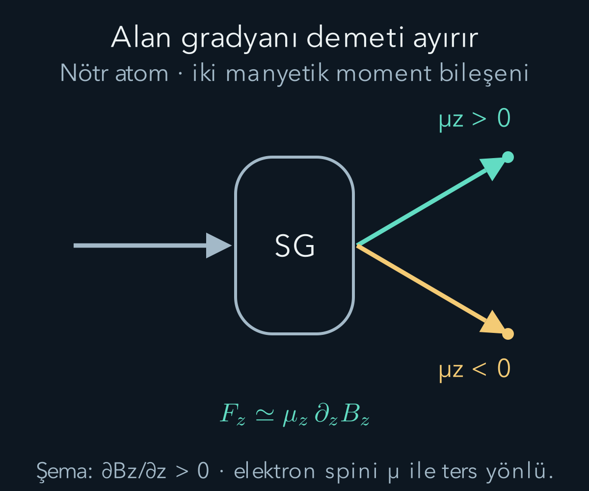
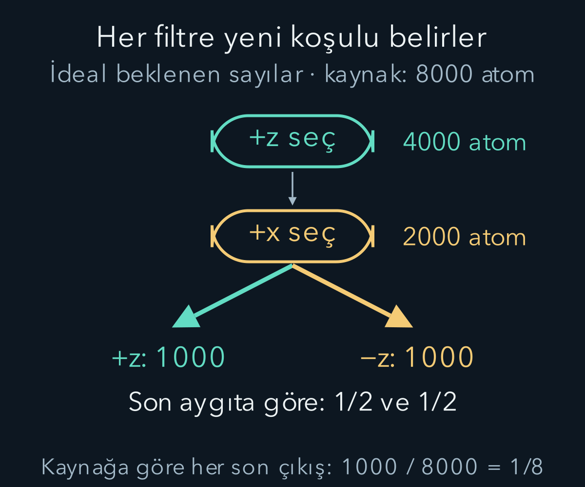

import ArticleVideo from '@/components/ArticleVideo.astro'
import kavram from './media/01-kavram.mp4?url'
import kavramPoster from './media/01-kavram.jpg?url'

Bir parçacık demetini bir aygıta gönderiyoruz. Aygıtın yönünü değiştirebiliyoruz, fakat belirli koşullarda çıkışta hep iki ayrı demet görüyoruz. İlk aygıttan yalnız bir çıkışı seçip aynı yöndeki ikinci aygıta gönderdiğimizde tek çıkış oluşuyor. İkinci aygıtı dik yöne çevirince iki çıkış yeniden ortaya çıkıyor. Kuantum durumunu anlamak için bu küçük deney ailesi, atomun bütün ayrıntılarını çözmeye çalışmaktan daha sade bir başlangıç sağlar.

[Madde dalgaları](/blog/atom-tayflari-ve-madde-dalgalari/) yazısında tek tek kaydedilen parçacıklarla çok tekrarın dağılımını ayırdık. Burada [manyetik alan](/blog/manyetizma-ve-elektromanyetik-induksiyon/), [açısal momentum](/blog/donme-tork-ve-acisal-momentum/) ve [koşullu olasılık](/blog/olasilik-sayma-ve-kosullu-bilgi/) bilgisini kullanacağız. Henüz kuantum durumunun bütün matematiğini kurmadık. Önce ölçüm düzenini, hazırlamayı ve sonuçları açıkça tanımlayacağız; olasılıkları hesaplayan genel kuralı sonraki adımda geliştireceğiz.

## 1. Yüksüz atom neden manyetik alandan etkilenir?

Bir cismin toplam elektrik yükünün sıfır olması, manyetik etkileşiminin de sıfır olmasını gerektirmez. İç yapısındaki yükler ve açısal momentum özellikleri bir **manyetik dipol momenti** oluşturabilir. Bu vektörü $\boldsymbol\mu$ ile gösteririz. Manyetik alan $\mathbf B$ içindeki etkileşim enerjisi, uygun dipol yaklaşımında $U=-\boldsymbol\mu\cdot\mathbf B$ olur.

Alan her yerde aynıysa dipol üzerinde yönünü değiştiren bir tork olabilir. Buna karşılık dipolü bir taraftan diğerine ayıran net öteleme kuvveti için alanın konumla değişmesi gerekir. Enerjinin konuma göre değişiminden $\mathbf F=-\nabla U=\nabla(\boldsymbol\mu\cdot\mathbf B)$ bulunur; momentin izlenen durum için sabit alınabildiği basit durumda bu ifade yeterlidir.

Demet yolu çevresinde alanın baskın doğrultusunu $z$ seçersek ayırıcı kuvvet yaklaşık $F_z=\mu_z\,\partial B_z/\partial z$ biçimindedir. $\mu_z$ momentin bu doğrultudaki bileşeni; $\partial B_z/\partial z$ ise alanın konumla değişim hızıdır. Bu yerel bir yaklaşık anlatımdır. Gerçek mıknatıs alanı üç boyutludur; her yerde yalnız $z$ bileşeni olup yalnız $z$ yönünde değişen keyfî bir alan, Maxwell denklemlerini koşulsuz sağlayamaz.

## 2. Stern–Gerlach aygıtının işi

Stern–Gerlach deneyinde dar bir atom demeti, düzgün olmayan manyetik alan bölgesinden geçirilir. Kaynak, daraltıcı yarıklar, mıknatıs ve kayıt yüzeyi düzenin temel parçalarıdır. Yarıklar demetin başlangıç yönünü daraltır; mıknatıs farklı manyetik moment bileşenlerini farklı yönlere saptırır; ekran konum kayıtlarını gösterir.

Tarihsel deneyde gümüş atomları kullanıldı. Gümüş atomunun ilgili düşük enerjili elektronik durumunda kapalı iç kabukların katkıları büyük ölçüde birbirini götürür ve eşleşmemiş dış elektronun spini iki ana demetlik yapının açıklanmasında belirleyici olur. Çekirdek spinini ve ince deney ayrıntılarını çözmeyen ideal model, etkin bir spin yarım sistemi gibi ele alınabilir. ‘Her atom her durumda ikiye ayrılır’ diye genel bir kural yoktur; hazırlanan toplam açısal momentum yapısına göre daha fazla demet oluşabilir.

Bu düzen nötr atomlarla çalıştığı için yalnız $q\mathbf v\times\mathbf B$ Lorentz kuvvetini yazıp $q=0$ diyerek etkiyi yok sayamayız. Buradaki ayrılma dipol momentinin alan gradyanıyla etkileşiminden gelir. Serbest elektron demeti kullanılsaydı net yükün Lorentz kuvveti de harekete katılır ve düzenin yorumu daha karmaşık olurdu.

## 3. İki çıkış hangi niceliğin iki değeridir?

Elektronun **spini**, içsel açısal momentumudur. Seçilmiş $z$ doğrultusundaki spin ölçümünün iki sonucu:

$$
S_z=+\frac\hbar2\quad\text{veya}\quad S_z=-\frac\hbar2
$$

olur. $\hbar=h/(2\pi)$ açısal momentum birimine sahiptir. Buradaki yarım, parçacığın uzayda yarım tur dönmesini anlatmaz; spin kuantum sayısının değeridir. ‘Spin yukarı’ ve ‘spin aşağı’ sözleri, seçilen ölçüm eksenine göre sonuç etiketleridir. Evrensel olarak uzaya yazılmış iki mutlak yön değildir.

Elektronun manyetik momenti ile spini aynı yönde değildir. Yaklaşık ilişki $\boldsymbol\mu=-g(e/2m_e)\mathbf S$ biçimindedir; $e$ pozitif temel yük büyüklüğü, $m_e$ elektron kütlesi, $g$ boyutsuz ve yaklaşık iki olan katsayıdır. Eksi işareti elektron yükünden gelir. Bu yüzden ekrandaki fiziksel ‘üst iz’ ile $S_z=+\hbar/2$ sonucunu, mıknatısın alan yönünü ve gradyan işaretini belirtmeden özdeşleştirmemeliyiz.

Aşağıdaki ideal aygıtlarda çıkışları geometrik üst-alt yerlerinden bağımsız olarak, kalibre edilmiş $+z$ ve $-z$ etiketleriyle adlandıracağız. Böylece mıknatısın polaritesi değişse bile hangi spin sonucunu kastettiğimiz açık kalır. Matematiksel sonuç etiketini gerçek detektör konumundan ayırmak, deney şemalarını doğru okumanın küçük ama gerekli adımıdır.

## 4. Spin dönen küçük bir top değildir

Klasik bir topun açısal momentumu, kütlesinin uzayda dönmesinden doğar. Elektron spinini bu resmin aynısı saymak doğru değildir. Spin, kuantum durumunun uzaydaki dönüşümlere verdiği tepki ve ölçülen açısal momentum sonuçlarıyla tanımlanan içsel özelliktir. Bir elektronun yüzeyinde boyalı bir noktanın dönmesini gözlüyor değiliz.

Ayrıca $z$ yönünde kesin $+\hbar/2$ sonucu elde etmek, klasik bir okun bütün bileşenlerinin aynı anda kesin olduğunu göstermez. Kuantum spin yarım sisteminde toplam spin karesi $S^2=s(s+1)\hbar^2=3\hbar^2/4$ değerindedir; burada $s=1/2$'dir. Bunun karekökü $\sqrt3\hbar/2$, tek eksendeki ölçüm büyüklüğü ise $\hbar/2$ olur. Şimdilik bu sonucu bir özellik olarak kaydediyoruz; işleç cebiri kurulduğunda nedenini açıklayacağız.

Bu farklılık, üç kesin klasik bileşenin karelerini toplayıp bir ok çizebileceğimizi varsaymamamız gerektiğini hatırlatır. Günlük dilde yön resmi kullanmak bazen yararlı olabilir; fakat o resim, her eksende ölçülmemiş bir sonucun önceden belirli olduğunu kendiliğinden kanıtlamaz.

## 5. Bir çıkışı seçmek bir hazırlamadır

İlk aygıtı $z$ doğrultusunda kuralım. Giriş demeti bu eksene göre kutuplanmamışsa ideal model iki çıkışa eşit olasılık verir. $-z$ çıkışını kapatıp yalnız $+z$ çıkışını geçirelim. Artık yeni demet, ilk demetin gelişigüzel yarısı değildir; seçilmiş bir ölçüm sonucuna göre **hazırlanmış** demettir.

Bu demeti aynı doğrultudaki ikinci ideal aygıta, arada spini değiştiren bir etkileşim olmadan gönderdiğimizde bütün parçacıklar $+z$ çıkışına gider. Buradaki ‘bütün’ ideal teorik olasılığın bir olduğunu söyler. Gerçek aygıt kayıpları, yanlış etiketleme ve dış alan etkileri bu idealden sapma doğurabilir. Deneyle karşılaştırırken bu etkileri ayrıca ölçeriz.

Tekrarlanabilirlik, hazırlama işleminin anlamını kurar. İlk aygıtta bir kayıt alıp hemen aynı niceliği yeniden ölçtüğümüzde aynı sonucun çıkması, ideal keskin ölçüm modelinin parçasıdır. Fakat bu özellik, araya başka yönde bir ölçüm koyduğumuzda da aynı sonucun korunacağını söylemez. Şimdi tam bu koşulu değiştireceğiz.

## 6. Dik yöndeki ikinci aygıt

$+z$ hazırlanmış demeti bu kez $x$ doğrultusunda çalışan aygıta gönderelim. İdeal spin yarım modeli $+x$ ve $-x$ sonuçlarına ayrı ayrı $1/2$ olasılık verir. Burada parçacığın spinini uzayda klasik bir oku döndürür gibi anlatmak yerine, hazırlama ve ölçüm eksenlerini açıkça ayırmak daha güvenlidir.

$+x$ çıkışını seçer ve onu üçüncü bir $z$ aygıtına gönderirsek, yeniden $+z$ ve $-z$ sonuçları eşit olasılıkla çıkar. İlk $+z$ hazırlığı, aradaki seçici $x$ ölçümünden sonra son $z$ sonucunu kesinleştirmez. İkinci aygıt sadece mevcut bir etiketi okuyup nesneyi her bakımdan aynı bırakmış olsaydı bu düzeni açıklayamazdık.

Buradan bütün olası gizli değişken kuramlarının çürütüldüğü sonucu çıkmaz. Yalnızca ‘her parçacığın değişmeden duran hazır $z$ ve $x$ etiketleri var; aygıt bunları pasifçe okuyor’ biçimindeki basit modelin yetersiz olduğunu görüyoruz. Kuantum ölçümünün hangi daha geniş klasik varsayımlarla çatıştığını ayrı bir deney ve ayrı bir mantıkla incelemek gerekir.

<ArticleVideo src={kavram} poster={kavramPoster} title="Stern–Gerlach aygıtının iki çıkışı" caption="Kutuplanmamış ideal demette z bileşeninin iki ayrık sonucu eşit olasılıkla oluşur. Gösterilen yollar düzenek şemasıdır; spinin klasik bir dönme yörüngesi değildir." />

## 7. Demet sayısını koşullu olasılıkla izlemek

Başlangıçta 8000 atomdan oluşan ideal kutuplanmamış bir topluluk düşünelim. Bu sayılar kesin olay sayısı garantileri değil, modelin verdiği beklenen sayılardır. İlk $+z$ filtresi ortalama yarısını geçirir: $8000\times1/2=4000$. Bu seçilmiş 4000 atom için ikinci $+x$ filtresinden geçiş olasılığı $1/2$ olduğundan beklenen sayı 2000 olur.

Üçüncü $z$ aygıtında $+z$ çıkışını sayarsak bunun koşullu olasılığı yine $1/2$'dir. Başlangıç topluluğunun beklenen $8000\times(1/2)^3=1000$ atomu bu son çıkışa ulaşır. Son $-z$ çıkışına da ortalama 1000 atom gider. Kalan atomlar başka çıkışlarda elenmiştir; olasılık kaybolmamıştır.

Son aygıta girenler içindeki $+z$ oranı $1000/2000=1/2$ iken ilk kaynaktan çıkanlar içindeki oran $1000/8000=1/8$'dir. İkisi farklı koşullara göre tanımlanır. ‘Geçiş olasılığı yüzde elli’ cümlesinde hangi aşamaya ulaşmış parçacıkları payda yaptığımızı belirtmezsek sonuçları yanlış karşılaştırabiliriz.

Aradaki $x$ filtresini tamamen kaldırırsak ilk $+z$ hazırlığından geçen 4000 atomun hepsi, ideal koşullarda, ikinci $z$ aygıtının $+z$ çıkışına gider. Aynı kaynak ve son ölçüm kullanılsa bile aradaki fiziksel işlem, sonuç dağılımını değiştirir. Bu farkı yalnız örnek sayısının azalmasıyla açıklayamayız.

## 8. Farklı açıları denemek

$+z$ hazırlanmış spin yarım durumunu, $z$ ile $\theta$ açısı yapan bir eksende ölçersek artı sonucu için kuantum öngörü $\cos^2(\theta/2)$, eksi sonucu için $\sin^2(\theta/2)$ olur. Bu aşamada bu bağıntıyı iki durumlu kuantum modelinin sonucu olarak kullanıyoruz; Born kuralı ve durum vektörü tanımlandığında nasıl hesaplandığını göreceğiz. Açı burada radyanla ifade edilen dönme açısıdır, fakat sayısal örneklerde derece karşılıklarını kullanabiliriz.

Aynı yön için $\theta=0$ olduğunda artı olasılığı birdir. Dik yön için $\theta=90^\circ$ olduğunda $\cos^2(45^\circ)=1/2$ çıkar. Ters yön için $\theta=180^\circ$ olduğunda artı olasılığı sıfır olur; eksen tersine döndüğü için önceki artı durumu yeni eksi sonucuna karşılık gelir. Bu üç sınır, etiket ve yön seçiminin tutarlılığını kontrol eder.

$\theta=60^\circ$ örneğinde artı olasılığı $\cos^2(30^\circ)=(\sqrt3/2)^2=3/4$, eksi olasılığı $1/4$ olur. Hazırlanmış 2000 atom için beklenen sayılar 1500 ve 500'dür. Sonlu bir gerçek deneyde sayılar tam bunlar olmayabilir; bağımsız tekrar modelinde doğal sayma dalgalanmaları vardır. Teorik olasılığı tek bir kısa deneyin tam oranıyla özdeşleştirmeyiz.

## 9. Seçmek, unutmak ve yeniden birleştirmek

Bir ölçümün sonucunu seçmek, ölçüp sonucu görmezden gelmek ve hiç ölçmemek aynı fiziksel işlem değildir. $x$ aygıtında yalnız $+x$ çıkışını geçirirsek sonraki demetin hazırlığı belirlenmiştir. Her iki sonucu kaydedip sonradan kayıtları okumazsak, iki sonuçla ilişkili alt toplulukların karışımını ele alırız. Kayıtların varlığı sırf bizim gözümüz kapalı diye ortadan kalkmaz.

Buna karşılık iki ayrılmış yolu, hangi yol bilgisini çevreye bırakmadan fazlarını koruyarak yeniden birleştiren ideal bir düzen farklı sonuçlar verebilir. Bu işlem basitçe iki demeti aynı kutuya dökmek değildir. Genlikler arasındaki ilişki korunmalıdır. Hangi koşulda genlikleri, hangi koşulda olasılıkları toplayacağımızı sonraki matematiksel anlatımda belirginleştireceğiz.

Bu ayrım ‘insan bakınca evren değişiyor’ gibi bir iddia gerektirmez. Ölçüm aygıtı, parçacık durumunu çıkış yolu ve kayıt sistemiyle ilişkilendiren fiziksel bir etkileşimdir. Bir insanın kaydı okuyup okumamasıyla bu etkileşimin kurulup kurulmadığı farklı sorulardır. Deneyin tanımı, yalnız insanın sahip olduğu bilgiden daha ayrıntılıdır.

## 10. Kuvvetin ölçeğine sayısal bir bakış

Yaklaşık manyetik moment büyüklüğü $\mu_B=9{,}27\times10^{-24}\ \mathrm{J/T}$ olsun; bu Bohr magnetonudur. Alan gradyanının büyüklüğünü $100\ \mathrm{T/m}$ seçelim. İdeal tek bileşenli yaklaşımda kuvvet büyüklüğü $F\approx\mu_B(100)\approx9{,}27\times10^{-22}\ \mathrm N$ olur. Birim kontrolü $\mathrm{J/T}\times\mathrm{T/m}=\mathrm{J/m}=\mathrm N$ verir.

Atom kütlesini örnek hesap için $1{,}8\times10^{-25}\ \mathrm{kg}$ alırsak ivme yaklaşık $5{,}15\times10^3\ \mathrm{m/s^2}$ çıkar. Alan bölgesinde kalma süresi $10^{-4}\ \mathrm s$ ve başlangıç düşey hızı sıfır ise, sabit kuvvet yaklaşımında düşey sapma $Ft^2/(2m)\approx2{,}58\times10^{-5}\ \mathrm m$ olur. Çıkıştan sonra atom kazandığı düşey hızla ilerlediği için ek sürüklenme mesafesi ekran ayrımını artırabilir.

Bu sayılar tarihsel aygıtın ölçülmüş boyutları olarak verilmedi; kuvvet, süre ve sapma ilişkisini görünür kılan model değerleridir. Gerçekte alan şekli, atomların hız dağılımı ve başlangıç demet genişliği izlerin ayrılmasını etkiler. İki çizgiyi çözebilmek yalnız iki kuantum değeri olmasına değil, aygıtın uzaysal ayırma gücüne de bağlıdır.

## 11. Durum sözcüğü artık neyi karşılamalı?

Bu deney ailesinde ‘durum’, bir parçacığın yalnız geçmişte hangi çıkıştan geldiğinin adı olmaktan fazlasını yapmalıdır. Yeni bir ölçüm yönü verildiğinde bütün olası sonuçların olasılıklarını üretmelidir. $+z$ hazırlığı, $z$ ölçümünde kesinlik ve $x$ ölçümünde eşit dağılım taşır. Aynı hazırlığı farklı deneylerde tekrar kullanabilmek, durum kavramının deneysel anlamını belirler.

Tek bir parçacıkta bir kez $+x$ görmek, önceki durumun mutlaka $+x$ olduğu sonucunu vermez. $+z$ hazırlığı da bu sonucu yarı olasılıkla üretebilir. Bir durum hakkında bilgi toplamak için aynı biçimde hazırlanmış çok sayıda sistemi farklı ölçümlere tabi tutarız. Ölçüm sonucu ile hazırlanan durum arasında bire bir ters eşleme olduğunu varsaymak, kuantum istatistiğinin temel ayrımını kaçırır.

Artık iki sonuçlu bir deneyin dilini kurduk: ölçüm ekseni, sonuç etiketi, seçilmiş hazırlık, koşullu olasılık ve aradaki fiziksel işlemler ayrı kavramlardır. Bir sonraki adımda bu bilgileri iki karmaşık sayıdan oluşan bir vektörde toplayacak ve aynı kuralla farklı ölçüm yönlerinin olasılıklarını hesaplayacağız. Böylece deney şemalarının yanında denetlenebilir bir matematiksel durum tanımı bulunacak.

Bu tanım için ölçüm yönlerinin sayısı sınırsız olabilirken, tek bir seçilmiş yöndeki olası sonuç sayısı ikidir. İki boyutlu durum uzayı demek, parçacığın yalnız iki uzaysal yönde hareket edebilmesi demek değildir; içsel durumun matematiksel boyutunu anlatır.

## Kaynakça

Aşağıdaki açık kaynaklar 11 Ekim 2026 tarihinde yeniden doğrudan kontrol edildi. Metin, hesap örnekleri ve şekiller bu yazı için özgün olarak hazırlandı.

- [OpenStax — Electron Spin](https://openstax.org/books/university-physics-volume-3/pages/8-3-electron-spin): Spin yarım, manyetik moment ve Stern–Gerlach deneyi.
- [Caltech, Feynman Lectures — Spin One-Half](https://www.feynmanlectures.caltech.edu/III_06.html): İdeal yön seçici analizörler ve iki durumlu geçiş genlikleri.
