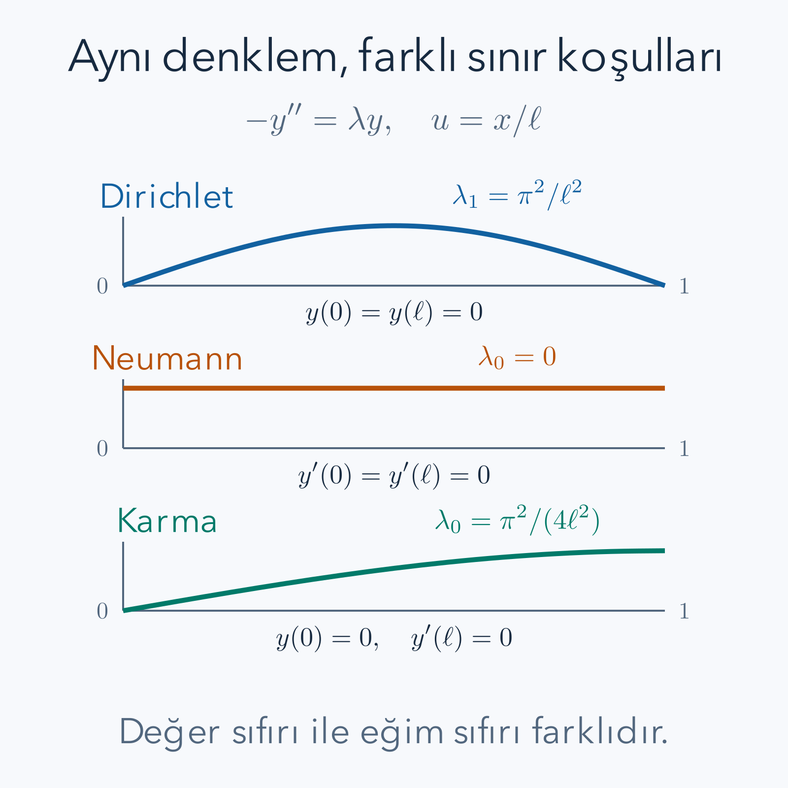

Bir tel yalnız belirli frekanslarda duran dalga oluşturur. Bir çubuğun sıcaklık profili de belirli uzaysal şekillere ayrılır. Önceki yazıda aynı sinüsler hem ısı hem dalga çözümünde karşımıza çıktı. Bu tekrarın nedeni yalnız trigonometrinin kullanışlı olması değildir. Bir diferansiyel ifade ile onun sınır koşulları birlikte, fonksiyonlar arasından özel şekilleri seçer. **Sturm–Liouville kuramı**, bu seçimin hangi koşullarda düzenli bir özdeğer ve ortogonallik yapısı verdiğini açıklar.

Önbilgi olarak [ikinci dereceden diferansiyel denklemler](/blog/ikinci-derece-diferansiyel-denklemler/), [belirli integral](/blog/belirli-integral-ve-temel-teorem/), [kısmi integrasyon](/blog/integral-alma-yontemleri/) ve bu dizinin [kısmi diferansiyel denklemler](/blog/kismi-diferansiyel-denklemler/) yazısı yeterlidir. Son yazıdaki sinüsleri burada daha genel bir çerçeveye koyacağız. Vektörlerdeki diklik düşüncesini kullanacağız, fakat fonksiyonlar için gereken iç çarpımı baştan tanımlayacağız.

## 1. Bir Diferansiyel Denklem Nasıl Özdeğer Problemi Olur?

Bir matriste $Mv=\lambda v$ denklemi, dönüşümün yalnız büyüklüğünü değiştirdiği yönleri seçer. Fonksiyonlarda da türev alma bir dönüşümdür. Örneğin $y(x)=\sin(nx)$ için $-y''=n^2y$ olur. İki türev ve eksi işareti, fonksiyonun biçimini koruyup onu $n^2$ ile çarpmıştır.

$\lambda$ sayısına **özdeğer**, sıfırdan farklı $y$ fonksiyonuna **özfonksiyon** deriz. Sıfır fonksiyon her $\lambda$ için denklemi sağladığından onu kabul etmek değer seçimini anlamsızlaştırır. Bir özfonksiyonun sıfırdan farklı sabit katı da özfonksiyondur; bu yüzden biçim önce belirlenir, büyüklük daha sonra normalizasyonla seçilir.

Ancak $-y''=\lambda y$ tek başına henüz ayrık bir liste seçmez. Aralık ve sınırlar belirtilmelidir. $y(0)=y(\pi)=0$ koşulu sinüslerin tam sayı indislerini seçerken $y(0)=0$, $y'(\pi)=0$ koşulu yarım tam sayıları seçecektir. Aynı diferansiyel ifade, farklı sınırlarla farklı problemdir. Bu nedenle operatörü yazıp sınırları küçük bir ayrıntı gibi sona bırakmamalıyız.

## 2. Düzenli Sturm–Liouville Probleminin Varsayımları

Sonlu bir $[a,b]$ aralığında, $b>a$ olmak üzere

$$
\mathcal L[y]=-(p(x)y'(x))'+q(x)y(x),
\qquad
\mathcal L[y]=\lambda w(x)y(x)
$$

problemini inceleyelim. $p$ türevli terimin katsayısı, $q$ yerel çarpan, $w$ ise **ağırlık** fonksiyonudur. Üçü de gerçektir. Bu yazıda $p$'nin sürekli türevlenebilir, $q,w$'nin sürekli, ayrıca $p(x)>0$ ve $w(x)>0$ olduğunu varsayıyoruz. Sonlu kapalı aralıkta bu pozitiflik ve süreklilik katsayıların sıfıra yaklaşarak tekillik üretmesini önler. Klasik hesaplarda özfonksiyonlar gereken iki türevi taşısın.

Bu koşullara uygun sonlu aralık problemi **düzenli** diye adlandırılır. Sonsuz aralık, uçta sıfırlanan $p$ veya tekil katsayılar aynı teoremlere otomatik olarak dahil değildir. Örneğin sonsuz doğruda modlar ayrık bir liste yerine sürekli bir değişkenle etiketlenebilir. Buradaki sonuçları o duruma koşulsuz taşımayacağız.

Eşitliğin sağındaki $w$'yi unutmak, yanlış iç çarpım ve yanlış katsayı hesabına götürür. Özdeğer biçimini sıradan $\mathcal A y=\lambda y$ olarak görmek istersek $\mathcal A=w^{-1}\mathcal L$ tanımlarız. $w$ pozitif olduğu için bu bölme yapılabilir. Birazdan ağırlıklı iç çarpımda simetrik olan dönüşüm bu $\mathcal A$ olacaktır; $\mathcal L$ ifadesinin çıplak haliyle aynı gösterim değildir.

## 3. Ayrılmış ve Gerçek Sınır Koşulları

Her uçta yalnız o uca ait bir doğrusal koşul koyalım:

$$
\begin{aligned}
A_a y(a)+B_a p(a)y'(a)&=0,\\
A_b y(b)+B_b p(b)y'(b)&=0.
\end{aligned}
$$

$A_a,B_a,A_b,B_b$ gerçek sabitlerdir. Her uçta ilgili iki katsayı aynı anda sıfır olamaz; yoksa o uçta hiç koşul konmamış olur. Bir ucun verisi diğer uca bağlanmadığı için bunlara **ayrılmış sınır koşulları** denir. Her özfonksiyona aynı sınırlar uygulanır. Farklı sınır sınıflarına ait fonksiyonları aynı ortogonallik ispatına sokamayız.

$B=0$ değer koşulunu, yani Dirichlet'i verir. $A=0$ ve $p>0$ türev koşulunu, yani Neumann'ı verir. Her ikisi sıfırdan farklıysa Robin türündedir. İki uçta aynı türü seçmek zorunda değiliz. Böyle gerçek ayrılmış koşullar, düzenli problemde uygun operatör tanım kümesiyle öz-adjoint bir gerçekleşim verir.

Öz-adjointlik yalnız formüldeki eksi işaretinin adı değildir. Fonksiyonların hangi uzayda bulunduğu, hangi sınırları taşıdığı ve operatörün tanım kümesi bu kavrama dahildir. Burada kuracağımız integral özdeşliği simetrinin doğrudan hesaplanan yüzünü gösterir. Düzenli ikinci dereceden problemde bunun tam operatör öz-adjointliğine uzanmasının fonksiyonel analiz ayrıntılarını ayrıca ispatlamıyoruz.

## 4. Ağırlıklı İç Çarpım Ne Ölçer?

Gerçek fonksiyonlarda $\int_a^b wuv\,dx$, vektörlerin skaler çarpımına benzer. Karmaşık fonksiyonları da kapsamak için birinci çarpanın eşleniğini alacağız:

$$
\langle u,v\rangle_w
=\int_a^b w(x)\overline{u(x)}v(x)\,dx,
\qquad
\|u\|_w^2=\int_a^b w(x)|u(x)|^2dx.
$$

Üst çizgi karmaşık eşleniktir; gerçek fonksiyonda hiçbir şeyi değiştirmez. $w>0$ olduğundan sıfırdan farklı sürekli bir fonksiyonun norm karesi pozitiftir. Norm uzunluğun fonksiyon karşılığıdır. Normu 1 yapılan özfonksiyona **normalize** deriz. İki fonksiyonun iç çarpımı sıfırsa ağırlıklı anlamda ortogonaldirler.

Ağırlık, farklı konumların karşılaştırmaya ne kadar katkı yapacağını belirler. Titreşen bir ipte değişken kütle yoğunluğu benzer bir rol oynayabilir; ağır bölgeler aynı yer değiştirmede daha fazla kinetik katkı yapar. Matematikte ise ağırlık keyfi bir süs değildir: özdenklemde $\lambda$'yı çarpan aynı $w$ seçilir. Yanlış ağırlıkla yapılan iki şekil karşılaştırması sıfır çıkmayabilir.

$w=1$ durumunda alışılmış integral iç çarpımına döneriz. Bir fonksiyonun her noktada küçük olması ile normunun küçük olması farklı ölçülerdir. Norm yalnız toplam kare farkı denetler; dar bir bölgede büyük bir sapma küçük integral verebilir. Seri yakınsaklığının anlamını belirtirken bu farkı hatırlayacağız.

## 5. İki Özdenklemi Çarpıp Çıkarmak

Önce gerçek özfonksiyonlar $y_m,y_n$ için

$$
\mathcal L[y_n]=\lambda_nwy_n,
\qquad
\mathcal L[y_m]=\lambda_mwy_m
$$

yazalım. İlk denklemi $y_m$, ikinciyi $y_n$ ile çarpıp ikinciyi birinciden çıkaralım. $q$'lu terimler $qy_my_n-qy_ny_m=0$ olur:

$$
(\lambda_n-\lambda_m)wy_my_n
=-y_m(py_n')'+y_n(py_m')'.
$$

Sağ tarafın tek bir türev olduğunu çarpım kuralıyla doğrulayabiliriz:

$$
\begin{aligned}
[p(y_ny_m'-y_my_n')]'
&=y_n'(py_m')+y_n(py_m')'\\
&\quad-y_m'(py_n')-y_m(py_n')'\\
&=y_n(py_m')'-y_m(py_n')'.
\end{aligned}
$$

İlk ve üçüncü terimler aynı $py_n'y_m'$ çarpımı olduğu için birbirini götürmüştür. Şimdi aralık boyunca integral alırsak

$$
(\lambda_n-\lambda_m)\int_a^bwy_my_n\,dx
=[p(y_ny_m'-y_my_n')]_a^b
$$

buluruz. Bu **sınır bilineeri**, bütün ortogonallik hesabının kilididir. “İntegrasyon yapınca sıfır” demek yeterli değildir; sağdaki uç değerlerin gerçekten neden sıfır olduğunu göstermeliyiz.

## 6. Sınır Bilineeri Neden Sıfırdır?

Bir uçta $B=0$ ise koşul $Ay=0$ olur; $A\ne0$ olduğundan bütün izin verilen fonksiyonların oradaki değeri sıfırdır. O zaman $y_ny_m'-y_my_n'$ ifadesinin her iki terimi de sıfır olur. Türevlerin kendilerinin sıfır olması gerekmez.

$B\ne0$ ise koşulu $py'=-(A/B)y$ diye düzenleyebiliriz. Aynı uçta iki fonksiyona uygularsak

$$
p(y_ny_m'-y_my_n')
=-\frac AB y_ny_m+\frac AB y_my_n=0
$$

çıkar. Bu hesap Neumann'ı da içerir; o durumda $A=0$'dır. Her uç ayrı ayrı sıfır verdiği için sağ uç eksi sol uç farkı sıfırdır. Gerçek katsayılar, birazdan eşlenik fonksiyonun da aynı koşulları sağlamasını güvenceye alacaktır.

İki ayrı sınır kuralı kullanılsaydı oranlar eşleşmeyebilir ve iptal gerçekleşmeyebilirdi. Aynı biçimde özdeğere bağlı sınır katsayıları da burada varsaydığımız problem değildir. Ortogonallik sonucu, diferansiyel ifadenin yapısıyla sınırların birlikte çalışmasından doğar. Biri olmadan diğerini kullanamayız.

## 7. Özdeğerlerin Gerçekliğini Eşlenikle Kanıtlamak

Özdeğerin baştan gerçek olduğunu varsaymak istemiyoruz. Karmaşık bir $y$ ve $\lambda$ için $\mathcal L[y]=\lambda wy$ olsun. Katsayılar gerçek olduğundan eşlenik alınca $\mathcal L[\bar y]=\bar\lambda w\bar y$ çıkar. Gerçek sınır katsayıları nedeniyle $\bar y$ de aynı sınırları taşır.

Önceki çarpıp çıkarma hesabında bir fonksiyonu $y$, diğerini $\bar y$ seçelim. Sınır bilineeri aynı nedenle sıfır olur ve

$$
(\lambda-\bar\lambda)\int_a^bw|y|^2dx=0
$$

kalır. Özfonksiyon sıfır değildir, $w>0$'dır; integral kesin pozitiftir. Ona böldüğümüzde $\lambda=\bar\lambda$ elde edilir. Eşleniğine eşit bir karmaşık sayının sanal kısmı sıfırdır; dolayısıyla bütün özdeğerler gerçektir.

Gerçek olmak pozitif olmak demek değildir. Örneğin $q$ yeterince negatifse negatif özdeğer çıkabilir. Sonraki basit örneklerde $q=0$, $p=w=1$ ve uygun sınırlar nedeniyle negatif olmayan değerler bulacağız. Bu ek işaret bilgisinin kaynağını gerçeklik kanıtıyla karıştırmamalıyız.

## 8. Farklı Özdeğerler Ortogonalliği Nasıl Verir?

Artık $\lambda_m,\lambda_n$ gerçektir. Karmaşık özfonksiyonlar için aynı hesabı $\bar y_m,y_n$ ile yürütünce

$$
(\lambda_n-\lambda_m)\langle y_m,y_n\rangle_w=0
$$

buluruz. Eğer özdeğerler farklıysa sıfırdan farklı farka böleriz ve $\langle y_m,y_n\rangle_w=0$ çıkar. İptal, yalnız farklı özdeğerler için geçerlidir. Aynı özdeğere bölmeye çalışmak sıfıra bölme olur; bu ispat o durumda herhangi bir sonuç vermez.

Düzenli, ayrılmış ikinci dereceden skaler problemde özdeğerler basittir: her özdeğerin özfonksiyonları birbirinin sabit katıdır. Bunun sezgisi, sol sınırın iki başlangıç verisi arasına bir doğrusal bağ koyması ve kalan ölçek dışında tek çözüm bırakmasıdır. Diferansiyel denklem için başlangıç değerinin tekliği bu açıklamayı kesinleştirir. Periyodik gibi ayrılmamış koşullarda ise sinüs ile kosinüs aynı özdeğeri paylaşabilir. O yüzden ayrılmış koşul varsayımımız gerçek bir kapsam sınırıdır.

*Çizimde yatay eksen $x/\ell$'dir. Dirichlet şekli iki uçta sıfır, Neumann sıfır modu sabit, karma şekil solda sıfır ve sağda yatay teğetlidir. Aynı ikinci türev ifadesi farklı sınırlarla farklı en düşük özdeğerler seçer.*

## 9. Rayleigh Oranı ve İşaret Kontrolü

Denklemi $\bar y$ ile çarpıp integral alalım. Türevli terime kısmi integrasyon uygulanınca

$$
\lambda\int_a^bw|y|^2dx
=\int_a^b\left(p|y'|^2+q|y|^2\right)dx
-[\bar y\,py']_a^b
$$

elde edilir. Paydadaki pozitif norma bölersek özdeğeri enerji benzeri integrallerin oranıyla ifade ederiz. Bu biçime **Rayleigh oranı** denir. Genel Robin sınırında son çarpım otomatik olarak sıfır olmayabilir; fakat gerçek katsayılarla gerçektir. Önceki bilineerin sıfır olmasıyla bu tek çarpımın sıfır olmasını aynı şey sanmamalıyız.

$p=w=1$, $q=0$ için Dirichlet, Neumann ve aşağıdaki karma koşulda her uçta ya değer ya türev sıfırdır. Sınır çarpımı gerçekten yok olur. Sonuç $\lambda=\int|y'|^2dx/\int|y|^2dx\ge0$'dır. Eşitlik ancak $y'=0$, yani sabit fonksiyonda mümkündür. Dirichlet sabit sıfırdan başka sabite izin vermez; Neumann ise verir. Sıfır modunun olup olmayacağını daha denklemi tam çözmeden bu oranla görebiliriz.

## 10. Çözülmüş Örnek: Dirichlet Sinüsleri

$[0,\ell]$ üzerinde $-y''=\lambda y$, $y(0)=y(\ell)=0$ olsun. Rayleigh hesabı negatif değerleri dışladı; sıfır da yalnız sıfır fonksiyon verir. Pozitif $\lambda$ için $r=\sqrt\lambda$ yazınca genel çözüm $y=C\cos(rx)+D\sin(rx)$'tir. Sol uç $C=0$, sağ uç $D\sin(r\ell)=0$ verir. Sıfır olmayan çözüm için

$$
r_n=\frac{n\pi}{\ell},\qquad
\lambda_n=\frac{n^2\pi^2}{\ell^2},\qquad
s_n(x)=\sin(r_nx),\quad n=1,2,\ldots
$$

olmalıdır. Birinci mod içeride düğüm taşımaz; ikinci ortada, üçüncü üçte bir ve üçte iki noktalarında sıfırdır. İndis büyüdükçe şekil daha hızlı değişir ve ikinci türevin çarpanı büyür. Bu, yüksek modların ısı probleminde neden daha hızlı söndüğünün uzaysal temelidir.

Normalizasyonu açık integralden bulalım:

$$
\begin{aligned}
\|s_n\|^2
&=\int_0^\ell\frac{1-\cos(2r_nx)}2dx\\
&=\frac\ell2-\frac{[\sin(2r_nx)]_0^\ell}{4r_n}
=\frac\ell2.
\end{aligned}
$$

Bu nedenle $\phi_n=\sqrt{2/\ell}\sin(n\pi x/\ell)$ seçimi normu 1 yapar. Örneğin $\ell=2$ için çarpan 1'dir; ilk özdeğer $\pi^2/4\approx2.46740$, ilk özfonksiyon $\sin(\pi x/2)$'dir. Türevin türevi $-(\pi^2/4)\sin(\pi x/2)$ olduğundan denklem ve iki uç doğrudan doğrulanır.

## 11. Katsayı Formülünü Ezberlemeden Bulmak

Normalize özfonksiyonlarla $f=\sum c_n\phi_n$ biçiminde açılım varsa iki tarafın $\phi_m$ ile iç çarpımını alırız. Ortogonallik bütün farklı indisleri siler; kendi normu 1 olduğu için $c_m=\langle\phi_m,f\rangle_w$ kalır. Normalizasyon yapılmamış $y_n$ kullanırsak kendi normunu bölmeliyiz:

$$
a_n=\frac{\langle y_n,f\rangle_w}{\langle y_n,y_n\rangle_w}.
$$

Bu formül, bir vektörün bir doğrultudaki izdüşüm katsayısının fonksiyon karşılığıdır. Pay sıfırsa o yönde bileşen yoktur. Paydanın görevi, seçtiğimiz özfonksiyonun keyfi büyüklüğünü telafi etmektir. $y_n$'yi iki katına çıkarırsak pay iki, payda dört kat artar; katsayı yarıya iner ve $a_ny_n$ katkısı aynı kalır.

Sonlu sayıda modla yaklaşım için de bu katsayılar özeldir. Farkın kare normunu açınca farklı modların çapraz çarpımları kaybolur. Her katsayı için kalan ifade bir tam kareye tamamlanır; en küçük hata izdüşüm katsayısında oluşur. Bu en iyi yaklaşım özelliği ortogonallikten gelir. Sonsuz toplamın hatasının sıfıra gitmesi ise ayrıca tamlık gerektirir; bir sonraki örnekten sonra o ayrımı açıkça koyacağız.

## 12. Çözülmüş Örnek: Parabolü Sinüslere Ayırmak

$[0,\pi]$ aralığında $f(x)=x(\pi-x)$ olsun. Uçlar sıfır olduğu için Dirichlet profiline uygundur. Normalize edilmemiş $\sin(nx)$ için norm karesi $\pi/2$ olduğundan $b_n=(2/\pi)I_n$, burada

$$
I_n=\int_0^\pi x(\pi-x)\sin(nx)dx
$$

olsun. $P(x)=x(\pi-x)$ yazalım; $P'=\pi-2x$, $P''=-2$'dir. Kısmi integrasyonda sinüsün integrali $-\cos(nx)/n$ olur. Sınırda $P=0$ olduğundan

$$
I_n=\frac1n\int_0^\pi P'(x)\cos(nx)dx
$$

kalır. İkinci kez kısmi integrasyonda kosinüsün integrali $\sin(nx)/n$'dir. Sınırda sinüs sıfırdır; kalan işaretleri koruyalım:

$$
\begin{aligned}
I_n
&=\frac{[P'\sin(nx)]_0^\pi}{n^2}
-\frac1{n^2}\int_0^\pi P''\sin(nx)dx\\
&=\frac2{n^2}\int_0^\pi\sin(nx)dx\\
&=\frac2{n^3}\bigl(1-\cos(n\pi)\bigr).
\end{aligned}
$$

Dolayısıyla $b_n=4[1-(-1)^n]/(\pi n^3)$ çıkar. Çift indisler yoktur; tek indisler $8/(\pi n^3)$ verir. Normalize bazda katsayı $c_n=\sqrt{2/\pi}I_n$ olur. İki gösterim aynı fonksiyonu temsil eder; katsayı sayılarını bazın ölçeğinden bağımsız karşılaştıramayız.

Ortada $f(\pi/2)=\pi^2/4\approx2.46740$'tır. İlk üç sıfır olmayan terim $n=1,3,5$ ile $8/\pi-8/(27\pi)+8/(125\pi)\approx2.47254$ verir. İşaretlerin değişmesi katsayılardan değil, orta noktadaki $\sin(n\pi/2)$ değerlerinden gelir. Katsayılar pozitifken terimin belirli bir noktadaki katkısı negatif olabilir. Bu sayı kontrolü hem indisleri hem normalizasyonu sınar.

## 13. Çözülmüş Örnek: Neumann Sınırları ve Sıfır Modu

Aynı denklemde bu kez $y'(0)=y'(\ell)=0$ olsun. $\lambda=0$ için $y=C+Dx$'tir; türev $D$ olduğundan iki sınır $D=0$ verir. $C$ sıfırdan farklı olabilir. Böylece $\lambda_0=0$, $y_0=1$ gerçekten bir özçifttir. Sabitin norm karesi $\ell$ olduğundan $\phi_0=1/\sqrt\ell$ seçilir.

Pozitif özdeğerde $y=C\cos(rx)+D\sin(rx)$ ve $y'=-Cr\sin(rx)+Dr\cos(rx)$ olur. Sol sınır $Dr=0$ verir; $r>0$ olduğundan $D=0$'dır. Sağ sınır $-Cr\sin(r\ell)=0$, sıfır olmayan çözümde $r\ell=n\pi$ verir. Sonuç

$$
\phi_n=\sqrt{\frac2\ell}\cos\left(\frac{n\pi x}{\ell}\right),
\qquad \lambda_n=(n\pi/\ell)^2,\quad n\ge1
$$

olur. Sıfır moduna bu formülü körlemesine uygularsak $\sqrt{2/\ell}$ elde eder, normu yanlış seçeriz. Çünkü sabitin kare integrali $\ell$, salınan kosinüslerininki $\ell/2$'dir.

$\ell=\pi$, $f(x)=2+3\cos x-\cos2x$ seçelim. $\int_0^\pi\cos(nx)dx=[\sin(nx)/n]_0^\pi=0$ olduğundan ortalama yalnız sabitten gelir. Normalize katsayılar $c_0=2\sqrt\pi$, $c_1=3\sqrt{\pi/2}$, $c_2=-\sqrt{\pi/2}$ olur. Başlangıç profilini ısı denkleminde kullanırsak $u=2+3e^{-\alpha t}\cos x-e^{-4\alpha t}\cos2x$ çıkar. Uzun zamanda sabit 2 kalır. Yalıtılmış çubuğun toplam ısısının korunmasını sağlayan parça, sönmeyen sıfır modudur.

## 14. Çözülmüş Örnek: Karma Sınır ve Yarım Tam Sayılar

Şimdi sol uç sabit, sağ uç türev koşullu olsun: $y(0)=0$, $y'(\ell)=0$. Sıfır özdeğerde $C+Dx$ çözümüne ilk uç $C=0$, ikinci uç $D=0$ verir; sıfır modu yoktur. Pozitif durumda ilk uç kosinüsü siler, $y=D\sin(rx)$ kalır. Sağdaki türev $Dr\cos(r\ell)$ olduğundan

$$
r_n\ell=(n+1/2)\pi,
\qquad
\lambda_n=\left(\frac{(n+1/2)\pi}{\ell}\right)^2,
\quad n=0,1,2,\ldots
$$

seçilir. Burada indis sıfırdan başlar ama özdeğer sıfır değildir. İlk mod çeyrek dalga taşır: solda sıfırdan çıkar, sağda tepeye ulaşırken yatay olur. İki ucun aynı türden olmaması yarım tam sayıyı üretmiştir.

Norm hesabında yine sinüs karesi özdeşliği kullanılır. Sınırdaki çift açı $2r_n\ell=(2n+1)\pi$ olduğundan sinüs terimi sıfır çıkar ve norm karesi $\ell/2$ olur. Normalize şekil $\sqrt{2/\ell}\sin(r_nx)$'tir. Katsayı integralleri de bu yeni yarım tam sayılı şekillerle alınmalıdır; önceki tam sayılı sinüsler aynı sınırı taşımaz.

$\ell=\pi$ için ilk iki özdeğer $1/4$ ve $9/4$'tür. $f(x)=\sin(x/2)+\tfrac12\sin(3x/2)$ her iki sınırı sağlar. İkinci türev, ilk parçayı $-1/4$, ikinci parçayı $-9/4$ ile çarpar. Bu toplam tek bir özfonksiyon değildir; iki özdeğerli iki modun birleşimidir. Isı çözümü $u=e^{-\alpha t/4}\sin(x/2)+\tfrac12e^{-9\alpha t/4}\sin(3x/2)$ olur. Başlangıç orta değeri $\sqrt2/2+\sqrt2/4=3\sqrt2/4\approx1.06066$'dır; en düşük mod, aynı uzunluktaki Dirichlet ilk modundan dört kat daha yavaş söner.

## 15. Ağırlığın Gerçekten Gerekli Olduğu Bir Örnek

Şimdi $[0,\pi]$ üzerinde $p=w=e^{2x}$, $q=0$, iki uçta Dirichlet alalım. Bütün katsayılar düzenlidir ve pozitiftir. Özdenklem

$$
-(e^{2x}y')'=\lambda e^{2x}y
$$

olur. Çarpım türevini açıp pozitif $e^{2x}$'e bölersek $-y''-2y'=\lambda y$ çıkar. Birinci türevden kurtulmak için $y=e^{-x}z$ deneyelim. Türevleri açıkça

$$
y'=e^{-x}(z'-z),
\qquad y''=e^{-x}(z''-2z'+z)
$$

olur. Yerine koyunca $-y''-2y'=e^{-x}(-z''+z)$ kalır; $z'$'li terimler birbirini götürür. Denklem $-z''=(\lambda-1)z$'ye dönüştü. Üstel sıfır olmadığı için $z$ de iki uçta sıfırdır. Önceki Dirichlet sonucundan $z_n=\sin(nx)$ ve $\lambda_n=n^2+1$ gelir:

$$
y_n=e^{-x}\sin(nx),\qquad
\phi_n=\sqrt{2/\pi}\,e^{-x}\sin(nx).
$$

Ağırlıklı çarpımda $e^{2x}$ ile iki tane $e^{-x}$ çarpanı tam sadeleşir:

$$
\langle y_m,y_n\rangle_w
=\int_0^\pi\sin(mx)\sin(nx)dx.
$$

Farklı indisler sıfır, aynı indis $\pi/2$ verir. Ağırlığı silseydik integrandda $e^{-2x}$ kalırdı ve önceki sinüs iptali gerçekleşmezdi. Bu örnek genel teoremin neden doğrudan $\int y_my_n$ demediğini gösterir. İlk özdeğer 2'dir; katsayıların değişmesi yalnız şekli değil özdeğerin büyüklüğünü de değiştirmiştir.

## 16. Ortogonallik ile Tamlık Aynı İddia Değildir

Ortogonal bir ailede her fonksiyonun temsil edilebilmesi zorunlu değildir. Üç boyutlu uzayda yalnız iki dik birim vektör seçersek üçüncü yöndeki bileşeni kaçırırız. Fonksiyonlarda da bazı modları atarak hâlâ ortogonal ama eksik bir aile kurabiliriz. Örneğin yalnız çift indisli Dirichlet sinüsleri birbirine ortogonaldir; birinci sinüsü temsil edemezler.

**Tamlık**, bütün özfonksiyonlar kullanıldığında kare integrallenebilir fonksiyonların ağırlıklı normda yaklaştırılabilmesidir. Burada düzenli katsayılar ve belirtilen öz-adjoint ayrılmış sınırlar altında spektrumun gerçek ve ayrık olması, özdeğerlerin yukarı doğru sınırsız bir dizi oluşturması ve özfonksiyonların $L^2_w$ uzayında tam bir baz vermesi bir genel teoremdir. Bu teoremin kompakt operatörler ve yakınsaklık içeren tam ispatını bu girişte sunmuyoruz. Kanıtladığımız parçalar sınır özdeşliği, gerçeklik, farklı özdeğer ortogonalliği ve örneklerin açık çözümleridir.

Sinüs ve kosinüs örneklerinde tamlık, Fourier serilerinin bilinen teoremlerine bağlanır. Normda yakınsaklık, her noktada veya her türevde yakınsaklık demek değildir. Parçalı düzgün bir fonksiyonun sıçrama noktasındaki Fourier değeri, iki yandaki limitlerin ortalaması olabilir. Uç değerleri sınır koşuluna uymayan bir fonksiyon da normda açılabilir; tek bir uç noktasındaki fark integral normunu değiştirmez. Fakat böyle bir açılımı doğrudan klasik ve uçlarda düzgün PDE başlangıcı diye sunamayız.

## 17. Sonlu Yaklaşımın Hatasını Hesaplamak

Normalize gerçek bir bazda ilk $N$ modla $f_N=\sum_{n=1}^Nc_n\phi_n$ yaklaşımı yapalım. Katsayılar iç çarpımla seçildiğinde kalan $r_N=f-f_N$ her kullanılan moda diktir. Gerçekten $\langle\phi_m,r_N\rangle=c_m-c_m=0$ olur. Bu yüzden $f=f_N+r_N$ eşitliğinin norm karesi

$$
\|f\|_w^2=\sum_{n=1}^N|c_n|^2+\|r_N\|_w^2
$$

şeklinde ayrılır. Çapraz terimler sıfırdır; her normalize modun kendi kare normu 1'dir. Bu, Pisagor bağıntısının fonksiyon karşılığıdır. Sağdaki hata normu negatif olamayacağından katsayı karelerinin kısmi toplamı toplam normu aşamaz.

Başka katsayılarla aynı ilk modları kullanmak hatayı küçültemez. Her yeni katsayıyı $c_n+d_n$ yazarsak yeni fark $r_N-\sum d_n\phi_n$ olur. Diklikten bunun norm karesi $\|r_N\|_w^2+\sum|d_n|^2$ çıkar. En küçük değer bütün $d_n$'ler sıfırken alınır. Böylece izdüşümün neden en iyi sonlu yaklaşım olduğunu yalnız bir adlandırmayla değil, pozitif bir hata farkıyla göstermiş olduk.

Tamlık teoremi, $N$ büyüdüğünde kalan normun sıfıra gittiğini söyler. O ek bilgi olmadan yalnız bu sonlu Pisagor eşitliğine sahibiz. Sayısal çalışmada birkaç modun iyi bir grafik vermesi ile matematiksel tamlık kanıtı aynı şey değildir. Yine de hata normu ve katsayıların büyüklüğü, hangi modların önemli olduğunu ölçmek için somut araçlardır.

## 18. Bir Özfonksiyon Hesabını Nasıl Doğrularız?

Önce diferansiyel ifadeyi ve ağırlığı ayrı yazmalıyız. Sonra iki uç koşulunu açıkça kaydetmeliyiz. Bulduğumuz $y_n$ için türev alıp $\mathcal L[y_n]-\lambda_nwy_n$ farkını kontrol ederiz. Bu farkın sıfır çıkması, sınırları sağladığını tek başına söylemez; uçları ayrıca yerleştiririz. Normalizasyonda kullanılan integralin gerçekten seçilen ağırlığı içerdiğini denetleriz.

İndisin nereden başladığı da verinin bir parçasıdır. Dirichlet'te sıfır şekil getiren indis kullanılmaz. Neumann'da sabit mod fiziksel ortalamayı taşır. Karma durumda sıfır indis, pozitif bir yarım dalga sayısını etiketler. Bu üç durumda aynı indis yazısını görmek aynı sıfır frekansı bulunduğu anlamına gelmez.

Sınırları değiştirdiğimizde yalnız katsayıları yeniden hesaplamak yetmeyebilir; bazın kendisi değişir. Katsayılar belirli bir bazda fonksiyonun ne kadar bulunduğunu söyler, baz ise problemin diferansiyel ifadesi ve sınırları tarafından seçilir. Bu ayrım, ısı ve dalga serilerinden kuantumda sınır değerli dalga fonksiyonlarına uzanan hesapların ortak düzenidir.

Birden fazla özfonksiyonun toplamı genel olarak tek bir özfonksiyon değildir. Her parçaya farklı özdeğer çarpanı geliyorsa toplamdan ortak tek bir sayı dışarı alınamaz. Bu toplam yine ısı veya dalga çözümünün başlangıç profili olabilir; özfonksiyon olmak daha özel bir koşuldur. Örneğin birinci ve ikinci sinüsün toplamını iki kez türevleyince birine bir, diğerine dört çarpanı gelir. Şekil değişir. Modlara ayırmanın gücü de burada bulunur: karmaşık bir toplamı tek bir özdeğere zorlamak yerine, her bileşenin kendi basit dönüşümünü ayrı hesaplarız.

## Kaynaklar

Ayrılmış sınırların açık çözümleri için [Toronto Üniversitesi, Victor Ivrii: Eigenvalue Problems](https://www.math.utoronto.ca/ivrii/PDE-textbook/Chapter4/S4.2.html), sınır terimleri ve ortogonallik için [Ivrii: Orthogonal Systems](https://www.math.utoronto.ca/ivrii/PDE-textbook/Chapter4/S4.3.html), sinüs, kosinüs ve yarım tam sayılı açılımlar için [Ivrii: Other Fourier Series](https://www.math.utoronto.ca/ivrii/PDE-textbook/Chapter4/S4.5.html) açık üniversite ders notları karşılaştırılabilir. Bu yazıdaki genel ağırlıklı türetim ve sayısal veriler özgün olarak kurulmuştur; kaynaklardaki daha geniş tamlık kuramı burada kanıtlanmış gibi sunulmamıştır.
