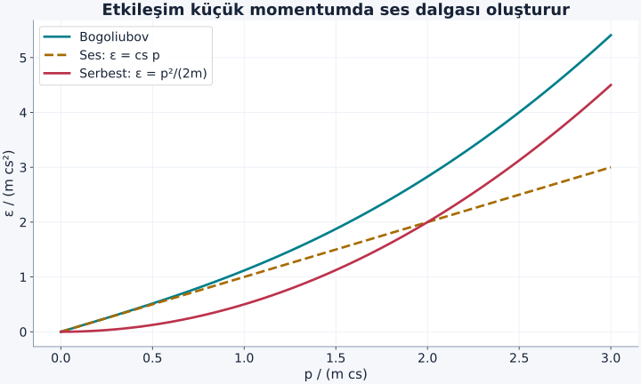
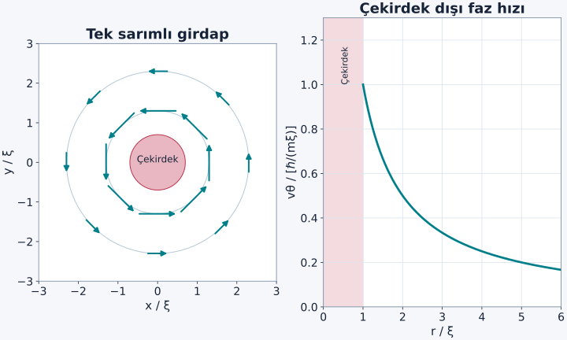

Birçok parçacığın aynı kuantum durumunu paylaşması etkileyicidir, fakat tek başına akışın kayıpsız olacağını söylemez. Akan bir sıvı bir engele enerji ve momentum aktarabiliyorsa yavaşlayabilir. Süperakışkanlık sorusu bu yüzden yalnız “kaç parçacık taban durumda?” sorusu değildir. Akan durumdan hangi uyarılmaların üretilebildiğini, fazın uzayda nasıl değiştiğini ve sınırların hangi bozunma yollarını açtığını da bilmeliyiz.

[Bose–Einstein yoğuşması](/blog/bose-einstein-yogusmasi/), [olasılık akımı](/blog/schrodinger-denklemi-ve-olasilik-akimi/) ve [fononlar](/blog/orgu-titresimleri-ve-fononlar/) ön bilgilerimiz. İlk olarak düşük sıcaklıkta, seyrek, zayıf ve itici etkileşen nötr bozon gazını inceleyeceğiz. Bu model helyum sıvısının bütün nicel ayrıntılarını temsil etmez; helyumda güçlü etkileşimler ve başka uyarılma yapıları önemlidir.

## 1. Faz bir akış bilgisini nasıl taşır?

Yoğuşmuş alanı $\Psi(\mathbf r)=\sqrt{n_0(\mathbf r)}e^{i\theta(\mathbf r)}$ biçiminde yazalım. $n_0$ yoğuşan sayı yoğunluğu, $\theta$ boyutsuz faz, $\mathbf r$ konumdur. Nötr parçacığın sayı akımı:

$$
\mathbf j=\frac{\hbar}{2mi}
(\Psi^*\nabla\Psi-\Psi\nabla\Psi^*)
$$

ile verilir. $m$ atom kütlesi, $\hbar$ indirgenmiş Planck sabiti, $i^2=-1$'dir. $\nabla$ gradyan, yani uzaysal değişimin yön ve hızını bir arada gösteren türev operatörüdür. Fazı yerine koyarsak:

$$
\nabla\Psi=e^{i\theta}
\left(\nabla\sqrt{n_0}+i\sqrt{n_0}\nabla\theta\right)
$$

olur. Akımdaki iki terim çıkarıldığında yoğunluk türevleri birbirini götürür, faz türevleri toplanır. Sonuç:

$$
\mathbf j=n_0\frac{\hbar}{m}\nabla\theta,
\qquad \mathbf v_s=\frac{\hbar}{m}\nabla\theta
$$

şeklindedir. $\mathbf v_s$ süperakışkan hız alanıdır. Bir fazın kendisi keyfi bir sabitle değiştirilebilir; uzaysal farkı ise akış taşır. Her noktada aynı faza sahip bulut ile doğrusal değişen faza sahip bulutun yoğunluk görüntüleri aynı olabilir, fakat akımları farklıdır.

## 2. Faz eğiminin basit bir örneği

Bir boyutta $\theta(x)=qx$ olsun. $q$ ters uzunluk birimli faz eğimidir; elektrik yükü değildir. Hız $v_s=\hbar q/m$ sabittir. Fazın bir mikrometrede bir radyan değişmesi $q=10^6\,\mathrm{m^{-1}}$ demektir. Rubidyum-87 için $m=1{,}4432\times10^{-25}\,\mathrm{kg}$ alırsak $v_s\simeq0{,}731\,\mathrm{mm/s}$ bulunur.

Bu hesap henüz akışın kararlı olduğunu kanıtlamadı. Sadece faz biçimi ile akım arasındaki bağı kurdu. Aynı hıza sahip bir durum belirli bir engelde uzun süre korunabilirken başka bir geometride girdap üreterek bozunabilir. “Akış hızı” ile “kritik hız” bu nedenle ayrı büyüklüklerdir. İlki mevcut durumu, ikincisi belirtilen koşullarda bir kararlılık sınırını anlatır.

## 3. Akışın yavaşlaması için enerji nereye gidecek?

Durgun sıvıda momentum $\mathbf p$ taşıyan bir uyarılmanın enerjisi $\epsilon(p)>0$ olsun. Çok ağır bir engelin akışa göre hızını $\mathbf v$ ile gösterelim. Engelin çok küçük geri tepmesini ihmal ettiğimizde, uyarılma oluşturmanın göreli hareketten karşılanabilecek enerji maliyeti:

$$
\Delta E=\epsilon(p)-\mathbf v\cdot\mathbf p
$$

biçimindedir. En kolay üretim, momentum hız yönüne paralel olduğunda gerçekleşir; skaler çarpım $vp$ olur. Eğer her $p>0$ için $\epsilon(p)-vp>0$ ise bu süreç enerji korunumu açısından akışı kendiliğinden düşüremez.

Böylece **Landau ölçütü**:

$$
v<v_L,\qquad v_L=\min_{p>0}\frac{\epsilon(p)}p
$$

olarak yazılır. $\epsilon/p$ birimi $\mathrm{J}/(\mathrm{kg\,m/s})=\mathrm{m/s}$'dir. Enerji–momentum grafiğinde orijinden eğriye çizilen doğruların en küçük eğimini arıyoruz. Grafik yatay ekseni dalga sayısı $k$ ise $p=\hbar k$ kullanılmalıdır; $\hbar$'ı unutmak birim hatasıdır.

Bu, belirtilen uyarılma kanallarının **enerjetik** sınırıdır. Engelin şekli, mevcut kusurlar ve girdap çekirdeklenmesi daha düşük hızlarda bozunma yaratabilir. [MIT'nin süperakışkanlık dersleri](https://www.mit.edu/~levitov/8514/) bu ölçütün tek başına deneysel kritik hızı belirlemediğini özellikle vurgular.

## 4. İdeal yoğuşmuş gazın kritik hız sorunu

Etkileşmeyen gazda uyarılmalar serbest parçacık biçimindedir: $\epsilon(p)=p^2/(2m)$. O zaman $\epsilon(p)/p=p/(2m)$ olur. Momentum sıfıra yaklaşırken bu oran da sıfıra yaklaşır; dolayısıyla $v_L=0$ bulunur. Önceki yazıdaki ideal üç boyutlu gaz yine de Bose–Einstein yoğuşması gösterebiliyordu.

Bu karşılaştırma BEC ile süperakışkanlığın farklı tanımlar olduğunu somutlaştırır. Büyük taban durum doluluğu tek başına sonlu bir Landau hız sınırı üretmez. Gerçek seyrek gazlarda zayıf bir itici etkileşim bile düşük momentum spektrumunu değiştirerek ses dalgaları oluşturur. Ortak hareketin kararlılığı için bu değişiklik belirleyicidir.

## 5. Etkileşim ses dalgasını nasıl getirir?

Düşük enerjili çarpışmayı tek parametreyle temsil etmek için $s$ dalgası saçılma uzunluğu $a_s>0$ kullanılır. Seyrek gaz koşulu $na_s^3\ll1$'dir; $n$ toplam yoğunluktur. Etkin bağlaşım:

$$
g=\frac{4\pi\hbar^2a_s}{m}
$$

olur. $g$ birimi $\mathrm{J\,m^3}$, dolayısıyla $gn$ enerji birimidir. Zayıf etkileşimli yaklaşık kuramın küçük uyarılma enerjisi:

$$
\epsilon(p)=\sqrt{\frac{p^2}{2m}\left(\frac{p^2}{2m}+2gn\right)}
$$

şeklindedir. Buna **Bogoliubov spektrumu** denir. Bunu burada tam çok parçacıklı köşegenleştirmeyle türetmiyoruz; düşük ve yüksek momentum limitlerini açıkça kontrol ediyoruz.

$p^2/(2m)\ll gn$ ise karekök içindeki başlıca çarpım $p^2gn/m$ olur. Böylece $\epsilon\simeq c_s p$ ve $c_s=\sqrt{gn/m}$ ses hızı bulunur. Büyük momentumda ise serbest parçacık davranışına yaklaşılır. Ayrıca:

$$
\frac{\epsilon(p)}p=\sqrt{c_s^2+\frac{p^2}{4m^2}}
$$

olduğu için minimum $p\to0$'da $c_s$'dir. Bu modelde Landau hızı ses hızına eşittir. [Jena Üniversitesi'nin kuantum alan kuramı dersi](https://www.tpi.uni-jena.de/~floerchinger/qft1/lecture14/) bu spektrum ile Landau koşulunun bağlantısını kurar.

Şekil: Aynı yoğunluk ölçeğiyle, etkileşimli spektrumun küçük momentumda doğrusal olması sonlu $v_L$ sağlar. Kırmızı serbest parabol için orijinden çizilen eğimler sıfıra kadar küçülebilir.

## 6. Örnek: Ses hızı ve iyileşme uzunluğu

Rubidyum-87 için $m=1{,}4432\times10^{-25}\,\mathrm{kg}$, $n=10^{20}\,\mathrm{m^{-3}}$ ve $a_s=5{,}3\,\mathrm{nm}$ alalım. Önce $na_s^3\simeq1{,}49\times10^{-5}\ll1$ koşulunu doğrularız. Bağlaşım:

$$
\begin{aligned}
4\pi\hbar^2a_s&\simeq7{,}407\times10^{-76}\,\mathrm{J^2s^2m},\\
g&=\frac{4\pi\hbar^2a_s}{m}\\
&\simeq5{,}13\times10^{-51}\,\mathrm{J\,m^3}.
\end{aligned}
$$

Böylece $gn\simeq5{,}13\times10^{-31}\,\mathrm J$ ve $c_s=\sqrt{gn/m}\simeq1{,}89\,\mathrm{mm/s}$ bulunur. Faz eğimi örneğindeki $0{,}731\,\mathrm{mm/s}$ bu ideal spektrum eşiğinin altındadır; yine de gerçek bir engelde bozunma olmayacağını tek başına garanti etmez.

Yoğunluğun bir kusur yakınında toparlandığı ölçeğe **iyileşme uzunluğu** denir. Kinetik enerji ölçeğini etkileşimle eşitleyelim: $\hbar^2/(2m\xi^2)=gn$. Buradan:

$$
\xi=\frac{\hbar}{\sqrt{2mgn}}\simeq2{,}74\times10^{-7}\,\mathrm m
=0{,}274\,\mu\mathrm m
$$

çıkar. Bu, girdap çekirdeğinin yaklaşık büyüklüğünü anlamamıza yardım eder. Sayısal katsayısı seçilen tanıma bağlı olabilen çekirdek yarıçapıyla birebir aynı geometrik sınır değildir; bir değişim ölçeğidir.

## 7. Kapalı bir yol faza ne şart koyar?

Akışkan içinde kapalı bir yol izleyip başlangıç noktasına dönelim. Alanın aynı noktada tek değerli olması için $e^{i\theta}$ başlangıç değerine dönmelidir. Fazın kendisi $2\pi$'nin tam katı kadar değişebilir:

$$
\oint\nabla\theta\cdot d\boldsymbol\ell=2\pi\ell,
\qquad \ell\in\mathbb Z.
$$

Buradaki $\ell$ tam sayı sarım sayısı, $d\boldsymbol\ell$ yolun küçük yönlü parçasıdır; aynı harfin farklı yazımları karıştırılmamalıdır. Hız bağıntısını integre edersek **dolaşım**:

$$
\kappa=\oint\mathbf v_s\cdot d\boldsymbol\ell
=\ell\frac hm
$$

olur; $h=2\pi\hbar$ Planck sabitidir. Dolaşım birimi $\mathrm{m^2/s}$'dir. Kuantumlanan büyüklük her noktadaki hız değil, kapalı yol boyunca hızın bu toplamıdır. Yolun yarıçapını değiştirirken dolaşım sabit kalabilir ama yerel hız değişir.

Faz her yerde düzgün ve tek değerli bir gerçek sayı olarak seçilebilseydi kapalı gradyan integrali sıfır olurdu. Sıfırdan farklı sarımda yolun içinden geçen girdap çekirdeğinde yoğunluk düşer ve faz tanımı tekillik kazanır. Bu yüzden “hız gradyandır, öyleyse girdap olamaz” çıkarımı yanlıştır; çekirdeğin dışındaki düzgün bölge ile bütün bölgenin topolojisi ayrılmalıdır.

## 8. Düz bir kuantum girdabının hız profili

Düz girdap ekseninden uzaklığı $r$ ile gösterelim. Dairesel simetride hız çembere teğet ve çember üzerinde sabittir. Dolaşım $2\pi r v_\theta$ olur. Böylece:

$$
v_\theta(r)=\frac{\ell\hbar}{mr}.
$$

Eksenel simetri ve $\theta=\ell\phi$ fazı korunuyorsa, yoğunluğun sıfır olmadığı her yarıçapta bu faz hızı geçerlidir. Merkezde yoğunluk sıfırlanır; faz ve ona bağlı hız alanı artık tanımlı değildir. Dolayısıyla formülün tekilliğini “merkezde sonsuz hızla giden atomlar” diye yorumlayamayız. Yoğunluğun düşmesi tek başına $1/r$ faz hızını sonlu yapmaz. Tek sarımlı düzgün çekirdekte alan genliği yaklaşık $r$ ile, yoğunluk $r^2$ ile gider; sayı akımı $j=n_0v$ ise yaklaşık $r$ ile sıfıra yaklaşır. Çekirdeği anlamak için yoğunluğu ve akımı birlikte çözmek gerekir.

Şekil: Çekirdeğin dışındaki akış, katı cisim dönmesi gibi $v\propto r$ değildir. Her çemberde aynı kuantumlanmış dolaşımı taşıdığı için $v\propto1/r$ olur.

## 9. Örnek: Bir girdapta hız ile dolaşımı ayırmak

Aynı rubidyum gazında tek sarımlı $\ell=1$ girdap için:

$$
\kappa=\frac{6{,}62607\times10^{-34}}{1{,}4432\times10^{-25}}
\simeq4{,}59\times10^{-9}\,\mathrm{m^2/s}.
$$

$r=2{,}0\,\mu\mathrm m$'de hız $\kappa/(2\pi r)\simeq0{,}365\,\mathrm{mm/s}$ olur. $r=4{,}0\,\mu\mathrm m$'de hız yaklaşık $0{,}183\,\mathrm{mm/s}$'ye iner. İlk çemberin çevresi $12{,}57\,\mu\mathrm m$, ikincininki bunun iki katıdır. Hızın yarıya inmesiyle çevrenin iki katına çıkması birbirini götürür; dolaşım aynı kalır.

Her iki yarıçap da hesapladığımız $\xi=0{,}274\,\mu\mathrm m$'den büyüktür. Dolayısıyla çekirdek dışı profil için makul örneklerdir. $\ell=-1$ seçilseydi büyüklükler aynı kalır, yön tersine dönerdi. İki sarımlı tek girdabın enerjisi kabaca $\ell^2$ ile büyüdüğünden uygun koşullarda iki tek sarımlı girdaba ayrılmak enerjetik olarak avantajlı olabilir; bunun dinamiği ve tuzağın etkisi ayrıca incelenir.

### Halka akışında sarım sayısı nasıl korunur?

Ortası boş bir halkada faz, merkezdeki boşluğu çevreleyen yolda tam sayı kez sarılabilir. Halkadaki yoğunluk her yerde sıfırdan farklı kaldığı ve faz düzgün değiştiği sürece bu tam sayı küçük bir değişimle kesirli bir değere kayamaz. Akışı yavaşlatmak için yalnız faz eğiminin biraz azalması yetmez; dolaşımın izin verilen başka bir tam sayılı değere geçmesi gerekir. Bu değişim sırasında bir yerde yoğunluk düşüp fazın tanımı kesintiye uğrayabilir. Böyle olaya faz kayması denir.

Tam sayı kısıtı, enerjetik kararlılık ve ömür için önemli bir başlangıçtır; sonsuz ömür garantisi değildir. Termal etkinleşme, kuantum tünelleme veya dışarıdan yaratılan girdaplar faz kaymasını mümkün kılabilir. Ölçülen kalıcı akımın ne kadar sürdüğü örnek boyutuna, en dar bölümüne, sıcaklığa ve bozucu etkilere bağlıdır. Bu nedenle makroskopik dolaşımı ölçmek, yalnız tek bir atomun hızını ölçmekten farklı bilgi verir. Dolaşımın tam sayılı yapısı ortak faz düzenini, akımın ömrü ise bu düzenin geçiş engellerini sınar.

## 10. Sonlu sıcaklık ve deneyin dili

Sonlu sıcaklıkta uyarılmalar momentum ve entropi taşıyabilir. İki akışkan betimlemesi toplam kütle yoğunluğunu süperakışkan ve normal katkılara ayırır. Bu, atomların kalıcı biçimde iki ayrı tür olarak etiketlendiği anlamına gelmez; sistemin hareket ve ısıya verdiği tepkinin etkin ayrımıdır. Yoğuşan oran ile süperakışkan oran genel olarak aynı değildir. Güçlü etkileşen sıvıda bu ayrım özellikle belirgindir.

Bir kanaldaki akışın uzun süre sönmemesi, dönmede kuantum girdaplarının belirmesi ve akışa karşı kuvvetin belirli koşullarda bastırılması farklı deneysel ipuçlarıdır. Bunların her biri sıcaklık, geometri ve gözlem süresiyle birlikte yorumlanır. Kuantum girdapları üretilebiliyorsa enerji akıştan başka biçimlere geçebilir; “süperakışkan” adı bütün olası hareketlerin kayıpsız olduğu anlamına gelmez.

Burada fazın uzaysal eğimini, uyarılmaların enerji eşiğini ve tam sayı dolaşımı tek bir çerçevede birleştirdik. Yüklü parçacıkların ortak fazında elektromanyetik alan da bu hesaba katılır. Elektronların eşleşerek böyle bir ortak düzen oluşturması, süperiletkenliğe giden bir sonraki basamağı sağlar.
