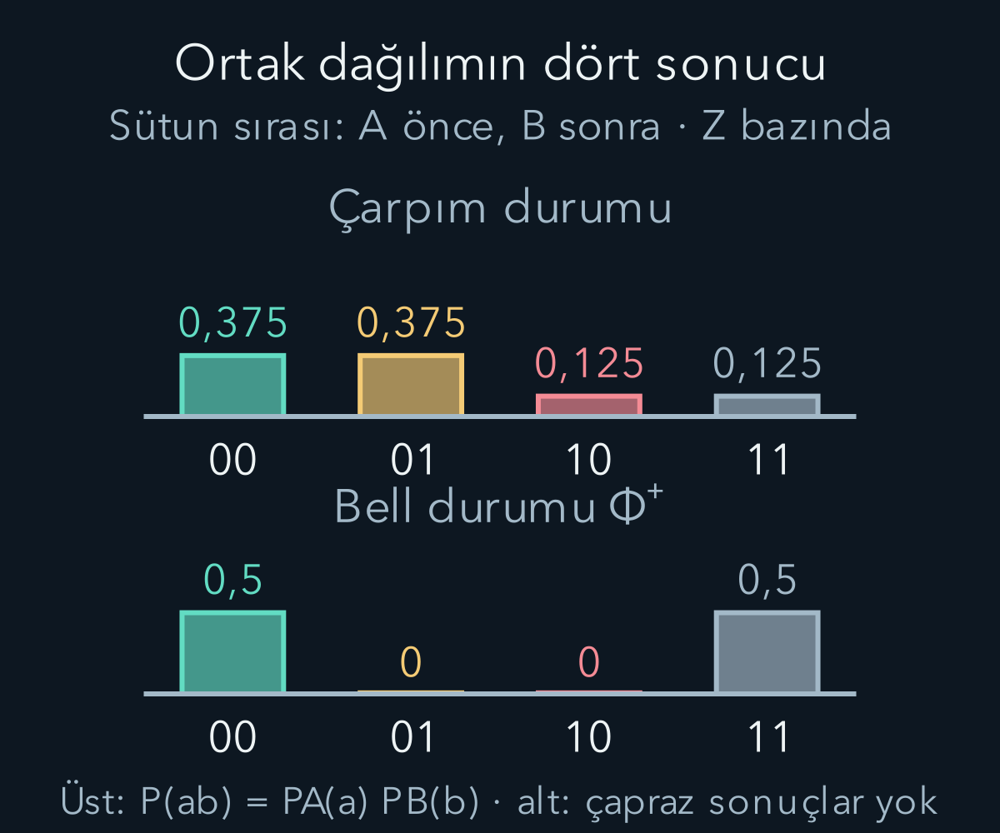
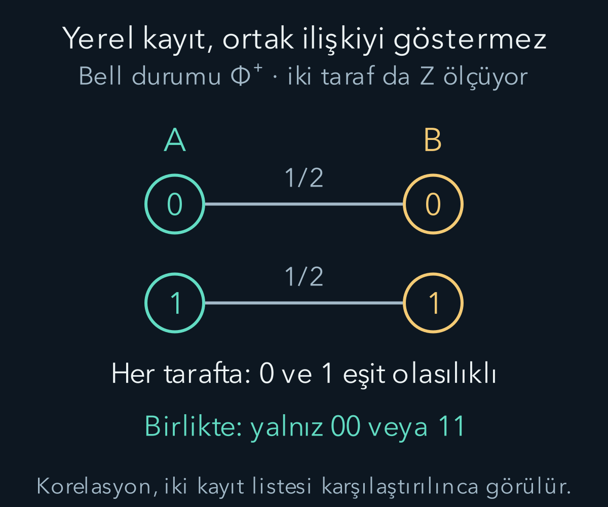

import ArticleVideo from '@/components/ArticleVideo.astro'
import kavram from './media/01-kavram.mp4?url'
import kavramPoster from './media/01-kavram.jpg?url'

İki kuantum sistemi için yalnız ayrı ayrı durumları söylemek her zaman yeterli değildir. İki sistemin ortak ölçümlerinde görülen ilişkiler, bütünün durumunda ek bilgi taşıyabilir. Bu bilgiyi yazmak için **tensör çarpımı** kullanacağız. Ardından ayrı durumların çarpımı olarak yazılamayan saf ortak durumlara dolanık diyeceğiz.

[Durum vektörleri](/blog/kuantum-durumu-superpozisyon-ve-born-kurali/) ve [ölçüm işleçleri](/blog/kuantum-gozlenebilirleri-ve-beklenen-deger/) ön bilgilerimizdir. Birbirinden ayırt edilebilen A ve B adlı iki sistem ele alıyoruz; her birinin durum uzayı iki boyutlu olsun. Özdeş parçacıklarda değiş tokuş simetrisi gibi ek kuralları bu örneğe karıştırmıyoruz. Alt sistem etiketleri deneyde hangi parçanın nerede ölçüldüğünü belirler.

## 1. Bileşik bazın dört seçeneği

Her sistemin ortonormal bazını $|0\rangle$ ve $|1\rangle$ diye adlandıralım. Bunlar önceki spin örneğinde $|+z\rangle$ ve $|-z\rangle$ olabilir; sıfır ve bir fiziksel enerji veya spin büyüklüğü değildir, durum etiketidir. Ortak baz vektörleri $|0\rangle_A\otimes|0\rangle_B$ gibi yazılır. $\otimes$ tensör çarpımı işaretidir.

Kısa gösterimde $|00\rangle$, $|01\rangle$, $|10\rangle$, $|11\rangle$ kullanacağız. İlk rakam A'ya, ikinci B'ye aittir. Baz sıramızı tam bu sırada sabitliyoruz. Böylece genel saf durum:

$$
|\Psi\rangle=c_{00}|00\rangle+c_{01}|01\rangle
+c_{10}|10\rangle+c_{11}|11\rangle
$$

olur. Sütun gösteriminde katsayılar $(c_{00},c_{01},c_{10},c_{11})^T$ sırasındadır. Başka bir sıra seçmek mümkündür, fakat matrisleri de aynı sıraya göre yazmak gerekir. Sıraları hesap ortasında değiştirmek fiziksel bir etki değil, gösterim hatası üretir.

Bileşik uzayın boyutu iki artı iki değil, iki çarpı ikidir. Çünkü her A seçeneği her B seçeneğiyle eşleşebilir. Üç iki durumlu sistemde aynı mantık sekiz baz durumu verir. Boyut artışı, ayrı sistemlerin seçeneklerini birlikte kaydetmemizden doğar.

## 2. İç çarpım ve normalleşme

Çarpım durumlarında iç çarpım bileşenlere ayrılır:

$$
(\langle a|\otimes\langle b|)(|c\rangle\otimes|d\rangle)
=\langle a|c\rangle\langle b|d\rangle.
$$

Her alt baz ortonormal olduğu için dört ortak baz vektörü de ortonormaldir. Genel durumda norm karesi $|c_{00}|^2+|c_{01}|^2+|c_{10}|^2+|c_{11}|^2$ olur. Bunun bir olmasını isteriz. Ortak baz ölçümünde $ab$ sonucu olasılığı $|c_{ab}|^2$'dir.

Örneğin A'nın sıfır sonucunun olasılığı için B'nin iki olası sonucunu toplarız: $P_A(0)=|c_{00}|^2+|c_{01}|^2$. B'nin sonucunu bilmediğimizde ortak dağılımdan **marjinal dağılım** elde etmiş oluruz. Bu işlem, kuantum genliklerini gelişigüzel toplamak değildir; birbirinden ayırt edilen B sonuçlarının olasılıkları toplanır.

Buna karşılık farklı genliklerin aynı ortak sonuca katkısı varsa önce bu genlikler toplanır. Hangi durumların alternatif sonuç, hangilerinin aynı sonuca giden ayırt edilemez katkılar olduğunu belirtmek gerekir. Tensör bazını açık tutmak bu ayrımı sistemli hâle getirir.

## 3. Ayrı hazırlanan iki sistemin çarpımı

A durumu $\alpha|0\rangle+\beta|1\rangle$, B durumu $\gamma|0\rangle+\delta|1\rangle$ olsun. Tensör çarpımı her bileşende doğrusaldır. Dağıtırsak:

$$
|\psi_A\rangle\otimes|\phi_B\rangle
=\alpha\gamma|00\rangle+\alpha\delta|01\rangle
+\beta\gamma|10\rangle+\beta\delta|11\rangle.
$$

Böyle yazılabilen saf durumlara **çarpım durumu** denir. Alt durumlar normalizeyse ortak norm da birdir; çünkü $(|\alpha|^2+|\beta|^2)(|\gamma|^2+|\delta|^2)=1$ olur. Ortak baz olasılıkları da ayrı olasılıkların çarpımıdır.

Somut olarak A'yı $(\sqrt3|0\rangle+|1\rangle)/2$, B'yi $(|0\rangle+i|1\rangle)/\sqrt2$ hazırlayalım. Ortak katsayılar $(\sqrt3,i\sqrt3,1,i)^T/(2\sqrt2)$ olur. Olasılıklar sırasıyla $3/8,3/8,1/8,1/8$ çıkar. A'nın sıfır olasılığı $3/4$, B'nin sıfır olasılığı $1/2$; ortak sıfır-sıfır olasılığı bunların çarpımı $3/8$'dir.

Bu bağımsızlık, seçilen çarpım hazırlığına aittir. İki fiziksel sistemin uzayda uzak olması tek başına ortak durumlarının çarpım olmasını gerektirmez. Önce birlikte etkileşmiş ve daha sonra ayrılmış olabilirler. Uzaklık ile durumun ayrışabilirliği farklı sorulardır.

## 4. Her dört bileşen çarpıma ayrılır mı?

Katsayıları ikiye iki bir tabloda toplayalım:

$$
C=\begin{pmatrix}c_{00}&c_{01}\\c_{10}&c_{11}\end{pmatrix}.
$$

Çarpım durumunda bu tablo $(\alpha,\beta)^T(\gamma,\delta)$ dış çarpımıdır. Satırlar orantılıdır ve determinant sıfır olur: $c_{00}c_{11}-c_{01}c_{10}=0$. Tersine, sıfır olmayan ikiye iki katsayı tablosunun determinantı sıfırsa rütbesi birdir ve bir sütunla satırın çarpımı olarak ayrılabilir.

Örneğin $c_{00}\ne0$ ise tabloyu $(c_{00},c_{10})^T(1,c_{01}/c_{00})$ diye yazabiliriz; son elemanın doğruluğu determinant koşulundan gelir. İlk eleman sıfırsa sıfır olmayan başka bir elemanı başlangıç alırız. Ortak durum normalizeyse elde edilen iki çarpanı karşılıklı ölçekleyerek ayrı ayrı normalleştirmek mümkündür.

Dolayısıyla iki iki boyutlu sistemin **saf** durumu için determinantın sıfır olmaması dolanıklık ölçütüdür. Bu testi gelişigüzel karışık durumlara uygulamayacağız; onlar tek bir katsayı tablosuyla temsil edilmez. Saf durum koşulu, bu kısa ölçütün temel parçasıdır.

## 5. Bir Bell durumunu incelemek

Şu durumu seçelim:

$$
|\Phi^+\rangle=\frac{|00\rangle+|11\rangle}{\sqrt2}.
$$

Katsayı tablosu $C=\operatorname{diag}(1,1)/\sqrt2$ olduğundan determinant $1/2$'dir. Sıfır değildir; durum iki ayrı saf durumun çarpımı olarak yazılamaz. Buna dolanık saf durum deriz. ‘İki sistemin ne olduğunu bilmiyoruz’ biçimindeki sıradan eksik bilgiyle bu matematiksel ayrışmama özelliğini özdeşleştirmiyoruz.

Ortak $z$ bazında ölçüm yapıldığında yalnız 00 ve 11 sonuçları çıkar; her birinin olasılığı $1/2$'dir. A'nın tek başına sonucu rastgeledir, B'nin tek başına sonucu da rastgeledir. Fakat sonuçlar birlikte karşılaştırıldığında eşittir. A'da sıfır görülmüş olması koşuluyla B'nin sıfır olasılığı birdir.

Bu tek baz korelasyonu, klasik olarak aynı sayıyı iki kutuya koymakla da taklit edilebilir. Dolanıklığın ayırt edici yapısını görmek için başka bazları da incelemeliyiz. Tek bir yönde mükemmel eşleşme görmek, kendi başına bütün kuantum ortak durumunu belirlemez.

## 6. Aynı durumu başka bazda yazmak

$|+\rangle=(|0\rangle+|1\rangle)/\sqrt2$ ve $|-\rangle=(|0\rangle-|1\rangle)/\sqrt2$ olsun; bunlar $x$ bazıdır. Ters ifadeler $|0\rangle=(|+\rangle+|-\rangle)/\sqrt2$, $|1\rangle=(|+\rangle-|-\rangle)/\sqrt2$ olur. Bell durumuna yerine koyarsak çapraz terimler birbirini götürür:

$$
|\Phi^+\rangle=\frac{|++\rangle+|--\rangle}{\sqrt2}.
$$

Çapraz terimlerin iptalini görmek için iki parçayı ayrı açmak yeterlidir:

$$
\begin{aligned}
|00\rangle&=\tfrac12(|++\rangle+|+-\rangle+|-+\rangle+|--\rangle),\\
|11\rangle&=\tfrac12(|++\rangle-|+-\rangle-|-+\rangle+|--\rangle).
\end{aligned}
$$

Toplamda $|+-\rangle$ ile $|-+\rangle$ katsayıları sıfır olur; kalan iki katsayı birdir. Bell durumunun dışındaki $1/\sqrt2$ çarpanı korunur. Burada iptal edilenler **genliklerdir**. Klasik 00/11 karışımında iki hazırlığın genliklerini bu biçimde toplayamayız: her hazırlığın dört $x$ sonucu olasılığı $1/4$'tür ve yarı yarıya ağırlıklı olasılık toplamı yine $1/4$ kalır. İki hesabın ayrıldığı işlem tam bu noktadır.

Yani iki taraf da $x$ ölçtüğünde yine eşit sonuçlar oluşur. Buna karşılık yarı yarıya 00 veya 11 hazırlanan klasik karışımda her alt durum $x$ ölçümlerinde bağımsız eşit sonuçlar verir; dört ortak sonuç da $1/4$ olur. Aynı $z$ dağılımına sahip iki hazırlığı, $x$ bazındaki ortak istatistikle ayırabiliriz.

Her yönde aynı korelasyon işaretini beklememeliyiz. $|\Phi^+\rangle$ için $y$ bazında sonuçlar ters ilişkilidir. Karmaşık fazların eşlenik etkisi önemlidir. Bütün eksenlerde ters korelasyon veren özel durum ise birazdan tanımlayacağımız singlet durumudur; Bell durumlarının tümünü tek bir yön resmiyle anlatmak hatalıdır.

## 7. Yalnız bir sisteme etki eden işleç

A sisteminde bir $M$ işleci uygularsak bütün uzayda $M\otimes I$ kullanırız. $I$, B'yi değiştirmeyen birim işleçtir. B'de $N$ uygulamak ise $I\otimes N$ olur. Çarpım durumlarında $(M\otimes N)(|a\rangle\otimes|b\rangle)=M|a\rangle\otimes N|b\rangle$ bağıntısı geçerlidir; doğrusallıkla genel duruma genişler.

Baz sıramızda $X=\sigma_x$ alırsak $X\otimes I$, 00 ile 10'u, 01 ile 11'i yer değiştirir. $I\otimes X$ ise 00 ile 01'i, 10 ile 11'i değiştirir. Matris biçiminde:

$$
X\otimes I=\begin{pmatrix}0&0&1&0\\0&0&0&1\\1&0&0&0\\0&1&0&0\end{pmatrix}.
$$

Bu **Kronecker çarpımı** gösterimidir: $X$'in her elemanı, o sayıyla çarpılmış ikiye iki $I$ bloğuna dönüşür. Böylece hangi alt sisteme dokunduğumuzu dört boyutlu hesapta açıkça takip ederiz. Yanlış baz sırası aynı tabloyu başka bir işleme çevirebilir.

## 8. Ayrı sistemlerdeki yerel işlemler

Çarpım kuralından $(M\otimes I)(I\otimes N)=M\otimes N=(I\otimes N)(M\otimes I)$ çıkar. Yani farklı alt sistemlere etki eden bu işlemler değişmelidir. Bu, aynı sistemdeki $S_x$ ve $S_z$ işleçlerinin değişmeli olmamasıyla çelişmez; artık farklı tensör faktörlerinde çalışıyoruz.

Yerel üniter işlemler bir saf çarpım durumunu yine çarpım durumuna götürür: $(U_A\otimes U_B)(|a\rangle\otimes|b\rangle)=U_A|a\rangle\otimes U_B|b\rangle$. Ayrıca dolanık saf durumu böyle işlemlerle çarpım hâline getiremeyiz; getirebilseydik ters yerel üniterleri uygulayarak çarpımdan dolanıklık üretmiş olurduk. Bileşenlerin ayrı ayrı yeniden adlandırılması veya döndürülmesi, ortak ayrışmama özelliğini ortadan kaldırmaz.

Gerçek iki sistem etkileşimi ise çarpım başlangıçtan dolanıklık üretebilir. Örneğin A sıfırsa B'yi bırakıp A birse B'yi ters çeviren kontrollü işlem, $(|0\rangle+|1\rangle)|0\rangle/\sqrt2$ durumunu $|\Phi^+\rangle$'ya götürür. Bu işlemin iki parçaya ayrı ayrı uygulanan çarpım üniter olmadığını sonuçtan da görürüz.

## 9. Ölçümde koşullama ve marjinal dağılım

$|\Phi^+\rangle$ durumunda B'nin $z$ ölçümünde sıfır sonucu seçilirse ortak durum $|00\rangle$ olur; A'nın koşullu durumu sıfırdır. B'nin bir sonucu seçilirse A'nın koşullu durumu birdir. Ancak B'nin sonucu seçilemez; iki seçenek eşit rastgeleliktedir. A, B'nin hangi sonuca ulaştığını öğrenmeden bütün kendi kayıtlarında yarı yarıya dağılım görür.

B bunun yerine $x$ ölçerse A'nın koşullu durumları artı veya eksi olabilir. Yine sonuçlar yarı yarıyadır. A kendi $z$ ölçümlerinde, artı ve eksi alt topluluklarının her birinden yarı yarıya sonuç aldığı için toplam dağılımı değişmez. Uzak tarafta baz seçimi, koşullu alt toplulukları değiştirirken A'nın koşulsuz kayıtlarını değiştirmez.

Buradaki güncelleme, A'ya kontrol edilebilir bir mesaj taşındığını göstermez. Korelasyonu ayırmak için B'nin hangi sonuca ulaştığı bilgisi sıradan bir iletişim kanalıyla paylaşılmalıdır. Bu bilgi gelmeden A kendi dizisini 00 veya 11 gruplarına hangi ölçüte göre ayıracağını bilemez. Koşullu bilgiyle yerel ölçülebilir dağılımı ayırmak temel noktadır.

<ArticleVideo src={kavram} poster={kavramPoster} title="Bell durumunun ortak sonuçları" caption="Φ⁺ durumunda iki taraf z bazında ölçüldüğünde yalnız 00 ve 11 sonuçları, eşit olasılıkla çıkar. Her tarafın tek başına görülen dağılımı yine yarı yarıyadır." />

## 10. Üniter işlemle mesaj gönderilemediğini hesaplamak

Genel saf durum katsayılarını $c_{ab}$ yazalım. B kendi sistemine üniter $U$ uyguladığında yeni katsayılar $d_{ab}=\sum_kU_{bk}c_{ak}$ olur. A'nın $a$ sonucu olasılığı $\sum_b|d_{ab}|^2$'dir. Açarsak:

$$
\sum_b|d_{ab}|^2
=\sum_{k,l}c_{ak}c_{al}^*\sum_bU_{bk}U_{bl}^*
=\sum_k|c_{ak}|^2.
$$

Son eşitlik üniter sütunların dikliğinden gelir. Böylece B'nin herhangi bir yerel üniter seçimi, A'nın bu bazdaki marjinal olasılığını değiştiremez. A başka bir baz seçerse aynı hesap o bazdaki katsayılarla yapılır; sonuç genel kalır.

Bu ispat yalnız bizim Bell örneğimize özgü değildir. Ölçüp sonucu görmezden gelmek gibi daha genel yerel işlemler için de uygun tamlık koşullarıyla aynı mesaj gönderememe sonucu çıkar. O genel yazımı yoğunluk matrisleriyle daha kısa biçimde ifade edeceğiz. Sonuç, dolanıklığın güçlü korelasyonlar yaratmasıyla uyumludur; kontrol edilebilir uzak iletişim başka bir gerekliliktir.

## 11. Dört Bell durumu

İki iki durumlu sistemde yaygın dört dolanık baz vektörü:

$$
|\Phi^\pm\rangle=\frac{|00\rangle\pm|11\rangle}{\sqrt2},
\qquad
|\Psi^\pm\rangle=\frac{|01\rangle\pm|10\rangle}{\sqrt2}
$$

olarak tanımlanır. Her birinin normu birdir. Aynı iki baz durumunu kullanan artı ve eksi birleşimlerin iç çarpımı $(1-1)/2=0$ olur; farklı çiftleri kullananlar da zaten dik baz bileşenlerine sahiptir. Böylece dört boyutlu uzayın ortonormal başka bir bazını oluştururlar.

$|\Psi^-\rangle$ spin yarım çiftinde **singlet** adı verilen durumdur. Aynı fiziksel eksende ölçülen spin sonuçları ters korelasyon gösterir. İleride farklı eksenler arasındaki korelasyonu bu durumla hesaplayacağız. Burada yalnız adı ve baz tanımını kurduk; herhangi bir ortak durumun bütün eksenlerde aynı davranışı göstereceğini iddia etmiyoruz.

## 12. Ortak Born kuralını açık uygulamak

A tarafında normalleştirilmiş $|u\rangle$, B tarafında $|v\rangle$ sonucunu birlikte arıyorsak ortak genlik $(\langle u|\otimes\langle v|)|\Psi\rangle$ olur. Olasılık bunun mutlak değer karesidir. Bu tek ifade, farklı bazlardaki bütün ortak ölçüm hesaplarını kapsar. Yalnız katsayı tablosunda görünen kareleri almak, ancak ölçüm tablonun yazıldığı bazdaysa doğrudur.

Örneğin Bell durumunda A'nın sıfır, B'nin artı sonucunun genliği $[\langle0|0\rangle\langle+|0\rangle+\langle0|1\rangle\langle+|1\rangle]/\sqrt2$ olur. İlk terim $1/\sqrt2$, ikinci sıfırdır; dış çarpanla sonuç $1/2$ çıkar. Olasılık $1/4$'tür. Aynı şekilde 0-eksi, 1-artı ve 1-eksi sonuçları da dörtte birdir. Biri z, diğeri x ölçtüğünde bu Bell durumunda sonuçlar korelasyonsuz görünür; iki taraf aynı uygun bazı seçtiğinde korelasyon belirir.

Bu durum, dolanıklığın her ölçüm çiftinde mutlaka görünür bir ilişki üreteceği anlamına gelmediğini gösterir. Ölçüm seçimi ortak durumun hangi yönünü açığa çıkardığını belirler. Korelasyonsuz tek bir tablo görmek de sistemlerin kesinlikle çarpım durumda olduğunu kanıtlamaz. Tam durum hakkında sonuç çıkarmak, yeterince farklı ölçüm bilgisini gerektirir.

Bir başka sayısal kontrol için $\sqrt{3/4}|00\rangle+\sqrt{1/4}|11\rangle$ durumunu alabiliriz. Normalize olmakla birlikte determinantı $\sqrt3/4$ olduğundan dolanıktır. Yerel z dağılımları artık yarı yarıya değil, üçte dört ve dörtte birdir. Dolanıklık ile yerel eşit rastgelelik aynı özellik değildir; eşit dağılım kullandığımız Bell durumunun özel simetrisinden gelir. B'nin yerel üniter işlemlerinin A marjinalini değiştirememesi ise bu eşit olmayan örnekte de aynı genel ispatla geçerlidir.

Koşulları ayrı tutmak, genellemenin kapsamını görünür kılar.

## 13. Dolanıklık ile sıradan korelasyonu ayırmak

Korelasyon, ortak olasılık dağılımının ayrı dağılımların çarpımına ayrılmamasıdır. Bu klasik sistemlerde de bulunabilir. Dolanıklık ise kuantum durumunun yapısına ilişkin daha güçlü bir kavramdır. Saf durumda ayrı ketlerin çarpımına ayrılamama diye tanımladık. Karışık durumlarda, çarpım durumlarının klasik karışımları da hesaba katılacağından tanım genişletilmelidir.

Aynı $z$ kayıtlarını üreten saf Bell durumu ve klasik 00/11 karışımı, neden yalnız tek bir korelasyon tablosuna bakmanın yetersiz olduğunu gösterdi. Durumu ayırt etmek için farklı ortak ölçümler gerekir. Hangi özelliklerin yerel ölçümlerle, hangilerinin ortak karşılaştırmalarla görülebileceğini ayrı tutacağız.

Şimdi bütünün saf durumu bilinse bile bir alt sistemi tek bir saf ketle anlatmanın neden yetmeyebileceğine hazırız. Bir sonraki yazı, hem klasik hazırlama karışımlarını hem dolanık bir bütünün tek parçasını aynı matematikte ele alan yoğunluk matrislerini kuracak. Bu dil, olasılıkların nereden geldiğini karıştırmadan ortak ve yerel bilgiyi izlememizi sağlayacak.

## Kaynakça

Aşağıdaki açık kaynaklar 11 Ekim 2026 tarihinde yeniden doğrudan kontrol edildi. Metin, hesap örnekleri ve şekiller bu yazı için özgün olarak hazırlandı.

- [MIT OpenCourseWare — Multiparticle States and Tensor Products](https://ocw.mit.edu/courses/8-05-quantum-physics-ii-fall-2013/resources/lecture-notes-8/): Bileşik durum uzayı, yerel işlemler ve dolanıklık.
- [Caltech, Feynman Lectures — Other Two-State Systems](https://www.feynmanlectures.caltech.edu/III_10.html): İki durumlu modeller için arka plan.
