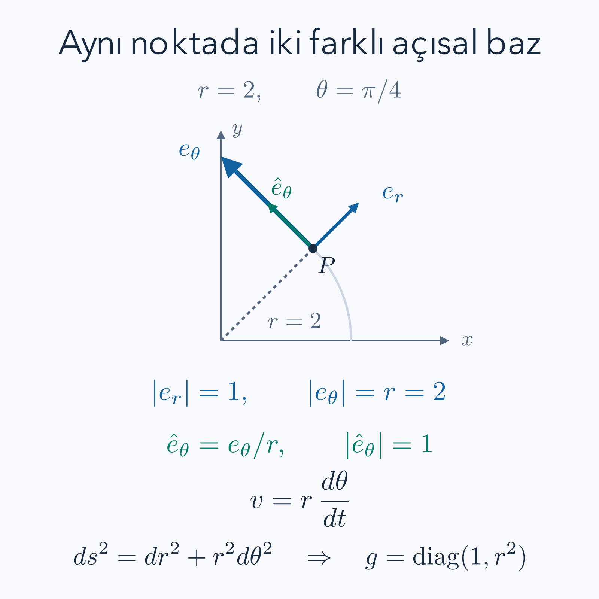

Bir okun yönünü değiştirmeden cetvellerimizi değiştirirsek, oku tarif eden sayılar değişebilir. İki farklı sayı listesi aynı geometrik nesneyi anlatabilir. Tensör hesabının temel sorusu şudur: **koordinatları değiştirdiğimizde hangi sayılar nasıl değişmeli ki anlattığımız nesne aynı kalsın?** İndislerin üstte veya altta yazılması bu değişim kuralını görünür kılar.

[Vektör bileşenleri](/blog/vektorler-ve-bilesenleri/), [baz kavramı](/blog/dogrusal-birlesim-baz-ve-boyut/), [matrisler](/blog/matrisler-ve-dogrusal-donusumler/), [çok değişkenli türev](/blog/cok-degiskenli-fonksiyonlar-ve-turev/) ve [koordinat dönüşümleri](/blog/cok-katli-integraller-ve-koordinatlar/) bu yazının ön bilgileridir. Gereken zincir kuralını yeniden kullanarak dönüşüm formüllerini türeteceğiz. Genel görelilik bilmek gerekmiyor; Öklid düzleminin polar koordinatları bütün temel ayrımları gösterecek.

## 1. Vektör ve onu yazdığımız baz farklıdır

İki boyutlu gerçek bir vektör uzayında baz vektörlerine $e_1,e_2$, vektörün bileşenlerine $V^1,V^2$ diyelim. Vektörü

$$
V=V^1e_1+V^2e_2
$$

biçiminde yazarız. Üstteki indis şu anda dönüşüm türünü işaretler; üs değildir. $V^2$, vektör bileşeninin karesi değil ikinci bileşenidir. Karesini istersek $(V^2)^2$ yazarız. Bu ilk ayrım, uzun formüllerde hangi işlemin yapıldığını doğru okumak için önemlidir.

Bazı değiştirdiğimizde aynı $V$ için başka katsayılar gerekir. Örneğin $e'_1=2e_1$, $e'_2=e_2$ seçelim. $V=6e_1+4e_2$ iken $V=3e'_1+4e'_2$ olur. Birinci baz oku iki kat uzadığı için onu üç kez toplamak yeterlidir. Bileşenin yarıya inmesi, geometrik okun yarıya indiği anlamına gelmez. Bir vektörü yalnız sayılarıyla tanımlarken baz bilgisini örtük de olsa saklarız.

## 2. Einstein toplam kuralını güvenle okumak

Aynı terimde bir kez üstte ve bir kez altta yinelenen indis üzerinden toplama yapacağız. Böylece $V=V^ie_i$, iki boyutta bir önceki açık toplamın kısaltmasıdır. Bu yazıda indisler iki boyutta $1,2$, gerektiğinde üç boyutta $1,2,3$ değerlerini alır. Boyutu bilmeden bir toplamın kaç terim içerdiğini bilemeyiz.

Tekrar eden indise kukla indis denir; adını her iki yerde birlikte değiştirebiliriz. $a_iV^i=a_jV^j$ aynı sayıdır. Buna karşılık $W^i=M^i{}_jV^j$ eşitliğinde $i$ serbest indistir: her $i$ için ayrı bir bileşen denklemi vardır. İki boyutta bu ifade

$$
\begin{aligned}
W^1&=M^1{}_1V^1+M^1{}_2V^2,\\
W^2&=M^2{}_1V^1+M^2{}_2V^2
\end{aligned}
$$

anlamına gelir. Sol ve sağ tarafta aynı serbest indisler bulunmalıdır. $W^i=M^j{}_kV^k$ yazımı geçersizdir; solda $i$, sağda $j$ serbest bırakılmıştır. $a_iV^iW^i$ de bu kuralla geçersizdir: aynı indis üç kez kullanılmıştır. $a_iV^i+b_jW^j$ ise iki skalerin toplamı olarak geçerlidir. İndis kuralları doğruluğu tek başına kanıtlamaz, ama yanlış türde nesnelerin eşitlenmesini erken fark ettirir.

## 3. Koordinat dönüşümü ve Jacobian

Eski koordinatlara $x^i$, yenilerine $q^a$ diyelim. Dönüşümün ilgili bölgede düzgün ve terslenebilir olduğunu varsayıyoruz. Jacobian matrisini

$$
J^a{}_i=\frac{\partial q^a}{\partial x^i},\qquad
K^i{}_a=\frac{\partial x^i}{\partial q^a}
$$

diye tanımlayalım. $K$, $J$'nin tersidir. Zincir kuralıyla

$$
J^a{}_iK^i{}_b=\frac{\partial q^a}{\partial q^b}=\delta^a{}_b
$$

bulunur. Kronecker deltası $\delta^a{}_b$, indisler aynıysa bir, farklıysa sıfırdır; birim matrisin bileşenleridir. Benzer biçimde $K^i{}_aJ^a{}_j=\delta^i{}_j$ olur. Jacobianın determinantı sıfırsa bu yerel tersleme yapılamaz; kullanacağımız dönüşüm kurallarının geçerlilik bölgesini belirtmek zorundayız.

Koordinatlar her zaman bir vektörün bileşenleri değildir. Örneğin polar açı bir yer etiketidir; açının üstüne indis yazılması onu kendiliğinden vektör yapmaz. Vektör dönüşümünü koordinatların sonlu farklarından değil, bir eğrinin o noktadaki türevinden kuracağız.

## 4. Üst indisli bileşenlerin dönüşümünü türetmek

Bir eğrinin parametresi $t$ olsun. Teğet vektör bileşenleri eski koordinatlarda $V^i=dx^i/dt$, yenilerde $V'^a=dq^a/dt$ olarak tanımlansın. Zincir kuralı

$$
V'^a=\frac{dq^a}{dt}
=\frac{\partial q^a}{\partial x^i}\frac{dx^i}{dt}
=J^a{}_iV^i
$$

verir. Bu dönüşüm türüne kontravaryant denir. Kelimeyi ezberlemek yerine formülü okuyabiliriz: yeni koordinatın eski koordinata göre türeviyle çarpılır.

Koordinat baz vektörleri $e_i=\partial r/\partial x^i$ ise yeni baz $e'_a=\partial r/\partial q^a=K^i{}_ae_i$ olur. Buradaki $r$ düzlemdeki konum vektörüdür. Aynı vektörü yeniden kurarsak

$$
V'^ae'_a=J^a{}_jV^jK^i{}_ae_i
=\delta^i{}_jV^je_i=V^ie_i.
$$

Bileşen ile bazın ters matrislerle dönüşmesi, birbirlerini tam dengelemelerini sağlar. Bu yüzden koordinat sayıları değiştiği halde geometrik vektör değişmez. Genel bir yüzeyde de teğet vektörün zincir kuralı üzerinden tanımı aynı yapıyı verir; onu çevreleyen üç boyutlu bir çizim varsaymamız gerekmez.

## 5. Dual baz ve kovektör ne yapar?

Bir kovektör, bir vektörü alıp doğrusal biçimde gerçek sayıya dönüştüren fonksiyondur. Ona $\alpha$ dersek $\alpha(aV+bW)=a\alpha(V)+b\alpha(W)$ şartını isteriz. Örneğin $(V^1,V^2)$ bileşenlerinden $2V^1-V^2$ sayısını çıkaran işlem kovektördür. Vektör bir yönü tarif ederken kovektör o yön üzerinde bir ölçüm yapar.

Dual baz $\epsilon^1,\epsilon^2$, $\epsilon^i(e_j)=\delta^i{}_j$ koşuluyla tanımlanır. Yani birinci dual baz, birinci bileşeni okur; ikinci dual baz ikinciyi okur. Kovektörün açılımı $\alpha=\alpha_i\epsilon^i$ ve vektöre etkisi

$$
\alpha(V)=\alpha_iV^i
$$

olur. Alt indis burada kovaryant bileşeni belirtir. Kovektörü “yatay yazılmış bir vektör” diye tanımlamak yeterli değildir; onun yaptığı doğrusal işlemi ve bu işlemin bazdan bağımsızlığını belirtmek gerekir.

Yeni dual baz $\epsilon'^a=J^a{}_i\epsilon^i$ seçilir; çünkü $\epsilon'^a(e'_b)=J^a{}_iK^i{}_b=\delta^a{}_b$. Aynı $\alpha$ için bileşenler ters yönde dönüşmelidir:

$$
\alpha'_a=K^i{}_a\alpha_i.
$$

Kontrol: $\alpha'_aV'^a=K^i{}_a\alpha_iJ^a{}_jV^j=\alpha_i\delta^i{}_jV^j=\alpha_iV^i$. Ölçülen sayı koordinat seçiminden bağımsız kalmıştır.

## 6. Bir ölçek değişiminde iki tür bileşen

Somut örnekte $q^1=2x^1$, $q^2=x^2$ alalım. O zaman $J=\operatorname{diag}(2,1)$, $K=\operatorname{diag}(1/2,1)$ olur. $V=(3,4)$ bileşenleri $V'=(6,4)$ biçimine dönüşür. Önceki baz örneğinde ters yönde bir tanım seçtiğimiz için orada bileşen yarıya inmişti; çelişki yoktur, burada yeni koordinatın sayısal ölçeğini iki katına çıkarıyoruz.

$\alpha=(2,-1)$ kovektörü için $\alpha'=(1,-1)$ bulunur. Eski eşleşme $2\cdot3-1\cdot4=2$, yeni eşleşme $1\cdot6-1\cdot4=2$ olur. Eğer kovektörü de yanlışlıkla $J$ ile çarpsaydık $(4,-1)$ bulur ve $24-4=20$ sonucuna ulaşırdık. Bu hata geometrik ölçümü değiştirmiş olurdu. Üst ve alt indisin farklı dönüşmesinin yalnız bir yazım geleneği olmadığını sayısal sonuçla görmüş olduk.

## 7. Skalerin türevi neden alt indis taşır?

$f$ koordinattan bağımsız bir skaler alan olsun; her noktaya bir sayı atasın. Küçük bir yer değiştirmede değişimi

$$
df=\frac{\partial f}{\partial x^i}dx^i
$$

şeklindedir. Bir eğri üzerinde $df/dt=(\partial_i f)V^i$ olur; burada $\partial_i$, $\partial/\partial x^i$ kısaltmasıdır. Bu ifade, $df$'nin bir teğet vektörü sayıya götüren kovektör olduğunu gösterir. Zincir kuralıyla $\partial f/\partial q^a=K^i{}_a\partial f/\partial x^i$ elde ederiz; dönüşüm de kovaryanttır.

“Gradyan bir vektör değil miydi?” sorusunun cevabı metrikle ilgilidir. Kartezyen Öklid bazında skalerin türev listesi ile ona karşılık gelen gradyan vektörün listesi aynı sayılardan oluşur. Genel koordinatlarda bu ikisini eşlemek için uzunluk ölçen yapıyı kullanmamız gerekir. Sayılar tesadüfen aynı görünürken kavramları ayırmak, polar koordinatlardaki hata riskini azaltır.

## 8. İkinci mertebeden tensörü dış çarpımla kurmak

İki vektör $V,W$ için dış çarpım $T=V\otimes W$ tanımlayalım. Bileşenleri $T^{ij}=V^iW^j$ olur. Bu işlem, üç boyutlu vektörel çarpımla aynı şey değildir; sonuç tek bir vektör değil, iki bağımsız indis taşıyan nesnedir. İki kovektör verildiğinde $T(\alpha,\beta)=\alpha(V)\beta(W)$ sayısını üretir; her girdiye ayrı ayrı doğrusal davranır.

Her çarpana kendi dönüşümünü uygularsak

$$
T'^{ab}=V'^aW'^b
=J^a{}_iJ^b{}_jV^iW^j
=J^a{}_iJ^b{}_jT^{ij}
$$

buluruz. Genel bir $(2,0)$ tensör de bu yasayla dönüşür; tek bir dış çarpım biçiminde yazılması şart değildir, dış çarpımların toplamı gerekebilir. İki alt indisli tensör iki $K$, bir üst bir alt indisli tensör ise bir $J$ ve bir $K$ ile dönüşür.

Dolayısıyla herhangi bir sayı tablosu, yalnız iki indisi olduğu için tensör değildir. Tabloya her koordinat sisteminde nasıl değer atadığımız önemlidir. Eski tabloyu yeni koordinatlarda hiçbir dönüşüm yapmadan aynen bırakmak, genellikle aynı geometrik nesneyi tarif etmez. “Tensör eşittir çok boyutlu dizi” benzetmesi bilgisayarda saklama biçimini anlatabilir; matematiksel tanımı tamamlamaz.

## 9. Daraltma ve serbest indislerin azalması

Karışık bir $M^i{}_j$ tensöründe bir üst ile bir alt indisi eşitleyip toplarsak iz elde ederiz: $M^i{}_i$. Yeni koordinatlarda

$$
\begin{aligned}
M'^a{}_a&=J^a{}_iK^j{}_aM^i{}_j\\
&=\delta^j{}_iM^i{}_j=M^i{}_i.
\end{aligned}
$$

Bu işleme daraltma denir. İki indisi kaldırıp daha düşük mertebeden bir tensör verir; burada bütün indisler gittiği için skaler kaldı. $M=V\otimes\alpha$ için bileşenler $M^i{}_j=V^i\alpha_j$, izi ise $\alpha(V)$'dir. Önceki ölçek örneğinde bu iz iki çıkar.

İki üst indisi doğrudan eşitleyip $T^{ii}$ yazmak genel koordinatlarda aynı skaler kuralını sağlamaz. Kartezyen ortonormal bazda iki üst indisli sayıları toplayarak bildiğimiz iz veya norm ifadelerine ulaşabiliriz; orada örtük birim metrik kullanıyoruz. Genel koordinatlarda gereken alt indisleri metrikten açıkça getireceğiz.

## 10. Metrik, uzunluk ve indis indirme

Metrik $g$, iki vektöre bir iç çarpım veren simetrik, Öklid örneğimizde pozitif tanımlı bir $(0,2)$ tensördür. Bazdaki bileşenleri $g_{ij}=e_i\cdot e_j$ olsun. Uzunluğun karesi

$$
\lVert V\rVert^2=g_{ij}V^iV^j
$$

olur. $V$'ye bir kovektör eşlemek için $V_i=g_{ij}V^j$ tanımlarız. Bu kovektör bir $W$ vektörüne uygulandığında $V_iW^i=g(V,W)$ verir. Üst indisi alta taşımak sayının yerini değiştirmek değildir; metrikle çarpmaktır.

Ters metrik $g^{ij}$, $g^{ik}g_{kj}=\delta^i{}_j$ koşulunu sağlar. Bununla $V^i=g^{ij}V_j$ geri bulunur. Kartezyen birim bazda metrik birim matris olduğundan üst ve alt bileşenler sayısal olarak aynıdır. Koordinat bazının uzunlukları veya aralarındaki açılar değişirse metrik artık birim olmayabilir. İşaretlerin ve ölçeklerin doğru taşınması bu yüzden önemlidir.

## 11. Polar metriği hiçbir terimi atlamadan çıkarmak

Polar koordinatlarda $x=r\cos\theta$, $y=r\sin\theta$ alalım. $r$ orijine uzaklık, $\theta$ radyanla açıdır. Orijini dışlayıp yerel bir açı aralığı seçiyoruz. Noktalarla koordinat çiftlerini düzgün ve terslenebilir biçimde eşleyen böyle yerel bir tanıma koordinat haritası denir. $r=0$'da açı tanımsız olduğu için polar koordinat haritası orijini içeremez. Konum vektörünü türevleyince

$$
e_r=(\cos\theta,\sin\theta),\qquad
e_\theta=(-r\sin\theta,r\cos\theta)
$$

bulunur. Bunlar koordinat bazıdır. Birincinin uzunluğu bir, ikincinin uzunluğu $r$'dir. İç çarpımları sıfırdır. Dolayısıyla

$$
g_{rr}=1,\quad g_{r\theta}=0,\quad g_{\theta\theta}=r^2.
$$

Aynı sonucu diferansiyellerle kontrol edelim:

$$
\begin{aligned}
dx&=\cos\theta\,dr-r\sin\theta\,d\theta,\\
dy&=\sin\theta\,dr+r\cos\theta\,d\theta,\\
dx^2+dy^2
&=(\cos^2\theta+\sin^2\theta)dr^2\\
&\quad+(-2r\cos\theta\sin\theta+2r\sin\theta\cos\theta)dr\,d\theta\\
&\quad+r^2(\sin^2\theta+\cos^2\theta)d\theta^2\\
&=dr^2+r^2d\theta^2.
\end{aligned}
$$

Çapraz terimler birbirini götürür. Bu nedenle $g=\operatorname{diag}(1,r^2)$, $g^{-1}=\operatorname{diag}(1,r^{-2})$ olur. Düzlem geometrisi eğrilmedi; koordinat cetvelinin açısal kolu yarıçapla uzadı.

*Koordinat bazı $e_\theta$, aynı açısal değişim için yarıçapla büyür. Birim açısal yön $\hat e_\theta=e_\theta/r$ ayrı bir baz vektörüdür.*

## 12. Koordinat bileşeni ile fiziksel bileşen aynı sayı değildir

Ortonormal yönler $\hat e_r=e_r$ ve $\hat e_\theta=e_\theta/r$ olsun. Vektör

$$
V=V^re_r+V^\theta e_\theta
=V^r\hat e_r+(rV^\theta)\hat e_\theta
$$

şeklinde yazılır. Birim yönlere göre fiziksel bileşenler $V^{\hat r}=V^r$, $V^{\hat\theta}=rV^\theta$'dır. Hız örneğinde $V^r=\dot r$ metre/saniye, $V^\theta=\dot\theta$ saniyenin tersi birimindedir; açısal yöndeki doğrusal hız $r\dot\theta$ metre/saniyedir.

$r=2$ metre ve $\theta=0$ noktasında Kartezyen hız $(3,4)$ metre/saniye olsun. Bazlar $e_r=(1,0)$ ve $e_\theta=(0,2)$ olduğundan polar koordinat bileşenleri $(3,2)$'dir. Uzunluk karesi $3^2+2^2$ değildir:

$$
\lVert V\rVert^2=1\cdot3^2+4\cdot2^2=9+16=25.
$$

İndisi indirilmiş bileşenler $V_r=3$, $V_\theta=r^2V^\theta=8$ olur. Bunlar fiziksel bileşenler $(3,4)$ ile de aynı liste değildir. Üç farklı liste, üç farklı baz veya eşleme anlamına gelir; her biri doğru yerde kullanıldığında aynı hız büyüklüğünü verir.

## 13. Kovektör eşleşmesi ve çift daraltma için sayısal kontrol

Aynı noktada Kartezyen $\alpha=(2,-1)$ kovektörünü alalım. $dx/dr=1$, $dy/dr=0$, $dx/d\theta=0$, $dy/d\theta=2$ olduğundan $\alpha_r=2$, $\alpha_\theta=-2$ olur. Polar eşleşme $2\cdot3+(-2)\cdot2=2$, Kartezyen eşleşme $2\cdot3-1\cdot4=2$ verir.

İkinci bir vektörü Kartezyen $W=(-1,2)$ seçelim. Polar bileşenleri $W^r=-1$, $W^\theta=1$'dir. $T=V\otimes W$ için

$$
(T^{ab})=\begin{pmatrix}-3&3\\-2&2\end{pmatrix}.
$$

İki indisi indirmek $T_{ab}=g_{ac}g_{bd}T^{cd}$ demektir. Köşegen metrikte birinci indis açısalsa bir dört, ikinci indis açısalsa bir dört çarpanı gelir:

$$
(T_{ab})=\begin{pmatrix}-3&12\\-8&32\end{pmatrix}.
$$

Tam daraltmayı dört giriş üzerinden açık yazalım:

$$
T^{ab}T_{ab}=(-3)(-3)+3\cdot12+(-2)(-8)+2\cdot32
=9+36+16+64=125.
$$

Kartezyen dış çarpım $\begin{pmatrix}-3&6\\-4&8\end{pmatrix}$ olduğundan karelerin toplamı $9+36+16+64=125$ çıkar. Ayrıca dış çarpım için $\lVert V\rVert^2\lVert W\rVert^2=25\cdot5=125$ bağımsız kontrolüdür. Dizi girişleri değişti; geometrik skaler değişmedi.

## 14. Polar dual bazın bileşenleriyle ikinci bir kontrol

Polar koordinat bazına karşılık gelen dual baz $dr,d\theta$ kovektörleridir. Bunlar sıradan küçük sayı aralıklarından daha geniş bir anlama sahiptir: bir teğet vektörün radyal ve açısal koordinat hızını okurlar. Kartezyen dual baz $dx,dy$ cinsinden

$$
dr=\cos\theta\,dx+\sin\theta\,dy,
\qquad
d\theta=-\frac{\sin\theta}{r}dx+\frac{\cos\theta}{r}dy
$$

olur. Ters yarıçap çarpanı, açı değişiminin aynı doğrusal harekette büyük yarıçapta daha küçük olmasını ifade eder. Orijinde bu ifade tanımsızdır; bu da polar koordinatların geçerlilik sınırının başka bir görünümüdür.

Dual baz şartlarını tek tek sınayalım. $dr(e_r)=\cos^2\theta+\sin^2\theta=1$; $dr(e_\theta)=-r\cos\theta\sin\theta+r\sin\theta\cos\theta=0$ bulunur. Diğer ikisi $d\theta(e_r)=(-\sin\theta\cos\theta+\cos\theta\sin\theta)/r=0$ ve $d\theta(e_\theta)=\sin^2\theta+\cos^2\theta=1$ olur. Böylece dual bazın her biri yalnız kendi koordinat bileşenini okur.

Örneğin $r=2$, $\theta=\pi/2$ noktasında radyal yön yukarı, açısal baz sola doğrudur ve uzunluğu ikidir. Kartezyen $V=(3,4)$ vektörü için $dr(V)=4$, $d\theta(V)=-3/2$ çıkar. Vektörü geri kurarsak $4(0,1)+(-3/2)(-2,0)=(3,4)$ buluruz. Norm da $4^2+4(-3/2)^2=16+9=25$ verir. Önceki örnekte açıyı sıfır seçmiştik; burada değişen baz yönlerinin hesabı etkisiz bir tesadüf olmadığını kontrol ettik.

## 15. Metrik dönüşümü ve çapraz terimlerin anlamı

Metrik, iki vektörün iç çarpımını aynı tutmalıdır. Eski bileşenlerde $g_{ij}V^iW^j$, yeni bileşenlerde $g'_{ab}V'^aW'^b$ yazalım. $V^i=K^i{}_aV'^a$ ve $W^j=K^j{}_bW'^b$ yerine koyunca

$$
g'_{ab}=K^i{}_aK^j{}_bg_{ij}
$$

bulunur. Metrik iki alt indisli olduğu için iki ters Jacobian taşır. Matris dilinde bu $g'=K^TgK$'dir. Bir dönüşümde vektörler ile metrik aynı matrisle dönüşmez; skaler normun sabit kalması onların birbirini dengelemesine dayanır.

Birim olmayan metrik yalnız eğri koordinatlarda ortaya çıkmaz. Düzlemde eğik doğrusal bir baz da yeterlidir. $e'_1=(1,0)$ ve $e'_2=(1,1)$ seçelim. Uzunluklar bir ve kök iki, aralarındaki iç çarpım birdir. Metrik $\begin{pmatrix}1&1\\1&2\end{pmatrix}$ olur. Bileşenleri $(a,b)$ olan vektör Kartezyen olarak $(a+b,b)$'dir; normu $a^2+2ab+2b^2$ çıkar. İç çarpımdaki çapraz terim, baz vektörlerinin dik olmadığını kaydeder.

$a=1,b=-1$ seçersek vektör $(0,-1)$ olur ve normunun karesi birdir. Metrik hesabı $1-2+2=1$ verir. Yalnız bileşenlerin karelerini toplasaydık iki bulurduk. Bu örnek, metriğin yalnız bir formülde gereken düzeltme çarpanı olmadığını gösterir: bazın uzunluk ve açı bilgisini saklayan geometrik yapıdır.

## 16. Vektörün sıradan kısmi türevi neden tensör değildir?

Bir vektör alanının bileşenleri $V'^a=J^a{}_iV^i$ ile dönüşür. Yeni koordinata göre türev alırken çarpım kuralını unutmayalım:

$$
\partial'_bV'^a
=K^j{}_bJ^a{}_i\partial_jV^i
+K^j{}_b(\partial_jJ^a{}_i)V^i.
$$

İlk terim bir üst, bir alt indisli tensör yasasına uyar. İkinci terim Jacobianın değişiminden gelir ve bu yasada bulunmaz. Sabit doğrusal dönüşümlerde kaybolduğu için Kartezyen eksen değişimlerinde sorunu fark etmeyebiliriz; genel koordinatlarda vardır.

Örneğin sabit Kartezyen $V=(1,0)$ alanının bütün Kartezyen kısmi türevleri sıfırdır. Polar bileşenleri $V^r=\cos\theta$, $V^\theta=-\sin\theta/r$ olur. Bu nedenle $\partial_\theta V^r=-\sin\theta$, $\partial_\theta V^\theta=-\cos\theta/r$ sıfır değildir. Gerçek bir tensör bir koordinatta tamamen sıfırsa her geçerli koordinatta sıfır kalmalıydı. Demek ki yalnız bileşen türevleri tensör oluşturmuyor.

Eksik olan, bazın da değişmesidir. Polar bazda $\partial_\theta e_r=e_\theta/r$, $\partial_\theta e_\theta=-re_r$ bulunur. Tam vektörü türevlediğimizde bu ek terimleri de toplarız. Bağlantı katsayıları denen $\Gamma$ sembolleri bu baz değişimini kaydeder:

$$
\nabla_bV^a=\partial_bV^a+\Gamma^a{}_{bc}V^c.
$$

Burada $\Gamma^r{}_{\theta\theta}=-r$, $\Gamma^\theta{}_{\theta r}=1/r$ terimleri açısal türevde gereklidir. Sabit alan için $\nabla_\theta V^r=-\sin\theta-r(-\sin\theta/r)=0$ ve $\nabla_\theta V^\theta=-\cos\theta/r+\cos\theta/r=0$ çıkar. Bağlantının kendisi tensör değildir; uygun birleşim tensörel türevi verir. Burada yalnız bu gereksinimi ve düzlem örneğini kurduk; eğrilik kuramına geçmedik.

## 17. Mertebe, matris rütbesi ve nokta bilgisi

Bir tensörün türü, kaç vektör ve kaç kovektör girdisine ayrı ayrı doğrusal cevap verdiğini kaydeder. Vektör tek bir kovektörü sayıya götürebilir; kovektör tek bir vektörü sayıya götürür. İki üst indisli tensör iki kovektör girdisi alır. Bu bakış, yalnız bileşen dönüşümünü ezberlemekten daha fazlasını sağlar: hangi tür nesneleri daraltabileceğimizi ve sonucunda ne tür nesne kalacağını önceden söyler. İki vektörü, aralarında bir metrik veya başka bir eşleme olmadan doğal olarak doğrudan sayıya çeviremeyiz.

Tensör mertebesiyle doğrusal cebirdeki matris rütbesi de farklıdır. İki indisli bir dış çarpımın matrisi satırları birbirinin katı olduğu için bir rütbeli olabilir; fakat tensör yine ikinci mertebedendir. Sıfır tensörünün bile belirli bir türü vardır. Onu bütün bileşenleri sıfır diye herhangi bir türdeki denklemde gerekçesiz kullanamayız. Nesnenin girdilerinin ve dönüşümünün ne olduğu, yalnız sıfırların sayısından çıkarılamaz.

Ayrıca dönüşüm formüllerindeki bütün matrisler aynı geometrik noktada değerlendirilir. Polar baz yarıçapa ve açıya bağlı olduğu için bir noktadaki bazla başka noktadaki bileşenleri doğrudan bir araya getirmek yanlış olur. Tek bir noktada tensörleri toplamak ile alanın iki farklı noktadaki değerlerini karşılaştırmak aynı işlem değildir. Son bölümde bağlantıya ihtiyaç duymamızın nedeni bu farktır: türev, yakındaki noktaların verilerini karşılaştırır ve bazın yerle birlikte nasıl değiştiğini hesaba katmak zorundadır.

Bu nedenle indis hesabı yalnız uzun toplamları kısaltan bir yazı sistemi olarak görülmemelidir. Her indisin yeri, nesnenin hangi ölçümü veya dönüşümü temsil ettiğini kaydeder. Bir formül kurarken önce nesneyi ve hangi noktada bulunduğunu belirlemek, sonra indisleri yazmak en güvenilir sıradır. Sembolleri geometriden koparıp yalnız yer değiştiren harfler olarak kullanmak, özellikle eğri koordinatlarda doğru görünen fakat yanlış sonuçlar üretebilir.

## 18. Kaynaklar ve kapsam

Vektör, dual uzay ve koordinat dönüşümlerinin geometrik kuruluşu için [David Tong, Cambridge: Introducing Differential Geometry, bölüm 2.2–2.3](https://www.damtp.cam.ac.uk/user/tong/gr/grhtml/S2.html) doğrudan ders kaynağıdır. Metrik ve indislerin yükseltilip alçaltılması [Tong, Introducing Riemannian Geometry, bölüm 3.1](https://www.damtp.cam.ac.uk/user/tong/gr/grhtml/S3.html) içinde geliştirilir. Matris biçimindeki dönüşümleri ayrıca [MIT OCW, David Roylance: Tensor Transformations](https://ocw.mit.edu/courses/3-11-mechanics-of-materials-fall-1999/resources/mit3_11f99_trans/) üzerinden karşılaştırabilirsiniz.

Bu kaynaklarda daha geniş fizik uygulamaları bulunur; burada gereken matematik Öklid düzleminde bağımsız kuruldu. Koordinatların düzgün ve yerel olarak terslenebilir olması, polar örnekte orijinin dışlanması ve norm hesabında pozitif Öklid metriği kullanılması bütün sonuçlarımızın açık koşullarıdır.
