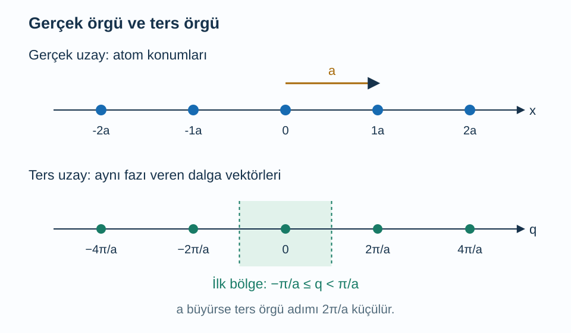
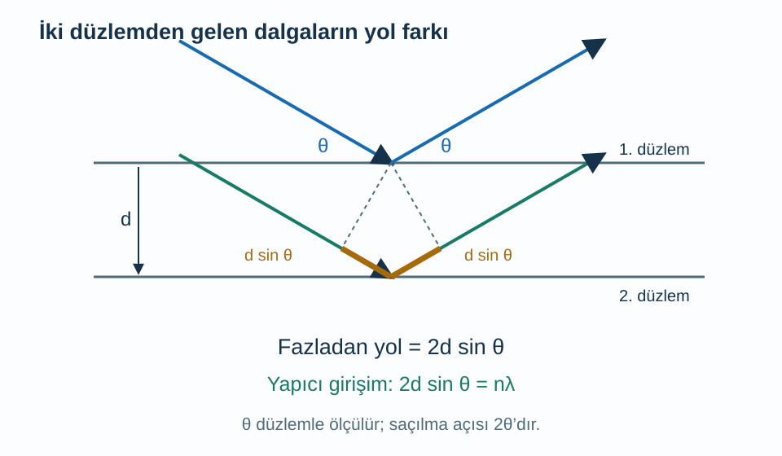

Bir kristalin içindeki atomlar arasındaki uzaklıkları sıradan bir cetvelle ölçemeyiz. Buna karşılık kristale gönderdiğimiz dalganın hangi yönlerde kuvvetlendiğini ölçebiliriz. Tek bir atomun saçtığı dalga çok şey söylemeyebilir; düzenli aralıklarla duran çok sayıda atomun dalgaları birlikte toplandığında, aralarındaki mesafe belirli açılarda belirgin izler bırakır. Kırınım deneyinin temel fikri, bu açısal bilgiden uzaysal düzeni geri okumaktır.

Önce [kristaller ve enerji bantları](/blog/kristaller-ve-enerji-bantlari/), [dalgalar](/blog/dalgalar-ve-dalga-denklemi/) ve [Fourier serileri](/blog/fourier-serileri-ve-dalga-paketleri/) yazılarındaki faz kavramını hatırlayacağız. Bir dalganın fazı, salınımın çevriminin neresinde olduğunu söyler. İki dalganın faz farkı tam bir çevrimse tepeleri yine birlikte gelir. Bu yazıda önce bir boyutlu bir diziden başlayıp üç boyutlu kristallere geçeceğiz. Saçılmayı elastik, gelen ışını yaklaşık tek dalga boylu kabul edeceğiz; yani saçılan dalganın enerjisi değişmeyecek.

## 1. Konumlar neden tek başına yeterli değil?

Doğru boyunca atomlar $x_j=ja$ noktalarında bulunsun. Burada $j$ tam sayı olan atom etiketi, $a$ komşu eşdeğer noktalar arasındaki uzaklık, $x_j$ ise konumdur. Gelen ve saçılan dalganın dalga vektörlerine sırasıyla $\mathbf k_i$ ve $\mathbf k_f$ diyelim. Dalga vektörü, ilerleme yönünü ve birim uzunluktaki faz değişimini birlikte taşır; büyüklüğü $k=2\pi/\lambda$ olur. $\lambda$ dalga boyudur. Uzunluğu metreyle ölçüyorsak $k$ birimi $\mathrm{m^{-1}}$ olur; radyanı boyutsuz sayıyoruz.

Saçılma vektörünü $\mathbf q=\mathbf k_f-\mathbf k_i$ diye tanımlayalım. İşaret seçimi kaynaklar arasında değişebilir; burada bütün denklemlerde bu seçimi kullanacağız. Bir atomu $\mathbf R$ kadar ötelediğimizde saçılan dalganın göreli fazı, seçilen dalga gösterimine göre $\pm\mathbf q\cdot\mathbf R$ kadar değişir. Girişimin kuvvetlenme koşulu işaretten etkilenmez: faz farkı $2\pi$'nin tam sayı katı olmalıdır.

Bir boyutta komşu atomlar için koşul $qa=2\pi m$ olur; $m$ herhangi bir tam sayıdır. Böylece kuvvetli saçılmaya aday değerler:

$$
\begin{aligned}
q&=G_m\\
&=\frac{2\pi m}{a}
\end{aligned}
$$

biçimindedir. $G_m$ değerlerinin oluşturduğu düzen **ters örgüdür**. Bu noktalar atomların yeni konumları değildir. Konumların hangi dalga vektörü değişimleriyle aynı fazı verdiğini kaydeden bir haritadır. Gerçek örgünün aralığı büyürse ters örgünün aralığı küçülür. Bu terslik bir benzetme değil, bağıntının paydasındaki $a$'nın doğrudan sonucudur.

## 2. Çok sayıda atom gerçekten nasıl kuvvetlendirir?

Aynı saçılma genliğine sahip $N$ atom düşünelim. Tek atomun ortak genlik çarpanını şimdilik bir kabul edersek toplam genlik:

$$
A(q)=\sum_{j=0}^{N-1}e^{iqja}
$$

olur. $i^2=-1$ olan $i$ sanal birimdir. $A$ karmaşık bir genliktir; ölçülen şiddet onun mutlak karesiyle orantılıdır. Toplamın ilk terimi $1$, sonraki terimleri $e^{iqa}$, $e^{2iqa}$ biçimindedir. Ardışık terim oranı sabit olduğundan bu bir geometrik seridir. $e^{iqa}\ne1$ iken toplamı yazıp pay ve paydayı uygun yarım fazlarla ayırırsak:

$$
\begin{aligned}
A(q)&=\frac{1-e^{iNqa}}{1-e^{iqa}}\\
|A(q)|^2&=\frac{\sin^2(Nqa/2)}{\sin^2(qa/2)}.
\end{aligned}
$$

Payda sıfır olduğunda bu son kesre doğrudan sayı yerleştirmeyiz. İlk toplama döneriz: $qa=2\pi m$ için bütün terimler $1$ olur, dolayısıyla $A=N$ ve şiddet çarpanı $N^2$ çıkar. Kuvvetlenme, atom sayısı kadar dalga genliğinin aynı yönde toplanmasıdır. Genel bir açıda ise bazı fazlar birbirini kısmen götürür.

Sonlu bir kristalde tepeler sonsuz incelikte değildir. Ana tepenin çevresindeki ilk sıfırlar yaklaşık $\Delta q=\pm2\pi/(Na)$ uzaklıktadır. Kristal uzadıkça tepe daralır. Bu, saçılmanın yalnız örgü aralığını değil, düzenin sürdüğü uzunluğu da taşıyabildiğini gösterir. Gerçek ölçümde cihazın açısal çözünürlüğü ve kristaldeki gerinim de tepeyi genişletebilir; her genişlemeyi küçük tane boyutuna bağlamak doğru olmaz.

Şekilde üstteki eksen uzunluk, alttaki eksen ters uzunluk taşır. İki eksenin üzerindeki sayıları aynı fiziksel uzaklıklar gibi karşılaştırmamalıyız. Renkli aralık, eşdeğer dalga etiketlerinden tek bir küme seçer.

## 3. Üç boyutta ters örgüyü tanımlamak

Üç bağımsız ilkel örgü vektörü $\mathbf a_1$, $\mathbf a_2$, $\mathbf a_3$ olsun. Her örgü noktası bu vektörlerin tam sayı katsayılı toplamıdır. Ters örgünün temel vektörleri $\mathbf b_j$, şu ilişkiyi sağlayacak biçimde tanımlanır:

$$
\mathbf a_i\cdot\mathbf b_j=2\pi\delta_{ij}.
$$

Burada $i,j$ yön etiketleri, $\delta_{ij}$ ise etiketler eşitse $1$, farklıysa $0$ olan Kronecker deltasıdır. Bu tanımın amacı, $\mathbf G=h\mathbf b_1+k\mathbf b_2+l\mathbf b_3$ vektörünün herhangi bir örgü ötelemesiyle skaler çarpımını $2\pi$'nin tam sayı katı yapmaktır. $h,k,l$ tam sayılardır; bu paragraftaki $k$ bir indis olup dalga vektörünün büyüklüğüyle karıştırılmamalıdır.

Basit kübik örgüde üç gerçek örgü vektörü birbirine diktir ve uzunlukları $a$'dır. Bu durumda ters vektörler de aynı doğrultulardadır, uzunlukları $2\pi/a$ olur. Fakat eğik bir örgüde ters vektörlerin yönünü yalnız gerçek vektörün yönünü kopyalayarak bulamayız. Tanımdaki bütün skaler çarpım koşullarını birlikte sağlamamız gerekir. [Tong'un bant yapısı notları](https://davidtong.org/pdfs/teaching/solid-state-physics/solidstate2.pdf), ters örgü ve Brillouin bölgesini bu öteleme koşuluyla tanımlar.

Ters örgü noktasının çevresinde en yakın noktaların orta dikme düzlemlerini çizerek birinci Brillouin bölgesi kurulur. Bu bölge kristalin gerçek uzaydaki dış yüzeyi değildir. Dalga etiketlerinin eşdeğerliklerini düzenler. Kırınımda ise $\mathbf q=\mathbf G$ koşuluyla hangi dalga vektörü değişimlerinin bütün hücrelerde aynı fazı oluşturabileceğine bakarız.

Eğik örgüde vektörleri gerçekten kurmak için $V_c=\mathbf a_1\cdot(\mathbf a_2\times\mathbf a_3)$ yönlü hücre hacmini kullanalım. Sağ elli sıralamada $V_c>0$'dır. İlk ters vektör:

$$
\mathbf b_1=2\pi\frac{\mathbf a_2\times\mathbf a_3}{V_c}
$$

olur; diğer ikisi indisleri döngüsel değiştirerek bulunur. Çapraz çarpım hem $\mathbf a_2$'ye hem $\mathbf a_3$'e dik olduğundan onlarla skaler çarpımı sıfırdır. $\mathbf a_1$ ile çarpınca payda aynen ortaya çıkar ve sonuç $2\pi$ olur. Böylece üç tanım koşulunu ayrı ayrı denetledik. Pay uzunluk karesi, payda uzunluk küpü taşıdığı için ters vektörün birimi de doğru biçimde ters uzunluktur.

## 4. Düzlemler arası uzaklıktan Bragg koşuluna

Birbirine paralel atom düzlemleri arasındaki dik uzaklık $d$ olsun. Gelen ışının bu düzlemlerle yaptığı açıya $\theta$ diyelim. Bu açı düzlemin normaliyle ölçülen açı değildir. Ardışık iki düzlemden saçılan ışınları karşılaştırdığımızda, alttaki düzleme ulaşan ışın hem girişte hem çıkışta fazladan yol alır. Her katkı $d\sin\theta$ olduğundan toplam yol farkı $2d\sin\theta$ olur.

Yol farkı bir tam dalga boyu kadar olduğunda tepeler yeniden üst üste gelir. Daha genel olarak $n$ pozitif tam sayı olmak üzere:

$$
2d\sin\theta=n\lambda
$$

buluruz. Bu **Bragg koşuludur**. Deney cihazları çoğunlukla gelen ışın doğrultusuyla saçılan ışın arasındaki açıyı, yani $2\theta$'yı bildirir. Verilen sayının $\theta$ mı $2\theta$ mı olduğunu kontrol etmeden sinüs hesabına geçmek iki kat açı hatasına yol açar.

Aynı sonucu vektörlerle denetleyebiliriz. Elastik saçılmada $|\mathbf k_i|=|\mathbf k_f|=2\pi/\lambda$ olur. İki vektörün farkının büyüklüğü, aralarındaki $2\theta$ açısı nedeniyle $q=2k\sin\theta$'dır. Düzlem ailesine dik temel ters vektörün büyüklüğü $2\pi/d$ olduğundan $q=n(2\pi/d)$ yazılır. İki ifadeyi eşitleyip $2\pi$ çarpanını sadeleştirdiğimizde aynı Bragg bağıntısı çıkar.

Şekil bir ayna yansıması modeli kurmaz; ayrı saçılma olaylarının yol farkını gösterir. Kristalin içindeki çok sayıda düzlemin dalgaları bu koşulda birlikte kuvvetlenebilir.

## 5. Kristali döndürmek neden farklı tepeler gösterir?

Bir ters örgü vektörünün bulunması, sabit bir gelen ışınla o tepenin mutlaka ölçüleceği anlamına gelmez. Elastik saçılmada çıkış dalga vektörünün uzunluğu girişinkiyle aynı kalmalıdır. $\mathbf k_f=\mathbf k_i+\mathbf G$ ifadesinin karesini alırsak:

$$
\begin{aligned}
|\mathbf k_i+\mathbf G|^2&=|\mathbf k_i|^2,\\
2\mathbf k_i\cdot\mathbf G+|\mathbf G|^2&=0.
\end{aligned}
$$

İkinci satırda iki taraftaki $|\mathbf k_i|^2$ terimleri sadeleşmiştir. Bu denklem uzunluk kadar yönün de önemli olduğunu gösterir. Kristali döndürdüğümüzde ters örgü vektörleri de gelen ışına göre döner; bazıları koşulu sağlarken bazıları sağlamaz. Bir tepenin görünmemesini hemen ilgili düzlemlerin yokluğuna bağlayamayız.

Toz örnekte ise çok sayıda küçük kristal farklı yönlerde durur. Aynı düzlem aralığına sahip tanelerden uygun yönelimde olanlar aynı saçılma açısında katkı verebilir. Böylece tek kristaldeki ayrı yön bilgisi, açısal halkalar veya toz desenindeki tepeler halinde yeniden düzenlenir. Düzlem aralığı bilgisi korunurken yönelim ayrıntısının bir kısmı ortalamaya girer. Ölçüm türünü bilmeden bir kırınım desenini yorumlamak bu nedenle eksik kalır.

## 6. Sayısal örnek: Bir kırınım tepesinden uzaklık ölçmek

Dalga boyu $\lambda=0{,}154\,\mathrm{nm}$ olan ışınla, $2\theta=40{,}0^\circ$ konumunda birinci mertebe bir tepe ölçülsün. İlk işlem yarı açıyı bulmaktır: $\theta=20{,}0^\circ$. Birinci mertebe demek $n=1$ seçmek demektir. Denklemin iki tarafını $2\sin\theta$ ile bölerek:

$$
\begin{aligned}
d&=\frac{\lambda}{2\sin\theta}\\
&=\frac{0{,}154}{2(0{,}34202)}\,\mathrm{nm}\\
&\simeq0{,}2251\,\mathrm{nm}
\end{aligned}
$$

elde ederiz. Sonucun uzunluk birimi taşıması gerekir; sinüsün birimi yoktur. Metreye çevirmek istersek $d=2{,}251\times10^{-10}\,\mathrm m$ olur. Bu, şimdilik yalnız ilgili düzlem ailesinin aralığıdır. Kristalin örgü sabitini elde etmek için tepenin hangi düzlemlere ait olduğunu da bilmeliyiz.

Aynı düzlem ailesinin ikinci mertebesi erişilebilir mi? $n=2$ koyarsak $\sin\theta=\lambda/d\simeq0{,}6840$ çıkar. Bu sayı birden küçük olduğu için geometrik olarak mümkündür; $\theta\simeq43{,}16^\circ$, dolayısıyla $2\theta\simeq86{,}32^\circ$ olur. Mertebe arttıkça açı artar, fakat sinüs birden büyük olamaz. Her mertebenin ölçülebilir bir çözümü yoktur.

## 7. Sayısal örnek: Kübik örgüde indisleri kullanmak

Kübik kristalde $(hkl)$ indisli düzlem ailesinin aralığı:

$$
d_{hkl}=\frac{a}{\sqrt{h^2+k^2+l^2}}
$$

olur. Bunun nedeni düzlemlere dik ters vektörün büyüklüğünün $(2\pi/a)\sqrt{h^2+k^2+l^2}$ olmasıdır. $d=2\pi/|\mathbf G|$ yazınca paydaki ve paydadaki $2\pi$ sadeleşir. İndisler yön bilgisini kodlar; üç rastgele uzunluğun adı değildir.

Örgü sabiti $a=0{,}400\,\mathrm{nm}$ olan basit kübik bir modelde $(110)$ düzlemlerine bakalım. Önce:

$$
\begin{aligned}
d_{110}&=\frac{0{,}400}{\sqrt2}\,\mathrm{nm}\\
&=0{,}2828\,\mathrm{nm}
\end{aligned}
$$

buluruz. Aynı $0{,}154\,\mathrm{nm}$ dalga boyuyla birinci mertebede:

$$
\begin{aligned}
\sin\theta&=\frac{0{,}154}{2(0{,}2828)}\\
&=0{,}27224\\
2\theta&\simeq31{,}59^\circ.
\end{aligned}
$$

Tersine, bu tepeyi $(110)$ diye güvenilir biçimde tanımlamışsak $a=d_{110}\sqrt2$ ile örgü sabitini geri bulabiliriz. Tek bir tepenin indislerini keyfî seçmek yeterli değildir; farklı tepelerden bulunan $a$ değerlerinin birbiriyle uyumlu olması beklenir. Böyle bir tutarlılık kontrolü, geometrik modelin deney verisini gerçekten açıklayıp açıklamadığını sınar.

## 8. İzinli konum her zaman güçlü tepe demek mi?

Hayır. Ters örgü hücreler arası girişimi düzenler; hücrenin içindeki atomlar da kendi aralarında girişim yapar. Hücre içindeki $s$ etiketli atomun konumu $\mathbf r_s$, saçılma ağırlığı $f_s$ ise **yapı faktörü** $F(\mathbf G)=\sum_s f_s e^{i\mathbf G\cdot\mathbf r_s}$ olur. Şiddetin çarpanlarından biri $|F|^2$'dir. Hücreler aynı fazda toplansa bile hücre içindeki katkılar birbirini götürebilir.

Örneğin özdeş iki atomu kübik hücrenin köşesine ve gövde merkezine yerleştirelim. İkinci atomun konumu $a(1,1,1)/2$ olduğundan göreli faz $\pi(h+k+l)$ çıkar. Yapı faktörü $F=f[1+(-1)^{h+k+l}]$ olur. İndis toplamı tekse sıfır, çiftse $2f$ elde edilir. Bu örnek, yalnız Bragg geometrisini bilerek bütün tepe şiddetlerini öngöremeyeceğimizi somutlaştırır.

Son olarak, termal titreşimler, atom türü, kusurlar ve çoklu saçılma ölçümü etkiler. Burada tek saçılma ve ideal periyodiklik sınırında temel geometrik ilişkiyi kurduk. [MIT'nin periyodik katı ders notları](https://ocw.mit.edu/courses/6-730-physics-for-solid-state-applications-spring-2003/pages/lecture-notes/) örgü geometrisini elektron bantlarıyla birlikte ele alır. Artık bir kırınım açısının nasıl bir uzunluk bilgisi taşıdığını ve ters örgünün neden dalga fiziğinin doğal dili olduğunu adım adım okuyabiliriz.
