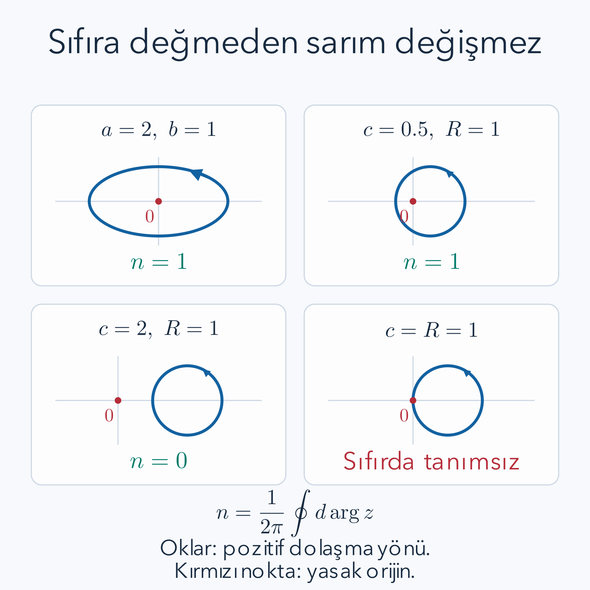

Bir lastik halkayı elipse dönüştürebiliriz; fakat ortasından geçen ve çıkarılamayan bir çiviyi kesmeden dışarı alamayız. Bu resim tek başına matematiksel kanıt değildir. Hangi hareketlere izin verdiğimizi, hangi noktaların yasak olduğunu ve “kesmeden” sözünün süreklilikle nasıl ifade edildiğini belirtmeliyiz. Topoloji bu soruları, uzunluk ve açı ölçümünden önce gelen bir düzeyde ele alır.

Ön bilgi olarak [limit ve süreklilik](/blog/diziler-limit-ve-sureklilik/), [karmaşık sayılar ve Euler bağıntısı](/blog/karmasik-sayilar-ve-euler-bagintisi/), [belirli integral](/blog/belirli-integral-ve-temel-teorem/) ve önceki [karmaşık analiz yazısındaki kontur parametrelemesi](/blog/karmasik-analiz-ve-reziduler/) yeterlidir. Burada yeni bir fizik modeli varsaymayacağız. Son örneğimiz, daha sonra fizik problemlerinde karşımıza çıkabilen iki bileşenli bir fonksiyonun yalnız geometrisini inceleyecek.

## 1. Yakınlığı açık toplarla tarif etmek

Bir metrik $d(p,q)$, iki nokta arasındaki uzaklığı verir. Negatif olmaması, yalnız aynı noktada sıfır olması, simetrik olması ve üçgen eşitsizliğini sağlaması gerekir. Düzlemde alıştığımız Öklid uzaklığı bunun örneğidir. Merkezi $p$, yarıçapı pozitif $\varepsilon$ olan açık top

$$
B_\varepsilon(p)=\{q:d(p,q)<\varepsilon\}
$$

şeklinde tanımlanır. Düzlemde buna açık disk deriz; çember sınırını içermez. Bir $U$ kümesinin her $p$ noktasının çevresine tamamen $U$ içinde kalan böyle küçük bir top koyabiliyorsak $U$ açıktır. Topun yarıçapı noktaya göre değişebilir; tek bir ortak yarıçap bulmak zorunda değiliz.

Gerçek doğrudaki $(0,1)$ aralığında bir $x$ noktası için $\varepsilon=\min(x,1-x)/2$ seçersek iki sınıra da ulaşmadan küçük bir aralık çizebiliriz. Bu yüzden aralık açıktır. $[0,1]$ ise gerçek doğru içinde açık değildir: sıfırın çevresindeki her açık aralık negatif noktalar da içerir. Fakat $[0,1]$'i kendi başına uzay seçersek bütün uzay kendinde açıktır. Açıklık, hangi uzayın içinde konuştuğumuza bağlıdır.

## 2. Topoloji aksiyomları neden bu biçimdedir?

Bir $X$ kümesinin açık altkümeler ailesine $\mathcal T$ diyelim. Bir topoloji için boş küme ve bütün uzay açık olmalı; açık kümelerin keyfî birleşimi açık olmalı; sonlu sayıda açık kümenin kesişimi açık olmalıdır. Bu üç kural, uzaklık verilmeden de yakınlık ve süreklilik konuşmamızı sağlar. Metrikten elde ettiğimiz açık kümeler bu şartları sağlar, ama her topolojiye bir metrik seçmek mümkün değildir.

Birleşim kuralının nedeni şudur: birleşimdeki bir nokta en az bir açık kümededir. O kümede kalan küçük top, birleşimde de kalır. İki açık kümenin kesişiminde bir nokta alırsak her küme için bir yarıçap buluruz; ikisinin küçüğünü seçmek iki kümede birden kalır. Bu yöntemi sonlu sayıda kümeye uzatabiliriz.

“Sonsuz kesişim” demememizin somut nedeni vardır. $U_n=(-1/n,1/n)$ açık aralıklarının tamamını kesiştirince yalnız sıfır kalır. Her sıfır dışı sayı, yeterince büyük $n$ için aralığın dışında kalır. Tek noktalı $\{0\}$ kümesi ise gerçek doğru içinde açık değildir. Böylece topoloji kurallarındaki sonluluk ayrımının keyfî bir teknik ayrıntı olmadığını görüyoruz.

## 3. Sürekliliği ters görüntüyle yeniden okumak

$f:X\to Y$ bir fonksiyon olsun. Hedefteki her açık $U$ kümesi için $f^{-1}(U)$ kaynakta açıksa fonksiyona sürekli deriz. Burada $f^{-1}(U)$ bir kümenin ters görüntüsüdür: çıktısı $U$ içine düşen bütün girdiler. Fonksiyonun tersinin var olmasını gerektirmez.

Örneğin $f(x)=x^2$ ve $U=(1,4)$ seçersek

$$
f^{-1}((1,4))=(-2,-1)\cup(1,2)
$$

olur. Çünkü $1<x^2<4$ şartı $1<|x|<2$ demektir. Ters görüntü iki parçaya ayrılsa da açıktır. Süreklilik, hedefteki tek aralığın kaynakta tek aralık olmasını istemez; ani sıçrama olmamasını açık kümelerle ifade eder.

Karşı örnek olarak $h(x)=0$ değerini negatif girdilerde, $h(x)=1$ değerini sıfır ve pozitif girdilerde veren basamak fonksiyonunu alalım. Hedefte açık $(1/2,3/2)$ aralığının ters görüntüsü $[0,\infty)$ olur. Sıfır noktasına kaynak içinde açık komşuluk koyamadığımız için fonksiyon sıfırda sürekli değildir. Bildiğimiz limit sorunu, ters görüntü dilinde aynı sınır noktasında görünür.

## 4. Bağlantılı olmak ile yolla bağlantılı olmak

Bir uzayı, ikisi de boş olmayan ve uzayın kendi içinde açık iki ayrık parçaya ayıramıyorsak bağlantılı deriz. Örneğin bir aralık iki ayrık açık parçaya ayrılamaz; arada geçilmesi gereken bir sınır bulunur. Buna karşılık iki ayrı diskten oluşan uzay bağlantısızdır; disklerin her biri bu uzay içinde açık bir parça oluşturur.

Yolla bağlantılı olmak daha somut bir şarttır: her iki noktayı uzay içinde kalan sürekli bir $\gamma:[0,1]\to X$ eğrisiyle birleştirebilmeliyiz. Yolla bağlantılılık bağlantılılığı gerektirir. Çünkü iki ayrı açık parçayı bir yolla bağlayabilseydik, yol parametresi aralığını da iki ayrı açık parçaya ayırmış olurduk; aralığın bağlantılılığı buna izin vermez.

Tersi her uzayda doğru değildir. Klasik karşı örnek, $y=\sin(1/x)$ grafiğinin $0<x\le1$ bölümü ile onun $x=0$ üzerindeki $[-1,1]$ düşey limit parçasının birleşimidir. Bu uzay bağlantılıdır fakat düşey parçadan salınan grafiğe sürekli bir yol kurulamaz. Bu karşı örneğin tam ispatını burada vermiyoruz; ayrımı yok saymamak için belirtiyoruz. Düzlemde açık ve bağlantılı bölgelerde ise yolla bağlantılılık da sağlanır. Kullanacağımız disk ve delinmiş düzlemde yolları açıkça kurabiliriz.

## 5. Homeomorfizma ile homotopi farklı sorular sorar

Bir homeomorfizma, sürekli, bire bir ve örten bir fonksiyondur; tersinin de sürekli olmasını isteriz. İki uzayın topolojik bakımdan aynı yerel ve küresel yapıyı taşımasını ifade eder. Birim çemberden yatay yarıçapı iki, düşey yarıçapı bir olan elipse $f(x,y)=(2x,y)$ eşlemesi homeomorfizmadır. Tersi $(u,v)\mapsto(u/2,v)$ süreklidir; hiçbir nokta bir başkasıyla birleştirilmez.

Homotopi ise iki fonksiyon arasında sürekli bir geçiştir. $f_0,f_1:X\to Y$ için $H(s,x)$, $s=0$'da $f_0$ ve $s=1$'de $f_1$ olsun. Bütün $(s,x)$ çiftlerinde sürekli davranmasını isteriz. Ara fonksiyonların bire bir olması gerekmez. Bir diski merkezine doğru büzmek buna örnektir; son adımda birçok nokta aynı noktaya gider.

Dolayısıyla bir disk bir noktaya homotopik olarak büzülebilir, ama disk ile tek nokta homeomorfik değildir. Homeomorfizmada nokta sayıları bile bire bir eşlenmelidir. “Esnetmek” sözcüğü bu iki kavramı karıştırabilir; yaptığımız şeyin uzaylar arasında terslenebilir bir eşleme mi, yoksa fonksiyonlar arasında sürekli bir değişim mi olduğunu her seferinde ayıracağız.

## 6. Yol, ilmek ve sabit başlangıç noktası

Bir yolun uçları $\gamma(0)$ ve $\gamma(1)$'dir. İkisi aynı $p$ noktasına eşitse yola $p$ taban noktalı ilmek deriz. İki ilmeği taban noktası korunarak deforme etmek istiyorsak

$$
H(s,0)=H(s,1)=p
$$

şartını bütün $s$ değerlerinde sağlamalıyız. Daha genel iki yolun uçları farklı olabilir; uçları sabit homotopide bu iki uç ayrı ayrı yerlerinde tutulur. Bu şartlar, bir yolun uçlarını oynatıp engelin çevresinden kaçırmayı önler.

Sarım sayısı hesaplarında başlangıç noktasının değişmesine de izin veren kapalı eğri ailelerini kullanabiliriz; yeter ki her eğri kapalı kalsın ve orijinden geçmesin. Bu serbest deformasyonla taban noktası sabit homotopiyi aynı tanım saymayacağız. Birim çemberin yarıçapını değiştirirken başlangıç noktası da hareket edebilir; sarım değişmezliği buna rağmen geçerlidir.

Buradan sonra yasak nokta orijin olacaktır. Çalışma uzayımız $\mathbb C\setminus\{0\}$, yani sıfırı çıkarılmış karmaşık düzlemdir. Eğrinin kendisini kesmesi yasak değildir; yalnız sıfıra değmesi yasaktır. Bir ilmek iki kez dolanabilir, geri dönebilir veya bir bölümünü tekrar izleyebilir. Sarım sayısı bunların yönlü net hesabını tutar.

## 7. Açıyı kesintisiz izlemek: fazın kaldırılması

Sıfıra değmeyen sürekli bir $z(t)$ eğrisini

$$
z(t)=\rho(t)e^{i\theta(t)},\qquad \rho(t)=|z(t)|>0
$$

biçiminde yazmak isteriz. Burada $\theta(t)$'yı her noktada $(-\pi,\pi]$ aralığına zorlamayız. Örneğin çemberi pozitif yönde tamamlayınca açı sıfırdan $2\pi$'ye çıkmalıdır; negatif gerçek eksende yapay bir sıçrama istemiyoruz. Böyle kesintisiz izlenen açıya fazın kaldırılması denir.

Bir başlangıç açısı seçince eğrinin küçük bir parçasında sürekli açı seçilebilir. O parçanın bitimindeki açıdan sonraki parçaya geçerken gerekirse $2\pi$'nin bir katını ekleriz. Parametre aralığının kompaktlığı bu işi sonlu sayıda yerel parça üzerinden yapabilmemizi sağlar. Sürekli yol için kaldırmanın varlığı ve başlangıç değeri verilince tekliği, standart yol kaldırma teoremidir; genel örtü uzayı ispatını burada geliştirmiyoruz. Çember örneklerinde kaldırmayı açıkça yazacağız.

Eğri kapalıysa $z(1)=z(0)$ olduğundan $\rho(1)=\rho(0)$ ve $e^{i\theta(1)}=e^{i\theta(0)}$ olur. Bu ancak

$$
\theta(1)-\theta(0)=2\pi n,\qquad n\in\mathbb Z
$$

ile mümkündür. Sarım sayısı $n$ işte bu tamsayıdır. Başlangıç açısına $2\pi m$ eklemek iki uç açıyı da aynı miktarda değiştirir; fark ve sarım etkilenmez.

## 8. Faz değişiminden integral formülüne

Eğri parçalı düzgünse ve sıfıra değmiyorsa türev alabiliriz. $t$ herhangi bir parametre aralığında olsun:

$$
\begin{aligned}
z'&=\rho'e^{i\theta}+i\rho\theta'e^{i\theta},\\
\frac{z'}{z}&=\frac{\rho'}{\rho}+i\theta'.
\end{aligned}
$$

Kapalı eğri boyunca integral alırsak ilk terim $\ln\rho(1)-\ln\rho(0)=0$, ikinci terim $i[\theta(1)-\theta(0)]=2\pi i n$ verir. Dolayısıyla

$$
n=\frac1{2\pi i}\oint\frac{dz}{z}
=\frac1{2\pi}\int\frac{xy'-yx'}{x^2+y^2}\,dt,
$$

burada $z=x+iy$'dir. Son biçimi görmek için $(x'+iy')/(x+iy)$ kesrini $(x-iy)/(x-iy)$ ile çarparız. Payın sanal kısmı $xy'-yx'$, payda $x^2+y^2$ olur. Gerçek kısım kapalı eğride yarıçap logaritmasının değişimi olduğundan sıfırdır.

Bu formülün koşulları önemlidir. Eğri sıfırdan geçerse payda sıfır olur ve açı tanımı bozulur. Eğri sürekli fakat türevlenemiyorsa kaldırılmış açıyla sarım tanımlanabilir, ama bu sıradan integral ifadesini ek düzgünlük olmadan kullanmayız. Sarım boyutsuzdur; $dz$ ve $z$ aynı uzunluk birimini taşıdığından oranlarında birim gider.

## 9. Birinci hesap: çember, ters yön ve iki tur

$0\le t\le2\pi$ ve $R>0$ için $z(t)=Re^{it}$ seçelim. Türev $z'=iRe^{it}$ ve oran $z'/z=i$ olur. Bu nedenle

$$
n=\frac1{2\pi i}\int_0^{2\pi}i\,dt
=\frac{2\pi i}{2\pi i}=1.
$$

Yarıçap sonuçta bulunmaz; büyük veya küçük çember aynı sayıda dolanır. Yönü değiştirip $z(t)=Re^{-it}$ alırsak oran $-i$ ve sarım $-1$ çıkar. Yarıçapı küçültmek yönü değiştirmez; parametrenin ilerleyişini ters çevirmek değiştirir.

$z(t)=Re^{2it}$ eğrisi geometrik olarak yine aynı çemberin noktalarını içerir, fakat parametre bir turunda çemberi iki kez dolaşır. Oran $2i$ olduğundan sarım iki olur. Bu örnek sarımın yalnız çizginin nokta kümesine ait olmadığını gösterir: parametrelenmiş kapalı yolun kaç kez ve hangi yönde izlendiğini de bilmeliyiz.

## 10. İkinci hesap: elipsin sarımı

$a>0,b>0$ için $z(t)=a\cos t+ib\sin t$ elipsini alalım. $x'=-a\sin t$, $y'=b\cos t$ olduğundan

$$
xy'-yx'=ab\cos^2t+ab\sin^2t=ab.
$$

Dolayısıyla

$$
n=\frac1{2\pi}\int_0^{2\pi}\frac{ab}{a^2\cos^2t+b^2\sin^2t}\,dt.
$$

İntegrandın dört çeyrekte aynı katkıyı verdiğini kullanıp ilk çeyrekte $u=\tan t$ değişkenini seçelim. $dt=du/(1+u^2)$, $\cos^2t=1/(1+u^2)$, $\sin^2t=u^2/(1+u^2)$ olur. Bir çeyreğin integrali

$$
\begin{aligned}
\int_0^\infty\frac{ab}{a^2+b^2u^2}\,du
&=\left[\arctan\left(\frac{bu}{a}\right)\right]_0^\infty\\
&=\frac\pi2
\end{aligned}
$$

çıkar. Dört çeyrek $2\pi$ verdiğinden $n=1$ bulunur. Örneğin $a=2,b=1$ için de sonuç aynıdır. $b$'nin işaretini ters çevirirsek dolaşma yönü değişir ve $n=-1$ olur. $b=0$ durumunda elips doğru parçasına çöker ve sıfırdan geçer; o sınırda sarım tanımlanamaz. Yalnız şekil ince görünmeye başladı diye tamsayı yavaşça küçülmez.

## 11. Homotopi boyunca tamsayı neden değişemez?

Kapalı eğrilerden oluşan sürekli bir $H(s,t)$ ailesi düşünelim. Bütün aile sıfırdan uzak kalsın. Parametre karesi kompakt olduğundan $|H|$ pozitif bir en küçük değere sahiptir. Yani eğriler yalnız tek tek sıfıra değmiyor değildir; bu kapalı ailede sıfıra ortak bir pozitif mesafe de vardır.

Birbirine yeterince yakın iki $s$ değeri için eğriler her parametrede birbirine bu mesafeden daha az yaklaşır. Oranları $H(s',t)/H(s,t)$ bu nedenle birin çevresinde, sıfırı çevrelemeyen küçük bir diskte kalır. Bu diskte tek değerli sürekli açı seçilebilir. Oranın kapalı yolunda başlangıç ve bitiş açısı eşittir; sarımı sıfırdır. Faz farklarının toplanabilirliği, iki yakın eğrinin sarımının aynı olduğunu söyler.

$s$ aralığını bu küçük adımlarla kaplayınca bütün ailede aynı tamsayı kalır. Bu, “tamsayı süreklilikle değişemez” cümlesinin arkasındaki koşulu açıklar: eğrinin kapanması ve sıfırdan uzak kalması gerekir. Sıfıra değme anında sürekli açı ve oran hesabı bozulur; değişim tam oradan geçebilir.

## 12. Üçüncü hesap: merkezinden kaymış çember

$c\ge0$, $R>0$ için $z(t)=c+Re^{it}$ seçelim. Eğer $c<R$ ise $H(s,t)=(1-s)c+Re^{it}$ deformasyonuyla merkezi sıfıra taşıyalım. Üçgen eşitsizliği

$$
|H(s,t)|\ge R-(1-s)c\ge R-c>0
$$

verir. Hiçbir eğri sıfıra değmez; son eğri merkezî çemberdir ve sarım birdir. Örneğin $c=1/2,R=1$ için $n=1$ olur.

Eğer $c>R$ ise yarıçapı küçültelim: $H(s,t)=c+(1-s)Re^{it}$. Bu kez $|H|\ge c-(1-s)R\ge c-R>0$ bulunur. Son eğri sabit $c$ noktasıdır; türevi sıfır ve sarımı sıfırdır. Örneğin $c=2,R=1$ için $n=0$ çıkar.

Sınırda $c=R$ iken $t=\pi$ noktasında $z=R-R=0$ olur. Sarımın birden sıfıra değişebilmesi için gereken tanımsız durum budur; sınır değerine yarım sarım atamayız. Negatif yönlü $e^{-it}$ kullanılsaydı içeren çemberin sarımı eksi bir olurdu. Bir grafikte yalnız çemberi çizmek yeterli değildir; orijinin yerini ve izleme yönünü de işaretlemeliyiz.

*Her panelde kırmızı nokta yasak orijindir. Orijine değmeyen deformasyonlarda tamsayı sabit kalır; teğet sınır çemberinde tanım bozulur.*

## 13. Bir diskte büzülen ilmek delinmiş düzlemde neden büzülmez?

Birim çemberi birim disk içinde, taban noktası $p=1$ sabit kalacak biçimde

$$
H(s,t)=(1-s)e^{2\pi it}+s
$$

ile büzebiliriz. $t=0,1$ uçlarında sonuç hep birdir; $s=0$ başlangıç ilmeği, $s=1$ sabit ilmek olur. Disk dışbükey olduğundan iki disk noktasının bu doğrusal ara noktası yine diskte kalır. Diskte böyle bir harekete izin vardır.

Fakat $s=1/2,t=1/2$ için $H=(1/2)(-1)+1/2=0$ olur. Orijini yasakladığımızda bu özel büzme geçersizdir. Daha farklı bir büzmenin de mümkün olmadığını sarım söyler: başlangıç ilmeği bir, sabit ilmek sıfır sarımlıdır; sıfıra değmeyen bir homotopi iki farklı tamsayıyı bağlayamaz. Burada yalnız kötü bir deneme bulmadık, bütün izin verilen büzmeleri engelleyen bir değişmez kurduk.

## 14. İki bileşenli bir fonksiyonun geometrisi: SSH döngüsü

$v,w$ pozitif gerçek sayılar ve $k$ boyutsuz bir açı parametresi olsun. Şu iki bileşenli fonksiyonu tanımlayalım:

$$
d_x(k)=v+w\cos k,\qquad d_y(k)=w\sin k.
$$

$0\le k\le2\pi$ boyunca $q(k)=d_x+id_y=v+we^{ik}$, merkezi $(v,0)$ ve yarıçapı $w$ olan bir çemberdir. Bu eğri SSH adı verilen fizik modelinde kullanılır; burada yalnız fonksiyonun topolojisini hesaplıyoruz. Enerji, parçacık veya sınır durumu bilgisine ihtiyaç yoktur.

$v=1/2,w=1$ için önceki kaymış çember sonucundan sarım birdir. En küçük uzaklık $w-v=1/2$ olduğundan eğri sıfırdan güvenli biçimde ayrıdır. $v=2,w=1$ için sarım sıfır, en küçük uzaklık $v-w=1$'dir. $v=w$ durumunda $k=\pi$ için iki bileşen de sıfır olur; yönü normalize eden $d/|d|$ ifadesi tanımsızlaşır.

Eğer bir problemde $q=v+we^{-ik}$ seçilirse aynı çember ters yönde izlenir ve sıfır olmayan sarımın işareti değişir. İşaret konvansiyonunu belirtmeden iki formülü karşılaştırmak yanıltıcıdır. Bu matematiksel döngünün sarımı tek başına herhangi bir fiziksel malzemenin bütün özelliklerini kanıtlamaz; fizik uygulamasında ek simetriler ve sınır koşulları ayrıca kurulmalıdır.

## 15. Torusta iki yön ve başka değişmezlerin sınırı

Torus, iki çemberin çarpımı olarak düşünülebilir: bir açı büyük halka boyunca, diğeri küçük kesit çevresinde ilerler. Bir ilmeği $(e^{i\theta_1(t)},e^{i\theta_2(t)})$ biçiminde yazarsak iki ayrı açı kaldırması vardır. Kapalı olma şartı her birinde $2\pi$'nin tamsayı katını verir; bu yüzden $(m,n)$ sarım çifti doğal olarak ortaya çıkar.

Örneğin $(e^{2\pi it},1)$ yalnız ilk yönde bir tur atar ve $(1,0)$ verir. $(e^{4\pi it},e^{-2\pi it})$ için çift $(2,-1)$ olur. Torusun çizimde kendisiyle örtüşmesi veya perspektif nedeniyle deliklerin görünüşü bu açı hesabını değiştirmez. Bütün temel grup sınıflandırmasının ispatını burada yapmıyoruz; iki bağımsız kapalı açı yönünün neden tek tamsayıdan daha çok bilgi taşıdığını görüyoruz.

Chern sayısı da tamsayılı bir topolojik değişmezdir, fakat bu bir boyutlu eğrinin orijin çevresindeki sarımıyla aynı tanım değildir. Chern sayısı uygun ek yapı üzerinde iki boyutlu bir yüzey integralinden kurulur. Bir problemin “topolojik” olması, bütün tamsayıları birbirinin yerine kullanabileceğimiz anlamına gelmez. Hangi uzayda, hangi nesneye ve hangi deformasyonlara göre değişmez tanımladığımızı açık tutmalıyız.

## 16. Dördüncü hesap: gidiş ve dönüşün sarımları

İki ilmeği aynı taban noktasında art arda izleyebiliriz. İlk yarıda birinci yolu iki kat hızla, ikinci yarıda ikinci yolu iki kat hızla yürürüz. İlk yolun bitişi ikinci yolun başlangıcıyla aynı olduğu için birleşik yol süreklidir. Parametre hızının değişmesi integral sonucunu değiştirmez; hız çarpanı ile parametre aralığının küçülmesi birbirini dengeler.

Örneğin taban noktası bir olan birim çemberi önce pozitif, ardından negatif yönde dolaşalım. İlk yarı için $z(t)=e^{4\pi it}$, ikinci yarı için $z(t)=e^{-4\pi i(t-1/2)}$ seçebiliriz; parametre sıfırdan bire gider. Ortadaki değeri her iki formül de bir verir. İlk integral katkısı $2\pi i$, ikinci katkı $-2\pi i$ olduğundan toplam sarım sıfırdır.

Bu yolun izi hâlâ birim çemberdir; geometrik çizimde çemberin görünmesi sarımın bir olduğunu söylemeye yetmez. Yolun her yönde kaç kez izlendiği gerekir. Birinci turda açıyı sıfırdan bir tam tura kaldırırız, ikinci turda aynı açıdan geriye sıfıra ineriz. Başlangıç ve son açı farkı sıfır çıkar. Genel olarak ilmeklerin art arda birleştirilmesinde sarımlar toplanır; bir yolun tersinde sarımın işareti değişir. Bu toplama kuralı, tamsayının yalnız tek bir örneğe ait rastgele etiket olmadığını, yolları birleştirme işlemiyle uyumlu bilgi taşıdığını gösterir.

## 17. Kaynaklar

Açık kümeler, metrik uzaylar, süreklilik ve homotopi için [Brooke Ullery, Harvard: Math 131 ders notları](https://people.math.harvard.edu/~bullery/math131/) doğrudan üniversite kaynağıdır. Sürekli fazın kurulmasını daha biçimsel okumak için aynı dersin [Covering Spaces and Path Lifting notu](https://people.math.harvard.edu/~bullery/math131/Section%2015_%20Covering%20spaces%20and%20path%20lifting.pdf) uygundur. Açıklık ve homeomorfizma tanımlarının başka bir kuruluşu [David Tong, Cambridge: Introducing Differential Geometry, bölüm 2.1.1](https://www.damtp.cam.ac.uk/user/tong/gr/grhtml/S2.html) içinde bulunur.

Burada tam örtü uzayı kuramını veya bağlantılılık karşı örneğinin bütün ispatını geliştirmedik. Çember, elips ve kaymış çember için ise yönü, integrali veya sıfırdan uzak kalan açık deformasyonu belirleyerek sarımları tamamıyla hesapladık. Tamsayıların korunması, çizginin güzel görünmesine değil, izin verilen yol ailesinin sıfıra hiç değmemesine dayanır.
